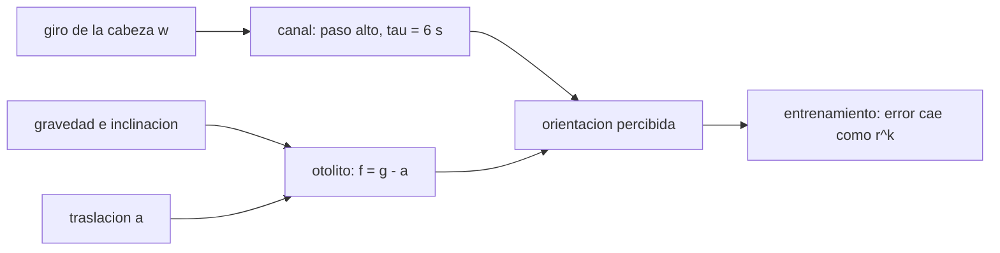

# B107-C03 — Entrenamiento vestibular y de orientación espacial

<!-- nav:top -->
[🏠 Programa](../../../../README.md) · [📚 Bloque B107](../../../tronco-comun/B107-acondicionamiento-fisico-y-rehabilitacion-de-astronautas.md) · [← Anterior: B107-C02 — Movilidad articular, flexibilidad y postura](../B107-C02-movilidad-articular-flexibilidad-y-postura/CLASE.md) · [Siguiente: B107-C04 — Evaluación del rendimiento físico y cognitivo de tripulantes →](../B107-C04-evaluacion-del-rendimiento-fisico-y-cognitivo-de-tripulantes/CLASE.md)
<!-- /nav -->

## 1. Ubicación, nivel y alcance

Clase 3 del bloque B107, nivel N3. B105-C04 (en la [guía de B105](../../../tronco-comun/B105-medicina-y-biologia-espacial.md)) describe el sistema vestibular; esta clase modela **cómo se entrena para orientarse** con dos ideas físicas —el canal como filtro paso alto y la ambigüedad entre inclinación y traslación— y una curva de aprendizaje por sesiones.

## 2. Por qué esta clase existe

Los fragmentos consultados indican que tras el vuelo hay alteraciones del control postural y locomotor (Macaulay et al., 2021) y que el equilibrio dinámico, la percepción del tiempo y el tiempo de reacción cambian tras el aterrizaje (Clément et al., 2023). Antes del vuelo la pregunta es cómo preparar la desorientación. La decisión central: **¿cuántas sesiones hacen falta para cerrar la mayor parte de la brecha de orientación y qué señales sensoriales están en conflicto?**

## 3. Lo que podrás hacer al terminar

1. Modelar un canal semicircular como filtro paso alto con constante `τ` y predecir la sensación en giro constante.
2. Calcular la traslación equivalente a una inclinación `a = g sen θ` y por qué las dos son ambiguas para el otolito.
3. Explicar cómo cambia la ambigüedad cuando no hay gravedad.
4. Ajustar una curva de aprendizaje `e_k = e∞ + (e0 − e∞) r^k` y calcular sesiones al 95 %.
5. Verificar una simulación numérica con la solución analítica.
6. Rotular lo sintético, lo consultado y lo no consultado, sin dar consejo médico ni operativo.

La evidencia es la **curva de aprendizaje con sus sesiones al 95 %** del ejercicio 12 (sección 20).

## 4. Con qué llegas y cómo comprobarlo

1. ¿Qué es una ecuación diferencial de primer orden?
2. ¿Qué es un filtro paso alto?
3. ¿Qué es la fuerza específica?
4. ¿Qué es una regresión log-lineal?
5. ¿Qué es un dato sintético?

<details>
<summary>Ver respuestas</summary>

1. Una ecuación que liga una cantidad con su derivada; aquí produce decaimientos exponenciales. 2. Un filtro que deja pasar los cambios rápidos y atenúa lo constante. 3. La fuerza por unidad de masa que mide un acelerómetro: gravedad menos aceleración. 4. Un ajuste lineal sobre el logaritmo de los datos para estimar una tasa. 5. Un dato generado para el ejemplo, no medido.
</details>

Con cuatro o cinco aciertos, sigue; si no, repasa los prerrequisitos.

## 5. Un caso de contexto y casos de referencia

Con `τ = 6 s` (**ilustrativa**) y un giro constante de `60 °/s`, la sensación a 9 s del inicio es `13,37 °/s` (analítico `13,39`; error máximo 0,031 % del escalón). Una inclinación de 10° equivale a una traslación de `1,703 m/s²` (0,174 g). Una curva de aprendizaje sintética baja de 20,0° a `5,01°` en 20 sesiones; `r` verdadero 0,85 y ajustado `0,857`. Es el **ejemplo conductor**: todo es **sintético**.

## 6. Vocabulario

El **canal semicircular** mide velocidad angular de la cabeza y su señal decae en un giro constante. El **otolito** mide la fuerza específica. La **ambigüedad inclinación-traslación** es que una inclinación `θ` y una aceleración `a = g sen θ` dan la misma fuerza en el eje. Una **curva de aprendizaje** relaciona el error con el número de sesiones.

## 7. Modelo mental



*Descripción textual:* el canal entrega la rotación con una señal que decae y el otolito la fuerza específica; el cerebro las combina y el entrenamiento reduce el error por sesión.

Analogía: el canal es un termómetro que marca un golpe de calor y vuelve a cero aunque el calor siga; el otolito es una plomada que no distingue si te inclinas o si el tren acelera. Límite: son modelos de primer orden; la percepción real integra más señales.

## 8. La explicación, paso a paso

### 8.1 El canal como paso alto

`y' = w' − y/τ`: ante un escalón `w0`, `y(t) = w0 e^{-t/τ}`. Con `τ = 6 s` y `w0 = 60 °/s`, a 9 s queda `60·e^{-1,5} = 13,39 °/s`. La sensación cae al 37 % en `τ` y al 10 % en `τ ln 10 = 13,8 s`. La constante de tiempo real del canal no se consultó; 6 s es un valor de ejemplo.

### 8.2 Rotación total percibida

La integral de la sensación en un giro constante es `w0 τ = 360°` aunque el giro real siga: el canal no «cuenta» una rotación prolongada.

### 8.3 Inclinación frente a traslación

La fuerza específica en el eje interaural es `g sen θ` si te inclinas θ y `a` si aceleras `a`: la misma señal con `a = g sen θ`. A 5°, 10° y 20°: `0,855`, `1,703` y `3,354 m/s²`. El otolito solo no resuelve la ambigüedad; se apoya en el canal y en la visión.

### 8.4 Sin gravedad

Sin gravedad, `f = −a`: una inclinación no da señal y toda fuerza específica es aceleración. Es física elemental; cómo la integra una persona no se consultó.

### 8.5 Curva de aprendizaje

`e_k = e∞ + (e0 − e∞) r^k`, con `e0 = 20°`, `e∞ = 4°`, `r = 0,85` y ruido de 0,5° por sesión (semilla 107). El ajuste log-lineal de `e − e∞` da `r = 0,857`. Las sesiones para cerrar el 95 % de la brecha: `ln 0,05/ln r = 19`. Los parámetros son inventados; Clément et al. (2023) comparan el rendimiento de astronautas con el de personas con vestibulopatía bilateral, pero no se vieron cifras.

## 9. Magnitudes, símbolos y unidades

| Símbolo | Qué es | Unidad | Valor / nota |
|---|---|---|---|
| `w` | velocidad angular de la cabeza | °/s | 60 (escalón) |
| `τ` | constante del canal | s | 6 (ilustrativa) |
| `g` | gravedad convencional | m/s² | 9,80665 |
| `θ` | inclinación | ° | 5, 10, 20 |
| `e_k` | error en la sesión `k` | ° | 20 a 5 |
| `r` | factor de aprendizaje | — | 0,85 (inventado) |

## 10. Convenciones y referencias

Eje interaural; `w` positiva hacia la derecha; `g = 9,80665 m/s²` (valor convencional); paso `dt = 0,01 s`. Datos **sintéticos**; semilla 107. Tolerancias: error máximo del canal ≤ 0,5 % del escalón; `r` ajustado dentro de ±0,03 de 0,85. Numpy 2.4.4, Python 3.12.9.

## 11. De dónde sale lo que afirmamos

| ID | Fuente | Localizador | Respalda | Estado |
|---|---|---|---|---|
| S1 | Macaulay, T. R. et al., «Developing Proprioceptive Countermeasures to Mitigate Postural and Locomotor Control Deficits After Long-Duration Spaceflight», Front Syst Neurosci, 2021 — PubMed, búsqueda https://pubmed.ncbi.nlm.nih.gov/?term=vestibular+rehabilitation+postflight+astronauts+balance (consultada 2026-11-10) | fragmento del resumen | revisión: tras el vuelo hay alteraciones del control postural y locomotor por adaptaciones sensoriomotoras; la descarga corporal reduce la dependencia de la información propioceptiva | Consultada (solo fragmento del resumen) |
| S2 | Clément, G. et al., «Cognitive and balance functions of astronauts after spaceflight are comparable to those of individuals with bilateral vestibulopathy», Front Neurol, 2023 — PubMed (misma búsqueda, consultada 2026-11-10) | fragmento del resumen | en una prueba de levantarse de una silla, los sujetos con vestibulopatía bilateral rindieron entre el día de aterrizaje y el día siguiente de los astronautas; cambios en control dinámico del equilibrio, percepción del tiempo y tiempo de reacción; el fragmento no da cifras | Consultada (solo fragmento del resumen) |
| — | Modelo del canal como filtro paso alto (τ = 6 s ilustrativa), física de la fuerza específica `f = g − a`, forma exponencial de la curva de aprendizaje | — | las verifica el laboratorio | No consultada en una fuente concreta (las verifica el laboratorio) |

Límites: de Macaulay et al. (2021) y Clément et al. (2023) solo se vieron fragmentos de resumen: ni la constante de tiempo del canal ni los parámetros de aprendizaje se tomaron de ellos; `τ = 6 s`, `r = 0,85` y los errores en grados son **ilustrativos**. La constante de tiempo real del canal no se consultó. Todas las consultas de PubMed se hicieron el 2026-11-10 y solo vieron los fragmentos que mostraba la página de resultados; no se leyó ningún artículo completo ni se verificaron cifras más allá de lo citado. Lo que no se consultó se rotula así y no se afirma como respaldado.

## 12. Cómo ver el resultado

| Magnitud | Simulada | Analítica |
|---|---|---|
| sensación a 9 s del escalón (°/s) | 13,37 | 13,39 |
| error máximo del canal (% del escalón) | 0,031 | — |
| `r` de aprendizaje | 0,857 | 0,85 |
| sesiones al 95 % | 19 | 18,4 → 19 |

Descripción larga: el canal numérico sigue a la exponencial; el ajuste recupera `r` dentro de 0,007. Todo **sintético**.

## 13. Ejemplo trabajado: sensación en un giro constante

**Paso 1 · Escalón.** `w0 = 60 °/s`, `τ = 6 s`.

**Paso 2 · Sensación.** A 9 s: `60·e^{-1,5} = 13,39 °/s`.

**Paso 3 · Tiempo al 10 %.** `6·ln 10 = 13,8 s`.

**Paso 4 · Lectura.** Tras 14 s de giro constante la persona siente casi nada, aunque siga girando: por eso la visión es clave en el entrenamiento.

## 14. Distintas formas de describir el problema

**Por ecuación:** `y' = w' − y/τ`. **Por escalas:** `τ`. **Por geometría:** `a = g sen θ`. **Por curva:** `e_k`. **Por tabla:** sesiones al 95 %.

## 15. Práctica guiada

**Ejercicio 1 · con los pasos indicados.** Calcula la sensación a 9 s de un giro de 60 °/s con `τ = 6 s`. *Pasos:* `w0 e^{-t/τ}`.

<details><summary>Solución comentada</summary>

`60·e^{-1,5} = 13,39 °/s`.
</details>

**Ejercicio 2 · con una pista.** ¿En cuánto tiempo cae la sensación al 37 %? *Pista:* es la constante.

<details><summary>Solución comentada</summary>

En `τ = 6 s`.
</details>

**Ejercicio 3 · casi autónomo.** ¿Qué traslación equivale a una inclinación de 15°?

<details><summary>Solución comentada</summary>

`9,80665·sen 15° = 2,538 m/s²` (0,259 g).
</details>

## 16. Práctica autónoma, transferencia e integrador

**Ejercicio 4 · autónomo.** ¿Cuánto tarda en caer de 60 a 5 °/s?

<details><summary>Solución comentada</summary>

`6·ln 12 = 14,9 s`.
</details>

**Ejercicio 5 · autónomo.** Con `e0 = 20`, `e∞ = 4`, `r = 0,85`, ¿qué error queda tras 10 sesiones?

<details><summary>Solución comentada</summary>

`4 + 16·0,85^10 = 7,15°`.
</details>

**Ejercicio 6 · autónomo.** ¿Cuántas sesiones cierran el 95 % de la brecha con `r = 0,85`? ¿Y con `r = 0,90`?

<details><summary>Solución comentada</summary>

`ln 0,05/ln 0,85 = 18,4` → 19; con 0,90, `28,4` → 29.
</details>

**Ejercicio 7 · autónomo.** ¿Cuál es la rotación total percibida en un giro constante con `τ = 6 s` y 60 °/s?

<details><summary>Solución comentada</summary>

`60·6 = 360°`.
</details>

**Ejercicio 8 · autónomo.** ¿Por qué el canal no sirve para sentir un giro constante prolongado?

<details><summary>Solución comentada</summary>

Porque es un filtro paso alto: su señal decae con `τ`.
</details>

**Ejercicio 9 · transferencia.** **Transferencia.** **Transferencia.** Sin gravedad, ¿qué fuerza específica produce una inclinación de 20°?

<details><summary>Solución comentada</summary>

Cero: `f = −a` y no hay componente de gravedad; el otolito no distingue inclinación (sin señal) de reposo.
</details>

**Ejercicio 10 · transferencia.** **Transferencia.** **Transferencia.** Con una curva de aprendizaje de `r = 0,85`, ¿por qué se excluyen los puntos con `e − e∞ < 0,3` del ajuste log-lineal?

<details><summary>Solución comentada</summary>

Porque con ruido de 0,5° el valor puede ser negativo o casi cero y el logaritmo se vuelve inestable.
</details>

**Ejercicio 11 · transferencia.** **Transferencia.** **Transferencia.** Si tras 10 sesiones el error medido es 10° y no 7,15°, ¿qué hipótesis revisarías?

<details><summary>Solución comentada</summary>

Que `r` sea mayor (aprendizaje más lento), que `e∞` sea más alto o que el ruido o el protocolo cambien; el modelo no distingue por sí solo.
</details>

**Ejercicio 12 · integrador.** **Integrador.** **Integrador.** Elabora tu *curva de aprendizaje con sus sesiones al 95 %*: modelo del canal, ambigüedad, ajuste con su `r`, sesiones al 95 % y lista de qué es sintético, consultado y no consultado.

<details><summary>Solución comentada</summary>

Secciones 8.1–8.5 y la salida del laboratorio.
</details>

## 17. Laboratorio: canal semicircular, ambigüedad inclinación-traslación y curva de aprendizaje

El script [vestibular.py](vestibular.py) integra el canal paso alto y lo compara con la exponencial, calcula la traslación equivalente a tres inclinaciones y ajusta una curva de aprendizaje sintética (**comprueba** error del canal ≤ 0,5 % y `r` ajustado dentro de ±0,03 de 0,85).

**Datos:** `τ`, `r` y errores **ilustrativos**; ruido sintético con semilla 107. **Predice antes de ejecutar:** ¿Cuántas sesiones cierran el 95 % con `r = 0,85`? (19.) **Ejecución del 2026-11-10 (Python 3.12.9):**

```text
Python 3.12.9; numpy 2.4.4
DATOS SINTETICOS E ILUSTRATIVOS (semilla 107): tau = 6 s, g = 9.80665 m/s2 (convencional)
Giro constante 60 deg/s: sensacion a 10 s del inicio = 13.37 deg/s (analitico 13.39); error maximo = 0.031 % del escalon
Tiempo en que la sensacion cae al 37 % (tau) = 6.0 s; al 10 % = 13.8 s
Inclinacion de  5 deg = traslacion equivalente a = 0.855 m/s2 (0.087 g)
Inclinacion de 10 deg = traslacion equivalente a = 1.703 m/s2 (0.174 g)
Inclinacion de 20 deg = traslacion equivalente a = 3.354 m/s2 (0.342 g)
Aprendizaje: error 20.0 -> 5.01 deg en 20 sesiones; r verdadero = 0.85; r ajustado = 0.857
Sesiones para cerrar el 95 % de la brecha (e0 - einf): 19 (= ln 0.05 / ln r)
Pruebas superadas.
```

```bash
python programa/clases/B107/B107-C03-entrenamiento-vestibular-y-de-orientacion-espacial/vestibular.py
```

**Límites:** modelos de primer orden; un solo eje; `τ` no consultada; la curva de aprendizaje es inventada; no describe a una persona.

## 18. Errores frecuentes y cómo corregirlos

**Creer que el canal mide la rotación indefinidamente.** Decae con `τ` (8.1).

**Confundir inclinación y traslación.** El otolito las confunde (8.3).

**Ajustar la curva sin conocer `e∞`.** Hay que estimarlo o fijarlo; se rotula (8.5).

**Convertir el modelo en una pauta de entrenamiento.** La clase no prescribe (sección 21).

## 19. Cómo sabrás que vas bien

Tras la sección 8: ¿qué sensación esperabas a 9 s y cuál da la tabla? Si dudas, repasa el ejemplo 13. Tras el laboratorio: ¿qué comprueba? (ver la sección 17).

## 20. Qué entregas y cómo se evalúa

El producto es tu **curva de aprendizaje con sus sesiones al 95 %** (ejercicio 12).

| Criterio | Inicial | En desarrollo | Logrado | Destacado |
|---|---|---|---|---|
| Conceptos | Confunde canal y otolito | Parciales | Explica el paso alto y la ambigüedad | Explica el caso sin gravedad |
| Cálculo | Sin unidades | Con errores | Calcula sensación, traslación y sesiones | Calcula casos nuevos |
| Numérico | Sin comprobar | Un caso | Compara con la forma cerrada o la verdad conocida | Interpreta las diferencias |
| Fuentes | Sin fuente | Sin fecha | Fuentes con fecha y estado | Declara lo sintético y lo no consultado |
| Límites | No los nombra | Uno | Tres | Discute qué falta del modelo |

**Condiciones críticas (no se compensan con promedio):** rotular los datos como sintéticos; no dar consejo médico, de entrenamiento ni operativo; citar solo lo consultado.

## 21. Ética, seguridad y límites

Clase **educativa**: **no da consejo médico, de entrenamiento ni operativo**, no prescribe ejercicio ni fija criterios clínicos, y no sustituye la formación, la licencia ni la supervisión de profesionales de la salud ni de los equipos médicos de una agencia. Las constantes son ilustrativas; un entrenamiento real de orientación se diseña y supervisa con profesionales y con seguridad física, y no se deduce de este modelo. Accesibilidad: tablas equivalentes a las gráficas, fórmulas en texto, ejercicios sin conexión.

## 22. Para cerrar y seguir

Con `τ = 6 s`, la sensación de un giro cae al 10 % en 13,8 s; una inclinación de 10° equivale a 1,70 m/s²; con `r = 0,85` hacen falta 19 sesiones para el 95 %. Queda una pregunta: ¿cómo se mide si alguien rinde igual antes y después, con su error de medida?

**Glosario español–inglés.** canal semicircular · *semicircular canal* · otolito · *otolith* · fuerza específica · *specific force* · curva de aprendizaje · *learning curve* · constante de tiempo · *time constant*.

**Continuidad.** [B107-C04](../B107-C04-evaluacion-del-rendimiento-fisico-y-cognitivo-de-tripulantes/CLASE.md) trata la evaluación del rendimiento físico y cognitivo.

**Referencias:** ver sección 11.

<!-- nav:bottom -->
---

[← Anterior: B107-C02 — Movilidad articular, flexibilidad y postura](../B107-C02-movilidad-articular-flexibilidad-y-postura/CLASE.md) · [📚 Bloque B107](../../../tronco-comun/B107-acondicionamiento-fisico-y-rehabilitacion-de-astronautas.md) · [Siguiente: B107-C04 — Evaluación del rendimiento físico y cognitivo de tripulantes →](../B107-C04-evaluacion-del-rendimiento-fisico-y-cognitivo-de-tripulantes/CLASE.md)
<!-- /nav -->
