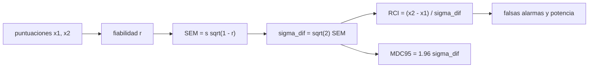

# B107-C04 — Evaluación del rendimiento físico y cognitivo de tripulantes

<!-- nav:top -->
[🏠 Programa](../../../../README.md) · [📚 Bloque B107](../../../tronco-comun/B107-acondicionamiento-fisico-y-rehabilitacion-de-astronautas.md) · [← Anterior: B107-C03 — Entrenamiento vestibular y de orientación espacial](../B107-C03-entrenamiento-vestibular-y-de-orientacion-espacial/CLASE.md) · [Siguiente: B107-C05 — Prevención de lesiones en entrenamiento y trabajo operativo →](../B107-C05-prevencion-de-lesiones-en-entrenamiento-y-trabajo-operativo/CLASE.md)
<!-- /nav -->

## 1. Ubicación, nivel y alcance

Clase 4 del bloque B107, nivel N3. B104-C03 (en la [guía de B104](../../../tronco-comun/B104-astronautica-y-preparacion-de-astronautas.md)) trata la selección y la aptitud; esta clase se ocupa de la **evaluación periódica**: cuánto de un cambio en una prueba es cambio real y cuánto es error de medida. Calculas fiabilidad, error típico de medida, cambio fiable y cambio mínimo detectable sobre datos **sintéticos**.

## 2. Por qué esta clase existe

Los fragmentos consultados describen una batería computarizada de pruebas breves de varios dominios cognitivos diseñada para astronautas de alto rendimiento (Basner et al., 2015; Casario et al., 2022) y preguntan cómo se relacionan sus descensos con el desempeño operativo (Basner et al., 2020). Antes de relacionar nada hay que saber **qué cambio es mayor que el ruido**. La decisión central: **¿cuántos puntos tiene que variar una puntuación para que el cambio sea más que error de medida, y cuál es la probabilidad de detectar un descenso real?**

## 3. Lo que podrás hacer al terminar

1. Calcular la fiabilidad test-retest y el error típico `SEM = s√(1 − r)`.
2. Calcular el índice de cambio fiable `RCI = (x2 − x1)/(√2 SEM)` y el cambio mínimo detectable `MDC95 = 1,96 √2 SEM`.
3. Medir la tasa de falsas alarmas y la potencia de detección con simulación y compararlas con la fórmula normal.
4. Explicar por qué un equipo de 12 personas puede no marcar un descenso real.
5. Distinguir cambio individual de cambio de grupo.
6. Rotular lo sintético, lo consultado y lo no consultado, sin dar consejo médico ni operativo.

La evidencia es la **informe de fiabilidad y de potencia de detección** del ejercicio 12 (sección 20).

## 4. Con qué llegas y cómo comprobarlo

1. ¿Qué es una desviación típica?
2. ¿Qué es una correlación?
3. ¿Qué es la distribución normal y su función acumulada `Φ`?
4. ¿Qué es un falso positivo?
5. ¿Qué es un dato sintético?

<details>
<summary>Ver respuestas</summary>

1. Una medida de dispersión alrededor de la media. 2. El grado de relación lineal entre dos series, de −1 a 1. 3. La campana; `Φ(z)` es la probabilidad de un valor menor que `z`. 4. Una alarma cuando no hay cambio real. 5. Un dato generado para el ejemplo, no medido.
</details>

Con cuatro o cinco aciertos, sigue; si no, repasa los prerrequisitos.

## 5. Un caso de contexto y casos de referencia

Una prueba **sintética** con media 100, desviación 15 y fiabilidad 0,85 (valores **inventados**) da, con 2.000 personas simuladas, `r = 0,850` y `SEM = 5,69` puntos (verdadero 5,81). La desviación de la diferencia es `8,05` y el cambio mínimo detectable `MDC95 = 15,79` puntos. Sin cambio real, el índice marca falsas alarmas en `5,25 %`. Con un descenso real de 10 puntos la detección es de `24,4 %` (fórmula `22,9 %`), y en un equipo de 12 con tres descensos reales no se marcó a nadie. Es el **ejemplo conductor**: todo es **sintético**.

## 6. Vocabulario

La **fiabilidad** `r` es la proporción de la varianza que es real. El **error típico de medida** `SEM` es la dispersión del error. El **índice de cambio fiable** `RCI` estandariza una diferencia con el error. El **cambio mínimo detectable** `MDC95` es la diferencia más pequeña que supera el error al 95 %. La **potencia** es la probabilidad de detectar un cambio real.

## 7. Modelo mental



*Descripción textual:* la fiabilidad da el error típico, de él sale la dispersión de una diferencia, y con ella el índice de cambio, el cambio mínimo detectable y las tasas de error.

Analogía: una báscula cuyo número tiembla: una diferencia menor que el temblor no dice nada. Límite: aquí el error es normal y constante; en la realidad puede variar con la persona y con el aprendizaje de la prueba.

## 8. La explicación, paso a paso

### 8.1 Fiabilidad y error típico

`r = var_verdadera/var_total`. Con `s = 15` y `r = 0,85`: `SEM = 15·√0,15 = 5,81`. El laboratorio estima `r = 0,850` y `SEM = 5,69` con 2.000 pares simulados. La teoría clásica de test que respalda esto es estándar y **no se consultó** en una fuente concreta.

### 8.2 Cambio fiable

La diferencia de dos medidas tiene desviación `√2·SEM = 8,05` (con el estimado). `RCI = (x2 − x1)/8,05`. Con `|RCI| > 1,96`, la diferencia supera el error al 95 %. El laboratorio mide `5,25 %` de falsas alarmas (nominal 5 %).

### 8.3 Cambio mínimo detectable

`MDC95 = 1,96·8,05 = 15,79` puntos: una puntuación tiene que cambiar casi un punto de desviación típica para distinguirse del error. Un descenso real de 10 puntos es **menor** que la `MDC95`.

### 8.4 Potencia

Con `σ_dif = 8,22` (teórica) un descenso real `Δ` se detecta con probabilidad `Φ(−1,96 + Δ/σ_dif)`: para `Δ = 10`, `Φ(−0,743) = 22,9 %`; el laboratorio da `24,4 %`. En un equipo de 12 con tres descensos reales, la probabilidad de no marcar a ninguno es alta (aquí no marcó ninguno).

### 8.5 Individual frente a grupo

La diferencia media de un grupo de 12 tiene error `σ_dif/√12 = 2,37`; un descenso medio de 10 puntos sí destaca a nivel grupal (`z = 4,2`) aunque no lo haga individualmente. Basner et al. (2020, fragmento) preguntan por la relación entre descensos cognitivos y desempeño operativo; no se vieron resultados, así que esta clase no afirma esa relación.

## 9. Magnitudes, símbolos y unidades

| Símbolo | Qué es | Unidad | Valor / nota |
|---|---|---|---|
| `x` | puntuación estandarizada | puntos | media 100 (sintética) |
| `s` | desviación total | puntos | 15 |
| `r` | fiabilidad test-retest | — | 0,85 |
| `SEM` | error típico de medida | puntos | 5,81 (verdadero); 5,69 (estimado) |
| `RCI` | índice de cambio fiable | — | umbral 1,96 |
| `MDC95` | cambio mínimo detectable | puntos | 15,79 |

## 10. Convenciones y referencias

Puntuaciones estandarizadas sin unidad física (media 100, desviación 15); `n = 2.000` personas simuladas; semilla 107. Tolerancias: `r` estimado ±0,02; falsas alarmas 5 % ±1 punto; potencia ±2 puntos. Umbral 1,96 (95 % bilateral). Numpy 2.4.4, Python 3.12.9.

## 11. De dónde sale lo que afirmamos

| ID | Fuente | Localizador | Respalda | Estado |
|---|---|---|---|---|
| S1 | Basner, M. et al., «Development and Validation of the Cognition Test Battery for Spaceflight», Aerosp Med Hum Perform, 2015 — PubMed, búsqueda https://pubmed.ncbi.nlm.nih.gov/?term=Cognition+test+battery+astronauts (consultada 2026-11-10) | fragmento del resumen | batería computarizada (Cognition) sensible a varios dominios cognitivos y diseñada para astronautas de alto rendimiento; primeros datos normativos; el fragmento no da cifras | Consultada (solo fragmento del resumen) |
| S2 | Casario, K. et al., «Acceptability of the Cognition Test Battery in Astronaut and Astronaut-Surrogate Populations», Acta Astronautica, 2022 — PubMed (misma búsqueda, consultada 2026-11-10) | fragmento del resumen | batería neuropsicológica de 10 pruebas breves de varios dominios cognitivos; el fragmento no da resultados | Consultada (solo fragmento del resumen) |
| S3 | Basner, M. et al., «Cognition Test Battery Performance Is Associated with Simulated 6df Spacecraft Docking Performance», Aerosp Med Hum Perform, 2020 — PubMed (misma búsqueda, consultada 2026-11-10) | fragmento del resumen | pregunta cómo se relacionan los descensos en baterías de dominios cognitivos individuales con el desempeño en tareas operativas; el fragmento no da cifras | Consultada (solo fragmento del resumen) |
| — | Teoría clásica de test (fiabilidad, SEM), índice de cambio fiable de Jacobson–Truax, cambio mínimo detectable y la fórmula normal de la potencia | — | las verifica el laboratorio | No consultada en una fuente concreta (las verifica el laboratorio) |

Límites: de Basner et al. (2015, 2020) y Casario et al. (2022) solo se vieron títulos y fragmentos de resumen: ni la fiabilidad real de la batería Cognition ni sus datos normativos se tomaron de ellos; la fiabilidad 0,85, la media 100 y la desviación 15 del laboratorio son **inventadas**; la fuente original del RCI no se consultó. Todas las consultas de PubMed se hicieron el 2026-11-10 y solo vieron los fragmentos que mostraba la página de resultados; no se leyó ningún artículo completo ni se verificaron cifras más allá de lo citado. Lo que no se consultó se rotula así y no se afirma como respaldado.

## 12. Cómo ver el resultado

| Magnitud | Simulada | Teórica |
|---|---|---|
| fiabilidad `r` | 0,850 | 0,85 |
| `SEM` (puntos) | 5,69 | 5,81 |
| falsas alarmas (%) | 5,25 | 5 |
| potencia ante −10 puntos (%) | 24,4 | 22,9 |
| `MDC95` (puntos) | 15,79 | 16,1 |

Descripción larga: el cambio mínimo detectable es mayor que un descenso real de 10 puntos, por eso la potencia es baja. Todo **sintético**.

## 13. Ejemplo trabajado: ¿es un descenso de 10 puntos un cambio fiable?

**Paso 1 · SEM.** `15·√(1 − 0,85) = 5,81`.

**Paso 2 · Dispersión de la diferencia.** `√2·5,81 = 8,22`.

**Paso 3 · RCI.** `−10/8,22 = −1,22`, menor que 1,96 en módulo.

**Paso 4 · Lectura.** Un descenso de 10 puntos no se distingue del error con esta prueba y esta fiabilidad; hace falta más fiabilidad, más medidas o un cambio mayor.

## 14. Distintas formas de describir el problema

**Por fiabilidad:** `r`. **Por error:** `SEM`. **Por diferencia:** `RCI`. **Por umbral:** `MDC95`. **Por probabilidad:** potencia y falsas alarmas.

## 15. Práctica guiada

**Ejercicio 1 · con los pasos indicados.** Calcula el `SEM` con `s = 15` y `r = 0,85`. *Pasos:* `s√(1 − r)`.

<details><summary>Solución comentada</summary>

`5,81`.
</details>

**Ejercicio 2 · con una pista.** Calcula el `RCI` de un cambio de −10 con `σ_dif = 8,22`. *Pista:* divide.

<details><summary>Solución comentada</summary>

`−1,22`; no supera 1,96.
</details>

**Ejercicio 3 · casi autónomo.** Calcula `MDC95` con `SEM = 5,81`.

<details><summary>Solución comentada</summary>

`1,96·√2·5,81 = 16,1` puntos.
</details>

## 16. Práctica autónoma, transferencia e integrador

**Ejercicio 4 · autónomo.** ¿Cuál es `MDC95` con `r = 0,95`?

<details><summary>Solución comentada</summary>

`SEM = 3,35`; `σ_dif = 4,74`; `MDC95 = 9,3`.
</details>

**Ejercicio 5 · autónomo.** ¿Y con `r = 0,70`?

<details><summary>Solución comentada</summary>

`SEM = 8,22`; `σ_dif = 11,6`; `MDC95 = 22,8`.
</details>

**Ejercicio 6 · autónomo.** ¿Qué potencia tiene un descenso real de 20 puntos con `σ_dif = 8,22`?

<details><summary>Solución comentada</summary>

`Φ(−1,96 + 2,43) = Φ(0,473) = 68,2 %`.
</details>

**Ejercicio 7 · autónomo.** ¿Por qué 5 % de falsas alarmas bilaterales son 2,5 % de falsas alarmas de descenso?

<details><summary>Solución comentada</summary>

Porque la mitad de los errores caen del lado de la mejora.
</details>

**Ejercicio 8 · autónomo.** En un equipo de 12 sin cambio real, ¿cuál es la probabilidad de que al menos una persona se marque?

<details><summary>Solución comentada</summary>

`1 − 0,95^12 = 46 %`.
</details>

**Ejercicio 9 · transferencia.** **Transferencia.** **Transferencia.** Si la línea de base es la media de dos medidas, ¿cuánto vale `σ_dif`?

<details><summary>Solución comentada</summary>

`SEM·√(1 + 1/2) = 5,81·1,225 = 7,12`; `MDC95 = 13,9`: menor, porque la línea de base tiene menos error.
</details>

**Ejercicio 10 · transferencia.** **Transferencia.** **Transferencia.** La prueba mejora por práctica entre sesiones. ¿Qué efecto tiene en el `RCI`?

<details><summary>Solución comentada</summary>

Un sesgo positivo que oculta descensos y crea mejoras falsas; hay que usar formas alternativas o un periodo de práctica. Si la batería tiene formas alternativas no se consultó.
</details>

**Ejercicio 11 · transferencia.** **Transferencia.** **Transferencia.** Con 12 personas y una caída media real de 10 puntos, ¿qué error tiene la diferencia media y qué `z` resulta?

<details><summary>Solución comentada</summary>

`8,22/√12 = 2,37`; `z = 10/2,37 = 4,2`: detectable en el grupo, no en cada persona.
</details>

**Ejercicio 12 · integrador.** **Integrador.** **Integrador.** Elabora tu *informe de fiabilidad y de potencia de detección*: `r`, `SEM`, `RCI`, `MDC95`, falsas alarmas, potencia, equipo de 12, y lista de qué es sintético, consultado y no consultado.

<details><summary>Solución comentada</summary>

Secciones 8.1–8.5 y la salida del laboratorio.
</details>

## 17. Laboratorio: fiabilidad, cambio fiable y detección de un descenso

El script [evaluacion.py](evaluacion.py) simula 2.000 personas con dos medidas, estima `r`, `SEM`, `MDC95`, las falsas alarmas del `RCI` y la potencia ante un descenso de 10 puntos, y prueba un equipo de 12 (**comprueba** `r` ±0,02, falsas alarmas 5 % ±1 y potencia ±2 puntos).

**Datos:** media 100, desviación 15 y fiabilidad 0,85 **inventadas**; semilla 107. **Predice antes de ejecutar:** ¿Es un descenso real de 10 puntos mayor que el `MDC95`? (No: 10 < 15,8.) **Ejecución del 2026-11-10 (Python 3.12.9):**

```text
Python 3.12.9; numpy 2.4.4
DATOS SINTETICOS (semilla 107): media 100, s total 15, fiabilidad verdadera 0.85; no son datos de astronautas
Fiabilidad test-retest estimada = 0.850 (verdadera 0.85); SEM estimado = 5.69 (verdadero 5.81) puntos
Desviacion de la diferencia = 8.05; cambio minimo detectable al 95 % (MDC95) = 15.79 puntos
Sin cambio real: falsas alarmas del RCI = 5.25 % (nominal 5 %)
Descenso real de 10 puntos: deteccion simulada = 24.4 %; formula normal = 22.9 %
Equipo de 12 (descenso real de 10 puntos en los tripulantes 2, 5 y 9): marcados por RCI = []
Pruebas superadas.
```

```bash
python programa/clases/B107/B107-C04-evaluacion-del-rendimiento-fisico-y-cognitivo-de-tripulantes/evaluacion.py
```

**Límites:** error normal y constante, sin efecto de práctica, una sola prueba; el RCI se aplica a una diferencia; los números no son de ninguna batería real.

## 18. Errores frecuentes y cómo corregirlos

**Confundir significación con importancia operativa.** El RCI dice si el cambio supera el error, no si importa (8.5).

**Interpretar «no marcado» como «sin descenso».** La potencia puede ser baja (8.4).

**Olvidar el efecto de práctica.** Sesga el RCI (ejercicio 10).

**Dar un umbral clínico.** La clase no fija criterios (sección 21).

## 19. Cómo sabrás que vas bien

Tras la sección 8: ¿qué `MDC95` esperabas y cuál da la tabla? Si dudas, repasa el ejemplo 13. Tras el laboratorio: ¿qué comprueba? (ver la sección 17).

## 20. Qué entregas y cómo se evalúa

El producto es tu **informe de fiabilidad y de potencia de detección** (ejercicio 12).

| Criterio | Inicial | En desarrollo | Logrado | Destacado |
|---|---|---|---|---|
| Conceptos | Confunde cambio y error | Parciales | Explica `r`, `SEM`, `RCI` y `MDC95` | Explica potencia y individuo frente a grupo |
| Cálculo | Sin unidades | Con errores | Calcula `SEM`, `RCI`, `MDC95` y potencia | Calcula casos nuevos |
| Numérico | Sin comprobar | Un caso | Compara con la forma cerrada o la verdad conocida | Interpreta las diferencias |
| Fuentes | Sin fuente | Sin fecha | Fuentes con fecha y estado | Declara lo sintético y lo no consultado |
| Límites | No los nombra | Uno | Tres | Discute qué falta del modelo |

**Condiciones críticas (no se compensan con promedio):** rotular los datos como sintéticos; no dar consejo médico, de entrenamiento ni operativo; citar solo lo consultado.

## 21. Ética, seguridad y límites

Clase **educativa**: **no da consejo médico, de entrenamiento ni operativo**, no prescribe ejercicio ni fija criterios clínicos, y no sustituye la formación, la licencia ni la supervisión de profesionales de la salud ni de los equipos médicos de una agencia. Una puntuación bajo el umbral de un RCI no diagnostica nada; la interpretación de pruebas de una tripulación corresponde a profesionales con la norma de la agencia, que aquí no se consultó. Accesibilidad: tablas equivalentes a las gráficas, fórmulas en texto, ejercicios sin conexión.

## 22. Para cerrar y seguir

Con `r = 0,85`, el cambio mínimo detectable es de unos 16 puntos y un descenso real de 10 se detecta solo en uno de cada cuatro casos. Queda una pregunta: ¿cómo se previene que el propio entrenamiento y el trabajo produzcan lesiones?

**Glosario español–inglés.** fiabilidad · *reliability* · error típico de medida · *standard error of measurement* · cambio fiable · *reliable change* · cambio mínimo detectable · *minimal detectable change* · potencia · *power*.

**Continuidad.** [B107-C05](../B107-C05-prevencion-de-lesiones-en-entrenamiento-y-trabajo-operativo/CLASE.md) trata la prevención de lesiones.

**Referencias:** ver sección 11.

<!-- nav:bottom -->
---

[← Anterior: B107-C03 — Entrenamiento vestibular y de orientación espacial](../B107-C03-entrenamiento-vestibular-y-de-orientacion-espacial/CLASE.md) · [📚 Bloque B107](../../../tronco-comun/B107-acondicionamiento-fisico-y-rehabilitacion-de-astronautas.md) · [Siguiente: B107-C05 — Prevención de lesiones en entrenamiento y trabajo operativo →](../B107-C05-prevencion-de-lesiones-en-entrenamiento-y-trabajo-operativo/CLASE.md)
<!-- /nav -->
