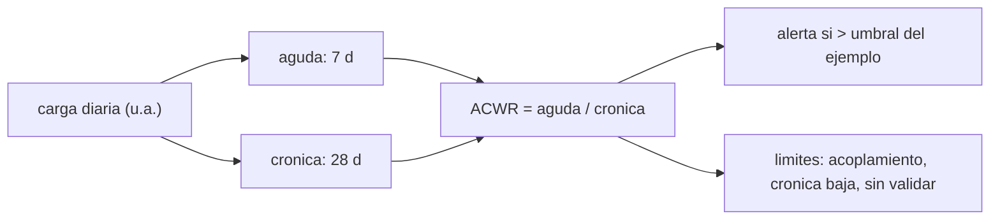

# B107-C05 — Prevención de lesiones en entrenamiento y trabajo operativo

<!-- nav:top -->
[🏠 Programa](../../../../README.md) · [📚 Bloque B107](../../../tronco-comun/B107-acondicionamiento-fisico-y-rehabilitacion-de-astronautas.md) · [← Anterior: B107-C04 — Evaluación del rendimiento físico y cognitivo de tripulantes](../B107-C04-evaluacion-del-rendimiento-fisico-y-cognitivo-de-tripulantes/CLASE.md) · [Siguiente: B107-C06 — Estimación y modelado de la recuperación posterior al vuelo →](../../../tronco-comun/B107-acondicionamiento-fisico-y-rehabilitacion-de-astronautas.md#b107-c06)
<!-- /nav -->

## 1. Ubicación, nivel y alcance

Clase 5 del bloque B107, nivel N3. Se ocupa de las **lesiones en el entrenamiento y el trabajo operativo** con una herramienta de monitorización de carga —la razón entre carga aguda y crónica— y, sobre todo, con sus **límites**: los umbrales son convenciones, el cálculo tiene trampas y la relación con la lesión no se asume. Todo sobre cargas **sintéticas**.

## 2. Por qué esta clase existe

El fragmento consultado de English et al. (2015) subraya que la pérdida de fuerza en misiones largas implica riesgos operativos y médicos, entre ellos el egreso de emergencia; y Loehr et al. (2015) señalan que el entrenamiento ya se realiza en vuelo. Cargar demasiado rápido es una de las formas de lesionarse. La decisión central: **¿qué señal de carga conviene vigilar, qué errores de cálculo tiene y cuánto se puede subir una semana sin disparar la alerta del ejemplo?**

## 3. Lo que podrás hacer al terminar

1. Calcular carga aguda (7 días), crónica (28 días) y su razón con media móvil y con media exponencial.
2. Verificar que la EWMA recursiva coincide con la suma ponderada explícita.
3. Calcular el aumento máximo semanal que mantiene la razón bajo un umbral.
4. Explicar el acoplamiento entre numerador y denominador y por qué la razón explota con cronicidad baja.
5. Reconocer que umbrales y curva de riesgo son del ejemplo y no están validados.
6. Rotular lo sintético, lo consultado y lo no consultado, sin dar consejo médico ni operativo.

La evidencia es la **tablero de carga con alertas y sus límites** del ejercicio 12 (sección 20).

## 4. Con qué llegas y cómo comprobarlo

1. ¿Qué es una media móvil?
2. ¿Qué es una media exponencial (EWMA)?
3. ¿Qué es una razón o cociente?
4. ¿Qué es una función logística?
5. ¿Qué es un dato sintético?

<details>
<summary>Ver respuestas</summary>

1. El promedio de los últimos `N` valores. 2. Un promedio donde el peso de cada dato decae geométricamente con su antigüedad. 3. Un número dividido por otro; aquí, aguda entre crónica. 4. `1/(1 + e^{-x})`: convierte un número real en una probabilidad. 5. Un dato generado para el ejemplo, no medido.
</details>

Con cuatro o cinco aciertos, sigue; si no, repasa los prerrequisitos.

## 5. Un caso de contexto y casos de referencia

Cargas diarias **sintéticas** (media 100 u.a., desviación 8, descanso un día por semana) con una semana de salto de +60 % en 70 días. La razón con media móvil pasa de `0,97` (día 55) a `1,37` (día 62), y con EWMA de `0,83` a `1,05`; con el umbral 1,3 del ejemplo, la media móvil marca los días 60 a 63 y la EWMA no marca ninguno. Es el **ejemplo conductor**: todo es **sintético**.

## 6. Vocabulario

La **carga aguda** es el promedio de los últimos 7 días; la **crónica**, el de 28. La **ACWR** es su cociente. La **EWMA** pondera con `λ = 2/(N + 1)`. El **acoplamiento** es que la carga aguda también forma parte de la crónica. Un **umbral** es un valor de alerta del ejemplo.

## 7. Modelo mental



*Descripción textual:* la carga diaria alimenta dos promedios de distinto horizonte; su cociente se compara con un umbral, con los límites de acoplamiento y de validez.

Analogía: comparar el ritmo de esta semana con el de las últimas cuatro: si esta es mucho más rápida, algo cambió. Límite: la razón no sabe qué cambió ni si es peligroso; solo marca un cambio.

## 8. La explicación, paso a paso

### 8.1 Media móvil y EWMA

Aguda `A7` y crónica `C28` por media móvil; EWMA con `λ = 2/(N + 1)` (0,25 para 7 d y 0,069 para 28 d). La EWMA recursiva `y_i = λ x_i + (1 − λ) y_{i−1}` coincide con la suma ponderada explícita (diferencia 0,0).

### 8.2 La razón

`ACWR = A7/C28`. Un salto de +60 % en una semana con la crónica en 100: `160/((300 + 160)/4) = 1,39`. El laboratorio da `1,37` con cargas reales sintéticas y un día de descanso por semana.

### 8.3 Cuánto se puede subir

Para `ACWR ≤ 1,3` con crónica previa de 100: `a/((300 + a)/4) ≤ 1,3`, es decir `a ≤ 144,4`: un aumento del 44 %. Es una consecuencia del umbral del ejemplo, no una recomendación.

### 8.4 Trampas del cálculo

(i) **Acoplamiento**: la aguda está dentro de la crónica; una razón desacoplada (aguda frente a las 3 semanas previas) da `160/100 = 1,6`. (ii) **Cronicidad baja**: tras semanas sin carga, una crónica de 20 y una aguda de 100 dan `5,0`. (iii) **La EWMA es más lenta** y puede no marcar lo que la media móvil marca.

### 8.5 Riesgo ilustrativo

Una curva logística en U inventada (`logit = −3 + 3 (ACWR − 1)²`) da `7,4 %` para 0,6, `4,7 %` para 1,0, `6,1 %` para 1,3 y `12,8 %` para 1,6. **No es una estimación de riesgo**: la forma y los números son del ejemplo y esta clase no consultó ninguna fuente que valide la relación carga–lesión.

## 9. Magnitudes, símbolos y unidades

| Símbolo | Qué es | Unidad | Valor / nota |
|---|---|---|---|
| `x` | carga diaria | u.a. | media 100 (sintética) |
| `A7` | carga aguda | u.a. | media de 7 días |
| `C28` | carga crónica | u.a. | media de 28 días |
| `λ` | factor EWMA | — | `2/(N + 1)` |
| `ACWR` | razón aguda:crónica | — | umbral del ejemplo 1,3 |

## 10. Convenciones y referencias

Carga en unidades arbitrarias por día; 70 días; descanso (carga 0) los días 6, 13, … , 69; semana de salto = días 56 a 62 con ×1,6. Datos **sintéticos**; semilla 107. Tolerancias: diferencia EWMA recursiva frente a explícita < 1e-9; `ACWR > 1,3` en la semana de salto. Numpy 2.4.4, Python 3.12.9.

## 11. De dónde sale lo que afirmamos

| ID | Fuente | Localizador | Respalda | Estado |
|---|---|---|---|---|
| S1 | English, K. L. et al., «Isokinetic Strength Changes Following Long-Duration Spaceflight on the ISS», Aerosp Med Hum Perform 86(12 Suppl):A68-A77, 2015 — PubMed (consultada 2026-11-10) | fragmento de la introducción | las misiones largas causan pérdida de fuerza muscular con riesgos operativos y médicos (egreso de emergencia, retorno, exploración); el fragmento termina antes de las cifras | Consultada (solo fragmento del resumen) |
| S2 | Loehr, J. A. et al., «Physical Training for Long-Duration Spaceflight», Aerosp Med Hum Perform 86(12 Suppl):A14-A23, 2015 — PubMed, búsqueda https://pubmed.ncbi.nlm.nih.gov/?term=Loehr+Physical+training+for+long-duration+spaceflight (consultada 2026-11-10) | fragmento del resumen | el entrenamiento físico se realiza en la ISS desde hace unos 10 años y cada agencia socia diseñó su propio enfoque; el fragmento termina antes de los hallazgos | Consultada (solo fragmento del resumen) |
| — | Razón de carga aguda:crónica (ACWR), media móvil y media exponencial, umbrales 0,8–1,3 y la forma en U del riesgo | — | las verifica el laboratorio | No consultada en una fuente concreta (las verifica el laboratorio) |

Límites: de English et al. (2015) y Loehr et al. (2015) solo se vieron fragmentos de introducción o resumen: no se consultó ninguna fuente sobre lesiones de entrenamiento, de EVA ni de reacondicionamiento, ni sobre la razón de carga aguda:crónica; los umbrales 0,8–1,3 y la curva de riesgo en U son **inventados** y su validez predictiva **no está establecida** aquí. Todas las consultas de PubMed se hicieron el 2026-11-10 y solo vieron los fragmentos que mostraba la página de resultados; no se leyó ningún artículo completo ni se verificaron cifras más allá de lo citado. Lo que no se consultó se rotula así y no se afirma como respaldado.

## 12. Cómo ver el resultado

| Día | ACWR (media móvil) | ACWR (EWMA) |
|---|---|---|
| 55 | 0,97 | 0,83 |
| 62 | 1,37 | 1,05 |

Días con ACWR > 1,3 (media móvil): 60, 61, 62 y 63. Riesgo ilustrativo (en U inventada): 7,4 % (0,6); 4,7 % (1,0); 6,1 % (1,3); 12,8 % (1,6). Todo **sintético**.

## 13. Ejemplo trabajado: cuánto puede subir una semana

**Paso 1 · Crónica.** Tres semanas a 100 u.a./día de media.

**Paso 2 · Condición.** `a/((300 + a)/4) ≤ 1,3`.

**Paso 3 · Despeje.** `4a ≤ 390 + 1,3a`, `a ≤ 144,4`.

**Paso 4 · Lectura.** Con el umbral del ejemplo, +44 % es el tope; +60 % ya lo supera (`1,39`). El umbral es una convención.

## 14. Distintas formas de describir el problema

**Por cociente:** `A7/C28`. **Por pesos:** media móvil o EWMA. **Por alerta:** umbral. **Por tabla:** días marcados. **Por gráfica:** serie de la razón (con tabla equivalente).

## 15. Práctica guiada

**Ejercicio 1 · con los pasos indicados.** Calcula la carga aguda de `[100, 100, 100, 0, 100, 100, 100]`. *Pasos:* promedio de 7.

<details><summary>Solución comentada</summary>

`600/7 = 85,7`.
</details>

**Ejercicio 2 · con una pista.** Calcula `λ` para `N = 7` y `N = 28`. *Pista:* `2/(N + 1)`.

<details><summary>Solución comentada</summary>

`0,25` y `0,069`.
</details>

**Ejercicio 3 · casi autónomo.** ¿Qué razón da aguda 130 y crónica 100?

<details><summary>Solución comentada</summary>

`1,30`.
</details>

## 16. Práctica autónoma, transferencia e integrador

**Ejercicio 4 · autónomo.** Con crónica previa 100, ¿qué razón da una semana de +60 %?

<details><summary>Solución comentada</summary>

`160/115 = 1,39`.
</details>

**Ejercicio 5 · autónomo.** ¿Y con +30 %?

<details><summary>Solución comentada</summary>

`130/107,5 = 1,21`.
</details>

**Ejercicio 6 · autónomo.** ¿Cuál es el aumento máximo semanal para `ACWR ≤ 1,3`?

<details><summary>Solución comentada</summary>

`a ≤ 144,4`, es decir +44 %.
</details>

**Ejercicio 7 · autónomo.** ¿Por qué la curva de riesgo del laboratorio no sirve para estimar riesgos?

<details><summary>Solución comentada</summary>

Porque es inventada: sus números no proceden de datos ni de una fuente.
</details>

**Ejercicio 8 · autónomo.** ¿En qué se diferencian media móvil y EWMA?

<details><summary>Solución comentada</summary>

La móvil pesa por igual los últimos `N` días y olvida lo anterior de golpe; la EWMA pesa más lo reciente y decae suavemente.
</details>

**Ejercicio 9 · transferencia.** **Transferencia.** **Transferencia.** Tras reposo, la crónica es 20 y se vuelve a una aguda de 100. ¿Qué razón resulta y qué indica del método?

<details><summary>Solución comentada</summary>

`5,0`: la razón explota con crónica baja; no distingue una reincorporación gradual de un salto.
</details>

**Ejercicio 10 · transferencia.** **Transferencia.** **Transferencia.** ¿Qué razón desacoplada resulta con aguda 160 y tres semanas previas a 100? ¿Por qué difiere de 1,39?

<details><summary>Solución comentada</summary>

`1,6`: la acoplada incluye la semana aguda en la crónica y la suaviza.
</details>

**Ejercicio 11 · transferencia.** **Transferencia.** **Transferencia.** Un umbral de alerta se fija en 1,3 «porque sí». ¿Qué evidencia pedirías antes de usarlo para decidir?

<details><summary>Solución comentada</summary>

Datos observacionales con lesiones registradas, validación en otra población, comparación con otras métricas y revisión de un profesional; en esta clase no hay ninguna de esas.
</details>

**Ejercicio 12 · integrador.** **Integrador.** **Integrador.** Elabora tu *tablero de carga con alertas y sus límites*: serie sintética, ACWR con ambos métodos, alerta, aumento máximo, trampas y lista de qué es sintético, consultado y no consultado.

<details><summary>Solución comentada</summary>

Secciones 8.1–8.5 y la salida del laboratorio.
</details>

## 17. Laboratorio: razón de carga aguda:crónica y un riesgo ilustrativo

El script [lesiones.py](lesiones.py) calcula la media móvil y la EWMA de una serie de cargas sintéticas, verifica la EWMA contra la suma explícita, marca los días con razón > 1,3 y tabula un riesgo logístico inventado (**comprueba** diferencia < 1e-9 y razón > 1,3 en la semana de salto).

**Datos:** cargas **sintéticas** (media 100 u.a., desviación 8) con semilla 107; umbrales y riesgo **inventados**. **Predice antes de ejecutar:** ¿Qué razón da la semana de +60 % con la media móvil? (alrededor de 1,4.) **Ejecución del 2026-11-10 (Python 3.12.9):**

```text
Python 3.12.9; numpy 2.4.4
DATOS SINTETICOS E ILUSTRATIVOS (semilla 107): cargas en u.a.; umbrales 0.8-1.3 del ejemplo, sin fuente
EWMA recursiva vs suma ponderada explicita: diferencia maxima = 0.00e+00
ACWR (media movil) al dia 55 = 0.97; al final de la semana de salto (dia 62) = 1.37
ACWR (EWMA) al dia 55 = 0.83; dia 62 = 1.05
Dias con ACWR > 1.3 (umbral del ejemplo): [60, 61, 62, 63]
Riesgo ilustrativo (forma en U inventada) para ACWR 0.6: 7.4 %
Riesgo ilustrativo (forma en U inventada) para ACWR 1.0: 4.7 %
Riesgo ilustrativo (forma en U inventada) para ACWR 1.3: 6.1 %
Riesgo ilustrativo (forma en U inventada) para ACWR 1.6: 12.8 %
Pruebas superadas.
```

```bash
python programa/clases/B107/B107-C05-prevencion-de-lesiones-en-entrenamiento-y-trabajo-operativo/lesiones.py
```

**Límites:** la relación carga–lesión no está validada aquí; una sola serie; unidades arbitrarias; no distingue tipos de carga; no es una herramienta clínica.

## 18. Errores frecuentes y cómo corregirlos

**Tomar el umbral como evidencia.** Es del ejemplo (8.5).

**Ignorar el acoplamiento.** Ver 8.4.

**Calcular la razón con crónica casi nula.** Explota (ejercicio 9).

**Usar la razón como diagnóstico.** La clase no da consejo médico (sección 21).

## 19. Cómo sabrás que vas bien

Tras la sección 8: ¿qué razón esperabas en la semana de salto y cuál da la tabla? Si dudas, repasa el ejemplo 13. Tras el laboratorio: ¿qué comprueba? (ver la sección 17).

## 20. Qué entregas y cómo se evalúa

El producto es tu **tablero de carga con alertas y sus límites** (ejercicio 12).

| Criterio | Inicial | En desarrollo | Logrado | Destacado |
|---|---|---|---|---|
| Conceptos | Confunde carga y razón | Parciales | Explica aguda, crónica y razón | Explica acoplamiento y límites del umbral |
| Cálculo | Sin unidades | Con errores | Calcula razones y aumento máximo | Calcula casos nuevos |
| Numérico | Sin comprobar | Un caso | Compara con la forma cerrada o la verdad conocida | Interpreta las diferencias |
| Fuentes | Sin fuente | Sin fecha | Fuentes con fecha y estado | Declara lo sintético y lo no consultado |
| Límites | No los nombra | Uno | Tres | Discute qué falta del modelo |

**Condiciones críticas (no se compensan con promedio):** rotular los datos como sintéticos; no dar consejo médico, de entrenamiento ni operativo; citar solo lo consultado.

## 21. Ética, seguridad y límites

Clase **educativa**: **no da consejo médico, de entrenamiento ni operativo**, no prescribe ejercicio ni fija criterios clínicos, y no sustituye la formación, la licencia ni la supervisión de profesionales de la salud ni de los equipos médicos de una agencia. La clase no consultó fuentes sobre lesiones ni valida ningún umbral; la prevención de lesiones en una tripulación corresponde a profesionales de la salud y del entrenamiento con evidencia y con la norma de la agencia. Accesibilidad: tablas equivalentes a las gráficas, fórmulas en texto, ejercicios sin conexión.

## 22. Para cerrar y seguir

Una semana de +60 % sube la razón a 1,37 con media móvil, y el tope del ejemplo es +44 %; pero el umbral no está validado. Queda una pregunta: ¿cómo se modela la recuperación esperada tras el vuelo, ya sin carga de entrenamiento sino de rehabilitación?

**Glosario español–inglés.** carga aguda · *acute load* · carga crónica · *chronic load* · media exponencial · *exponentially weighted moving average* · acoplamiento · *coupling* · umbral · *threshold*.

**Continuidad.** [B107-C06](../B107-C06-estimacion-y-modelado-de-la-recuperacion-posterior-al-vuelo/CLASE.md) modela la recuperación posterior al vuelo.

**Referencias:** ver sección 11.

<!-- nav:bottom -->
---

[← Anterior: B107-C04 — Evaluación del rendimiento físico y cognitivo de tripulantes](../B107-C04-evaluacion-del-rendimiento-fisico-y-cognitivo-de-tripulantes/CLASE.md) · [📚 Bloque B107](../../../tronco-comun/B107-acondicionamiento-fisico-y-rehabilitacion-de-astronautas.md) · [Siguiente: B107-C06 — Estimación y modelado de la recuperación posterior al vuelo →](../../../tronco-comun/B107-acondicionamiento-fisico-y-rehabilitacion-de-astronautas.md#b107-c06)
<!-- /nav -->
