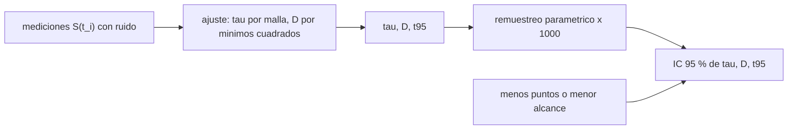

# B107-C06 — Estimación y modelado de la recuperación posterior al vuelo

<!-- nav:top -->
[🏠 Programa](../../../../README.md) · [📚 Bloque B107](../../../tronco-comun/B107-acondicionamiento-fisico-y-rehabilitacion-de-astronautas.md) · [← Anterior: B107-C05 — Prevención de lesiones en entrenamiento y trabajo operativo](../B107-C05-prevencion-de-lesiones-en-entrenamiento-y-trabajo-operativo/CLASE.md) · [Siguiente: B107-C07 — Rehabilitación vestibular y del equilibrio posterior al vuelo →](../B107-C07-rehabilitacion-vestibular-y-del-equilibrio-posterior-al-vuelo/CLASE.md)
<!-- /nav -->

## 1. Ubicación, nivel y alcance

Clase 6 del bloque B107, nivel N3. B105-C17 (en la [guía de B105](../../../tronco-comun/B105-medicina-y-biologia-espacial.md)) describe la rehabilitación; esta clase **modela y estima la recuperación esperada** de una función tras el retorno con un modelo exponencial, lo ajusta a mediciones **sintéticas** con ruido y cuantifica su incertidumbre. Es la herramienta numérica del segundo tramo del bloque.

## 2. Por qué esta clase existe

Los fragmentos consultados indican pérdida de fuerza muscular tras misiones largas con riesgos operativos y médicos (English et al., 2015), cambios en tareas funcionales y sus factores fisiológicos (Mulavara et al., 2018) y alteraciones del control postural y locomotor (Macaulay et al., 2021). No dan, en lo visto, el ritmo de recuperación. La decisión central: **¿con qué incertidumbre se puede estimar cuándo se recuperará una función a partir de unas pocas mediciones ruidosas?**

## 3. Lo que podrás hacer al terminar

1. Escribir y ajustar `S(t) = S_pre − D e^{-t/τ}` con `τ` por malla y `D` por mínimos cuadrados.
2. Calcular el tiempo para recuperar el 95 % del déficit `τ ln 20` y el tiempo para llegar al 95 % del valor previo `τ ln(D/5)`.
3. Cuantificar la incertidumbre de `τ`, `D` y `t95` por remuestreo paramétrico.
4. Mostrar cómo el número y el alcance de las mediciones cambian la incertidumbre.
5. Distinguir un ajuste de un pronóstico y no extrapolar fuera de lo medido.
6. Rotular lo sintético, lo consultado y lo no consultado, sin dar consejo médico ni operativo.

La evidencia es la **curva de recuperación con intervalo** del ejercicio 12 (sección 20).

## 4. Con qué llegas y cómo comprobarlo

1. ¿Qué es un ajuste por mínimos cuadrados?
2. ¿Qué es una constante de tiempo?
3. ¿Qué es un remuestreo (bootstrap)?
4. ¿Qué es un intervalo de 95 %?
5. ¿Qué es un dato sintético?

<details>
<summary>Ver respuestas</summary>

1. Elegir los parámetros que minimizan la suma de los residuos al cuadrado. 2. El tiempo en que un decaimiento exponencial cae al 37 %. 3. Repetir el ajuste sobre datos regenerados para ver cuánto varían los parámetros. 4. El rango entre los percentiles 2,5 y 97,5 de la distribución de la estimación. 5. Un dato generado para el ejemplo, no medido.
</details>

Con cuatro o cinco aciertos, sigue; si no, repasa los prerrequisitos.

## 5. Un caso de contexto y casos de referencia

Una función de un tripulante **inventado** (déficit inicial `D = 18 %`, `τ = 25 d`, ruido 1,5 puntos) se mide en los días 1, 3, 7, 14, 21, 30, 45 y 60. El ajuste da `τ = 22,8 d` y `D = 18,9 %`; el remuestreo da `τ = 23,0 ± 3,2 d` (IC 95 %: 17,5–29,3) y `t95 = 68,2 d` (IC 52,4–87,6), frente al verdadero 74,9 d. Con solo los días 1–14, la dispersión de `τ` sube a ± 10,7 d. Es el **ejemplo conductor**: todo es **sintético**.

## 6. Vocabulario

La **recuperación** es el retorno de una función a su valor previo. El **déficit** `D` es la pérdida inicial (% del valor previo). `τ` es la **constante de tiempo**. El **remuestreo paramétrico** regenera datos con el modelo ajustado y el ruido conocido. El **IC 95 %** son los percentiles 2,5 y 97,5.

## 7. Modelo mental



*Descripción textual:* las mediciones se ajustan a la exponencial; el remuestreo repite el ajuste con datos regenerados para obtener intervalos, que se ensanchan con menos puntos o menor alcance temporal.

Analogía: ver cuánto de una vela se ha consumido y adivinar cuándo se apagará: con pocas marcas tempranas, la predicción es inestable. Límite: aquí la recuperación es una exponencial única; las reales pueden tener varias fases.

## 8. La explicación, paso a paso

### 8.1 El modelo

`S(t) = S_pre − D e^{-t/τ}` con `S_pre = 100 %`, `t` en días desde el retorno. Con `D = 18` y `τ = 25`, `S(14) = 89,7 %`. El modelo exponencial es un supuesto de enseñanza; no se consultó ningún estudio que lo respalde para astronautas.

### 8.2 Ajuste

Para cada `τ` de una malla (5 a 80 d) se resuelve `D` por mínimos cuadrados lineales y se queda el `τ` de menor residuo. Resultado: `τ = 22,8 d`, `D = 18,9 %`, residuo cuadrático 26,24 (con 6 grados de libertad, `s = 2,09`, frente al ruido verdadero 1,5).

### 8.3 Dos definiciones de «95 %»

(i) Recuperar el 95 % del **déficit**: `D e^{-t/τ} = 0,05 D` → `t = τ ln 20 = 68,3 d` (independiente de `D`). (ii) Llegar al 95 % del **valor previo**: `D e^{-t/τ} = 5` → `t = τ ln(D/5)`, que **sí** depende de `D` (para `D = 18,9`: 30,0 d). El laboratorio calcula la primera.

### 8.4 Incertidumbre

Con 1.000 remuestreos: `τ = 23,0 ± 3,2 d`, `D = 18,9 ± 1,1 %`, `t95 = 68,2 d` con IC 52,4–87,6. El valor verdadero (74,9 d) cae dentro. El remuestreo paramétrico supone que el modelo es correcto y que el ruido es conocido.

### 8.5 Menos datos

Si solo se mide hasta el día 14, `τ` tiene dispersión `± 10,7 d` frente a `± 3,2 d` con datos hasta el día 60: la asíntota no está determinada. Regla práctica del modelo: se necesitan datos hasta del orden de `2 τ`. No se extrapola más allá de lo medido.

## 9. Magnitudes, símbolos y unidades

| Símbolo | Qué es | Unidad | Valor / nota |
|---|---|---|---|
| `S` | función medida | % del previo | 80 a 100 |
| `D` | déficit inicial | % | 18 (verdadero); 18,9 (ajustado) |
| `τ` | constante de tiempo | d | 25 (verdadero); 22,8 (ajustado) |
| `t95` | tiempo al 95 % del déficit | d | `τ ln 20` |
| `σ` | ruido de medida | puntos | 1,5 |

## 10. Convenciones y referencias

`t` en días desde el retorno; `S` en % del valor previo al vuelo (`S_pre = 100`). Malla de `τ` de 5 a 80 d (301 puntos); 1.000 remuestreos paramétricos; semilla 107. Datos **sintéticos**. Tolerancias: `τ` y `D` recuperados dentro de 2 desviaciones remuestreadas; dispersión con 4 puntos mayor que con 8. Numpy 2.4.4, Python 3.12.9.

## 11. De dónde sale lo que afirmamos

| ID | Fuente | Localizador | Respalda | Estado |
|---|---|---|---|---|
| S1 | English, K. L. et al., «Isokinetic Strength Changes Following Long-Duration Spaceflight on the ISS», Aerosp Med Hum Perform 86(12 Suppl):A68-A77, 2015 — PubMed (consultada 2026-11-10) | fragmento de la introducción | las misiones largas causan pérdida de fuerza muscular con riesgos operativos y médicos (egreso de emergencia, retorno, exploración); el fragmento termina antes de las cifras | Consultada (solo fragmento del resumen) |
| S2 | Mulavara, A. P. et al., «Physiological and Functional Alterations after Spaceflight and Bed Rest», Med Sci Sports Exerc, 2018 — PubMed, búsqueda https://pubmed.ncbi.nlm.nih.gov/?term=Functional+Task+Test+spaceflight (consultada 2026-11-10) | fragmento del resumen | examina cómo el vuelo afecta el desempeño en tareas funcionales y qué factores fisiológicos lo explican; la batería incluye siete pruebas funcionales y 15 medidas fisiológicas; el fragmento termina antes de los resultados | Consultada (solo fragmento del resumen) |
| S3 | Macaulay, T. R. et al., «Developing Proprioceptive Countermeasures to Mitigate Postural and Locomotor Control Deficits After Long-Duration Spaceflight», Front Syst Neurosci, 2021 — PubMed, búsqueda https://pubmed.ncbi.nlm.nih.gov/?term=vestibular+rehabilitation+postflight+astronauts+balance (consultada 2026-11-10) | fragmento del resumen | revisión: tras el vuelo hay alteraciones del control postural y locomotor por adaptaciones sensoriomotoras; la descarga corporal reduce la dependencia de la información propioceptiva | Consultada (solo fragmento del resumen) |
| — | Modelo exponencial de recuperación `S(t) = S_pre − D e^{-t/τ}`, ajuste por mínimos cuadrados, remuestreo paramétrico y los parámetros `D = 18 %`, `τ = 25 d` | — | las verifica el laboratorio | No consultada en una fuente concreta (las verifica el laboratorio) |

Límites: de English et al. (2015), Mulavara et al. (2018) y Macaulay et al. (2021) solo se vieron fragmentos de resumen o introducción: ninguna curva ni tiempo de recuperación de astronautas se tomó de ellos; `D`, `τ`, el ruido y los días de medición son **inventados**, y no se consultó ninguna fuente sobre tiempos de recuperación reales. Todas las consultas de PubMed se hicieron el 2026-11-10 y solo vieron los fragmentos que mostraba la página de resultados; no se leyó ningún artículo completo ni se verificaron cifras más allá de lo citado. Lo que no se consultó se rotula así y no se afirma como respaldado.

## 12. Cómo ver el resultado

| Magnitud | Verdadera | Ajustada | Remuestreo |
|---|---|---|---|
| `τ` (d) | 25 | 22,8 | 23,0 ± 3,2 (17,5–29,3) |
| `D` (%) | 18 | 18,9 | 18,9 ± 1,1 |
| `t95` (d) | 74,9 | 68,2 | 52,4–87,6 |
| `τ`, solo días 1–14 (d) | 25 | — | 27,8 ± 10,7 |

Descripción larga: el ajuste está dentro de una desviación del verdadero y el intervalo de `t95` es amplio; con menos datos la incertidumbre se triplica. Todo **sintético**.

## 13. Ejemplo trabajado: tiempo al 95 % con los parámetros ajustados

**Paso 1 · Parámetros.** `τ = 22,8 d`, `D = 18,9 %`.

**Paso 2 · Valor a 30 días.** `100 − 18,9·e^{-30/22,8} = 94,9 %`.

**Paso 3 · Tiempo al 95 % del déficit.** `22,8·ln 20 = 68,3 d`.

**Paso 4 · Lectura.** Con el intervalo de `τ` (17,5–29,3), `t95` va de 52 a 88 días: la fecha es una estimación con margen, no un punto.

## 14. Distintas formas de describir el problema

**Por ecuación:** `S(t)`. **Por parámetros:** `D`, `τ`. **Por tiempo:** `t95`. **Por intervalo:** IC 95 %. **Por tabla:** mediciones y ajuste.

## 15. Práctica guiada

**Ejercicio 1 · con los pasos indicados.** Calcula `t95 = τ ln 20` con `τ = 25 d`. *Pasos:* `25·2,996`.

<details><summary>Solución comentada</summary>

`74,9 d`.
</details>

**Ejercicio 2 · con una pista.** Calcula `S(14)` con `D = 18` y `τ = 25`. *Pista:* `100 − D e^{-t/τ}`.

<details><summary>Solución comentada</summary>

`100 − 18·0,571 = 89,7 %`.
</details>

**Ejercicio 3 · casi autónomo.** ¿Cuándo se llega a 90 % con `D = 18` y `τ = 25`?

<details><summary>Solución comentada</summary>

`D e^{-t/τ} = 10` → `t = 25·ln 1,8 = 14,7 d`.
</details>

## 16. Práctica autónoma, transferencia e integrador

**Ejercicio 4 · autónomo.** ¿Cuál es la vida media del déficit?

<details><summary>Solución comentada</summary>

`τ ln 2 = 17,3 d`.
</details>

**Ejercicio 5 · autónomo.** ¿Cuánto tarda en llegar al 95 % del valor previo con `D = 30` y `τ = 25`?

<details><summary>Solución comentada</summary>

`25·ln(30/5) = 44,8 d`; con `D = 18`, `32,0 d`.
</details>

**Ejercicio 6 · autónomo.** ¿Qué desviación residual tiene el ajuste (residuo 26,24, 8 puntos, 2 parámetros)?

<details><summary>Solución comentada</summary>

`√(26,24/6) = 2,09`, algo mayor que el ruido verdadero 1,5.
</details>

**Ejercicio 7 · autónomo.** ¿Por qué con datos solo hasta el día 14 se determina mal `τ`?

<details><summary>Solución comentada</summary>

Porque la curva aún no muestra su asíntota: `D` y `τ` se compensan.
</details>

**Ejercicio 8 · autónomo.** ¿Qué supone el remuestreo paramétrico?

<details><summary>Solución comentada</summary>

Que el modelo ajustado es correcto y que el ruido es conocido.
</details>

**Ejercicio 9 · transferencia.** **Transferencia.** **Transferencia.** Otra función recupera con `τ = 40 d`. ¿Cuánto vale `t95`?

<details><summary>Solución comentada</summary>

`40·2,996 = 119,8 d`: la función más lenta fija el calendario del conjunto.
</details>

**Ejercicio 10 · transferencia.** **Transferencia.** **Transferencia.** La recuperación real tiene dos fases (rápida `τ = 5 d` y lenta `τ = 40 d`). ¿Qué hará un ajuste de una sola exponencial?

<details><summary>Solución comentada</summary>

Un `τ` intermedio que describe mal ambas fases y subestima la cola; hay que probar un modelo de dos exponenciales y contrastarlos.
</details>

**Ejercicio 11 · transferencia.** **Transferencia.** **Transferencia.** Con el error de `τ` de ± 3,2 d en una persona, ¿cuánto sería el de la media de 6 personas independientes?

<details><summary>Solución comentada</summary>

`3,2/√6 = 1,3 d` (si fueran independientes y con el mismo `τ`; las personas reales difieren).
</details>

**Ejercicio 12 · integrador.** **Integrador.** **Integrador.** Elabora tu *curva de recuperación con intervalo*: datos, ajuste con `τ` y `D`, remuestreo, `t95` con IC, efecto de menos puntos y lista de qué es sintético, consultado y no consultado.

<details><summary>Solución comentada</summary>

Secciones 8.1–8.5 y la salida del laboratorio.
</details>

## 17. Laboratorio: recuperación exponencial, ajuste e incertidumbre por remuestreo

El script [recuperacion.py](recuperacion.py) ajusta la exponencial a ocho mediciones sintéticas, remuestrea 1.000 veces para obtener intervalos de `τ`, `D` y `t95`, y repite con solo cuatro puntos (**comprueba** `τ` y `D` dentro de 2 desviaciones y mayor dispersión con menos puntos).

**Datos:** un tripulante **inventado** (`D = 18 %`, `τ = 25 d`, ruido 1,5); semilla 107. **Predice antes de ejecutar:** ¿Será `t95` estimado mayor o menor que el verdadero (74,9 d)? (Menor en esta muestra: 68,2 d, con el verdadero dentro del IC.) **Ejecución del 2026-11-10 (Python 3.12.9):**

```text
Python 3.12.9; numpy 2.4.4
DATOS SINTETICOS E ILUSTRATIVOS (semilla 107): un tripulante inventado; D = 18 %, tau = 25 d, ruido 1.5 puntos
Datos (dia: % del previo): 1: 83.3, 3: 81.2, 7: 86.3, 14: 92.4, 21: 90.0, 30: 95.5, 45: 96.1, 60: 100.7
Ajuste: tau = 22.8 d; D = 18.9 %; residuo cuadratico = 26.24
Remuestreo: tau = 23.0 +- 3.2 d (IC 95 %: 17.5-29.3); D = 18.9 +- 1.1 %
t95 estimado = 68.2 d (IC 95 %: 52.4-87.6); t95 verdadero = 74.9 d
Solo con los dias 1-14: tau remuestreado = 27.8 +- 10.7 d (frente a +- 3.2 d con 8 puntos hasta el dia 60)
Pruebas superadas.
```

```bash
python programa/clases/B107/B107-C06-estimacion-y-modelado-de-la-recuperacion-posterior-al-vuelo/recuperacion.py
```

**Límites:** una sola exponencial; ruido gaussiano constante; modelo supuesto correcto en el remuestreo; ocho puntos; no es un pronóstico clínico.

## 18. Errores frecuentes y cómo corregirlos

**Dar `t95` como una fecha exacta.** Tiene un intervalo (8.4).

**Confundir los dos «95 %».** Ver 8.3.

**Extrapolar más allá de lo medido.** La cola no está determinada (8.5).

**Tomar el modelo como una predicción individual.** La clase no da consejo médico (sección 21).

## 19. Cómo sabrás que vas bien

Tras la sección 8: ¿qué `t95` esperabas y cuál da la tabla? Si dudas, repasa el ejemplo 13. Tras el laboratorio: ¿qué comprueba? (ver la sección 17).

## 20. Qué entregas y cómo se evalúa

El producto es tu **curva de recuperación con intervalo** (ejercicio 12).

| Criterio | Inicial | En desarrollo | Logrado | Destacado |
|---|---|---|---|---|
| Conceptos | Confunde ajuste y pronóstico | Parciales | Explica `D`, `τ` y `t95` | Explica el intervalo y el efecto de los datos |
| Cálculo | Sin unidades | Con errores | Ajusta y calcula `t95` | Calcula casos nuevos |
| Numérico | Sin comprobar | Un caso | Compara con la forma cerrada o la verdad conocida | Interpreta las diferencias |
| Fuentes | Sin fuente | Sin fecha | Fuentes con fecha y estado | Declara lo sintético y lo no consultado |
| Límites | No los nombra | Uno | Tres | Discute qué falta del modelo |

**Condiciones críticas (no se compensan con promedio):** rotular los datos como sintéticos; no dar consejo médico, de entrenamiento ni operativo; citar solo lo consultado.

## 21. Ética, seguridad y límites

Clase **educativa**: **no da consejo médico, de entrenamiento ni operativo**, no prescribe ejercicio ni fija criterios clínicos, y no sustituye la formación, la licencia ni la supervisión de profesionales de la salud ni de los equipos médicos de una agencia. Una curva ajustada a datos inventados no predice a nadie; las expectativas de recuperación de una persona las fija el equipo clínico con sus datos y su juicio. Accesibilidad: tablas equivalentes a las gráficas, fórmulas en texto, ejercicios sin conexión.

## 22. Para cerrar y seguir

Con ocho puntos, `τ = 23,0 ± 3,2 d` y `t95` entre 52 y 88 días; con cuatro puntos tempranos, `τ` varía ± 10,7 d. Queda una pregunta: ¿cómo se modela y se mide la recuperación del equilibrio, que depende de varias fuentes sensoriales?

**Glosario español–inglés.** recuperación · *recovery* · déficit · *deficit* · constante de tiempo · *time constant* · remuestreo · *bootstrap* · intervalo de confianza · *confidence interval*.

**Continuidad.** [B107-C07](../B107-C07-rehabilitacion-vestibular-y-del-equilibrio-posterior-al-vuelo/CLASE.md) trata la rehabilitación vestibular y del equilibrio.

**Referencias:** ver sección 11.

<!-- nav:bottom -->
---

[← Anterior: B107-C05 — Prevención de lesiones en entrenamiento y trabajo operativo](../B107-C05-prevencion-de-lesiones-en-entrenamiento-y-trabajo-operativo/CLASE.md) · [📚 Bloque B107](../../../tronco-comun/B107-acondicionamiento-fisico-y-rehabilitacion-de-astronautas.md) · [Siguiente: B107-C07 — Rehabilitación vestibular y del equilibrio posterior al vuelo →](../B107-C07-rehabilitacion-vestibular-y-del-equilibrio-posterior-al-vuelo/CLASE.md)
<!-- /nav -->
