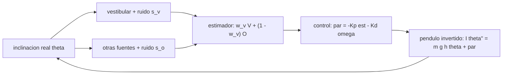

# B107-C07 — Rehabilitación vestibular y del equilibrio posterior al vuelo

<!-- nav:top -->
[🏠 Programa](../../../../README.md) · [📚 Bloque B107](../../../tronco-comun/B107-acondicionamiento-fisico-y-rehabilitacion-de-astronautas.md) · [← Anterior: B107-C06 — Estimación y modelado de la recuperación posterior al vuelo](../B107-C06-estimacion-y-modelado-de-la-recuperacion-posterior-al-vuelo/CLASE.md) · [Siguiente: B107-C08 — Evaluación funcional posterior al vuelo →](../B107-C08-evaluacion-funcional-posterior-al-vuelo/CLASE.md)
<!-- /nav -->

## 1. Ubicación, nivel y alcance

Clase 7 del bloque B107, nivel N3. B105-C04 (en la [guía de B105](../../../tronco-comun/B105-medicina-y-biologia-espacial.md)) describe el sistema vestibular; esta clase se ocupa de su **rehabilitación y del equilibrio** con un modelo mínimo: un péndulo invertido controlado con una estimación de la inclinación que combina información vestibular y de otras fuentes. Muestra por qué el control es estable solo si la rigidez supera un umbral y cómo la ponderación de las fuentes cambia el balanceo.

## 2. Por qué esta clase existe

Los fragmentos consultados indican que el vuelo altera el control postural y locomotor por adaptaciones sensoriomotoras y que la descarga reduce la dependencia de la información propioceptiva (Macaulay et al., 2021), y que el rendimiento de astronautas en una prueba de levantarse de una silla tras el aterrizaje se compara con el de la vestibulopatía bilateral (Clément et al., 2023). La decisión central: **¿cuánto peso debe darse a cada fuente sensorial para estimar la inclinación, y cuánto margen de rigidez hace falta para no caer?**

## 3. Lo que podrás hacer al terminar

1. Escribir la dinámica linealizada `I θ'' = m g h θ − Kp θ − Kd θ' + ruido` y su umbral de estabilidad.
2. Calcular el margen de rigidez, la frecuencia natural y el amortiguamiento del sistema controlado.
3. Combinar dos fuentes con ruido y calcular el peso de mínima varianza `w* = s_o²/(s_v² + s_o²)`.
4. Verificar la varianza del estimador por Monte Carlo.
5. Mostrar cómo el balanceo cambia cuando se degradan las otras fuentes.
6. Rotular lo sintético, lo consultado y lo no consultado, sin dar consejo médico ni operativo.

La evidencia es la **estudio de peso sensorial y estabilidad** del ejercicio 12 (sección 20).

## 4. Con qué llegas y cómo comprobarlo

1. ¿Qué es un péndulo invertido?
2. ¿Qué es un controlador proporcional-derivativo?
3. ¿Qué es la varianza de una suma ponderada?
4. ¿Qué es un grado de libertad de ruido?
5. ¿Qué es un dato sintético?

<details>
<summary>Ver respuestas</summary>

1. Una masa sobre un pivote por encima del pivote, inestable sin control. 2. Uno que aplica un par proporcional al ángulo y a su velocidad. 3. `w² s1² + (1 − w)² s2²` para dos fuentes independientes. 4. Una fuente de variabilidad aleatoria que se añade a una señal. 5. Un dato generado para el ejemplo, no medido.
</details>

Con cuatro o cinco aciertos, sigue; si no, repasa los prerrequisitos.

## 5. Un caso de contexto y casos de referencia

Un cuerpo **inventado** de 70 kg con centro de masa a 1,0 m necesita `Kp > m g h = 686,5 N·m/rad`. Con `Kp = 500` el péndulo cae; con `Kp = 900` el balanceo es acotado (RMS 0,101°). Con ruidos de 0,20° (vestibular) y 0,35° (otras fuentes) el peso óptimo es `w* = 0,75` y la desviación mínima del estimador `0,174°`. Si las otras fuentes se degradan ×4, `w* = 0,98` y el balanceo simulado con `w_v = 0` es `0,257°` frente a `0,108°` con `w_v = 1`. Es el **ejemplo conductor**: todo es **sintético**.

## 6. Vocabulario

El **péndulo invertido** modela el cuerpo en pie. La **rigidez** `Kp` y el **amortiguamiento** `Kd` son las ganancias del control. El **peso vestibular** `w_v` es la fracción de la estimación que viene del sistema vestibular. La **re-ponderación sensorial** es el cambio de esos pesos según la fiabilidad de cada fuente. El **balanceo** es la oscilación del ángulo.

## 7. Modelo mental



*Descripción textual:* la inclinación real se mide con dos fuentes ruidosas; el estimador las pondera y el control aplica un par; la dinámica del péndulo cierra el lazo.

Analogía: mantener un bastón en equilibrio sobre la mano mirando a veces con un ojo borroso y otras con uno bueno: se confía más en el mejor. Límite: aquí el ruido es blanco y la ponderación es fija.

## 8. La explicación, paso a paso

### 8.1 Dinámica y umbral

`I θ'' = m g h θ + par`, con `I = m h² = 70 kg·m²` y `m g h = 686,5 N·m/rad`. Con `par = −Kp θ − Kd θ'`, el sistema es estable si `Kp > m g h` y `Kd > 0`. El laboratorio muestra que con `Kp = 500` el ángulo supera 0,5 rad (cae) y con `Kp = 900` el balanceo es acotado.

### 8.2 Margen, frecuencia y amortiguamiento

Con `Kp = 900` y `Kd = 250`: margen `Kp − m g h = 213,5 N·m/rad`; frecuencia natural `√(213,5/70) = 1,75 rad/s` (periodo 3,6 s); amortiguamiento `ζ = Kd/(2√(213,5·70)) = 1,02` (críticamente amortiguado).

### 8.3 Combinar fuentes

Con ruidos `s_v = 0,20°` y `s_o = 0,35°`, la estimación `w θ_v + (1 − w) θ_o` tiene desviación `√(w² s_v² + (1 − w)² s_o²)`; su mínimo está en `w* = s_o²/(s_v² + s_o²) = 0,754` y vale `√(s_v² s_o²/(s_v² + s_o²)) = 0,174°`. El Monte Carlo con 200.000 muestras coincide con la fórmula dentro del 2 % para cada `w`.

### 8.4 Otras fuentes degradadas

Si el ruido de las otras fuentes se multiplica por 4 (`s_o = 1,4°`), `w* = 0,98` y el mínimo es `0,198°`: casi todo el peso pasa al vestibular. El balanceo RMS simulado baja de `0,257°` (`w_v = 0`) a `0,108°` (`w_v = 1`). Es el razonamiento de «re-ponderar», no una descripción de lo que ocurre en una persona; la teoría de re-ponderación no se consultó.

### 8.5 Si el vestibular empeora

Con `s_v = 0,50°` y `s_o = 0,35°`: `w* = 0,33` y la desviación mínima sube a `0,287°` (65 % más que `0,174°`). Un déficit vestibular en el modelo obliga a depender de las otras fuentes y a un mayor balanceo; Clément et al. (2023) comparan astronautas y vestibulopatía bilateral, sin cifras en lo consultado.

## 9. Magnitudes, símbolos y unidades

| Símbolo | Qué es | Unidad | Valor / nota |
|---|---|---|---|
| `m`, `h` | masa y altura del centro de masa | kg, m | 70; 1,0 (inventadas) |
| `I` | momento de inercia `m h²` | kg·m² | 70 |
| `Kp`, `Kd` | rigidez y amortiguamiento | N·m/rad, N·m·s/rad | 900; 250 |
| `s_v`, `s_o` | ruido vestibular y de otras fuentes | ° | 0,20; 0,35 |
| `w_v` | peso vestibular | — | 0 a 1 |
| `θ` | inclinación | rad o ° | RMS 0,1° |

## 10. Convenciones y referencias

Ángulo `θ` respecto de la vertical, positivo hacia delante; `g = 9,80665 m/s²`; Euler explícito, `dt = 0,005 s`, 60 s; ruido de par gaussiano de 8 N·m; datos **sintéticos**; semilla 107. Tolerancias: desviación del estimador ±2 % de la analítica; mínimo en la malla = `w*` ± 0,05; `RMS(w_v = 1) < RMS(w_v = 0)` con degradación. Numpy 2.4.4, Python 3.12.9.

## 11. De dónde sale lo que afirmamos

| ID | Fuente | Localizador | Respalda | Estado |
|---|---|---|---|---|
| S1 | Macaulay, T. R. et al., «Developing Proprioceptive Countermeasures to Mitigate Postural and Locomotor Control Deficits After Long-Duration Spaceflight», Front Syst Neurosci, 2021 — PubMed, búsqueda https://pubmed.ncbi.nlm.nih.gov/?term=vestibular+rehabilitation+postflight+astronauts+balance (consultada 2026-11-10) | fragmento del resumen | revisión: tras el vuelo hay alteraciones del control postural y locomotor por adaptaciones sensoriomotoras; la descarga corporal reduce la dependencia de la información propioceptiva | Consultada (solo fragmento del resumen) |
| S2 | Clément, G. et al., «Cognitive and balance functions of astronauts after spaceflight are comparable to those of individuals with bilateral vestibulopathy», Front Neurol, 2023 — PubMed (misma búsqueda, consultada 2026-11-10) | fragmento del resumen | en una prueba de levantarse de una silla, los sujetos con vestibulopatía bilateral rindieron entre el día de aterrizaje y el día siguiente de los astronautas; cambios en control dinámico del equilibrio, percepción del tiempo y tiempo de reacción; el fragmento no da cifras | Consultada (solo fragmento del resumen) |
| — | Modelo de péndulo invertido linealizado, criterio de estabilidad `Kp > m g h`, combinación ponderada de fuentes sensoriales de mínima varianza y los valores de masa, altura, ganancias y ruidos | — | las verifica el laboratorio | No consultada en una fuente concreta (las verifica el laboratorio) |

Límites: de Macaulay et al. (2021) y Clément et al. (2023) solo se vieron fragmentos de resumen: ninguna medida de balanceo ni de peso sensorial se tomó de ellos; la masa de 70 kg, la altura de 1,0 m, las ganancias del control y los ruidos sensoriales (0,20° y 0,35°) son **inventados**, y la teoría de re-ponderación sensorial **no se consultó**. Todas las consultas de PubMed se hicieron el 2026-11-10 y solo vieron los fragmentos que mostraba la página de resultados; no se leyó ningún artículo completo ni se verificaron cifras más allá de lo citado. Lo que no se consultó se rotula así y no se afirma como respaldado.

## 12. Cómo ver el resultado

| Condición | `w*` analítico | Mínimo en malla | `σ` mínima (°) | RMS balanceo `w_v = 0` / `1` (°) |
|---|---|---|---|---|
| superficie firme | 0,75 | 0,8 | 0,174 | 0,109 / 0,108 |
| otras fuentes ×4 | 0,98 | 1,0 | 0,198 | 0,257 / 0,108 |

Descripción larga: con otras fuentes buenas, el peso óptimo es intermedio y el balanceo casi no cambia; con ellas degradadas, el peso pasa al vestibular y el balanceo se reduce a la mitad. Todo **sintético**.

## 13. Ejemplo trabajado: peso óptimo de dos fuentes

**Paso 1 · Ruidos.** `s_v = 0,20°`, `s_o = 0,35°`.

**Paso 2 · Peso.** `w* = 0,1225/(0,04 + 0,1225) = 0,754`.

**Paso 3 · Desviación.** `√(0,04·0,1225/0,1625) = 0,174°`.

**Paso 4 · Lectura.** Mejor que cualquier fuente sola (0,20° y 0,35°): combinar reduce el ruido; el máximo peso va a la fuente más fiable.

## 14. Distintas formas de describir el problema

**Por dinámica:** `I θ''`. **Por estabilidad:** `Kp > m g h`. **Por frecuencia:** `ωn`. **Por estimación:** `w*`. **Por tabla:** balanceo según el peso.

## 15. Práctica guiada

**Ejercicio 1 · con los pasos indicados.** Calcula `m g h` con 70 kg y 1,0 m. *Pasos:* `70·9,80665·1`.

<details><summary>Solución comentada</summary>

`686,5 N·m/rad`.
</details>

**Ejercicio 2 · con una pista.** ¿Qué margen deja `Kp = 900`?

<details><summary>Solución comentada</summary>

`900 − 686,5 = 213,5 N·m/rad`.
</details>

**Ejercicio 3 · casi autónomo.** Calcula `w*` con `s_v = 0,20°` y `s_o = 0,35°`. *Pista:* `s_o²/(s_v² + s_o²)`.

<details><summary>Solución comentada</summary>

`0,754`.
</details>

## 16. Práctica autónoma, transferencia e integrador

**Ejercicio 4 · autónomo.** ¿Qué desviación tiene la estimación con `w = 0,5`?

<details><summary>Solución comentada</summary>

`√(0,25·0,04 + 0,25·0,1225) = 0,2016°`.
</details>

**Ejercicio 5 · autónomo.** ¿Cuánto vale `w*` con `s_o = 1,4°`?

<details><summary>Solución comentada</summary>

`1,96/(0,04 + 1,96) = 0,98`.
</details>

**Ejercicio 6 · autónomo.** ¿Cuál es la desviación mínima en ese caso?

<details><summary>Solución comentada</summary>

`√(0,04·1,96/2,0) = 0,198°`.
</details>

**Ejercicio 7 · autónomo.** ¿Qué `m g h` resulta con `h = 1,1 m`?

<details><summary>Solución comentada</summary>

`755,1 N·m/rad`: el umbral sube con la altura.
</details>

**Ejercicio 8 · autónomo.** ¿Por qué se vigila el paso `dt` de Euler?

<details><summary>Solución comentada</summary>

Porque un paso grande puede volver inestable un sistema estable; aquí `dt = 0,005 s` es mucho menor que el periodo de 3,6 s.
</details>

**Ejercicio 9 · transferencia.** **Transferencia.** **Transferencia.** Si el ruido vestibular sube a `s_v = 0,50°` con `s_o = 0,35°`, ¿cuánto valen `w*` y `σ` mínima?

<details><summary>Solución comentada</summary>

`w* = 0,1225/(0,25 + 0,1225) = 0,33`; `σ = √(0,25·0,1225/0,3725) = 0,287°`, 65 % más que antes.
</details>

**Ejercicio 10 · transferencia.** **Transferencia.** **Transferencia.** La rigidez efectiva de una persona baja a `Kp = 650`. ¿Qué predice el modelo?

<details><summary>Solución comentada</summary>

`650 < 686,5`: inestable; cae. En una persona la rigidez no es un número fijo; es una ilustración del umbral.
</details>

**Ejercicio 11 · transferencia.** **Transferencia.** **Transferencia.** ¿Qué `ωn` y periodo resultan con `Kp = 800`?

<details><summary>Solución comentada</summary>

`√(113,5/70) = 1,27 rad/s`; periodo `4,9 s`: más lento y menos estable.
</details>

**Ejercicio 12 · integrador.** **Integrador.** **Integrador.** Elabora tu *estudio de peso sensorial y estabilidad*: umbral y margen, `w*` en dos condiciones, verificación por Monte Carlo, efecto de un vestibular peor y lista de qué es sintético, consultado y no consultado.

<details><summary>Solución comentada</summary>

Secciones 8.1–8.5 y la salida del laboratorio.
</details>

## 17. Laboratorio: péndulo invertido con ruido sensorial y re-ponderación vestibular

El script [equilibrio.py](equilibrio.py) simula el péndulo con dos rigideces, mide por Monte Carlo la desviación del estimador para once pesos en dos condiciones y simula el balanceo con `w_v = 0` y `1` (**comprueba** que cae con `Kp < m g h`, desviación ±2 % y mínimo en `w*` ± 0,05).

**Datos:** masa, altura, ganancias y ruidos **inventados**; semilla 107. **Predice antes de ejecutar:** ¿Dónde estará `w*` con otras fuentes degradadas ×4? (cerca de 1.) **Ejecución del 2026-11-10 (Python 3.12.9):**

```text
Python 3.12.9; numpy 2.4.4
DATOS SINTETICOS E ILUSTRATIVOS (semilla 107): masa 70 kg, h 1.0 m, g 9.80665 m/s2; ruidos 0.20 y 0.35 deg
Umbral de rigidez para estabilidad: m g h = 686.5 N m/rad; Kp usado = 900
Kp = 500: diverge (cae antes de 60 s); RMS = 8.097 deg
Kp = 900: balanceo acotado; RMS = 0.101 deg
superficie firme: desviacion del estimador (deg) por w_v 0..1 paso 0.1 = 0.350, 0.315, 0.283, 0.253, 0.224, 0.201, 0.185, 0.175, 0.174, 0.183, 0.200
  w* analitico = 0.75; minimo en la malla = 0.8
  balanceo RMS simulado (60 s): w_v = 0 -> 0.109 deg; w_v = 1 -> 0.108 deg
otras fuentes degradadas x4: desviacion del estimador (deg) por w_v 0..1 paso 0.1 = 1.401, 1.262, 1.120, 0.978, 0.844, 0.707, 0.575, 0.442, 0.324, 0.228, 0.200
  w* analitico = 0.98; minimo en la malla = 1.0
  balanceo RMS simulado (60 s): w_v = 0 -> 0.257 deg; w_v = 1 -> 0.108 deg
Pruebas superadas.
```

```bash
python programa/clases/B107/B107-C07-rehabilitacion-vestibular-y-del-equilibrio-posterior-al-vuelo/equilibrio.py
```

**Límites:** modelo lineal de un eje; ruido blanco; pesos fijos; sin retardo neural; la teoría de re-ponderación no se consultó; no describe a una persona.

## 18. Errores frecuentes y cómo corregirlos

**Creer que cualquier rigidez estabiliza.** Hace falta `Kp > m g h` (8.1).

**Dar el mismo peso a todas las fuentes.** El óptimo depende de sus ruidos (8.3).

**Atribuir el modelo a una persona.** Es sintético (sección 10).

**Convertirlo en un protocolo de rehabilitación.** La clase no prescribe (sección 21).

## 19. Cómo sabrás que vas bien

Tras la sección 8: ¿qué `w*` esperabas con las fuentes degradadas y cuál da la tabla? Si dudas, repasa el ejemplo 13. Tras el laboratorio: ¿qué comprueba? (ver la sección 17).

## 20. Qué entregas y cómo se evalúa

El producto es tu **estudio de peso sensorial y estabilidad** (ejercicio 12).

| Criterio | Inicial | En desarrollo | Logrado | Destacado |
|---|---|---|---|---|
| Conceptos | Confunde rigidez y amortiguamiento | Parciales | Explica umbral, `w*` y balanceo | Explica el efecto de degradar fuentes |
| Cálculo | Sin unidades | Con errores | Calcula umbral, frecuencia y `w*` | Calcula casos nuevos |
| Numérico | Sin comprobar | Un caso | Compara con la forma cerrada o la verdad conocida | Interpreta las diferencias |
| Fuentes | Sin fuente | Sin fecha | Fuentes con fecha y estado | Declara lo sintético y lo no consultado |
| Límites | No los nombra | Uno | Tres | Discute qué falta del modelo |

**Condiciones críticas (no se compensan con promedio):** rotular los datos como sintéticos; no dar consejo médico, de entrenamiento ni operativo; citar solo lo consultado.

## 21. Ética, seguridad y límites

Clase **educativa**: **no da consejo médico, de entrenamiento ni operativo**, no prescribe ejercicio ni fija criterios clínicos, y no sustituye la formación, la licencia ni la supervisión de profesionales de la salud ni de los equipos médicos de una agencia. La clase no es un protocolo de rehabilitación ni de pruebas de equilibrio; la rehabilitación vestibular la diseñan y supervisan profesionales con licencia, con evaluación previa y seguridad física del paciente. Accesibilidad: tablas equivalentes a las gráficas, fórmulas en texto, ejercicios sin conexión.

## 22. Para cerrar y seguir

Con `Kp = 900` el margen es 213,5 N·m/rad y, con ruidos de 0,20° y 0,35°, el peso óptimo vestibular es 0,75. Queda una pregunta: ¿cómo se mide la función global del retorno con pruebas cuyo cambio supera su error?

**Glosario español–inglés.** péndulo invertido · *inverted pendulum* · rigidez · *stiffness* · re-ponderación sensorial · *sensory reweighting* · balanceo postural · *postural sway* · amortiguamiento · *damping*.

**Continuidad.** [B107-C08](../B107-C08-evaluacion-funcional-posterior-al-vuelo/CLASE.md) trata la evaluación funcional posterior al vuelo.

**Referencias:** ver sección 11.

<!-- nav:bottom -->
---

[← Anterior: B107-C06 — Estimación y modelado de la recuperación posterior al vuelo](../B107-C06-estimacion-y-modelado-de-la-recuperacion-posterior-al-vuelo/CLASE.md) · [📚 Bloque B107](../../../tronco-comun/B107-acondicionamiento-fisico-y-rehabilitacion-de-astronautas.md) · [Siguiente: B107-C08 — Evaluación funcional posterior al vuelo →](../B107-C08-evaluacion-funcional-posterior-al-vuelo/CLASE.md)
<!-- /nav -->
