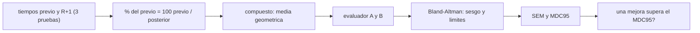

# B107-C08 — Evaluación funcional posterior al vuelo

<!-- nav:top -->
[🏠 Programa](../../../../README.md) · [📚 Bloque B107](../../../tronco-comun/B107-acondicionamiento-fisico-y-rehabilitacion-de-astronautas.md) · [← Anterior: B107-C07 — Rehabilitación vestibular y del equilibrio posterior al vuelo](../B107-C07-rehabilitacion-vestibular-y-del-equilibrio-posterior-al-vuelo/CLASE.md) · [Siguiente: B107-C09 — Progresión de recuperación y criterios de alta →](../B107-C09-progresion-de-recuperacion-y-criterios-de-alta/CLASE.md)
<!-- /nav -->

## 1. Ubicación, nivel y alcance

Clase 8 del bloque B107, nivel N3. Trata la **evaluación funcional de retorno** con una batería de tres pruebas de tiempo **sintéticas** inspiradas en el tipo de tareas (levantarse de una silla, recorrido con obstáculos, marcha en tándem): cómo se normaliza cada una, cómo se combinan, qué concordancia tienen dos evaluadores y qué cambio es distinguible del error.

## 2. Por qué esta clase existe

El fragmento de Mulavara et al. (2018) describe una batería con siete pruebas funcionales y 15 medidas fisiológicas para entender el desempeño de tareas tras el vuelo, y Clément et al. (2023) usan una prueba de levantarse de una silla para comparar astronautas con vestibulopatía bilateral. Falta enseñar a **combinar y a medir con error** pruebas de este tipo. La decisión central: **¿una mejora de 5 puntos entre dos evaluaciones es mejora real o error de medida?**

## 3. Lo que podrás hacer al terminar

1. Normalizar tiempos como porcentaje del valor previo `100·previo/posterior`.
2. Combinar pruebas con la media geométrica y justificar por qué.
3. Calcular sesgo y límites de acuerdo de Bland–Altman entre dos evaluadores.
4. Calcular `SEM` y `MDC95` a partir de la dispersión de las diferencias.
5. Decidir si una mejora supera el cambio mínimo detectable.
6. Rotular lo sintético, lo consultado y lo no consultado, sin dar consejo médico ni operativo.

La evidencia es la **informe de concordancia y cambio mínimo** del ejercicio 12 (sección 20).

## 4. Con qué llegas y cómo comprobarlo

1. ¿Qué es un porcentaje del valor previo?
2. ¿Qué es una media geométrica?
3. ¿Qué es un sesgo?
4. ¿Qué son los límites de acuerdo?
5. ¿Qué es un dato sintético?

<details>
<summary>Ver respuestas</summary>

1. El cociente entre el valor previo y el posterior (para tiempos), por 100. 2. La raíz `n`-ésima del producto; es la media de los logaritmos elevada de nuevo. 3. Una diferencia sistemática entre dos evaluadores o métodos. 4. Sesgo ± 1,96 desviaciones de las diferencias: dentro caen el 95 % de ellas. 5. Un dato generado para el ejemplo, no medido.
</details>

Con cuatro o cinco aciertos, sigue; si no, repasa los prerrequisitos.

## 5. Un caso de contexto y casos de referencia

Quince tripulantes **inventados**, tres pruebas de tiempo (silla ×5, obstáculos, tándem de 3 m) con déficits de 1,45, 1,30 y 1,60 veces el tiempo previo. En R+1 el porcentaje del previo medio es `69,5 %`, `77,3 %` y `62,7 %`, y el compuesto geométrico `69,4 %` (62,0–75,2). Dos evaluadores sintéticos difieren en `+1,81` puntos de sesgo con límites `[−3,93; 7,54]`, `SEM = 2,07` y `MDC95 = 5,73`: una mejora de 5 puntos **no** supera la `MDC95`. Es el **ejemplo conductor**: todo es **sintético**.

## 6. Vocabulario

**R+1** es el primer día tras el retorno. El **porcentaje del previo** normaliza cada prueba. El **compuesto** es la media geométrica de los porcentajes. **Bland–Altman** compara dos medidas con el sesgo y los límites de acuerdo. El **MDC95** es el cambio mínimo detectable al 95 %.

## 7. Modelo mental



*Descripción textual:* los tiempos se normalizan y se combinan; dos evaluadores se comparan con Bland–Altman, de cuya dispersión sale el error y el cambio mínimo con el que se juzgan las mejoras.

Analogía: dos jueces puntúan la misma actuación: sus diferencias dicen cuánto vale una décima de punto. Límite: aquí el error es normal y los jueces son simulados.

## 8. La explicación, paso a paso

### 8.1 Normalizar

Para tiempos, menor es mejor: `% del previo = 100·previo/posterior`. Un tiempo de silla de 9,0 s que pasa a 13,05 s da `69,0 %`.

### 8.2 Compuesto geométrico

`compuesto = (p1·p2·p3)^{1/3} = exp(media de ln p)`. Con 69,0; 76,9 y 62,5: `69,2 %`. La media geométrica trata un cambio relativo igual en cualquier prueba por igual y no la domina una prueba de escala grande; el laboratorio verifica la identidad con la forma logarítmica.

### 8.3 Dos evaluadores

El compuesto de cada persona se «mide» dos veces con errores de 2,0 y 2,5 puntos y un sesgo de +1,5 del evaluador B. Bland–Altman da sesgo `1,81`, `s = 2,93` y límites `[−3,93; 7,54]`; el 93 % de las diferencias cae dentro.

### 8.4 Error y cambio mínimo

`SEM = s_dif/√2 = 2,07` y `MDC95 = 1,96·√2·SEM = 1,96·s_dif = 5,73` puntos. Una mejora de 5 puntos entre R+1 y R+5 es menor: no se distingue del error de medida. Una de 7,6 sí.

### 8.5 Qué no captura

La media de porcentajes no es el porcentaje de las medias (`62,7 %` frente a `62,5 %` para el tándem con medias de 5,85 s y 9,36 s). La batería real de Mulavara et al. (2018) incluye pruebas y medidas fisiológicas que no se vieron; este laboratorio no la reproduce.

## 9. Magnitudes, símbolos y unidades

| Símbolo | Qué es | Unidad | Valor / nota |
|---|---|---|---|
| `t_prev`, `t_post` | tiempo de una prueba | s | 9,0 / 14,0 / 6,0 de media previa (sintéticos) |
| `p` | % del previo | % | 62 a 77 en R+1 |
| `C` | compuesto geométrico | % | 69,4 |
| `s_dif` | desviación de las diferencias | puntos | 2,93 |
| `SEM` | error típico de medida | puntos | 2,07 |
| `MDC95` | cambio mínimo detectable | puntos | 5,73 |

## 10. Convenciones y referencias

Tiempos en segundos; porcentajes sin unidad física; `n = 15`; variabilidad individual lognormal de 10 % entre personas y de 8 % en el déficit; semilla 107; datos **sintéticos**. Tolerancias: media geométrica igual a la forma logarítmica (`allclose`); `MDC95 = 1,96 s_dif` (< 1e-9); al menos el 90 % de las diferencias dentro de los límites. Numpy 2.4.4, Python 3.12.9.

## 11. De dónde sale lo que afirmamos

| ID | Fuente | Localizador | Respalda | Estado |
|---|---|---|---|---|
| S1 | Mulavara, A. P. et al., «Physiological and Functional Alterations after Spaceflight and Bed Rest», Med Sci Sports Exerc, 2018 — PubMed, búsqueda https://pubmed.ncbi.nlm.nih.gov/?term=Functional+Task+Test+spaceflight (consultada 2026-11-10) | fragmento del resumen | examina cómo el vuelo afecta el desempeño en tareas funcionales y qué factores fisiológicos lo explican; la batería incluye siete pruebas funcionales y 15 medidas fisiológicas; el fragmento termina antes de los resultados | Consultada (solo fragmento del resumen) |
| S2 | Clément, G. et al., «Cognitive and balance functions of astronauts after spaceflight are comparable to those of individuals with bilateral vestibulopathy», Front Neurol, 2023 — PubMed (misma búsqueda, consultada 2026-11-10) | fragmento del resumen | en una prueba de levantarse de una silla, los sujetos con vestibulopatía bilateral rindieron entre el día de aterrizaje y el día siguiente de los astronautas; cambios en control dinámico del equilibrio, percepción del tiempo y tiempo de reacción; el fragmento no da cifras | Consultada (solo fragmento del resumen) |
| S3 | Macaulay, T. R. et al., «Developing Proprioceptive Countermeasures to Mitigate Postural and Locomotor Control Deficits After Long-Duration Spaceflight», Front Syst Neurosci, 2021 — PubMed, búsqueda https://pubmed.ncbi.nlm.nih.gov/?term=vestibular+rehabilitation+postflight+astronauts+balance (consultada 2026-11-10) | fragmento del resumen | revisión: tras el vuelo hay alteraciones del control postural y locomotor por adaptaciones sensoriomotoras; la descarga corporal reduce la dependencia de la información propioceptiva | Consultada (solo fragmento del resumen) |
| — | Media geométrica como compuesto, límites de acuerdo de Bland–Altman, `SEM = s_dif/√2` y `MDC95 = 1,96 √2 SEM`; factores de déficit y tiempos previos de las pruebas | — | las verifica el laboratorio | No consultada en una fuente concreta (las verifica el laboratorio) |

Límites: de Mulavara et al. (2018), Clément et al. (2023) y Macaulay et al. (2021) solo se vieron fragmentos de resumen: los tiempos de las tres pruebas, los factores de déficit (1,45; 1,30; 1,60) y el compuesto del laboratorio son **inventados**; la composición exacta de la batería del estudio de 2018 más allá de «siete pruebas funcionales y 15 medidas fisiológicas» no se consultó; Bland–Altman no se consultó en su fuente. Todas las consultas de PubMed se hicieron el 2026-11-10 y solo vieron los fragmentos que mostraba la página de resultados; no se leyó ningún artículo completo ni se verificaron cifras más allá de lo citado. Lo que no se consultó se rotula así y no se afirma como respaldado.

## 12. Cómo ver el resultado

| Prueba | Previo (s) | R+1 (s) | % del previo |
|---|---|---|---|
| silla ×5 | 9,44 | 13,68 | 69,5 ± 5,4 |
| obstáculos | 13,82 | 18,00 | 77,3 ± 9,7 |
| tándem 3 m | 5,85 | 9,36 | 62,7 ± 4,3 |

Compuesto: 69,4 % (62,0–75,2). Bland–Altman: sesgo 1,81; límites [−3,93; 7,54]; `SEM = 2,07`; `MDC95 = 5,73`. Todo **sintético**.

## 13. Ejemplo trabajado: compuesto de un tripulante y comparación con la MDC95

**Paso 1 · Porcentajes.** Silla 69,0 %; obstáculos 76,9 %; tándem 62,5 %.

**Paso 2 · Compuesto.** `exp((ln 69,0 + ln 76,9 + ln 62,5)/3) = 69,2 %`.

**Paso 3 · Mejora.** Supón 74,0 % en R+5: `+4,8` puntos.

**Paso 4 · Lectura.** `4,8 < 5,73`: no se distingue del error; hace falta otra medida o un cambio mayor.

## 14. Distintas formas de describir el problema

**Por tiempo:** s. **Por porcentaje:** % del previo. **Por compuesto:** media geométrica. **Por concordancia:** sesgo y límites. **Por error:** `SEM`, `MDC95`.

## 15. Práctica guiada

**Ejercicio 1 · con los pasos indicados.** Calcula el % del previo con 9,0 s antes y 13,5 s después. *Pasos:* `100·9/13,5`.

<details><summary>Solución comentada</summary>

`66,7 %`.
</details>

**Ejercicio 2 · con una pista.** Calcula la media geométrica de 64, 81 y 100. *Pista:* raíz cúbica del producto.

<details><summary>Solución comentada</summary>

`(518.400)^{1/3} = 80,3`.
</details>

**Ejercicio 3 · casi autónomo.** Con `s_dif = 2,93`, ¿cuánto vale `MDC95`?

<details><summary>Solución comentada</summary>

`1,96·2,93 = 5,74`.
</details>

## 16. Práctica autónoma, transferencia e integrador

**Ejercicio 4 · autónomo.** ¿Cuánto vale `SEM`?

<details><summary>Solución comentada</summary>

`2,93/√2 = 2,07`.
</details>

**Ejercicio 5 · autónomo.** Calcula los límites de acuerdo con sesgo 1,81 y `s = 2,93`.

<details><summary>Solución comentada</summary>

`1,81 ± 5,74 = [−3,93; 7,54]`.
</details>

**Ejercicio 6 · autónomo.** ¿Por qué una media geométrica y no aritmética para combinar porcentajes?

<details><summary>Solución comentada</summary>

Porque son razones: la media de logaritmos trata los cambios relativos de forma simétrica.
</details>

**Ejercicio 7 · autónomo.** ¿Supera una mejora de 5 puntos la `MDC95` de 5,73?

<details><summary>Solución comentada</summary>

No; no es distinguible del error.
</details>

**Ejercicio 8 · autónomo.** ¿Qué indica un sesgo de +1,81 entre evaluadores?

<details><summary>Solución comentada</summary>

Que el evaluador B puntúa en promedio 1,81 puntos más que el A.
</details>

**Ejercicio 9 · transferencia.** **Transferencia.** **Transferencia.** Si el compuesto sube de 69,4 % en R+1 a 77,0 % en R+5, ¿es una mejora distinguible?

<details><summary>Solución comentada</summary>

`+7,6 > 5,73`: sí, con el error de este laboratorio.
</details>

**Ejercicio 10 · transferencia.** **Transferencia.** **Transferencia.** Para el tándem, ¿por qué `62,7 %` (media de porcentajes) y `62,5 %` (porcentaje de las medias) difieren?

<details><summary>Solución comentada</summary>

Porque la media de cocientes no es el cociente de medias; se declara qué se calcula.
</details>

**Ejercicio 11 · transferencia.** **Transferencia.** **Transferencia.** Una prueba de levantarse de una silla se usa en estudios con astronautas y con vestibulopatía (Clément et al., 2023, fragmento). ¿Qué debes verificar antes de usar tus tiempos sintéticos como si fueran de ese estudio?

<details><summary>Solución comentada</summary>

Nada: no lo son; son inventados y deben rotularse. Para usar datos reales habría que consultar el protocolo y sus cifras, que aquí no se vieron.
</details>

**Ejercicio 12 · integrador.** **Integrador.** **Integrador.** Elabora tu *informe de concordancia y cambio mínimo*: normalización, compuesto, Bland–Altman, `SEM`, `MDC95`, comparación de una mejora y lista de qué es sintético, consultado y no consultado.

<details><summary>Solución comentada</summary>

Secciones 8.1–8.5 y la salida del laboratorio.
</details>

## 17. Laboratorio: batería funcional sintética: compuesto, concordancia y cambio mínimo

El script [funcional.py](funcional.py) simula 15 tripulantes con tres pruebas, calcula porcentajes y compuesto, compara dos evaluadores con Bland–Altman y calcula `SEM` y `MDC95` (**comprueba** media geométrica por dos vías, `MDC95 = 1,96 s_dif` y al menos el 90 % dentro de los límites).

**Datos:** tiempos y factores de déficit **inventados**; semilla 107. **Predice antes de ejecutar:** ¿Supera una mejora de 5 puntos la `MDC95`? (No: 5,73.) **Ejecución del 2026-11-10 (Python 3.12.9):**

```text
Python 3.12.9; numpy 2.4.4
DATOS SINTETICOS (semilla 107): 15 tripulantes inventados, 3 pruebas; factores de deficit 1.45, 1.30 y 1.60
silla x5: previo = 9.44 s; R+1 = 13.68 s; % del previo = 69.5 +- 5.4
obstaculos: previo = 13.82 s; R+1 = 18.00 s; % del previo = 77.3 +- 9.7
tandem 3 m: previo = 5.85 s; R+1 = 9.36 s; % del previo = 62.7 +- 4.3
Compuesto (media geometrica) R+1: media = 69.4 %; minimo = 62.0 %; maximo = 75.2 %
Bland-Altman (B - A): sesgo = 1.81 puntos; s = 2.93; limites de acuerdo = [-3.93; 7.54]; dentro = 93 %
SEM = 2.07; MDC95 = 5.73 puntos (= 1.96 s_dif = 5.73)
Una mejora de 5 puntos NO supera la MDC95 (5.73): no es distinguible del error de medida
Pruebas superadas.
```

```bash
python programa/clases/B107/B107-C08-evaluacion-funcional-posterior-al-vuelo/funcional.py
```

**Límites:** error normal; dos evaluadores simulados; tres pruebas inventadas; sin efecto de aprendizaje; no reproduce la batería real.

## 18. Errores frecuentes y cómo corregirlos

**Promediar porcentajes con la media aritmética sin pensar.** Ver 8.2.

**Creer que un buen acuerdo promedio es acuerdo individual.** Mira los límites (8.3).

**Interpretar una mejora menor que la MDC95 como real.** Ver 8.4.

**Tomar los números como los de una misión.** Son sintéticos (sección 10).

## 19. Cómo sabrás que vas bien

Tras la sección 8: ¿qué `MDC95` esperabas y cuál da la tabla? Si dudas, repasa el ejemplo 13. Tras el laboratorio: ¿qué comprueba? (ver la sección 17).

## 20. Qué entregas y cómo se evalúa

El producto es tu **informe de concordancia y cambio mínimo** (ejercicio 12).

| Criterio | Inicial | En desarrollo | Logrado | Destacado |
|---|---|---|---|---|
| Conceptos | Confunde sesgo y error | Parciales | Explica compuesto, Bland–Altman y `MDC95` | Explica por qué una mejora puede no ser real |
| Cálculo | Sin unidades | Con errores | Calcula compuesto, `SEM` y `MDC95` | Calcula casos nuevos |
| Numérico | Sin comprobar | Un caso | Compara con la forma cerrada o la verdad conocida | Interpreta las diferencias |
| Fuentes | Sin fuente | Sin fecha | Fuentes con fecha y estado | Declara lo sintético y lo no consultado |
| Límites | No los nombra | Uno | Tres | Discute qué falta del modelo |

**Condiciones críticas (no se compensan con promedio):** rotular los datos como sintéticos; no dar consejo médico, de entrenamiento ni operativo; citar solo lo consultado.

## 21. Ética, seguridad y límites

Clase **educativa**: **no da consejo médico, de entrenamiento ni operativo**, no prescribe ejercicio ni fija criterios clínicos, y no sustituye la formación, la licencia ni la supervisión de profesionales de la salud ni de los equipos médicos de una agencia. Una batería funcional real se aplica y se interpreta por profesionales con protocolo y norma; aquí no hay umbrales de aptitud ni de retorno al trabajo. Accesibilidad: tablas equivalentes a las gráficas, fórmulas en texto, ejercicios sin conexión.

## 22. Para cerrar y seguir

Con tres pruebas sintéticas el compuesto de R+1 es 69,4 % y el cambio mínimo detectable 5,73 puntos. Queda una pregunta: ¿cuándo se considera que alguien ha progresado lo bastante y con qué probabilidad de equivocarse en esa decisión?

**Glosario español–inglés.** prueba funcional · *functional test* · compuesto · *composite score* · concordancia · *agreement* · sesgo · *bias* · cambio mínimo detectable · *minimal detectable change*.

**Continuidad.** [B107-C09](../B107-C09-progresion-de-recuperacion-y-criterios-de-alta/CLASE.md) trata la progresión y los criterios de alta.

**Referencias:** ver sección 11.

<!-- nav:bottom -->
---

[← Anterior: B107-C07 — Rehabilitación vestibular y del equilibrio posterior al vuelo](../B107-C07-rehabilitacion-vestibular-y-del-equilibrio-posterior-al-vuelo/CLASE.md) · [📚 Bloque B107](../../../tronco-comun/B107-acondicionamiento-fisico-y-rehabilitacion-de-astronautas.md) · [Siguiente: B107-C09 — Progresión de recuperación y criterios de alta →](../B107-C09-progresion-de-recuperacion-y-criterios-de-alta/CLASE.md)
<!-- /nav -->
