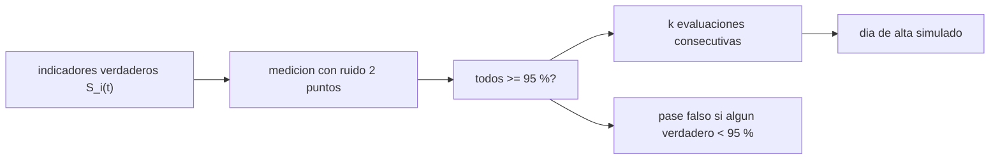

# B107-C09 — Progresión de recuperación y criterios de alta

<!-- nav:top -->
[🏠 Programa](../../../../README.md) · [📚 Bloque B107](../../../tronco-comun/B107-acondicionamiento-fisico-y-rehabilitacion-de-astronautas.md) · [← Anterior: B107-C08 — Evaluación funcional posterior al vuelo](../B107-C08-evaluacion-funcional-posterior-al-vuelo/CLASE.md) · [Siguiente: B107-C10 — Indicadores de rehabilitación y seguimiento →](../B107-C10-indicadores-de-rehabilitacion-y-seguimiento/CLASE.md)
<!-- /nav -->

## 1. Ubicación, nivel y alcance

Clase 9 del bloque B107, nivel N3. Trata **cómo se diseña una regla de progresión y de alta como un problema de decisión con error de medida**: qué umbral, cuántas evaluaciones de confirmación y con qué probabilidad de equivocarse. Es un ejercicio de diseño con indicadores **sintéticos**; **no propone criterios clínicos**.

## 2. Por qué esta clase existe

Los fragmentos consultados indican que la pérdida de fuerza tras misiones largas conlleva riesgos operativos y médicos (English et al., 2015) y que existen baterías de pruebas funcionales y medidas fisiológicas (Mulavara et al., 2018). Una regla de alta combina varios indicadores con ruido. La decisión central: **¿con qué frecuencia una regla «todos por encima del umbral» da el alta antes de tiempo solo por el ruido, y cuánto la reduce exigir dos evaluaciones consecutivas?**

## 3. Lo que podrás hacer al terminar

1. Calcular el día en que cada indicador exponencial cruza un umbral: `τ ln(D/(100 − umbral))`.
2. Aplicar una regla conjuntiva («todos ≥ umbral») con `k` evaluaciones consecutivas.
3. Calcular la probabilidad de pase falso con normales y verificarla por simulación.
4. Cuantificar el efecto de exigir `k = 2` y su costo en tiempo.
5. Explicar por qué el indicador más lento fija el calendario.
6. Rotular lo sintético, lo consultado y lo no consultado, sin dar consejo médico ni operativo.

La evidencia es la **regla de alta con su tasa de error** del ejercicio 12 (sección 20).

## 4. Con qué llegas y cómo comprobarlo

1. ¿Qué es una conjunción lógica?
2. ¿Qué es la función `Φ` de la normal?
3. ¿Qué es un pase falso?
4. ¿Qué es un umbral?
5. ¿Qué es un dato sintético?

<details>
<summary>Ver respuestas</summary>

1. Una condición que exige que todas las partes se cumplan. 2. La probabilidad acumulada de la distribución normal estándar. 3. Cumplir el criterio por azar cuando el valor verdadero no lo cumple. 4. Un valor de corte; aquí, 95 % del valor previo, del ejemplo. 5. Un dato generado para el ejemplo, no medido.
</details>

Con cuatro o cinco aciertos, sigue; si no, repasa los prerrequisitos.

## 5. Un caso de contexto y casos de referencia

Cuatro indicadores **inventados** (fuerza, equilibrio, resistencia y marcha) con déficits de 22, 15, 30 y 12 % y constantes de 20, 14, 28 y 10 días cruzan el 95 % en los días 29,6; 15,4; 50,2 y 8,8: el más lento (resistencia) fija el día 55 de la primera evaluación posible (cada 5 días). Con ruido de 2 puntos, la probabilidad de que una evaluación del día 40 cumpla los cuatro umbrales es `11,1 %` por el cálculo y `11,14 %` simulado, aunque la resistencia verdadera es 92,8 %. Con `k = 1`, el 66,8 % de las simulaciones da el alta antes del día 55; con `k = 2`, el 14,4 %. Es el **ejemplo conductor**: todo es **sintético**.

## 6. Vocabulario

Un **indicador** es una medida en % del valor previo. Un **umbral** es el corte (95 %, del ejemplo). La **regla conjuntiva** exige todos. La **confirmación** `k` exige `k` evaluaciones seguidas. Un **pase falso** es cumplir el criterio por ruido. **Alta** aquí es solo el nombre del evento simulado, no un criterio clínico.

## 7. Modelo mental



*Descripción textual:* los indicadores verdaderos se miden con ruido; la regla exige todos sobre el umbral y `k` evaluaciones seguidas; el resultado es un día de alta con una probabilidad de pase falso.

Analogía: una aduana que deja pasar a quien muestra todos los sellos: con un sello borroso a veces deja pasar a quien no los tiene todos. Límite: aquí el ruido es independiente entre evaluaciones.

## 8. La explicación, paso a paso

### 8.1 Cruce de un umbral

Con `S_i(t) = 100 − D_i e^{-t/τ_i}`, el cruce del 95 % ocurre en `t = τ_i ln(D_i/5)`: fuerza `20·ln 4,4 = 29,6`; equilibrio `14·ln 3 = 15,4`; resistencia `28·ln 6 = 50,2`; marcha `10·ln 2,4 = 8,8` días. Sin ruido, la regla da el alta en la primera evaluación (cada 5 d) posterior a 50,2: el día 55 con `k = 1` y el 60 con `k = 2`.

### 8.2 El indicador lento manda

En una conjunción el calendario lo fija el indicador más lento: la resistencia (50,2 d). Acelerar los demás no cambia el alta.

### 8.3 Pase falso

En el día 40 los verdaderos son 97,0; 99,1; 92,8 y 99,8. Cada uno pasa con probabilidad `1 − Φ((95 − v)/2)`: 0,84; 0,98; 0,136 y 0,99. El producto, `≈ 11 %`, coincide con la simulación (`11,14 %` con 30.000 repeticiones; teórica exacta `11,23 %`). Un 11 % de pases en un día en que la resistencia verdadera aún no llega es el costo del ruido.

### 8.4 Efecto de la confirmación

Con 4.000 simulaciones: `k = 1` da mediana del día de alta 50 (P10–P90: 40–60) y `66,8 %` de altas antes del día 55; `k = 2` da mediana 60 (50–70) y `14,4 %`. Exigir dos evaluaciones cuesta 5 días en el caso sin ruido y reduce los pases falsos.

### 8.5 Qué no es

No es un criterio clínico: no se consultó ninguna regla real, los indicadores son inventados y el umbral del 95 % es del ejemplo. El ruido independiente entre evaluaciones es un supuesto: errores sistemáticos (sesgo del evaluador, efecto de práctica) no se reducen con repetir.

## 9. Magnitudes, símbolos y unidades

| Símbolo | Qué es | Unidad | Valor / nota |
|---|---|---|---|
| `D_i` | déficit inicial del indicador `i` | % | 22; 15; 30; 12 |
| `τ_i` | constante de tiempo | d | 20; 14; 28; 10 |
| `U` | umbral | % | 95 |
| `σ` | ruido de medida | puntos | 2,0 |
| `k` | evaluaciones consecutivas | — | 1 o 2 |
| `t_i` | cruce del umbral | d | 29,6; 15,4; 50,2; 8,8 |

## 10. Convenciones y referencias

Indicadores en % del valor previo; evaluaciones cada 5 días (5 a 90); ruido gaussiano independiente de 2,0 puntos; semilla 107; datos **sintéticos**. Tolerancias: día de alta analítico = día sin ruido; probabilidad de pase falso simulada frente a teórica ±1 punto (30.000 repeticiones); fracción de altas anticipadas con `k = 2` menor que con `k = 1`. Numpy 2.4.4, Python 3.12.9.

## 11. De dónde sale lo que afirmamos

| ID | Fuente | Localizador | Respalda | Estado |
|---|---|---|---|---|
| S1 | Mulavara, A. P. et al., «Physiological and Functional Alterations after Spaceflight and Bed Rest», Med Sci Sports Exerc, 2018 — PubMed, búsqueda https://pubmed.ncbi.nlm.nih.gov/?term=Functional+Task+Test+spaceflight (consultada 2026-11-10) | fragmento del resumen | examina cómo el vuelo afecta el desempeño en tareas funcionales y qué factores fisiológicos lo explican; la batería incluye siete pruebas funcionales y 15 medidas fisiológicas; el fragmento termina antes de los resultados | Consultada (solo fragmento del resumen) |
| S2 | English, K. L. et al., «Isokinetic Strength Changes Following Long-Duration Spaceflight on the ISS», Aerosp Med Hum Perform 86(12 Suppl):A68-A77, 2015 — PubMed (consultada 2026-11-10) | fragmento de la introducción | las misiones largas causan pérdida de fuerza muscular con riesgos operativos y médicos (egreso de emergencia, retorno, exploración); el fragmento termina antes de las cifras | Consultada (solo fragmento del resumen) |
| — | Regla de alta «todos los indicadores ≥ umbral en k evaluaciones consecutivas», los umbrales (95 %), las trayectorias exponenciales y el cálculo de pase falso con normales | — | las verifica el laboratorio | No consultada en una fuente concreta (las verifica el laboratorio) |

Límites: de Mulavara et al. (2018) y English et al. (2015) solo se vieron fragmentos de resumen o introducción: **no se consultó ningún criterio real de alta, de retorno al trabajo ni de progresión** de ninguna agencia o disciplina; los cuatro indicadores, sus déficits y constantes de tiempo, el umbral del 95 % y la regla de confirmación son **inventados**. Todas las consultas de PubMed se hicieron el 2026-11-10 y solo vieron los fragmentos que mostraba la página de resultados; no se leyó ningún artículo completo ni se verificaron cifras más allá de lo citado. Lo que no se consultó se rotula así y no se afirma como respaldado.

## 12. Cómo ver el resultado

| Regla | Día de alta sin ruido | Mediana con ruido (P10–P90) | Altas antes del día 55 (%) |
|---|---|---|---|
| `k = 1` | 55 | 50 (40–60) | 66,8 |
| `k = 2` | 60 | 60 (50–70) | 14,4 |

Probabilidad de que una evaluación del día 40 cumpla los cuatro umbrales: 11,23 % (teórica), 11,14 % (simulada). Todo **sintético**.

## 13. Ejemplo trabajado: cruce del umbral y pase falso de un indicador

**Paso 1 · Cruce.** Resistencia: `28·ln(30/5) = 28·1,792 = 50,2 d`.

**Paso 2 · Valor a 40 d.** `100 − 30·e^{-40/28} = 92,8 %`.

**Paso 3 · Pase.** `1 − Φ((95 − 92,8)/2) = 1 − Φ(1,1) = 13,6 %`.

**Paso 4 · Lectura.** Aunque la resistencia aún está 2,2 puntos bajo el umbral, una medida de las ruidosas la deja pasar una de cada siete veces.

## 14. Distintas formas de describir el problema

**Por tiempo:** cruce `t_i`. **Por regla:** conjunción y `k`. **Por probabilidad:** pase falso. **Por distribución:** día de alta (P10–P90). **Por tabla:** reglas y tasas.

## 15. Práctica guiada

**Ejercicio 1 · con los pasos indicados.** Calcula el cruce de la fuerza: `D = 22`, `τ = 20`. *Pasos:* `τ ln(D/5)`.

<details><summary>Solución comentada</summary>

`20·ln 4,4 = 29,6 d`.
</details>

**Ejercicio 2 · con una pista.** Calcula el cruce de la marcha: `D = 12`, `τ = 10`.

<details><summary>Solución comentada</summary>

`10·ln 2,4 = 8,8 d`.
</details>

**Ejercicio 3 · casi autónomo.** ¿Cuánto vale la resistencia a 40 d (`D = 30`, `τ = 28`)? *Pista:* `100 − D e^{-t/τ}`.

<details><summary>Solución comentada</summary>

`92,8 %`.
</details>

## 16. Práctica autónoma, transferencia e integrador

**Ejercicio 4 · autónomo.** ¿Qué probabilidad tiene un solo indicador de pasar a 92,8 % con ruido 2?

<details><summary>Solución comentada</summary>

`1 − Φ(1,1) = 13,6 %`.
</details>

**Ejercicio 5 · autónomo.** Si la confirmación `k = 2` exige dos pases independientes de ese indicador, ¿qué probabilidad tienen?

<details><summary>Solución comentada</summary>

`0,136² = 1,8 %`.
</details>

**Ejercicio 6 · autónomo.** ¿Qué probabilidad tiene con ruido 1,0?

<details><summary>Solución comentada</summary>

`1 − Φ(2,2) = 1,4 %`.
</details>

**Ejercicio 7 · autónomo.** ¿Qué indicador fija el calendario y por qué?

<details><summary>Solución comentada</summary>

La resistencia (50,2 d), el más lento: en una conjunción manda el último.
</details>

**Ejercicio 8 · autónomo.** ¿Cuánto retrasa la regla `k = 2` el alta sin ruido?

<details><summary>Solución comentada</summary>

Una evaluación: 5 días (55 → 60).
</details>

**Ejercicio 9 · transferencia.** **Transferencia.** **Transferencia.** Con el umbral en 90 %, ¿cuándo cruza la resistencia?

<details><summary>Solución comentada</summary>

`28·ln(30/10) = 30,8 d`: un umbral menos exigente adelanta 19 días, pero con otra definición de «recuperado».
</details>

**Ejercicio 10 · transferencia.** **Transferencia.** **Transferencia.** Un sesgo del evaluador de +2 puntos en todas las medidas, ¿lo corrige `k = 2`?

<details><summary>Solución comentada</summary>

No: repetir no reduce un error sistemático; hay que calibrar o usar el MDC95 y evaluadores cruzados (B107-C08).
</details>

**Ejercicio 11 · transferencia.** **Transferencia.** **Transferencia.** Si el costo de un pase falso es mayor que el de una espera de 5 días, ¿qué `k` elegirías en el modelo? ¿Qué falta para decidir de verdad?

<details><summary>Solución comentada</summary>

`k = 2` (14,4 % frente a 66,8 %). Para decidir de verdad faltan los costos reales, el criterio de la disciplina y la norma de la agencia, que aquí no existen.
</details>

**Ejercicio 12 · integrador.** **Integrador.** **Integrador.** Elabora tu *regla de alta con su tasa de error*: cruces, regla conjuntiva, pase falso teórico y simulado, efecto de `k`, costo en tiempo y lista de qué es sintético, consultado y no consultado.

<details><summary>Solución comentada</summary>

Secciones 8.1–8.5 y la salida del laboratorio.
</details>

## 17. Laboratorio: criterios de progresión y de alta con error de medida

El script [criterios.py](criterios.py) calcula los cruces de umbral, el día de alta sin ruido, la probabilidad de pase falso teórica y simulada y la distribución del día de alta con `k = 1` y `2` (**comprueba** día analítico = día sin ruido, pase falso ±1 punto y menos altas anticipadas con `k = 2`).

**Datos:** cuatro indicadores y reglas **inventados**; semilla 107; 30.000 y 4.000 repeticiones. **Predice antes de ejecutar:** ¿Cuántos días retrasa `k = 2` el alta sin ruido? (5.) **Ejecución del 2026-11-10 (Python 3.12.9):**

```text
Python 3.12.9; numpy 2.4.4
DATOS SINTETICOS E ILUSTRATIVOS (semilla 107): 4 indicadores; umbral 95 %; ruido 2.0 puntos; reglas del ejemplo
Dia en que cada indicador verdadero cruza el 95 %: fuerza 29.6, equilibrio 15.4, resistencia 50.2, marcha 8.8
Sin ruido: dia de alta con k = 1: 55; con k = 2: 60; analitico (primera evaluacion >= 50.2 d) = 55
Evaluacion del dia 40: verdaderos = fuerza 97.0, equilibrio 99.1, resistencia 92.8, marcha 99.8
Probabilidad de que una sola evaluacion en el dia 40 cumpla todos los umbrales (pase falso si algun verdadero esta bajo): teorica = 11.23 %; simulada = 11.14 %
k = 1: dia de alta simulado: mediana = 50; P10-P90 = 40-60; altas antes del dia analitico 55 = 66.8 %
k = 2: dia de alta simulado: mediana = 60; P10-P90 = 50-70; altas antes del dia analitico 55 = 14.4 %
Pruebas superadas.
```

```bash
python programa/clases/B107/B107-C09-progresion-de-recuperacion-y-criterios-de-alta/criterios.py
```

**Límites:** ruido independiente y normal; indicadores exponenciales; regla inventada; no hay costos reales ni criterio clínico.

## 18. Errores frecuentes y cómo corregirlos

**Creer que repetir elimina cualquier error.** Solo reduce el aleatorio (8.5).

**Olvidar que la conjunción la manda el más lento.** Ver 8.2.

**Presentar la regla como criterio real de alta.** La clase no fija criterios (sección 21).

**Ignorar la probabilidad de pase falso.** Ver 8.3.

## 19. Cómo sabrás que vas bien

Tras la sección 8: ¿qué porcentaje de altas anticipadas esperabas con `k = 1` y cuál da la tabla? Si dudas, repasa el ejemplo 13. Tras el laboratorio: ¿qué comprueba? (ver la sección 17).

## 20. Qué entregas y cómo se evalúa

El producto es tu **regla de alta con su tasa de error** (ejercicio 12).

| Criterio | Inicial | En desarrollo | Logrado | Destacado |
|---|---|---|---|---|
| Conceptos | Confunde umbral y regla | Parciales | Explica la conjunción, `k` y el pase falso | Explica el efecto de `k` y el costo |
| Cálculo | Sin unidades | Con errores | Calcula cruces y probabilidades | Calcula casos nuevos |
| Numérico | Sin comprobar | Un caso | Compara con la forma cerrada o la verdad conocida | Interpreta las diferencias |
| Fuentes | Sin fuente | Sin fecha | Fuentes con fecha y estado | Declara lo sintético y lo no consultado |
| Límites | No los nombra | Uno | Tres | Discute qué falta del modelo |

**Condiciones críticas (no se compensan con promedio):** rotular los datos como sintéticos; no dar consejo médico, de entrenamiento ni operativo; citar solo lo consultado.

## 21. Ética, seguridad y límites

Clase **educativa**: **no da consejo médico, de entrenamiento ni operativo**, no prescribe ejercicio ni fija criterios clínicos, y no sustituye la formación, la licencia ni la supervisión de profesionales de la salud ni de los equipos médicos de una agencia. Esta clase **no define criterios de alta**: las decisiones de alta o de retorno a la actividad las toma un equipo clínico con sus normas y con la persona; aquí solo se ve cómo el error de medida afecta a una regla inventada. Accesibilidad: tablas equivalentes a las gráficas, fórmulas en texto, ejercicios sin conexión.

## 22. Para cerrar y seguir

Con `k = 1` casi dos de cada tres simulaciones dan el alta antes de tiempo por ruido; con `k = 2`, una de cada siete. Queda una pregunta: ¿qué indicadores permiten dar seguimiento a una cohorte cuando no todos alcanzan el criterio durante el seguimiento?

**Glosario español–inglés.** umbral · *threshold* · pase falso · *false pass* · criterio de alta · *discharge criterion* · regla conjuntiva · *conjunctive rule* · progresión · *progression*.

**Continuidad.** [B107-C10](../B107-C10-indicadores-de-rehabilitacion-y-seguimiento/CLASE.md) trata los indicadores de rehabilitación y seguimiento.

**Referencias:** ver sección 11.

<!-- nav:bottom -->
---

[← Anterior: B107-C08 — Evaluación funcional posterior al vuelo](../B107-C08-evaluacion-funcional-posterior-al-vuelo/CLASE.md) · [📚 Bloque B107](../../../tronco-comun/B107-acondicionamiento-fisico-y-rehabilitacion-de-astronautas.md) · [Siguiente: B107-C10 — Indicadores de rehabilitación y seguimiento →](../B107-C10-indicadores-de-rehabilitacion-y-seguimiento/CLASE.md)
<!-- /nav -->
