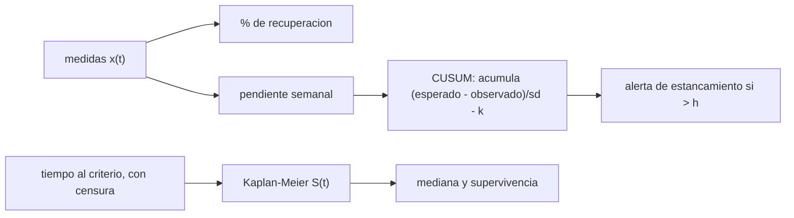

# B107-C10 — Indicadores de rehabilitación y seguimiento

<!-- nav:top -->
[🏠 Programa](../../../../README.md) · [📚 Bloque B107](../../../tronco-comun/B107-acondicionamiento-fisico-y-rehabilitacion-de-astronautas.md) · [← Anterior: B107-C09 — Progresión de recuperación y criterios de alta](../B107-C09-progresion-de-recuperacion-y-criterios-de-alta/CLASE.md) · [Siguiente: B108-C01 — Sistemas portátiles de soporte vital (PLSS) →](../../B108/B108-C01-sistemas-portatiles-de-soporte-vital-plss/CLASE.md)
<!-- /nav -->

## 1. Ubicación, nivel y alcance

Clase 10 del bloque B107 y cierre del segundo tramo, nivel N3. Trata los **indicadores de rehabilitación y seguimiento**: el porcentaje de recuperación, el tiempo hasta el criterio con **datos censurados** (el estimador de Kaplan–Meier) y un control CUSUM para detectar un estancamiento. Todo sobre una cohorte **sintética**.

## 2. Por qué esta clase existe

Los fragmentos consultados describen el entrenamiento en la ISS (Loehr et al., 2015) y baterías funcionales con medidas fisiológicas (Mulavara et al., 2018), pero un seguimiento necesita **indicadores bien definidos y bien calculados**. La decisión central: **¿cómo se resume el tiempo hasta el criterio cuando parte de la cohorte aún no lo alcanza al terminar el seguimiento, y cómo se detecta a tiempo que una recuperación se estancó?**

## 3. Lo que podrás hacer al terminar

1. Calcular el porcentaje de recuperación `100 (x − x_R1)/(x_prev − x_R1)` y reconocer su inestabilidad cuando el denominador es pequeño.
2. Estimar la curva de supervivencia (tiempo hasta el criterio) con Kaplan–Meier con datos censurados.
3. Comparar KM con el conteo directo y con la curva teórica.
4. Calcular un CUSUM unilateral y su tasa de falsas alarmas y su detección.
5. Explicar por qué ignorar la censura sesga el tiempo medio.
6. Rotular lo sintético, lo consultado y lo no consultado, sin dar consejo médico ni operativo.

La evidencia es la **panel de indicadores de una cohorte sintética** del ejercicio 12 (sección 20).

## 4. Con qué llegas y cómo comprobarlo

1. ¿Qué es una distribución exponencial?
2. ¿Qué es un dato censurado?
3. ¿Qué es una función de supervivencia?
4. ¿Qué es un control CUSUM?
5. ¿Qué es un dato sintético?

<details>
<summary>Ver respuestas</summary>

1. La de un tiempo de espera con tasa constante; su media es el inverso de la tasa. 2. Un tiempo que solo se sabe que es mayor que lo observado, porque el seguimiento terminó. 3. La probabilidad de que el evento aún no haya ocurrido en `t`. 4. Una suma acumulada de desviaciones que se dispara al superar un umbral. 5. Un dato generado para el ejemplo, no medido.
</details>

Con cuatro o cinco aciertos, sigue; si no, repasa los prerrequisitos.

## 5. Un caso de contexto y casos de referencia

Una cohorte **inventada** de 40 personas con tiempo hasta el criterio exponencial de media 30 d y seguimiento de 45 d: 30 alcanzan el criterio y 10 quedan **censuradas**. Kaplan–Meier da `S = 0,525` a 15 d, `0,300` a 30 d y `0,250` a 45 d (teóricas 0,607; 0,368; 0,223) y una mediana de `15,7 d` (teórica 20,8). Un CUSUM de la pendiente semanal (`k = 0,5`, `h = 4`) tiene `1,0 %` de falsas alarmas y detecta un estancamiento introducido en la semana 5 en el `96,7 %` de 300 corridas. Es el **ejemplo conductor**: todo es **sintético**.

## 6. Vocabulario

El **% de recuperación** compara el valor actual con el del día 1 y con el previo. El **tiempo hasta el criterio** es el tiempo en alcanzar un umbral. La **censura** es no haber alcanzado el criterio al terminar. **Kaplan–Meier** estima `S(t)` con censura. El **CUSUM** acumula las desviaciones hacia abajo respecto de lo esperado.

## 7. Modelo mental



*Descripción textual:* las medidas dan el porcentaje de recuperación y la pendiente semanal; los tiempos con censura dan la curva de Kaplan–Meier y el CUSUM de la pendiente emite una alerta de estancamiento.

Analogía: un cuaderno de seguimiento: la curva resume quién ha llegado y cuándo, sin contar como «llegado» a quien aún no terminó; el CUSUM es una alarma que suena si varias semanas seguidas van peor de lo esperado. Límite: aquí la cohorte es simulada y homogénea.

## 8. La explicación, paso a paso

### 8.1 % de recuperación

`R = 100 (x − x_R1)/(x_prev − x_R1)`. Con `x_prev = 100`, `x_R1 = 70` y `x = 85`: `50 %`. Si el déficit inicial es pequeño (`x_prev − x_R1 = 2`), un punto de ruido mueve `R` 50 puntos: el indicador es inestable.

### 8.2 Kaplan–Meier

En cada instante con eventos, `S ← S (1 − d/n_riesgo)`. Ejemplo mínimo con 5 personas (tiempos 5E, 10E, 20C, 30E, 40C): `S(5) = 0,8`, `S(10) = 0,6`, `S(30) = 0,3`. Con la cohorte sintética de 40, KM coincide con el conteo directo (sin censura antes del final del seguimiento) y difiere de la teórica hasta 0,08 por tamaño muestral.

### 8.3 Censura

Ignorar a los 10 censurados y promediar solo los 30 que alcanzaron el criterio daría un tiempo medio demasiado bajo; KM los usa hasta el día 45. La mediana de KM es 15,7 d (teórica 20,8): con 40 personas el error es grande, la incertidumbre es amplia (`√(0,3·0,7/40) = 0,072` de error típico en `S(30)`).

### 8.4 CUSUM

`C_i = máx(0, C_{i−1} + (esp − x_i)/σ − k)` y alerta si `C > h`. Con `esp = 5` puntos/semana, `σ = 3`, `k = 0,5` y `h = 4`: sin estancamiento, 1,0 % de falsas alarmas en 12 semanas; con una pendiente de 0,5 desde la semana 5, detección en 96,7 % de las corridas. Cada semana estancada suma `(5 − 0,5)/3 − 0,5 = 1,0` en media, de modo que se esperan unas 4 semanas hasta superar `h = 4`.

### 8.5 Qué no captura

No hay covariables, riesgos competidores, ni dependencia entre indicadores. Los parámetros del CUSUM son del ejemplo; una pendiente baja no dice por qué se estancó. Y ninguno de estos números procede de datos reales de astronautas.

## 9. Magnitudes, símbolos y unidades

| Símbolo | Qué es | Unidad | Valor / nota |
|---|---|---|---|
| `R` | % de recuperación | % | 0 a 100 |
| `S(t)` | supervivencia (aún sin criterio) | — | 0,525 a 15 d |
| `n_riesgo` | personas en riesgo | — | decrece con `t` |
| `k`, `h` | holgura y umbral del CUSUM | desviaciones | 0,5; 4 |
| `esp`, `σ` | mejora semanal esperada y su dispersión | puntos/semana | 5; 3 |

## 10. Convenciones y referencias

Tiempo en días; seguimiento máximo de 45 d; semanas de 7 d para el CUSUM (12 semanas); cohorte de 40; semilla 107; datos **sintéticos**. Tolerancias: KM igual al conteo directo (1e-9) en 15 y 30 d; KM frente a `e^{-t/30}` ±0,12; falsas alarmas del CUSUM < 10 % y detección > 80 % en 300 corridas. Numpy 2.4.4, Python 3.12.9.

## 11. De dónde sale lo que afirmamos

| ID | Fuente | Localizador | Respalda | Estado |
|---|---|---|---|---|
| S1 | Mulavara, A. P. et al., «Physiological and Functional Alterations after Spaceflight and Bed Rest», Med Sci Sports Exerc, 2018 — PubMed, búsqueda https://pubmed.ncbi.nlm.nih.gov/?term=Functional+Task+Test+spaceflight (consultada 2026-11-10) | fragmento del resumen | examina cómo el vuelo afecta el desempeño en tareas funcionales y qué factores fisiológicos lo explican; la batería incluye siete pruebas funcionales y 15 medidas fisiológicas; el fragmento termina antes de los resultados | Consultada (solo fragmento del resumen) |
| S2 | Loehr, J. A. et al., «Physical Training for Long-Duration Spaceflight», Aerosp Med Hum Perform 86(12 Suppl):A14-A23, 2015 — PubMed, búsqueda https://pubmed.ncbi.nlm.nih.gov/?term=Loehr+Physical+training+for+long-duration+spaceflight (consultada 2026-11-10) | fragmento del resumen | el entrenamiento físico se realiza en la ISS desde hace unos 10 años y cada agencia socia diseñó su propio enfoque; el fragmento termina antes de los hallazgos | Consultada (solo fragmento del resumen) |
| — | Estimador de Kaplan–Meier, CUSUM unilateral con `k = 0,5` y `h = 4`, indicador de % de recuperación y la distribución exponencial de los tiempos | — | las verifica el laboratorio | No consultada en una fuente concreta (las verifica el laboratorio) |

Límites: de Mulavara et al. (2018) y Loehr et al. (2015) solo se vieron fragmentos de resumen: ningún indicador, tiempo de recuperación ni método de seguimiento de la literatura se tomó de ellos; la cohorte de 40, los tiempos exponenciales de media 30 d y los parámetros del CUSUM son **inventados**; Kaplan–Meier y CUSUM **no se consultaron** en una fuente concreta. Todas las consultas de PubMed se hicieron el 2026-11-10 y solo vieron los fragmentos que mostraba la página de resultados; no se leyó ningún artículo completo ni se verificaron cifras más allá de lo citado. Lo que no se consultó se rotula así y no se afirma como respaldado.

## 12. Cómo ver el resultado

| `t` (d) | KM `S(t)` | Conteo directo | Teórica `e^{-t/30}` |
|---|---|---|---|
| 15 | 0,525 | 0,525 | 0,607 |
| 30 | 0,300 | 0,300 | 0,368 |
| 45 | 0,250 | 0,250 | 0,223 |

Mediana KM: 15,7 d (teórica 20,8). CUSUM: falsas alarmas 1,0 %; detección 96,7 %. Todo **sintético**.

## 13. Ejemplo trabajado: Kaplan–Meier mínimo y un paso de CUSUM

**Paso 1 · Datos.** Cinco personas: 5 E, 10 E, 20 C, 30 E, 40 C (E = criterio, C = censura).

**Paso 2 · KM.** `S(5) = 4/5 = 0,8`; `S(10) = 0,8·3/4 = 0,6`; en 20 hay censura; `S(30) = 0,6·1/2 = 0,3`.

**Paso 3 · CUSUM.** Con `esp = 5`, `σ = 3`, `x = 0,5`: aporte `(5 − 0,5)/3 − 0,5 = 1,0`.

**Paso 4 · Lectura.** Cuatro semanas así superan `h = 4`; el CUSUM avisa al cabo de ese tiempo, no al instante.

## 14. Distintas formas de describir el problema

**Por porcentaje:** `R`. **Por curva:** `S(t)`. **Por mediana:** tiempo al 50 %. **Por alarma:** CUSUM. **Por tabla:** KM, conteo y teoría.

## 15. Práctica guiada

**Ejercicio 1 · con los pasos indicados.** Calcula `R` con `x_prev = 100`, `x_R1 = 70` y `x = 85`. *Pasos:* `100(x − x_R1)/(x_prev − x_R1)`.

<details><summary>Solución comentada</summary>

`50 %`.
</details>

**Ejercicio 2 · con una pista.** Calcula `S(30)` del ejemplo de 5 personas. *Pista:* ver 13.

<details><summary>Solución comentada</summary>

`0,3`.
</details>

**Ejercicio 3 · casi autónomo.** ¿Cuánto aporta una semana con `x = 0,5` al CUSUM (`esp = 5`, `σ = 3`, `k = 0,5`)?

<details><summary>Solución comentada</summary>

`1,0`.
</details>

## 16. Práctica autónoma, transferencia e integrador

**Ejercicio 4 · autónomo.** ¿Cuántas semanas así hacen falta para superar `h = 4`?

<details><summary>Solución comentada</summary>

Más de 4: cinco (4 daría exactamente 4, no mayor).
</details>

**Ejercicio 5 · autónomo.** ¿Cuál es la mediana teórica de un tiempo exponencial de media 30 d?

<details><summary>Solución comentada</summary>

`30·ln 2 = 20,8 d`.
</details>

**Ejercicio 6 · autónomo.** ¿Qué fracción debe alcanzar el criterio en 45 d con media 30 d? ¿Y cuántos de 40?

<details><summary>Solución comentada</summary>

`1 − e^{-1,5} = 77,7 %`; 31 de 40 (se observaron 30).
</details>

**Ejercicio 7 · autónomo.** ¿Por qué promediar solo a quienes llegaron al criterio sesga el tiempo medio?

<details><summary>Solución comentada</summary>

Porque excluye a los más lentos (censurados) y subestima el tiempo.
</details>

**Ejercicio 8 · autónomo.** ¿Por qué no basta el conteo directo cuando hay censura antes del final?

<details><summary>Solución comentada</summary>

Porque los censurados no son «sin evento» seguros; KM los cuenta solo mientras están en riesgo.
</details>

**Ejercicio 9 · transferencia.** **Transferencia.** **Transferencia.** Con `h = 5` en vez de 4, ¿qué cambia en el CUSUM?

<details><summary>Solución comentada</summary>

Menos falsas alarmas y mayor retraso de detección (una semana más en el caso medio).
</details>

**Ejercicio 10 · transferencia.** **Transferencia.** **Transferencia.** Con `x_prev = 100`, `x_R1 = 98` y `x = 99`, ¿cuánto vale `R`? ¿Y con `x = 98`?

<details><summary>Solución comentada</summary>

`50 %` y `0 %`: un punto de ruido mueve 50 puntos; el denominador es demasiado pequeño para usar `R`.
</details>

**Ejercicio 11 · transferencia.** **Transferencia.** **Transferencia.** ¿Qué error típico tiene `S(30) = 0,3` con 40 personas?

<details><summary>Solución comentada</summary>

`√(0,3·0,7/40) = 0,072`; con n = 10 sería 0,145: las cohortes pequeñas dan curvas muy inciertas.
</details>

**Ejercicio 12 · integrador.** **Integrador.** **Integrador.** Elabora tu *panel de indicadores de una cohorte sintética*: `R`, KM con censura, mediana, CUSUM con sus tasas y lista de qué es sintético, consultado y no consultado.

<details><summary>Solución comentada</summary>

Secciones 8.1–8.5 y la salida del laboratorio.
</details>

## 17. Laboratorio: Kaplan–Meier con censura y CUSUM de estancamiento

El script [indicadores.py](indicadores.py) calcula el estimador de Kaplan–Meier de una cohorte sintética con censura, lo compara con el conteo directo y con la curva teórica y evalúa un CUSUM sobre una serie semanal con y sin estancamiento (**comprueba** KM = conteo directo, KM frente a teórica ±0,12, falsas alarmas < 10 % y detección > 80 %).

**Datos:** cohorte de 40 **inventada** (tiempos exponenciales de media 30 d, seguimiento de 45 d); semilla 107. **Predice antes de ejecutar:** ¿Cuántas semanas tarda el CUSUM, en media, en detectar un estancamiento? (alrededor de 4 contadas desde que empieza; el laboratorio reporta 3,1 tras la primera semana estancada.) **Ejecución del 2026-11-10 (Python 3.12.9):**

```text
Python 3.12.9; numpy 2.4.4
DATOS SINTETICOS E ILUSTRATIVOS (semilla 107): cohorte de 40; tiempo al criterio exp(media 30 d); seguimiento 45 d
Alcanzan el criterio: 30 de 40; censurados en el dia 45: 10
t =   15 d: KM S = 0.525; conteo directo = 0.525; teorico exp(-t/30) = 0.607
t =   30 d: KM S = 0.300; conteo directo = 0.300; teorico exp(-t/30) = 0.368
t =   45 d: KM S = 0.250; conteo directo = 0.250; teorico exp(-t/30) = 0.223
Mediana de tiempo al criterio (KM) = 15.7 d (teorica 20.8 d)
CUSUM (k = 0.5, h = 4): falsas alarmas sin estancamiento = 1.0 % de 300; con estancamiento desde la semana 5 se detecta en 96.7 % de 300 corridas, con 3.1 semanas de retraso tras la primera semana estancada (indice base 0)
Pruebas superadas.
```

```bash
python programa/clases/B107/B107-C10-indicadores-de-rehabilitacion-y-seguimiento/indicadores.py
```

**Límites:** cohorte homogénea; una sola serie de seguimiento; parámetros de CUSUM del ejemplo; sin covariables; no son datos de astronautas.

## 18. Errores frecuentes y cómo corregirlos

**Ignorar la censura.** Subestima el tiempo (8.3).

**Usar `R` cuando el déficit inicial es pequeño.** Ver ejercicio 10.

**Confundir una alerta de CUSUM con un diagnóstico.** Solo señala un cambio (8.5).

**Interpretar una curva de 40 personas como exacta.** Tiene error típico de 0,07 (8.3).

## 19. Cómo sabrás que vas bien

Tras la sección 8: ¿qué `S(30)` esperabas y cuál da la tabla? Si dudas, repasa el ejemplo 13. Tras el laboratorio: ¿qué comprueba? (ver la sección 17).

## 20. Qué entregas y cómo se evalúa

El producto es tu **panel de indicadores de una cohorte sintética** (ejercicio 12).

| Criterio | Inicial | En desarrollo | Logrado | Destacado |
|---|---|---|---|---|
| Conceptos | Confunde porcentaje y tiempo | Parciales | Explica `R`, KM y CUSUM | Explica censura y falsas alarmas |
| Cálculo | Sin unidades | Con errores | Calcula `R`, KM y CUSUM | Calcula casos nuevos |
| Numérico | Sin comprobar | Un caso | Compara con la forma cerrada o la verdad conocida | Interpreta las diferencias |
| Fuentes | Sin fuente | Sin fecha | Fuentes con fecha y estado | Declara lo sintético y lo no consultado |
| Límites | No los nombra | Uno | Tres | Discute qué falta del modelo |

**Condiciones críticas (no se compensan con promedio):** rotular los datos como sintéticos; no dar consejo médico, de entrenamiento ni operativo; citar solo lo consultado.

## 21. Ética, seguridad y límites

Clase **educativa**: **no da consejo médico, de entrenamiento ni operativo**, no prescribe ejercicio ni fija criterios clínicos, y no sustituye la formación, la licencia ni la supervisión de profesionales de la salud ni de los equipos médicos de una agencia. Los indicadores de seguimiento de una persona real los define y los interpreta el equipo clínico con su protocolo; una alerta estadística no es una decisión de tratamiento ni de aptitud. Accesibilidad: tablas equivalentes a las gráficas, fórmulas en texto, ejercicios sin conexión.

## 22. Para cerrar y seguir

Con 40 personas sintéticas, KM da `S(30) = 0,300` con error típico de 0,07 y el CUSUM detecta el estancamiento en el 96,7 % de las corridas con 1,0 % de falsas alarmas. El bloque cierra aquí: medir con su error es el hilo común de sus diez clases.

**Glosario español–inglés.** censura · *censoring* · supervivencia · *survival function* · estancamiento · *plateau* · seguimiento · *follow-up* · cohorte · *cohort*.

**Continuidad.** Con esta clase termina el bloque B107; vuelve a la [guía del bloque](../../../tronco-comun/B107-acondicionamiento-fisico-y-rehabilitacion-de-astronautas.md).

**Referencias:** ver sección 11.

<!-- nav:bottom -->
---

[← Anterior: B107-C09 — Progresión de recuperación y criterios de alta](../B107-C09-progresion-de-recuperacion-y-criterios-de-alta/CLASE.md) · [📚 Bloque B107](../../../tronco-comun/B107-acondicionamiento-fisico-y-rehabilitacion-de-astronautas.md) · [Siguiente: B108-C01 — Sistemas portátiles de soporte vital (PLSS) →](../../B108/B108-C01-sistemas-portatiles-de-soporte-vital-plss/CLASE.md)
<!-- /nav -->
