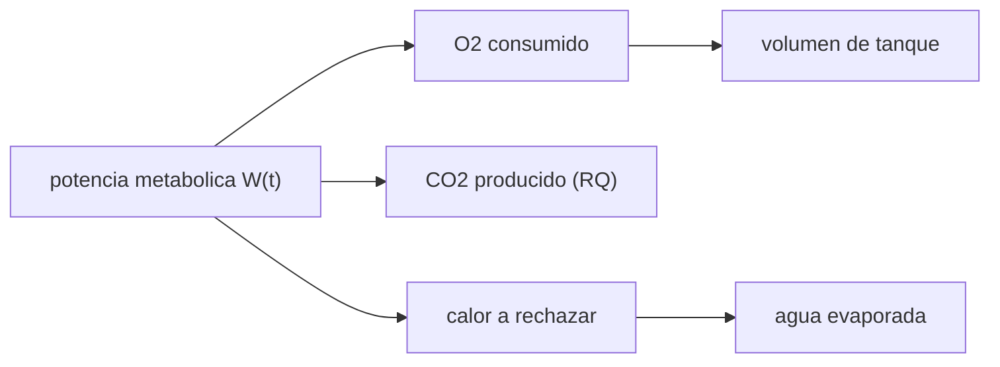

# B108-C01 — Sistemas portátiles de soporte vital (PLSS)

<!-- nav:top -->
[🏠 Programa](../../../../README.md) · [📚 Bloque B108](../../../tronco-comun/B108-actividades-extravehiculares-y-trajes-espaciales.md) · [← Anterior: B107-C10 — Indicadores de rehabilitación y seguimiento](../../B107/B107-C10-indicadores-de-rehabilitacion-y-seguimiento/CLASE.md) · [Siguiente: B108-C02 — Planificación de desplazamientos y rutas de EVA →](../B108-C02-planificacion-de-desplazamientos-y-rutas-de-eva/CLASE.md)
<!-- /nav -->

## 1. Ubicación, nivel y alcance

Clase 1 del bloque B108. Nivel N3. El hábitat tiene un sistema de soporte vital fijo; el traje lleva uno **portátil** que debe mantener a una persona respirable, refrigerada y a presión durante horas de trabajo. Aquí conviertes un perfil de tasa metabólica en consumos de oxígeno, producción de CO₂ y agua evaporada para refrigerar, y lo contrastas con rangos publicados de una prueba de la NASA. Se apoya en [B106](../../../tronco-comun/B106-habitats-espaciales-y-soporte-vital.md) solo como idea de balance de masa. La EVA es **sintética** y la clase es educativa: no da consejo médico ni operativo.

## 2. Por qué esta clase existe

B106-C09 trata el soporte vital de hábitat; el del traje no tiene clase. La decisión central: **¿cuánto oxígeno, cuánto calor a rechazar y cuánto CO₂ genera una EVA con un perfil de esfuerzo dado, y qué margen deja el sistema?**

## 3. Lo que podrás hacer al terminar

1. Nombrar los tres subsistemas de un PLSS: oxígeno, ventilación y térmico.
2. Calcular el volumen y la masa de O₂ consumidos con `V = W t / e`.
3. Calcular el CO₂ producido con el cociente respiratorio.
4. Calcular el agua evaporada para rechazar un calor dado.
5. Dimensionar el volumen de un tanque con la ley de gas ideal y la presión útil.
6. Separar lo consultado (rangos de prueba, presión del traje) de lo ilustrativo (perfil de la EVA).

La evidencia es la **ficha de consumibles de una EVA sintética** del ejercicio 12 (sección 20).

## 4. Con qué llegas y cómo comprobarlo

1. ¿Qué es la potencia metabólica y en qué unidades se da?
2. ¿Qué es la ley de gas ideal?
3. ¿Qué es un calor latente?
4. ¿Qué es un dato sintético?
5. ¿Qué es una verificación por segunda vía?

<details>
<summary>Ver respuestas</summary>

1. La energía por unidad de tiempo que gasta el cuerpo, en W. 2. `P V = n R T`. 3. La energía para cambiar de fase una masa de sustancia, en J/kg. 4. Un dato generado para el ejemplo, no medido. 5. Calcular lo mismo con otro método y comparar.
</details>

Con cuatro o cinco aciertos, sigue; si no, repasa los prerrequisitos.

## 5. Un caso de contexto y casos de referencia

Una EVA **sintética** de 7,0 h con seis segmentos (egreso 300 W, traslado 450 W, trabajo 469 W, trabajo intenso 700 W, retorno 450 W, ingreso 300 W) consume `848,8 g` de O₂, produce `998,2 g` de CO₂ y evapora `4913,3 g` de agua. Es el **ejemplo conductor**. El perfil es ilustrativo; las potencias 469 W y 700 W son las de las pruebas PLSS 1.0.

## 6. Vocabulario

El **PLSS** (*portable life support system*) es la mochila del traje. Tiene tres subsistemas: **oxígeno** (suministro y regulación de presión), **ventilación** (circula gas, retira CO₂ y vapor) y **térmico** (rechaza el calor, en la prueba con un evaporador de membrana, SWME). El **cociente respiratorio** `RQ` es CO₂ producido sobre O₂ consumido. La **presión útil** es la fracción de presión del tanque que el regulador puede aprovechar.

## 7. Modelo mental: un presupuesto de energía que se vuelve masa



*Descripción textual:* la potencia metabólica determina el oxígeno consumido, el CO₂ producido y el calor a rechazar; el calor fija el agua evaporada y el oxígeno fija el tanque.

Analogía: el cuerpo es una caldera que quema oxígeno; todo lo que quema sale como CO₂, vapor y calor. Límite: se supone que todo el calor metabólico se rechaza por el sistema térmico, sin pérdidas por el traje.

## 8. La explicación, paso a paso

### 8.1 Oxígeno y CO₂

Con `e = 20,1 kJ/L` de O₂ (STP), `V_O₂ = W t / e`. A 469 W durante 3,5 h: `469 × 12600/20100 = 294,0 L`, es decir `420,1 g` con 1,429 g/L. El CO₂ es `RQ × V_O₂ × 1,977 g/L` con `RQ = 0,85`: `494,1 g`.

### 8.2 Tabla de la EVA sintética

| Segmento | t (h) | W | O₂ (g) | CO₂ (g) | Agua (g) |
|---|---|---|---|---|---|
| Egreso | 0,50 | 300 | 38,4 | 45,1 | 222,2 |
| Traslado | 0,75 | 450 | 86,4 | 101,6 | 500,0 |
| Trabajo | 3,50 | 469 | 420,1 | 494,1 | 2431,9 |
| Trabajo intenso | 1,00 | 700 | 179,2 | 210,7 | 1037,0 |
| Retorno | 0,75 | 450 | 86,4 | 101,6 | 500,0 |
| Ingreso | 0,50 | 300 | 38,4 | 45,1 | 222,2 |
| **Total** | 7,00 | media 473,8 | 848,8 | 998,2 | 4913,3 |

Energía metabólica total: `3,317 kWh`. El agua evaporada es `W t/h_fg` con `h_fg = 2,43 MJ/kg`: es agua de **rechazo de calor**, no el vapor exhalado.

### 8.3 Contraste con rangos publicados

En la prueba PLSS 1.0 la inyección de CO₂ se ajustó entre 28 y 280 g/h, el agua de vapor entre 35 y 89 g/h, la fuga del traje entre 2,1 y 4,2 g/h y el rechazo de diseño del evaporador fue 810 W. A 469 W el modelo da `141,2 g/h` de CO₂ y a 700 W `210,7 g/h`: ambos **dentro** del rango. El margen de 700 W frente a 810 W es `110 W`. Este contraste es de coherencia, no una validación: el banco usó nitrógeno y un modelo de la NASA para la inyección.

### 8.4 Reserva y tanque

Con fuga de `4,2 g/h × 7 h = 29,4 g` y una reserva ilustrativa de 30 min a 700 W (`89,6 g`), el O₂ requerido es `967,8 g = 30,25 mol`. La presión de suministro va de 25,86 MPa a 1,72 MPa, de modo que la fracción útil es `0,9335`. Con gas ideal a 293,15 K, el volumen es `n R T/(P_full × fracción) = 3,05 L`. Con gas real a esa presión el valor cambia: es un orden de magnitud, no un diseño.

## 9. Magnitudes, símbolos y unidades

| Símbolo | Qué es | Unidad | Valor / nota |
|---|---|---|---|
| `W` | potencia metabólica | W | 300–700 |
| `e` | energía por litro de O₂ | J/L | 20 100 (estándar) |
| `RQ` | cociente respiratorio | — | 0,85 (ilustrativo) |
| `h_fg` | calor latente | J/kg | 2,43×10⁶ (estándar) |
| `P_traje` | presión de operación del EMU | kPa | 29,6 (consultada) |
| `V_tanque` | volumen del tanque | L | 3,05 |

## 10. Convenciones y referencias

Volúmenes de gas a STP (0 °C, 101,325 kPa); el tanque a 293,15 K con gas ideal (`Z = 1`). Sistema de referencia: no aplica. Los valores de e, RQ, densidades, calor latente y `R` son relaciones estándar no consultadas en una fuente concreta.

## 11. De dónde sale lo que afirmamos

| ID | Fuente | Localizador | Respalda | Estado |
|---|---|---|---|---|
| S1 | NASA JSC, presentación sobre trajes espaciales (NTRS 20170004971) — https://ntrs.nasa.gov/citations/20170004971 (consultada 2026-11-10; PDF leído con PyMuPDF) | diapositiva «Extravehicular Mobility Unit» | presión de operación del EMU 4,3 psi (29,6 kPa); el EMU incluye un PLSS | Consultada |
| S2 | Watts et al., *Space Suit Portable Life Support System Test Bed (PLSS 1.0) Development and Testing*, AIAA (NTRS 20120007410) — https://ntrs.nasa.gov/citations/20120007410 (consultada 2026-11-10; PDF leído con PyMuPDF) | resumen, tabla 2 y secciones de ensayo | subsistemas oxígeno/ventilación/térmico; rangos de caudal, CO₂, agua y fuga; 469 W y 700 W; SWME 810 W; presión de suministro | Consultada |
| — | Relaciones estándar (energía por litro de O₂, RQ, densidades, calor latente, gas ideal) | — | las verifica el laboratorio con una segunda vía | No consultada en una fuente concreta |

Límites: el perfil de la EVA y la reserva son ilustrativos; no se consultaron los datos del EMU de vuelo (consumibles ni duraciones) ni los requisitos de la NASA.

## 12. Cómo ver el balance de una EVA

| Magnitud | Valor |
|---|---|
| O₂ total | 848,8 g |
| CO₂ total | 998,2 g |
| Agua evaporada | 4913,3 g |
| Potencia media | 473,8 W |
| Tanque (ilustrativo) | 3,05 L |

Descripción larga: el oxígeno y el CO₂ crecen con la energía; el trabajo de 3,5 h a 469 W domina el total.

## 13. Ejemplo trabajado: el segmento de trabajo intenso

**Paso 1 · Energía.** `700 W × 3600 s = 2,52 MJ`.

**Paso 2 · O₂.** `2,52×10⁶/20 100 = 125,4 L`, `× 1,429 = 179,2 g`.

**Paso 3 · CO₂.** `0,85 × 125,4 × 1,977 = 210,7 g`.

**Paso 4 · Agua.** `2,52×10⁶/2,43×10⁶ = 1,037 kg`.

## 14. Distintas formas de describir el consumo

**Por energía:** `W t`. **Por gas:** litros de O₂. **Por masa:** gramos. **Por calor:** vatios a rechazar. **Por presión:** volumen de tanque.

## 15. Práctica guiada

**Ejercicio 1 · con los pasos indicados.** Calcula el O₂ en gramos de 1 h a 300 W. *Pasos:* energía en julios, litros con 20 100 J/L, gramos con 1,429.

<details><summary>Solución comentada</summary>

`300×3600/20100 = 53,7 L`; `×1,429 = 76,8 g`.
</details>

**Ejercicio 2 · con una pista.** CO₂ de ese mismo tramo. *Pista:* `RQ × 53,7 × 1,977`.

<details><summary>Solución comentada</summary>

`0,85×53,7×1,977 = 90,2 g`.
</details>

**Ejercicio 3 · casi autónomo.** ¿Por qué el agua evaporada no es el vapor exhalado?

<details><summary>Solución comentada</summary>

Porque se calcula de la energía a rechazar y el calor latente; el vapor exhalado es otro flujo (35–89 g/h en la prueba).
</details>

## 16. Práctica autónoma, transferencia e integrador

**Ejercicio 4 · autónomo.** Agua evaporada en 2 h a 500 W.

<details><summary>Solución comentada</summary>

`500×7200/2,43×10⁶ = 1,481 kg`.
</details>

**Ejercicio 5 · autónomo.** Potencia media de dos segmentos: 1 h a 300 W y 3 h a 500 W.

<details><summary>Solución comentada</summary>

`(300+1500)/4 = 450 W`.
</details>

**Ejercicio 6 · autónomo.** ¿Cuántos moles son 967,8 g de O₂?

<details><summary>Solución comentada</summary>

`967,8/31,998 = 30,25 mol`.
</details>

**Ejercicio 7 · autónomo.** Si el volumen del tanque fuese el doble, ¿qué presión hace falta para el mismo oxígeno?

<details><summary>Solución comentada</summary>

La mitad (`P ∝ 1/V` a igual `n` y `T`).
</details>

**Ejercicio 8 · autónomo.** ¿Cuántos watts de margen quedan si el pico es 760 W frente a 810 W?

<details><summary>Solución comentada</summary>

`50 W`.
</details>

**Ejercicio 9 · transferencia.** **Transferencia.** Otro equipo usa `RQ = 1,0`. ¿Cómo cambia el CO₂?

<details><summary>Solución comentada</summary>

Sube en `1/0,85 = 17,6 %`; el O₂ no cambia.
</details>

**Ejercicio 10 · transferencia.** **Transferencia.** El gas real a 25,86 MPa se desvía del ideal. ¿Hacia dónde cambia el cálculo del tanque?

<details><summary>Solución comentada</summary>

Depende del factor de compresibilidad `Z`: si `Z < 1`, el tanque necesario es menor; si `Z > 1`, mayor. Hay que usar datos del gas real.
</details>

**Ejercicio 11 · transferencia.** **Transferencia.** ¿Por qué no se puede usar este balance para decidir una EVA real?

<details><summary>Solución comentada</summary>

El perfil es sintético, las constantes son estándar sin fuente de vuelo y no hay requisitos ni márgenes de la agencia.
</details>

**Ejercicio 12 · integrador.** **Integrador.** Elabora tu *ficha de consumibles de una EVA sintética*: tabla por segmento, contraste con los rangos de PLSS 1.0, tanque y lista de qué es consultado, estándar e ilustrativo.

<details><summary>Solución comentada</summary>

Secciones 8.1–8.4 y la salida del laboratorio.
</details>

## 17. Laboratorio: consumibles de una EVA sintética

El script [plss.py](plss.py) calcula el balance por segmento, lo contrasta con rangos consultados y estima un tanque (**comprueba** forma cerrada frente a suma numérica < 1e-9 y CO₂ dentro de 28–280 g/h).

**Datos:** presión del traje y rangos de PLSS 1.0 (consultados); perfil, reserva y temperatura **ilustrativos**. **Predice antes de ejecutar:** ¿qué CO₂ tendrá 1 h a 469 W? (unos 141 g.) **Ejecución del 2026-11-10 (Python 3.12.9):**

```text
Python 3.12.9 (biblioteca estandar)
EVA SINTETICA (perfil ilustrativo); presion de traje 29.6 kPa (consultada)
 segmento           t [h]   W    O2 [g]  CO2 [g]  agua [g]
 egreso             0.50    300     38.4     45.1    222.2
 traslado           0.75    450     86.4    101.6    500.0
 trabajo            3.50    469    420.1    494.1   2431.9
 trabajo intenso    1.00    700    179.2    210.7   1037.0
 retorno            0.75    450     86.4    101.6    500.0
 ingreso            0.50    300     38.4     45.1    222.2
 TOTAL              7.00          848.8    998.2   4913.3
Energia metabolica total = 3.317 kWh; potencia media = 473.8 W
Fuga del traje (4.2 g/h x 7.0 h) = 29.4 g
Diferencia relativa forma cerrada frente a suma numerica (dt = 1 s) = 3.08e-14
Contraste con rangos de ajuste de PLSS 1.0 (no es validacion):
  469 W: CO2  141.2 g/h (rango 28-280: dentro), agua evaporada  694.8 g/h, O2  120.0 g/h
  700 W: CO2  210.7 g/h (rango 28-280: dentro), agua evaporada 1037.0 g/h, O2  179.2 g/h
Margen frente al rechazo de diseno del SWME: 810 - 700 = 110 W
Reserva ilustrativa (30 min a 700 W) = 89.6 g; O2 total requerido = 967.8 g = 30.25 mol
Fraccion util de la presion (25.86 -> 1.72 MPa) = 0.9335; volumen de tanque (gas ideal, 293.15 K) = 3.05 L
Pruebas superadas.
```

```bash
python programa/clases/B108/B108-C01-sistemas-portatiles-de-soporte-vital-plss/plss.py
```

**Límites:** calor metabólico rechazado íntegramente, gas ideal, constantes estándar sin fuente de vuelo; la suma numérica valida el código, no la fisiología.

## 18. Errores frecuentes y cómo corregirlos

**Confundir el agua de rechazo de calor con el vapor exhalado.** Se corrige con 8.2.

**Tomar el contraste con rangos de la prueba como validación.** Se corrige con 8.3.

**Usar volúmenes de gas a otra temperatura sin corregir.** Se corrige con la sección 10.

**Presentar el perfil sintético como una EVA real.** Se corrige con la sección 5.

## 19. Cómo sabrás que vas bien

Tras la sección 8: ¿cuántos gramos de O₂ esperabas para 7 h y cuántos obtuviste? Si dudas, repasa el ejemplo 13. Tras el laboratorio: ¿qué comprueba? (ver la sección 17).

## 20. Qué entregas y cómo se evalúa

El producto es tu **ficha de consumibles de una EVA sintética** (ejercicio 12).

| Criterio | Inicial | En desarrollo | Logrado | Destacado |
|---|---|---|---|---|
| Conceptos | Los confunde | Parciales | Calcula O₂, CO₂ y agua | Explica los límites |
| Cálculo | Sin unidades | Con errores | Tablas completas con unidades | Calcula casos nuevos |
| Numérico | Sin comprobar | Un caso | Contraste con una segunda vía | Interpreta las diferencias |
| Fuentes | Sin fuente | Sin fecha | Fuentes con fecha y estado | Declara lo estándar e ilustrativo |
| Límites | No los nombra | Uno | Tres | Discute qué falta del modelo |

**Condiciones críticas (no se compensan con promedio):** rotular el perfil como sintético; no usarlo como planificación real; citar solo lo consultado.

## 21. Ética, seguridad y límites

Clase educativa: no da consejo médico ni operativo y no sustituye los procedimientos ni los datos de ingeniería de ninguna agencia; los modelos son simplificados y los datos del escenario son sintéticos. Accesibilidad: tablas equivalentes a las gráficas, fórmulas en texto, ejercicios sin conexión.

## 22. Para cerrar y seguir

Una EVA sintética de 7 h a 474 W de media consume unos `849 g` de oxígeno y obliga a rechazar `3,3 kWh` de calor. Queda una pregunta: ¿por dónde llega la persona a su puesto de trabajo?

**Glosario español–inglés.** sistema portátil de soporte vital · *portable life support system (PLSS)*; cociente respiratorio · *respiratory quotient*; rechazo de calor · *heat rejection*; tasa metabólica · *metabolic rate*; presión útil · *usable pressure*.

**Continuidad.** [B108-C02](../B108-C02-planificacion-de-desplazamientos-y-rutas-de-eva/CLASE.md) planifica las rutas de la EVA.

**Referencias:** ver sección 11.

<!-- nav:bottom -->
---

[← Anterior: B107-C10 — Indicadores de rehabilitación y seguimiento](../../B107/B107-C10-indicadores-de-rehabilitacion-y-seguimiento/CLASE.md) · [📚 Bloque B108](../../../tronco-comun/B108-actividades-extravehiculares-y-trajes-espaciales.md) · [Siguiente: B108-C02 — Planificación de desplazamientos y rutas de EVA →](../B108-C02-planificacion-de-desplazamientos-y-rutas-de-eva/CLASE.md)
<!-- /nav -->
