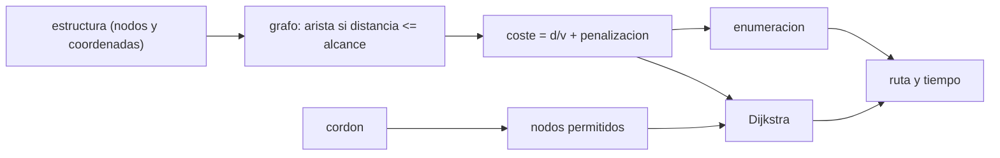

# B108-C02 — Planificación de desplazamientos y rutas de EVA

<!-- nav:top -->
[🏠 Programa](../../../../README.md) · [📚 Bloque B108](../../../tronco-comun/B108-actividades-extravehiculares-y-trajes-espaciales.md) · [← Anterior: B108-C01 — Sistemas portátiles de soporte vital (PLSS)](../B108-C01-sistemas-portatiles-de-soporte-vital-plss/CLASE.md) · [Siguiente: B108-C03 — Herramientas y equipos de EVA →](../B108-C03-herramientas-y-equipos-de-eva/CLASE.md)
<!-- /nav -->

## 1. Ubicación, nivel y alcance

Clase 2 del bloque B108. Nivel N3. Antes de trabajar hay que llegar al puesto: en microgravedad la persona se traslada de asidero en asidero y está atada por un cordón. Aquí modelas la estructura como un grafo, buscas el camino de menor tiempo con Dijkstra y lo verificas enumerando todos los caminos. Usas el balance de [C01](../B108-C01-sistemas-portatiles-de-soporte-vital-plss/CLASE.md) solo como motivación (el tiempo cuesta consumibles). La estructura es **sintética** y la clase es educativa: no da consejo operativo.

## 2. Por qué esta clase existe

Ninguna clase planifica rutas y accesibilidad de una EVA en una estructura. La decisión central: **¿por qué asideros pasa la persona, cuánto tarda y qué restricciones (alcance, cordón) pueden dejar un puesto inaccesible?**

## 3. Lo que podrás hacer al terminar

1. Representar una estructura como un grafo de asideros con aristas por alcance.
2. Asignar un coste de tiempo a cada traslado (distancia, velocidad y cambio de asidero).
3. Encontrar el camino mínimo con Dijkstra.
4. Verificarlo con una enumeración exhaustiva.
5. Detectar un destino inaccesible por alcance o por cordón.
6. Separar lo consultado de lo ilustrativo (toda la geometría es sintética).

La evidencia es el **plan de ruta sobre una estructura sintética** del ejercicio 12 (sección 20).

## 4. Con qué llegas y cómo comprobarlo

1. ¿Qué es un grafo?
2. ¿Qué es la distancia euclidea entre dos puntos 3D?
3. ¿Qué es un camino simple?
4. ¿Qué es un dato sintético?
5. ¿Qué es una verificación por segunda vía?

<details>
<summary>Ver respuestas</summary>

1. Un conjunto de nodos unidos por aristas. 2. `√(Δx²+Δy²+Δz²)`. 3. Un camino que no repite nodos. 4. Un dato generado para el ejemplo, no medido. 5. Calcular lo mismo con otro método y comparar.
</details>

Con cuatro o cinco aciertos, sigue; si no, repasa los prerrequisitos.

## 5. Un caso de contexto y casos de referencia

Una estructura **sintética** de 9 asideros (A a I, en metros, con origen en A), alcance máximo de 2,0 m entre asideros consecutivos, 0,25 m/s de velocidad y 20 s por cambio de asidero. El camino de menor tiempo de A a I es `A-B-C-D-H-F-G-I` con `189,76 s (3,16 min)`. Es el **ejemplo conductor**; todo es ilustrativo.

## 6. Vocabulario

Un **asidero** es un punto de agarre fijo en la estructura. El **alcance** es la distancia máxima entre dos asideros consecutivos que la persona puede salvar. El **cordón de seguridad** ata a la persona a un **anclaje**; limita la distancia al anclaje. **Dijkstra** es el algoritmo que halla el camino de menor coste con costes no negativos.

## 7. Modelo mental: un mapa de metro con tiempos



*Descripción textual:* las coordenadas dan un grafo por alcance; cada arista tiene un coste; Dijkstra y la enumeración encuentran la ruta, y el cordón restringe los nodos permitidos.

Analogía: un mapa de metro donde solo hay líneas entre estaciones cercanas. Límite: se ignoran la orientación del cuerpo, los obstáculos y el tamaño del traje.

## 8. La explicación, paso a paso

### 8.1 Aristas y costes

Una arista `(a, b)` existe si `‖a−b‖ ≤ 2,0 m`. Su coste es `d/0,25 + 20` s. Con 9 nodos resultan **9 aristas**. Un tramo de 1,8 m cuesta `1,8/0,25 + 20 = 27,2 s`; uno de 1,7205 m, `26,88 s`.

### 8.2 El atajo

`D-E-F` cuesta `2 × 27,2 = 54,4 s`; `D-H-F`, pasando por un asidero elevado `H = (3,8; 3,4; 0,6)`, cuesta `2 × 26,88 = 53,76 s`. La ruta óptima usa H y gana `0,64 s`, aunque parezca un rodeo: recorre `12,44 m` en 7 traslados frente a la distancia directa de `9,69 m`.

### 8.3 Dos vías

Dijkstra y la enumeración exhaustiva de caminos simples dan la misma ruta y el mismo coste, con diferencia `0,0 s`. La comprobación valida la implementación del algoritmo, no que el modelo de tiempos sea realista.

### 8.4 Cuando no hay ruta

Con el cordón de 15 m todos los nodos son accesibles. Con un cordón de 8,0 m, I (a 9,69 m del anclaje) queda **fuera** y no hay ruta. Con un alcance de 1,5 m el grafo se desconecta y tampoco hay ruta. La accesibilidad es una propiedad del conjunto estructura + alcance + cordón.

## 9. Magnitudes, símbolos y unidades

| Símbolo | Qué es | Unidad | Valor / nota |
|---|---|---|---|
| `d` | distancia entre asideros | m | 1,72–1,8 |
| `v` | velocidad de traslación | m/s | 0,25 (ilustrativa) |
| `p` | penalización por cambio de asidero | s | 20 (ilustrativa) |
| `L_c` | longitud del cordón | m | 15 (ilustrativa) |
| `T` | tiempo de ruta | s | 189,76 |

## 10. Convenciones y referencias

Ejes cartesianos de la estructura sintética, origen en el nodo A, en metros. Costes no negativos (requisito de Dijkstra). Coordenadas, alcance, velocidad, penalización y cordón son ilustrativos.

## 11. De dónde sale lo que afirmamos

| ID | Fuente | Localizador | Respalda | Estado |
|---|---|---|---|---|
| S1 | Hagale y Price, *EVA Design, Verification, and On-Orbit Operations Support Using Worksite Analysis* (NTRS 20000067662; ICES 2000) — https://ntrs.nasa.gov/citations/20000067662 (consultada 2026-11-10) | solo el resumen del registro | el análisis de puestos EVA usa CAD para verificar el acceso y la manipulación de la tripulación | Consultada (solo resumen) |
| — | Dijkstra, enumeración de caminos, distancia euclidea | — | las verifica el laboratorio con una segunda vía | No consultada en una fuente concreta |

Límites: no se consultaron requisitos de diseño EVA ni la posición real de asideros de ninguna estación; ninguna cifra de velocidad o tiempo es de vuelo.

## 12. Cómo ver una ruta

| Magnitud | Valor |
|---|---|
| Aristas | 9 |
| Ruta óptima | A-B-C-D-H-F-G-I |
| Tiempo | 189,76 s |
| Longitud | 12,44 m |
| Ganancia del atajo | 0,64 s |

Descripción larga: la ruta sigue el eje de la estructura y toma un atajo por un asidero elevado; con un cordón corto el destino se vuelve inaccesible.

## 13. Ejemplo trabajado: el coste de A a D

**Paso 1 · Tramos.** A-B, B-C y C-D miden 1,8 m.

**Paso 2 · Coste unitario.** `1,8/0,25 + 20 = 27,2 s`.

**Paso 3 · Suma.** `3 × 27,2 = 81,6 s`.

**Paso 4 · Total.** Se añaden `D-H-F-G-I` = `26,88 + 26,88 + 27,2 + 27,2 = 108,16 s`; total `189,76 s`.

## 14. Distintas formas de describir una ruta

**Por nodos:** `A-B-C-D-H-F-G-I`. **Por tiempo:** `189,76 s`. **Por longitud:** `12,44 m`. **Por accesibilidad:** sí/no según alcance y cordón. **Por restricción activa:** el cordón o el alcance.

## 15. Práctica guiada

**Ejercicio 1 · con los pasos indicados.** Calcula el coste de un tramo de 1,5 m. *Pasos:* distancia entre velocidad, más la penalización.

<details><summary>Solución comentada</summary>

`1,5/0,25 + 20 = 26 s`.
</details>

**Ejercicio 2 · con una pista.** ¿Cuántas aristas tendría un grafo completo de 9 nodos? *Pista:* `n(n−1)/2`.

<details><summary>Solución comentada</summary>

`36`; el alcance deja solo 9.
</details>

**Ejercicio 3 · casi autónomo.** ¿Por qué el atajo por H gana aunque sea un rodeo geométrico?

<details><summary>Solución comentada</summary>

Sus dos tramos (1,7205 m) son algo más cortos que los dos de D-E-F (1,8 m).
</details>

## 16. Práctica autónoma, transferencia e integrador

**Ejercicio 4 · autónomo.** Si la penalización sube a 40 s, ¿cambia la ruta óptima?

<details><summary>Solución comentada</summary>

Ambos caminos tienen 7 traslados, por lo que suman lo mismo en penalización: la ruta no cambia; el tiempo sube `7 × 20 = 140 s`.
</details>

**Ejercicio 5 · autónomo.** Tiempo del camino si la velocidad fuera 0,5 m/s con penalización de 20 s.

<details><summary>Solución comentada</summary>

Distancia `12,44 m`; `12,44/0,5 + 7 × 20 = 164,9 s`.
</details>

**Ejercicio 6 · autónomo.** ¿Qué nodo del ejemplo queda más lejos del anclaje?

<details><summary>Solución comentada</summary>

I, a `9,69 m`.
</details>

**Ejercicio 7 · autónomo.** Añade un asidero que conecte B con D directamente (3,2 m). ¿Es una arista con alcance 2,0 m?

<details><summary>Solución comentada</summary>

No: `3,2 > 2,0`.
</details>

**Ejercicio 8 · autónomo.** ¿Cuántos traslados tiene la ruta óptima?

<details><summary>Solución comentada</summary>

7.
</details>

**Ejercicio 9 · transferencia.** **Transferencia.** Un colega mide la ruta en línea recta (9,69 m a 0,25 m/s = 38,8 s). ¿Qué ignora?

<details><summary>Solución comentada</summary>

Que solo se puede avanzar de asidero en asidero, con el alcance y la penalización por cada cambio; el tiempo real es casi cinco veces mayor en el modelo.
</details>

**Ejercicio 10 · transferencia.** **Transferencia.** Un puesto queda inaccesible por el cordón. ¿Qué dos acciones de diseño del modelo cambiarían el resultado?

<details><summary>Solución comentada</summary>

Cambiar el punto de anclaje o la longitud del cordón; el alcance no ayuda si el problema es la distancia al anclaje.
</details>

**Ejercicio 11 · transferencia.** **Transferencia.** ¿Por qué no basta este modelo para aprobar una ruta real?

<details><summary>Solución comentada</summary>

La geometría es sintética, no hay obstáculos ni orientación del cuerpo, y no se consultaron requisitos EVA.
</details>

**Ejercicio 12 · integrador.** **Integrador.** Elabora tu *plan de ruta sobre una estructura sintética*: tabla de aristas, ruta óptima con su tiempo, verificación por enumeración y casos sin ruta.

<details><summary>Solución comentada</summary>

Secciones 8.1–8.4 y la salida del laboratorio.
</details>

## 17. Laboratorio: rutas sobre una estructura sintética

El script [rutas.py](rutas.py) construye el grafo, halla la ruta con Dijkstra, la verifica por enumeración y prueba el cordón y el alcance (**comprueba** diferencia < 1e-9 s y ausencia de ruta con cordón de 8 m y alcance de 1,5 m).

**Datos:** coordenadas, alcance, velocidad, penalización y cordón **ilustrativos**; solo el resumen de Hagale y Price se consultó. **Predice antes de ejecutar:** ¿pasará la ruta por H? (sí, por 0,64 s.) **Ejecución del 2026-11-10 (Python 3.12.9):**

```text
Python 3.12.9 (biblioteca estandar)
Estructura SINTETICA: 9 nodos; alcance 2.0 m; velocidad 0.25 m/s; penalizacion 20.0 s por asidero
Aristas validas: 9
Nodos dentro del cordon de 15.0 m desde A: 9 de 9
Ruta A->I (Dijkstra): A-B-C-D-H-F-G-I; coste = 189.76 s (3.16 min)
Ruta A->I (enumeracion): A-B-C-D-H-F-G-I; coste = 189.76 s; diferencia = 0.0e+00 s
Longitud recorrida = 12.44 m en 7 traslados; distancia directa = 9.69 m
Sin cordon: ruta A-B-C-D-H-F-G-I coste 189.76 s
Con cordon de 8.0 m: sin ruta (I queda fuera)
Con alcance de 1.5 m: sin ruta (grafo desconectado)
Pruebas superadas.
```

```bash
python programa/clases/B108/B108-C02-planificacion-de-desplazamientos-y-rutas-de-eva/rutas.py
```

**Límites:** modelo de coste lineal, geometría sintética, sin obstáculos ni orientación; la enumeración valida el algoritmo, no el realismo.

## 18. Errores frecuentes y cómo corregirlos

**Medir la ruta en línea recta.** Se corrige con 8.1.

**Suponer que el camino más corto geométrico es el más rápido.** Se corrige con 8.2.

**Olvidar la restricción del cordón.** Se corrige con 8.4.

**Presentar la estructura sintética como una estación real.** Se corrige con la sección 10.

## 19. Cómo sabrás que vas bien

Tras la sección 8: ¿qué ruta esperabas y cuál obtuviste? Si dudas, repasa el ejemplo 13. Tras el laboratorio: ¿qué comprueba? (ver la sección 17).

## 20. Qué entregas y cómo se evalúa

El producto es tu **plan de ruta sobre una estructura sintética** (ejercicio 12).

| Criterio | Inicial | En desarrollo | Logrado | Destacado |
|---|---|---|---|---|
| Conceptos | Los confunde | Parciales | Modela grafo y costes | Explica los límites |
| Cálculo | Sin unidades | Con errores | Tiempos y longitudes con unidades | Calcula casos nuevos |
| Numérico | Sin comprobar | Un caso | Contraste con enumeración | Interpreta las diferencias |
| Fuentes | Sin fuente | Sin fecha | Fuentes con fecha y estado | Declara lo ilustrativo y lo no consultado |
| Límites | No los nombra | Uno | Tres | Discute qué falta del modelo |

**Condiciones críticas (no se compensan con promedio):** rotular la estructura como sintética; no usarla como plan operativo; citar solo lo consultado.

## 21. Ética, seguridad y límites

Clase educativa: no da consejo operativo ni sustituye requisitos ni procedimientos de ninguna agencia; la geometría y los tiempos son sintéticos. Accesibilidad: tablas equivalentes a las gráficas, fórmulas en texto, ejercicios sin conexión.

## 22. Para cerrar y seguir

La ruta sintética de A a I tarda `189,76 s` y pasa por un asidero elevado que ahorra `0,64 s`; con un cordón de 8 m el destino no es accesible. Queda una pregunta: ¿qué fuerzas exige trabajar en el puesto con una herramienta?

**Glosario español–inglés.** asidero · *handrail / handhold*; cordón de seguridad · *safety tether*; alcance · *reach*; camino mínimo · *shortest path*; anclaje · *anchor point*.

**Continuidad.** [B108-C03](../B108-C03-herramientas-y-equipos-de-eva/CLASE.md) estudia herramientas y la reacción de par.

**Referencias:** ver sección 11.

<!-- nav:bottom -->
---

[← Anterior: B108-C01 — Sistemas portátiles de soporte vital (PLSS)](../B108-C01-sistemas-portatiles-de-soporte-vital-plss/CLASE.md) · [📚 Bloque B108](../../../tronco-comun/B108-actividades-extravehiculares-y-trajes-espaciales.md) · [Siguiente: B108-C03 — Herramientas y equipos de EVA →](../B108-C03-herramientas-y-equipos-de-eva/CLASE.md)
<!-- /nav -->
