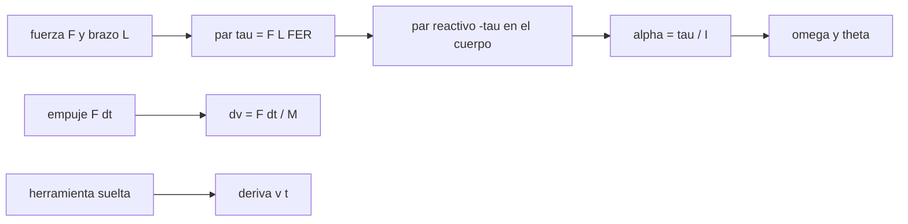

# B108-C03 — Herramientas y equipos de EVA

<!-- nav:top -->
[🏠 Programa](../../../../README.md) · [📚 Bloque B108](../../../tronco-comun/B108-actividades-extravehiculares-y-trajes-espaciales.md) · [← Anterior: B108-C02 — Planificación de desplazamientos y rutas de EVA](../B108-C02-planificacion-de-desplazamientos-y-rutas-de-eva/CLASE.md) · [Siguiente: B108-C04 — Sistemas de sujeción y restricción de pies →](../B108-C04-sistemas-de-sujecion-y-restriccion-de-pies/CLASE.md)
<!-- /nav -->

## 1. Ubicación, nivel y alcance

Clase 3 del bloque B108. Nivel N3. En microgravedad apretar un tornillo es un problema de acción y reacción: el par que la herramienta aplica a la pieza lo aplica en sentido contrario a quien la sostiene. Aquí calculas el par de apriete que se obtiene con una fuerza y un brazo de palanca, la rotación que produce la reacción en un cuerpo sin sujeción y la deriva de una herramienta suelta. Usas la mecánica de cuerpo rígido de [B10](../../B10/B10-C13-matrices-de-rotacion-tridimensional/CLASE.md) solo como lenguaje de ejes. Los parámetros del escenario son **sintéticos** y la clase es educativa: no da consejo operativo.

## 2. Por qué esta clase existe

No hay clase sobre herramientas EVA (torque, reacción, sujeción de herramientas). La decisión central: **¿qué par se logra con una fuerza dada, y cuánto gira o se desplaza quien lo aplica si nada lo sujeta?**

## 3. Lo que podrás hacer al terminar

1. Calcular el par `τ = F·L·FER` y situarlo en el rango de fuerzas publicado.
2. Calcular la aceleración angular, la velocidad y el ángulo de un cuerpo libre sometido a un par.
3. Calcular el cambio de velocidad por un empuje con `Δv = F Δt/M`.
4. Aplicar la conservación del momento lineal a una herramienta suelta.
5. Estimar la deriva de una herramienta y por qué se amarra.
6. Separar lo consultado (rangos de fuerza y FER) de lo ilustrativo (inercias, masas, par de la herramienta).

La evidencia es la **ficha de reacción de una herramienta** del ejercicio 12 (sección 20).

## 4. Con qué llegas y cómo comprobarlo

1. ¿Qué es un par (momento de una fuerza) y en qué unidades se mide?
2. ¿Qué es el momento de inercia?
3. ¿Qué dice la tercera ley de Newton?
4. ¿Qué es un dato sintético?
5. ¿Qué es una verificación por segunda vía?

<details>
<summary>Ver respuestas</summary>

1. El producto de una fuerza por su brazo, en N·m. 2. La resistencia de un cuerpo a cambiar su rotación, en kg·m². 3. A toda acción corresponde una reacción igual y opuesta. 4. Un dato generado para el ejemplo, no medido. 5. Calcular lo mismo con otro método y comparar.
</details>

Con cuatro o cinco aciertos, sigue; si no, repasa los prerrequisitos.

## 5. Un caso de contexto y casos de referencia

Una herramienta que aplica `20 N·m` durante 2 s sobre un conjunto persona + traje **sintético** de `I = 30 kg·m²` sin sujeción lo hace girar `1,333 rad = 76,39°`. Con fuerzas de 400 a 750 N (rango de un informe de la NASA) y un brazo de 0,30 m, el par de apriete va de `66,0` a `202,5 N·m`. Es el **ejemplo conductor**: los rangos de fuerza son consultados; el resto es ilustrativo.

## 6. Vocabulario

El **par de apriete** es `τ = F·L`. La **razón de efectividad de la fuerza** (FER) es la fracción del esfuerzo que va a la tarea prevista. La **reacción** es el par o la fuerza igual y opuesta sobre quien opera la herramienta. Una **herramienta suelta** es la que se libera sin amarre y deriva con velocidad constante.

## 7. Modelo mental: empujar una puerta desde un patín



*Descripción textual:* una fuerza con un brazo da un par; el par reactivo acelera el cuerpo libre; un empuje da un cambio de velocidad y una herramienta suelta deriva a velocidad constante.

Analogía: empujar una puerta pesada estando sobre patines. Límite: se supone un cuerpo rígido, sin amortiguación ni restricción.

## 8. La explicación, paso a paso

### 8.1 El par de apriete

`τ = F·L·FER` con `L = 0,30 m`:

| F (N) | FER | τ (N·m) |
|---|---|---|
| 400 | 0,55 | 66,0 |
| 400 | 0,90 | 108,0 |
| 750 | 0,55 | 123,8 |
| 750 | 0,90 | 202,5 |

F y FER son los extremos del rango publicado; `L` es ilustrativo. Una herramienta de par limitado impone su propio techo.

### 8.2 La reacción en un cuerpo libre

Con `τ = 20 N·m`, `I = 30 kg·m²` y `t = 2 s`: `α = τ/I = 0,6667 rad/s²`, `ω = 1,3333 rad/s`, `θ = ½ α t² = 1,3333 rad = 76,39°`. La integración numérica da `1,3334 rad`; la diferencia relativa es `5,0 × 10⁻⁵`.

### 8.3 Sensibilidad a la inercia

El ángulo es inverso a `I`: `152,79°` con `I = 15`, `76,39°` con `I = 30` y `38,20°` con `I = 60 kg·m²`. Un cuerpo con más inercia gira menos por el mismo par.

### 8.4 Empuje y herramienta suelta

Un empuje de `100 N` durante `0,5 s` sobre `150 kg` da `Δv = 0,3333 m/s` y `3,33 m` en 10 s. Una herramienta de `1,5 kg` liberada a `0,05 m/s` se aleja `30 m` en 10 min y `180 m` en 1 h; el momento lineal total se conserva (`0,0 kg·m/s`). Por eso las herramientas se amarran. Los informes de la NASA indican además que, sin restricción de pies, trabajar hacia el cuerpo es más efectivo que hacerlo alejándose.

## 9. Magnitudes, símbolos y unidades

| Símbolo | Qué es | Unidad | Valor / nota |
|---|---|---|---|
| `F` | fuerza aplicada | N | 400–750 (consultada) |
| `FER` | razón de efectividad | — | 0,55–0,90 (consultada) |
| `L` | brazo de palanca | m | 0,30 (ilustrativo) |
| `τ` | par | N·m | 66–202,5 |
| `I` | momento de inercia | kg·m² | 30 (ilustrativo) |
| `θ` | ángulo | rad | 1,333 |

## 10. Convenciones y referencias

SI. Ejes del cuerpo con origen en el centro de masa; el par reactivo es opuesto al aplicado. Cuerpo rígido libre. Brazo, inercia, masa, par de la herramienta, empuje y velocidad de la herramienta suelta son ilustrativos.

## 11. De dónde sale lo que afirmamos

| ID | Fuente | Localizador | Respalda | Estado |
|---|---|---|---|---|
| S1 | Poliner, Wilmington y Klute, *Strength capabilities and load requirements while performing torquing tasks in zero gravity*, NASA TP-3433 (NTRS 19940017154, 1993) — https://ntrs.nasa.gov/citations/19940017154 (consultada 2026-11-10) | solo el resumen del registro | ensayo en KC-135; fuerzas de aprox. 400 a 750 N; FER de 0,55 a 0,90; mayor fuerza al empujar hacia arriba | Consultada (solo resumen) |
| S2 | Rajulu, Poliner y Klute, *Loads produced by a suited subject performing tool tasks without the use of foot restraints*, NASA TP-3424 (NTRS 19940016133, 1993) — https://ntrs.nasa.gov/citations/19940016133 (consultada 2026-11-10) | solo el resumen del registro | seis sujetos en KC-135; trabajar hacia el cuerpo es más efectivo; la herramienta eléctrica fue difícil de usar | Consultada (solo resumen) |
| — | Mecánica de cuerpo rígido, conservación del momento | — | las verifica el laboratorio con una segunda vía | No consultada en una fuente concreta |

Límites: el resumen no da pares en N·m ni cargas sobre la restricción; no se consultó el texto completo de los informes ni los requisitos de herramientas de la NASA.

## 12. Cómo ver la reacción de una herramienta

| Magnitud | Valor |
|---|---|
| τ máximo (con L ilustrativo) | 202,5 N·m |
| θ en 2 s (I = 30) | 76,39° |
| Δv por 100 N·0,5 s | 0,3333 m/s |
| Deriva en 1 h | 180 m |

Descripción larga: el ángulo de reacción cae a la mitad si se duplica la inercia; una herramienta suelta deriva decenas de metros en minutos.

## 13. Ejemplo trabajado: la reacción con I = 60 kg·m²

**Paso 1 · Aceleración.** `α = 20/60 = 0,3333 rad/s²`.

**Paso 2 · Ángulo.** `θ = ½ × 0,3333 × 2² = 0,6667 rad`.

**Paso 3 · Grados.** `0,6667 × 180/π = 38,20°`.

**Paso 4 · Comparación.** Es la mitad del caso `I = 30`.

## 14. Distintas formas de describir una herramienta

**Por par:** `τ`. **Por fuerza y brazo:** `F`, `L`. **Por reacción:** `α`, `θ`. **Por momento lineal:** `m v`. **Por restricción:** con o sin sujeción.

## 15. Práctica guiada

**Ejercicio 1 · con los pasos indicados.** Calcula `τ` con `F = 500 N`, `L = 0,30 m` y `FER = 0,7`. *Pasos:* multiplica los tres factores.

<details><summary>Solución comentada</summary>

`500 × 0,30 × 0,7 = 105 N·m`.
</details>

**Ejercicio 2 · con una pista.** Calcula `α` para `τ = 105 N·m` y `I = 30`. *Pista:* `τ/I`.

<details><summary>Solución comentada</summary>

`3,5 rad/s²`.
</details>

**Ejercicio 3 · casi autónomo.** ¿Por qué el ángulo crece con `t²`?

<details><summary>Solución comentada</summary>

Porque `α` es constante y `θ = ½ α t²`: la velocidad crece con `t` y el ángulo acumula esa velocidad.
</details>

## 16. Práctica autónoma, transferencia e integrador

**Ejercicio 4 · autónomo.** Ángulo tras 1 s con `τ = 20`, `I = 30`.

<details><summary>Solución comentada</summary>

`½ × 0,6667 × 1 = 0,3333 rad = 19,1°`.
</details>

**Ejercicio 5 · autónomo.** `Δv` de un empuje de 50 N durante 1 s sobre 150 kg.

<details><summary>Solución comentada</summary>

`0,3333 m/s`.
</details>

**Ejercicio 6 · autónomo.** Deriva de una herramienta a 0,02 m/s en 5 min.

<details><summary>Solución comentada</summary>

`0,02 × 300 = 6 m`.
</details>

**Ejercicio 7 · autónomo.** ¿Qué `L` hace falta para `τ = 100 N·m` con `F = 400 N` y `FER = 0,8`?

<details><summary>Solución comentada</summary>

`L = 100/(400 × 0,8) = 0,3125 m`.
</details>

**Ejercicio 8 · autónomo.** Si el cuerpo pesa el doble, ¿cómo cambia `Δv` del empuje?

<details><summary>Solución comentada</summary>

Se reduce a la mitad.
</details>

**Ejercicio 9 · transferencia.** **Transferencia.** Un compañero dice que en microgravedad «no hay reacción porque no hay peso». ¿Qué error comete?

<details><summary>Solución comentada</summary>

La reacción depende de la masa y de la inercia, no del peso; sin sujeción la reacción mueve a quien la aplica.
</details>

**Ejercicio 10 · transferencia.** **Transferencia.** ¿Por qué un resumen de un informe no basta para fijar el par de una herramienta?

<details><summary>Solución comentada</summary>

Porque no reporta el par en N·m ni las cargas sobre la restricción; el texto completo y los requisitos son necesarios.
</details>

**Ejercicio 11 · transferencia.** **Transferencia.** ¿Qué parte de este modelo no se debe usar para una herramienta real?

<details><summary>Solución comentada</summary>

La inercia, la masa y el par de la herramienta, que son sintéticos; y el modelo de cuerpo libre, que ignora la restricción y la rigidez del traje.
</details>

**Ejercicio 12 · integrador.** **Integrador.** Elabora tu *ficha de reacción de una herramienta*: tabla de `τ`, rotación con tres inercias, empuje y deriva, y lista de qué es consultado e ilustrativo.

<details><summary>Solución comentada</summary>

Secciones 8.1–8.4 y la salida del laboratorio.
</details>

## 17. Laboratorio: par, reacción y deriva

El script [herramientas.py](herramientas.py) calcula `τ`, la rotación (analítica y numérica), el empuje y la deriva (**comprueba** diferencia relativa < 1e-3 y conservación del momento).

**Datos:** rangos de fuerza y FER de TP-3433 (consultados, resumen); el resto **ilustrativo**. **Predice antes de ejecutar:** ¿qué ángulo con `I = 60`? (38,2°.) **Ejecución del 2026-11-10 (Python 3.12.9):**

```text
Python 3.12.9 (biblioteca estandar)
Par de apriete tau = F L FER, con L = 0.30 m (ILUSTRATIVO) y F, FER de TP-3433 (consultados)
  F [N]   FER    tau [N m]
    400  0.55      66.0
    400  0.90     108.0
    750  0.55     123.8
    750  0.90     202.5
Reaccion: herramienta de 20 N m durante 2 s sobre I = 30 kg m2 (cuerpo libre, ILUSTRATIVO)
  analitica: alpha = 0.6667 rad/s2, omega = 1.3333 rad/s, theta = 1.3333 rad = 76.39 grados
  numerica:  omega = 1.3333 rad/s, theta = 1.3334 rad; diferencia relativa en theta = 5.00e-05
Empuje de 100 N durante 0.5 s sobre 150 kg: dv = 0.3333 m/s; desplazamiento en 10 s = 3.33 m
Herramienta suelta de 1.5 kg a 0.05 m/s: deriva 30 m en 10 min y 180 m en 1 h
Momento lineal total tras lanzar la herramienta y retroceder el cuerpo = 0.0e+00 kg m/s (se conserva)
Rotacion tras 2 s segun la inercia (tau = 20 N m):
  I =   15 kg m2 -> theta = 152.79 grados
  I =   30 kg m2 -> theta =  76.39 grados
  I =   60 kg m2 -> theta =  38.20 grados
Pruebas superadas.
```

```bash
python programa/clases/B108/B108-C03-herramientas-y-equipos-de-eva/herramientas.py
```

**Límites:** cuerpo rígido libre, sin amortiguación ni restricción; la integración numérica valida el código, no la fisiología ni el traje real.

## 18. Errores frecuentes y cómo corregirlos

**Pensar que sin peso no hay reacción.** Se corrige con 8.2.

**Combinar los extremos de fuerza y FER como si fueran un resultado medido para un brazo concreto.** Se corrige con 8.1.

**Ignorar la deriva de una herramienta suelta.** Se corrige con 8.4.

**Presentar la inercia sintética como la de un traje real.** Se corrige con la sección 10.

## 19. Cómo sabrás que vas bien

Tras la sección 8: ¿qué ángulo esperabas con `I = 60` y cuál obtuviste? Si dudas, repasa el ejemplo 13. Tras el laboratorio: ¿qué comprueba? (ver la sección 17).

## 20. Qué entregas y cómo se evalúa

El producto es tu **ficha de reacción de una herramienta** (ejercicio 12).

| Criterio | Inicial | En desarrollo | Logrado | Destacado |
|---|---|---|---|---|
| Conceptos | Los confunde | Parciales | Calcula par y reacción | Explica los límites |
| Cálculo | Sin unidades | Con errores | Tablas completas con unidades | Calcula casos nuevos |
| Numérico | Sin comprobar | Un caso | Contraste analítico y numérico | Interpreta las diferencias |
| Fuentes | Sin fuente | Sin fecha | Fuentes con fecha y estado | Declara lo ilustrativo y que solo se leyó el resumen |
| Límites | No los nombra | Uno | Tres | Discute qué falta del modelo |

**Condiciones críticas (no se compensan con promedio):** rotular inercias, masas y par como ilustrativos; no usarlo como especificación de herramienta; citar solo lo consultado.

## 21. Ética, seguridad y límites

Clase educativa: no da consejo médico ni operativo y no sustituye requisitos ni procedimientos de ninguna agencia; el escenario es sintético. Accesibilidad: tablas equivalentes a las gráficas, fórmulas en texto, ejercicios sin conexión.

## 22. Para cerrar y seguir

Un par de `20 N·m` sobre un cuerpo libre de `30 kg·m²` lo gira `76°` en 2 s, y una herramienta suelta se aleja `180 m` en una hora. Queda una pregunta: ¿cómo se evita esa reacción sujetando los pies?

**Glosario español–inglés.** par de apriete · *torque*; razón de efectividad de la fuerza · *force effectiveness ratio*; herramienta suelta · *loose tool*; momento de inercia · *moment of inertia*; reacción · *reaction*.

**Continuidad.** [B108-C04](../B108-C04-sistemas-de-sujecion-y-restriccion-de-pies/CLASE.md) modela la restricción de pies.

**Referencias:** ver sección 11.

<!-- nav:bottom -->
---

[← Anterior: B108-C02 — Planificación de desplazamientos y rutas de EVA](../B108-C02-planificacion-de-desplazamientos-y-rutas-de-eva/CLASE.md) · [📚 Bloque B108](../../../tronco-comun/B108-actividades-extravehiculares-y-trajes-espaciales.md) · [Siguiente: B108-C04 — Sistemas de sujeción y restricción de pies →](../B108-C04-sistemas-de-sujecion-y-restriccion-de-pies/CLASE.md)
<!-- /nav -->
