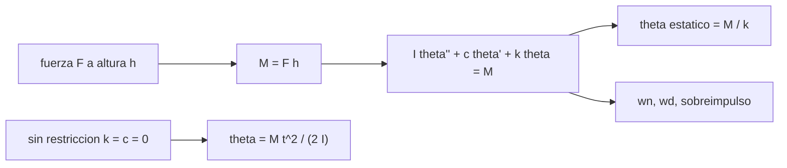

# B108-C04 — Sistemas de sujeción y restricción de pies

<!-- nav:top -->
[🏠 Programa](../../../../README.md) · [📚 Bloque B108](../../../tronco-comun/B108-actividades-extravehiculares-y-trajes-espaciales.md) · [← Anterior: B108-C03 — Herramientas y equipos de EVA](../B108-C03-herramientas-y-equipos-de-eva/CLASE.md) · [Siguiente: B108-C05 — Evaluación de secuencias y líneas de tiempo de EVA →](../B108-C05-evaluacion-de-secuencias-y-lineas-de-tiempo-de-eva/CLASE.md)
<!-- /nav -->

## 1. Ubicación, nivel y alcance

Clase 4 del bloque B108. Nivel N3. En [C03](../B108-C03-herramientas-y-equipos-de-eva/CLASE.md) un par sobre un cuerpo libre lo hacía girar sin límite; una restricción de pies lo evita ofreciendo rigidez y amortiguamiento. Aquí modelas la persona sujeta como un oscilador torsional, comparas el ángulo con y sin restricción y barres la rigidez. Usas el cálculo de [B09](../../../tronco-comun/B09-calculo-diferencial-e-integral.md) solo como herramienta. Todos los parámetros son **sintéticos** y la clase es educativa: no da consejo operativo.

## 2. Por qué esta clase existe

Ninguna clase trata la estabilización del astronauta durante trabajo en microgravedad. La decisión central: **¿cuánto rigidez y amortiguamiento necesita una sujeción para que una fuerza de trabajo no desplace a la persona más allá de lo útil?**

## 3. Lo que podrás hacer al terminar

1. Plantear `I θ'' + c θ' + k θ = M` para una persona sujeta por los pies.
2. Calcular el desplazamiento estático `θ = M/k`.
3. Calcular la frecuencia natural, la amortiguada y el sobreimpulso.
4. Comparar con el cuerpo libre `θ = M t²/(2I)`.
5. Barrer la rigidez y leer su efecto.
6. Separar lo consultado de lo ilustrativo y reconocer el límite de pequeños ángulos.

La evidencia es la **comparación con y sin restricción de pies** del ejercicio 12 (sección 20).

## 4. Con qué llegas y cómo comprobarlo

1. ¿Qué es la rigidez de un resorte torsional y en qué unidades se da?
2. ¿Qué es la razón de amortiguamiento?
3. ¿Qué es la frecuencia natural `ωn = √(k/I)`?
4. ¿Qué es un dato sintético?
5. ¿Qué es una verificación por segunda vía?

<details>
<summary>Ver respuestas</summary>

1. El par por radián de giro, en N·m/rad. 2. `ζ = c/(2√(kI))`; con `ζ < 1` hay oscilación. 3. La frecuencia a la que oscila sin amortiguación, en rad/s. 4. Un dato generado para el ejemplo, no medido. 5. Calcular lo mismo con otro método y comparar.
</details>

Con cuatro o cinco aciertos, sigue; si no, repasa los prerrequisitos.

## 5. Un caso de contexto y casos de referencia

Una fuerza de `100 N` a `0,5 m` del pivote (`M = 50 N·m`) sobre una persona **sintética** con `I = 60 kg·m²`, sujeta con `k = 800 N·m/rad` y `ζ = 0,3`, la desplaza `0,0625 rad = 3,58°` en régimen estático, con un pico de `0,0858 rad`. Sin sujeción, en 2 s giraría `95,49°`. Es el **ejemplo conductor**; todo es ilustrativo.

## 6. Vocabulario

Una **restricción de pies** fija los pies del operador a un punto de trabajo. El **desplazamiento estático** es `θ_s = M/k`. El **sobreimpulso** es el exceso del pico sobre `θ_s`: `exp(−πζ/√(1−ζ²))`. La **hipótesis de pequeños ángulos** linealiza el modelo y solo vale para ángulos pequeños.

## 7. Modelo mental: un péndulo invertido con resorte en el tobillo



*Descripción textual:* una fuerza con altura da un momento; el oscilador da un ángulo estático, una frecuencia y un sobreimpulso; sin restricción el ángulo crece con `t²`.

Analogía: empujar un poste con resorte en la base. Límite: modelo lineal de un solo grado de libertad; la persona real tiene articulaciones y el traje, rigidez propia.

## 8. La explicación, paso a paso

### 8.1 Régimen estático y frecuencia

`θ_s = F h/k = 100 × 0,5/800 = 0,0625 rad = 3,58°`. `ωn = √(800/60) = 3,6515 rad/s` (`0,581 Hz`) y `ωd = ωn √(1−ζ²) = 3,4833 rad/s`.

### 8.2 Sobreimpulso y pico

Con `ζ = 0,3` el sobreimpulso es `37,23 %`, el pico ocurre en `π/ωd = 0,9019 s` y vale `0,0858 rad`. La integración numérica (RK4, `dt = 1 ms`) da el mismo pico y `θ(5 s) = 0,062546 rad`, con diferencia `1,7 × 10⁻¹⁵ rad` respecto a la solución analítica.

### 8.3 Con y sin restricción

Sin restricción, `θ(2 s) = M t²/(2I) = 1,6667 rad = 95,49°` y sigue creciendo. Con restricción, `θ(2 s) = 0,0557 rad = 3,19°`: la rigidez acota el movimiento.

### 8.4 Barrido de rigidez y límite del modelo

| k (N·m/rad) | θ estático (°) | ωn (rad/s) | Pico (°) |
|---|---|---|---|
| 200 | 14,32 | 1,826 | 19,66 |
| 800 | 3,58 | 3,651 | 4,91 |
| 3200 | 0,90 | 7,303 | 1,23 |

El ángulo estático cae con `1/k`. Con `F = 400 N` (extremo inferior del rango publicado de fuerzas) el ángulo estático sería `0,250 rad = 14,32°`: **fuera** del límite ilustrativo de pequeños ángulos de `0,2 rad`, de modo que el modelo lineal deja de ser fiable.

## 9. Magnitudes, símbolos y unidades

| Símbolo | Qué es | Unidad | Valor / nota |
|---|---|---|---|
| `I` | inercia respecto al pivote | kg·m² | 60 (ilustrativo) |
| `h` | altura de la fuerza | m | 0,5 (ilustrativo) |
| `k` | rigidez torsional | N·m/rad | 800 (ilustrativo) |
| `ζ` | razón de amortiguamiento | — | 0,3 (ilustrativo) |
| `θ_s` | ángulo estático | rad | 0,0625 |
| `ωn` | frecuencia natural | rad/s | 3,6515 |

## 10. Convenciones y referencias

SI. Ejes del cuerpo con el pivote en el tobillo. Modelo lineal de un grado de libertad con escalón de fuerza. Inercia, altura, rigidez y amortiguamiento son ilustrativos; la rigidez de una restricción real no se consultó.

## 11. De dónde sale lo que afirmamos

| ID | Fuente | Localizador | Respalda | Estado |
|---|---|---|---|---|
| S1 | Poliner, Wilmington y Klute, NASA TP-3433 (NTRS 19940017154, 1993) — https://ntrs.nasa.gov/citations/19940017154 (consultada 2026-11-10) | solo el resumen del registro | ensayo en KC-135 con placas de fuerza (una con restricción de pies); fuerzas de aprox. 400 a 750 N | Consultada (solo resumen) |
| S2 | Rajulu, Poliner y Klute, NASA TP-3424 (NTRS 19940016133, 1993) — https://ntrs.nasa.gov/citations/19940016133 (consultada 2026-11-10) | solo el resumen del registro | el estudio sin restricción de pies mide las cargas transmitidas a la estructura | Consultada (solo resumen) |
| — | Oscilador lineal de segundo orden, RK4 | — | las verifica el laboratorio con una segunda vía | No consultada en una fuente concreta |

Límites: no se consultaron rigideces ni cargas de restricciones reales ni los requisitos de la NASA.

## 12. Cómo ver el efecto de la restricción

| Magnitud | Valor |
|---|---|
| θ estático (k = 800) | 3,58° |
| Sobreimpulso | 37,23 % |
| θ libre a 2 s | 95,49° |
| θ con restricción a 2 s | 3,19° |

Descripción larga: sin sujeción el ángulo crece sin cota; con ella se estabiliza alrededor de `M/k` tras unas oscilaciones.

## 13. Ejemplo trabajado: k = 3200 N·m/rad

**Paso 1 · Estático.** `θ_s = 50/3200 = 0,015625 rad`.

**Paso 2 · Grados.** `0,90°`.

**Paso 3 · Frecuencia.** `ωn = √(3200/60) = 7,303 rad/s`.

**Paso 4 · Pico.** `0,90° × 1,3723 = 1,23°`.

## 14. Distintas formas de describir una sujeción

**Por rigidez:** `k`. **Por amortiguamiento:** `ζ`. **Por frecuencia:** `ωn`. **Por ángulo estático:** `M/k`. **Por validez:** `|θ| < 0,2 rad`.

## 15. Práctica guiada

**Ejercicio 1 · con los pasos indicados.** Calcula `θ_s` con `F = 80 N`, `h = 0,5 m` y `k = 800`. *Pasos:* `M = F h` y divide entre `k`.

<details><summary>Solución comentada</summary>

`M = 40 N·m`; `θ_s = 0,05 rad = 2,86°`.
</details>

**Ejercicio 2 · con una pista.** Calcula `ωn` para `k = 800` e `I = 60`. *Pista:* `√(k/I)`.

<details><summary>Solución comentada</summary>

`3,6515 rad/s`.
</details>

**Ejercicio 3 · casi autónomo.** ¿Por qué el pico supera a `θ_s` si `ζ < 1`?

<details><summary>Solución comentada</summary>

La inercia lleva al cuerpo más allá del equilibrio antes de que el resorte lo frene: hay sobreimpulso.
</details>

## 16. Práctica autónoma, transferencia e integrador

**Ejercicio 4 · autónomo.** Periodo amortiguado `2π/ωd` del ejemplo.

<details><summary>Solución comentada</summary>

`2π/3,4833 = 1,804 s`.
</details>

**Ejercicio 5 · autónomo.** Rigidez para `θ_s ≤ 2°` con `M = 50 N·m`.

<details><summary>Solución comentada</summary>

`2° = 0,0349 rad`; `k ≥ 50/0,0349 = 1432 N·m/rad`.
</details>

**Ejercicio 6 · autónomo.** Amortiguamiento `c` del ejemplo.

<details><summary>Solución comentada</summary>

`c = 2ζ√(kI) = 2 × 0,3 × √48000 = 131,4 N·m·s/rad`.
</details>

**Ejercicio 7 · autónomo.** ¿Cómo cambia el sobreimpulso si `ζ` sube a 0,7?

<details><summary>Solución comentada</summary>

`exp(−π × 0,7/√0,51) = 4,6 %`: baja mucho.
</details>

**Ejercicio 8 · autónomo.** ¿Qué pasa con `θ_s` si se duplica `h`?

<details><summary>Solución comentada</summary>

Se duplica (`M = F h`).
</details>

**Ejercicio 9 · transferencia.** **Transferencia.** Con `F = 400 N` el modelo da 14,3°. ¿Qué conclusión es válida?

<details><summary>Solución comentada</summary>

Que el modelo lineal pierde fiabilidad: hace falta un modelo no lineal o geometría completa; no se puede afirmar 14,3° como resultado.
</details>

**Ejercicio 10 · transferencia.** **Transferencia.** Un diseñador sube `k` para reducir el ángulo. ¿Qué otra cantidad aumenta y por qué importa?

<details><summary>Solución comentada</summary>

La carga sobre la estructura y sobre el cuerpo (`M` se transmite íntegra), y la frecuencia natural; un diseño rígido traslada la reacción a la estructura.
</details>

**Ejercicio 11 · transferencia.** **Transferencia.** ¿Por qué no se puede usar este modelo para elegir una restricción real?

<details><summary>Solución comentada</summary>

La inercia, la altura, la rigidez y el amortiguamiento son sintéticos y no se consultó ninguna restricción real.
</details>

**Ejercicio 12 · integrador.** **Integrador.** Elabora tu *comparación con y sin restricción de pies*: ángulo libre y con restricción a 2 s, barrido de rigidez, sobreimpulso y verificación numérica.

<details><summary>Solución comentada</summary>

Secciones 8.1–8.4 y la salida del laboratorio.
</details>

## 17. Laboratorio: oscilador torsional con y sin restricción

El script [restriccion.py](restriccion.py) calcula la respuesta analítica, la integra con RK4, compara con el cuerpo libre y barre la rigidez (**comprueba** diferencia < 1e-6 rad y el pico teórico).

**Datos:** solo los resúmenes de NASA TP-3433 y TP-3424 se consultaron; inercia, altura, rigidez y amortiguamiento son **ilustrativos**. **Predice antes de ejecutar:** ¿cuánto vale el ángulo estático con `k = 3200`? (0,90°.) **Ejecución del 2026-11-10 (Python 3.12.9):**

```text
Python 3.12.9 (biblioteca estandar)
Restriccion SINTETICA: I = 60.0 kg m2, h = 0.5 m, k = 800.0 N m/rad, zeta = 0.3; F = 100 N
  theta estatico = 0.0625 rad = 3.58 grados; wn = 3.6515 rad/s (0.581 Hz); wd = 3.4833 rad/s
  sobreimpulso teorico = 37.23 %; instante del pico = 0.9019 s; pico = 0.0858 rad
  RK4: theta(5 s) = 0.062546 rad; pico numerico = 0.0858 rad; analitico theta(5 s) = 0.062546 rad; dif = 1.7e-15 rad
Sin restriccion (cuerpo libre): theta(2 s) = 1.6667 rad = 95.49 grados (crece sin cota)
Con restriccion: theta(2 s) = 0.0557 rad = 3.19 grados
Barrido de rigidez (F = 100 N):
  k [N m/rad]  theta estatico [grados]  wn [rad/s]  pico [grados]
         200                   14.32       1.826         19.66
         800                    3.58       3.651          4.91
        3200                    0.90       7.303          1.23
Con F = 400 N (extremo inferior del rango consultado): theta estatico = 0.250 rad = 14.32 grados -> fuera de la hipotesis de pequenos angulos (limite ilustrativo 0.2 rad)
Pruebas superadas.
```

```bash
python programa/clases/B108/B108-C04-sistemas-de-sujecion-y-restriccion-de-pies/restriccion.py
```

**Límites:** un grado de libertad, lineal, escalón de fuerza, sin traje ni articulaciones; RK4 valida el código, no la dinámica real.

## 18. Errores frecuentes y cómo corregirlos

**Usar el modelo lineal con ángulos grandes.** Se corrige con 8.4.

**Ignorar el sobreimpulso y quedarse con `M/k`.** Se corrige con 8.2.

**Pensar que más rigidez siempre es mejor.** Se corrige con el ejercicio 10.

**Presentar los parámetros sintéticos como los de una restricción real.** Se corrige con la sección 10.

## 19. Cómo sabrás que vas bien

Tras la sección 8: ¿qué ángulo estático esperabas con `k = 200` y cuál obtuviste? Si dudas, repasa el ejemplo 13. Tras el laboratorio: ¿qué comprueba? (ver la sección 17).

## 20. Qué entregas y cómo se evalúa

El producto es tu **comparación con y sin restricción de pies** (ejercicio 12).

| Criterio | Inicial | En desarrollo | Logrado | Destacado |
|---|---|---|---|---|
| Conceptos | Los confunde | Parciales | Calcula `θ_s`, `ωn` y sobreimpulso | Explica los límites |
| Cálculo | Sin unidades | Con errores | Tablas completas con unidades | Calcula casos nuevos |
| Numérico | Sin comprobar | Un caso | Contraste analítico y RK4 | Interpreta las diferencias |
| Fuentes | Sin fuente | Sin fecha | Fuentes con fecha y estado | Declara lo ilustrativo y que solo se leyó el resumen |
| Límites | No los nombra | Uno | Tres | Discute la validez de pequeños ángulos |

**Condiciones críticas (no se compensan con promedio):** rotular los parámetros como ilustrativos; no usarlo para elegir una restricción real; citar solo lo consultado.

## 21. Ética, seguridad y límites

Clase educativa: no da consejo médico ni operativo y no sustituye requisitos ni procedimientos de ninguna agencia; los parámetros son sintéticos. Accesibilidad: tablas equivalentes a las gráficas, fórmulas en texto, ejercicios sin conexión.

## 22. Para cerrar y seguir

Una restricción de `800 N·m/rad` limita a `3,6°` lo que sin ella sería `95°` en 2 s, pero con un sobreimpulso del `37 %`. Queda una pregunta: ¿cabe todo el trabajo en el tiempo y los consumibles de la EVA?

**Glosario español–inglés.** restricción de pies · *foot restraint*; rigidez torsional · *torsional stiffness*; razón de amortiguamiento · *damping ratio*; sobreimpulso · *overshoot*; pequeños ángulos · *small-angle approximation*.

**Continuidad.** [B108-C05](../B108-C05-evaluacion-de-secuencias-y-lineas-de-tiempo-de-eva/CLASE.md) evalúa la secuencia completa de una EVA.

**Referencias:** ver sección 11.

<!-- nav:bottom -->
---

[← Anterior: B108-C03 — Herramientas y equipos de EVA](../B108-C03-herramientas-y-equipos-de-eva/CLASE.md) · [📚 Bloque B108](../../../tronco-comun/B108-actividades-extravehiculares-y-trajes-espaciales.md) · [Siguiente: B108-C05 — Evaluación de secuencias y líneas de tiempo de EVA →](../B108-C05-evaluacion-de-secuencias-y-lineas-de-tiempo-de-eva/CLASE.md)
<!-- /nav -->
