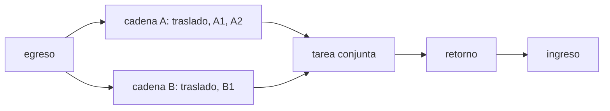

# B108-C05 — Evaluación de secuencias y líneas de tiempo de EVA

<!-- nav:top -->
[🏠 Programa](../../../../README.md) · [📚 Bloque B108](../../../tronco-comun/B108-actividades-extravehiculares-y-trajes-espaciales.md) · [← Anterior: B108-C04 — Sistemas de sujeción y restricción de pies](../B108-C04-sistemas-de-sujecion-y-restriccion-de-pies/CLASE.md) · [Siguiente: B109-C01 — Selección de emplazamiento para un asentamiento extraterrestre →](../../../tronco-comun/B109-arquitectura-y-factores-humanos-de-habitats-extraterrestres.md#b109-c01)
<!-- /nav -->

## 1. Ubicación, nivel y alcance

Clase 5 del bloque B108. Nivel N3. Cierra el bloque: reúne el consumo de [C01](../B108-C01-sistemas-portatiles-de-soporte-vital-plss/CLASE.md), las rutas de [C02](../B108-C02-planificacion-de-desplazamientos-y-rutas-de-eva/CLASE.md) y el trabajo de [C03](../B108-C03-herramientas-y-equipos-de-eva/CLASE.md) y [C04](../B108-C04-sistemas-de-sujecion-y-restriccion-de-pies/CLASE.md) en una **línea de tiempo** con duraciones inciertas. Evalúas la ruta crítica, la probabilidad de exceder el tiempo y el margen de energía metabólica con una simulación de Monte Carlo con semilla. La EVA es **sintética** y la clase es educativa: no da consejo operativo.

## 2. Por qué esta clase existe

Falta evaluar la secuencia de una EVA (tiempos, consumibles, márgenes) antes de ejecutarla. La decisión central: **¿cabe la secuencia en el tiempo y en los consumibles disponibles, con qué probabilidad y con qué margen?**

## 3. Lo que podrás hacer al terminar

1. Hallar la ruta crítica de una red de precedencias con dos tripulantes.
2. Modelar duraciones con una distribución triangular.
3. Calcular la media y la varianza analíticas de una suma de triangulares.
4. Estimar con Monte Carlo la probabilidad de exceder un límite y los percentiles.
5. Evaluar el margen de energía metabólica por tripulante.
6. Separar lo consultado (la referencia de 7 h) de lo ilustrativo (todas las tareas).

La evidencia es el **informe de márgenes de una línea de tiempo sintética** del ejercicio 12 (sección 20).

## 4. Con qué llegas y cómo comprobarlo

1. ¿Qué es la ruta crítica?
2. ¿Qué es una distribución triangular?
3. ¿Qué es un percentil?
4. ¿Qué es un dato sintético?
5. ¿Qué es una verificación por segunda vía?

<details>
<summary>Ver respuestas</summary>

1. La cadena de tareas dependientes de mayor duración, que fija la duración total. 2. Una distribución con mínimo, moda y máximo. 3. El valor bajo el cual cae un porcentaje dado de los resultados. 4. Un dato generado para el ejemplo, no medido. 5. Calcular lo mismo con otro método y comparar.
</details>

Con cuatro o cinco aciertos, sigue; si no, repasa los prerrequisitos.

## 5. Un caso de contexto y casos de referencia

Una EVA **sintética** de dos tripulantes: egreso, dos cadenas paralelas (A: traslado + tareas A1 y A2; B: traslado + tarea B1), una tarea conjunta, retorno e ingreso. Con duraciones **modales** la ruta crítica (cadena A) da `305 min`, pero con la incertidumbre la media sube a `343,3 min` y la probabilidad de exceder el límite de `360 min` es `26,3 %`. Es el **ejemplo conductor**; todas las tareas y límites son ilustrativos.

## 6. Vocabulario

La **red de precedencias** ordena las tareas según sus dependencias. La **holgura** es el tiempo que una cadena puede retrasarse sin alargar el total. La **distribución triangular** `(a, m, b)` tiene mínimo `a`, moda `m` y máximo `b`. **Monte Carlo** estima probabilidades muestreando muchas veces. El **margen** es el límite menos un percentil del resultado.

## 7. Modelo mental: un plan de viaje con retrasos asimétricos



*Descripción textual:* tras el egreso, dos tripulantes trabajan en paralelo en las cadenas A y B; la tarea conjunta espera a la más lenta; después vienen el retorno y el ingreso.

Analogía: un viaje con dos trenes que deben coincidir en un andén; llega el último. Límite: se suponen duraciones independientes y sin fallos ni reprogramación.

## 8. La explicación, paso a paso

### 8.1 Ruta crítica determinista

Con las duraciones modales, la cadena A suma `40 + 90 + 45 = 175 min` y la B `40 + 70 = 110 min`; la crítica es A y la B tiene una holgura de `65 min`. La EVA dura `30 + 175 + 30 + 40 + 30 = 305 min (5,08 h)`, bajo el límite de `360 min`.

### 8.2 Por qué la moda engaña

Las duraciones son asimétricas (el máximo está más lejos de la moda que el mínimo), de modo que la media supera a la moda: la media de la cadena A es `(a+m+b)/3` por tarea, `198,333 min`, frente a `175 min` modales. La simulación da `198,347 min`, con desviación `23,52 min` frente a `23,48 min` analíticos.

### 8.3 Monte Carlo de la EVA

Con `N = 100 000` y semilla `20261110`: media `343,3 min`; P50 `342,3`; P90 `378,2`; P95 `388,4 min`. La probabilidad de superar `360 min` es `0,2626` (con la semilla 7, `0,2638`; la diferencia está dentro del ruido binomial). El margen frente al P90 es `360 − 378,2 = −18,2 min`: **negativo**. El plan modal parecía holgado y el probabilístico no lo es.

### 8.4 Energía metabólica

Con `W` por tarea (300–469 W) la energía media es `2,473 kWh` para el tripulante A y `1,873 kWh` para el B. Con un presupuesto ilustrativo de `2,6 kWh`, `P(E > 2,6) = 0,2648` para A y `0,0000` para B. La cadena más cargada limita el conjunto, y esa ruta crítica puede reequilibrarse moviendo trabajo a la cadena con holgura.

## 9. Magnitudes, símbolos y unidades

| Símbolo | Qué es | Unidad | Valor / nota |
|---|---|---|---|
| `(a, m, b)` | mínimo, moda y máximo | min | por tarea (ilustrativos) |
| `T_lim` | límite de planificación | min | 360 (ilustrativo) |
| `W` | potencia metabólica | W | 300–469 (469 de PLSS 1.0) |
| `E_max` | presupuesto metabólico | kWh | 2,6 (ilustrativo) |
| `P` | probabilidad de exceder | — | 0,2626 |
| `N` | muestras | — | 100 000 |

## 10. Convenciones y referencias

Tiempos en minutos desde el inicio de la EVA; energía `Σ W·t` en kWh. Duraciones independientes. Semillas fijas 20261110 y 7. Tareas, duraciones, límites, presupuesto y reserva son ilustrativos.

## 11. De dónde sale lo que afirmamos

| ID | Fuente | Localizador | Respalda | Estado |
|---|---|---|---|---|
| S1 | Watts et al., *Space Suit Portable Life Support System Test Bed (PLSS 1.0) Development and Testing*, AIAA (NTRS 20120007410) — https://ntrs.nasa.gov/citations/20120007410 (consultada 2026-11-10; PDF leído con PyMuPDF) | sección de pruebas transitorias | el banco simuló EVAs nominales de 7 h con carga metabólica máxima de 700 W (la duración se usa solo como referencia) | Consultada |
| — | Distribución triangular, ruta crítica, Monte Carlo | — | las verifica el laboratorio con una segunda vía | No consultada en una fuente concreta |

Límites: no se consultaron líneas de tiempo, márgenes ni procedimientos de ninguna EVA real; las duraciones y los presupuestos no son datos de vuelo.

## 12. Cómo ver los márgenes

| Magnitud | Valor |
|---|---|
| EVA con modas | 305 min |
| EVA media (MC) | 343,3 min |
| P90 | 378,2 min |
| P(EVA > 360 min) | 0,2626 |
| Margen frente al P90 | −18,2 min |

Descripción larga: la media y los percentiles quedan por encima de la planificación modal y la holgura desaparece.

## 13. Ejemplo trabajado: la media de la cadena B

**Paso 1 · Traslado B.** `(30+40+60)/3 = 43,33 min`.

**Paso 2 · Tarea B1.** `(45+70+120)/3 = 78,33 min`.

**Paso 3 · Suma.** `121,67 min`, frente a `110 min` modales.

**Paso 4 · Comparación.** Sigue lejos de la cadena A (`198,33 min`): B conserva holgura.

## 14. Distintas formas de describir una línea de tiempo

**Por modas:** 305 min. **Por media:** 343,3 min. **Por percentil:** P90 = 378,2 min. **Por probabilidad:** `P(exceder)`. **Por margen:** límite − percentil.

## 15. Práctica guiada

**Ejercicio 1 · con los pasos indicados.** Media de una tarea `(20, 30, 60)`. *Pasos:* suma los tres valores y divide entre 3.

<details><summary>Solución comentada</summary>

`110/3 = 36,67 min`.
</details>

**Ejercicio 2 · con una pista.** Varianza de esa tarea. *Pista:* `(a²+m²+b²−am−ab−mb)/18`.

<details><summary>Solución comentada</summary>

`(400+900+3600−600−1200−1800)/18 = 1300/18 = 72,2 min²`; desviación `8,50 min`.
</details>

**Ejercicio 3 · casi autónomo.** ¿Por qué la media supera a la moda en estas tareas?

<details><summary>Solución comentada</summary>

La cola derecha es más larga que la izquierda: hay más retraso posible que adelanto.
</details>

## 16. Práctica autónoma, transferencia e integrador

**Ejercicio 4 · autónomo.** Ruta crítica modal si la tarea B1 sube a 140 min.

<details><summary>Solución comentada</summary>

Cadena B `40 + 140 = 180 min > 175`: B pasa a ser la crítica; EVA `30 + 180 + 30 + 40 + 30 = 310 min`.
</details>

**Ejercicio 5 · autónomo.** Margen modal frente a 360 min.

<details><summary>Solución comentada</summary>

`360 − 305 = 55 min`.
</details>

**Ejercicio 6 · autónomo.** Media y desviación de la suma de dos tareas independientes de medias 36,67 y 43,33 min y varianzas 72,2 y 66,7 min².

<details><summary>Solución comentada</summary>

Media `80,0 min`; varianza `138,9 min²`; desviación `11,79 min`.
</details>

**Ejercicio 7 · autónomo.** Si subes el límite a 390 min, ¿qué esperas de `P(exceder)`?

<details><summary>Solución comentada</summary>

Que baje por debajo del 5 %: 390 supera el P95 de 388,4 min.
</details>

**Ejercicio 8 · autónomo.** ¿Cuánto vale `4σ` binomial para `p = 0,26` y `N = 10⁵`?

<details><summary>Solución comentada</summary>

`4 × √(0,26 × 0,74/10⁵) = 0,0055`.
</details>

**Ejercicio 9 · transferencia.** **Transferencia.** Un planificador presenta 305 min como «la duración». ¿Qué le objetas?

<details><summary>Solución comentada</summary>

Es la duración con las modas: ignora la asimetría y la incertidumbre; la media es 343,3 min y hay un 26 % de superar el límite.
</details>

**Ejercicio 10 · transferencia.** **Transferencia.** ¿Qué haría el modelo si las duraciones de las tareas estuvieran correlacionadas (una falla retrasa todas)?

<details><summary>Solución comentada</summary>

La varianza del total aumentaría y la cola derecha pesaría más: `P(exceder)` subiría. El modelo independiente la subestima.
</details>

**Ejercicio 11 · transferencia.** **Transferencia.** ¿Por qué estas cifras no sirven para aprobar una EVA real?

<details><summary>Solución comentada</summary>

Las tareas, duraciones, potencias y límites son sintéticos; no se consultaron procedimientos, requisitos ni datos de vuelo.
</details>

**Ejercicio 12 · integrador.** **Integrador.** Elabora tu *informe de márgenes de una línea de tiempo sintética*: ruta crítica modal, media y percentiles de Monte Carlo, `P(exceder)`, margen de energía por tripulante y la verificación analítica.

<details><summary>Solución comentada</summary>

Secciones 8.1–8.4 y la salida del laboratorio.
</details>

## 17. Laboratorio: línea de tiempo con Monte Carlo

El script [linea_tiempo.py](linea_tiempo.py) calcula la ruta crítica modal, verifica la media y la desviación de una cadena con fórmulas analíticas y simula la EVA con dos semillas (**comprueba** media dentro de 0,5 min y `P(exceder)` coherente entre semillas).

**Datos:** solo la referencia de 7 h de PLSS 1.0 se consultó; tareas, duraciones, potencias y límites son **ilustrativos**. **Predice antes de ejecutar:** ¿será la media mayor o menor que 305 min? (mayor, por la asimetría.) **Ejecución del 2026-11-10 (Python 3.12.9):**

```text
Python 3.12.9 (biblioteca estandar)
Linea de tiempo SINTETICA de EVA con dos tripulantes; duraciones triangulares (min, moda, max)
Ruta critica con duraciones modales: cadena A = 175 min, cadena B = 110 min -> critica = A; EVA = 305 min (5.08 h); limite = 360 min
Holgura de la cadena B = 65 min
Cadena A: media analitica = 198.333 min, Monte Carlo = 198.347 min; desv. analitica = 23.482, MC = 23.524
Monte Carlo (N = 100000, semilla 20261110): EVA media = 343.3 min; P50 = 342.3; P90 = 378.2; P95 = 388.4
P(EVA > 360 min) = 0.2626; con semilla 7 = 0.2638
Energia metabolica media: tripulante A = 2.473 kWh, B = 1.873 kWh; P(E > 2.6 kWh): A = 0.2648, B = 0.0000
Margen de tiempo frente al P90 = -18.2 min
Pruebas superadas.
```

```bash
python programa/clases/B108/B108-C05-evaluacion-de-secuencias-y-lineas-de-tiempo-de-eva/linea_tiempo.py
```

**Límites:** duraciones independientes, sin fallos ni reprogramación; el Monte Carlo valida el código frente a las fórmulas, no que las distribuciones sean las de una EVA real.

## 18. Errores frecuentes y cómo corregirlos

**Planificar con las duraciones modales.** Se corrige con 8.2.

**Suponer duraciones independientes sin discutirlo.** Se corrige con el ejercicio 10.

**Dar un margen sin decir contra qué percentil.** Se corrige con 8.3.

**Presentar la línea de tiempo sintética como la de una EVA real.** Se corrige con la sección 10.

## 19. Cómo sabrás que vas bien

Tras la sección 8: ¿qué media esperabas y cuál obtuviste? Si dudas, repasa el ejemplo 13. Tras el laboratorio: ¿qué comprueba? (ver la sección 17).

## 20. Qué entregas y cómo se evalúa

El producto es tu **informe de márgenes de una línea de tiempo sintética** (ejercicio 12).

| Criterio | Inicial | En desarrollo | Logrado | Destacado |
|---|---|---|---|---|
| Conceptos | Los confunde | Parciales | Calcula ruta crítica y percentiles | Explica los límites |
| Cálculo | Sin unidades | Con errores | Tablas completas con unidades | Calcula casos nuevos |
| Numérico | Sin comprobar | Un caso | Contraste analítico y entre semillas | Interpreta las diferencias |
| Fuentes | Sin fuente | Sin fecha | Fuentes con fecha y estado | Declara lo ilustrativo y lo no consultado |
| Límites | No los nombra | Uno | Tres | Discute la independencia de las duraciones |

**Condiciones críticas (no se compensan con promedio):** rotular tareas y límites como ilustrativos; no usarlo para aprobar o planificar una EVA real; citar solo lo consultado.

## 21. Ética, seguridad y límites

Clase educativa: no da consejo médico ni operativo y no sustituye procedimientos, requisitos ni márgenes de ninguna agencia; la línea de tiempo es sintética. Accesibilidad: tablas equivalentes a las gráficas, fórmulas en texto, ejercicios sin conexión.

## 22. Para cerrar y seguir

Una EVA sintética que parece caber con las modas (`305 min`) excede el límite de `360 min` en el `26 %` de las simulaciones y deja un margen negativo frente al P90. El bloque termina aquí: el consumo, la ruta, la herramienta, la sujeción y la secuencia se evalúan con números, siempre rotulados como modelo.

**Glosario español–inglés.** ruta crítica · *critical path*; holgura · *slack / float*; línea de tiempo · *timeline*; distribución triangular · *triangular distribution*; margen · *margin*.

**Continuidad.** Vuelve al [bloque B108](../../../tronco-comun/B108-actividades-extravehiculares-y-trajes-espaciales.md) o a [C01](../B108-C01-sistemas-portatiles-de-soporte-vital-plss/CLASE.md) para revisar el consumo con otro perfil.

**Referencias:** ver sección 11.

<!-- nav:bottom -->
---

[← Anterior: B108-C04 — Sistemas de sujeción y restricción de pies](../B108-C04-sistemas-de-sujecion-y-restriccion-de-pies/CLASE.md) · [📚 Bloque B108](../../../tronco-comun/B108-actividades-extravehiculares-y-trajes-espaciales.md) · [Siguiente: B109-C01 — Selección de emplazamiento para un asentamiento extraterrestre →](../../../tronco-comun/B109-arquitectura-y-factores-humanos-de-habitats-extraterrestres.md#b109-c01)
<!-- /nav -->
