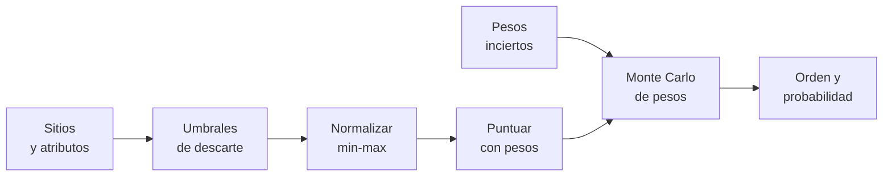

# B109-C01 — Selección de emplazamiento para un asentamiento extraterrestre

<!-- nav:top -->
[🏠 Programa](../../../../README.md) · [📚 Bloque B109](../../../tronco-comun/B109-arquitectura-y-factores-humanos-de-habitats-extraterrestres.md) · [← Anterior: B108-C05 — Evaluación de secuencias y líneas de tiempo de EVA](../../../tronco-comun/B108-actividades-extravehiculares-y-trajes-espaciales.md#b108-c05) · [Siguiente: B109-C02 — Zonificación y distribución funcional de módulos de un hábitat →](../B109-C02-zonificacion-y-distribucion-funcional-de-modulos-de-un-habitat/CLASE.md)
<!-- /nav -->

## 1. Ubicación, nivel y alcance

Clase 1 del bloque B109. Nivel N3. Antes de diseñar un hábitat hay que decidir dónde ponerlo, y esa decisión mezcla relieve, luz, recursos, comunicaciones y riesgo, que no se miden con las mismas unidades. Aquí aprendes a descartar sitios con umbrales, a normalizar criterios distintos, a puntuarlos con pesos explícitos y a medir cuánto resiste el orden si los pesos son inciertos. Abre el bloque [B109](../../../tronco-comun/B109-arquitectura-y-factores-humanos-de-habitats-extraterrestres.md) y se apoya en el entorno lunar. Los cinco sitios son **sintéticos**: no son lugares reales.

## 2. Por qué esta clase existe

Un asentamiento no se puede mover una vez construido. La decisión central: **¿cómo comparar sitios con criterios distintos sin esconder los juicios de valor en un número?** La respuesta del método es mostrar los umbrales, los pesos y la sensibilidad, para que otra persona pueda discrepar con datos.

## 3. Lo que podrás hacer al terminar

1. Aplicar umbrales de descarte (restricciones duras) antes de puntuar.
2. Normalizar criterios de beneficio y de coste a la escala 0–1.
3. Calcular una puntuación ponderada y ordenar los sitios.
4. Estimar la noche máxima de un sitio a partir de la fracción iluminada y del período sinódico.
5. Medir la estabilidad del orden con pesos inciertos (Monte Carlo con semilla fija).
6. Distinguir lo consultado de lo sintético, lo ilustrativo y lo no consultado.

La evidencia es tu **matriz de decisión de cinco sitios sintéticos** del ejercicio 12 (sección 20).

## 4. Con qué llegas y cómo comprobarlo

1. ¿Qué es un criterio de beneficio y uno de coste?
2. ¿Qué es normalizar con mínimo y máximo?
3. ¿Qué es el período sinódico de la Luna?
4. ¿Qué es una suma ponderada?
5. ¿Qué es un dato sintético?

<details>
<summary>Ver respuestas</summary>

1. Beneficio: cuanto más, mejor (iluminación); coste: cuanto menos, mejor (pendiente). 2. Llevar cada valor a `(x − mín)/(máx − mín)`, con valores entre 0 y 1. 3. El tiempo entre dos fases iguales, 29,53 d (NASA/NSSDC). 4. `Σ wᵢ xᵢ` con pesos que suman 1. 5. Uno inventado para practicar, rotulado como tal.
</details>

Con cuatro o cinco aciertos, sigue; si no, repasa los prerrequisitos.

## 5. Un caso de contexto y casos de referencia

Un equipo compara cinco sitios con cuatro tipos de dato. Dos quedan fuera por una restricción dura (D por pendiente de `12°` y E por iluminación de `45 %`). De los tres restantes, A obtiene `0,649`, C `0,562` y B `0,336`; con pesos inciertos A es primero en `75,8 %` de los sorteos. Es el **ejemplo conductor**. El artículo de NASA sobre el diseño interior de un hábitat lunar supone que la tripulación estará presente «durante periodos mayormente iluminados», y por eso la luz es un criterio de primer orden.

## 6. Vocabulario

Un **emplazamiento** es el lugar elegido para construir. Un **umbral de descarte** es una restricción dura que excluye un sitio aunque brille en otros criterios. Una **matriz de decisión** tabula sitios y criterios. Los **pesos** expresan la importancia relativa de cada criterio. La **normalización min–max** lleva cada criterio a `[0, 1]`. Un **sitio dominado** es peor o igual que otro en todos los criterios. La **sensibilidad** mide cuánto cambia el resultado al cambiar los pesos.

## 7. Modelo mental: un embudo de dos filtros



*Descripción textual:* los sitios pasan primero por los umbrales; los que sobreviven se normalizan y se puntúan con pesos; un muestreo de pesos mide qué tan estable es el orden.

Analogía: elegir una casa con un filtro de precio máximo y luego una lista de pros y contras puntuada. Límite: la normalización min–max depende del conjunto de sitios; quitar o añadir uno cambia las puntuaciones.

## 8. La explicación, paso a paso

### 8.1 Entorno lunar

La ficha de la NASA/NSSDC da `g = 1,62 m/s²`, un período sinódico de `29,53 d` y una temperatura ecuatorial diurna entre `95 K` y `390 K`. La noche máxima de un sitio con fracción iluminada `f` se estima con `(1 − f) × 29,53 d` suponiendo **una sola noche por lunación** (ilustrativo; en sitios reales la luz depende del relieve y de la latitud).

### 8.2 Descarte

Se excluyen los sitios con pendiente mayor de `10°` o iluminación menor de `50 %` (umbrales **ilustrativos**). Una restricción dura no se compensa: D tiene la mejor distancia al recurso y la mejor visibilidad de la Tierra y aun así queda fuera.

### 8.3 Normalización y puntuación

Con tres sitios y `x = (v − mín)/(máx − mín)`, los criterios de coste se invierten (`1 − x`). La puntuación es `S = Σ wᵢ xᵢ` con pesos base `0,25; 0,25; 0,20; 0,15; 0,15` (pendiente, iluminación, distancia al recurso, visibilidad de la Tierra, peligro).

| Sitio | Puntuación | Noche máx. (d) |
|---|---|---|
| A | 0,6493 | 11,22 |
| C | 0,5620 | 8,86 |
| B | 0,3357 | 4,43 |

### 8.4 Sensibilidad

Se sortean pesos de una distribución de Dirichlet centrada en los pesos base (`20000` sorteos, semilla `109001`): A es primero con `0,7579`, C con `0,2116` y B con `0,0305`. Una puntuación con una sola cifra sin esta cola es una falsa precisión. Como segunda vía, con todo el peso en un criterio gana el sitio que lidera ese criterio.

## 9. Magnitudes, símbolos y unidades

| Símbolo | Qué es | Unidad | Valor / nota |
|---|---|---|---|
| `S` | puntuación ponderada | — | 0 a 1 |
| `wᵢ` | peso del criterio i | — | suman 1 (ilustrativos) |
| `xᵢ` | valor normalizado | — | 0 a 1 |
| `f` | fracción iluminada | % | 45 a 90 (sintética) |
| `g` | gravedad lunar | m/s² | 1,62 (NASA/NSSDC) |
| `T_sin` | período sinódico | d | 29,53 (NASA/NSSDC) |

## 10. Convenciones y referencias

Datos del entorno de la ficha NASA/NSSDC de la Luna. Pendiente en grados, iluminación en %, distancia en km, visibilidad de la Tierra en % del tiempo, peligro como índice 0–1. Los cinco sitios, los umbrales y los pesos son **sintéticos o ilustrativos**. Las regiones candidatas reales de Artemis y sus criterios oficiales **no se consultaron**.

## 11. De dónde sale lo que afirmamos

| ID | Fuente | Localizador | Respalda | Estado |
|---|---|---|---|---|
| S1 | NASA/NSSDC, Moon Fact Sheet — https://nssdc.gsfc.nasa.gov/planetary/factsheet/moonfact.html (consultada 2026-11-10) | ficha completa leída | g, período sinódico, rango térmico | Consultada |
| S2 | Burke, Howard y Kessler (2022), «Internal Layout of a Lunar Surface Habitat», AIAA ASCEND 2022 — https://ntrs.nasa.gov/citations/20220013669 (leído completo, 16 páginas, 2026-11-10) | Sección «Surface Habitat Ground Rules and Assumptions» | la tripulación estará presente solo durante periodos mayormente iluminados; misión nominal de 30 días | Consultada |
| — | Métodos de decisión multicriterio (normalización min–max, suma ponderada, Dirichlet) | — | las verifica el laboratorio con una segunda vía | No consultada en una fuente concreta |

Límites: no se consultaron los criterios oficiales de selección de regiones de aterrizaje de Artemis III (la página de NASA no respondió); los sitios, umbrales y pesos de esta clase son inventados para practicar.

## 12. Cómo ver la matriz de decisión

| Magnitud | Valor |
|---|---|
| Descartados | D (pendiente), E (iluminación) |
| Primero con pesos base | A, 0,6493 |
| P(A primero) | 0,7579 |
| Noche máx. de A | 11,22 d |

Descripción larga: Dos sitios caen por umbral; de los tres restantes A lidera con casi tres de cada cuatro sorteos de pesos, C es el rival creíble y B casi nunca gana.

## 13. Ejemplo trabajado: la puntuación del sitio C

**Paso 1 · Normalizar.** Pendiente de C `6°` entre `4°` y `8°`: `x = 0,5`, coste: `0,5`. Iluminación `70` entre `62` y `85`: `0,348`. Distancia `6 km`, la menor: `1`. Visibilidad `20 %`, la menor: `0`. Peligro `0,25`, el menor: `1`.

**Paso 2 · Ponderar.** `0,25·0,5 + 0,25·0,348 + 0,20·1 + 0,15·0 + 0,15·1 = 0,125 + 0,087 + 0,200 + 0 + 0,150`.

**Paso 3 · Sumar.** `S = 0,562`, igual a la salida del laboratorio.

## 14. Distintas formas de describir la elección

**Por tabla:** matriz sitios × criterios. **Por puntuación:** un número por sitio. **Por probabilidad:** la fracción de sorteos en que cada sitio es primero. **Por esquinas:** quién gana si un solo criterio importa.

## 15. Práctica guiada

**Ejercicio 1 · con los pasos indicados.** Calcula la noche máxima del sitio A. *Pasos:* `1 − 0,62`, multiplica por `29,53`.

<details><summary>Solución comentada</summary>

`0,38 × 29,53 = 11,22 d`.
</details>

**Ejercicio 2 · con una pista.** Predice el valor normalizado de pendiente de B. *Pista:* es el peor de los tres y es un criterio de coste.

<details><summary>Solución comentada</summary>

`0`: pendiente `8°` es el máximo, `x = 1`, coste `1 − 1 = 0`.
</details>

**Ejercicio 3 · casi autónomo.** ¿Por qué D queda fuera si tiene la mejor distancia al recurso?

<details><summary>Solución comentada</summary>

Porque el umbral de pendiente es una restricción dura: no se compensa con otros criterios.
</details>

## 16. Práctica autónoma, transferencia e integrador

**Ejercicio 4 · autónomo.** Aporte de la visibilidad de la Tierra al sitio A.

<details><summary>Solución comentada</summary>

`0,15 × 1 = 0,15`.
</details>

**Ejercicio 5 · autónomo.** ¿Quién gana si todo el peso está en la distancia al recurso?

<details><summary>Solución comentada</summary>

C (salida del laboratorio).
</details>

**Ejercicio 6 · autónomo.** Puntuación de A con pesos iguales `0,2` cada uno.

<details><summary>Solución comentada</summary>

`(1 + 0 + 0,684 + 1 + 0,75)/5 = 0,687`: A sigue primero.
</details>

**Ejercicio 7 · autónomo.** Probabilidad de que A no sea primero.

<details><summary>Solución comentada</summary>

`1 − 0,7579 = 0,2421`.
</details>

**Ejercicio 8 · autónomo.** Noche máxima del sitio B.

<details><summary>Solución comentada</summary>

`0,15 × 29,53 = 4,43 d`.
</details>

**Ejercicio 9 · transferencia.** **Transferencia.** Añades un sexto criterio con peso `0,2`. ¿Qué haces con los otros pesos?

<details><summary>Solución comentada</summary>

Los multiplicas por `0,8` para que la suma siga siendo 1.
</details>

**Ejercicio 10 · transferencia.** **Transferencia.** ¿Es el orden A, C, B una recomendación de dónde construir en la Luna?

<details><summary>Solución comentada</summary>

No: los sitios son sintéticos y los umbrales y pesos ilustrativos; es un ejercicio de método.
</details>

**Ejercicio 11 · transferencia.** **Transferencia.** Quitas el sitio C. ¿Cambian las puntuaciones de A y B?

<details><summary>Solución comentada</summary>

Sí: la normalización min–max cambia con el conjunto. Con solo A y B, A pasa de `0,649` a `0,75` y B de `0,336` a `0,25`.
</details>

**Ejercicio 12 · integrador.** **Integrador.** Elabora tu *matriz de decisión*: tabla de cinco sitios con atributos y umbrales, puntuaciones, probabilidad de ser primero y lista de lo consultado, lo sintético y lo no consultado.

<details><summary>Solución comentada</summary>

Secciones 8.1–8.4 y la salida del laboratorio.
</details>

## 17. Laboratorio: matriz de decisión de cinco sitios sintéticos

El script [sitios.py](sitios.py) aplica los umbrales, normaliza, puntúa, muestrea pesos y **comprueba** el caso de esquinas con tolerancia `1e-12`.

**Datos:** el período sinódico y `g` están consultados (NASA/NSSDC); los cinco sitios, los umbrales y los pesos son **sintéticos o ilustrativos**. **Predice antes de ejecutar:** ¿qué sitio crees que será primero con más frecuencia? (A.) **Ejecución del 2026-11-10 (Python 3.12.9):**

```text
Datos SINTETICOS; umbrales y pesos ILUSTRATIVOS; periodo sinodico 29.53 d (NASA/NSSDC)
Descartados: D(pendiente), E(iluminacion)
 sitio  puntuacion  noche_max [d]
   A       0.6493       11.22
   C       0.5620        8.86
   B       0.3357        4.43
Probabilidad de ser primero con pesos inciertos (20000 sorteos, semilla 109001):
   A: 0.7579
   C: 0.2116
   B: 0.0305
Comprobacion de esquinas (todo el peso en un criterio):
   pendiente   gana A
   iluminacion gana B
   distancia   gana C
   tierra      gana A
   peligro     gana C
Pruebas superadas.
```

```bash
python programa/clases/B109/B109-C01-seleccion-de-emplazamiento-para-un-asentamiento-extraterrestre/sitios.py
```

**Límites:** la normalización depende del conjunto; los pesos de Dirichlet son una elección ilustrativa; no hay datos reales de terreno.

## 18. Errores frecuentes y cómo corregirlos

**Dejar que un buen criterio compense una restricción dura.** Se corrige con 8.2.

**Dar el orden sin su sensibilidad.** Se corrige con 8.4.

**Presentar los sitios sintéticos como lugares reales.** Se corrige con la sección 10.

**Olvidar renormalizar los pesos al añadir un criterio.** Se corrige con el ejercicio 9.

## 19. Cómo sabrás que vas bien

Tras 8.3: ¿qué sitio esperabas primero y cuál salió? Si dudas, repasa el ejemplo 13. Tras el laboratorio: ¿qué comprueba? (ver la sección 17).

## 20. Qué entregas y cómo se evalúa

El producto es tu **matriz de decisión de cinco sitios sintéticos** (ejercicio 12).

| Criterio | Inicial | En desarrollo | Logrado | Destacado |
|---|---|---|---|---|
| Conceptos | Los confunde | Parciales | Distingue descarte, peso y sensibilidad | Explica la dependencia del conjunto |
| Cálculo | Sin unidades | Con errores | Matriz completa con unidades | Calcula casos nuevos |
| Numérico | Sin comprobar | Un caso | Contraste con las esquinas | Interpreta la cola de probabilidad |
| Fuentes | Sin fuente | Sin fecha | Fuentes con fecha y estado | Declara lo sintético y lo no consultado |
| Límites | No los nombra | Uno | Tres | Discute qué falta del método |

**Condiciones críticas (no se compensan con promedio):** rotular los sitios como sintéticos y los umbrales y pesos como ilustrativos; no presentar un orden como recomendación de sitio; declarar que los criterios de Artemis no se consultaron; no dar consejo médico ni operativo; citar solo lo consultado.

## 21. Ética, seguridad y límites

Clase educativa: **no da consejo médico ni operativo** y no sustituye a las normas de diseño, a la revisión de ingeniería ni al juicio de profesionales de factores humanos y de seguridad de misión. Los modelos son simplificados y sus datos son sintéticos o ilustrativos; ningún resultado describe un hábitat real. Un ranking multicriterio no es una autorización de aterrizaje ni de construcción; esa decisión requiere datos de misión y revisión de seguridad. Accesibilidad: tablas equivalentes a las gráficas, fórmulas en texto, ejercicios sin conexión.

## 22. Para cerrar y seguir

Con umbrales y pesos explícitos, A lidera con `0,649` y con `75,8 %` de los sorteos: un resultado con su incertidumbre. Queda una pregunta: ya elegido el sitio, ¿cómo se reparten las zonas dentro del hábitat?

**Glosario español–inglés.** emplazamiento · *site*; umbral de descarte · *screening threshold*; matriz de decisión · *decision matrix*; peso · *weight*; sensibilidad · *sensitivity*.

**Continuidad.** [B109-C02](../B109-C02-zonificacion-y-distribucion-funcional-de-modulos-de-un-habitat/CLASE.md) organiza las zonas funcionales del hábitat.

**Referencias:** ver sección 11.

<!-- nav:bottom -->
---

[← Anterior: B108-C05 — Evaluación de secuencias y líneas de tiempo de EVA](../../../tronco-comun/B108-actividades-extravehiculares-y-trajes-espaciales.md#b108-c05) · [📚 Bloque B109](../../../tronco-comun/B109-arquitectura-y-factores-humanos-de-habitats-extraterrestres.md) · [Siguiente: B109-C02 — Zonificación y distribución funcional de módulos de un hábitat →](../B109-C02-zonificacion-y-distribucion-funcional-de-modulos-de-un-habitat/CLASE.md)
<!-- /nav -->
