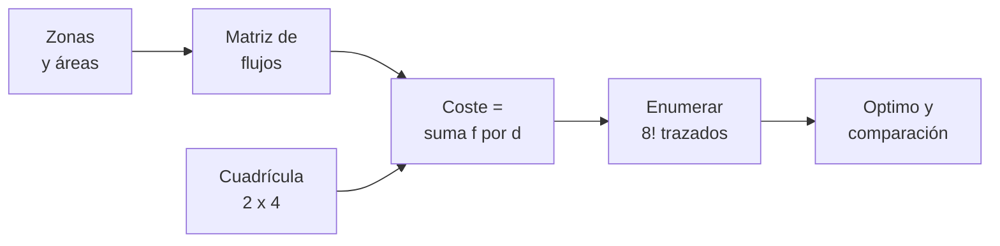

# B109-C02 — Zonificación y distribución funcional de módulos de un hábitat

<!-- nav:top -->
[🏠 Programa](../../../../README.md) · [📚 Bloque B109](../../../tronco-comun/B109-arquitectura-y-factores-humanos-de-habitats-extraterrestres.md) · [← Anterior: B109-C01 — Selección de emplazamiento para un asentamiento extraterrestre](../B109-C01-seleccion-de-emplazamiento-para-un-asentamiento-extraterrestre/CLASE.md) · [Siguiente: B109-C03 — Accesos, esclusas y transferencia entre ambientes presurizados →](../B109-C03-accesos-esclusas-y-transferencia-entre-ambientes-presurizados/CLASE.md)
<!-- /nav -->

## 1. Ubicación, nivel y alcance

Clase 2 del bloque B109. Nivel N3. Con el sitio elegido ([B109-C01](../B109-C01-seleccion-de-emplazamiento-para-un-asentamiento-extraterrestre/CLASE.md)), el hábitat se organiza en zonas (dormir, higiene, comer, trabajar, medicina, ejercicio, control, acceso) que se relacionan por flujos de personas y por incompatibilidades. Aquí convertes esas relaciones en un coste, buscas el mejor trazado sobre una cuadrícula y comparas con trazados al azar. Los flujos son **sintéticos**; las áreas salen de un artículo técnico de NASA sobre un concepto de referencia.

## 2. Por qué esta clase existe

Un buen plano ahorra pasos, separa lo sucio de lo limpio y deja las zonas tranquilas lejos de las ruidosas. La decisión central: **¿dónde pongo cada zona para que los recorridos frecuentes sean cortos y las zonas incompatibles estén lejos?** El método sustituye la intuición por un coste que se puede comparar.

## 3. Lo que podrás hacer al terminar

1. Describir las zonas funcionales de un hábitat de dos tripulantes con sus áreas publicadas.
2. Construir una matriz de flujos con atracciones y separaciones.
3. Calcular el coste de un trazado como suma de flujo por distancia.
4. Buscar el trazado óptimo por enumeración exhaustiva (`8! = 40320`).
5. Verificar el óptimo con las simetrías de la cuadrícula y con trazados al azar.
6. Detectar incoherencias entre filas y totales de una tabla publicada y rotular lo sintético y lo consultado.

La evidencia es tu **plano de zonas con su coste de recorridos** del ejercicio 12 (sección 20).

## 4. Con qué llegas y cómo comprobarlo

1. ¿Qué es una distancia Manhattan?
2. ¿Qué es una permutación?
3. ¿Qué es un flujo entre dos zonas?
4. ¿Qué es una simetría de una cuadrícula?
5. ¿Qué es un dato sintético?

<details>
<summary>Ver respuestas</summary>

1. La suma de las diferencias de fila y de columna. 2. Un orden de los elementos; con 8 zonas hay `8! = 40320`. 3. La cantidad de viajes por día entre ellas. 4. Un giro o reflejo que deja la cuadrícula igual. 5. Un dato inventado para practicar, rotulado.
</details>

Con cuatro o cinco aciertos, sigue; si no, repasa los prerrequisitos.

## 5. Un caso de contexto y casos de referencia

El concepto de referencia de NASA para un hábitat de superficie lunar para dos tripulantes lista áreas mínimas y áreas del trazado por función: dormir `1,82 m²`, higiene `1,06 m²`, mesa `1,62 m²`, trabajo `1,37 m²`… y un total recomendado de `14,6 m²` frente a `42,63 m²` en el trazado. Con flujos sintéticos, el mejor trazado de 8 zonas cuesta `184,6` frente a `404,0` de media al azar: un `54,3 %` menos. Es el **ejemplo conductor**. Además, la suma de las filas de la tabla no coincide con sus totales, y esa diferencia es parte de la lección.

## 6. Vocabulario

Una **zona** agrupa funciones que comparten espacio. Un **flujo** es el número de viajes por día entre dos zonas. Una **adyacencia** es la cercanía deseada. Una **incompatibilidad** es una cercanía no deseada (polvo, ruido). El **coste de trazado** es `Σ f·d`. Un **trazado óptimo** es el de menor coste. Los **recorridos** son las rutas que sigue la tripulación.

## 7. Modelo mental: un tablero de ocho fichas



*Descripción textual:* las zonas y sus flujos definen un coste; una cuadrícula fija las posiciones posibles; la enumeración de todas las permutaciones da el mejor trazado, que se compara con los trazados al azar.

Analogía: colocar muebles en una casa pequeña para que lo que más se usa quede cerca. Límite: una cuadrícula de celdas iguales ignora formas, alturas, pasillos y el sentido vertical (el concepto NASA tiene tres niveles).

## 8. La explicación, paso a paso

### 8.1 Áreas publicadas

La Tabla 4 de Burke et al. (2022) compara áreas mínimas recomendadas y áreas del trazado: estiramiento `1,40 → 2,68 m²`, dormir `1,82 → 3,70`, médico `1,87 → 3,43`, ejercicio `1,5 → 2,09`, mesa `1,62 → 2,23`, esclusa `5,00 → 5,18`. El total recomendado es `14,6 m²` y el del trazado `42,63 m²` (`21,31 m²` por tripulante). El artículo señala que los usos pueden compartir un espacio si son compatibles en el tiempo.

### 8.2 Coste

Con `d` Manhattan sobre una cuadrícula de `2 × 4` celdas con paso de `2,6 m` (ilustrativo), el coste es `Σ f_ij d_ij`. Un flujo positivo atrae; uno negativo separa (esclusa con polvo frente a dormitorios y cocina; ejercicio frente a dormitorios).

### 8.3 Enumeración y verificación

Se evalúan las `40320` permutaciones: mínimo `184,6`, máximo `642,2`, media al azar `404,0` (2000 trazados, semilla `109002`). Hay `4` trazados óptimos, un múltiplo de `4` como exige el grupo de simetrías de la cuadrícula (identidad, dos reflejos y un giro de 180°). El trazado óptimo deja Dormitorios junto a Higiene y Cocina-mesa, y la Esclusa en la esquina opuesta.

### 8.4 Lectura y revisión de la tabla

El óptimo depende de los flujos inventados: otros flujos darían otro plano. La suma de las filas listadas en la tabla da `14,49 m²` (total publicado `14,6`) y `42,21 m²` (total `42,63`); la diferencia puede deberse a redondeo o a filas no listadas y no se resolvió con las fuentes consultadas.

## 9. Magnitudes, símbolos y unidades

| Símbolo | Qué es | Unidad | Valor / nota |
|---|---|---|---|
| `f_ij` | flujo entre zonas i y j | viajes/día | sintético; negativo = separar |
| `d_ij` | distancia Manhattan | m | paso 2,6 m (ilustrativo) |
| `C` | coste de trazado | viaje·m/día | 184,6 (óptimo) |
| `A` | área de zona | m² | Tabla 4 de Burke et al. (2022) |
| `n_opt` | trazados óptimos | — | 4 |
| `8!` | trazados posibles | — | 40320 |

## 10. Convenciones y referencias

Áreas de la Tabla 4 de Burke et al. (2022), de un concepto de referencia que no es un diseño de vuelo. Distancias en metros sobre una cuadrícula ilustrativa de celdas de `6,76 m²`. Los flujos y las separaciones son **sintéticos**. Las zonas agrupan filas de la tabla (por ejemplo, Dormitorios = estiramiento + dormir).

## 11. De dónde sale lo que afirmamos

| ID | Fuente | Localizador | Respalda | Estado |
|---|---|---|---|---|
| S1 | Burke, Howard y Kessler (2022), «Internal Layout of a Lunar Surface Habitat», AIAA ASCEND 2022 — https://ntrs.nasa.gov/citations/20220013669 (leído completo, 16 páginas, 2026-11-10) | Tabla 4 y sección «Surface Habitat Functionality» | áreas recomendadas y del trazado; total 14,6 y 42,63 m²; los usos compatibles en el tiempo pueden compartir espacio | Consultada |
| — | Enumeración exhaustiva de permutaciones y distancia Manhattan | — | las verifica el laboratorio con una segunda vía | No consultada en una fuente concreta |

Límites: los flujos, las separaciones y el paso de celda no se consultaron en ninguna fuente; el artículo no publica flujos de la tripulación; las diferencias entre filas y totales de la Tabla 4 no se explicaron.

## 12. Cómo ver el coste de los trazados

| Magnitud | Valor |
|---|---|
| Trazados evaluados | 40320 |
| Coste mínimo | 184,6 |
| Coste medio al azar | 404,0 |
| Ahorro del óptimo | 54,3 % |

Descripción larga: El mejor trazado cuesta menos de la mitad que un trazado típico al azar, y hay exactamente cuatro equivalentes por simetría.

## 13. Ejemplo trabajado: el coste de dos zonas

**Paso 1 · Distancia.** Dormitorios y Higiene en celdas contiguas: `d = 2,6 m`.

**Paso 2 · Flujo.** `f = 20 viajes/día`.

**Paso 3 · Aporte.** `20 × 2,6 = 52 viaje·m/día`. Si estuvieran en esquinas opuestas (`d = 2,6 × 4 = 10,4 m`) aportarían `208`.

## 14. Distintas formas de describir el trazado

**Por rejilla:** quién ocupa cada celda. **Por matriz:** flujos entre pares. **Por coste:** un número a minimizar. **Por área:** m² por zona frente al mínimo recomendado.

## 15. Práctica guiada

**Ejercicio 1 · con los pasos indicados.** Calcula la suma de las filas recomendadas de la Tabla 4 y compárala con `14,6`. *Pasos:* suma `1,40 + 1,82 + … + 0,56`.

<details><summary>Solución comentada</summary>

`14,49 m²`: faltan `0,11`.
</details>

**Ejercicio 2 · con una pista.** Predice el aporte de Dormitorios–Cocina-mesa si están contiguas. *Pista:* `f = 12`.

<details><summary>Solución comentada</summary>

`12 × 2,6 = 31,2 viaje·m/día`.
</details>

**Ejercicio 3 · casi autónomo.** ¿Por qué hay 4 trazados óptimos y no 1?

<details><summary>Solución comentada</summary>

Porque la cuadrícula `2 × 4` tiene 4 simetrías (identidad, dos reflejos y un giro de 180°) y cada una da un trazado equivalente.
</details>

## 16. Práctica autónoma, transferencia e integrador

**Ejercicio 4 · autónomo.** Ahorro del óptimo frente a la media al azar.

<details><summary>Solución comentada</summary>

`(404,0 − 184,6)/404,0 = 54,3 %`.
</details>

**Ejercicio 5 · autónomo.** Área por tripulante del trazado.

<details><summary>Solución comentada</summary>

`42,63/2 = 21,31 m²` (dato publicado).
</details>

**Ejercicio 6 · autónomo.** Distancia Manhattan entre las celdas `(0,0)` y `(1,3)`.

<details><summary>Solución comentada</summary>

`2,6 × (1 + 3) = 10,4 m`.
</details>

**Ejercicio 7 · autónomo.** Aporte de Esclusa–Dormitorios si están a `10,4 m` y `f = −5`.

<details><summary>Solución comentada</summary>

`−5 × 10,4 = −52`: la separación reduce el coste.
</details>

**Ejercicio 8 · autónomo.** Diferencia entre el total del trazado `42,63` y la suma de sus filas.

<details><summary>Solución comentada</summary>

`42,63 − 42,21 = 0,42 m²`.
</details>

**Ejercicio 9 · transferencia.** **Transferencia.** Cambias el flujo Dormitorios–Higiene a `2`. ¿Se mantiene el trazado óptimo?

<details><summary>Solución comentada</summary>

No hay garantía: hay que reevaluar las `40320` permutaciones; con menos atracción es más probable que Higiene deje de ser contigua.
</details>

**Ejercicio 10 · transferencia.** **Transferencia.** ¿Por qué no vale para un hábitat de 30 zonas la enumeración exhaustiva?

<details><summary>Solución comentada</summary>

`30!` es astronómico; hace falta una heurística (intercambios, recocido) y se pierde la garantía de óptimo.
</details>

**Ejercicio 11 · transferencia.** **Transferencia.** ¿El plano óptimo del laboratorio es el de un hábitat real?

<details><summary>Solución comentada</summary>

No: los flujos son inventados y el artículo de NASA es un concepto de referencia.
</details>

**Ejercicio 12 · integrador.** **Integrador.** Elabora tu *plano de zonas*: rejilla óptima, coste frente al azar, áreas por zona, revisión de la tabla publicada y lista de lo consultado, sintético y no consultado.

<details><summary>Solución comentada</summary>

Secciones 8.1–8.4 y la salida del laboratorio.
</details>

## 17. Laboratorio: zonificación por flujos y búsqueda exhaustiva

El script [zonas.py](zonas.py) evalúa las 40320 permutaciones, compara con 2000 trazados al azar y **comprueba** que el número de óptimos es múltiplo de 4 y que ninguno al azar lo supera (tolerancia `1e-9`).

**Datos:** las áreas son de la Tabla 4 de Burke et al. (2022); los flujos, las separaciones y el paso de celda son **sintéticos o ilustrativos**. **Predice antes de ejecutar:** ¿en qué esquina quedará la Esclusa? (lejos de Dormitorios y de Cocina-mesa.) **Ejecución del 2026-11-10 (Python 3.12.9):**

```text
Flujos SINTETICOS; areas de la Tabla 4 de Burke et al. (2022); paso de celda 2.6 m ILUSTRATIVO
Suma de filas recomendadas = 14.49 m2 (total publicado 14.6; diferencia 0.11)
Suma de filas del trazado  = 42.21 m2 (total publicado 42.63; diferencia 0.42)
Trazados evaluados: 40320
Coste minimo = 184.6 ; maximo = 642.2 ; media al azar = 404.0
Trazados optimos = 4 (multiplo de 4: True)
Ahorro del optimo frente a la media al azar = 54.3 %
Un trazado optimo (filas de la cuadricula):
  Dormitorios | Higiene     | Medico      | Ejercicio  
  Cocina-mesa | Trabajo     | Control     | Esclusa    
Pruebas superadas.
```

```bash
python programa/clases/B109/B109-C02-zonificacion-y-distribucion-funcional-de-modulos-de-un-habitat/zonas.py
```

**Límites:** cuadrícula plana de celdas iguales; flujos inventados; sin pasillos, alturas ni niveles.

## 18. Errores frecuentes y cómo corregirlos

**Optimizar con flujos que no se justifican.** Se corrige con 8.4.

**Tratar como óptimo único lo que tiene simetrías.** Se corrige con 8.3.

**Confiar en los totales de una tabla sin sumar las filas.** Se corrige con 8.4.

**Presentar el plano como diseño real.** Se corrige con la sección 10.

## 19. Cómo sabrás que vas bien

Tras 8.3: ¿cuántos óptimos esperabas y cuántos salieron? Si dudas, repasa el ejemplo 13. Tras el laboratorio: ¿qué comprueba? (ver la sección 17).

## 20. Qué entregas y cómo se evalúa

El producto es tu **plano de zonas con su coste de recorridos** (ejercicio 12).

| Criterio | Inicial | En desarrollo | Logrado | Destacado |
|---|---|---|---|---|
| Conceptos | Los confunde | Parciales | Distingue flujo, adyacencia e incompatibilidad | Explica las simetrías |
| Cálculo | Sin unidades | Con errores | Costes con unidades | Calcula casos nuevos |
| Numérico | Sin comprobar | Un caso | Contraste con simetrías y azar | Detecta las diferencias de la tabla |
| Fuentes | Sin fuente | Sin fecha | Fuentes con fecha y estado | Declara lo sintético y lo no consultado |
| Límites | No los nombra | Uno | Tres | Discute qué falta del modelo |

**Condiciones críticas (no se compensan con promedio):** rotular los flujos y el paso de celda como sintéticos o ilustrativos; no presentar el plano como diseño real; citar las áreas solo de la fuente consultada; no dar consejo médico ni operativo; citar solo lo consultado.

## 21. Ética, seguridad y límites

Clase educativa: **no da consejo médico ni operativo** y no sustituye a las normas de diseño, a la revisión de ingeniería ni al juicio de profesionales de factores humanos y de seguridad de misión. Los modelos son simplificados y sus datos son sintéticos o ilustrativos; ningún resultado describe un hábitat real. Un plano óptimo para flujos inventados no valida un diseño: la evacuación, la seguridad contra incendios y los accesos de emergencia requieren su propio análisis. Accesibilidad: tablas equivalentes a las gráficas, fórmulas en texto, ejercicios sin conexión.

## 22. Para cerrar y seguir

Con flujos sintéticos, el mejor de `40320` trazados cuesta `184,6` frente a `404,0` al azar. Queda una pregunta: ¿cómo se entra y se sale del hábitat sin perder demasiado aire?

**Glosario español–inglés.** zona · *zone*; flujo · *flow*; adyacencia · *adjacency*; trazado · *layout*; esclusa · *airlock*.

**Continuidad.** [B109-C03](../B109-C03-accesos-esclusas-y-transferencia-entre-ambientes-presurizados/CLASE.md) calcula el gas que consume una esclusa en cada ciclo.

**Referencias:** ver sección 11.

<!-- nav:bottom -->
---

[← Anterior: B109-C01 — Selección de emplazamiento para un asentamiento extraterrestre](../B109-C01-seleccion-de-emplazamiento-para-un-asentamiento-extraterrestre/CLASE.md) · [📚 Bloque B109](../../../tronco-comun/B109-arquitectura-y-factores-humanos-de-habitats-extraterrestres.md) · [Siguiente: B109-C03 — Accesos, esclusas y transferencia entre ambientes presurizados →](../B109-C03-accesos-esclusas-y-transferencia-entre-ambientes-presurizados/CLASE.md)
<!-- /nav -->
