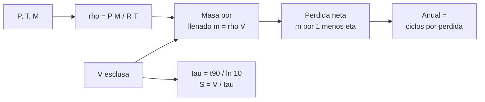

# B109-C03 — Accesos, esclusas y transferencia entre ambientes presurizados

<!-- nav:top -->
[🏠 Programa](../../../../README.md) · [📚 Bloque B109](../../../tronco-comun/B109-arquitectura-y-factores-humanos-de-habitats-extraterrestres.md) · [← Anterior: B109-C02 — Zonificación y distribución funcional de módulos de un hábitat](../B109-C02-zonificacion-y-distribucion-funcional-de-modulos-de-un-habitat/CLASE.md) · [Siguiente: B109-C04 — Mitigación de polvo lunar en accesos y hábitats →](../B109-C04-mitigacion-de-polvo-lunar-en-accesos-y-habitats/CLASE.md)
<!-- /nav -->

## 1. Ubicación, nivel y alcance

Clase 3 del bloque B109. Nivel N3. Un hábitat presurizado en el vacío necesita puntos de acceso donde se cambia de presión: la esclusa. Cada ciclo consume gas, tarda en bombear y carga la escotilla con una fuerza grande. Aquí calculas la masa de gas de un llenado con la ley de los gases ideales, el efecto de recuperar el 90 % y el tiempo de bombeo con un modelo exponencial. Sigue a [B109-C02](../B109-C02-zonificacion-y-distribucion-funcional-de-modulos-de-un-habitat/CLASE.md), donde la esclusa era una zona. Los datos de esclusa vienen de un artículo técnico de NASA; temperatura y composición son ilustrativas.

## 2. Por qué esta clase existe

Un asentamiento con salidas frecuentes pierde aire en cada ciclo. La decisión central: **¿cuánto gas hay que reponer al año y qué ganas recuperándolo?** La respuesta decide el tamaño de la esclusa, el compresor y la logística.

## 3. Lo que podrás hacer al terminar

1. Calcular la densidad y la masa de gas de una esclusa a una presión de cabina dada.
2. Obtener la pérdida neta por ciclo con una fracción de recuperación.
3. Proyectar el consumo anual con una cadencia de EVA.
4. Estimar la constante de tiempo y la velocidad de bombeo de un modelo exponencial.
5. Calcular la fuerza de presión sobre una escotilla.
6. Comparar con una cifra publicada y reconocer cuando no se reproduce.

La evidencia es tu **ficha de consumo de una esclusa** del ejercicio 12 (sección 20).

## 4. Con qué llegas y cómo comprobarlo

1. ¿Qué dice la ley de los gases ideales?
2. ¿Qué es una constante de tiempo?
3. ¿Qué es la presión de una cabina en psi y en pascales?
4. ¿Qué es una fracción de recuperación?
5. ¿Qué es un dato ilustrativo?

<details>
<summary>Ver respuestas</summary>

1. `P V = n R T`, o `m = P V M/(R T)`. 2. El tiempo en que una cantidad que decae exponencialmente cae a `1/e`. 3. `1 psi = 6894,757 Pa`, así que `8,2 psi ≈ 56,5 kPa`. 4. La parte del gas que se guarda en lugar de ventearse. 5. Uno supuesto para practicar, sin fuente.
</details>

Con cuatro o cinco aciertos, sigue; si no, repasa los prerrequisitos.

## 5. Un caso de contexto y casos de referencia

El artículo de Stromgren et al. (2023) supone una esclusa de `15 m³`, una cabina a `8,2 psi` con `34 %` de oxígeno (Burke et al., 2022) y recuperar el `90 %` del gas con un tiempo de bombeo de `35 min` para unos `13 m³`. Con esos datos, una esclusa de `13 m³` contiene `8,83 kg` de gas por llenado: ventearlo `104` veces al año serían `918 kg`. Con recuperación, la pérdida neta baja a `92 kg`. Es el **ejemplo conductor**. La tabla del artículo da `861 kg/año` sin recuperación y `510 kg/año` con ella para toda la esclusa: no coincide con este cálculo y esa diferencia es parte de la clase.

## 6. Vocabulario

Una **esclusa** es un volumen entre dos escotillas donde se cambia la presión. El **ciclo** es presurizar o despresurizar una vez. La **recuperación de gas** (*airsave*) bombea el gas a un depósito antes de ventear. La **constante de tiempo** `τ` mide la rapidez del bombeo. La **velocidad de bombeo** `S` es el volumen por minuto que mueve el compresor. Una **escotilla** es la puerta presurizada.

## 7. Modelo mental: una piscina que se vacía



*Descripción textual:* presión, temperatura y masa molar dan la densidad; con el volumen sale la masa por llenado; la fracción recuperada da la pérdida neta, y los ciclos anuales, el consumo; el tiempo de bombeo da `τ` y `S`.

Analogía: una piscina cuyo nivel baja más rápido cuanto más llena está. Límite: un compresor real no mueve un volumen constante por minuto a presiones bajas, y el modelo exponencial es solo una aproximación.

## 8. La explicación, paso a paso

### 8.1 Densidad y masa

Con `R = 8,314 462 618 J mol⁻¹ K⁻¹` (NIST CODATA 2022), `P = 8,2 psi = 56 537 Pa`, `T = 294,15 K` (ilustrativa) y una mezcla del `34 %` de `O₂` y `66 %` de `N₂` (masa molar `29,369 g/mol`, ilustrativa), `ρ = P M/(R T) = 0,6789 kg/m³`. Una esclusa de `13 m³` contiene `8,826 kg`; una de `15 m³`, `10,184 kg`.

### 8.2 Pérdida y consumo anual

Con recuperación `η = 0,90`, la pérdida neta por ciclo es `m(1 − η)`: `0,883 kg` (13 m³) o `1,018 kg` (15 m³). Con `2` EVA por semana (`104` ciclos al año, Stromgren et al.) el consumo sin recuperar es `917,9` y `1059,1 kg/año`; con recuperación, `91,8` y `105,9 kg/año`.

### 8.3 Bombeo

Retirar el `90 %` en `35 min` da `τ = 35/ln 10 = 15,20 min` y `S = 13/15,20 = 0,855 m³/min`. Retirar el `99 %` tardaría `τ ln 100 = 70 min`. Una integración de Euler con paso de `1 s` da `34,98 min`, dentro del `0,5 %` del valor analítico.

### 8.4 Comparación y fuerza

La diferencia publicada entre esclusa sin y con recuperación es `861 − 510 = 351 kg/año`. Si fuera solo gas de esta esclusa con `104` ciclos y `η = 0,9`, equivaldría a `3,75 kg` por ciclo, o `5,52 m³`, menos de la mitad del volumen supuesto: los supuestos del artículo (cadencia, volumen presurizado efectivo, otros fluidos) no son los de esta clase, y no se reproduce su cifra. Sobre una escotilla de `0,8 m` (ilustrativa) con la cabina a `8,2 psi` y vacío fuera actúan `28,4 kN`, unos `2,9` toneladas-fuerza.

## 9. Magnitudes, símbolos y unidades

| Símbolo | Qué es | Unidad | Valor / nota |
|---|---|---|---|
| `P` | presión de cabina | Pa | 56 537 (8,2 psi) |
| `T` | temperatura | K | 294,15 (ilustrativa) |
| `M` | masa molar de la mezcla | g/mol | 29,369 (ilustrativa) |
| `V` | volumen de esclusa | m³ | 13 o 15 |
| `η` | fracción recuperada | — | 0,90 (Stromgren et al.) |
| `τ` | constante de tiempo | min | 15,20 |
| `S` | velocidad de bombeo | m³/min | 0,855 |
| `F` | fuerza sobre la escotilla | kN | 28,4 |

## 10. Convenciones y referencias

Presión absoluta de cabina. Gas ideal con mezcla `O₂/N₂`. Volumen constante; `T` constante. Cadencia de dos EVA por semana (Stromgren et al., 2023). Temperatura, masas molares y diámetro de escotilla **ilustrativos**; la conversión `1 psi = 6894,757 Pa` es una definición, no una consulta.

## 11. De dónde sale lo que afirmamos

| ID | Fuente | Localizador | Respalda | Estado |
|---|---|---|---|---|
| S1 | Stromgren, Lynch, Burke, Cho y Mary (2023), «Evaluating Extravehicular Activity Access Options for a Lunar Surface Habitat», IEEE Aerospace Conference — https://ntrs.nasa.gov/citations/20230000121 (leído completo, 7 páginas, 2026-11-10) | Resumen, secciones «Airlock» y «Consumables Resupply Mass», Tabla 2 | esclusa de 15 m³; recuperación del 90 %; bombeo de 35 min para ~13 m³; dos EVA por semana; 510 y 861 kg/año | Consultada |
| S2 | Burke, Howard y Kessler (2022), «Internal Layout of a Lunar Surface Habitat», AIAA ASCEND 2022 — https://ntrs.nasa.gov/citations/20220013669 (leído completo, 16 páginas, 2026-11-10) | Sección «Surface Habitat Overview» | cabina a 8,2 psi con 34 % de O₂ o 10,2 psi con 26,5 % | Consultada |
| S3 | NIST CODATA 2022, constante molar de los gases — https://physics.nist.gov/cgi-bin/cuu/Value?r (consultada 2026-11-10) | valor de `R` | `R = 8,314 462 618… J mol⁻¹ K⁻¹` | Consultada |
| — | Ley de los gases ideales y bombeo exponencial | — | las verifica el laboratorio con una segunda vía | No consultada en una fuente concreta |

Límites: la composición real del gas de cabina, la temperatura y el diámetro de escotilla no se consultaron; el artículo no publica el desglose de su tabla de masas, por eso no se reproduce.

## 12. Cómo ver el consumo de gas

| Magnitud | Valor |
|---|---|
| Masa por llenado (13 m³) | 8,826 kg |
| Pérdida neta por ciclo (13 m³) | 0,883 kg |
| `τ` | 15,20 min |
| Anual sin recuperar (13 m³) | 917,9 kg |

Descripción larga: Un llenado de la esclusa pesa menos de nueve kilos, pero a 104 ciclos al año suma casi una tonelada si se ventea; con recuperación del 90 % baja a cerca de cien kilos.

## 13. Ejemplo trabajado: el gas de un llenado

**Paso 1 · Densidad.** `ρ = 56 537 × 0,029 369/(8,3145 × 294,15) = 0,6789 kg/m³`.

**Paso 2 · Masa.** `m = 0,6789 × 13 = 8,826 kg`.

**Paso 3 · Pérdida neta.** `8,826 × (1 − 0,9) = 0,883 kg` por ciclo.

## 14. Distintas formas de describir la esclusa

**Por masa:** kg por ciclo. **Por consumo anual:** kg/año. **Por tiempo:** `τ` y minutos para un porcentaje. **Por fuerza:** kN sobre la escotilla.

## 15. Práctica guiada

**Ejercicio 1 · con los pasos indicados.** Calcula la densidad del gas de cabina. *Pasos:* `P M/(R T)` con los datos de 8.1.

<details><summary>Solución comentada</summary>

`0,679 kg/m³`.
</details>

**Ejercicio 2 · con una pista.** Predice la masa de un llenado de `15 m³`. *Pista:* multiplica la densidad por el volumen.

<details><summary>Solución comentada</summary>

`0,6789 × 15 = 10,18 kg`.
</details>

**Ejercicio 3 · casi autónomo.** ¿Por qué recuperar el gas importa más cuanto mayor es la cadencia de EVA?

<details><summary>Solución comentada</summary>

Porque la pérdida anual es proporcional al número de ciclos y la recuperación recorta cada uno.
</details>

## 16. Práctica autónoma, transferencia e integrador

**Ejercicio 4 · autónomo.** Pérdida neta por ciclo con `η = 0,9` y `V = 15 m³`.

<details><summary>Solución comentada</summary>

`1,018 kg`.
</details>

**Ejercicio 5 · autónomo.** `τ` si el 90 % tarda `35 min`.

<details><summary>Solución comentada</summary>

`35/ln 10 = 15,20 min`.
</details>

**Ejercicio 6 · autónomo.** Tiempo para retirar el 99 %.

<details><summary>Solución comentada</summary>

`15,20 × ln 100 = 70 min`.
</details>

**Ejercicio 7 · autónomo.** Fuerza sobre la escotilla de `0,8 m`.

<details><summary>Solución comentada</summary>

`28,4 kN` (unos `2,9` toneladas-fuerza).
</details>

**Ejercicio 8 · autónomo.** Consumo anual con recuperación y `V = 15 m³`.

<details><summary>Solución comentada</summary>

`105,9 kg/año`.
</details>

**Ejercicio 9 · transferencia.** **Transferencia.** Si cada tripulante usara la esclusa por separado, ¿cuánto sería el consumo anual sin recuperar con `13 m³`?

<details><summary>Solución comentada</summary>

El doble de ciclos: `208 × 8,826 = 1835,8 kg/año`.
</details>

**Ejercicio 10 · transferencia.** **Transferencia.** ¿Significa `η = 0,9` que se ahorra el 90 % del gas del hábitat?

<details><summary>Solución comentada</summary>

No: solo el gas que pasa por la esclusa; las fugas y otros consumos no cambian.
</details>

**Ejercicio 11 · transferencia.** **Transferencia.** La tabla de NASA muestra `351 kg/año` de ahorro y este modelo daría `826 kg/año` (`917,9 − 91,8`) para 13 m³. ¿Qué concluyes?

<details><summary>Solución comentada</summary>

Que los supuestos son distintos (cadencia, volumen efectivo, otros fluidos) y que no se debe usar esta clase para reproducir la cifra publicada.
</details>

**Ejercicio 12 · integrador.** **Integrador.** Elabora tu *ficha de consumo de una esclusa*: densidad, masa por llenado, pérdida y consumo anual con y sin recuperación, `τ`, `S`, fuerza de escotilla y lista de lo consultado, ilustrativo y no consultado.

<details><summary>Solución comentada</summary>

Secciones 8.1–8.4 y la salida del laboratorio.
</details>

## 17. Laboratorio: gas de una esclusa y tiempo de bombeo

El script [esclusa.py](esclusa.py) calcula la masa de llenado, la pérdida neta, el consumo anual, `τ` y `S`, e **integra** el bombeo con pasos de 1 s para **comprobar** la fórmula analítica con una tolerancia del `0,5 %`.

**Datos:** la recuperación, la cadencia, la presión de cabina y las cifras publicadas son consultados; temperatura, composición y escotilla son **ilustrativas**. **Predice antes de ejecutar:** ¿el volumen implícito en la cifra publicada será mayor o menor que 13 m³? (menor.) **Ejecución del 2026-11-10 (Python 3.12.9):**

```text
Cabina 8.2 psi = 56537 Pa ; 34 % O2 ; M = 29.369 g/mol ; T = 294.15 K (ILUSTRATIVO)
Densidad del gas de cabina = 0.6789 kg/m3
 V [m3]  masa por llenado [kg]  perdida neta/ciclo con 90 % recuperado [kg]  anual sin recuperar [kg]  anual con 90 % [kg]
  13.0                8.826                                      0.883                      917.9               91.8
  15.0               10.184                                      1.018                     1059.1              105.9
Ahorro publicado con recuperacion = 351 kg/ano -> masa por ciclo implicita = 3.750 kg -> volumen equivalente = 5.52 m3
Bombeo: tau = 15.20 min ; velocidad de bombeo = 0.855 m3/min (modelo exponencial, ILUSTRATIVO)
   tiempo para retirar el 90 % = 35.0 min
   tiempo para retirar el 99 % = 70.0 min
Euler (paso 1 s): 90 % retirado en 34.98 min frente a 35.00 min analitico
Fuerza sobre una escotilla de 0.8 m con cabina a 8.2 psi y vacio fuera = 28.4 kN
Pruebas superadas.
```

```bash
python programa/clases/B109/B109-C03-accesos-esclusas-y-transferencia-entre-ambientes-presurizados/esclusa.py
```

**Límites:** gas ideal, volumen y temperatura constantes, compresor con velocidad volumétrica constante; no incluye fugas, humedad ni la fracción de gas que ocupan los equipos dentro de la esclusa.

## 18. Errores frecuentes y cómo corregirlos

**Usar presión manométrica en la ley de los gases.** Se corrige con 8.1: la presión es absoluta.

**Creer que la recuperación elimina la pérdida.** Se corrige con 8.2.

**Dar por reproducida una cifra publicada sin comprobar los supuestos.** Se corrige con 8.4.

**Olvidar que la temperatura es ilustrativa.** Se corrige con la sección 10.

## 19. Cómo sabrás que vas bien

Tras 8.2: ¿qué consumo anual esperabas y cuál obtuviste? Si dudas, repasa el ejemplo 13. Tras el laboratorio: ¿qué comprueba? (ver la sección 17).

## 20. Qué entregas y cómo se evalúa

El producto es tu **ficha de consumo de una esclusa** (ejercicio 12).

| Criterio | Inicial | En desarrollo | Logrado | Destacado |
|---|---|---|---|---|
| Conceptos | Los confunde | Parciales | Calcula masa, pérdida y `τ` | Explica por qué no coincide con la tabla |
| Cálculo | Sin unidades | Con errores | Fichas con unidades | Calcula casos nuevos |
| Numérico | Sin comprobar | Un caso | Contraste analítico frente a Euler | Interpreta las diferencias |
| Fuentes | Sin fuente | Sin fecha | Fuentes con fecha y estado | Declara lo ilustrativo y lo no consultado |
| Límites | No los nombra | Uno | Tres | Discute qué falta del modelo |

**Condiciones críticas (no se compensan con promedio):** rotular temperatura, composición y escotilla como ilustrativas; no presentar el modelo como la cifra publicada; citar solo lo consultado; no dar consejo médico ni operativo; citar solo lo consultado.

## 21. Ética, seguridad y límites

Clase educativa: **no da consejo médico ni operativo** y no sustituye a las normas de diseño, a la revisión de ingeniería ni al juicio de profesionales de factores humanos y de seguridad de misión. Los modelos son simplificados y sus datos son sintéticos o ilustrativos; ningún resultado describe un hábitat real. La presurización y despresurización reales de una esclusa tripulada, con trajes y personas, requieren procedimientos y verificaciones que esta clase no cubre. Accesibilidad: tablas equivalentes a las gráficas, fórmulas en texto, ejercicios sin conexión.

## 22. Para cerrar y seguir

Un llenado de `13 m³` pesa `8,83 kg` de gas; con recuperación del `90 %`, el consumo anual baja de `918` a `92 kg` en este modelo. Queda una pregunta: ¿cómo evita el hábitat que entre el polvo que traen los trajes?

**Glosario español–inglés.** esclusa · *airlock*; recuperación de gas · *airsave*; constante de tiempo · *time constant*; escotilla · *hatch*; velocidad de bombeo · *pumping speed*.

**Continuidad.** [B109-C04](../B109-C04-mitigacion-de-polvo-lunar-en-accesos-y-habitats/CLASE.md) calcula cuánto polvo llega al interior tras varias barreras.

**Referencias:** ver sección 11.

<!-- nav:bottom -->
---

[← Anterior: B109-C02 — Zonificación y distribución funcional de módulos de un hábitat](../B109-C02-zonificacion-y-distribucion-funcional-de-modulos-de-un-habitat/CLASE.md) · [📚 Bloque B109](../../../tronco-comun/B109-arquitectura-y-factores-humanos-de-habitats-extraterrestres.md) · [Siguiente: B109-C04 — Mitigación de polvo lunar en accesos y hábitats →](../B109-C04-mitigacion-de-polvo-lunar-en-accesos-y-habitats/CLASE.md)
<!-- /nav -->
