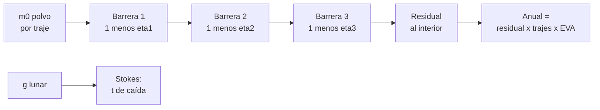

# B109-C04 — Mitigación de polvo lunar en accesos y hábitats

<!-- nav:top -->
[🏠 Programa](../../../../README.md) · [📚 Bloque B109](../../../tronco-comun/B109-arquitectura-y-factores-humanos-de-habitats-extraterrestres.md) · [← Anterior: B109-C03 — Accesos, esclusas y transferencia entre ambientes presurizados](../B109-C03-accesos-esclusas-y-transferencia-entre-ambientes-presurizados/CLASE.md) · [Siguiente: B109-C05 — Crecimiento modular y escalabilidad de asentamientos →](../B109-C05-crecimiento-modular-y-escalabilidad-de-asentamientos/CLASE.md)
<!-- /nav -->

## 1. Ubicación, nivel y alcance

Clase 4 del bloque B109. Nivel N3. El polvo lunar se pega, abrasiona y se cuela por los mecanismos; la arquitectura de los accesos decide cuánto llega al interior. Aquí modelas una cadena de barreras (cepillado, rejilla, aspirado, suitport), calculas el polvo residual por EVA y por año con su incertidumbre, y estimas cuánto tarda una partícula en sedimentar en la gravedad lunar. Sigue a [B109-C03](../B109-C03-accesos-esclusas-y-transferencia-entre-ambientes-presurizados/CLASE.md). Las masas y las eficiencias son **ilustrativas**: no se consultó ninguna cifra cuantitativa de dosis ni de mitigación.

## 2. Por qué esta clase existe

Cada salida y cada regreso trae polvo a un lugar donde la tripulación respira, duerme y repara equipos. La decisión central: **¿cuántas barreras en serie hacen falta y qué arquitectura de acceso reduce más la entrada?** La respuesta es un balance de masa con incertidumbre, no una promesa.

## 3. Lo que podrás hacer al terminar

1. Describir las categorías de efectos del polvo lunar reportadas en Apollo.
2. Calcular el residual de una cadena de barreras en serie.
3. Proyectar el polvo anual con la cadencia de EVA publicada.
4. Propagar la incertidumbre de las eficiencias con Monte Carlo y verificarla con el producto de medias.
5. Calcular la velocidad de Stokes y el tiempo de sedimentación en gravedad lunar y terrestre.
6. Distinguir lo consultado, lo ilustrativo y lo no consultado.

La evidencia es tu **balance de polvo de una cadena de barreras** del ejercicio 12 (sección 20).

## 4. Con qué llegas y cómo comprobarlo

1. ¿Qué es una eficiencia de barrera?
2. ¿Qué es una distribución Beta?
3. ¿Qué dice la ley de Stokes?
4. ¿Qué es un número de Reynolds de partícula?
5. ¿Qué es un dato ilustrativo?

<details>
<summary>Ver respuestas</summary>

1. La fracción del polvo que la barrera retiene. 2. Una distribución en `[0, 1]` con media y dispersión ajustables. 3. Una esfera pequeña cae a `v = ρ_p g d²/(18 μ)` en un fluido viscoso. 4. `Re = ρ v d/μ`; Stokes vale si `Re < 1`. 5. Uno supuesto para practicar, sin fuente.
</details>

Con cuatro o cinco aciertos, sigue; si no, repasa los prerrequisitos.

## 5. Un caso de contexto y casos de referencia

Gaier (2005) revisó los documentos de las seis misiones Apollo con alunizaje y agrupó los efectos del polvo en nueve categorías: obscurecimiento de la visión, lecturas falsas de instrumentos, recubrimiento y contaminación, pérdida de tracción, atascos de mecanismos, abrasión, problemas térmicos, fallas de sellos, e inhalación e irritación. Encontró que las medidas simples no bastaban contra las más graves y que las pruebas en tierra subestimaban el problema. En este modelo, con `100 g` de polvo por traje y EVA, tres barreras dejan `6 g`: `1,25 kg/año` frente a `20,8 kg` sin barreras. Es el **ejemplo conductor**.

## 6. Vocabulario

El **regolito** es el suelo suelto de la Luna; el **polvo** es su fracción fina. Una **barrera** retiene parte del polvo. Una **cadena de barreras** las pone en serie. El **residual** es lo que llega al interior. Un **suitport** acopla el traje a la pared del hábitat para entrar sin llevar el polvo adentro. La **sedimentación** es la caída lenta de una partícula en el aire.

## 7. Modelo mental: una cascada de coladores



*Descripción textual:* el polvo de cada traje atraviesa barreras en serie y lo que sobrevive es el residual; multiplicado por trajes y EVA da el anual; por separado, la gravedad fija cuánto tardan las partículas en sedimentar.

Analogía: filtrar agua turbia con tres coladores sucesivos. Límite: las eficiencias reales dependen del tamaño de grano, de la carga electrostática y de cuántas veces se usa la barrera; aquí son constantes ilustrativas.

## 8. La explicación, paso a paso

### 8.1 Lo que dice la literatura consultada

El resumen de Gaier (2005) lista nueve categorías de efectos del polvo en los sistemas de EVA de Apollo y concluye que medidas simples (por ejemplo, contra la pérdida de tracción) no bastaron contra el atasco, la abrasión y la menor disipación de calor. Stromgren et al. (2023) comparan esclusa, *suitlock* y suitport-esclusa y concluyen, de forma **cualitativa**, que los dos últimos reducen la entrada de polvo porque evitan abrir la escotilla interior con trajes sucios. De estos documentos solo se consultaron el resumen (Gaier) y el artículo completo (Stromgren); ninguno da eficiencias numéricas.

### 8.2 Cadena de barreras

Con `m₀ = 100 g` por traje y EVA y eficiencias ilustrativas `0,60` (cepillado), `0,50` (rejilla) y `0,70` (aspirado), el residual es `m₀ ∏(1 − ηᵢ) = 100·0,4·0,5·0,3 = 6,00 g`. Con `2` trajes y `104` EVA al año (Stromgren et al.) son `1,248 kg/año`. Con cepillado más suitport (`3 %` cruza, ilustrativo) bajan a `1,20 g` por traje y `0,250 kg/año`.

### 8.3 Incertidumbre

Con eficiencias de distribución Beta (concentración `20`, semilla `109004`, `20000` sorteos), la media es `1,248 kg/año` y el intervalo del `95 %` va de `0,366` a `2,757 kg/año`. Como segunda vía, la media coincide con el producto de las medias (tolerancia del `1 %`) porque las etapas son independientes. La anchura del intervalo recuerda que tres barreras de eficiencia incierta dan un residual muy incierto.

### 8.4 Sedimentación

Con `ρ_p = 3100 kg/m³`, `μ = 1,8×10⁻⁵ Pa s` y una caída de `1,5 m` (todas ilustrativas) y `g = 1,62 m/s²` (NASA/NSSDC), una partícula de `10 µm` cae a `1,55 mm/s` y tarda `16,1 min`, frente a `2,7 min` en la Tierra: `g_T/g_L = 6,05` veces más. Una de `2 µm` tarda `403 min`, unas `6,7 h`. El número de Reynolds queda por debajo de `0,08`, así que Stokes es válido. Las partículas finas permanecen suspendidas largo tiempo, y por eso la filtración del aire importa.

## 9. Magnitudes, símbolos y unidades

| Símbolo | Qué es | Unidad | Valor / nota |
|---|---|---|---|
| `m₀` | polvo por traje y EVA | g | 100 (ilustrativo) |
| `ηᵢ` | eficiencia de la barrera i | — | 0,60; 0,50; 0,70 (ilustrativas) |
| `n_EVA` | EVA por año | — | 104 (Stromgren et al.) |
| `v` | velocidad de Stokes | mm/s | 1,55 (10 µm, Luna) |
| `g` | gravedad lunar | m/s² | 1,62 (NASA/NSSDC) |
| `Re` | número de Reynolds de partícula | — | < 0,08 |

## 10. Convenciones y referencias

Masas en gramos, longitudes en metros, tiempos en segundos o minutos. Barreras independientes y constantes. Partículas esféricas. Gravedad terrestre convencional `9,80665 m/s²` (no consultada). La masa de polvo, las eficiencias, la fracción que cruza el suitport, la densidad del grano, la viscosidad y la altura de caída son **ilustrativas**.

## 11. De dónde sale lo que afirmamos

| ID | Fuente | Localizador | Respalda | Estado |
|---|---|---|---|---|
| S1 | Gaier (2005), «The Effects of Lunar Dust on EVA Systems During the Apollo Missions», NASA/TM-2005-213610 — https://ntrs.nasa.gov/citations/20050160460 (2026-11-10) | página de resumen del informe (la copia completa no se obtuvo) | nueve categorías de efectos del polvo en los sistemas de EVA de Apollo; las medidas simples no bastaron contra atasco, abrasión y calor; las pruebas en tierra subestimaron la gravedad del problema | Solo se consultó el resumen |
| S2 | Stromgren, Lynch, Burke, Cho y Mary (2023), «Evaluating Extravehicular Activity Access Options for a Lunar Surface Habitat», IEEE Aerospace Conference — https://ntrs.nasa.gov/citations/20230000121 (leído completo, 7 páginas, 2026-11-10) | sección «Dust Mitigation» y Figura 5 | comparación cualitativa de esclusa, suitlock y suitport-esclusa; dos EVA de dos tripulantes por semana | Consultada |
| S3 | NASA/NSSDC, Moon Fact Sheet — https://nssdc.gsfc.nasa.gov/planetary/factsheet/moonfact.html (consultada 2026-11-10) | ficha completa leída | g = 1,62 m/s² | Consultada |
| — | Ley de Stokes y balance de masa en serie | — | las verifica el laboratorio con una segunda vía | No consultada en una fuente concreta |

Límites: de Gaier solo se consultó el resumen; no se consultó ninguna eficiencia, masa de polvo ni cifra de toxicidad; el resto de los datos son ilustrativos.

## 12. Cómo ver el polvo residual

| Magnitud | Valor |
|---|---|
| Sin barreras | 20,8 kg/año |
| Esclusa clásica, 3 barreras | 1,248 kg/año |
| Cepillado + suitport | 0,250 kg/año |
| `t` de 10 µm en la Luna | 16,1 min |

Descripción larga: Tres barreras bajan el polvo anual de unos veinte kilos a poco más de uno; el suitport lo baja cinco veces más en este modelo, y las partículas finas tardan horas en sedimentar.

## 13. Ejemplo trabajado: el residual por traje

**Paso 1 · Fracciones que pasan.** `0,4`, `0,5` y `0,3`.

**Paso 2 · Producto.** `0,4 × 0,5 × 0,3 = 0,06`.

**Paso 3 · Residual.** `100 g × 0,06 = 6 g` por traje; con `2 × 104 = 208` trajes al año, `1,248 kg`.

## 14. Distintas formas de describir el polvo

**Por barrera:** fracción retenida. **Por masa:** gramos por traje o kilos al año. **Por incertidumbre:** intervalo de 95 %. **Por tiempo:** minutos de caída de una partícula.

## 15. Práctica guiada

**Ejercicio 1 · con los pasos indicados.** Calcula el residual por traje con las tres barreras. *Pasos:* multiplica `0,4 × 0,5 × 0,3` y por `100 g`.

<details><summary>Solución comentada</summary>

`6 g`.
</details>

**Ejercicio 2 · con una pista.** Predice el polvo anual sin barreras. *Pista:* `100 g × 2 × 104`.

<details><summary>Solución comentada</summary>

`20 800 g = 20,8 kg`.
</details>

**Ejercicio 3 · casi autónomo.** ¿Qué concluye el resumen de Gaier sobre las pruebas en tierra?

<details><summary>Solución comentada</summary>

Que subestimaron de forma consistente la gravedad de los problemas del polvo en Apollo.
</details>

## 16. Práctica autónoma, transferencia e integrador

**Ejercicio 4 · autónomo.** Velocidad de Stokes de una partícula de `10 µm` en la Luna.

<details><summary>Solución comentada</summary>

`3100·1,62·(10⁻⁵)²/(18·1,8×10⁻⁵) = 1,55 mm/s`.
</details>

**Ejercicio 5 · autónomo.** Tiempo para caer `1,5 m` con esa velocidad.

<details><summary>Solución comentada</summary>

`1,5/1,55×10⁻³ ≈ 968 s ≈ 16,1 min`.
</details>

**Ejercicio 6 · autónomo.** Cociente de tiempos de sedimentación Luna/Tierra.

<details><summary>Solución comentada</summary>

`9,80665/1,62 = 6,05`.
</details>

**Ejercicio 7 · autónomo.** Reducción relativa de la configuración B frente a la A.

<details><summary>Solución comentada</summary>

`1 − 0,250/1,248 = 0,80`: un `80 %` menos.
</details>

**Ejercicio 8 · autónomo.** Número de Reynolds de la partícula de `50 µm`.

<details><summary>Solución comentada</summary>

`0,073`: menor que 1, Stokes es válido.
</details>

**Ejercicio 9 · transferencia.** **Transferencia.** Añades una cuarta barrera de eficiencia `0,5`. ¿Cuál es el nuevo polvo anual?

<details><summary>Solución comentada</summary>

Se divide por 2: `0,624 kg/año`.
</details>

**Ejercicio 10 · transferencia.** **Transferencia.** ¿Significa `1,25 kg/año` que la tripulación inhala esa masa?

<details><summary>Solución comentada</summary>

No: es polvo que llega al interior, no una dosis; la inhalación depende del tamaño, de la ventilación y de la filtración, y esta clase no da consejo médico.
</details>

**Ejercicio 11 · transferencia.** **Transferencia.** ¿Por qué el intervalo de Monte Carlo es tan ancho (`0,37–2,76 kg/año`)?

<details><summary>Solución comentada</summary>

Porque los residuos se multiplican: errores relativos moderados de tres etapas se componen.
</details>

**Ejercicio 12 · integrador.** **Integrador.** Elabora tu *balance de polvo*: residuales por traje y por año de dos configuraciones, intervalo Monte Carlo, tiempos de sedimentación y lista de lo consultado, ilustrativo y no consultado.

<details><summary>Solución comentada</summary>

Secciones 8.1–8.4 y la salida del laboratorio.
</details>

## 17. Laboratorio: cadena de barreras y sedimentación

El script [polvo.py](polvo.py) calcula el residual de dos configuraciones, propaga la incertidumbre con `20000` sorteos, **comprueba** que la media coincide con el producto de medias (tolerancia `1 %`) y que `t_Luna/t_Tierra = g_T/g_L`.

**Datos:** `g` lunar y la cadencia de EVA son consultados; masas, eficiencias y propiedades del aire y del grano son **ilustrativos**. **Predice antes de ejecutar:** ¿cuántas veces más tarda en sedimentar una partícula en la Luna que en la Tierra? (6,05.) **Ejecución del 2026-11-10 (Python 3.12.9):**

```text
Masas, eficiencias y propiedades ILUSTRATIVAS; g lunar y cadencia de EVA consultados
Config A (esclusa clasica, 3 barreras): residual por traje = 6.00 g ; anual = 1.248 kg
Config B (cepillado + suitport):        residual por traje = 1.20 g ; anual = 0.250 kg
Sin barreras: anual = 20.8 kg
Monte Carlo (A): media = 1.248 kg/ano ; intervalo 95 % = [0.366, 2.757] kg/ano
Media analitica (producto de medias) = 1.248 kg/ano
 d [um]   v_Luna [mm/s]   t_Luna [min]   t_Tierra [min]   Re_Luna
    2.0         0.0620          403.2             66.6   4.68e-06
   10.0         1.5500           16.1              2.7   5.86e-04
   50.0        38.7500            0.6              0.1   7.32e-02
Pruebas superadas.
```

```bash
python programa/clases/B109/B109-C04-mitigacion-de-polvo-lunar-en-accesos-y-habitats/polvo.py
```

**Límites:** barreras independientes y constantes; partículas esféricas de un solo tamaño; sin carga electrostática, sin resuspensión y sin la corrección de Cunningham para partículas pequeñas.

## 18. Errores frecuentes y cómo corregirlos

**Tomar las eficiencias ilustrativas como medidas.** Se corrige con la sección 10.

**Olvidar que la incertidumbre se multiplica en una cadena.** Se corrige con 8.3.

**Presentar masa que llega al interior como dosis de inhalación.** Se corrige con el ejercicio 10.

**Citar a Gaier más allá de su resumen.** Se corrige con la sección 11.

## 19. Cómo sabrás que vas bien

Tras 8.2: ¿qué residual esperabas y cuál salió? Si dudas, repasa el ejemplo 13. Tras el laboratorio: ¿qué comprueba? (ver la sección 17).

## 20. Qué entregas y cómo se evalúa

El producto es tu **balance de polvo de una cadena de barreras** (ejercicio 12).

| Criterio | Inicial | En desarrollo | Logrado | Destacado |
|---|---|---|---|---|
| Conceptos | Los confunde | Parciales | Calcula residual y sedimentación | Explica por qué la incertidumbre se compone |
| Cálculo | Sin unidades | Con errores | Balance con unidades | Calcula casos nuevos |
| Numérico | Sin comprobar | Un caso | Contraste con el producto de medias | Interpreta el intervalo |
| Fuentes | Sin fuente | Sin fecha | Fuentes con fecha y estado | Declara que de Gaier solo se leyó el resumen |
| Límites | No los nombra | Uno | Tres | Discute qué falta del modelo |

**Condiciones críticas (no se compensan con promedio):** rotular masas y eficiencias como ilustrativas; no presentar masa de polvo como dosis ni dar consejo médico; declarar que de Gaier solo se leyó el resumen; no dar consejo médico ni operativo; citar solo lo consultado.

## 21. Ética, seguridad y límites

Clase educativa: **no da consejo médico ni operativo** y no sustituye a las normas de diseño, a la revisión de ingeniería ni al juicio de profesionales de factores humanos y de seguridad de misión. Los modelos son simplificados y sus datos son sintéticos o ilustrativos; ningún resultado describe un hábitat real. No hay en la clase ningún criterio de exposición ni de seguridad respiratoria: eso corresponde a la medicina aeroespacial y a las normas de NASA. Accesibilidad: tablas equivalentes a las gráficas, fórmulas en texto, ejercicios sin conexión.

## 22. Para cerrar y seguir

Con barreras ilustrativas, el polvo anual baja de `20,8` a `1,25 kg` (y a `0,25` con suitport), con un intervalo muy ancho. Queda una pregunta: ¿cómo crece un asentamiento por fases sin rehacer lo que ya existe?

**Glosario español–inglés.** polvo lunar · *lunar dust*; regolito · *regolith*; barrera · *barrier*; sedimentación · *settling*; suitport · *suitport*.

**Continuidad.** [B109-C05](../B109-C05-crecimiento-modular-y-escalabilidad-de-asentamientos/CLASE.md) planifica el crecimiento del asentamiento por fases.

**Referencias:** ver sección 11.

<!-- nav:bottom -->
---

[← Anterior: B109-C03 — Accesos, esclusas y transferencia entre ambientes presurizados](../B109-C03-accesos-esclusas-y-transferencia-entre-ambientes-presurizados/CLASE.md) · [📚 Bloque B109](../../../tronco-comun/B109-arquitectura-y-factores-humanos-de-habitats-extraterrestres.md) · [Siguiente: B109-C05 — Crecimiento modular y escalabilidad de asentamientos →](../B109-C05-crecimiento-modular-y-escalabilidad-de-asentamientos/CLASE.md)
<!-- /nav -->
