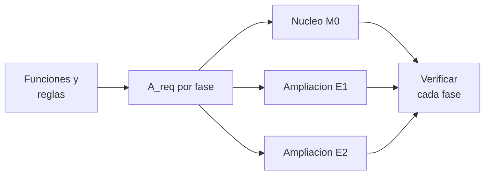

# B109-C05 — Crecimiento modular y escalabilidad de asentamientos

<!-- nav:top -->
[🏠 Programa](../../../../README.md) · [📚 Bloque B109](../../../tronco-comun/B109-arquitectura-y-factores-humanos-de-habitats-extraterrestres.md) · [← Anterior: B109-C04 — Mitigación de polvo lunar en accesos y hábitats](../B109-C04-mitigacion-de-polvo-lunar-en-accesos-y-habitats/CLASE.md) · [Siguiente: B109-C06 — Antropometría y dimensionamiento para tripulación →](../../../tronco-comun/B109-arquitectura-y-factores-humanos-de-habitats-extraterrestres.md#b109-c06)
<!-- /nav -->

## 1. Ubicación, nivel y alcance

Clase 5 del bloque B109. Nivel N3. Un asentamiento rara vez se construye de una vez: empieza con una tripulación pequeña y una estancia corta y crece. Aquí planificas tres fases (2 tripulantes y 30 días, 4 y 30, 4 y 60), calculas el área necesaria por función con reglas de escalado, añades módulos sin tocar lo que ya existe y comparas con rehacer el hábitat en cada fase. Cierra el tramo 1 del bloque y sigue a [B109-C04](../B109-C04-mitigacion-de-polvo-lunar-en-accesos-y-habitats/CLASE.md). Las reglas de escalado son **ilustrativas**; las áreas base vienen de un artículo de NASA sobre un concepto de referencia.

## 2. Por qué esta clase existe

Si el primer módulo no admite ampliación, crecer obliga a desechar lo construido. La decisión central: **¿qué funciones se duplican con la tripulación, cuáles no, y cómo se añaden módulos sin rediseñar?** El plan debe mostrar cada fase cubierta y lo reutilizado.

## 3. Lo que podrás hacer al terminar

1. Clasificar las funciones de un hábitat como fijas, lineales en tripulantes, por pares o logísticas.
2. Calcular el área requerida de cada fase.
3. Dimensionar los módulos de ampliación y comprobar que cada fase queda cubierta.
4. Comparar un plan aditivo con uno de reemplazo por el área construida.
5. Calcular el área y el volumen funcional por tripulante y compararlos con una referencia, con sus cautelas.
6. Rotular las reglas como ilustrativas y lo publicado como consultado.

La evidencia es tu **plan de tres fases con su verificación** del ejercicio 12 (sección 20).

## 4. Con qué llegas y cómo comprobarlo

1. ¿Qué es una función fija y una proporcional?
2. ¿Qué hace `ceil`?
3. ¿Qué es el volumen funcional?
4. ¿Qué es la reutilización entre fases?
5. ¿Qué es un dato ilustrativo?

<details>
<summary>Ver respuestas</summary>

1. Fija: no cambia con la tripulación; proporcional: crece con ella. 2. Redondea hacia arriba al entero. 3. Área por altura estándar (`2,4 m` en el concepto de NASA). 4. La parte de lo construido que se conserva. 5. Uno supuesto, sin fuente.
</details>

Con cuatro o cinco aciertos, sigue; si no, repasa los prerrequisitos.

## 5. Un caso de contexto y casos de referencia

Burke et al. (2022) indican que NASA estudia ampliar el hábitat de superficie de `2` tripulantes y `30` días a `4` tripulantes durante `30` y `60` días. Con reglas ilustrativas sobre sus áreas, el hábitat necesita `47,39 m²` en la fase 1, `65,96` en la 2 y `77,54` en la 3. Un plan aditivo de un núcleo y dos ampliaciones construye `78,5 m²`; reemplazar el hábitat en cada fase construye `191,5 m²`. Es el **ejemplo conductor**.

## 6. Vocabulario

Un **módulo** es una unidad presurizada con funciones definidas. Una **fase** es un estado del asentamiento con tripulación y duración dadas. El **crecimiento aditivo** añade módulos sin retirar los existentes. La **escalabilidad** es la capacidad de crecer sin rediseño. Una función **fija** no depende del número de tripulantes; una **lineal** crece con él; una **por pares** crece por cada dos tripulantes; una **logística** crece con tripulantes por días.

## 7. Modelo mental: un edificio que añade pisos



*Descripción textual:* las funciones con sus reglas dan el área requerida de cada fase; un núcleo y dos ampliaciones se verifican contra esas áreas acumuladas.

Analogía: una casa a la que se añaden habitaciones sin tirar las anteriores. Límite: el área total no basta; también hacen falta interfaces, servicios y transporte entre módulos, que este modelo reduce a «una interfaz nueva por fase».

## 8. La explicación, paso a paso

### 8.1 Áreas base

De la Tabla 4 de Burke et al. (2022) se toman las `15` filas del trazado para dos tripulantes (suman `42,21 m²`; el total publicado es `42,63`) y la esclusa de `5,18 m²`: `47,39 m²`. Se usa la suma de filas y no el total publicado para que el modelo sea coherente consigo mismo.

### 8.2 Reglas de escalado (ilustrativas)

Fijas: médico, trabajo, ordenadores, cocina, utilización, traslado y esclusa. Lineales: estiramiento, sueño y mesa. Por pares (`⌈N/2⌉`): ejercicio, higiene y gestión de residuos. Logística: sistemas y almacenamiento, proporcional a `N × días/(2 × 30)`.

### 8.3 Fases

| Fase | N | Días | Área requerida (m²) | Por tripulante (m²) | Vol. funcional por tripulante (m³) |
|---|---|---|---|---|---|
| 1 | 2 | 30 | 47,39 | 23,70 | 56,87 |
| 2 | 4 | 30 | 65,96 | 16,49 | 39,58 |
| 3 | 4 | 60 | 77,54 | 19,39 | 46,52 |

El volumen funcional es área por `2,4 m`, **no** el volumen neto habitable (que descuenta equipos y huecos, ver [B109-C07](../B109-C07-asignacion-de-volumenes-habitables-por-tripulante/CLASE.md)). El informe de consenso del HRP recomienda `25 m³` por persona para una misión de `30` meses a Marte; aquí se cita solo como comparación, no como requisito lunar.

### 8.4 Plan aditivo y reemplazo

Núcleo `47,5 m²`; ampliación 1 de `19,0 m²` (acumulado `66,5`); ampliación 2 de `12,0 m²` (acumulado `78,5`). Cada fase queda cubierta y la reutilización es `1,00`. Reemplazar el hábitat en cada fase construiría `47,5 + 66,0 + 78,0 = 191,5 m²`, `113 m²` más. Como la fase 3 añade `60` días, la logística crece (`5,79 → 23,16 m²`) aunque la tripulación no cambie.

## 9. Magnitudes, símbolos y unidades

| Símbolo | Qué es | Unidad | Valor / nota |
|---|---|---|---|
| `N` | tripulantes | — | 2 o 4 |
| `d` | duración | días | 30 o 60 |
| `A_req` | área requerida | m² | 47,39; 65,96; 77,54 |
| `H` | altura estándar | m | 2,4 (Burke et al.) |
| `E_k` | módulo de ampliación | m² | 19,0; 12,0 |
| `R` | reutilización | — | 1,00 |

## 10. Convenciones y referencias

Áreas en m²; altura `2,4 m`. Las reglas de escalado, el redondeo a `0,5 m²` y el reparto en módulos son **ilustrativos**. El hábitat de referencia es un concepto, no un diseño de vuelo. El `25 m³/persona` del informe HRP corresponde a una misión de `30` meses a Marte y no es un requisito para la Luna.

## 11. De dónde sale lo que afirmamos

| ID | Fuente | Localizador | Respalda | Estado |
|---|---|---|---|---|
| S1 | Burke, Howard y Kessler (2022), «Internal Layout of a Lunar Surface Habitat», AIAA ASCEND 2022 — https://ntrs.nasa.gov/citations/20220013669 (leído completo, 16 páginas, 2026-11-10) | Tabla 4; sección «Surface Habitat Ground Rules and Assumptions» | áreas por función para 2 tripulantes; altura estándar 2,4 m; NASA interesada en ampliar a 4 tripulantes durante ~30 y ~60 días | Consultada |
| S2 | NASA Human Research Program, «Minimum Acceptable Net Habitable Volume for Long-Duration Exploration Missions: Subject Matter Expert Consensus Session Report» (sesión de enero de 2014) — https://ntrs.nasa.gov/citations/20140016951 (leído completo, 14 páginas, 2026-11-10) | resumen y sección de duración de la misión | 25 m³ por persona para una misión de 30 meses (Mars DRM 5.0); definición de volumen funcional | Consultada |
| — | Planificación por fases y escalado de áreas por función | — | las verifica el laboratorio con una segunda vía | No consultada en una fuente concreta |

Límites: las reglas de escalado no se consultaron en ninguna fuente; el artículo no publica áreas de las fases ampliadas; el volumen funcional de esta clase no es el volumen neto habitable.

## 12. Cómo ver el crecimiento por fases

| Magnitud | Valor |
|---|---|
| Fase 1 | 47,39 m² |
| Fase 2 | 65,96 m² |
| Fase 3 | 77,54 m² |
| Exceso del reemplazo | 113,0 m² |

Descripción larga: El área requerida crece un 39 % al pasar de dos a cuatro tripulantes y otro 18 % al doblar la duración; el plan aditivo evita construir más del doble.

## 13. Ejemplo trabajado: el área de la fase 2

**Paso 1 · Funciones lineales.** Estiramiento, sueño y mesa se duplican: `(2,68 + 3,70 + 2,23) × 2 = 17,22 m²`.

**Paso 2 · Por pares.** Con `⌈4/2⌉ = 2`: `(2,09 + 1,04 + 1,04) × 2 = 8,34 m²`.

**Paso 3 · Logística y fijas.** Logística `5,79 × 2 = 11,58`; fijas `47,39 − 8,61 − 4,17 − 5,79 = 28,82`. Suma: `65,96 m²`.

## 14. Distintas formas de describir el crecimiento

**Por tabla de fases.** **Por módulos:** núcleo más ampliaciones. **Por área por tripulante:** cuánto espacio queda a cada persona. **Por reutilización:** fracción conservada.

## 15. Práctica guiada

**Ejercicio 1 · con los pasos indicados.** Calcula `A_req` de la fase 1. *Pasos:* suma `42,21` y la esclusa `5,18`.

<details><summary>Solución comentada</summary>

`47,39 m²`.
</details>

**Ejercicio 2 · con una pista.** Predice el módulo de ampliación de la fase 2. *Pista:* diferencia de áreas y redondeo hacia arriba a `0,5`.

<details><summary>Solución comentada</summary>

`65,96 − 47,39 = 18,57`, redondeado a `19,0 m²`.
</details>

**Ejercicio 3 · casi autónomo.** ¿Por qué el área no se duplica al pasar de 2 a 4 tripulantes?

<details><summary>Solución comentada</summary>

Porque varias funciones (médico, trabajo, ordenadores, cocina, utilización, traslado, esclusa) son fijas.
</details>

## 16. Práctica autónoma, transferencia e integrador

**Ejercicio 4 · autónomo.** Área por tripulante en la fase 2.

<details><summary>Solución comentada</summary>

`65,96/4 = 16,49 m²`.
</details>

**Ejercicio 5 · autónomo.** Volumen funcional por tripulante en la fase 1.

<details><summary>Solución comentada</summary>

`47,39 × 2,4/2 = 56,87 m³`.
</details>

**Ejercicio 6 · autónomo.** Exceso de área construida del plan de reemplazo.

<details><summary>Solución comentada</summary>

`191,5 − 78,5 = 113,0 m²`.
</details>

**Ejercicio 7 · autónomo.** Área de logística en la fase 3.

<details><summary>Solución comentada</summary>

`5,79 × (4 × 60)/60 = 23,16 m²`: `17,37 m²` más que en la base.
</details>

**Ejercicio 8 · autónomo.** Área de ejercicio en la fase 2.

<details><summary>Solución comentada</summary>

`2,09 × 2 = 4,18 m²`.
</details>

**Ejercicio 9 · transferencia.** **Transferencia.** ¿Cuántas unidades *por pares* hacen falta con `5` tripulantes?

<details><summary>Solución comentada</summary>

`⌈5/2⌉ = 3`.
</details>

**Ejercicio 10 · transferencia.** **Transferencia.** ¿Son `47,39 m²` el requisito de área para dos tripulantes?

<details><summary>Solución comentada</summary>

No: es la suma de áreas de un concepto de referencia más una esclusa; no es una norma.
</details>

**Ejercicio 11 · transferencia.** **Transferencia.** ¿Por qué sube el área por tripulante de la fase 2 a la 3 sin cambiar la tripulación?

<details><summary>Solución comentada</summary>

Porque la logística crece con los días: `16,49 → 19,39 m²`.
</details>

**Ejercicio 12 · integrador.** **Integrador.** Elabora tu *plan de tres fases*: tabla de áreas, módulos aditivos, comparación con el reemplazo, área y volumen funcional por tripulante y lista de lo consultado, ilustrativo y no consultado.

<details><summary>Solución comentada</summary>

Secciones 8.1–8.4 y la salida del laboratorio.
</details>

## 17. Laboratorio: crecimiento por fases y plan aditivo

El script [crecimiento.py](crecimiento.py) calcula `A_req` de tres fases con reglas de escalado, dimensiona los módulos y **comprueba** la coherencia con la suma de filas de la Tabla 4 (tolerancia `1e-9`), la monotonía del área y la cobertura de cada fase.

**Datos:** las áreas base y la altura son de Burke et al. (2022); las reglas de escalado y el reparto en módulos son **ilustrativos**. **Predice antes de ejecutar:** ¿cuánto más construye el plan de reemplazo que el aditivo? (113 m².) **Ejecución del 2026-11-10 (Python 3.12.9):**

```text
Reglas de escalado ILUSTRATIVAS; areas base de la Tabla 4 de Burke et al. (2022); 25 m3/persona del informe HRP solo como comparacion
A_req(2 trip., 30 d) = 47.39 m2 ; suma de filas = 47.39 m2
 fase    N   dias   A_req [m2]   A_req/trip [m2]   V funcional/trip [m3]  (altura 2.4 m)
Fase 1    2     30        47.39             23.70                  56.87
Fase 2    4     30        65.96             16.49                  39.58
Fase 3    4     60        77.54             19.39                  46.52
Modulos del plan aditivo:
   M0 nucleo       area =  47.50 m2 ; acumulada =   47.50 m2 ; requerida en la fase 1 =   47.39 m2
   E1 ampliacion   area =  19.00 m2 ; acumulada =   66.50 m2 ; requerida en la fase 2 =   65.96 m2
   E2 ampliacion   area =  12.00 m2 ; acumulada =   78.50 m2 ; requerida en la fase 3 =   77.54 m2
Area construida: plan aditivo = 78.5 m2 ; plan de reemplazo = 191.5 m2 ; exceso del reemplazo = 113.0 m2
Reutilizacion entre fases del plan aditivo = 1.00 ; interfaces nuevas por fase = 1
Pruebas superadas.
```

```bash
python programa/clases/B109/B109-C05-crecimiento-modular-y-escalabilidad-de-asentamientos/crecimiento.py
```

**Límites:** la coherencia con la tabla es una verificación interna, no una validación del escalado; no hay interfaces, servicios ni transporte entre módulos; el volumen funcional no es el neto habitable.

## 18. Errores frecuentes y cómo corregirlos

**Duplicar todo el hábitat cuando se duplica la tripulación.** Se corrige con 8.2.

**Olvidar la logística de una estancia más larga.** Se corrige con 8.4.

**Comparar el volumen funcional con el NHV mínimo sin cautelas.** Se corrige con 8.3.

**Presentar las reglas de escalado como norma.** Se corrige con la sección 10.

## 19. Cómo sabrás que vas bien

Tras 8.3: ¿qué fase esperabas más grande por tripulante y cuál fue? Si dudas, repasa el ejemplo 13. Tras el laboratorio: ¿qué comprueba? (ver la sección 17).

## 20. Qué entregas y cómo se evalúa

El producto es tu **plan de tres fases con su verificación** (ejercicio 12).

| Criterio | Inicial | En desarrollo | Logrado | Destacado |
|---|---|---|---|---|
| Conceptos | Los confunde | Parciales | Distingue funciones fijas y proporcionales | Explica el efecto de la duración |
| Cálculo | Sin unidades | Con errores | Fases con unidades | Calcula casos nuevos |
| Numérico | Sin comprobar | Un caso | Cobertura y monotonía verificadas | Interpreta el exceso del reemplazo |
| Fuentes | Sin fuente | Sin fecha | Fuentes con fecha y estado | Declara lo ilustrativo y lo no consultado |
| Límites | No los nombra | Uno | Tres | Discute interfaces y servicios |

**Condiciones críticas (no se compensan con promedio):** rotular las reglas de escalado como ilustrativas; no presentar áreas calculadas como requisitos; no comparar volumen funcional con NHV sin cautelas; no dar consejo médico ni operativo; citar solo lo consultado.

## 21. Ética, seguridad y límites

Clase educativa: **no da consejo médico ni operativo** y no sustituye a las normas de diseño, a la revisión de ingeniería ni al juicio de profesionales de factores humanos y de seguridad de misión. Los modelos son simplificados y sus datos son sintéticos o ilustrativos; ningún resultado describe un hábitat real. Un plan por fases de esta clase no sustituye al análisis de interfaces, de seguridad y de operaciones de cada ampliación. Accesibilidad: tablas equivalentes a las gráficas, fórmulas en texto, ejercicios sin conexión.

## 22. Para cerrar y seguir

Con reglas ilustrativas, tres fases requieren `47,4`, `66,0` y `77,5 m²`, y el plan aditivo construye `113 m²` menos que reemplazar. Empieza el tramo de la persona: ¿qué medidas del cuerpo dimensionan un puesto?

**Glosario español–inglés.** módulo · *module*; fase · *phase*; crecimiento aditivo · *additive growth*; escalabilidad · *scalability*; volumen funcional · *functional volume*.

**Continuidad.** [B109-C06](../B109-C06-antropometria-y-dimensionamiento-para-tripulacion/CLASE.md) usa percentiles de medidas del cuerpo para dimensionar espacios.

**Referencias:** ver sección 11.

<!-- nav:bottom -->
---

[← Anterior: B109-C04 — Mitigación de polvo lunar en accesos y hábitats](../B109-C04-mitigacion-de-polvo-lunar-en-accesos-y-habitats/CLASE.md) · [📚 Bloque B109](../../../tronco-comun/B109-arquitectura-y-factores-humanos-de-habitats-extraterrestres.md) · [Siguiente: B109-C06 — Antropometría y dimensionamiento para tripulación →](../../../tronco-comun/B109-arquitectura-y-factores-humanos-de-habitats-extraterrestres.md#b109-c06)
<!-- /nav -->
