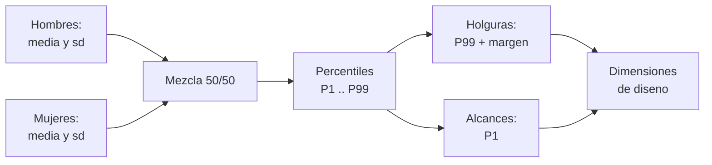

# B109-C06 — Antropometría y dimensionamiento para tripulación

<!-- nav:top -->
[🏠 Programa](../../../../README.md) · [📚 Bloque B109](../../../tronco-comun/B109-arquitectura-y-factores-humanos-de-habitats-extraterrestres.md) · [← Anterior: B109-C05 — Crecimiento modular y escalabilidad de asentamientos](../B109-C05-crecimiento-modular-y-escalabilidad-de-asentamientos/CLASE.md) · [Siguiente: B109-C07 — Asignación de volúmenes habitables por tripulante →](../B109-C07-asignacion-de-volumenes-habitables-por-tripulante/CLASE.md)
<!-- /nav -->

## 1. Ubicación, nivel y alcance

Clase 6 del bloque B109. Nivel N3. Los espacios se dimensionan con las medidas del cuerpo, y una dimensión de diseño no es la media: depende de si se quiere que quepa casi todo el mundo (holguras) o que casi todo el mundo alcance (controles). Aquí calculas percentiles de una población mixta, derivas dimensiones de litera, pasillo y altura de controles y los verificas con una simulación. Abre el tramo 2 y sigue a [B109-C05](../B109-C05-crecimiento-modular-y-escalabilidad-de-asentamientos/CLASE.md). La población es **sintética**: ni ANSUR II ni la norma NASA-STD-3001 se pudieron consultar.

## 2. Por qué esta clase existe

Si se dimensiona para la media, la mitad de las personas no cabe o no alcanza. La decisión central: **¿qué percentil de qué población usar para cada dimensión?** Y, en la Luna, **cómo cambia la postura con la gravedad parcial**.

## 3. Lo que podrás hacer al terminar

1. Calcular percentiles de una mezcla de dos poblaciones normales.
2. Elegir P99 para holguras y P1 para alcances.
3. Derivar largo de litera, ancho de paso y altura de control.
4. Comprobar los percentiles analíticos con una simulación de 200 000 individuos.
5. Relacionar el diseño con la gravedad parcial: la postura de dormir.
6. Distinguir lo consultado, lo sintético y lo no consultado.

La evidencia es tu **tabla de dimensiones de diseño por percentil** del ejercicio 12 (sección 20).

## 4. Con qué llegas y cómo comprobarlo

1. ¿Qué es un percentil?
2. ¿Qué es una distribución normal?
3. ¿Qué es una mezcla de distribuciones?
4. ¿Qué es una holgura?
5. ¿Qué es un dato sintético?

<details>
<summary>Ver respuestas</summary>

1. El valor por debajo del cual está esa fracción de la población. 2. Una campana definida por media y desviación típica. 3. Una población formada por dos grupos con pesos dados. 4. El espacio libre que se deja sobre una medida. 5. Uno inventado para practicar, rotulado.
</details>

Con cuatro o cinco aciertos, sigue; si no, repasa los prerrequisitos.

## 5. Un caso de contexto y casos de referencia

El concepto de hábitat lunar de NASA (Burke et al., 2022) define sus volúmenes funcionales con la antropometría del percentil 99 de hombres y mujeres y una altura estándar de `2,4 m`; el volumen de sueño es de `1 m` de altura y la longitud del cuerpo manda sobre la litera. Con una población sintética 50/50, el P99 de estatura es `1898,8 mm` y deja `501 mm` bajo un techo de `2,4 m`. Es el **ejemplo conductor**. Un control a `1825 mm` lo alcanza el `99 %` de la población sintética.

## 6. Vocabulario

Un **percentil** `Pₖ` deja por debajo al `k %` de la población. La **antropometría** mide las dimensiones del cuerpo. Una **holgura** (*clearance*) es una dimensión que debe acomodar el cuerpo más grande. Un **alcance** (*reach*) es una dimensión que debe permitir el cuerpo más pequeño. Un **intervalo de diseño** es el rango de percentiles que el diseño cubre. Una **población mixta** combina grupos con pesos.

## 7. Modelo mental: un traje a medida para todos



*Descripción textual:* dos poblaciones forman una mezcla; sus percentiles dan holguras (P99) y alcances (P1), y de ellos salen las dimensiones de diseño.

Analogía: elegir la altura de una puerta para que pase la persona más alta, y la de un estante para que lo alcance la más baja. Límite: las poblaciones reales no son normales exactas ni las dimensiones son independientes, y una tripulación seleccionada no es una población general.

## 8. La explicación, paso a paso

### 8.1 Población sintética

Estatura: hombres `1755 ± 70 mm`, mujeres `1630 ± 65 mm`; anchura de hombros: `480 ± 25` y `430 ± 22 mm`; alcance vertical de pie: `2150 ± 90` y `2000 ± 85 mm`. **Son valores inventados**; los datos reales de ANSUR II o de NASA-STD-3001 no se consultaron.

### 8.2 Percentiles de la mezcla

Se invierte `F(x) = 0,5 F_h(x) + 0,5 F_m(x)` por bisección. Para la estatura: `P1 = 1496,4`, `P5 = 1546,2`, `P50 = 1690,2`, `P95 = 1844,9`, `P99 = 1898,8 mm`. Para los hombros: `P99 = 531,3 mm`; para el alcance: `P1 = 1825,2 mm`. Una simulación de `200 000` individuos (semilla `109006`) coincide en menos de `5 mm`.

### 8.3 Dimensiones de diseño

- Holgura sobre la cabeza: `2400 − 1898,8 = 501 mm`.
- Largo de litera: `P99 + 100 mm = 1999 mm` (en gravedad el cuerpo duerme horizontal; Burke et al. señalan que el mínimo de sueño en microgravedad se logra en vertical y que en gravedad la litera es mayor).
- Ancho libre: `P99 hombros + 2 × 100 = 731 mm`, con `269 mm` de margen en una pista de `1,00 m`.
- Control alcanzable por el `99 %`: altura máxima `1825 mm`.

### 8.4 Lectura

Cada dimensión se elige por la cola que importa: P99 si debe caber el más grande, P1 si debe alcanzar el más pequeño. El valor medio no sirve para ninguna de las dos. Con `g = 1,62 m/s²` (NASA/NSSDC) la gravedad parcial permite posturas verticales y movimientos que en microgravedad no existen, y por eso la antropometría de microgravedad no se traslada sin revisión.

## 9. Magnitudes, símbolos y unidades

| Símbolo | Qué es | Unidad | Valor / nota |
|---|---|---|---|
| `Pₖ` | percentil k | mm | P99 de estatura: 1898,8 |
| `μ, σ` | media y desviación típica | mm | sintéticas |
| `F` | función de distribución de la mezcla | — | 0,5 hombres + 0,5 mujeres |
| `H` | altura estándar | mm | 2400 (Burke et al.) |
| `m` | margen de holgura | mm | 100 (ilustrativo) |
| `g` | gravedad lunar | m/s² | 1,62 (NASA/NSSDC) |

## 10. Convenciones y referencias

Medidas en milímetros. Población sintética normal, 50 % de cada grupo, dimensiones tratadas por separado. Altura estándar `2,4 m`, sueño `1 m`, esclusa `2,6 m` y pista de `1,00 m` de Burke et al. (2022). Medias, desviaciones y márgenes **sintéticos o ilustrativos**.

## 11. De dónde sale lo que afirmamos

| ID | Fuente | Localizador | Respalda | Estado |
|---|---|---|---|---|
| S1 | Burke, Howard y Kessler (2022), «Internal Layout of a Lunar Surface Habitat», AIAA ASCEND 2022 — https://ntrs.nasa.gov/citations/20220013669 (leído completo, 16 páginas, 2026-11-10) | secciones «Surface Habitat Functionality» y Tabla 1 | volúmenes con antropometría del percentil 99 de hombres y mujeres; altura estándar 2,4 m (sueño 1 m, esclusa 2,6 m); pista de 1,00 m; el sueño en gravedad exige posición horizontal | Consultada |
| S2 | NASA/NSSDC, Moon Fact Sheet — https://nssdc.gsfc.nasa.gov/planetary/factsheet/moonfact.html (consultada 2026-11-10) | ficha completa leída | g = 1,62 m/s² | Consultada |
| — | Percentiles de una mezcla de normales y simulación por muestreo | — | las verifica el laboratorio con una segunda vía | No consultada en una fuente concreta |

Límites: no se consultaron ANSUR II, NASA-STD-3001 Vol. 2 ni el Human Integration Design Handbook; las medias, las desviaciones y los márgenes son inventados; no se usó ninguna medida de tripulación real.

## 12. Cómo ver los percentiles

| Magnitud | Valor |
|---|---|
| P99 de estatura | 1898,8 mm |
| Holgura bajo 2,4 m | 501 mm |
| Litera | 1999 mm |
| Alcance P1 | 1825 mm |

Descripción larga: El percentil 99 de estatura sintética es 1,90 m; con un techo de 2,4 m sobran medio metro, una litera cómoda mide unos 2,0 m y un control a 1,83 m lo alcanza casi todo el mundo.

## 13. Ejemplo trabajado: la holgura sobre la cabeza

**Paso 1 · Percentil.** `P99(estatura) = 1898,8 mm` (de la mezcla, no de un grupo).

**Paso 2 · Altura.** Altura estándar `2400 mm`.

**Paso 3 · Holgura.** `2400 − 1898,8 = 501,2 mm`.

## 14. Distintas formas de describir una dimensión de diseño

**Por percentil:** `P1`, `P50`, `P99`. **Por regla:** holgura (cola alta) o alcance (cola baja). **Por cobertura:** fracción de la población que cabe o alcanza. **Por simulación:** muestreo de la población.

## 15. Práctica guiada

**Ejercicio 1 · con los pasos indicados.** Calcula la holgura sobre la cabeza del P99. *Pasos:* resta `1898,8` de `2400`.

<details><summary>Solución comentada</summary>

`501,2 mm`.
</details>

**Ejercicio 2 · con una pista.** Predice el largo de litera. *Pista:* P99 de estatura más `100 mm`.

<details><summary>Solución comentada</summary>

`1898,8 + 100 = 1998,8 ≈ 1999 mm`.
</details>

**Ejercicio 3 · casi autónomo.** ¿Por qué el P50 de la mezcla (`1690,2`) no es exactamente el promedio de las dos medias (`1692,5`)?

<details><summary>Solución comentada</summary>

Porque la mediana de una mezcla se obtiene de su distribución combinada, no promediando medias; solo está entre ambas.
</details>

## 16. Práctica autónoma, transferencia e integrador

**Ejercicio 4 · autónomo.** Ancho del intervalo P5–P95 de estatura.

<details><summary>Solución comentada</summary>

`1844,9 − 1546,2 = 298,7 mm`.
</details>

**Ejercicio 5 · autónomo.** ¿En qué percentil de los hombres cae el P99 de la mezcla?

<details><summary>Solución comentada</summary>

`z = (1898,8 − 1755)/70 = 2,05`: percentil `98,0`.
</details>

**Ejercicio 6 · autónomo.** Margen en una pista de `1000 mm` con hombros P99 y `2 × 100 mm`.

<details><summary>Solución comentada</summary>

`1000 − 731,3 = 268,7 mm`.
</details>

**Ejercicio 7 · autónomo.** Fracción que alcanza un control a `1900 mm`.

<details><summary>Solución comentada</summary>

`93,9 %`: `1 − F(1900)` de la mezcla de alcances.
</details>

**Ejercicio 8 · autónomo.** Holgura sobre la cabeza si la altura fuera `2200 mm`.

<details><summary>Solución comentada</summary>

`2200 − 1898,8 = 301,2 mm`.
</details>

**Ejercicio 9 · transferencia.** **Transferencia.** ¿Valen estos percentiles para dimensionar para astronautas reales?

<details><summary>Solución comentada</summary>

No: son sintéticos, y una tripulación seleccionada no es la población general; habría que usar datos de la norma aplicable.
</details>

**Ejercicio 10 · transferencia.** **Transferencia.** ¿Por qué no se dimensiona la altura de un estante por la media?

<details><summary>Solución comentada</summary>

Porque la mitad de la población no lo alcanzaría; se usa P1 del alcance.
</details>

**Ejercicio 11 · transferencia.** **Transferencia.** ¿Qué cambia en la litera al pasar de microgravedad a la Luna?

<details><summary>Solución comentada</summary>

En gravedad el cuerpo duerme horizontal y la litera debe ser más larga que un volumen vertical de microgravedad (Burke et al.).
</details>

**Ejercicio 12 · integrador.** **Integrador.** Elabora tu *tabla de dimensiones de diseño*: percentiles P1–P99 de tres dimensiones, holgura, litera, ancho libre y control, con la verificación de la simulación y la lista de lo consultado, sintético y no consultado.

<details><summary>Solución comentada</summary>

Secciones 8.1–8.4 y la salida del laboratorio.
</details>

## 17. Laboratorio: percentiles de una población sintética

El script [antropometria.py](antropometria.py) calcula percentiles por bisección, deriva cuatro dimensiones de diseño y **comprueba** que una simulación de `200 000` individuos coincide con la solución analítica en menos de `5 mm`.

**Datos:** la altura estándar, la pista y la regla del P99 son de Burke et al. (2022); las poblaciones y los márgenes son **sintéticos o ilustrativos**. **Predice antes de ejecutar:** ¿cuánta holgura queda bajo el techo con el P99? (unos 500 mm.) **Ejecución del 2026-11-10 (Python 3.12.9):**

```text
Poblacion SINTETICA normal (50 % hombres, 50 % mujeres); ANSUR II y NASA-STD-3001 no consultados; g lunar 1.62 m/s2 (NASA/NSSDC)
 dimension                      P1      P5     P50     P95     P99   [mm]
estatura                    1496.4  1546.2  1690.2  1844.9  1898.8
anchura de hombros           384.8   401.7   453.4   512.1   531.3
alcance vertical de pie     1825.2  1890.1  2072.9  2265.8  2334.9
Dimensiones de diseno derivadas:
  Holgura sobre la cabeza con altura estandar 2400 mm y P99 de estatura = 501 mm
  Largo de litera = P99 de estatura + 100 mm = 1999 mm
  Ancho libre minimo por hombros P99 + 2 x 100 mm = 731 mm (pista de 1000 mm: margen 269 mm)
  Altura maxima de un control que alcanza el 99 % de la poblacion = P1 del alcance vertical = 1825 mm
  Fraccion de la poblacion que cabe en una litera de 1999 mm = 0.9999
Pruebas superadas.
```

```bash
python programa/clases/B109/B109-C06-antropometria-y-dimensionamiento-para-tripulacion/antropometria.py
```

**Límites:** normalidad supuesta; dimensiones independientes; población general y no tripulación seleccionada; sin efectos de la gravedad sobre el cuerpo ni de trajes.

## 18. Errores frecuentes y cómo corregirlos

**Dimensionar por la media.** Se corrige con 8.4.

**Usar P99 para un alcance.** Se corrige con 8.3.

**Presentar los valores sintéticos como datos de ANSUR II.** Se corrige con la sección 10.

**Trasladar medidas de microgravedad a gravedad parcial sin revisar.** Se corrige con 8.3 y 8.4.

## 19. Cómo sabrás que vas bien

Tras 8.3: ¿qué holgura esperabas y cuál fue? Si dudas, repasa el ejemplo 13. Tras el laboratorio: ¿qué comprueba? (ver la sección 17).

## 20. Qué entregas y cómo se evalúa

El producto es tu **tabla de dimensiones de diseño por percentil** (ejercicio 12).

| Criterio | Inicial | En desarrollo | Logrado | Destacado |
|---|---|---|---|---|
| Conceptos | Los confunde | Parciales | Distingue holgura y alcance | Explica la mezcla de poblaciones |
| Cálculo | Sin unidades | Con errores | Tabla con unidades | Calcula casos nuevos |
| Numérico | Sin comprobar | Un caso | Contraste con la simulación | Interpreta las diferencias |
| Fuentes | Sin fuente | Sin fecha | Fuentes con fecha y estado | Declara lo sintético y lo no consultado |
| Límites | No los nombra | Uno | Tres | Discute qué falta del modelo |

**Condiciones críticas (no se compensan con promedio):** rotular la población como sintética; no presentar los valores como datos de ANSUR II ni de NASA-STD-3001; no usar la tabla para dimensionar un hábitat real; no dar consejo médico ni operativo; citar solo lo consultado.

## 21. Ética, seguridad y límites

Clase educativa: **no da consejo médico ni operativo** y no sustituye a las normas de diseño, a la revisión de ingeniería ni al juicio de profesionales de factores humanos y de seguridad de misión. Los modelos son simplificados y sus datos son sintéticos o ilustrativos; ningún resultado describe un hábitat real. Las dimensiones de esta clase son un ejercicio: un diseño real usa los datos y percentiles de la norma aplicable y la revisión de especialistas en factores humanos. Accesibilidad: tablas equivalentes a las gráficas, fórmulas en texto, ejercicios sin conexión.

## 22. Para cerrar y seguir

Con una población sintética, el P99 de estatura es `1898,8 mm` y deja `501 mm` bajo `2,4 m`. Queda una pregunta: ¿cuánto volumen necesita cada tripulante una vez descontado lo que ocupan los equipos?

**Glosario español–inglés.** antropometría · *anthropometry*; percentil · *percentile*; holgura · *clearance*; alcance · *reach*; población mixta · *mixed population*.

**Continuidad.** [B109-C07](../B109-C07-asignacion-de-volumenes-habitables-por-tripulante/CLASE.md) calcula el volumen neto habitable por tripulante.

**Referencias:** ver sección 11.

<!-- nav:bottom -->
---

[← Anterior: B109-C05 — Crecimiento modular y escalabilidad de asentamientos](../B109-C05-crecimiento-modular-y-escalabilidad-de-asentamientos/CLASE.md) · [📚 Bloque B109](../../../tronco-comun/B109-arquitectura-y-factores-humanos-de-habitats-extraterrestres.md) · [Siguiente: B109-C07 — Asignación de volúmenes habitables por tripulante →](../B109-C07-asignacion-de-volumenes-habitables-por-tripulante/CLASE.md)
<!-- /nav -->
