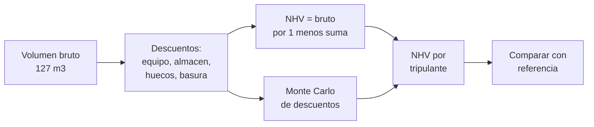

# B109-C07 — Asignación de volúmenes habitables por tripulante

<!-- nav:top -->
[🏠 Programa](../../../../README.md) · [📚 Bloque B109](../../../tronco-comun/B109-arquitectura-y-factores-humanos-de-habitats-extraterrestres.md) · [← Anterior: B109-C06 — Antropometría y dimensionamiento para tripulación](../B109-C06-antropometria-y-dimensionamiento-para-tripulacion/CLASE.md) · [Siguiente: B109-C08 — Diseño inclusivo en hábitats →](../B109-C08-diseno-inclusivo-en-habitats/CLASE.md)
<!-- /nav -->

## 1. Ubicación, nivel y alcance

Clase 7 del bloque B109. Nivel N3. El volumen que se publica de un hábitat (el recinto) no es el que usa la tripulación: equipo desplegado, almacenamiento, basura y huecos lo reducen. Aquí calculas el volumen neto habitable (NHV) a partir del bruto y de los descuentos, lo expresas por tripulante, propagas la incertidumbre de los descuentos y lo comparas con una referencia con sus cautelas. Sigue a [B109-C06](../B109-C06-antropometria-y-dimensionamiento-para-tripulacion/CLASE.md). Los descuentos son **ilustrativos**.

## 2. Por qué esta clase existe

Una cifra de «metros cúbicos por persona» sin decir qué se descontó no se puede comparar. La decisión central: **¿cuánto volumen utilizable queda por tripulante y qué tan sensible es a lo que se descuenta?**

## 3. Lo que podrás hacer al terminar

1. Definir el volumen neto habitable según el informe de consenso del HRP.
2. Calcular el NHV de un volumen bruto con descuentos aditivos.
3. Distinguir el descuento aditivo del multiplicativo.
4. Expresar el NHV por tripulante y propagar la incertidumbre de los descuentos.
5. Calcular el volumen funcional como área por altura y no confundirlo con el NHV.
6. Citar el `25 m³` por persona con su misión y sus límites.

La evidencia es tu **balance de volumen neto de un hábitat de dos tripulantes** del ejercicio 12 (sección 20).

## 4. Con qué llegas y cómo comprobarlo

1. ¿Qué es un volumen bruto?
2. ¿Qué es una fracción de descuento?
3. ¿Qué es un sorteo uniforme?
4. ¿Qué es un percentil?
5. ¿Qué es un dato ilustrativo?

<details>
<summary>Ver respuestas</summary>

1. El volumen de un recinto sin descontar nada. 2. La parte del bruto que se pierde por una causa. 3. Un valor al azar con igual probabilidad en un rango. 4. El valor bajo el cual está esa fracción de los casos. 5. Uno supuesto para practicar, sin fuente.
</details>

Con cuatro o cinco aciertos, sigue; si no, repasa los prerrequisitos.

## 5. Un caso de contexto y casos de referencia

El informe de consenso del Human Research Program (2014) define el volumen neto habitable como el volumen que queda disponible para la tripulación tras descontar el equipo desplegado, el almacenamiento, la basura y otras ineficiencias, y recomendó `25 m³` por persona para una misión de `30` meses a Marte. Burke et al. (2022) dan `127 m³` de volumen habitable para un hábitat lunar de dos tripulantes, casi `64 m³` por persona. Con descuentos ilustrativos del `49 %`, el NHV es `64,8 m³`, `32,4 m³` por persona. Es el **ejemplo conductor**.

## 6. Vocabulario

El **volumen bruto** es el del recinto. El **volumen neto habitable (NHV)** es el que queda libre para la tripulación. El **volumen funcional** es el que requiere una tarea (área por altura). Un **descuento** es la parte perdida por equipo, almacenamiento, huecos o basura. Los **huecos** son espacios sin uso por la forma de lo instalado. Un **mínimo aceptable** es el valor por debajo del cual el diseño es inaceptable para una misión dada.

## 7. Modelo mental: un cajón con cosas dentro



*Descripción textual:* el volumen bruto pierde partes por cuatro causas y queda el NHV; se divide entre la tripulación y se propaga la incertidumbre de los descuentos antes de compararlo con una referencia.

Analogía: la capacidad útil de una maleta una vez ocupada con ropa, bolsas y huecos. Límite: el volumen libre no es todo utilizable; su forma y su ubicación importan tanto como su cantidad.

## 8. La explicación, paso a paso

### 8.1 Qué es el NHV

Según el informe del HRP, el NHV es el volumen que queda tras descontar el equipo desplegado, el almacenamiento, la basura y los huecos que reducen el volumen funcional. El **mínimo aceptable** depende del tamaño de la tripulación, de la duración y de las tareas. La recomendación de `25 m³` por persona se formuló para el escenario de la arquitectura de referencia de Marte (`30` meses: `6` de ida, `18` en destino, `6` de vuelta), y el informe advierte que reducir el volumen para una misión más corta no se recomienda porque el volumen está definido por las funciones.

### 8.2 Balance

Con `V = 127 m³` (Burke et al.) y descuentos ilustrativos de `25 %` (equipo, `31,75 m³`), `12 %` (almacenamiento, `15,24`), `10 %` (huecos, `12,70`) y `2 %` (basura, `2,54`), la suma es `49 %` y el NHV es `64,77 m³`. Por tripulante: `32,38 m³` con dos y `16,19 m³` con cuatro.

### 8.3 Aditivo frente a multiplicativo

Aplicar los descuentos uno tras otro sobre lo que queda (`127·0,75·0,88·0,90·0,98 = 73,93 m³`) da `9,16 m³` más que restarlos todos del bruto. Hay que decir sobre qué base se expresa cada fracción: en esta clase, sobre el volumen bruto.

### 8.4 Incertidumbre y volumen funcional

Con descuentos uniformes en los rangos ilustrativos (`20000` sorteos, semilla `109007`), el NHV por tripulante con dos va de `24,0` (P5) a `40,3 m³` (P95), con mediana `32,1`, y supera `25 m³` en el `92,2 %` de los sorteos. El volumen funcional de Burke et al. es área por `2,4 m`: `14,6 m² → 35,0 m³` como mínimo recomendado y `42,63 m² → 102,3 m³` en el trazado. No es el NHV. La geometría publicada de los cilindros (`39,5` más `128,1 m³`) no reproduce los `127 m³`; el artículo no desglosa ese volumen y aquí se usa la cifra publicada.

## 9. Magnitudes, símbolos y unidades

| Símbolo | Qué es | Unidad | Valor / nota |
|---|---|---|---|
| `V` | volumen bruto | m³ | 127 (Burke et al.) |
| `fᵢ` | fracción de descuento i | — | 0,25; 0,12; 0,10; 0,02 (ilustrativas) |
| `NHV` | volumen neto habitable | m³ | 64,77 |
| `N` | tripulantes | — | 2 o 4 |
| `H` | altura estándar | m | 2,4 |
| `V_f` | volumen funcional | m³ | 35,0 y 102,3 |

## 10. Convenciones y referencias

Volumen en metros cúbicos y áreas en metros cuadrados. Descuentos aditivos sobre el volumen bruto. Altura `2,4 m` (Burke et al.). Las fracciones de descuento y sus rangos son **ilustrativos**. El `25 m³/persona` se cita solo como comparación: no es un requisito para un hábitat lunar de `30` días.

## 11. De dónde sale lo que afirmamos

| ID | Fuente | Localizador | Respalda | Estado |
|---|---|---|---|---|
| S1 | NASA Human Research Program, «Minimum Acceptable Net Habitable Volume for Long-Duration Exploration Missions: Subject Matter Expert Consensus Session Report» (sesión de enero de 2014) — https://ntrs.nasa.gov/citations/20140016951 (leído completo, 14 páginas, 2026-11-10) | resumen, definiciones y sección «Mission Duration» | definición de NHV; recomendación de 25 m³ por persona para una misión de 30 meses (Mars DRM 5.0); no reducir el volumen por una misión más corta | Consultada |
| S2 | Burke, Howard y Kessler (2022), «Internal Layout of a Lunar Surface Habitat», AIAA ASCEND 2022 — https://ntrs.nasa.gov/citations/20220013669 (leído completo, 16 páginas, 2026-11-10) | secciones II, IV y V; Tabla 4 | ~127 m³ de volumen habitable, casi 64 m³ por tripulante; altura estándar 2,4 m; áreas 14,6 y 42,63 m²; dimensiones de los cilindros | Consultada |
| — | Balance de volúmenes y propagación Monte Carlo | — | las verifica el laboratorio con una segunda vía | No consultada en una fuente concreta |

Límites: el desglose del volumen bruto del artículo no se consultó ni se reproduce; los descuentos y sus rangos son inventados; el informe del HRP trata una misión de Marte y no de Luna.

## 12. Cómo ver el balance de volumen

| Magnitud | Valor |
|---|---|
| Volumen bruto | 127,0 m³ |
| NHV | 64,77 m³ |
| NHV por tripulante (2) | 32,38 m³ |
| P(≥ 25 m³) | 92,2 % |

Descripción larga: Los descuentos ilustrativos se llevan la mitad del volumen; con dos tripulantes cada uno conserva unos 32 m³, pero con cuatro quedarían 16 m³.

## 13. Ejemplo trabajado: el NHV central

**Paso 1 · Suma de fracciones.** `0,25 + 0,12 + 0,10 + 0,02 = 0,49`.

**Paso 2 · Volumen conservado.** `127 × (1 − 0,49) = 64,77 m³`.

**Paso 3 · Por tripulante.** `64,77/2 = 32,38 m³`.

## 14. Distintas formas de describir el volumen

**Bruto:** el del recinto. **Neto:** tras descuentos. **Por tripulante:** dividido entre `N`. **Funcional:** área por altura. **Por probabilidad:** fracción de sorteos sobre una referencia.

## 15. Práctica guiada

**Ejercicio 1 · con los pasos indicados.** Calcula el NHV central. *Pasos:* suma las fracciones y aplica `V(1 − Σf)`.

<details><summary>Solución comentada</summary>

`127 × 0,51 = 64,77 m³`.
</details>

**Ejercicio 2 · con una pista.** Predice el NHV por tripulante con dos. *Pista:* divide entre dos.

<details><summary>Solución comentada</summary>

`32,38 m³`.
</details>

**Ejercicio 3 · casi autónomo.** ¿Por qué el descuento multiplicativo da más NHV que el aditivo?

<details><summary>Solución comentada</summary>

Porque cada fracción se aplica a un volumen que ya se redujo y descuenta menos; hay que declarar la base.
</details>

## 16. Práctica autónoma, transferencia e integrador

**Ejercicio 4 · autónomo.** Volumen que se lleva el equipo desplegado.

<details><summary>Solución comentada</summary>

`0,25 × 127 = 31,75 m³`.
</details>

**Ejercicio 5 · autónomo.** NHV por tripulante con cuatro.

<details><summary>Solución comentada</summary>

`64,77/4 = 16,19 m³`.
</details>

**Ejercicio 6 · autónomo.** Fracción de sorteos con NHV por tripulante menor que `25 m³`.

<details><summary>Solución comentada</summary>

`1 − 0,922 = 0,078`.
</details>

**Ejercicio 7 · autónomo.** Volumen funcional del mínimo recomendado.

<details><summary>Solución comentada</summary>

`14,6 × 2,4 = 35,0 m³`.
</details>

**Ejercicio 8 · autónomo.** Ancho P5–P95 del NHV por tripulante.

<details><summary>Solución comentada</summary>

`40,33 − 24,01 = 16,3 m³`.
</details>

**Ejercicio 9 · transferencia.** **Transferencia.** ¿Son `25 m³` el requisito de un hábitat lunar de `30` días?

<details><summary>Solución comentada</summary>

No: es una recomendación para una misión de 30 meses a Marte; aquí solo se compara.
</details>

**Ejercicio 10 · transferencia.** **Transferencia.** La geometría de cilindros da `167,6 m³` y el artículo `127 m³`. ¿Qué haces?

<details><summary>Solución comentada</summary>

Usar la cifra publicada con su fuente y declarar que su desglose no se consultó; no corregirla por cuenta propia.
</details>

**Ejercicio 11 · transferencia.** **Transferencia.** ¿Por qué no basta la cifra de `m³` por persona para comparar dos hábitats?

<details><summary>Solución comentada</summary>

Porque falta saber qué se descontó, cómo se reparte el volumen y qué tareas debe acomodar.
</details>

**Ejercicio 12 · integrador.** **Integrador.** Elabora tu *balance de volumen neto*: bruto, descuentos, NHV, NHV por tripulante con dos y cuatro, intervalo Monte Carlo y lista de lo consultado, ilustrativo y no consultado.

<details><summary>Solución comentada</summary>

Secciones 8.1–8.4 y la salida del laboratorio.
</details>

## 17. Laboratorio: volumen neto habitable y su incertidumbre

El script [volumen.py](volumen.py) calcula el NHV, lo expresa por tripulante, **comprueba** que descontado más NHV es el bruto (tolerancia `1e-9`), muestra la diferencia con el descuento multiplicativo y sortea los descuentos.

**Datos:** el volumen bruto, la altura y las áreas son de Burke et al. (2022); la definición y los `25 m³` son del informe del HRP; los descuentos son **ilustrativos**. **Predice antes de ejecutar:** ¿el NHV por tripulante con dos quedará por encima o por debajo de 25 m³? (por encima.) **Ejecución del 2026-11-10 (Python 3.12.9):**

```text
Descuentos ILUSTRATIVOS; volumen bruto y areas de Burke et al. (2022); 25 m3/persona del informe HRP solo como comparacion (mision de 30 meses a Marte)
Volumen bruto = 127.0 m3 (63.5 m3 por tripulante con 2)
   descuento equipo desplegado     25.0 % =  31.75 m3
   descuento almacenamiento        12.0 % =  15.24 m3
   descuento huecos y estructura   10.0 % =  12.70 m3
   descuento basura                 2.0 % =   2.54 m3
NHV (descuento aditivo) = 64.77 m3 ; NHV (descuento multiplicativo) = 73.93 m3 ; diferencia = 9.16 m3
   NHV por tripulante con 2 = 32.38 m3  (referencia HRP 25 m3: por encima)
   NHV por tripulante con 4 = 16.19 m3  (referencia HRP 25 m3: por debajo)
Monte Carlo (2 tripulantes): NHV/trip P5 = 24.01 ; P50 = 32.12 ; P95 = 40.33 m3 ; P(>= 25) = 0.9220
Volumen funcional (area x 2.4 m): minimo recomendado 35.0 m3 (17.5 por trip.) ; trazado 102.3 m3 (51.2 por trip.)
Geometria publicada (cilindros): metalica 39.5 m3 ; inflable sin nucleo 128.1 m3 ; suma 167.6 m3 (el articulo da ~127 m3 de 'volumen habitable': su desglose no se consulto)
Pruebas superadas.
```

```bash
python programa/clases/B109/B109-C07-asignacion-de-volumenes-habitables-por-tripulante/volumen.py
```

**Límites:** los descuentos son inventados; el volumen libre no es todo utilizable; la referencia de 25 m³ es de otra misión; no se reproduce el desglose del volumen bruto.

## 18. Errores frecuentes y cómo corregirlos

**Dividir el volumen bruto entre la tripulación y llamarlo NHV.** Se corrige con 8.1.

**No declarar la base de cada descuento.** Se corrige con 8.3.

**Aplicar los `25 m³` a cualquier misión.** Se corrige con la sección 10.

**Confundir volumen funcional con NHV.** Se corrige con 8.4.

## 19. Cómo sabrás que vas bien

Tras 8.2: ¿qué NHV por tripulante esperabas y cuál salió? Si dudas, repasa el ejemplo 13. Tras el laboratorio: ¿qué comprueba? (ver la sección 17).

## 20. Qué entregas y cómo se evalúa

El producto es tu **balance de volumen neto de un hábitat de dos tripulantes** (ejercicio 12).

| Criterio | Inicial | En desarrollo | Logrado | Destacado |
|---|---|---|---|---|
| Conceptos | Los confunde | Parciales | Distingue bruto, neto y funcional | Explica la base del descuento |
| Cálculo | Sin unidades | Con errores | Balance con unidades | Calcula casos nuevos |
| Numérico | Sin comprobar | Un caso | Contraste del balance y del descuento | Interpreta el intervalo |
| Fuentes | Sin fuente | Sin fecha | Fuentes con fecha y estado | Declara lo ilustrativo y lo no consultado |
| Límites | No los nombra | Uno | Tres | Discute qué falta del modelo |

**Condiciones críticas (no se compensan con promedio):** rotular los descuentos como ilustrativos; no presentar los 25 m³ como requisito lunar; no confundir volumen funcional con NHV; citar solo lo consultado; no dar consejo médico ni operativo; citar solo lo consultado.

## 21. Ética, seguridad y límites

Clase educativa: **no da consejo médico ni operativo** y no sustituye a las normas de diseño, a la revisión de ingeniería ni al juicio de profesionales de factores humanos y de seguridad de misión. Los modelos son simplificados y sus datos son sintéticos o ilustrativos; ningún resultado describe un hábitat real. Las cifras de volumen de esta clase no sustituyen a la verificación del NHV de un diseño real ni a los requisitos de habitabilidad de la norma aplicable. Accesibilidad: tablas equivalentes a las gráficas, fórmulas en texto, ejercicios sin conexión.

## 22. Para cerrar y seguir

Con descuentos ilustrativos, un recinto de `127 m³` deja `64,8 m³` netos, `32,4 m³` por tripulante con dos. Queda una pregunta: ¿cómo se diseña para personas distintas entre sí?

**Glosario español–inglés.** volumen neto habitable · *net habitable volume*; volumen bruto · *gross volume*; volumen funcional · *functional volume*; descuento · *deduction*; huecos · *gaps*.

**Continuidad.** [B109-C08](../B109-C08-diseno-inclusivo-en-habitats/CLASE.md) mide cuánta población cubre un diseño y qué significa diseñar para usuarios diversos.

**Referencias:** ver sección 11.

<!-- nav:bottom -->
---

[← Anterior: B109-C06 — Antropometría y dimensionamiento para tripulación](../B109-C06-antropometria-y-dimensionamiento-para-tripulacion/CLASE.md) · [📚 Bloque B109](../../../tronco-comun/B109-arquitectura-y-factores-humanos-de-habitats-extraterrestres.md) · [Siguiente: B109-C08 — Diseño inclusivo en hábitats →](../B109-C08-diseno-inclusivo-en-habitats/CLASE.md)
<!-- /nav -->
