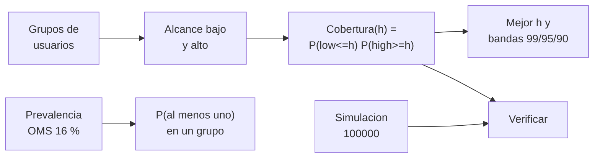

# B109-C08 — Diseño inclusivo en hábitats

<!-- nav:top -->
[🏠 Programa](../../../../README.md) · [📚 Bloque B109](../../../tronco-comun/B109-arquitectura-y-factores-humanos-de-habitats-extraterrestres.md) · [← Anterior: B109-C07 — Asignación de volúmenes habitables por tripulante](../B109-C07-asignacion-de-volumenes-habitables-por-tripulante/CLASE.md) · [Siguiente: B109-C09 — Privacidad y espacios personales →](../B109-C09-privacidad-y-espacios-personales/CLASE.md)
<!-- /nav -->

## 1. Ubicación, nivel y alcance

Clase 8 del bloque B109. Nivel N3. Un hábitat lo usan personas distintas entre sí en estatura, fuerza, movilidad, vista y oído. Diseñar de forma inclusiva es elegir geometrías que sirvan a la mayor parte de esa diversidad, y se puede medir: qué fracción de usuarios alcanza un control a una altura dada. Aquí calculas esa cobertura para una población sintética con usuarios de pie y sentados, la verificas con una simulación y estimas con una cifra de la OMS qué tan probable es que un grupo incluya a alguien con discapacidad. Sigue a [B109-C07](../B109-C07-asignacion-de-volumenes-habitables-por-tripulante/CLASE.md). Los usuarios son **sintéticos**.

## 2. Por qué esta clase existe

Un control puesto «a la altura normal» deja fuera a quien no la alcanza. La decisión central: **¿a qué altura (o con qué ajuste) un puesto sirve al mayor número de usuarios y a quién deja fuera?** La respuesta es una curva de cobertura, no una impresión.

## 3. Lo que podrás hacer al terminar

1. Citar la prevalencia de discapacidad de la OMS con su fecha y su alcance.
2. Calcular la probabilidad de que un grupo incluya al menos una persona en esa condición.
3. Calcular la cobertura de un control en función de su altura para usuarios de pie y sentados.
4. Encontrar la altura que maximiza la cobertura y las bandas con cobertura mínima.
5. Verificar el cálculo con una simulación de 100 000 usuarios.
6. Distinguir lo consultado, lo sintético y lo no consultado, y evitar extrapolar a tripulaciones reales.

La evidencia es tu **informe de cobertura inclusiva de un puesto** del ejercicio 12 (sección 20).

## 4. Con qué llegas y cómo comprobarlo

1. ¿Qué es una probabilidad complementaria?
2. ¿Qué es la independencia entre dos sucesos?
3. ¿Qué es una función de distribución normal?
4. ¿Qué es un alcance cómodo?
5. ¿Qué es un dato sintético?

<details>
<summary>Ver respuestas</summary>

1. `1 − P`: la de que no ocurra. 2. Que saber uno no cambia la probabilidad del otro. 3. La probabilidad de estar por debajo de un valor en una campana. 4. El rango de alturas que una persona alcanza sin esfuerzo. 5. Uno inventado para practicar, rotulado.
</details>

Con cuatro o cinco aciertos, sigue; si no, repasa los prerrequisitos.

## 5. Un caso de contexto y casos de referencia

La ficha de la OMS sobre discapacidad (7 de marzo de 2023) estima que `1300` millones de personas, el `16 %` o una de cada seis, viven con una discapacidad significativa. En un grupo de `4` personas de la población general, la probabilidad de que al menos una esté en esa condición es `0,502`. Con usuarios sintéticos de pie y sentados, un control a `960 mm` tiene cobertura casi total, y uno a `1600 mm` cubre el `81 %`. Es el **ejemplo conductor**. La tripulación de una misión se selecciona y sus criterios no se consultaron.

## 6. Vocabulario

El **diseño inclusivo** busca que un producto o espacio sirva a la mayor diversidad posible de usuarios. La **cobertura** es la fracción de usuarios que realiza una tarea con la geometría dada. La **prevalencia** es la proporción de una población con una condición. La **banda de cobertura** es el rango de alturas con cobertura mínima fija. Un **usuario de pie** y uno **sentado** tienen rangos de alcance distintos. La **accesibilidad** es la posibilidad de usar un entorno sin barreras.

## 7. Modelo mental: una puerta con dos manijas



*Descripción textual:* cada grupo de usuarios tiene un alcance bajo y uno alto; la cobertura de una altura es la fracción que cumple ambos; una simulación la verifica; aparte, la prevalencia permite calcular la probabilidad de diversidad en un grupo.

Analogía: una puerta con una manija alta y otra baja sirve a más personas que una sola a altura media. Límite: la cobertura mide un solo atributo; un espacio inclusivo considera además fuerza, vista, oído y cognición.

## 8. La explicación, paso a paso

### 8.1 Prevalencia y grupos

La OMS (7 de marzo de 2023) estima `1300` millones de personas con discapacidad significativa, el `16 %`. Con independencia entre personas, la probabilidad de que un grupo de `N` incluya al menos una es `1 − 0,84ᴺ`: `0,294` (N = 2), `0,502` (N = 4), `0,825` (N = 10). La cifra es de población general; **no** describe a una tripulación seleccionada.

### 8.2 Cobertura

Con usuarios sintéticos (de pie: alcance inferior `700 ± 50 mm`, superior `1750 ± 90`; sentados: `450 ± 40` y `1300 ± 70`; mezcla `85 %` y `15 %`), la cobertura de una altura `h` es `Σ w (P(inferior ≤ h) · P(superior ≥ h))`.

### 8.3 Resultados

La cobertura máxima (`1,000`) empieza en `960 mm`. La banda con cobertura `≥ 0,99` va de `820` a `1190 mm`; con `≥ 0,95`, de `780` a `1260`; con `≥ 0,90`, de `760` a `1330`. A `1300 mm` es `0,925`; a `1500`, `0,848`; a `1700`, `0,604`. Una simulación de `100 000` usuarios (semilla `109008`) coincide con la analítica en menos de `0,01`.

### 8.4 Lectura

La pérdida a partir de `1300 mm` es, casi exactamente, la fracción de usuarios sentados (`0,15`): un control alto deja fuera a un grupo entero. Ubicar el control en la banda de `820–1190 mm`, o duplicarlo o hacerlo ajustable, no requiere más espacio, pero sí decidir quiénes son los usuarios. Los valores son de una población inventada y no son una norma de accesibilidad, que no se consultó.

## 9. Magnitudes, símbolos y unidades

| Símbolo | Qué es | Unidad | Valor / nota |
|---|---|---|---|
| `h` | altura del control | mm | 300 a 2000 |
| `P_disc` | prevalencia de discapacidad | — | 0,16 (OMS 2023) |
| `w_g` | peso del grupo g | — | 0,85 y 0,15 (ilustrativos) |
| `low, high` | alcance inferior y superior | mm | sintéticos |
| `C(h)` | cobertura | — | 0 a 1 |
| `N` | personas en el grupo | — | 2, 4 o 10 |

## 10. Convenciones y referencias

Alturas en milímetros. Los grupos de usuarios, sus alcances y sus pesos son **sintéticos o ilustrativos**. La prevalencia de la OMS es de población general y no aplica a una tripulación seleccionada. Las normas de accesibilidad y la selección médica de tripulaciones **no se consultaron**.

## 11. De dónde sale lo que afirmamos

| ID | Fuente | Localizador | Respalda | Estado |
|---|---|---|---|---|
| S1 | OMS, «Disability» (ficha descriptiva, 7 de marzo de 2023) — https://www.who.int/news-room/fact-sheets/detail/disability-and-health (consultada 2026-11-10) | ficha completa leída | 1300 millones de personas (16 %, una de cada seis) con discapacidad significativa; el transporte inaccesible es una barrera 15 veces mayor para las personas con discapacidad | Consultada |
| S2 | Burke, Howard y Kessler (2022), «Internal Layout of a Lunar Surface Habitat», AIAA ASCEND 2022 — https://ntrs.nasa.gov/citations/20220013669 (leído completo, 16 páginas, 2026-11-10) | sección «Surface Habitat Ground Rules and Assumptions» | funciones de habitabilidad: ventanas, trabajo, higiene privada; pista de 1,00 m | Consultada |
| — | Probabilidad complementaria y cobertura de una población normal | — | las verifica el laboratorio con una segunda vía | No consultada en una fuente concreta |

Límites: no se consultaron normas de accesibilidad ni los criterios de selección de tripulaciones; los grupos de usuarios y sus alcances son inventados; la independencia entre personas es un supuesto.

## 12. Cómo ver la cobertura de un control

| Magnitud | Valor |
|---|---|
| Mejor altura | 960 mm (cobertura 1,000) |
| Banda ≥ 0,99 | 820–1190 mm |
| A 1500 mm | 0,848 |
| P(≥ 1 en N = 4) | 0,502 |

Descripción larga: Entre unos 0,8 y 1,2 metros casi todos los usuarios sintéticos alcanzan el control; a partir de 1,3 m la cobertura cae hasta ser la de los usuarios de pie.

## 13. Ejemplo trabajado: la cobertura a 1500 mm

**Paso 1 · De pie.** `P(inferior ≤ 1500) ≈ 1` y `P(superior ≥ 1500) = 1 − Φ((1500 − 1750)/90) = 0,997`: cobertura `0,997`.

**Paso 2 · Sentados.** `P(superior ≥ 1500) = 1 − Φ((1500 − 1300)/70) = 0,002`.

**Paso 3 · Mezcla.** `0,85 × 0,997 + 0,15 × 0,002 = 0,848`.

## 14. Distintas formas de describir la inclusión

**Por curva:** cobertura frente a altura. **Por banda:** rango con cobertura mínima. **Por probabilidad:** `1 − (1 − p)ᴺ` en un grupo. **Por exclusión:** quién queda fuera de cada altura.

## 15. Práctica guiada

**Ejercicio 1 · con los pasos indicados.** Calcula la probabilidad de al menos una persona con discapacidad en un grupo de `4`. *Pasos:* `1 − 0,84⁴`.

<details><summary>Solución comentada</summary>

`0,502`.
</details>

**Ejercicio 2 · con una pista.** Predice la probabilidad en un grupo de `2`. *Pista:* `1 − 0,84²`.

<details><summary>Solución comentada</summary>

`0,294`.
</details>

**Ejercicio 3 · casi autónomo.** ¿Por qué una altura pensada para el usuario de pie medio no es inclusiva?

<details><summary>Solución comentada</summary>

Porque deja fuera al grupo con alcance superior menor: a `1600 mm` la cobertura es `0,81`.
</details>

## 16. Práctica autónoma, transferencia e integrador

**Ejercicio 4 · autónomo.** Probabilidad en un grupo de `10`.

<details><summary>Solución comentada</summary>

`1 − 0,84¹⁰ = 0,825`.
</details>

**Ejercicio 5 · autónomo.** Ancho de la banda con cobertura `≥ 0,99`.

<details><summary>Solución comentada</summary>

`1190 − 820 = 370 mm`.
</details>

**Ejercicio 6 · autónomo.** Cobertura a `1500 mm`.

<details><summary>Solución comentada</summary>

`0,848`.
</details>

**Ejercicio 7 · autónomo.** Cobertura a `500 mm`.

<details><summary>Solución comentada</summary>

`0,134`: casi nadie de pie llega cómodo tan abajo.
</details>

**Ejercicio 8 · autónomo.** ¿Qué fracción pierde un control a `1500 mm` y a quién corresponde?

<details><summary>Solución comentada</summary>

`0,152`: casi exactamente los usuarios sentados (`0,15`).
</details>

**Ejercicio 9 · transferencia.** **Transferencia.** ¿Es el `16 %` la proporción de astronautas con discapacidad?

<details><summary>Solución comentada</summary>

No: es de población general y la tripulación se selecciona; esos criterios no se consultaron.
</details>

**Ejercicio 10 · transferencia.** **Transferencia.** ¿La banda `820–1190 mm` es una norma de accesibilidad?

<details><summary>Solución comentada</summary>

No: sale de usuarios sintéticos; las normas aplicables no se consultaron.
</details>

**Ejercicio 11 · transferencia.** **Transferencia.** Un puesto alto no puede bajar. ¿Qué opciones da la cobertura?

<details><summary>Solución comentada</summary>

Duplicarlo a dos alturas, hacerlo ajustable o añadir una interfaz alternativa: cada opción se evalúa con la misma curva.
</details>

**Ejercicio 12 · integrador.** **Integrador.** Elabora tu *informe de cobertura inclusiva*: curva de cobertura, mejor altura, bandas 99/95/90, probabilidad de diversidad en un grupo y lista de lo consultado, sintético y no consultado.

<details><summary>Solución comentada</summary>

Secciones 8.1–8.4 y la salida del laboratorio.
</details>

## 17. Laboratorio: cobertura de un control y diversidad en un grupo

El script [inclusivo.py](inclusivo.py) calcula la cobertura de alturas de `300` a `2000 mm`, las bandas de cobertura y la probabilidad `1 − 0,84ᴺ`, y **comprueba** la cobertura con una simulación de `100 000` usuarios (tolerancia `0,01`).

**Datos:** la prevalencia es de la OMS (2023); los grupos, los alcances y los pesos son **sintéticos o ilustrativos**. **Predice antes de ejecutar:** ¿a partir de qué altura cae la cobertura por la fracción de usuarios sentados? (alrededor de 1300 mm.) **Ejecución del 2026-11-10 (Python 3.12.9):**

```text
Usuarios SINTETICOS (85 % de pie, 15 % sentados) ; 16 % de la OMS (2023) para la poblacion general
Probabilidad de al menos una persona con discapacidad significativa en un grupo (poblacion general):
   N =  2: 0.2944
   N =  4: 0.5021
   N = 10: 0.8251
Mejor altura de control = 960 mm con cobertura 1.0000
   cobertura >= 0.99: de 820 a 1190 mm (ancho 370 mm)
   cobertura >= 0.95: de 780 a 1260 mm (ancho 480 mm)
   cobertura >= 0.90: de 760 a 1330 mm (ancho 570 mm)
 h [mm]  cobertura
    500     0.1342
    900     1.0000
   1100     0.9997
   1300     0.9250
   1500     0.8480
   1700     0.6041
Simulacion en h = 900: 1.0000 frente a 1.0000
Simulacion en h = 1300: 0.9276 frente a 0.9250
Simulacion en h = 1500: 0.8501 frente a 0.8480
Control a 1600 mm (comodo para de pie): cobertura = 0.8094
Pruebas superadas.
```

```bash
python programa/clases/B109/B109-C08-diseno-inclusivo-en-habitats/inclusivo.py
```

**Límites:** un solo atributo (alcance), independencia entre alcances, población inventada; no evalúa fuerza, vista, oído ni cognición.

## 18. Errores frecuentes y cómo corregirlos

**Dimensionar para el usuario medio.** Se corrige con 8.4.

**Extrapolar el 16 % a una tripulación seleccionada.** Se corrige con 8.1.

**Presentar la banda como norma de accesibilidad.** Se corrige con la sección 10.

**Medir la inclusión solo por la altura.** Se corrige con los límites del laboratorio.

## 19. Cómo sabrás que vas bien

Tras 8.3: ¿qué altura esperabas como mejor y cuál salió? Si dudas, repasa el ejemplo 13. Tras el laboratorio: ¿qué comprueba? (ver la sección 17).

## 20. Qué entregas y cómo se evalúa

El producto es tu **informe de cobertura inclusiva de un puesto** (ejercicio 12).

| Criterio | Inicial | En desarrollo | Logrado | Destacado |
|---|---|---|---|---|
| Conceptos | Los confunde | Parciales | Distingue prevalencia y cobertura | Explica la exclusión por altura |
| Cálculo | Sin unidades | Con errores | Curva y bandas con unidades | Calcula casos nuevos |
| Numérico | Sin comprobar | Un caso | Contraste con la simulación | Interpreta las diferencias |
| Fuentes | Sin fuente | Sin fecha | Fuentes con fecha y estado | Declara lo sintético y lo no consultado |
| Límites | No los nombra | Uno | Tres | Discute atributos que faltan |

**Condiciones críticas (no se compensan con promedio):** rotular los usuarios como sintéticos; no extrapolar la prevalencia de la OMS a tripulaciones seleccionadas; no presentar la banda como norma ni dar consejo médico; no dar consejo médico ni operativo; citar solo lo consultado.

## 21. Ética, seguridad y límites

Clase educativa: **no da consejo médico ni operativo** y no sustituye a las normas de diseño, a la revisión de ingeniería ni al juicio de profesionales de factores humanos y de seguridad de misión. Los modelos son simplificados y sus datos son sintéticos o ilustrativos; ningún resultado describe un hábitat real. La clase usa categorías simplificadas con fines pedagógicos y no etiqueta a nadie: una persona no es un tipo de usuario. No da consejo médico ni juzga la aptitud para una misión. Accesibilidad: tablas equivalentes a las gráficas, fórmulas en texto, ejercicios sin conexión.

## 22. Para cerrar y seguir

Con usuarios sintéticos, un control entre `820` y `1190 mm` cubre al menos el `99 %`; uno a `1500 mm` deja fuera al `15 %`. Queda una pregunta: ¿cómo se protege la intimidad en un hábitat pequeño?

**Glosario español–inglés.** diseño inclusivo · *inclusive design*; cobertura · *coverage*; prevalencia · *prevalence*; accesibilidad · *accessibility*; alcance · *reach*.

**Continuidad.** [B109-C09](../B109-C09-privacidad-y-espacios-personales/CLASE.md) calcula cuánta privacidad acústica da una división ligera.

**Referencias:** ver sección 11.

<!-- nav:bottom -->
---

[← Anterior: B109-C07 — Asignación de volúmenes habitables por tripulante](../B109-C07-asignacion-de-volumenes-habitables-por-tripulante/CLASE.md) · [📚 Bloque B109](../../../tronco-comun/B109-arquitectura-y-factores-humanos-de-habitats-extraterrestres.md) · [Siguiente: B109-C09 — Privacidad y espacios personales →](../B109-C09-privacidad-y-espacios-personales/CLASE.md)
<!-- /nav -->
