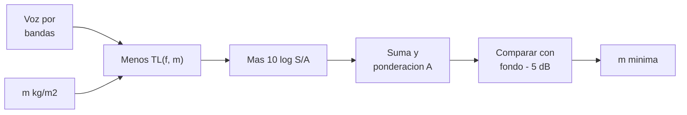

# B109-C09 — Privacidad y espacios personales

<!-- nav:top -->
[🏠 Programa](../../../../README.md) · [📚 Bloque B109](../../../tronco-comun/B109-arquitectura-y-factores-humanos-de-habitats-extraterrestres.md) · [← Anterior: B109-C08 — Diseño inclusivo en hábitats](../B109-C08-diseno-inclusivo-en-habitats/CLASE.md) · [Siguiente: B109-C10 — Acústica y control de ruido interior →](../B109-C10-acustica-y-control-de-ruido-interior/CLASE.md)
<!-- /nav -->

## 1. Ubicación, nivel y alcance

Clase 9 del bloque B109. Nivel N3. En un hábitat pequeño, la privacidad se diseña: cabinas individuales, divisiones que no dejen pasar la conversación y espacios donde se pueda estar a solas. Aquí te centras en la privacidad **acústica**: calculas cuánto sonido de voz atraviesa una división con la ley de masa, lo comparas con el ruido de fondo y obtienes la densidad superficial mínima que cumple un criterio. Sigue a [B109-C08](../B109-C08-diseno-inclusivo-en-habitats/CLASE.md). La voz, las masas y el criterio son **ilustrativos**; los valores por banda de la norma de ruido no se pudieron consultar.

## 2. Por qué esta clase existe

Una división que no se ve a través pero que deja pasar cada palabra no da privacidad. La decisión central: **¿qué masa debe tener una división para que lo que se dice al otro lado quede por debajo del ruido de fondo?** La respuesta es un cálculo con margen, y su coste en masa.

## 3. Lo que podrás hacer al terminar

1. Convertir un espectro por bandas en un nivel ponderado A.
2. Calcular la pérdida de transmisión de una división con la ley de masa.
3. Calcular el nivel transmitido al recinto receptor.
4. Comparar con el ruido de fondo según un criterio de privacidad.
5. Encontrar la densidad superficial mínima y su coste en masa.
6. Rotular lo consultado, lo ilustrativo y lo no consultado.

La evidencia es tu **ficha de privacidad de tres divisiones** del ejercicio 12 (sección 20).

## 4. Con qué llegas y cómo comprobarlo

1. ¿Qué es un decibelio?
2. ¿Qué es la ponderación A?
3. ¿Qué es la pérdida de transmisión?
4. ¿Qué es la absorción de un recinto?
5. ¿Qué es un dato ilustrativo?

<details>
<summary>Ver respuestas</summary>

1. Una escala logarítmica de nivel respecto a una referencia (`20 µPa` en presión sonora). 2. Un filtro que imita la sensibilidad del oído y da dBA. 3. Los decibelios que una división quita al sonido que la atraviesa. 4. El área equivalente de superficie que absorbe sonido. 5. Uno supuesto para practicar, sin fuente.
</details>

Con cuatro o cinco aciertos, sigue; si no, repasa los prerrequisitos.

## 5. Un caso de contexto y casos de referencia

El concepto de hábitat lunar de NASA (Burke et al., 2022) pide áreas de dormir y de higiene privadas y recomienda con fuerza cabinas individuales: `1,82 m²` mínimos y `1,85 m²` por tripulante en el trazado. NASA-STD-3001 Vol. 2 limita el ruido continuo de las áreas de sueño a la curva NC-40 en misiones de más de 30 días. Con una voz de `60,4 dBA` a `1 m` (ilustrativa), una cortina textil deja pasar `54,1 dBA`, un panel de `2 kg/m²` deja `41,5` y uno de `6 kg/m²`, `31,9`, frente a un criterio de `40 dBA`. Es el **ejemplo conductor**.

## 6. Vocabulario

La **privacidad acústica** es que lo dicho en un espacio no se entienda en otro. El **nivel de presión sonora** se mide en dB y, ponderado, en dBA. La **pérdida de transmisión** `TL` es la atenuación de una división. La **ley de masa** dice que `TL` sube `6 dB` al duplicar la masa o la frecuencia. El **ruido de fondo** es el nivel del recinto receptor. La **densidad superficial** `m` es la masa por unidad de área de la división.

## 7. Modelo mental: un muro entre dos habitaciones



*Descripción textual:* el espectro de la voz pierde la pérdida de transmisión de la división y gana la corrección por área y absorción; la suma ponderada A se compara con el fondo menos un margen y de ahí sale la masa mínima.

Analogía: cuanto más gruesa la pared de un departamento, menos se oye al vecino. Límite: la ley de masa ignora la rigidez, las fugas por rendijas y los puentes por estructura, que en divisiones ligeras dominan.

## 8. La explicación, paso a paso

### 8.1 Lo consultado

El concepto de Burke et al. (2022) incluye entre las funciones mínimas áreas privadas para dormir, aseo y gestión de residuos privados, y recomienda cabinas individuales. El resumen técnico OCHMO-TB-035 Rev C indica que NASA-STD-3001 Vol. 2 [V2 6079] limita el ruido continuo en áreas de dormir a la curva NC-40 para misiones de más de `30` días; sus valores por banda (Tabla 6.6-3) no se consultaron.

### 8.2 Ley de masa y nivel transmitido

Con `TL = 20 log₁₀(f m) − 47 dB` (acotada a `≥ 0`) y la corrección `10 log₁₀(S/A) = 10 log₁₀(2/6) = −4,77 dB` (área de división `2 m²`, absorción del receptor `6 m²`), el nivel por banda es `L_voz − TL − 4,77`. A `500 Hz`, `TL = 0` (cortina, `0,3 kg/m²`), `13,0` (`2 kg/m²`) y `22,5 dB` (`6 kg/m²`).

### 8.3 Resultados

La voz ilustrativa a `1 m` es `60,4 dBA`. Con criterio «transmitido ≤ fondo − 5 dB = 40 dBA» (fondo ilustrativo de `45 dBA`):

| División | m (kg/m²) | Transmitido (dBA) | ¿Privada? |
|---|---|---|---|
| Cortina textil | 0,3 | 54,1 | No |
| Panel ligero | 2,0 | 41,5 | No (1,5 dB de más) |
| Panel pesado | 6,0 | 31,9 | Sí |

La densidad mínima que cumple es `2,37 kg/m²`: `20 log₁₀(2,37/2) = 1,5 dB`, exactamente el déficit del panel ligero. Como segunda vía, duplicar la masa sube `TL` exactamente `6,02 dB`.

### 8.4 Lectura

Pasar de `2` a `6 kg/m²` ahorra `9,6 dB` en el nivel transmitido; lo decisivo es el margen frente al fondo. Más ruido de fondo da más privacidad (a costa de otros criterios, ver [B109-C10](../B109-C10-acustica-y-control-de-ruido-interior/CLASE.md)). La privacidad también es visual y de espacio personal; aquí solo se modeló la acústica.

## 9. Magnitudes, símbolos y unidades

| Símbolo | Qué es | Unidad | Valor / nota |
|---|---|---|---|
| `L` | nivel de presión sonora | dB / dBA | voz a 1 m: 60,4 dBA |
| `m` | densidad superficial | kg/m² | 0,3; 2,0; 6,0 |
| `TL` | pérdida de transmisión | dB | 13,0 y 22,5 a 500 Hz |
| `S` | área de la división | m² | 2,0 (ilustrativa) |
| `A` | absorción del receptor | m² | 6,0 (ilustrativa) |
| `f` | frecuencia | Hz | 125 a 4000 |

## 10. Convenciones y referencias

Niveles en dB re `20 µPa`; ponderación A por la fórmula analítica. Ley de masa de incidencia aleatoria acotada a `TL ≥ 0`. Recinto receptor reverberante. El espectro de la voz, las masas, las áreas, el fondo de `45 dBA` y el criterio de margen son **ilustrativos**.

## 11. De dónde sale lo que afirmamos

| ID | Fuente | Localizador | Respalda | Estado |
|---|---|---|---|---|
| S1 | Burke, Howard y Kessler (2022), «Internal Layout of a Lunar Surface Habitat», AIAA ASCEND 2022 — https://ntrs.nasa.gov/citations/20220013669 (leído completo, 16 páginas, 2026-11-10) | secciones de GR&A y Tabla 4 | áreas de sueño de 1,82 m² (mínimo) y 3,70 m² para dos (1,85 m² por tripulante); áreas privadas para dormir y aseo; cabinas individuales muy recomendadas | Consultada |
| S2 | NASA OCHMO, NASA-STD-3001 Technical Brief OCHMO-TB-035 «Acoustics», Rev C (2023-10-06), derivado de NASA-STD-3001 Vol. 2 Rev D — https://www.nasa.gov/sites/default/files/atoms/files/acoustics_technical_brief_ochmo_0.pdf (leído completo, 12 páginas, 2026-11-10) | página 2 y requisito [V2 6079] | ruido continuo de áreas de sueño limitado a NC-40 en misiones de más de 30 días; ruido en dB re 20 µPa | Consultada |
| — | Ley de masa, suma energética de decibelios y ponderación A analítica | — | las verifica el laboratorio con una segunda vía | No consultada en una fuente concreta |

Límites: no se consultaron los valores por banda de la curva NC-40 ni ningún criterio de privacidad de habla; el fondo de 45 dBA y el espectro de la voz son inventados; no se modelaron fugas ni flancos.

## 12. Cómo ver la privacidad acústica

| Magnitud | Valor |
|---|---|
| Voz a 1 m | 60,4 dBA |
| Transmitido (2 kg/m²) | 41,5 dBA |
| Transmitido (6 kg/m²) | 31,9 dBA |
| Densidad mínima | 2,37 kg/m² |

Descripción larga: Una cortina no da privacidad, un panel ligero queda a un decibelio y medio del criterio, y uno de seis kilos por metro cuadrado lo supera con holgura.

## 13. Ejemplo trabajado: el panel ligero a 500 Hz

**Paso 1 · Pérdida.** `TL = 20 log₁₀(500 × 2) − 47 = 60 − 47 = 13,0 dB`.

**Paso 2 · Nivel en la banda.** `60 − 13,0 − 4,77 = 42,2 dB`.

**Paso 3 · Suma de bandas y ponderación A.** El laboratorio suma las seis bandas con A y da `41,5 dBA`, `1,5 dB` sobre los `40 dBA` del criterio.

## 14. Distintas formas de describir la privacidad

**Por decibelios:** nivel transmitido frente a fondo. **Por masa:** densidad mínima. **Por banda:** `TL(f)`. **Por criterio:** sí o no frente a un margen.

## 15. Práctica guiada

**Ejercicio 1 · con los pasos indicados.** Calcula `10 log₁₀(S/A)` con `S = 2` y `A = 6`. *Pasos:* divide y toma `10 log₁₀`.

<details><summary>Solución comentada</summary>

`−4,77 dB`.
</details>

**Ejercicio 2 · con una pista.** Predice `TL` a `500 Hz` de `2 kg/m²`. *Pista:* `20 log₁₀(1000) − 47`.

<details><summary>Solución comentada</summary>

`13,0 dB`.
</details>

**Ejercicio 3 · casi autónomo.** ¿Por qué una cortina no da privacidad acústica?

<details><summary>Solución comentada</summary>

Porque su masa es muy baja y `TL ≈ 0`: la voz pasa casi sin atenuarse (`54,1 dBA`).
</details>

## 16. Práctica autónoma, transferencia e integrador

**Ejercicio 4 · autónomo.** `TL` a `500 Hz` de `6 kg/m²`.

<details><summary>Solución comentada</summary>

`20 log₁₀(3000) − 47 = 22,5 dB`.
</details>

**Ejercicio 5 · autónomo.** Aumento de `TL` al duplicar la masa.

<details><summary>Solución comentada</summary>

`20 log₁₀ 2 = 6,02 dB`.
</details>

**Ejercicio 6 · autónomo.** Déficit del panel ligero frente al criterio y masa necesaria.

<details><summary>Solución comentada</summary>

`41,5 − 40 = 1,5 dB` → `2 × 10^(1,5/20) = 2,38 kg/m²` (el laboratorio da `2,37`).
</details>

**Ejercicio 7 · autónomo.** Nivel de la voz de referencia en dBA.

<details><summary>Solución comentada</summary>

`60,4 dBA` a `1 m`.
</details>

**Ejercicio 8 · autónomo.** Margen del área de sueño por tripulante respecto al mínimo.

<details><summary>Solución comentada</summary>

`1,85 − 1,82 = 0,03 m²`, el `1,6 %`.
</details>

**Ejercicio 9 · transferencia.** **Transferencia.** ¿Es `45 dBA` el ruido de fondo de un hábitat o el límite de NC-40?

<details><summary>Solución comentada</summary>

Ninguno: es un valor ilustrativo; NC-40 es un límite por bandas cuyos valores no se consultaron.
</details>

**Ejercicio 10 · transferencia.** **Transferencia.** Un hábitat resuelve la privacidad visual con cortinas. ¿Qué dice de la acústica?

<details><summary>Solución comentada</summary>

Nada: la privacidad visual y la acústica son distintas; esta clase solo modela la acústica.
</details>

**Ejercicio 11 · transferencia.** **Transferencia.** ¿Cuánta masa extra suponen `10 m²` de panel de `6 kg/m²` en lugar de `2,37`?

<details><summary>Solución comentada</summary>

`(6 − 2,37) × 10 = 36,3 kg`, el `0,3 %` de la masa de aterrizaje de `12 t` del concepto de NASA.
</details>

**Ejercicio 12 · integrador.** **Integrador.** Elabora tu *ficha de privacidad*: espectro, `TL`, nivel transmitido y veredicto de tres divisiones, densidad mínima, coste en masa y lista de lo consultado, ilustrativo y no consultado.

<details><summary>Solución comentada</summary>

Secciones 8.1–8.4 y la salida del laboratorio.
</details>

## 17. Laboratorio: privacidad acústica de tres divisiones

El script [privacidad.py](privacidad.py) calcula `TL` por banda, el nivel transmitido ponderado A y la masa mínima, y **comprueba** que duplicar la masa sube `TL` `20 log 2` dB (`1e-9`) y que la ponderación A reproduce los valores conocidos de `0,1 dB`.

**Datos:** las áreas de sueño son de Burke et al. (2022) y el límite NC-40 del resumen OCHMO; la voz, las masas, el fondo y el criterio son **ilustrativos**. **Predice antes de ejecutar:** ¿el panel ligero cumplirá el criterio? (no, por 1,5 dB.) **Ejecución del 2026-11-10 (Python 3.12.9):**

```text
Voz, masas, areas, fondo y criterio ILUSTRATIVOS; areas de sueno de Burke et al. (2022); NC-40 (sueno > 30 d) del resumen OCHMO-TB-035, sin valores por banda
Voz a 1 m = 63.1 dB lineal ; 60.4 dBA
Criterio: transmitido <= fondo - 5 dB = 40 dBA ; fondo = 45 dBA ; 10 log10(S/A) = -4.77 dB
 division           m [kg/m2]   TL(500 Hz) [dB]   nivel transmitido [dBA]   margen vs fondo [dB]   privada
cortina textil          0.3               0.0                      54.1                    9.1   no
panel ligero            2.0              13.0                      41.5                   -3.5   no
panel pesado            6.0              22.5                      31.9                  -13.1   si
Densidad superficial minima para cumplir el criterio = 2.37 kg/m2 (por pasos de 0.01)
Area de sueno por tripulante: recomendada 1.82 m2 ; trazado de referencia 1.85 m2
Pruebas superadas.
```

```bash
python programa/clases/B109/B109-C09-privacidad-y-espacios-personales/privacidad.py
```

**Límites:** ley de masa sin rigidez ni fugas; campo reverberante; criterio y fondo inventados; solo privacidad acústica.

## 18. Errores frecuentes y cómo corregirlos

**Confundir privacidad visual con acústica.** Se corrige con 8.4.

**Dejar `TL` negativo.** Se corrige con 8.2.

**Tomar el fondo ilustrativo como límite de la norma.** Se corrige con la sección 10.

**Olvidar el coste en masa de la división.** Se corrige con el ejercicio 11.

## 19. Cómo sabrás que vas bien

Tras 8.3: ¿qué división esperabas que cumpliera y cuál cumplió? Si dudas, repasa el ejemplo 13. Tras el laboratorio: ¿qué comprueba? (ver la sección 17).

## 20. Qué entregas y cómo se evalúa

El producto es tu **ficha de privacidad de tres divisiones** (ejercicio 12).

| Criterio | Inicial | En desarrollo | Logrado | Destacado |
|---|---|---|---|---|
| Conceptos | Los confunde | Parciales | Calcula `TL` y nivel transmitido | Explica el papel del fondo |
| Cálculo | Sin unidades | Con errores | Ficha con unidades | Calcula casos nuevos |
| Numérico | Sin comprobar | Un caso | Contraste con +6 dB y con la ponderación A | Interpreta el déficit en masa |
| Fuentes | Sin fuente | Sin fecha | Fuentes con fecha y estado | Declara lo ilustrativo y lo no consultado |
| Límites | No los nombra | Uno | Tres | Discute fugas y rigidez |

**Condiciones críticas (no se compensan con promedio):** rotular la voz, el fondo y el criterio como ilustrativos; no presentar NC-40 con valores no consultados; no dar consejo médico ni operativo; no dar consejo médico ni operativo; citar solo lo consultado.

## 21. Ética, seguridad y límites

Clase educativa: **no da consejo médico ni operativo** y no sustituye a las normas de diseño, a la revisión de ingeniería ni al juicio de profesionales de factores humanos y de seguridad de misión. Los modelos son simplificados y sus datos son sintéticos o ilustrativos; ningún resultado describe un hábitat real. La privacidad también tiene una dimensión psicológica y de convivencia que esta clase no aborda y que corresponde a especialistas en salud conductual; no se da consejo sobre ella. Accesibilidad: tablas equivalentes a las gráficas, fórmulas en texto, ejercicios sin conexión.

## 22. Para cerrar y seguir

Con datos ilustrativos, un panel de `2 kg/m²` deja pasar `41,5 dBA` y hace falta `2,37 kg/m²` para el criterio de `40 dBA`. Queda una pregunta: ¿cómo se suma el ruido de ventiladores y bombas y se compara con un límite?

**Glosario español–inglés.** privacidad acústica · *acoustic privacy*; pérdida de transmisión · *transmission loss*; ley de masa · *mass law*; ruido de fondo · *background noise*; densidad superficial · *surface density*.

**Continuidad.** [B109-C10](../B109-C10-acustica-y-control-de-ruido-interior/CLASE.md) suma las fuentes de ruido de una cabina y las compara con los límites.

**Referencias:** ver sección 11.

<!-- nav:bottom -->
---

[← Anterior: B109-C08 — Diseño inclusivo en hábitats](../B109-C08-diseno-inclusivo-en-habitats/CLASE.md) · [📚 Bloque B109](../../../tronco-comun/B109-arquitectura-y-factores-humanos-de-habitats-extraterrestres.md) · [Siguiente: B109-C10 — Acústica y control de ruido interior →](../B109-C10-acustica-y-control-de-ruido-interior/CLASE.md)
<!-- /nav -->
