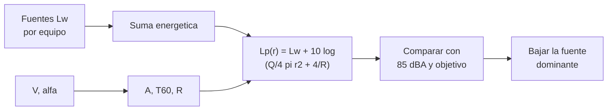

# B109-C10 — Acústica y control de ruido interior

<!-- nav:top -->
[🏠 Programa](../../../../README.md) · [📚 Bloque B109](../../../tronco-comun/B109-arquitectura-y-factores-humanos-de-habitats-extraterrestres.md) · [← Anterior: B109-C09 — Privacidad y espacios personales](../B109-C09-privacidad-y-espacios-personales/CLASE.md) · [Siguiente: B109-C11 — Diseño de espacios de trabajo, mantenimiento y laboratorio →](../B109-C11-diseno-de-espacios-de-trabajo-mantenimiento-y-laboratorio/CLASE.md)
<!-- /nav -->

## 1. Ubicación, nivel y alcance

Clase 10 del bloque B109. Nivel N3. En un recinto cerrado y sin ventanas al aire libre, los ventiladores y las bombas suenan todo el día y el sonido rebota en las paredes. Aquí construyes un presupuesto de ruido: sumas fuentes en decibelios, calculas el campo reverberante con la fórmula de Sabine, comparas con un límite publicado y con un objetivo de diseño y ves qué fuente conviene bajar primero. Sigue a [B109-C09](../B109-C09-privacidad-y-espacios-personales/CLASE.md). Las potencias de las fuentes y la absorción son **ilustrativas**; los límites vienen de un resumen técnico de NASA.

## 2. Por qué esta clase existe

El ruido continuo degrada la comunicación, el sueño y el trabajo aunque no dañe el oído. La decisión central: **¿qué fuente reduzco primero y cuánto baja el nivel de la cabina?** Los decibelios no se suman como números ordinarios, y por eso conviene calcular.

## 3. Lo que podrás hacer al terminar

1. Sumar niveles en decibelios con suma de energías.
2. Calcular absorción, tiempo de reverberación y constante del recinto con la fórmula de Sabine.
3. Calcular el nivel a distintas distancias y la distancia crítica.
4. Comparar con el límite de 85 dBA, el ruido de Spacelab y un objetivo ilustrativo.
5. Elegir la fuente que más reduce el nivel total.
6. Rotular lo consultado, lo ilustrativo y lo no consultado.

La evidencia es tu **presupuesto de ruido de una cabina** del ejercicio 12 (sección 20).

## 4. Con qué llegas y cómo comprobarlo

1. ¿Cuánto suben dos fuentes iguales?
2. ¿Qué es el tiempo de reverberación?
3. ¿Qué es un nivel de potencia sonora?
4. ¿Qué es la dosis de ruido?
5. ¿Qué es un dato ilustrativo?

<details>
<summary>Ver respuestas</summary>

1. `3 dB` (`10 log₁₀ 2`). 2. El tiempo que tarda el sonido en caer `60 dB` tras apagar la fuente. 3. Una medida, en dB, de la energía que emite la fuente, independiente del recinto. 4. La exposición acumulada comparada con un límite de referencia (por ejemplo, `85 dBA` durante `8 h`). 5. Uno supuesto para practicar, sin fuente.
</details>

Con cuatro o cinco aciertos, sigue; si no, repasa los prerrequisitos.

## 5. Un caso de contexto y casos de referencia

El resumen técnico OCHMO-TB-035 de NASA (Rev C, 2023) indica que NASA-STD-3001 Vol. 2 limita el ruido peligroso a menos de `85 dBA` sin importar la duración y el ruido continuo de las áreas de trabajo a la curva NC-50. En Spacelab (STS-40) el promedio diario fue de `68 dBA`, con picos de `75,5` y `84 dBA` durante el ergómetro, y la tripulación tuvo problemas de comunicación y de irritación, también durante el sueño. Con cuatro fuentes ilustrativas (dos ventiladores de `58 dBA`, una bomba de `55` y un compresor de `62`), la cabina del ejemplo suma `65,0 dBA` de potencia y llega a `55,9 dBA` a `3 m`. Es el **ejemplo conductor**.

## 6. Vocabulario

El **nivel de potencia sonora** `Lw` describe la fuente; el **nivel de presión** `Lp`, lo que se mide en un punto. El **campo directo** viene de la fuente; el **reverberante**, de los rebotes. La **absorción** `A` es la superficie equivalente que absorbe. El **tiempo de reverberación** `T60` mide cuánto dura el eco. La **distancia crítica** es donde el campo directo iguala al reverberante. La **curva NC** es un límite por bandas de octava.

## 7. Modelo mental: gotas en una bañera cerrada



*Descripción textual:* las fuentes se suman en energía; el recinto aporta absorción y constante; el nivel en un punto mezcla campo directo y reverberante y se compara con el límite y el objetivo para decidir qué fuente bajar.

Analogía: varios grifos que gotean en una bañera cerrada: más cerca del grifo oyes el chorro, lejos oyes el eco de todos. Límite: el modelo supone un campo difuso y absorción uniforme; una cabina pequeña con equipos y mobiliario no lo es del todo.

## 8. La explicación, paso a paso

### 8.1 Lo consultado

El resumen OCHMO-TB-035 Rev C indica: ruido peligroso (sin ruido impulsivo ni alarmas) menor de `85 dBA` sin importar la duración [V2 6077]; ruido continuo en áreas de trabajo limitado por la curva NC-50 (que varía de `70 dB` a `63 Hz` a `45 dB` a `8 kHz`) [V2 6078]; ruido continuo en áreas de sueño por NC-40 si la misión pasa de `30` días [V2 6079]. Recomienda ventiladores silenciosos, aislar las partes vibrantes y mantener los equipos; los absorbentes blandos exigen cuidado con la limpieza. La norma completa y sus tablas por banda no se consultaron.

### 8.2 Recinto

Con `V = 127 m³` (Burke et al., 2022) y una superficie equivalente `6V^(2/3) = 151,6 m²` y `α = 0,20` (ilustrativos): `A = 30,3 m²`, `T60 = 0,161 V/A = 0,67 s`, `R = A/(1 − α) = 37,9 m²` y distancia crítica `√(Q R/16π) = 1,23 m` con `Q = 2`.

### 8.3 Presupuesto

La potencia total es `10 log₁₀(2·10^5,8 + 10^5,5 + 10^6,2) = 65,0 dBA`. El nivel total es `59,2 dBA` a `1 m`, `56,6` a `2 m`, `55,9` a `3 m` y `55,5` a `5 m`; el campo reverberante da `55,2`. Más allá de la distancia crítica alejarse apenas ayuda: de `1` a `5 m` bajan solo `3,7 dB`. Todos los puntos quedan `≥ 25 dB` por debajo de `85 dBA`, pero `5,9 dB` por encima del objetivo ilustrativo de `50 dBA` a `3 m`.

### 8.4 Qué bajar primero

Bajar `5 dB` cada ventilador solo ahorra `1,4 dB` a `3 m`; bajar `10 dB` el compresor ahorra `2,6 dB`, porque domina (`62 dBA`, la mitad de la energía). Una dosis ilustrativa de un día (16 h a `50`, 6 h a `62` y 2 h a `72 dBA`, intercambio de `3 dB`) es `1,7 %` y su nivel equivalente `62,5 dBA`. Como Spacelab muestra, estar por debajo de `85 dBA` no basta: los problemas de comunicación e irritación aparecieron con medias diarias de `68 a 75,5 dBA`.

## 9. Magnitudes, símbolos y unidades

| Símbolo | Qué es | Unidad | Valor / nota |
|---|---|---|---|
| `Lw` | nivel de potencia sonora | dBA | 58; 58; 55; 62 (ilustrativos) |
| `Lp` | nivel de presión sonora | dBA | 55,9 a 3 m |
| `V` | volumen | m³ | 127 (Burke et al.) |
| `A` | absorción | m² | 30,3 |
| `T60` | tiempo de reverberación | s | 0,67 |
| `R` | constante del recinto | m² | 37,9 |
| `Q` | directividad | — | 2 (ilustrativo) |

## 10. Convenciones y referencias

Niveles en dBA re `20 µPa` (presión) y re `1 pW` (potencia). Campo difuso, absorción uniforme, fuente omnidireccional junto a una pared. Los valores por banda de NC-40 y NC-50 no se consultaron y no se usan. Potencias, absorción, directividad, tasa de intercambio de `3 dB` y objetivo de `50 dBA` **ilustrativos**.

## 11. De dónde sale lo que afirmamos

| ID | Fuente | Localizador | Respalda | Estado |
|---|---|---|---|---|
| S1 | NASA OCHMO, NASA-STD-3001 Technical Brief OCHMO-TB-035 «Acoustics», Rev C (2023-10-06), derivado de NASA-STD-3001 Vol. 2 Rev D — https://www.nasa.gov/sites/default/files/atoms/files/acoustics_technical_brief_ochmo_0.pdf (leído completo, 12 páginas, 2026-11-10) | páginas 2–5 y requisitos [V2 6077]–[V2 6082] | límite peligroso de 85 dBA; NC-50 en áreas de trabajo (70 dB a 63 Hz, 45 dB a 8 kHz); NC-40 en áreas de sueño; Spacelab 68, 75,5 y 84 dBA con problemas de comunicación; recomendaciones de diseño | Consultada |
| S2 | Burke, Howard y Kessler (2022), «Internal Layout of a Lunar Surface Habitat», AIAA ASCEND 2022 — https://ntrs.nasa.gov/citations/20220013669 (leído completo, 16 páginas, 2026-11-10) | sección V | volumen habitable de ~127 m³ | Consultada |
| — | Suma de decibelios y fórmula de Sabine con campo difuso | — | las verifica el laboratorio con una segunda vía | No consultada en una fuente concreta |

Límites: no se consultó la norma NASA-STD-3001 Vol. 2 ni sus tablas por banda; las potencias, la absorción, la directividad, la tasa de intercambio y el objetivo son inventados; no se verificó ningún nivel con mediciones.

## 12. Cómo ver el presupuesto de ruido

| Magnitud | Valor |
|---|---|
| `Lw` total | 65,0 dBA |
| `T60` | 0,67 s |
| `Lp` a 3 m | 55,9 dBA |
| Mejor palanca | bajar 10 dB el compresor (−2,6 dB) |

Descripción larga: El nivel casi no cae al alejarse más de un metro, y la mejora mayor viene de la fuente que más energía aporta.

## 13. Ejemplo trabajado: la suma de dos ventiladores

**Paso 1 · Energías.** `10^(58/10) = 6,31×10⁵` cada uno.

**Paso 2 · Suma.** `2 × 6,31×10⁵ = 1,26×10⁶`.

**Paso 3 · Nivel.** `10 log₁₀(1,26×10⁶) = 61,0 dBA`: `58 + 3,01`.

## 14. Distintas formas de describir el ruido

**Por fuente:** `Lw` de cada equipo. **Por punto:** `Lp(r)`. **Por recinto:** `A`, `T60`, `R`. **Por límite:** margen frente a 85 dBA o al objetivo. **Por dosis:** exposición acumulada.

## 15. Práctica guiada

**Ejercicio 1 · con los pasos indicados.** Calcula lo que suben dos fuentes iguales. *Pasos:* `10 log₁₀ 2`.

<details><summary>Solución comentada</summary>

`3,01 dB`.
</details>

**Ejercicio 2 · con una pista.** Predice la potencia total de las cuatro fuentes. *Pista:* suma energías.

<details><summary>Solución comentada</summary>

`65,0 dBA`.
</details>

**Ejercicio 3 · casi autónomo.** ¿Por qué conviene bajar primero el compresor?

<details><summary>Solución comentada</summary>

Porque aporta la mitad de la energía: bajarlo `10 dB` ahorra `2,6 dB` a `3 m`, frente a `1,4 dB` de bajar `5 dB` cada ventilador.
</details>

## 16. Práctica autónoma, transferencia e integrador

**Ejercicio 4 · autónomo.** `T60` con `V = 127 m³` y `A = 30,3 m²`.

<details><summary>Solución comentada</summary>

`0,161 × 127/30,3 = 0,67 s`.
</details>

**Ejercicio 5 · autónomo.** Distancia crítica con `Q = 2` y `R = 37,9 m²`.

<details><summary>Solución comentada</summary>

`√(2 · 37,9/(16π)) = 1,23 m`.
</details>

**Ejercicio 6 · autónomo.** Margen del nivel a `3 m` frente al objetivo de `50 dBA`.

<details><summary>Solución comentada</summary>

`55,9 − 50 = 5,9 dB` de exceso.
</details>

**Ejercicio 7 · autónomo.** Cuánto baja el nivel entre `1 m` y `5 m`.

<details><summary>Solución comentada</summary>

`59,2 − 55,5 = 3,7 dB`: casi todo es campo reverberante.
</details>

**Ejercicio 8 · autónomo.** Dosis ilustrativa de 2 h a `72 dBA` con intercambio de `3 dB`.

<details><summary>Solución comentada</summary>

Tiempo de referencia `8 × 2^(13/3) = 161 h`; `100 × 2/161 = 1,2 %`.
</details>

**Ejercicio 9 · transferencia.** **Transferencia.** Spacelab tuvo `84 dBA` con el ergómetro, bajo `85`. ¿Era aceptable?

<details><summary>Solución comentada</summary>

No: el límite de 85 dBA protege el oído, pero hubo problemas de comunicación e irritación con niveles menores; el resumen lo documenta.
</details>

**Ejercicio 10 · transferencia.** **Transferencia.** Un absorbente blando baja el ruido. ¿Qué cuidado añade el resumen OCHMO?

<details><summary>Solución comentada</summary>

Que los materiales blandos y porosos exigen consideraciones de limpieza y de salud de la tripulación.
</details>

**Ejercicio 11 · transferencia.** **Transferencia.** ¿Cumple esta cabina la curva NC-50?

<details><summary>Solución comentada</summary>

No se sabe: NC-50 es un límite por bandas y el laboratorio trabaja en dBA con valores ilustrativos; los valores por banda no se consultaron.
</details>

**Ejercicio 12 · integrador.** **Integrador.** Elabora tu *presupuesto de ruido*: potencias, recinto, niveles a cuatro distancias, márgenes, efecto de dos intervenciones y lista de lo consultado, ilustrativo y no consultado.

<details><summary>Solución comentada</summary>

Secciones 8.1–8.4 y la salida del laboratorio.
</details>

## 17. Laboratorio: presupuesto de ruido de una cabina

El script [ruido.py](ruido.py) suma cuatro fuentes, calcula `A`, `T60` y `R`, el nivel a cuatro distancias y dos intervenciones, y **comprueba** que dos fuentes iguales suman `10 log 2` y que en la distancia crítica `Lp = Lw + 10 log(8/R)` (tolerancia `1e-9`).

**Datos:** el límite de 85 dBA, el NC-50/NC-40 en texto y los niveles de Spacelab son del resumen OCHMO; las potencias, la absorción, la directividad y el objetivo son **ilustrativos**. **Predice antes de ejecutar:** ¿bajar los ventiladores o el compresor? (el compresor.) **Ejecución del 2026-11-10 (Python 3.12.9):**

```text
Fuentes, absorcion y objetivo ILUSTRATIVOS; limites y niveles de Spacelab del resumen OCHMO-TB-035 Rev C; V = 127 m3 (Burke et al. 2022)
S = 151.6 m2 ; A = 30.3 m2 ; T60 = 0.67 s ; R = 37.9 m2 ; distancia critica = 1.23 m
Potencia sonora total = 65.0 dBA
 distancia a las fuentes [m]   Lp total [dBA]   margen frente al objetivo de 50 dBA [dB]   margen frente al limite de 85 dBA [dB]
                      1.0             59.2                                      -9.2                                   25.8
                      2.0             56.6                                      -6.6                                   28.4
                      3.0             55.9                                      -5.9                                   29.1
                      5.0             55.5                                      -5.5                                   29.5
Campo reverberante (r grande): Lp -> 55.2 dBA
Efecto de bajar 5 dB cada ventilador (53 dBA):
   Lp a 3 m: 55.9 -> 54.5 dBA (ahorro 1.4 dB)
Efecto de bajar 10 dB el compresor (52 dBA): Lp a 3 m: 55.9 -> 53.3 dBA (ahorro 2.6 dB)
Referencias publicadas (resumen OCHMO): Spacelab 68 dBA (media diaria), 75.5 dBA (max. diario), 84 dBA (con ergometro) ; limite peligroso 85 dBA
Dosis ilustrativa de un dia (16 h a 50, 6 h a 62, 2 h a 72 dBA; intercambio 3 dB) = 1.7 % ; Leq 24 h = 62.5 dBA
Pruebas superadas.
```

```bash
python programa/clases/B109/B109-C10-acustica-y-control-de-ruido-interior/ruido.py
```

**Límites:** campo difuso, sin valores por banda, absorción uniforme, fuentes ilustrativas; no sustituye a una medición ni a la verificación contra la norma.

## 18. Errores frecuentes y cómo corregirlos

**Sumar decibelios como números.** Se corrige con 8.3.

**Creer que alejarse siempre baja el nivel.** Se corrige con 8.3: la distancia crítica.

**Suponer que estar bajo 85 dBA basta.** Se corrige con 8.4.

**Usar NC-50 sin sus valores por banda.** Se corrige con la sección 10.

## 19. Cómo sabrás que vas bien

Tras 8.3: ¿qué fuente esperabas bajar primero y cuál fue? Si dudas, repasa el ejemplo 13. Tras el laboratorio: ¿qué comprueba? (ver la sección 17).

## 20. Qué entregas y cómo se evalúa

El producto es tu **presupuesto de ruido de una cabina** (ejercicio 12).

| Criterio | Inicial | En desarrollo | Logrado | Destacado |
|---|---|---|---|---|
| Conceptos | Los confunde | Parciales | Calcula suma y campo reverberante | Explica la distancia crítica |
| Cálculo | Sin unidades | Con errores | Presupuesto con unidades | Calcula casos nuevos |
| Numérico | Sin comprobar | Un caso | Contraste con la suma y la distancia crítica | Interpreta las diferencias |
| Fuentes | Sin fuente | Sin fecha | Fuentes con fecha y estado | Declara lo ilustrativo y lo no consultado |
| Límites | No los nombra | Uno | Tres | Discute qué falta del modelo |

**Condiciones críticas (no se compensan con promedio):** rotular las potencias y la absorción como ilustrativas; no usar NC-50 o NC-40 con valores no consultados; no dar consejo médico ni operativo; no dar consejo médico ni operativo; citar solo lo consultado.

## 21. Ética, seguridad y límites

Clase educativa: **no da consejo médico ni operativo** y no sustituye a las normas de diseño, a la revisión de ingeniería ni al juicio de profesionales de factores humanos y de seguridad de misión. Los modelos son simplificados y sus datos son sintéticos o ilustrativos; ningún resultado describe un hábitat real. Los límites de ruido citados proceden de un resumen técnico y no sustituyen a la norma vigente ni a la evaluación de audiología y de seguridad de la tripulación; esta clase no da consejo sobre protección auditiva. Accesibilidad: tablas equivalentes a las gráficas, fórmulas en texto, ejercicios sin conexión.

## 22. Para cerrar y seguir

Cuatro fuentes ilustrativas suman `65,0 dBA` de potencia y `55,9 dBA` a `3 m`; el compresor es la palanca principal. Queda una pregunta: ¿cómo se diseñan los puestos de trabajo y mantenimiento para que se pueda acceder a los equipos?

**Glosario español–inglés.** nivel de potencia sonora · *sound power level*; campo reverberante · *reverberant field*; tiempo de reverberación · *reverberation time*; distancia crítica · *critical distance*; curva NC · *NC curve*.

**Continuidad.** [B109-C11](../B109-C11-diseno-de-espacios-de-trabajo-mantenimiento-y-laboratorio/CLASE.md) comprueba las superficies y las holguras de los puestos de trabajo y mantenimiento.

**Referencias:** ver sección 11.

<!-- nav:bottom -->
---

[← Anterior: B109-C09 — Privacidad y espacios personales](../B109-C09-privacidad-y-espacios-personales/CLASE.md) · [📚 Bloque B109](../../../tronco-comun/B109-arquitectura-y-factores-humanos-de-habitats-extraterrestres.md) · [Siguiente: B109-C11 — Diseño de espacios de trabajo, mantenimiento y laboratorio →](../B109-C11-diseno-de-espacios-de-trabajo-mantenimiento-y-laboratorio/CLASE.md)
<!-- /nav -->
