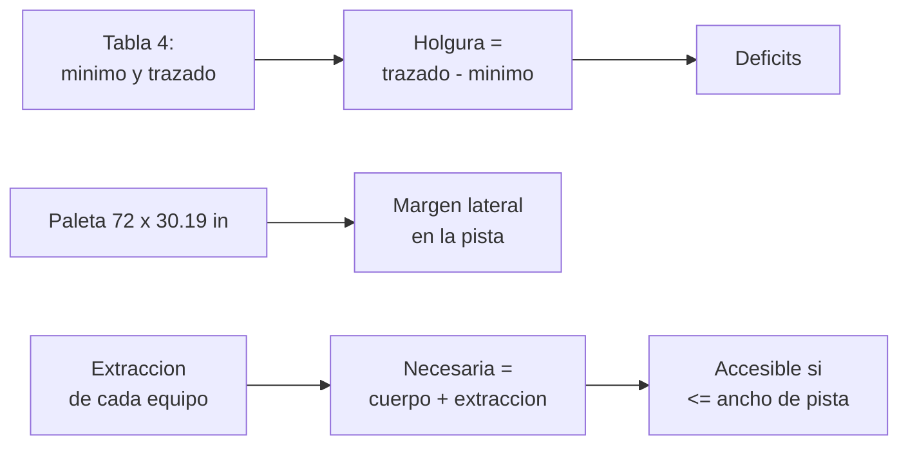

# B109-C11 — Diseño de espacios de trabajo, mantenimiento y laboratorio

<!-- nav:top -->
[🏠 Programa](../../../../README.md) · [📚 Bloque B109](../../../tronco-comun/B109-arquitectura-y-factores-humanos-de-habitats-extraterrestres.md) · [← Anterior: B109-C10 — Acústica y control de ruido interior](../B109-C10-acustica-y-control-de-ruido-interior/CLASE.md) · [Siguiente: B109-C12 — Evaluación de factores humanos de maquetas y distribuciones →](../B109-C12-evaluacion-de-factores-humanos-de-maquetas-y-distribuciones/CLASE.md)
<!-- /nav -->

## 1. Ubicación, nivel y alcance

Clase 11 del bloque B109. Nivel N3. En un hábitat de dos personas, el puesto de mantenimiento, el de computación y el laboratorio comparten metros cuadrados con todo lo demás, y los equipos hay que poder alcanzarlos, abrirlos y sacarlos. Aquí comparas las áreas de trabajo del trazado de referencia con los mínimos recomendados, compruebas que una paleta de equipos pasa por una pista de `1,00 m` y verificas si cada equipo es accesible con una profundidad libre suficiente. Sigue a [B109-C10](../B109-C10-acustica-y-control-de-ruido-interior/CLASE.md). Las dimensiones de extracción son **ilustrativas**.

## 2. Por qué esta clase existe

Un equipo que no se puede abrir o extraer no se puede reparar, y en un hábitat sin taller externo eso es un riesgo de misión. La decisión central: **¿hay área, paso y holgura para trabajar y mantener cada equipo, y dónde falta?** La respuesta es una lista de verificación con números.

## 3. Lo que podrás hacer al terminar

1. Comparar las áreas del trazado con los mínimos recomendados e identificar los déficits.
2. Calcular el margen de paso de un equipo por una pista.
3. Calcular la profundidad libre necesaria para acceder a un equipo.
4. Contar los equipos inaccesibles y el ancho de pista que los habilita.
5. Verificar la consistencia entre áreas y volúmenes publicados.
6. Rotular lo consultado, lo ilustrativo y lo no consultado.

La evidencia es tu **lista de verificación de accesos de un puesto** del ejercicio 12 (sección 20).

## 4. Con qué llegas y cómo comprobarlo

1. ¿Qué es un área mínima recomendada?
2. ¿Qué es una holgura negativa?
3. ¿Qué es una pista de traslado?
4. ¿Qué es una unidad sustituible en órbita o en superficie?
5. ¿Qué es un dato ilustrativo?

<details>
<summary>Ver respuestas</summary>

1. El área que una referencia indica como mínima para una función. 2. Un déficit: el área disponible es menor que el mínimo. 3. El pasillo por donde se desplaza la tripulación (de `1,00 m` de ancho en el concepto de NASA). 4. Un componente que se cambia entero en lugar de repararse. 5. Uno supuesto para practicar, sin fuente.
</details>

Con cuatro o cinco aciertos, sigue; si no, repasa los prerrequisitos.

## 5. Un caso de contexto y casos de referencia

En el trazado de Burke et al. (2022), el área de mantenimiento es de `1,30 m²` frente a `1,37 m²` recomendados y la de higiene de `1,04 m²` frente a `1,06`: son las dos únicas funciones del trazado por debajo del mínimo, mientras que otras como el sueño y el estiramiento lo superan por más de `1 m²`. Las paletas del sistema de soporte vital miden `72 in` de largo y caben, con `30,19 in` de sección, por una escotilla estándar de NASA. Con extracciones ilustrativas, dos de siete equipos no son accesibles desde una pista de `1,00 m`. Es el **ejemplo conductor**.

## 6. Vocabulario

Una **estación de trabajo** es el lugar donde se hace una tarea. Una **estación de mantenimiento** permite diagnosticar y reparar equipos. La **holgura** es el exceso de área sobre el mínimo. La **extracción** es el espacio frente a un equipo para abrirlo o sacarlo. La **accesibilidad de un equipo** es la posibilidad de llegar a él con la profundidad libre necesaria. Una **paleta** es un bastidor de equipos de soporte vital.

## 7. Modelo mental: una cocina donde hay que abrir el horno



*Descripción textual:* la comparación de áreas da holguras y déficits; la paleta y la pista dan un margen de paso; la extracción de cada equipo más el cuerpo da la profundidad necesaria, que se compara con el ancho de pista.

Analogía: en una cocina pequeña, no basta que quepa el horno: tienes que poder abrir la puerta y agacharte. Límite: se modela una sola dimensión (la profundidad frente al equipo); la altura, la visibilidad y las herramientas también cuentan.

## 8. La explicación, paso a paso

### 8.1 Áreas

La Tabla 4 de Burke et al. (2022) compara el mínimo recomendado y el área del trazado de referencia. Las funciones con holgura positiva van de `0,13 m²` (gestión de residuos) a `1,88 m²` (sueño). Dos son negativas: higiene (`−0,02 m²`, el `1,9 %`) y la superficie de trabajo de mantenimiento (`−0,07 m²`, el `5,1 %`). El artículo señala que las áreas del trazado son típicamente mayores que las mínimas y que los usos compatibles en el tiempo pueden compartir espacio, así que un déficit es una señal que revisar, no un fallo.

### 8.2 Coherencia de los datos

La estación de mantenimiento ocupa `3,28 m³` en `1,37 m²`, es decir, `2,394 m` de altura: coincide con la altura estándar `2,4 m` (tolerancia del `0,5 %`).

### 8.3 Paso de equipos

Una paleta mide `72 in = 1,829 m` de largo y `30,19 in = 0,767 m` de sección máxima. En una pista de `1,00 m` queda un margen lateral de `0,233 m` (`0,117 m` por lado). El paso recto es posible; los giros y las esquinas exigen un análisis geométrico aparte.

### 8.4 Accesibilidad con extracciones ilustrativas

Con `0,50 m` de profundidad de cuerpo y extracciones ilustrativas de `0,30` a `0,90 m`, la profundidad necesaria va de `0,80` a `1,40 m`. Desde una pista de `1,00 m`, cinco de siete equipos son accesibles; la unidad sustituible (`1,30 m`) y la extracción de paleta (`1,40 m`) no. Con `1,30 m` son accesibles seis y con `1,40 m` los siete. La estación de geología del concepto está en el primer nivel por la posibilidad de un puerto de transferencia de muestras (Burke et al.), otro ejemplo de que la ubicación nace de la tarea.

## 9. Magnitudes, símbolos y unidades

| Símbolo | Qué es | Unidad | Valor / nota |
|---|---|---|---|
| `A_min` | área mínima recomendada | m² | Tabla 4 (Burke et al.) |
| `A_traz` | área del trazado | m² | Tabla 4 |
| `h` | holgura | m² | −0,07 (mantenimiento) |
| `w` | ancho de pista | m | 1,00 |
| `e` | extracción del equipo | m | 0,30–0,90 (ilustrativa) |
| `d_c` | profundidad de cuerpo | m | 0,50 (ilustrativa) |

## 10. Convenciones y referencias

Áreas en m²; longitudes en metros. Pista de traslado de `1,00 m` y altura estándar `2,4 m` del concepto de Burke et al. (2022); `1 in = 0,0254 m` por definición. La profundidad de cuerpo, las extracciones y el análisis en una sola dimensión son **ilustrativos**.

## 11. De dónde sale lo que afirmamos

| ID | Fuente | Localizador | Respalda | Estado |
|---|---|---|---|---|
| S1 | Burke, Howard y Kessler (2022), «Internal Layout of a Lunar Surface Habitat», AIAA ASCEND 2022 — https://ntrs.nasa.gov/citations/20220013669 (leído completo, 16 páginas, 2026-11-10) | Tablas 1 y 4; secciones IV y V | áreas mínimas y del trazado; estación de mantenimiento 3,28 m³/1,37 m²; altura estándar 2,4 m; pista de 1,00 m; paletas de 72 in y sección máxima de 30,19 in para pasar por una escotilla estándar; estación de geología en el primer nivel por un posible puerto de muestras | Consultada |
| — | Comparación de áreas y verificación geométrica de holguras | — | las verifica el laboratorio con una segunda vía | No consultada en una fuente concreta |

Límites: no se consultaron normas de mantenimiento ni de alcance (por ejemplo, el Human Integration Design Handbook); las extracciones y la profundidad de cuerpo son inventadas; el artículo no desglosa su Tabla 4 más allá de lo citado.

## 12. Cómo ver el estado del puesto

| Magnitud | Valor |
|---|---|
| Déficits de área | Higiene (−0,02 m²) y mantenimiento (−0,07 m²) |
| Margen de la paleta en la pista | 0,233 m |
| Equipos inaccesibles (pista 1,00 m) | 2 de 7 |
| Ancho que habilita los 7 | 1,40 m |

Descripción larga: Casi todas las funciones tienen holgura, pero el puesto de mantenimiento queda un 5 % bajo el mínimo y dos de siete equipos no se pueden extraer desde la pista de un metro.

## 13. Ejemplo trabajado: accesibilidad de la unidad sustituible

**Paso 1 · Necesaria.** `d = 0,50 + 0,80 = 1,30 m`.

**Paso 2 · Disponible.** Pista `1,00 m`.

**Paso 3 · Veredicto.** `1,30 > 1,00`: no es accesible; hace falta ensanchar o extraer en otra dirección.

## 14. Distintas formas de describir el puesto

**Por tabla:** holgura de áreas. **Por margen:** paleta frente a pista. **Por profundidad:** necesaria frente a disponible. **Por conteo:** equipos accesibles según el ancho.

## 15. Práctica guiada

**Ejercicio 1 · con los pasos indicados.** Calcula la holgura del área de mantenimiento. *Pasos:* trazado menos mínimo.

<details><summary>Solución comentada</summary>

`1,30 − 1,37 = −0,07 m²`: déficit del `5,1 %`.
</details>

**Ejercicio 2 · con una pista.** Predice el margen lateral de la paleta en la pista. *Pista:* `1,00 − 0,767`.

<details><summary>Solución comentada</summary>

`0,233 m`.
</details>

**Ejercicio 3 · casi autónomo.** ¿Por qué no basta con que haya área suficiente para trabajar?

<details><summary>Solución comentada</summary>

Porque también hace falta profundidad libre para abrir y extraer cada equipo, que el área no mide.
</details>

## 16. Práctica autónoma, transferencia e integrador

**Ejercicio 4 · autónomo.** Profundidad necesaria de la unidad sustituible.

<details><summary>Solución comentada</summary>

`0,50 + 0,80 = 1,30 m`.
</details>

**Ejercicio 5 · autónomo.** Ancho de pista que habilita los siete equipos.

<details><summary>Solución comentada</summary>

`1,40 m`.
</details>

**Ejercicio 6 · autónomo.** Altura implícita de la estación de mantenimiento.

<details><summary>Solución comentada</summary>

`3,28/1,37 = 2,394 m`.
</details>

**Ejercicio 7 · autónomo.** Déficit de higiene en porcentaje.

<details><summary>Solución comentada</summary>

`0,02/1,06 = 1,9 %`.
</details>

**Ejercicio 8 · autónomo.** Largo de la paleta en metros.

<details><summary>Solución comentada</summary>

`72 × 0,0254 = 1,829 m`.
</details>

**Ejercicio 9 · transferencia.** **Transferencia.** ¿Es un déficit de área un fallo de diseño?

<details><summary>Solución comentada</summary>

No necesariamente: los usos compatibles pueden compartir espacio; es una señal para revisar con una evaluación.
</details>

**Ejercicio 10 · transferencia.** **Transferencia.** ¿Valen `0,50 m` de cuerpo y las extracciones para un diseño real?

<details><summary>Solución comentada</summary>

No: son ilustrativos; un diseño real usa los datos de la norma y pruebas con maquetas (ver [B109-C12](../B109-C12-evaluacion-de-factores-humanos-de-maquetas-y-distribuciones/CLASE.md)).
</details>

**Ejercicio 11 · transferencia.** **Transferencia.** ¿Por qué la estación de geología del concepto está en el primer nivel?

<details><summary>Solución comentada</summary>

Por la posibilidad de un puerto de transferencia de muestras a ese nivel (Burke et al.).
</details>

**Ejercicio 12 · integrador.** **Integrador.** Elabora tu *lista de verificación de accesos*: déficits de área, margen de paleta, profundidad necesaria de siete equipos, ancho que los habilita y lista de lo consultado, ilustrativo y no consultado.

<details><summary>Solución comentada</summary>

Secciones 8.1–8.4 y la salida del laboratorio.
</details>

## 17. Laboratorio: áreas de trabajo y accesibilidad de equipos

El script [puesto.py](puesto.py) lista las holguras de la Tabla 4, calcula el margen de la paleta y la accesibilidad de siete equipos para cuatro anchos de pista, y **comprueba** que `volumen/área` de la estación de mantenimiento es la altura estándar (`0,5 %`) y que el conteo de inaccesibles coincide por dos vías.

**Datos:** las áreas, la pista y la paleta son de Burke et al. (2022); el cuerpo y las extracciones son **ilustrativos**. **Predice antes de ejecutar:** ¿cuántos equipos serán inaccesibles desde una pista de 1,00 m? (dos.) **Ejecución del 2026-11-10 (Python 3.12.9):**

```text
Areas de la Tabla 4 y dimensiones de las paletas de Burke et al. (2022); cuerpo y extraccion ILUSTRATIVOS
 funcion                    minimo [m2]   trazado [m2]   holgura [m2]
Estiramiento                     1.40          2.68          1.28
Sueno                            1.82          3.70          1.88
Medico                           1.87          3.43          1.56
Ejercicio                        1.50          2.09          0.59
UWMS                             0.91          1.04          0.13
Higiene                          1.06          1.04         -0.02
Mesa                             1.62          2.23          0.61
Trabajo (mantenimiento)          1.37          1.30         -0.07
Ordenador general                1.82          2.10          0.28
Cocina trabajo                   0.56          0.95          0.39
Cocina preparacion               0.56          1.17          0.61
Funciones con area del trazado menor que el minimo recomendado: Higiene, Trabajo (mantenimiento)
Paleta ECLSS: largo 1.829 m ; seccion maxima 0.767 m ; margen lateral en una pista de 1.00 m = 0.233 m (0.117 m por lado)
Estacion de mantenimiento: 3.28 m3 / 1.37 m2 = 2.394 m (altura estandar 2.4 m)
 equipo                      extraccion [m]   profundidad libre necesaria [m]   accesible desde una pista de 1.00 m
filtro de aire                        0.30                              0.80   si
bomba de agua                         0.40                              0.90   si
ordenador                             0.30                              0.80   si
panel electrico                       0.45                              0.95   si
unidad sustituible (rack)             0.80                              1.30   no
paleta ECLSS (extraccion)             0.90                              1.40   no
ventilador                            0.35                              0.85   si
Inaccesibles con pista de 1.00 m: unidad sustituible (rack), paleta ECLSS (extraccion)
 ancho de pista [m]   equipos accesibles
              1.00            5 de 7
              1.20            5 de 7
              1.30            6 de 7
              1.40            7 de 7
Pruebas superadas.
```

```bash
python programa/clases/B109/B109-C11-diseno-de-espacios-de-trabajo-mantenimiento-y-laboratorio/puesto.py
```

**Límites:** análisis en una dimensión; extracciones inventadas; sin altura, visibilidad ni herramientas; los déficits son señales, no veredictos.

## 18. Errores frecuentes y cómo corregirlos

**Tratar un déficit de área como un fallo.** Se corrige con 8.1.

**Medir solo el área y no la profundidad de acceso.** Se corrige con 8.4.

**Presentar las extracciones ilustrativas como requisitos.** Se corrige con la sección 10.

**Olvidar los giros al pasar una paleta.** Se corrige con 8.3.

## 19. Cómo sabrás que vas bien

Tras 8.4: ¿cuántos equipos esperabas inaccesibles y cuántos salieron? Si dudas, repasa el ejemplo 13. Tras el laboratorio: ¿qué comprueba? (ver la sección 17).

## 20. Qué entregas y cómo se evalúa

El producto es tu **lista de verificación de accesos de un puesto** (ejercicio 12).

| Criterio | Inicial | En desarrollo | Logrado | Destacado |
|---|---|---|---|---|
| Conceptos | Los confunde | Parciales | Distingue área, margen y profundidad | Explica por qué un déficit es una señal |
| Cálculo | Sin unidades | Con errores | Lista con unidades | Calcula casos nuevos |
| Numérico | Sin comprobar | Un caso | Contraste de coherencia y conteo | Interpreta las diferencias |
| Fuentes | Sin fuente | Sin fecha | Fuentes con fecha y estado | Declara lo ilustrativo y lo no consultado |
| Límites | No los nombra | Uno | Tres | Discute qué falta del modelo |

**Condiciones críticas (no se compensan con promedio):** rotular las extracciones y el cuerpo como ilustrativos; no presentar un déficit de área como fallo ni las holguras como requisitos; citar solo lo consultado; no dar consejo médico ni operativo; citar solo lo consultado.

## 21. Ética, seguridad y límites

Clase educativa: **no da consejo médico ni operativo** y no sustituye a las normas de diseño, a la revisión de ingeniería ni al juicio de profesionales de factores humanos y de seguridad de misión. Los modelos son simplificados y sus datos son sintéticos o ilustrativos; ningún resultado describe un hábitat real. Las holguras de esta clase no sustituyen a las normas de mantenimiento ni a las pruebas con personas; no dan consejo operativo sobre cómo reparar ningún equipo. Accesibilidad: tablas equivalentes a las gráficas, fórmulas en texto, ejercicios sin conexión.

## 22. Para cerrar y seguir

El trazado de referencia deja el puesto de mantenimiento `0,07 m²` bajo el mínimo y, con extracciones ilustrativas, `2` de `7` equipos inaccesibles desde `1,00 m`. Queda una pregunta final: ¿cómo se comprueba con personas que la maqueta funciona?

**Glosario español–inglés.** estación de mantenimiento · *maintenance workstation*; holgura · *margin*; extracción · *pull-out clearance*; pista de traslado · *translation path*; paleta · *pallet*.

**Continuidad.** [B109-C12](../B109-C12-evaluacion-de-factores-humanos-de-maquetas-y-distribuciones/CLASE.md) evalúa maquetas con listas de verificación y cuestionarios de usabilidad.

**Referencias:** ver sección 11.

<!-- nav:bottom -->
---

[← Anterior: B109-C10 — Acústica y control de ruido interior](../B109-C10-acustica-y-control-de-ruido-interior/CLASE.md) · [📚 Bloque B109](../../../tronco-comun/B109-arquitectura-y-factores-humanos-de-habitats-extraterrestres.md) · [Siguiente: B109-C12 — Evaluación de factores humanos de maquetas y distribuciones →](../B109-C12-evaluacion-de-factores-humanos-de-maquetas-y-distribuciones/CLASE.md)
<!-- /nav -->
