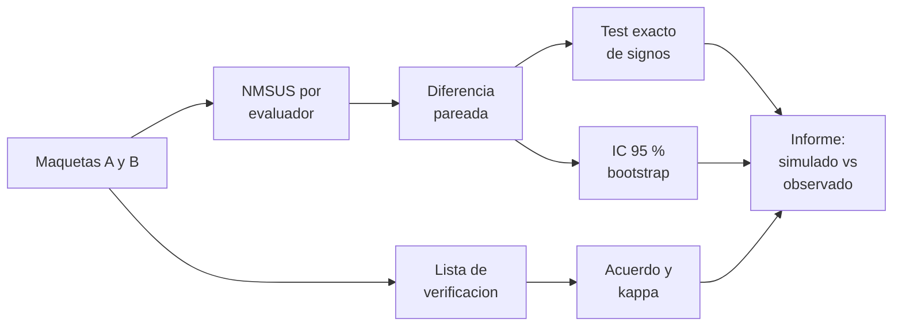

# B109-C12 — Evaluación de factores humanos de maquetas y distribuciones

<!-- nav:top -->
[🏠 Programa](../../../../README.md) · [📚 Bloque B109](../../../tronco-comun/B109-arquitectura-y-factores-humanos-de-habitats-extraterrestres.md) · [← Anterior: B109-C11 — Diseño de espacios de trabajo, mantenimiento y laboratorio](../B109-C11-diseno-de-espacios-de-trabajo-mantenimiento-y-laboratorio/CLASE.md) · [Siguiente: B110-C01 — Despresurización: detección, aislamiento y respuesta →](../../../tronco-comun/B110-emergencias-y-seguridad-de-tripulacion.md#b110-c01)
<!-- /nav -->

## 1. Ubicación, nivel y alcance

Clase 12, la última del bloque B109. Nivel N3. Un diseño de hábitat se prueba con maquetas y personas antes de construirse, y esa prueba necesita instrumentos: listas de verificación, cuestionarios de usabilidad y una forma honesta de decir si una maqueta es mejor que otra. Aquí puntúas con el NMSUS (el cuestionario modificado de NASA), contrastas dos maquetas con un test exacto de signos, estimas un intervalo con bootstrap y mides el acuerdo entre dos inspectores con el kappa de Cohen. Cierra el bloque tras [B109-C11](../B109-C11-diseno-de-espacios-de-trabajo-mantenimiento-y-laboratorio/CLASE.md). Las maquetas y las respuestas son **sintéticas**: lo simulado no se presenta como observado.

## 2. Por qué esta clase existe

Sin medir, «esta distribución es mejor» es una opinión. La decisión central: **¿la diferencia entre dos maquetas es mayor que lo que daría el azar, y las personas que la evalúan coinciden entre sí?** Un informe de evaluación debe responder las dos cosas y decir qué no pudo probar.

## 3. Lo que podrás hacer al terminar

1. Calcular la puntuación NMSUS de una respuesta y reconocer sus casos extremos.
2. Calcular la diferencia pareada entre dos maquetas.
3. Aplicar un contraste exacto de signos y verificarlo con una simulación.
4. Estimar un intervalo del 95 % con bootstrap.
5. Calcular el acuerdo entre inspectores y el kappa de Cohen por dos vías.
6. Redactar un informe que rotule lo simulado, lo consultado y lo no consultado.

La evidencia es tu **informe de evaluación de dos maquetas** del ejercicio 12 (sección 20).

## 4. Con qué llegas y cómo comprobarlo

1. ¿Qué es un ítem redactado en negativo?
2. ¿Qué es una prueba pareada?
3. ¿Qué es un valor p?
4. ¿Qué es un bootstrap?
5. ¿Qué es un dato sintético?

<details>
<summary>Ver respuestas</summary>

1. Un enunciado cuyo acuerdo indica una mala experiencia; se puntúa invertido. 2. Una comparación donde cada persona evalúa ambas opciones. 3. La probabilidad de ver una diferencia tan grande o mayor si no hubiera efecto. 4. Remuestrear los datos con reposición para estimar la incertidumbre. 5. Uno inventado para practicar, rotulado.
</details>

Con cuatro o cinco aciertos, sigue; si no, repasa los prerrequisitos.

## 5. Un caso de contexto y casos de referencia

La nota técnica de NASA sobre el NMSUS explica que las verificaciones de naves incluyen medir la usabilidad, que el SUS de 10 ítems recibió comentarios de astronautas sobre la redacción de algunos ítems, y que el NMSUS, de 8 ítems, se validó con `35` participantes y dos prototipos, uno bien y otro peor diseñado, y distinguió entre ambos. Su puntuación es `3,125 × Σ`, de `0` a `100`. Con doce evaluadores simulados, la maqueta A promedia `58,3` y la B `75,5`: diferencia `17,19`, con `p = 0,001` y un intervalo del `95 %` de `11,5` a `22,9`. Es el **ejemplo conductor**, y es ficticio.

## 6. Vocabulario

La **evaluación con maqueta** prueba un diseño con una representación física o virtual antes de construirlo. La **lista de verificación** comprueba funciones o atributos como cumple o no cumple. El **NMSUS** es el cuestionario modificado de usabilidad de NASA (8 ítems, 1 a 5). Una **prueba pareada** compara dos condiciones en las mismas personas. El **kappa de Cohen** mide el acuerdo entre dos evaluadores corrigiendo el azar. El **bootstrap** estima un intervalo remuestreando.

## 7. Modelo mental: un jurado con dos tablas



*Descripción textual:* cada evaluador puntúa ambas maquetas; la diferencia pareada se contrasta con un test exacto y se acota con un bootstrap; una lista de verificación aparte se evalúa con el acuerdo entre inspectores; todo termina en un informe que rotula qué es simulado.

Analogía: dos jueces puntúan dos platos y además cada uno rellena la misma lista de comprobación. Límite: con pocos evaluadores y datos simulados, la estadística solo ilustra el método y no dice nada de ninguna maqueta real.

## 8. La explicación, paso a paso

### 8.1 El NMSUS

Según la nota técnica de NASA, el NMSUS se puntúa con `NMSUS = 3,125 × ((Q1−1)+(5−Q2)+(Q3−1)+(5−Q4)+(Q5−1)+(5−Q6)+(Q7−1)+(5−Q8))`, con respuestas de `1` a `5`. Los ítems impares suman `respuesta − 1` y los pares `5 − respuesta` (redacción negativa). Casos extremos verificados: todas favorables `100`, todas neutras (`3`) `50`, todas desfavorables `0`. La nota indica que el NMSUS fue tan fiable como el SUS en un estudio con `35` participantes; la nota es un resumen breve que se leyó completo; el estudio completo no se consultó.

### 8.2 Diferencia entre maquetas

Doce evaluadores simulados (semilla `109012`, medias latentes `3,4` para A y `4,0` para B) dan `58,3` y `75,5`: diferencia media `17,19` puntos. El contraste exacto de signos recorre las `2¹² = 4096` combinaciones de signos de las diferencias y da `p = 0,0010`; un sorteo de `20 000` signos da `0,0014` (tolerancia `0,02`). El bootstrap (`10 000` remuestreos) da un intervalo del `95 %` de `11,46` a `22,92`.

### 8.3 Acuerdo entre inspectores

En una lista de `20` ítems sí/no, los dos inspectores simulados coinciden en `18` (`0,90`): `13` cumple/cumple, `5` no/no, `2` cumple/no y `0` no/cumple. El acuerdo por azar es `0,575` y `κ = (0,90 − 0,575)/(1 − 0,575) = 0,765`; la forma cerrada `2(ad − bc)/…` da el mismo valor. Una lista real podría partir de las funciones mínimas del concepto de Burke et al. (2022): protección contra el polvo, mantenimiento de trajes y hábitat, protección contra radiación y micrometeoroides, ejercicio, medicina, cocina, dormir y aseo privados, gestión de residuos privada, socialización, vista exterior (al menos una o dos ventanas), logística y monitoreo de subsistemas.

### 8.4 Lo que el informe no puede decir

Con datos simulados el resultado no prueba que ninguna maqueta sea mejor. Con personas reales, un `p` pequeño con `12` evaluadores indica una diferencia de usabilidad percibida entre maquetas, no que el hábitat sea habitable o seguro. El informe debe decir quiénes evaluaron, con qué tareas, qué se simuló y qué quedó sin probar.

## 9. Magnitudes, símbolos y unidades

| Símbolo | Qué es | Unidad | Valor / nota |
|---|---|---|---|
| `Qᵢ` | respuesta al ítem i | — | 1 a 5 |
| `NMSUS` | puntuación | puntos | 0 a 100 |
| `dᵢ` | diferencia B − A del evaluador i | puntos | media 17,19 |
| `p` | valor p exacto | — | 0,0010 |
| `κ` | kappa de Cohen | — | 0,765 |
| `pₒ` | acuerdo observado | — | 0,90 |

## 10. Convenciones y referencias

Puntuación NMSUS de `0` a `100`. Evaluación pareada de `12` evaluadores y lista de `20` ítems sí/no. Todos los datos de respuestas y de listas son **sintéticos**. La fórmula del NMSUS es de la nota técnica de NASA consultada; el SUS original de 10 ítems y su multiplicador no se consultaron en su fuente primaria.

## 11. De dónde sale lo que afirmamos

| ID | Fuente | Localizador | Respalda | Estado |
|---|---|---|---|---|
| S1 | NASA, «Development and Validation of the NASA Modified System Usability Scale (NMSUS): A Brief Summary» — https://ntrs.nasa.gov/citations/20220017395 (leído completo, 2026-11-10) | documento completo (resumen y fórmula) | NMSUS de 8 ítems; fórmula `3,125 × Σ`; estudio con 35 participantes y dos prototipos; tan fiable como el SUS y sensible a diferencias de diseño; incluido en requisitos de programas de NASA | Consultada |
| S2 | Burke, Howard y Kessler (2022), «Internal Layout of a Lunar Surface Habitat», AIAA ASCEND 2022 — https://ntrs.nasa.gov/citations/20220013669 (leído completo, 16 páginas, 2026-11-10) | sección «Surface Habitat Ground Rules and Assumptions» | funciones mínimas de habitabilidad usadas como ejemplo de lista de verificación | Consultada |
| — | Contraste exacto de signos, bootstrap y kappa de Cohen | — | las verifica el laboratorio con una segunda vía | No consultada en una fuente concreta |

Límites: no se consultaron el SUS original ni normas de evaluación con maquetas; las respuestas, las maquetas y las listas son inventadas; el NMSUS se citó a partir de su nota técnica y no de un artículo revisado por pares.

## 12. Cómo ver el informe de evaluación

| Magnitud | Valor |
|---|---|
| NMSUS A y B | 58,3 y 75,5 |
| Diferencia B − A | 17,19 (IC 95 %: 11,46–22,92) |
| `p` exacto | 0,0010 |
| `κ` | 0,765 (acuerdo 0,90) |

Descripción larga: La maqueta simulada B puntúa unos 17 puntos más que la A con una diferencia que el azar casi no produce, y los dos inspectores simulados coinciden bastante más de lo que darían por casualidad.

## 13. Ejemplo trabajado: la puntuación NMSUS de una respuesta

**Paso 1 · Respuestas.** `[4, 2, 4, 2, 4, 2, 4, 2]`.

**Paso 2 · Términos.** Impares: `4 − 1 = 3`; pares: `5 − 2 = 3`: ocho términos de `3`, suma `24`.

**Paso 3 · Puntuación.** `3,125 × 24 = 75`.

## 14. Distintas formas de describir la evaluación

**Por puntuación:** NMSUS de 0 a 100. **Por diferencia:** pareada con su intervalo. **Por contraste:** valor `p` exacto. **Por acuerdo:** `pₒ` y `κ`. **Por rótulo:** qué es simulado, consultado y no consultado.

## 15. Práctica guiada

**Ejercicio 1 · con los pasos indicados.** Calcula el NMSUS de `[4, 2, 4, 2, 4, 2, 4, 2]`. *Pasos:* suma los ocho términos y multiplica por `3,125`.

<details><summary>Solución comentada</summary>

`24 × 3,125 = 75`.
</details>

**Ejercicio 2 · con una pista.** Predice el NMSUS de ocho respuestas neutras (`3`). *Pista:* cada término vale `2`.

<details><summary>Solución comentada</summary>

`16 × 3,125 = 50`.
</details>

**Ejercicio 3 · casi autónomo.** ¿Por qué los ítems pares se puntúan como `5 − respuesta`?

<details><summary>Solución comentada</summary>

Porque están redactados en negativo: estar de acuerdo indica peor usabilidad.
</details>

## 16. Práctica autónoma, transferencia e integrador

**Ejercicio 4 · autónomo.** NMSUS con todas las respuestas favorables.

<details><summary>Solución comentada</summary>

`32 × 3,125 = 100`.
</details>

**Ejercicio 5 · autónomo.** Diferencia entre las medias de B y A.

<details><summary>Solución comentada</summary>

`75,5 − 58,3 = 17,2` (`17,19` con más decimales).
</details>

**Ejercicio 6 · autónomo.** Valor `p` del test exacto si 4 de 4096 combinaciones son tan extremas.

<details><summary>Solución comentada</summary>

`4/4096 = 0,00098 ≈ 0,0010`.
</details>

**Ejercicio 7 · autónomo.** Calcula `κ` con `pₒ = 0,90`, `pa = 0,75` y `pb = 0,65`.

<details><summary>Solución comentada</summary>

`pe = 0,75·0,65 + 0,25·0,35 = 0,575`; `κ = 0,325/0,425 = 0,765`.
</details>

**Ejercicio 8 · autónomo.** Cumplimiento medio de la lista si los inspectores marcaron `15` y `13` de `20`.

<details><summary>Solución comentada</summary>

`28/40 = 0,70`.
</details>

**Ejercicio 9 · transferencia.** **Transferencia.** ¿Prueba el resultado del laboratorio que la maqueta B es mejor?

<details><summary>Solución comentada</summary>

No: las respuestas son simuladas; solo muestra cómo se calcularía con datos reales.
</details>

**Ejercicio 10 · transferencia.** **Transferencia.** Con `12` evaluadores reales, ¿un `p = 0,001` prueba que el hábitat es habitable?

<details><summary>Solución comentada</summary>

No: indica una diferencia de usabilidad percibida entre maquetas, no habitabilidad ni seguridad.
</details>

**Ejercicio 11 · transferencia.** **Transferencia.** ¿Por qué se reporta `κ` además del acuerdo `0,90`?

<details><summary>Solución comentada</summary>

Porque parte del acuerdo ocurre por azar (`0,575`); `κ` lo descuenta.
</details>

**Ejercicio 12 · integrador.** **Integrador.** Elabora tu *informe de evaluación de dos maquetas*: NMSUS de cada una, diferencia con intervalo y `p` exacto, acuerdo y `κ` de una lista, y lista de lo simulado, consultado y no consultado, con sus límites.

<details><summary>Solución comentada</summary>

Secciones 8.1–8.4 y la salida del laboratorio.
</details>

## 17. Laboratorio: evaluación de dos maquetas con NMSUS, contraste exacto y kappa

El script [evaluacion.py](evaluacion.py) genera respuestas sintéticas, calcula el NMSUS, el contraste exacto de signos (`4096` combinaciones), un bootstrap y el kappa, y **comprueba** los casos extremos del NMSUS, el contraste frente a un Monte Carlo (`0,02`) y el kappa por dos fórmulas (`1e-12`).

**Datos:** la fórmula del NMSUS es de la nota técnica de NASA; las respuestas, las maquetas y las listas son **sintéticas**. **Predice antes de ejecutar:** ¿el `p` exacto será mayor o menor que `0,05`? (menor.) **Ejecución del 2026-11-10 (Python 3.12.9):**

```text
Respuestas y listas SINTETICAS (12 evaluadores simulados, 2 maquetas inexistentes); formula del NMSUS de la nota tecnica de NASA
Casos extremos: favorable = 100.0 ; neutro = 50.0 ; desfavorable = 0.0
NMSUS medio: maqueta A = 58.3 ; maqueta B = 75.5 ; diferencia media (B - A) = 17.19
Contraste exacto de signos (4096 combinaciones): p = 0.0010 ; Monte Carlo = 0.0014
IC 95 % bootstrap de la diferencia = [11.46, 22.92]
Lista de 20 items, 2 inspectores: cumple/cumple = 13, cumple/no = 2, no/cumple = 0, no/no = 5
Acuerdo observado = 0.90 ; kappa de Cohen = 0.765 (forma cerrada 0.765)
Cumplimiento medio de la lista = 0.70 (15 y 13 de 20 items)
Pruebas superadas.
```

```bash
python programa/clases/B109/B109-C12-evaluacion-de-factores-humanos-de-maquetas-y-distribuciones/evaluacion.py
```

**Límites:** doce evaluadores simulados; independencia entre ítems y evaluadores; kappa con dos categorías; no hay tareas ni personas reales.

## 18. Errores frecuentes y cómo corregirlos

**Presentar datos simulados como resultados de una evaluación.** Se corrige con 8.4.

**Olvidar invertir los ítems en negativo.** Se corrige con 8.1.

**Dar el acuerdo sin corregir el azar.** Se corrige con 8.3.

**Confundir usabilidad percibida con habitabilidad o seguridad.** Se corrige con 8.4.

## 19. Cómo sabrás que vas bien

Tras 8.2: ¿qué `p` esperabas y cuál salió? Si dudas, repasa el ejemplo 13. Tras el laboratorio: ¿qué comprueba? (ver la sección 17).

## 20. Qué entregas y cómo se evalúa

El producto es tu **informe de evaluación de dos maquetas** (ejercicio 12).

| Criterio | Inicial | En desarrollo | Logrado | Destacado |
|---|---|---|---|---|
| Conceptos | Los confunde | Parciales | Calcula NMSUS, contraste y kappa | Explica qué no puede concluirse |
| Cálculo | Sin unidades | Con errores | Informe con cifras y unidades | Calcula casos nuevos |
| Numérico | Sin comprobar | Un caso | Contraste con extremos, Monte Carlo y forma cerrada | Interpreta las diferencias |
| Fuentes | Sin fuente | Sin fecha | Fuentes con fecha y estado | Declara lo simulado y lo no consultado |
| Límites | No los nombra | Uno | Tres | Discute tamaño muestral y validez |

**Condiciones críticas (no se compensan con promedio):** rotular las respuestas y las maquetas como sintéticas; no presentar lo simulado como observado; no confundir usabilidad con habitabilidad; no dar consejo médico ni operativo; no dar consejo médico ni operativo; citar solo lo consultado.

## 21. Ética, seguridad y límites

Clase educativa: **no da consejo médico ni operativo** y no sustituye a las normas de diseño, a la revisión de ingeniería ni al juicio de profesionales de factores humanos y de seguridad de misión. Los modelos son simplificados y sus datos son sintéticos o ilustrativos; ningún resultado describe un hábitat real. Una evaluación con personas exige consentimiento informado, protección de datos y revisión ética que esta clase no cubre; el informe no autoriza ningún diseño para uso real. Accesibilidad: tablas equivalentes a las gráficas, fórmulas en texto, ejercicios sin conexión.

## 22. Para cerrar y seguir

Con doce evaluadores simulados, la maqueta B puntúa `75,5` frente a `58,3` (diferencia `17,19`, `p = 0,001`) y los inspectores tienen `κ = 0,765`: una demostración del método, no un hallazgo. Con ella termina el bloque: del sitio y los accesos a las personas y su evaluación, siempre rotulando qué es modelo y qué es medida.

**Glosario español–inglés.** maqueta · *mockup*; usabilidad · *usability*; lista de verificación · *checklist*; kappa de Cohen · *Cohen's kappa*; bootstrap · *bootstrap*.

**Continuidad.** no tiene clase siguiente dentro de este bloque; el área A09 continúa con el bloque siguiente.

**Referencias:** ver sección 11.

<!-- nav:bottom -->
---

[← Anterior: B109-C11 — Diseño de espacios de trabajo, mantenimiento y laboratorio](../B109-C11-diseno-de-espacios-de-trabajo-mantenimiento-y-laboratorio/CLASE.md) · [📚 Bloque B109](../../../tronco-comun/B109-arquitectura-y-factores-humanos-de-habitats-extraterrestres.md) · [Siguiente: B110-C01 — Despresurización: detección, aislamiento y respuesta →](../../../tronco-comun/B110-emergencias-y-seguridad-de-tripulacion.md#b110-c01)
<!-- /nav -->
