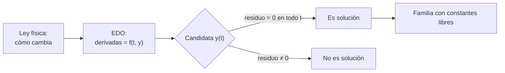

# B11-C01 — Ecuaciones diferenciales ordinarias

<!-- nav:top -->
[🏠 Programa](../../../../README.md) · [📚 Bloque B11](../../../tronco-comun/B11-ecuaciones-diferenciales-y-simulacion-numerica.md) · [← Anterior: B10-C20 — Cinemática de orientación satelital](../../B10/B10-C20-cinematica-de-orientacion-satelital/CLASE.md) · [Siguiente: B11-C02 — Problemas de valor inicial →](../B11-C02-problemas-de-valor-inicial/CLASE.md)
<!-- /nav -->

## 1. Ubicación, nivel y alcance

Primera clase del bloque B11. Vienes del cálculo diferencial de [B09](../../../tronco-comun/B09-calculo-diferencial-e-integral.md), donde aprendiste que la derivada mide una tasa de cambio. Aquí das el paso siguiente: **una ecuación en la que la incógnita es una función y aparece su derivada**. Nivel N2. Aprenderás a leer, clasificar y comprobar ecuaciones diferenciales ordinarias (EDO). No resolverás aún problemas con datos iniciales (C02) ni aprenderás técnicas de solución (C03) ni sistemas (C04).

## 2. Por qué esta clase existe

Casi ninguna ley de la mecánica espacial nos dice *dónde está* un satélite; nos dice *cómo cambia* su movimiento: la aceleración depende de la posición. Eso es una ecuación diferencial. Si no sabes leerla, no puedes distinguir una solución correcta de una que solo «se ve bien», ni sabes qué datos hacen falta para predecir.

La pregunta motivadora: **dada una ley de cambio, ¿qué función de la posición o del tiempo la cumple, y cómo compruebo que lo hace?** La decisión central: **tratar una ley de cambio como una condición que la función debe satisfacer, no como una fórmula para evaluar**.

## 3. Lo que podrás hacer al terminar

1. Distinguir variable independiente, función incógnita, derivada y parámetros en una EDO.
2. Clasificarla por **orden**, **linealidad** y **autonomía**.
3. Comprobar si una función es solución sustituyéndola (residuo nulo).
4. Reconocer que una EDO tiene una **familia** de soluciones con constantes libres.
5. Escribir la ecuación del movimiento de un satélite y su solución circular.
6. Usar un residuo numérico como prueba de que una solución candidata falla.

La evidencia es la **ficha de clasificación y verificación** del ejercicio 12 (sección 20).

## 4. Con qué llegas y cómo comprobarlo

Necesitas derivadas de funciones sencillas (B09-C03, B09-C04) y las funciones `exp`, `sin`, `cos`. Cinco preguntas:

1. ¿Cuánto es la derivada de `5 e^{−0,3 t}`?
2. ¿Cuánto es la segunda derivada de `cos(2 t)`?
3. ¿Qué significa que `f″(t)` sea la aceleración si `f` es la posición?
4. Si `x(t) = a cos(n t)`, ¿cuánto vale `x(0)`?
5. ¿Qué unidades tiene `GM/r²` si `GM` está en m³/s² y `r` en m?

<details>
<summary>Ver respuestas</summary>

1. `−1,5 e^{−0,3 t}`. 2. `−4 cos(2 t)`. 3. La tasa de cambio de la velocidad. 4. `a`. 5. m/s² (una aceleración).
</details>

Con cuatro o cinco aciertos, sigue; si no, repasa B09-C03 y B09-C04.

## 5. Un caso real: un satélite a 400 km de altura

Una nave en órbita baja terrestre, a unos 400 km de altitud, completa una vuelta en poco más de una hora y media. Con el parámetro gravitacional nominal de la Tierra `GM = 3,986 004 × 10¹⁴ m³ s⁻²` y el radio ecuatorial nominal `6,3781 × 10⁶ m` (S1), el radio de la órbita es `a = 6 778,1 km` y el periodo del movimiento circular resulta `5 553,6 s = 92,56 min`. La altitud de 400 km es un valor **ilustrativo**, no una misión concreta; el periodo es un resultado **calculado**. Este es el **ejemplo conductor** de la clase: la ley es una EDO, y la órbita circular es una de sus soluciones.

## 6. Vocabulario

Una **ecuación diferencial** relaciona una función desconocida con sus derivadas. Es **ordinaria** si la función depende de una sola variable independiente (aquí el tiempo `t`); si depende de varias (tiempo y posición), se llama «en derivadas parciales» y se verá en [C13](../B11-C13-ecuaciones-en-derivadas-parciales/CLASE.md). El **orden** es la derivada más alta que aparece. Es **lineal** si la función y sus derivadas aparecen solo multiplicadas por funciones de `t` y sumadas, sin potencias, productos entre ellas ni funciones como `sin y`. Es **homogénea** si todos sus términos contienen la incógnita. Es **autónoma** si `t` no aparece explícitamente. Una **solución** es una función que, sustituida, hace cierta la ecuación en todo un intervalo. La **solución general** contiene constantes libres; una **solución particular** fija esas constantes. El **residuo** es lado izquierdo menos lado derecho tras sustituir: vale cero para una solución (S2, §1.13(i), para el caso lineal de segundo orden).

## 7. Modelo mental: la ecuación como un reglamento

Piensa en la EDO como un reglamento que cada instante impone a la función: «en cada `t`, tu derivada debe valer esto». Muchas funciones cumplen el reglamento; la diferencia entre ellas es desde dónde partieron.



*Descripción textual:* de la ley física se escribe la EDO; una función candidata se sustituye y se mide el residuo; si es cero en todo el intervalo es solución y pertenece a una familia que depende de constantes libres.

Analogía: un reglamento de tránsito dice a qué velocidad puedes ir en cada punto, pero no dice por dónde empezó tu viaje. Su límite: un reglamento admite infracciones; una EDO exige cumplimiento exacto.

## 8. La explicación, paso a paso

### 8.1 Primer ejemplo: decaimiento

`y′ = −k y`, con `k > 0` constante. Pide una función cuya derivada sea proporcional a ella misma y de signo opuesto. La función `y(t) = C e^{−k t}` lo cumple para *cualquier* constante `C`: `y′ = −kC e^{−k t} = −k y`. Con `k = 0,3 s⁻¹` y `C = 5`, `y(2) = 5 e^{−0,6} = 2,744`. La EDO es de **primer orden**, **lineal**, **homogénea** y **autónoma**.

### 8.2 Segundo ejemplo: oscilador

`y″ + ω² y = 0`. Es de **segundo orden**, lineal, homogénea y autónoma. Tanto `cos(ω t)` como `sin(ω t)` la cumplen; también cualquier combinación `A cos(ω t) + B sin(ω t)`. Aparecen **dos** constantes libres porque el orden es dos: el número de constantes de la solución general de una lineal coincide con su orden (S2, §1.13(i): conocidos `w` y `w′` en un punto, la solución es única).

### 8.3 Cómo se comprueba una solución

Se sustituye. Para `y = cos(3 t)` en `y″ + 4 y = 0`: `y″ = −9 cos(3 t)`; el residuo es `−9 cos(3 t) + 4 cos(3 t) = −5 cos(3 t) ≠ 0`. No es solución. Comprobar con una gráfica *parece* suficiente, pero un residuo exacto no admite dudas.

### 8.4 La ecuación del movimiento de un satélite

Con `r` el vector de posición respecto al centro de la Tierra y `|r|` su módulo, la segunda ley de Newton con la gravedad de un cuerpo puntual da

`r″ = −GM r / |r|³`.

Es de **segundo orden**, **no lineal** (porque `|r|` depende de las componentes) y **autónoma**. En componentes planas `x″ = −GM x / (x² + y²)^{3/2}` y análogamente para `y`. La órbita circular `x = a cos(n t)`, `y = a sin(n t)`, con `n = √(GM/a³)`, la cumple: `x″ = −a n² cos(n t) = −(GM/a³) x` y `|r|³ = a³`.

### 8.5 Comprobación numérica de una solución

Se aproxima la derivada con un cociente central (S3, §3.4(i), ec. 3.4.6 con `t = 0`): `y″(t) ≈ [y(t+h) − 2 y(t) + y(t−h)] / h²`, y se mide el residuo. Para soluciones correctas, el residuo es muy pequeño y baja como `h²`; para candidatas incorrectas, no. El laboratorio de la sección 17 hace exactamente esto.

## 9. Magnitudes, símbolos y unidades

| Símbolo | Qué es | Unidad | Nota |
|---|---|---|---|
| `t` | variable independiente (tiempo) | s | |
| `y(t)` | función incógnita | según el caso | |
| `y′`, `y″` | primera y segunda derivada | unidad de `y` por s, por s² | |
| `k`, `ω` | parámetros de ejemplo | s⁻¹ | sintéticos |
| `GM` | parámetro gravitacional de la Tierra | m³ s⁻² | `3,986 004 × 10¹⁴`, nominal (S1) |
| `r`, `a` | posición, radio de la órbita circular | m | |
| `n` | movimiento medio `√(GM/a³)` | rad s⁻¹ | `1,131 376 × 10⁻³` |

## 10. Convenciones y referencias

Sistema inercial centrado en la Tierra, plano orbital como plano `xy`, ángulos en radianes, tiempo en segundos del SI. La Tierra se trata como masa puntual (sin achatamiento, atmósfera ni Luna). Un valor «nominal» es un factor de conversión definido, no una medida reciente (S1).

## 11. De dónde sale lo que afirmamos

| ID | Fuente | Localizador | Respalda | Estado |
|---|---|---|---|---|
| S1 | IAU, Resolución B3 de 2015 (valores nominales) | arXiv:1510.07674, https://arxiv.org/pdf/1510.07674 | `(GM)_E^N = 3,986 004 × 10¹⁴ m³ s⁻²`, `R_eE^N = 6,3781 × 10⁶ m` | Texto extraído del PDF el 2026-11-05 |
| S2 | NIST, *Digital Library of Mathematical Functions* §1.13, versión 1.2.8 | https://dlmf.nist.gov/1.13 | Unicidad con `w` y `w′` en un punto (EDO lineal de segundo orden) | Consultada el 2026-11-05 mediante extracción automática |
| S3 | NIST, *DLMF* §3.4, versión 1.2.8 | https://dlmf.nist.gov/3.4 | Fórmula de tres puntos (ec. 3.4.6) | Consultada el 2026-11-05 mediante extracción automática |

Límites: las definiciones de orden, linealidad y autonomía son estándar y no se atribuyen a una fuente; la solución circular es un cálculo propio comprobado en el laboratorio.

## 12. Cómo ver la solución

Equivalente accesible a una gráfica de `y = 5 e^{−0,3 t}`:

| `t` (s) | `y` | `y′` | `−0,3 y` |
|---|---|---|---|
| 0 | 5,000 | −1,500 | −1,500 |
| 2 | 2,744 | −0,823 | −0,823 |
| 5 | 1,116 | −0,335 | −0,335 |

Descripción larga: la curva baja desde 5 y se aplana hacia 0; en cada fila la pendiente coincide con `−0,3 y`, que es lo que exige la EDO.

## 13. Ejemplo trabajado: ¿la órbita circular cumple la ley?

**Paso 1 · Datos.** `GM = 3,986 004 × 10¹⁴ m³ s⁻²`; `a = 6,3781 × 10⁶ + 4,0 × 10⁵ = 6,7781 × 10⁶ m`.

**Paso 2 · Candidata.** `x(t) = a cos(n t)` con `n = √(GM/a³)`.

**Paso 3 · Sustitución.** `x″ = −a n² cos(n t)`. El lado derecho es `−GM x/|r|³ = −GM a cos(n t)/a³ = −(GM/a²) cos(n t)`. Como `n² = GM/a³`, `a n² = GM/a²`. El residuo es cero.

**Paso 4 · Número.** `n = 1,131 376 × 10⁻³ rad/s`; periodo `2π/n = 5 553,6 s`; velocidad `a n = 7 668,6 m/s`.

**Paso 5 · Sentido.** Un periodo de 92,6 min concuerda con el orden de magnitud conocido para órbitas bajas. Esta es una solución *particular*: la general incluye elipses y otras posiciones iniciales (C02, C04).

## 14. Dos maneras de saber si algo es solución

La **sustitución exacta** es definitiva pero exige derivar a mano. El **residuo numérico** funciona con cualquier función, incluso si solo la conoces como un programa, pero tiene un error propio (de orden `h²`) y debe ser *mucho menor* que las escalas del problema para convencer. Se complementan: la exacta demuestra, la numérica detecta errores de tipeo y de signo.

## 15. Práctica guiada

**Ejercicio 1 · con los pasos indicados.** Comprueba que `y = 5 e^{−0,3 t}` cumple `y′ = −0,3 y` y calcula `y(2)`. *Pasos:* deriva, sustituye, evalúa (8.1).

<details><summary>Solución comentada</summary>

`y′ = −1,5 e^{−0,3 t} = −0,3 · 5 e^{−0,3 t}` ✓. `y(2) = 5 e^{−0,6} = 2,744`.
</details>

**Ejercicio 2 · con una pista.** Clasifica `y″ + 4 y = 0`: orden, linealidad, homogeneidad, autonomía. *Pista:* revisa el vocabulario de la sección 6.

<details><summary>Solución comentada</summary>

Segundo orden, lineal, homogénea, autónoma. Por ser de segundo orden, su solución general tiene dos constantes libres (8.2).
</details>

**Ejercicio 3 · casi autónomo.** Demuestra que `y = cos(3 t)` **no** es solución de `y″ + 4 y = 0` y encuentra un valor de `ω` para el que `cos(ω t)` sí lo sea.

<details><summary>Solución comentada</summary>

Residuo `−5 cos(3 t)` (8.3). Con `y″ = −ω² cos(ω t)` el residuo es `(4 − ω²) cos(ω t)`, que se anula si `ω = 2` (o `−2`).
</details>

## 16. Práctica autónoma, transferencia e integrador

**Ejercicio 4.** ¿Es `y = A cos(2 t) + B sin(2 t)` solución de `y″ + 4 y = 0` para cualesquiera `A`, `B`?

<details><summary>Solución comentada</summary>

`y″ = −4 A cos(2 t) − 4 B sin(2 t) = −4 y`, así que el residuo es 0 para todo `A`, `B` (8.2).
</details>

**Ejercicio 5.** Clasifica `y′ = y²`, `y‴ + y = sin t` y `y″ = −GM x/(x² + y²)^{3/2}`.

<details><summary>Solución comentada</summary>

(a) 1.er orden, no lineal (potencia de `y`), autónoma. (b) 3.er orden, lineal, no homogénea (el término `sin t` no contiene `y`), no autónoma. (c) 2.º orden, no lineal, autónoma (8.4).
</details>

**Ejercicio 6.** Si `y(t) = 5 e^{−0,3 t}`, ¿en qué instante `y` cae a la mitad de su valor inicial?

<details><summary>Solución comentada</summary>

`e^{−0,3 t} = 1/2` → `t = ln 2/0,3 = 2,31 s`.
</details>

**Ejercicio 7.** Calcula el periodo de una órbita circular a `a = 6 778,1 km` con `GM = 3,986 004 × 10¹⁴ m³ s⁻²`.

<details><summary>Solución comentada</summary>

`T = 2π √(a³/GM) = 5 553,6 s = 92,56 min` (13).
</details>

**Ejercicio 8.** Con `y = C e^{−k t}`, ¿cuántas constantes libres hay y cómo se llama la solución cuando `C = 5`?

<details><summary>Solución comentada</summary>

Una constante libre; con `C = 5` es una solución particular (sección 6).
</details>

**Ejercicio 9 · transferencia.** En caída libre cerca de la superficie, `h″ = −g` con `g = 9,806 65 m/s²`. Verifica que `h(t) = h₀ + v₀ t − g t²/2` es solución y halla el instante de altura máxima para `v₀ = 20 m/s`.

<details><summary>Solución comentada</summary>

`h′ = v₀ − g t`, `h″ = −g` ✓. El máximo ocurre donde `h′ = 0`: `t = v₀/g = 2,04 s`.
</details>

**Ejercicio 10 · transferencia.** El residuo numérico de una candidata a la órbita circular salió `1,6 × 10⁻⁷ m/s²` frente a una escala de `8,7 m/s²`. ¿Basta para aceptarla? ¿Qué otra comprobación harías?

<details><summary>Solución comentada</summary>

El cociente `1,8 × 10⁻⁸` es pequeño y coherente con el error de `h²`; pero un solo instante no prueba nada: repite en varios `t` y con otro `h` para ver que el residuo baja como `h²`.
</details>

**Ejercicio 11 · transferencia.** Un compañero afirma que `x = a cos(n t)` con `n = GM/a³` (sin raíz) es solución. Detecta el error con unidades.

<details><summary>Solución comentada</summary>

`GM/a³` tiene unidades s⁻² y no s⁻¹; `n` debe ser un ritmo (rad/s). El residuo de `x″ + (GM/a³) x` con ese `n` no se anula: la raíz es necesaria porque `x″ = −a n² cos(n t)`.
</details>

**Ejercicio 12 · integrador.** Elabora tu *ficha de clasificación y verificación* con cuatro EDO (una de cada tipo: 1.er orden lineal, 2.º orden lineal, no lineal, la de la órbita), con clasificación completa, una candidata a solución, su residuo exacto y su residuo numérico en un punto.

<details><summary>Solución modelo</summary>

Ficha con columnas: ecuación, orden, linealidad, autonomía, candidata, residuo exacto (0 o expresión), residuo numérico en un `t` con `h` declarado. Debe incluir al menos una candidata incorrecta detectada, y rotular los parámetros sintéticos y la fuente de `GM` con fecha.
</details>

## 17. Laboratorio: residuos de soluciones candidatas

El script [residuo_de_soluciones.py](residuo_de_soluciones.py) calcula el residuo de cuatro candidatas (decaimiento, oscilador, órbita circular e incorrecta) y exige que las tres correctas queden por debajo de `10⁻⁵` y la incorrecta por encima de `10⁻²`.

**Datos:** `GM` y radio nominales IAU; `k`, `ω` sintéticos. **Predice antes de ejecutar:** ¿qué residuo relativo esperas para el oscilador con `h = 10⁻³`? (del orden de `h²` por la segunda derivada de la derivada, es decir, muy pequeño.) **Ejecución del 2026-11-05 (Python 3.12.9):**

```text
y' = -k y ; y = 5 exp(-k t)        residuo = -1.235e-08  relativo = 1.50e-08
y'' + w^2 y = 0 ; y = cos(w t)     residuo = -1.143e-06  relativo = 2.86e-07
orbita circular x'' = -GM x/r^3    residuo =  1.595e-07  relativo = 1.84e-08
INCORRECTO y = cos(3t), y''+4y=0   residuo =  3.630e+00  relativo = 9.07e-01
a = 6778.1 km; n = 1.131376e-03 rad/s; periodo = 5553.6 s = 92.56 min
Pruebas superadas.
```

```bash
python programa/clases/B11/B11-C01-ecuaciones-diferenciales-ordinarias/residuo_de_soluciones.py
```

**Límites:** el residuo en un solo punto no es una prueba; la órbita es la circular de dos cuerpos.

## 18. Errores frecuentes y cómo corregirlos

**Confundir la ecuación con su solución.** Se corrige con el ejercicio 3.

**Creer que hay una sola solución.** Se corrige con el ejercicio 4 y la sección 8.2.

**Clasificar como lineal una ecuación con `sin y` o `y²`.** Se corrige con el ejercicio 5.

**Aceptar una solución porque «se parece» a la gráfica.** Se corrige con el ejercicio 10.

**Olvidar las unidades al escribir `n`.** Se corrige con el ejercicio 11.

## 19. Cómo sabrás que vas bien

Tras 8.1: ¿derivas y sustituyes sin ayuda? Si no, ejercicio 1. Tras 8.3: ¿distingues el residuo cero del no cero? Si no, ejercicio 3. Tras 8.4: ¿por qué la ecuación del satélite no es lineal? Si no puedes responder, ejercicio 5. Tras el laboratorio: ¿cómo sabes que el residuo es pequeño *en comparación con algo*? Si no lo ves, ejercicio 10.

## 20. Qué entregas y cómo se evalúa

El producto es tu **ficha de clasificación y verificación** (ejercicio 12).

| Criterio | Inicial | En desarrollo | Logrado | Destacado |
|---|---|---|---|---|
| Clasificación | Sin criterio | Parcial | Orden, linealidad y autonomía correctas | Justifica cada una con la definición |
| Verificación | Solo gráfica | Sustitución con errores | Residuo exacto correcto | Más residuo numérico con `h` declarado |
| Candidata incorrecta | No incluida | Sin explicar | Detectada | Corregida |
| Unidades | Ausentes | Parciales | Coherentes | Detecta un error por unidades |
| Fuentes | Sin fuente | Sin fecha | Con localizador y fecha | Rotula sintético y nominal |

**Condiciones críticas (no se compensan con promedio):** incluir al menos una candidata incorrecta detectada; rotular los parámetros sintéticos; citar solo fuentes consultadas.

## 21. Ética, seguridad y límites

La órbita circular de dos cuerpos es una enseñanza, no una herramienta de planificación: no incluye achatamiento terrestre, atmósfera ni terceros cuerpos. Ningún resultado de esta clase sirve para operar una nave. Accesibilidad: fórmulas en texto, tablas equivalentes a las gráficas, ejercicios sin conexión.

## 22. Para cerrar y seguir

Una EDO impone una ley de cambio; sus soluciones forman una familia; una función es solución si el residuo es cero; el orden dicta cuántos datos libres quedan. Queda abierta una pregunta: ¿cómo se elige *una* solución de la familia? Es el problema de valor inicial.

**Glosario español–inglés.** ecuación diferencial ordinaria · *ordinary differential equation (ODE)*; orden · *order*; lineal · *linear*; autónoma · *autonomous*; solución general · *general solution*; solución particular · *particular solution*; residuo · *residual*.

**Continuidad.** B11-C02 reutiliza tu capacidad de **comprobar una solución por sustitución** para fijar una solución con datos iniciales.

**Referencias:** ver sección 11.

<!-- nav:bottom -->
---

[← Anterior: B10-C20 — Cinemática de orientación satelital](../../B10/B10-C20-cinematica-de-orientacion-satelital/CLASE.md) · [📚 Bloque B11](../../../tronco-comun/B11-ecuaciones-diferenciales-y-simulacion-numerica.md) · [Siguiente: B11-C02 — Problemas de valor inicial →](../B11-C02-problemas-de-valor-inicial/CLASE.md)
<!-- /nav -->
