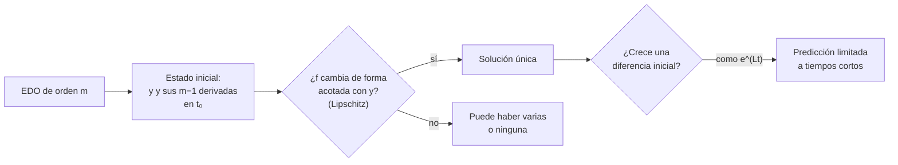

# B11-C02 — Problemas de valor inicial

<!-- nav:top -->
[🏠 Programa](../../../../README.md) · [📚 Bloque B11](../../../tronco-comun/B11-ecuaciones-diferenciales-y-simulacion-numerica.md) · [← Anterior: B11-C01 — Ecuaciones diferenciales ordinarias](../B11-C01-ecuaciones-diferenciales-ordinarias/CLASE.md) · [Siguiente: B11-C03 — Ecuaciones de primer orden →](../B11-C03-ecuaciones-de-primer-orden/CLASE.md)
<!-- /nav -->

## 1. Ubicación, nivel y alcance

Segunda clase del bloque B11. En la [clase anterior](../B11-C01-ecuaciones-diferenciales-ordinarias/CLASE.md) viste que una ecuación diferencial ordinaria tiene una **familia** de soluciones. Aquí aprendes a elegir una: el **problema de valor inicial** (PVI), formado por la ecuación y el estado en un instante de partida. Nivel N2. Verás cuándo la solución existe y es única, por qué una pequeña diferencia inicial puede crecer, y cómo un lanzamiento vertical depende de su velocidad inicial. No verás técnicas de solución (C03) ni métodos numéricos (C05 en adelante).

## 2. Por qué esta clase existe

Una nave no sigue «la» solución de las ecuaciones del movimiento: sigue la que corresponde a *su* posición y velocidad en el instante en que se midieron. Saber cuántos datos exige la ecuación, cuándo garantizan una única trayectoria y cuánto se amplifica su error es la base de toda predicción de trayectoria.

La pregunta motivadora: **¿qué datos hacen falta para que el futuro quede determinado, y cuánto puedo fiarme si esos datos tienen error?** La decisión central: **cuántas condiciones iniciales declarar y con qué incertidumbre**.

## 3. Lo que podrás hacer al terminar

1. Formular un PVI: ecuación, instante inicial y valores iniciales.
2. Contar cuántas condiciones iniciales exige una EDO según su orden.
3. Resolver PVI simples y comprobar la solución con la condición inicial.
4. Reconocer un caso donde la unicidad falla y explicar por qué.
5. Estimar cómo crece una diferencia inicial (sensibilidad).
6. Usar la energía específica para obtener la altura máxima de un lanzamiento vertical y la velocidad de escape.

La evidencia es la **ficha de PVI** del ejercicio 12 (sección 20).

## 4. Con qué llegas y cómo comprobarlo

Necesitas lo de [C01](../B11-C01-ecuaciones-diferenciales-ordinarias/CLASE.md): orden, solución, residuo. Cinco preguntas:

1. ¿Qué orden tiene `y″ = −4 y`?
2. ¿Cuántas constantes libres tiene su solución general?
3. ¿Cuánto vale `5 e^{−0,3 t}` en `t = 0`?
4. ¿Qué es un residuo?
5. ¿Qué unidades tiene `v²/2` si `v` está en m/s?

<details>
<summary>Ver respuestas</summary>

1. Segundo. 2. Dos. 3. 5. 4. Lado izquierdo menos lado derecho tras sustituir una candidata. 5. m²/s² (J/kg).
</details>

Con cuatro o cinco aciertos, sigue; si no, repasa C01.

## 5. Un caso real: lanzar algo hacia arriba desde la Tierra

Se dispara un objeto verticalmente desde la superficie, a `R = 6 378,1 km` del centro de la Tierra, con velocidad inicial `v₀ = 7 000 m/s` (valor **sintético**, sin atmósfera). Si la gravedad fuera constante, subiría `2 500 km`; con la gravedad real, que disminuye con la altura, sube **`4 112,7 km`**, un 65 % más. Con los valores nominales IAU `GM = 3,986 004 × 10¹⁴ m³ s⁻²` y `R_eE = 6,3781 × 10⁶ m` (S1), la velocidad de escape resulta `11 179,9 m/s`: por encima de ella, el objeto no regresa. Este es el **ejemplo conductor**: el mismo modelo, con distintos datos iniciales, da destinos totalmente distintos.

## 6. Vocabulario

Un **problema de valor inicial** es una EDO más condiciones en un instante `t₀`: para orden `m`, los valores de `y` y sus primeras `m − 1` derivadas. El **estado** es el conjunto de esos valores. El **instante inicial** es `t₀`. Una EDO de primer orden `y′ = f(t, y)` se llama **bien planteada** si la solución existe, es única y depende de forma continua de los datos. La **constante de Lipschitz** `L` mide cuánto puede cambiar `f` cuando cambia `y`: `|f(t, y₁) − f(t, y₂)| ≤ L |y₁ − y₂|`. La **sensibilidad** describe cuánto se amplifica una diferencia inicial. La **energía específica** es `ε = v²/2 − GM/r` (energía por unidad de masa). La **velocidad de escape** es la velocidad mínima a la que `ε ≥ 0`.

## 7. Modelo mental: la ley es el mapa, los datos son el punto de partida

La EDO es un mapa de corrientes; el dato inicial es el punto donde sueltas una hoja. La hoja sigue una sola corriente si el mapa no se bifurca ahí; dos hojas que parten muy juntas pueden terminar lejos si las corrientes divergen.



*Descripción textual:* para una EDO de orden `m` se fija el estado inicial; si la función `f` es lipschitziana la solución es única; luego se pregunta cuánto crece una diferencia inicial, lo que limita el horizonte útil de predicción.

Analogía: soltar una hoja en un río. Su límite: en el río hay turbulencia aleatoria; en una EDO determinista la sensibilidad es una propiedad del mapa, no azar.

## 8. La explicación, paso a paso

### 8.1 El PVI de primer orden

`y′ = −2 y`, `y(0) = 3`. La solución general es `y = C e^{−2 t}`; imponer `y(0) = 3` da `C = 3`. Solución: `y = 3 e^{−2 t}`; `y(0,5) = 3 e^{−1} = 1,1036`. Siempre se comprueba la ecuación *y* el dato inicial.

### 8.2 El PVI de segundo orden

`y″ = −4 y`, con `y(0) = 1` y `y′(0) = 0`. Se necesitan **dos** datos porque el orden es dos. La solución general es `A cos(2 t) + B sin(2 t)`; `y(0) = A = 1`; `y′(0) = 2B = 0`. Resultado: `cos(2 t)`. Con `y(0) = 0`, `y′(0) = 2` sale `sin(2 t)`. Para esta clase de ecuaciones lineales de segundo orden, conocer `w` y `w′` en un punto determina la solución de forma única (S2, §1.13(i)).

### 8.3 Cuando la unicidad falla

`y′ = √|y|`, `y(0) = 0`. Las funciones `y = 0` y `y = t²/4` (para `t ≥ 0`) cumplen ambas la ecuación *y* el dato inicial: en `t = 3`, la primera vale 0 y la segunda `2,25`. La razón: cerca de `y = 0`, `√|y|` cambia infinitamente rápido, y el cociente `|f(y) − f(0)|/|y| = 1/√y` no está acotado (vale 10, 100, 1000 en `y = 10⁻²`, `10⁻⁴`, `10⁻⁶`): no existe constante de Lipschitz. Cuando existe `L`, la solución es única; ésa es la garantía que usarás en toda la clase de modelos físicos suaves.

### 8.4 Sensibilidad a los datos iniciales

Si `y′ = y`, la solución es `y₀ e^t`. Dos datos iniciales que difieren en `δ` producen soluciones que difieren en `δ e^t`. Con `δ = 10⁻⁶` y `t = 10`, la diferencia es `2,2 × 10⁻²`: se amplificó unas 22 000 veces. En general, si `f` tiene constante de Lipschitz `L`, la diferencia crece como mucho como `δ e^{L t}`. Es el primer límite de cualquier predicción: el error inicial se amplifica.

### 8.5 La energía y el lanzamiento vertical

Para `r″ = −GM/r²` (movimiento radial), multiplicar por `r′` y reescribir da que la **energía específica** `ε = r′²/2 − GM/r` es constante (se comprueba derivando: `dε/dt = r′ r″ + GM r′/r² = 0`). En el punto de retorno `r′ = 0`, de modo que `ε = −GM/r_max`. Con `v₀ = 7 000 m/s` y `R = 6,3781 × 10⁶ m`: `ε = 2,45 × 10⁷ − 6,2495 × 10⁷ = −3,7995 × 10⁷ J/kg`, luego `r_max = GM/|ε| = 10 490,8 km` y una altura de `4 112,7 km`. La velocidad de escape resulta de `ε = 0`: `v_esc = √(2 GM/R) = 11 179,9 m/s`. Si `v₀ ≥ v_esc`, `ε ≥ 0` y el objeto nunca regresa.

## 9. Magnitudes, símbolos y unidades

| Símbolo | Qué es | Unidad | Nota |
|---|---|---|---|
| `t₀` | instante inicial | s | |
| `y₀`, `v₀` | valores iniciales | según el caso | `v₀ = 7 000` (sintético) |
| `L` | constante de Lipschitz | s⁻¹ | |
| `δ` | diferencia inicial | unidad de `y` | |
| `ε` | energía específica | J/kg = m²/s² | |
| `R`, `r_max` | radio de partida, radio máximo | m | `R = 6,3781 × 10⁶` (S1) |
| `GM` | parámetro gravitacional | m³ s⁻² | `3,986 004 × 10¹⁴` (S1) |

## 10. Convenciones y referencias

Movimiento radial, Tierra esférica, sin rotación ni atmósfera; `r` se mide desde el centro. Los valores nominales IAU son factores de conversión exactos por definición (S1). La velocidad de escape depende del radio elegido: con `R_eE = 6,3781 × 10⁶ m` resulta `11 179,9 m/s`; con otro radio, otro valor.

## 11. De dónde sale lo que afirmamos

| ID | Fuente | Localizador | Respalda | Estado |
|---|---|---|---|---|
| S1 | IAU, Resolución B3 de 2015 | arXiv:1510.07674, https://arxiv.org/pdf/1510.07674 | `(GM)_E^N = 3,986 004 × 10¹⁴ m³ s⁻²`, `R_eE^N = 6,3781 × 10⁶ m` | Texto extraído del PDF el 2026-11-05 |
| S2 | NIST, *DLMF* §1.13, versión 1.2.8 | https://dlmf.nist.gov/1.13 | Unicidad con `w` y `w′` en un punto | Consultada el 2026-11-05 mediante extracción automática |

Límites: el teorema de existencia y unicidad con constante de Lipschitz y la cota `δ e^{Lt}` son resultados estándar que no se atribuyen a una fuente consultada; la altura es un **cálculo** con datos nominales y `v₀` **sintética**.

## 12. Cómo ver el lanzamiento

Equivalente accesible a una gráfica de altura máxima frente a velocidad inicial (cálculo con `GM` y `R` nominales):

| `v₀` (m/s) | altura con `g` constante (km) | altura con `g(r)` (km) |
|---|---|---|
| 5 000 | 1 275,7 | 1 594,7 |
| 7 000 | 2 500,4 | 4 112,7 |
| 11 179,9 | — | no regresa |

Descripción larga: la curva con gravedad real sube cada vez más por encima de la recta de gravedad constante y se dispara hacia el infinito al aproximarse a la velocidad de escape.

## 13. Ejemplo trabajado: ¿hasta dónde llega con 7 000 m/s?

**Paso 1 · PVI.** `r″ = −GM/r²`, `r(0) = R = 6,3781 × 10⁶ m`, `r′(0) = 7 000 m/s`.

**Paso 2 · Energía.** `ε = 7 000²/2 − 3,986 004 × 10¹⁴/6,3781 × 10⁶ = 2,45 × 10⁷ − 6,2495 × 10⁷ = −3,7995 × 10⁷ J/kg`.

**Paso 3 · Retorno.** `r_max = −GM/ε = 1,0491 × 10⁷ m = 10 490,8 km`.

**Paso 4 · Altura.** `r_max − R = 4 112,7 km`.

**Paso 5 · Comprobación independiente.** Una bisección sobre `−GM/r = ε` da el mismo `r_max`. La estimación con `g` constante (`v₀²/(2 g₀)`, `g₀ = 9,798 m/s²`) da `2 500,4 km`: subestima porque la gravedad disminuye al subir.

**Paso 6 · Sentido.** Los resultados dependen de tres cifras en `v₀`; no se debe dar más de tres o cuatro cifras significativas.

## 14. Dos maneras de averiguar el destino

La **cantidad conservada** (energía) da el punto de retorno sin resolver la EDO, pero no dice *cuándo* ocurre. La **solución completa** (en C05 y siguientes, por métodos numéricos) da `r(t)`. Si las dos discrepan, hay un error en una de ellas; esa es la lógica de las pruebas de los laboratorios del bloque.

## 15. Práctica guiada

**Ejercicio 1 · con los pasos indicados.** Resuelve `y′ = y`, `y(0) = 2` y evalúa `y(1)`. *Pasos:* solución general, imponer el dato, evaluar (8.1).

<details><summary>Solución comentada</summary>

`y = C e^t`, `C = 2`, `y(1) = 2e = 5,4366`.
</details>

**Ejercicio 2 · con una pista.** Resuelve `y′ = −2 y`, `y(0) = 3` y calcula `y(0,5)`. *Pista:* misma estructura que el 1.

<details><summary>Solución comentada</summary>

`y = 3 e^{−2 t}`; `y(0,5) = 3 e^{−1} = 1,1036`.
</details>

**Ejercicio 3 · casi autónomo.** Resuelve `y″ = −4 y` con `y(0) = 0`, `y′(0) = 2`.

<details><summary>Solución comentada</summary>

`y = A cos 2t + B sin 2t`; `A = 0`; `y′(0) = 2B = 2 → B = 1`. `y = sin 2t` (8.2).
</details>

## 16. Práctica autónoma, transferencia e integrador

**Ejercicio 4.** ¿Cuántas condiciones iniciales exige `y‴ + y = 0` y cuáles?

<details><summary>Solución comentada</summary>

Tres: `y(t₀)`, `y′(t₀)`, `y″(t₀)` (una por cada orden).
</details>

**Ejercicio 5.** Calcula la altura máxima de un lanzamiento vertical con `v₀ = 5 000 m/s` desde `R = 6,3781 × 10⁶ m`.

<details><summary>Solución comentada</summary>

`ε = 1,25 × 10⁷ − 6,2495 × 10⁷ = −4,9995 × 10⁷`; `r_max = 7 972,8 km`; altura `1 594,7 km` (con `g` constante: `1 275,7 km`) (8.5).
</details>

**Ejercicio 6.** Si dos datos iniciales difieren en `10⁻⁶` y `y′ = y`, ¿cuánto difieren las soluciones en `t = 10`?

<details><summary>Solución comentada</summary>

`10⁻⁶ e^{10} = 2,2 × 10⁻²` (8.4).
</details>

**Ejercicio 7.** Verifica que `y = t²/4` resuelve `y′ = √|y|` con `y(0) = 0` y evalúala en `t = 3`.

<details><summary>Solución comentada</summary>

`y′ = t/2`; `√(t²/4) = t/2` para `t ≥ 0` ✓; `y(3) = 2,25` (8.3).
</details>

**Ejercicio 8.** Calcula la velocidad de escape a 400 km de altitud (`a = 6,7781 × 10⁶ m`).

<details><summary>Solución comentada</summary>

`√(2 GM/a) = √2 × 7 668,6 = 10 845,0 m/s`; menor que en superficie porque se parte más lejos.
</details>

**Ejercicio 9 · transferencia.** En `r = a = 6,7781 × 10⁶ m`, un satélite tiene velocidad tangencial de 9 000 m/s. ¿Está ligado a la Tierra? Compárala con el caso circular.

<details><summary>Solución comentada</summary>

`ε = 4,05 × 10⁷ − 5,8807 × 10⁷ = −1,83 × 10⁷ J/kg < 0`: ligado (órbita elíptica). El caso circular, `v = 7 668,6 m/s`, da `ε = −2,94 × 10⁷`. A 11 000 m/s, `ε = +1,7 × 10⁶ > 0`: no ligado.
</details>

**Ejercicio 10 · transferencia.** Para `f(y) = y²` en `|y| ≤ M`, ¿cuál es una constante de Lipschitz? ¿Por qué depende de `M`?

<details><summary>Solución comentada</summary>

`|y₁² − y₂²| = |y₁ + y₂||y₁ − y₂| ≤ 2M |y₁ − y₂|`: `L = 2M`. Crece con `M`, de modo que cerca de valores grandes la solución se amplifica más rápido.
</details>

**Ejercicio 11 · transferencia.** Un estudiante usa `v₀ = 7` (en km/s) con `GM` y `R` en m. ¿Qué altura obtiene y qué error cometió?

<details><summary>Solución comentada</summary>

`ε = 24,5 − 6,2495 × 10⁷ ≈ −6,2495 × 10⁷`; `r_max ≈ R(1 + 3,9 × 10⁻⁷)`: altura de unos 2,5 m. Mezcló unidades: `v₀` debía ser 7 000 m/s.
</details>

**Ejercicio 12 · integrador.** Elabora tu *ficha de PVI*: tres PVI distintos (primer orden, segundo orden, lanzamiento vertical), con ecuación, estado inicial, número de condiciones, solución, comprobación de la condición inicial y, para uno, la sensibilidad a una diferencia inicial.

<details><summary>Solución modelo</summary>

Ficha con columnas: ecuación, orden, estado inicial, solución, comprobación (ecuación y dato), sensibilidad. Debe incluir la energía y altura máxima del lanzamiento con `GM` y `R` nominales y `v₀` rotulada como sintética, y declarar la fuente con fecha.
</details>

## 17. Laboratorio: unicidad, sensibilidad y lanzamiento vertical

El script [datos_iniciales_y_unicidad.py](datos_iniciales_y_unicidad.py) comprueba dos soluciones de `y′ = √|y|`, la amplificación de una diferencia inicial y el lanzamiento vertical con dos métodos independientes (fórmula de energía y bisección).

**Datos:** `GM` y `R` nominales IAU; `v₀` sintética. **Predice antes de ejecutar:** ¿qué altura darán fórmula y bisección? (ambas, `4 112,7 km`.) **Ejecución del 2026-11-05 (Python 3.12.9):**

```text
(a) residuos de las dos soluciones en t=3: 0.0e+00 y 2.1e-10; valores 0.0 y 2.25
    cociente |f(y)-f(0)|/|y| = 10.0  (y = 0.01)
    cociente |f(y)-f(0)|/|y| = 100.0  (y = 0.0001)
    cociente |f(y)-f(0)|/|y| = 1000.0  (y = 1e-06)
(b) diferencia inicial 1e-6 -> en t=10: 2.2026e-02 (factor e^10 = 22026.5)
(c) e0 = -3.799516e+07 J/kg; v_escape = 11179.907 m/s
    r_max = 10490.820 km; altura = 4112.720 km; (bisección 4112.720 km)
    sin variación de g (g0 = GM/R^2 = 9.7984 m/s2): h = 2500.409 km
Python 3.12.9
Pruebas superadas.
```

```bash
python programa/clases/B11/B11-C02-problemas-de-valor-inicial/datos_iniciales_y_unicidad.py
```

**Límites:** sin atmósfera, rotación ni achatamiento; `v₀` sintética.

## 18. Errores frecuentes y cómo corregirlos

**Resolver la EDO pero olvidar el dato inicial.** Se corrige con los ejercicios 1 a 3.

**Dar menos condiciones que el orden.** Se corrige con el ejercicio 4.

**Suponer que siempre hay una sola solución.** Se corrige con el ejercicio 7.

**Ignorar la amplificación de un error inicial.** Se corrige con el ejercicio 6.

**Mezclar unidades (km/s con m).** Se corrige con el ejercicio 11.

## 19. Cómo sabrás que vas bien

Tras 8.2: ¿cuántos datos necesitas y por qué? Si dudas, ejercicio 4. Tras 8.3: ¿qué falla en `√|y|`? Si no lo ves, ejercicio 10. Tras 8.5: ¿por qué la energía da `r_max` pero no el tiempo? Si no lo sabes, repasa la sección 14. Tras el laboratorio: ¿qué comprueba que la altura no sea un error de fórmula? (el segundo método, la bisección).

## 20. Qué entregas y cómo se evalúa

El producto es tu **ficha de PVI** (ejercicio 12).

| Criterio | Inicial | En desarrollo | Logrado | Destacado |
|---|---|---|---|---|
| Planteamiento | Sin datos iniciales | Datos incompletos | Orden y datos coherentes | Discute existencia y unicidad |
| Solución | Errores de signo | Correcta sin comprobar | Comprueba ecuación y dato | Con segunda vía independiente |
| Sensibilidad | Ausente | Cualitativa | Estima `δ e^{Lt}` | Interpreta el horizonte de predicción |
| Unidades | Ausentes | Parciales | Coherentes | Detecta un error de unidades |
| Fuentes | Sin fuente | Sin fecha | Con localizador y fecha | Rotula sintético y nominal |

**Condiciones críticas (no se compensan con promedio):** comprobar siempre el dato inicial; rotular `v₀` como sintética; citar solo fuentes consultadas.

## 21. Ética, seguridad y límites

El lanzamiento vertical es un ejercicio de principios, no un cálculo de seguridad ni de lanzamiento real: ignora atmósfera, rotación y propulsión. No debe usarse para decidir nada operativo. Accesibilidad: fórmulas en texto, tablas equivalentes a las gráficas, ejercicios sin conexión.

## 22. Para cerrar y seguir

Una EDO de orden `m` necesita `m` condiciones; si `f` es lipschitziana la solución es única; una diferencia inicial puede crecer como `e^{Lt}`; una cantidad conservada permite saltar pasos. Queda abierta una pregunta: ¿qué técnicas dan la solución exacta cuando existe?

**Glosario español–inglés.** problema de valor inicial · *initial value problem (IVP)*; condición inicial · *initial condition*; unicidad · *uniqueness*; constante de Lipschitz · *Lipschitz constant*; sensibilidad · *sensitivity*; velocidad de escape · *escape velocity*; energía específica · *specific energy*.

**Continuidad.** B11-C03 reutiliza tu capacidad de **imponer un dato inicial a una solución general** para resolver ecuaciones de primer orden.

**Referencias:** ver sección 11.

<!-- nav:bottom -->
---

[← Anterior: B11-C01 — Ecuaciones diferenciales ordinarias](../B11-C01-ecuaciones-diferenciales-ordinarias/CLASE.md) · [📚 Bloque B11](../../../tronco-comun/B11-ecuaciones-diferenciales-y-simulacion-numerica.md) · [Siguiente: B11-C03 — Ecuaciones de primer orden →](../B11-C03-ecuaciones-de-primer-orden/CLASE.md)
<!-- /nav -->
