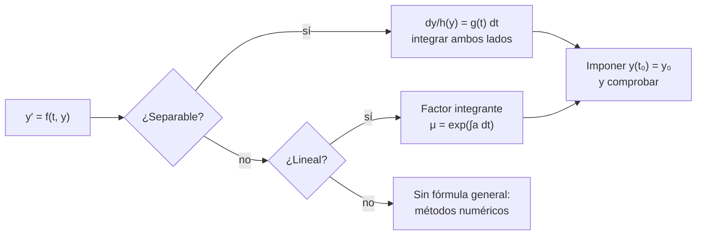

# B11-C03 — Ecuaciones de primer orden

<!-- nav:top -->
[🏠 Programa](../../../../README.md) · [📚 Bloque B11](../../../tronco-comun/B11-ecuaciones-diferenciales-y-simulacion-numerica.md) · [← Anterior: B11-C02 — Problemas de valor inicial](../B11-C02-problemas-de-valor-inicial/CLASE.md) · [Siguiente: B11-C04 — Sistemas de ecuaciones diferenciales →](../B11-C04-sistemas-de-ecuaciones-diferenciales/CLASE.md)
<!-- /nav -->

## 1. Ubicación, nivel y alcance

Tercera clase del bloque B11. Con el [problema de valor inicial](../B11-C02-problemas-de-valor-inicial/CLASE.md) sabes qué datos fijan una solución; ahora aprendes a **encontrarla en forma cerrada** cuando la ecuación es de primer orden y de dos tipos manejables: **separable** y **lineal**. Nivel N2. Verás la velocidad con arrastre, el enfriamiento de un componente y la comparación entre integral exacta y cuadratura. No verás ecuaciones no resolubles en forma cerrada (esas piden los métodos numéricos de C05 en adelante) ni sistemas (C04).

## 2. Por qué esta clase existe

Muchos procesos espaciales relajan hacia un equilibrio: una cápsula que cae frena hasta una velocidad terminal, un instrumento se enfría hacia la temperatura de su entorno, una población de partículas decae. Tener una fórmula cerrada da una **respuesta de referencia** contra la que se prueba cualquier método numérico, y da la escala de tiempo del fenómeno de un vistazo.

La pregunta motivadora: **¿cuánto tarda un sistema en acercarse a su equilibrio, y cómo lo obtengo de la ecuación?** La decisión central: **reconocer el tipo de ecuación para elegir la técnica**.

## 3. Lo que podrás hacer al terminar

1. Reconocer una EDO de primer orden separable y resolverla integrando.
2. Resolver una lineal `y′ + a y = b` con factor integrante.
3. Interpretar la **constante de tiempo** y el **equilibrio**.
4. Imponer una condición inicial y comprobar el resultado.
5. Calcular la velocidad terminal y la evolución térmica de un modelo sencillo.
6. Comparar el resultado cerrado con una cuadratura numérica.

La evidencia es la **hoja de ecuaciones resueltas** del ejercicio 12 (sección 20).

## 4. Con qué llegas y cómo comprobarlo

Necesitas [C02](../B11-C02-problemas-de-valor-inicial/CLASE.md) y la integral indefinida de B09. Cinco preguntas:

1. ¿Cuánto es `∫ e^{k s} ds`?
2. ¿Cuánto es `∫ 2 t dt`?
3. Despeja `y` en `ln y = −t² + C`.
4. ¿Cuántas condiciones iniciales necesita una EDO de primer orden?
5. ¿Cuánto vale `e^{−1}`?

<details>
<summary>Ver respuestas</summary>

1. `e^{k s}/k + C`. 2. `t² + C`. 3. `y = e^C e^{−t²}`. 4. Una. 5. `0,3679`.
</details>

Con cuatro o cinco aciertos, sigue; si no, repasa B09 e integrales.

## 5. Un caso real: frenarse en el aire

Una cápsula sintética de `m = 100 kg` cae con un arrastre proporcional a su velocidad, `c = 5 kg/s` (valores **sintéticos**), con `g = 9,806 65 m/s²` (valor convencional). La ecuación de movimiento es `m v′ = m g − c v`. La velocidad terminal es `g m/c = 196,1 m/s`, se alcanza con una constante de tiempo `m/c = 20 s`, y a los 30 s la velocidad es `152,4 m/s`. Es un modelo simplificado: el arrastre real depende del cuadrado de la velocidad y de la densidad del aire. Este es el **ejemplo conductor**.

## 6. Vocabulario

Una EDO de primer orden es **separable** si se escribe `y′ = g(t) h(y)`: se separan variables, `dy/h(y) = g(t) dt`, y se integra. Es **lineal** si se escribe `y′ + a(t) y = b(t)`. El **factor integrante** `μ(t) = exp(∫ a dt)` convierte el lado izquierdo en `(μ y)′`. El **equilibrio** es un valor `y*` donde `y′ = 0`. La **constante de tiempo** `τ` es el tiempo en que la diferencia con el equilibrio se reduce a `1/e ≈ 36,8 %`. El **campo de pendientes** es el conjunto de pendientes `f(t, y)` en una malla de puntos.

## 7. Modelo mental: bola que rueda hacia el valle

El equilibrio es el fondo de un valle y la ecuación dice con qué pendiente baja la bola. Cuanto más lejos del fondo, más rápido se acerca; al llegar, se detiene.



*Descripción textual:* se pregunta primero si la ecuación es separable, luego si es lineal; en ambos casos se llega a una fórmula a la que se impone el dato inicial; si ninguna aplica, se acude a métodos numéricos.

Analogía: la bola que baja al valle. Su límite: un valle con varias hondonadas (varios equilibrios) puede llevar la bola a otra; el modelo de un solo equilibrio no lo muestra.

## 8. La explicación, paso a paso

### 8.1 Separables

`y′ = −2 t y`, `y(0) = 1`. Se separa: `dy/y = −2 t dt`; se integra: `ln |y| = −t² + C`; se despeja: `y = A e^{−t²}`, con `A = 1` por el dato. En `t = 0,7`: `e^{−0,49} = 0,6126`. Siempre se verifica sustituyendo (C01); en el laboratorio el residuo es `5,8 × 10⁻⁹`.

### 8.2 Lineales con coeficiente constante

`v′ + κ v = g` con `κ = c/m = 0,05 s⁻¹`. Se multiplica por `μ = e^{κ t}`: `(e^{κ t} v)′ = g e^{κ t}`. Se integra de 0 a `t`: `e^{κ t} v = (g/κ)(e^{κ t} − 1)` (con `v(0) = 0`). Resultado: `v(t) = (g/κ)(1 − e^{−κ t})`. La velocidad terminal es `g/κ = 196,13 m/s`; para `t = 20 s`, `v = 196,13 (1 − e^{−1}) = 123,98 m/s`; en `t = 30 s`, `152,37 m/s`.

### 8.3 Equilibrio y constante de tiempo

El resultado anterior tiene la forma general `y(t) = y* + (y₀ − y*) e^{−t/τ}`: la distancia al equilibrio decae exponencialmente. Para `v`, `y* = 196,13 m/s` y `τ = 1/κ = 20 s`. Para un componente térmico (sintético) con `T′ = −(T − T_amb)/τ`, `τ = 600 s`, `T_amb = 250 K` y `T(0) = 300 K`: `T(600) = 250 + 50 e^{−1} = 268,39 K`. Después de `3τ` queda el 5 % de la diferencia; después de `5τ`, menos del 1 %.

### 8.4 Cuánto tarda en acercarse

Si se quiere llegar a un 10 % del valor del equilibrio: `e^{−t/τ} = 0,1`, `t = τ ln 10`. Para `v`, llegar al 90 % de `196,13 m/s` toma `20 ln 10 = 46,05 s`. Para que el componente térmico quede a 1 K del ambiente: `t = 600 ln 50 = 2 347,2 s`.

### 8.5 Ecuaciones que se salen del patrón

`y′ = y²`, `y(0) = 1` es separable: `dy/y² = dt` → `−1/y = t + C` → `y = 1/(1 − t)`, que crece sin límite al acercarse a `t = 1`. La solución *explota en tiempo finito*, aunque la ecuación sea suave. Es una advertencia: una solución puede no existir para todo `t`, y un método numérico que ignore esto dará resultados sin sentido (se retoma en C09).

### 8.6 Comprobar con una cuadratura

El factor integrante lleva a una integral. Si no se sabe resolverla, se aproxima con trapecios (la regla elemental, que se estudia con detalle en B09) y se compara con la fórmula. En el laboratorio, la integral con 20 000 trapecios reproduce `152,369 812 3 m/s` con diferencia `7 × 10⁻⁸`.

## 9. Magnitudes, símbolos y unidades

| Símbolo | Qué es | Unidad | Nota |
|---|---|---|---|
| `v` | velocidad de caída | m/s | |
| `m`, `c` | masa y coeficiente de arrastre lineal | kg, kg/s | 100, 5 (sintéticos) |
| `κ` | `c/m` | s⁻¹ | 0,05 |
| `g` | aceleración de la gravedad | m/s² | 9,806 65 (convencional) |
| `τ` | constante de tiempo | s | `1/κ` = 20 s; térmica 600 s (sintética) |
| `T`, `T_amb` | temperatura, ambiente | K | 300, 250 (sintéticas) |
| `μ` | factor integrante | adimensional | `e^{κ t}` |

## 10. Convenciones y referencias

Dirección positiva hacia abajo (la gravedad acelera y el arrastre frena). Arrastre lineal, válido a velocidades bajas. Los valores de la cápsula y del componente térmico son **sintéticos**: sirven para aprender, no representan un vehículo real.

## 11. De dónde sale lo que afirmamos

| ID | Fuente | Localizador | Respalda | Estado |
|---|---|---|---|---|
| S1 | NIST, *DLMF* §1.13, versión 1.2.8 | https://dlmf.nist.gov/1.13 | Teoría general de EDO lineales y variación de parámetros (contexto) | Consultada el 2026-11-05 mediante extracción automática |
| S2 | NIST, *DLMF* §3.4, versión 1.2.8 | https://dlmf.nist.gov/3.4 | Diferencia central de tres puntos usada en el residuo | Consultada el 2026-11-05 mediante extracción automática |

Límites: las técnicas de separación de variables y de factor integrante son resultados estándar que no se atribuyen a una fuente consultada; todos los parámetros del caso son sintéticos; la cuadratura trapezoidal es la regla elemental.

## 12. Cómo ver la solución

Equivalente accesible a una gráfica de `v(t)` (parámetros sintéticos):

| `t` (s) | `v` (m/s) | `v′ = g − κ v` (m/s²) |
|---|---|---|
| 0 | 0 | 9,807 |
| 20 | 123,98 | 3,608 |
| 30 | 152,37 | 2,188 |
| 100 | 194,8 | 0,066 |

Descripción larga: la curva sube casi en línea recta al principio (pendiente `g`) y se aplana hacia la asíntota de `196,13 m/s`.

## 13. Ejemplo trabajado: ¿en cuánto tiempo se alcanza el 90 % de la velocidad terminal?

**Paso 1 · Modelo.** `v′ = g − κ v`, `v(0) = 0`, `κ = 0,05 s⁻¹`, `g = 9,806 65 m/s²`.

**Paso 2 · Solución.** `v = (g/κ)(1 − e^{−κ t})` con `g/κ = 196,13 m/s`.

**Paso 3 · Condición.** `v = 0,9 · 196,13 = 176,52 m/s` ⇒ `e^{−κ t} = 0,1`.

**Paso 4 · Despeje.** `t = ln 10/κ = 46,05 s`.

**Paso 5 · Comprobación.** Sustituyendo, `v(46,05) = 196,13 (1 − 0,1) = 176,52 m/s` ✓; y `v′ = 9,807 − 0,05 · 176,52 = 0,981 m/s²`, que es el 10 % de `g`, como debe ser.

**Paso 6 · Sentido.** El modelo, **sintético**, dice que la cápsula está cerca de su velocidad terminal tras menos de un minuto; no vale para una reentrada real.

## 14. Comparación: fórmula exacta o numérica

La **fórmula cerrada** es exacta y dice la escala de tiempo de un vistazo, pero solo existe para ecuaciones de forma especial. La **cuadratura** o un **método numérico** sirve para cualquier ecuación, con error que se debe controlar. En este bloque, los métodos numéricos se prueban contra estas soluciones cerradas.

## 15. Práctica guiada

**Ejercicio 1 · con los pasos indicados.** Resuelve `y′ = −2 t y`, `y(0) = 1` y evalúa en `t = 0,7`. *Pasos:* separar, integrar, imponer (8.1).

<details><summary>Solución comentada</summary>

`y = e^{−t²}`; `y(0,7) = e^{−0,49} = 0,6126`.
</details>

**Ejercicio 2 · con una pista.** Halla `v(20 s)` para `v′ = g − 0,05 v`, `v(0) = 0`. *Pista:* usa la forma `y* (1 − e^{−t/τ})`.

<details><summary>Solución comentada</summary>

`196,13 (1 − e^{−1}) = 123,98 m/s` (8.2).
</details>

**Ejercicio 3 · casi autónomo.** Calcula `T(1 200 s)` para el componente térmico sintético (`τ = 600 s`, `T_amb = 250 K`, `T₀ = 300 K`).

<details><summary>Solución comentada</summary>

`250 + 50 e^{−2} = 256,77 K` (8.3).
</details>

## 16. Práctica autónoma, transferencia e integrador

**Ejercicio 4.** Resuelve `v′ + 0,2 v = 2`, `v(0) = 0` y calcula `v(5)`.

<details><summary>Solución comentada</summary>

Equilibrio `2/0,2 = 10`; `v = 10 (1 − e^{−0,2 t})`; `v(5) = 10 (1 − e^{−1}) = 6,321`.
</details>

**Ejercicio 5.** ¿En cuánto tiempo alcanza `v` el 90 % de la velocidad terminal con `κ = 0,05 s⁻¹`?

<details><summary>Solución comentada</summary>

`t = ln 10/0,05 = 46,05 s` (13).
</details>

**Ejercicio 6.** Resuelve `y′ = y²`, `y(0) = 1`. ¿Para qué `t` deja de existir la solución?

<details><summary>Solución comentada</summary>

`y = 1/(1 − t)`; explota en `t = 1` (8.5).
</details>

**Ejercicio 7.** Una presión sintética cumple `dp/dh = −p/H` con `H = 8 km` y `p(0) = p₀`. Halla `p(16 km)/p₀`.

<details><summary>Solución comentada</summary>

Separable: `p = p₀ e^{−h/H}`; en `h = 16`: `e^{−2} = 0,1353`.
</details>

**Ejercicio 8.** ¿Cuánto vale la pendiente `y′` en `(t, y) = (0, 1)` para `y′ = −2 t y`? ¿Y en `(1, 1)`?

<details><summary>Solución comentada</summary>

En `(0, 1)`: 0; en `(1, 1)`: `−2` (campo de pendientes; sección 6).
</details>

**Ejercicio 9 · transferencia.** Un cohete sintético expulsa gas a `vₑ = 3 000 m/s` y su velocidad cumple `dv/dm = −vₑ/m`. Resuelve y halla el aumento de velocidad cuando la masa se reduce a la mitad.

<details><summary>Solución comentada</summary>

Separable: `v = v₀ + vₑ ln(m₀/m)`; con `m₀/m = 2`: `3 000 ln 2 = 2 079,4 m/s`. Es la ecuación del cohete vista en B09-C04.
</details>

**Ejercicio 10 · transferencia.** Un compañero propone `v = (g/κ)(1 + e^{−κ t})` para el problema con `v(0) = 0`. ¿Qué falla?

<details><summary>Solución comentada</summary>

En `t = 0` da `2g/κ ≠ 0`: no cumple el dato inicial. Además `v′` queda negativa, cuando la cápsula acelera. La correcta tiene `1 − e^{−κ t}` (8.2).
</details>

**Ejercicio 11 · transferencia.** ¿Cuánto tarda el componente térmico sintético en quedar a 1 K del ambiente?

<details><summary>Solución comentada</summary>

`50 e^{−t/600} = 1` → `t = 600 ln 50 = 2 347,2 s` (8.4).
</details>

**Ejercicio 12 · integrador.** Elabora tu *hoja de ecuaciones resueltas*: una separable, una lineal y una de explosión en tiempo finito, con solución, dato inicial, comprobación por sustitución y residuo numérico, y la constante de tiempo cuando exista.

<details><summary>Solución modelo</summary>

Para cada ecuación: tipo, técnica, solución, comprobación del dato y de la ecuación, residuo numérico con `h` declarado y escala de tiempo (`τ` o tiempo de explosión). Rotula como sintéticos los parámetros y cita la fuente del método numérico con fecha.
</details>

## 17. Laboratorio: soluciones exactas y cuadratura

El script [primer_orden_exactas.py](primer_orden_exactas.py) calcula el residuo de tres soluciones cerradas y compara la solución por factor integrante contra una cuadratura trapezoidal.

**Datos:** sintéticos (cápsula, componente térmico); `g` convencional. **Predice antes de ejecutar:** ¿qué velocidad esperas a los 30 s? (`152,37 m/s`.) **Ejecución del 2026-11-05 (Python 3.12.9):**

```text
residuo velocidad   :  9.04e-10
residuo temperatura : -1.85e-12
residuo separable   :  5.77e-09
v(30 s): exacta 152.369812300  factor integrante 152.369812371 m/s
v terminal = 196.13 m/s; v(30 s) = 152.370 m/s; tiempo característico m/c = 20.0 s
T(tau) = 268.394 K (esperado 268.394); tiempo para llegar a 1 K sobre T_amb: 2347.2 s
Python 3.12.9
Pruebas superadas.
```

```bash
python programa/clases/B11/B11-C03-ecuaciones-de-primer-orden/primer_orden_exactas.py
```

**Límites:** arrastre lineal; datos sintéticos; la cuadratura es la regla trapezoidal elemental.

## 18. Errores frecuentes y cómo corregirlos

**Olvidar la constante de integración o el dato inicial.** Se corrige con los ejercicios 1 y 4.

**Confundir equilibrio con valor inicial.** Se corrige con el ejercicio 4.

**Pensar que toda solución existe para todo `t`.** Se corrige con el ejercicio 6.

**Elegir mal el signo del exponente.** Se corrige con el ejercicio 10.

**Mezclar la constante de tiempo con la velocidad.** Se corrige con el ejercicio 5.

## 19. Cómo sabrás que vas bien

Tras 8.1: ¿separas e integras sin ayuda? Si no, ejercicio 1. Tras 8.2: ¿sabes por qué aparece `1 − e^{−κt}`? Si no, ejercicio 4. Tras 8.3: ¿qué es `τ`? Si dudas, ejercicio 3. Tras 8.5: ¿qué le pasa a `y′ = y²`? Si no lo ves, ejercicio 6. Tras el laboratorio: ¿qué pasaría si la cuadratura tuviera pocos trapecios? (la diferencia crecería).

## 20. Qué entregas y cómo se evalúa

El producto es tu **hoja de ecuaciones resueltas** (ejercicio 12).

| Criterio | Inicial | En desarrollo | Logrado | Destacado |
|---|---|---|---|---|
| Elección de técnica | Al azar | Con ayuda | Reconoce separable o lineal | Justifica y detecta el caso no resoluble |
| Solución | Errores de signo | Correcta sin dato | Impone el dato inicial | Simplifica y da escala de tiempo |
| Comprobación | Ausente | Sustitución parcial | Sustitución exacta | Más residuo numérico |
| Interpretación | Sin unidades | Unidades sin sentido | Equilibrio y `τ` interpretados | Discute los límites del modelo |
| Fuentes | Sin fuente | Sin fecha | Con localizador y fecha | Rotula lo sintético |

**Condiciones críticas (no se compensan con promedio):** comprobar siempre ecuación y dato inicial; rotular los parámetros sintéticos; citar solo fuentes consultadas.

## 21. Ética, seguridad y límites

Los modelos sintéticos de arrastre y de enfriamiento no sirven para diseñar paracaídas, escudos térmicos ni controles térmicos reales. Accesibilidad: fórmulas en texto, tablas equivalentes a las gráficas, ejercicios sin conexión.

## 22. Para cerrar y seguir

Las ecuaciones separables y lineales tienen solución cerrada; la constante de tiempo resume la rapidez de la relajación; una solución puede explotar en tiempo finito; las fórmulas exactas son el patrón contra el que se probarán los métodos numéricos. Queda abierta una pregunta: ¿cómo se trata un fenómeno con *varias* magnitudes acopladas, como la posición y la velocidad?

**Glosario español–inglés.** separable · *separable*; factor integrante · *integrating factor*; velocidad terminal · *terminal velocity*; constante de tiempo · *time constant*; equilibrio · *equilibrium*; campo de pendientes · *slope field*.

**Continuidad.** B11-C04 reutiliza tu capacidad de **resolver y verificar una ecuación de primer orden** para tratar varias ecuaciones acopladas.

**Referencias:** ver sección 11.

<!-- nav:bottom -->
---

[← Anterior: B11-C02 — Problemas de valor inicial](../B11-C02-problemas-de-valor-inicial/CLASE.md) · [📚 Bloque B11](../../../tronco-comun/B11-ecuaciones-diferenciales-y-simulacion-numerica.md) · [Siguiente: B11-C04 — Sistemas de ecuaciones diferenciales →](../B11-C04-sistemas-de-ecuaciones-diferenciales/CLASE.md)
<!-- /nav -->
