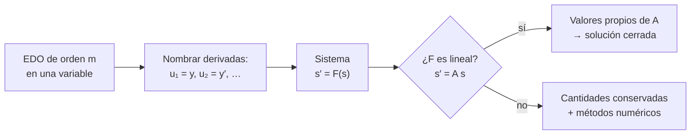

# B11-C04 — Sistemas de ecuaciones diferenciales

<!-- nav:top -->
[🏠 Programa](../../../../README.md) · [📚 Bloque B11](../../../tronco-comun/B11-ecuaciones-diferenciales-y-simulacion-numerica.md) · [← Anterior: B11-C03 — Ecuaciones de primer orden](../B11-C03-ecuaciones-de-primer-orden/CLASE.md) · [Siguiente: B11-C05 — Método de Euler →](../B11-C05-metodo-de-euler/CLASE.md)
<!-- /nav -->

## 1. Ubicación, nivel y alcance

Cuarta clase del bloque B11. Hasta ahora has trabajado con una sola función incógnita. Una nave tiene al menos posición y velocidad, y ambas cambian a la vez, acopladas. Aquí aprendes a escribir cualquier EDO como un **sistema de primer orden** con un **vector de estado**, que es la forma que reciben todos los métodos numéricos del resto del bloque. Nivel N2. Verás la reducción de orden, la órbita como sistema, sistemas lineales con valores propios y cantidades conservadas. No resolverás sistemas numéricamente aún (C05).

## 2. Por qué esta clase existe

Un programa que propaga una trayectoria no entiende `r″ = −GM r/|r|³`: entiende una función que recibe un estado y devuelve su derivada. Si escribes mal ese puente, ningún método, por bueno que sea, te salva. Además, un sistema revela cantidades que se conservan y sirven de prueba de cualquier cálculo.

La pregunta motivadora: **¿cómo convierto una ley de movimiento en algo que un programa pueda integrar, y cómo sé que la conversión es correcta?** La decisión central: **qué variables forman el estado**.

## 3. Lo que podrás hacer al terminar

1. Reducir una EDO de orden `m` a un sistema de `m` ecuaciones de primer orden.
2. Escribir el vector de estado y la función `F(s)` de un satélite en el plano.
3. Resolver un sistema lineal con coeficientes constantes mediante valores propios.
4. Comprobar la función `F` contra una solución exacta.
5. Calcular cantidades conservadas (energía y momento angular específicos) sobre una solución.
6. Contar la dimensión del estado de un problema (plano, 3D, varios cuerpos).

La evidencia es la **ficha de estado y verificación** del ejercicio 12 (sección 20).

## 4. Con qué llegas y cómo comprobarlo

Necesitas [C01](../B11-C01-ecuaciones-diferenciales-ordinarias/CLASE.md) (orden, residuo) y [C02](../B11-C02-problemas-de-valor-inicial/CLASE.md) (estado inicial). Cinco preguntas:

1. ¿Cuántas condiciones iniciales necesita una EDO de tercer orden?
2. ¿Qué es el residuo de una candidata?
3. ¿Cuánto vale `√(GM/a³)` en las unidades de C01 para `a = 6 778,1 km`?
4. ¿Qué unidades tiene el momento angular específico `x v_y − y v_x`?
5. Resuelve `λ² + 4 = 0`.

<details>
<summary>Ver respuestas</summary>

1. Tres. 2. Lado izquierdo menos lado derecho. 3. `1,1314 × 10⁻³ rad/s`. 4. m²/s. 5. `λ = ±2i`.
</details>

Con cuatro o cinco aciertos, sigue; si no, repasa C01 y C02.

## 5. Un caso real: el satélite a 400 km como sistema

Una nave a 400 km de altitud (valor **ilustrativo**) en el plano de la órbita tiene cuatro números que cambian: sus coordenadas `x`, `y` y las dos componentes de velocidad `v_x`, `v_y`. Con `GM = 3,986 004 × 10¹⁴ m³ s⁻²` y radio ecuatorial `6,3781 × 10⁶ m` (S1), el estado inicial de una órbita circular es `s₀ = (6 778 100 m, 0, 0, 7 668,58 m/s)`, y la aceleración inicial vale `8,676 m/s²` apuntando al centro. Este es el **ejemplo conductor**: la misma ley de C01, reescrita como sistema de cuatro ecuaciones.

## 6. Vocabulario

El **vector de estado** `s` reúne las variables que, con la ley, determinan el futuro. Un **sistema de primer orden** es `s′ = F(t, s)`. La **reducción de orden** consiste en dar nombre a cada derivada intermedia como una variable nueva. Un sistema es **lineal con coeficientes constantes** si `s′ = A s` con `A` una matriz fija. Un **valor propio** `λ` de `A` y su **vector propio** `u` cumplen `A u = λ u`. Una **cantidad conservada** es una función del estado que no cambia a lo largo de una solución. El **espacio de fases** es el conjunto de todos los estados posibles.

## 7. Modelo mental: un punto que se mueve en un espacio de estados

Cada instante es un punto en el espacio de fases; la ecuación `s′ = F(s)` es un campo de velocidades en ese espacio, y la solución es la curva que sigue el punto.



*Descripción textual:* una EDO de orden `m` se reescribe nombrando cada derivada; el resultado es un sistema de primer orden; si es lineal se resuelve con valores propios, si no, se usan sus cantidades conservadas y métodos numéricos.

Analogía: el estado es la «fotografía completa» de un sistema; la ecuación es la película. Su límite: si faltan variables en la fotografía (por ejemplo, la masa que cambia), la película sale mal.

## 8. La explicación, paso a paso

### 8.1 Reducir el oscilador

`y″ = −4 y`. Se nombra `u = y` y `w = y′`. Entonces `u′ = w` y `w′ = −4 u`. En forma matricial, `(u, w)′ = A (u, w)` con `A = [[0, 1], [−4, 0]]`. Un sistema de dos ecuaciones de primer orden reemplaza una de segundo orden: el estado `(u, w)` tiene dos números, como las dos condiciones iniciales que ya sabíamos que hacían falta (C02).

### 8.2 El satélite en el plano

Con `s = (x, y, v_x, v_y)` y `r = √(x² + y²)`: `x′ = v_x`, `y′ = v_y`, `v_x′ = −GM x/r³`, `v_y′ = −GM y/r³`. La función `F(s)` devuelve el vector `(v_x, v_y, −GM x/r³, −GM y/r³)`. En tres dimensiones el estado tiene seis números; para `N` cuerpos que se atraen, `6N`. Si además la masa cambia (cohete), se añade como variable de estado.

### 8.3 Comprobar `F` con una solución conocida

La solución circular `x = a cos(n t)`, `y = a sin(n t)`, `v_x = −a n sin(n t)`, `v_y = a n cos(n t)`, con `n = √(GM/a³)`, debe cumplir `s′ = F(s)`. Se deriva `s(t)` numéricamente con el cociente central (S2, §3.4(i), ec. 3.4.6) y se compara con `F(s(t))`. En el laboratorio, para `t = 1 500 s` y `h = 0,5 s`, el error relativo máximo es `5,3 × 10⁻⁸`.

### 8.4 Sistemas lineales: valores propios

Para `s′ = A s` se prueba `s = u e^{λ t}`: entonces `λ u = A u`. El polinomio característico de `A = [[0, 1], [−4, 0]]` es `λ² + 4 = 0`, con `λ = ±2i`: soluciones oscilatorias de periodo `2π/2 = 3,1416`. Para `x′ = −3x + y`, `y′ = x − 3y`, los valores propios son `−2` y `−4`; con `x(0) = 1`, `y(0) = 0`, la solución es `x = (e^{−2t} + e^{−4t})/2`, `y = (e^{−2t} − e^{−4t})/2`. Valores propios reales negativos significan relajación; imaginarios, oscilación; con parte real positiva, crecimiento. Esta lectura se usará en C09.

### 8.5 Cantidades conservadas

Sobre cualquier solución del problema de dos cuerpos se conservan la **energía específica** `ε = (v_x² + v_y²)/2 − GM/r` y el **momento angular específico** `h = x v_y − y v_x`. Para el estado inicial circular: `ε = −2,9404 × 10⁷ J/kg` y `h = 5,1978 × 10¹⁰ m²/s`. Estas dos cifras no cambian a lo largo de la órbita (en el laboratorio coinciden a mejor que `10⁻¹²` relativo en cuatro instantes). Son la prueba más barata de un programa de propagación: si no se conservan, algo falla.

### 8.6 Cómo cuentas dimensiones

Un sistema de dimensión `d` necesita `d` condiciones iniciales. Dos cuerpos en 3D, con uno de masa despreciable: `d = 6`. Y la dimensión determina el costo de cada paso.

## 9. Magnitudes, símbolos y unidades

| Símbolo | Qué es | Unidad | Nota |
|---|---|---|---|
| `s` | vector de estado | mezcla | `(x, y, v_x, v_y)` |
| `F(s)` | derivada del estado | mezcla por s | |
| `A` | matriz del sistema lineal | s⁻¹ o s⁻² | |
| `λ`, `u` | valor y vector propios | s⁻¹ | |
| `ε` | energía específica | J/kg = m²/s² | |
| `h` | momento angular específico | m²/s | |
| `n` | movimiento medio | rad s⁻¹ | `1,131 376 × 10⁻³` |
| `GM` | parámetro gravitacional | m³ s⁻² | `3,986 004 × 10¹⁴` (S1) |

## 10. Convenciones y referencias

Plano orbital como plano `xy`, origen en el centro de la Tierra, ejes inerciales, ángulos en radianes. Dos cuerpos con masa del satélite despreciable. Las componentes de `s` mezclan metros y metros por segundo: al integrar numéricamente (C05 y siguientes) conviene recordar que tienen escalas muy distintas.

## 11. De dónde sale lo que afirmamos

| ID | Fuente | Localizador | Respalda | Estado |
|---|---|---|---|---|
| S1 | IAU, Resolución B3 de 2015 | arXiv:1510.07674, https://arxiv.org/pdf/1510.07674 | `(GM)_E^N = 3,986 004 × 10¹⁴ m³ s⁻²`, `R_eE^N = 6,3781 × 10⁶ m` | Texto extraído del PDF el 2026-11-05 |
| S2 | NIST, *DLMF* §3.4, versión 1.2.8 | https://dlmf.nist.gov/3.4 | Fórmula de tres puntos (ec. 3.4.6) | Consultada el 2026-11-05 mediante extracción automática |

Límites: la reducción de orden, los valores propios y la conservación de `ε` y `h` son resultados estándar; las comprobaciones se hicieron numéricamente en el laboratorio. La altitud de 400 km es ilustrativa.

## 12. Cómo ver el espacio de fases

Equivalente accesible a una gráfica de la órbita circular en el plano `xy` (cálculo, `a = 6 778,1 km`, `T = 5 553,6 s`):

| `t` (s) | `x` (km) | `y` (km) | `v_x` (m/s) | `v_y` (m/s) |
|---|---|---|---|---|
| 0 | 6 778,1 | 0 | 0 | 7 668,6 |
| 1 388,4 | 0 | 6 778,1 | −7 668,6 | 0 |
| 2 776,8 | −6 778,1 | 0 | 0 | −7 668,6 |

Descripción larga: el punto `(x, y)` recorre una circunferencia en sentido antihorario; las componentes de velocidad son una circunferencia en su propio plano, adelantada un cuarto de vuelta.

## 13. Ejemplo trabajado: verificar la función del satélite

**Paso 1 · Estado inicial.** `s₀ = (a, 0, 0, a n)`, con `a = 6,7781 × 10⁶ m`, `a n = 7 668,58 m/s`.

**Paso 2 · Evaluar `F`.** `F(s₀) = (0, 7 668,58, −GM/a², 0)`, con `GM/a² = 3,986 004 × 10¹⁴/(6,7781 × 10⁶)² = 8,676 m/s²`.

**Paso 3 · Derivar la solución.** En `t = 0`, `x′ = −a n sin 0 = 0`, `y′ = a n cos 0 = 7 668,58`, `v_x′ = −a n² cos 0 = −a n² = −8,676`, `v_y′ = 0` ✓.

**Paso 4 · Cantidades conservadas.** `ε = 7 668,58²/2 − GM/a = 2,9403 × 10⁷ − 5,8807 × 10⁷ = −2,9404 × 10⁷ J/kg`; `h = a · a n = 5,1978 × 10¹⁰ m²/s`.

**Paso 5 · Sentido.** Para órbitas circulares, `ε = −GM/(2a)`, que da el mismo número: `−2,9404 × 10⁷`. La coincidencia es otra comprobación independiente.

## 14. Comparación: ecuación única o sistema

Una ecuación de orden alto es cómoda para el análisis (soluciones cerradas, valores propios del polinomio característico). El sistema de primer orden es indispensable para programar. La reducción es mecánica, sin pérdida de información, y siempre permite comprobar el programa con la solución de la ecuación original.

## 15. Práctica guiada

**Ejercicio 1 · con los pasos indicados.** Reduce `y″ = −4 y` a un sistema y escribe la matriz. *Pasos:* `u = y`, `w = y′` (8.1).

<details><summary>Solución comentada</summary>

`u′ = w`, `w′ = −4 u`; `A = [[0, 1], [−4, 0]]`.
</details>

**Ejercicio 2 · con una pista.** Halla los valores propios de `A`. *Pista:* `λ² − tr(A) λ + det(A) = 0`.

<details><summary>Solución comentada</summary>

`tr = 0`, `det = 4`: `λ² + 4 = 0`, `λ = ±2i`; periodo `π` (8.4).
</details>

**Ejercicio 3 · casi autónomo.** Evalúa `F(s₀)` del satélite con `s₀ = (6,7781 × 10⁶, 0, 0, 7 668,58)`.

<details><summary>Solución comentada</summary>

`F = (0, 7 668,58, −8,676, 0)` (13).
</details>

## 16. Práctica autónoma, transferencia e integrador

**Ejercicio 4.** Reduce `y‴ = −y + sin t` a un sistema. ¿Cuántas componentes tiene el estado?

<details><summary>Solución comentada</summary>

`u₁ = y`, `u₂ = y′`, `u₃ = y″`: `u₁′ = u₂`, `u₂′ = u₃`, `u₃′ = −u₁ + sin t`. Tres componentes.
</details>

**Ejercicio 5.** Para `x′ = −3x + y`, `y′ = x − 3y` con `x(0) = 1`, `y(0) = 0`, calcula `x(0,5)` e `y(0,5)`.

<details><summary>Solución comentada</summary>

`x = (e^{−1} + e^{−2})/2 = 0,2516`; `y = (e^{−1} − e^{−2})/2 = 0,1163` (8.4).
</details>

**Ejercicio 6.** Calcula el momento angular específico del estado inicial circular.

<details><summary>Solución comentada</summary>

`h = x v_y − y v_x = 6,7781 × 10⁶ · 7 668,58 = 5,198 × 10¹⁰ m²/s`.
</details>

**Ejercicio 7.** Calcula la energía específica del mismo estado y compárala con `−GM/(2a)`.

<details><summary>Solución comentada</summary>

`ε = 2,9403 × 10⁷ − 5,8807 × 10⁷ = −2,9404 × 10⁷`; `−GM/(2a) = −2,9404 × 10⁷` ✓.
</details>

**Ejercicio 8.** ¿Qué tipo de comportamiento (oscilación, relajación, crecimiento) dan los valores propios `−0,5`, `±3i` y `+0,2`?

<details><summary>Solución comentada</summary>

`−0,5`: relajación; `±3i`: oscilación de periodo `2π/3`; `+0,2`: crecimiento exponencial (8.4).
</details>

**Ejercicio 9 · transferencia.** ¿Cuántas componentes tiene el vector de estado de una nave en 3D (posición y velocidad) con masa variable? ¿Y el del problema de tres cuerpos puntuales en 3D?

<details><summary>Solución comentada</summary>

Siete para la nave con masa variable; `6 × 3 = 18` para tres cuerpos (8.2, 8.6).
</details>

**Ejercicio 10 · transferencia.** Un estudiante escribe `F = (v_x, v_y, +GM x/r³, +GM y/r³)`. Detecta el error mirando la aceleración en `s₀`.

<details><summary>Solución comentada</summary>

Daría `v_x′ = +8,676` en `(a, 0)`: la aceleración apuntaría hacia afuera. La gravedad atrae hacia el centro, de modo que `v_x′ = −GM x/r³`. La energía tampoco se conservaría.
</details>

**Ejercicio 11 · transferencia.** Usas `F` para integrar con pasos de 1 s y tras una vuelta la energía cambió de `−2,9404 × 10⁷` a `−2,9000 × 10⁷`. ¿Qué te dice y qué harías?

<details><summary>Solución comentada</summary>

Que la energía no se conserva: el error del método o un fallo en `F`. Se verifica `F` contra la solución circular (como en 13) y luego se reduce el paso; si la deriva baja como una potencia de `h`, el culpable es el método (C05 en adelante).
</details>

**Ejercicio 12 · integrador.** Elabora tu *ficha de estado y verificación*: define el estado del satélite en el plano, programa `F`, compara `F(s(t))` con la derivada numérica de la solución circular en tres instantes, y comprueba la conservación de `ε` y `h`.

<details><summary>Solución modelo</summary>

Ficha con vector de estado, `F`, tabla de tres instantes (error relativo < `10⁻⁷`), `ε` y `h` constantes (< `10⁻¹²`), y un caso de error intencional (signo cambiado) detectado. Declara `GM` y radio con fuente y fecha, y rotula la altitud como ilustrativa.
</details>

## 17. Laboratorio: la órbita como sistema

El script [orbita_como_sistema.py](orbita_como_sistema.py) comprueba `F` contra la solución circular, verifica la conservación de `ε` y `h` y calcula los valores propios del oscilador.

**Datos:** `GM` y radio nominales IAU; altitud ilustrativa. **Predice antes de ejecutar:** ¿qué periodo esperas? (`5 553,6 s`.) **Ejecución del 2026-11-05 (Python 3.12.9):**

```text
derivada numerica vs F(s): error relativo maximo = 5.33e-08
energia especifica = -2.940355e+07 J/kg;  h = 5.197839e+10 m2/s  (constantes sobre la solucion)
oscilador w = 2.0: valores propios 2j y -2j; periodo 3.141593
a = 6778.1 km, v circular = 7668.58 m/s, periodo = 5553.6 s, vector de estado inicial = (6778100.0, 0.0, -0.0, 7668.5787036856955)
Python 3.12.9
Pruebas superadas.
```

```bash
python programa/clases/B11/B11-C04-sistemas-de-ecuaciones-diferenciales/orbita_como_sistema.py
```

**Límites:** dos cuerpos, plano, sin perturbaciones; la comprobación vale para la órbita circular.

## 18. Errores frecuentes y cómo corregirlos

**Olvidar una componente del estado.** Se corrige con los ejercicios 4 y 9.

**Signo equivocado de la gravedad.** Se corrige con el ejercicio 10.

**Mezclar la ecuación original con el sistema.** Se corrige con los ejercicios 1 y 2.

**No comprobar `F` antes de integrar.** Se corrige con el ejercicio 12.

**Esperar que `ε` se conserve numéricamente sin más.** Se corrige con el ejercicio 11 (y con C10).

## 19. Cómo sabrás que vas bien

Tras 8.1: ¿reduces una EDO de orden tres sin ayuda? Si no, ejercicio 4. Tras 8.2: ¿escribes `F` del satélite de memoria? Si no, ejercicio 3. Tras 8.5: ¿por qué la conservación sirve de prueba? Si no lo sabes, ejercicio 11. Tras el laboratorio: ¿qué verificaría un error de signo? (la energía y la dirección de la aceleración).

## 20. Qué entregas y cómo se evalúa

El producto es tu **ficha de estado y verificación** (ejercicio 12).

| Criterio | Inicial | En desarrollo | Logrado | Destacado |
|---|---|---|---|---|
| Estado | Faltan variables | Incompleto | Completo y con unidades | Justifica la dimensión |
| Función `F` | Errores de signo | Correcta sin comprobar | Comprobada con la solución circular | Detecta un error provocado |
| Conservadas | Ausentes | Una sola | `ε` y `h` con tolerancia | Explica su uso como prueba |
| Valores propios | No los usa | Calcula sin interpretar | Interpreta oscilación o relajación | Los relaciona con el periodo |
| Fuentes | Sin fuente | Sin fecha | Con localizador y fecha | Rotula lo ilustrativo |

**Condiciones críticas (no se compensan con promedio):** comprobar `F` antes de integrar; rotular la altitud como ilustrativa; citar solo fuentes consultadas.

## 21. Ética, seguridad y límites

Un `F` que solo incluye gravedad puntual no sirve para operar una nave: ignora achatamiento, atmósfera, presión de radiación y terceros cuerpos. Accesibilidad: fórmulas en texto, tablas equivalentes a las gráficas, ejercicios sin conexión.

## 22. Para cerrar y seguir

Toda EDO de orden `m` se convierte en un sistema de `m` ecuaciones de primer orden; la función `F(s)` es el puente hacia el computador; los valores propios leen el comportamiento de un sistema lineal; la energía y el momento angular son pruebas baratas. Queda abierta una pregunta: ¿cómo se avanza un estado en el tiempo con una regla que un computador pueda ejecutar? Es el método de Euler.

**Glosario español–inglés.** vector de estado · *state vector*; sistema de primer orden · *first-order system*; reducción de orden · *order reduction*; valor propio · *eigenvalue*; cantidad conservada · *conserved quantity*; espacio de fases · *phase space*; momento angular específico · *specific angular momentum*.

**Continuidad.** B11-C05 reutiliza tu capacidad de **escribir `F(t, s)` y su estado inicial** para avanzar el estado paso a paso.

**Referencias:** ver sección 11.

<!-- nav:bottom -->
---

[← Anterior: B11-C03 — Ecuaciones de primer orden](../B11-C03-ecuaciones-de-primer-orden/CLASE.md) · [📚 Bloque B11](../../../tronco-comun/B11-ecuaciones-diferenciales-y-simulacion-numerica.md) · [Siguiente: B11-C05 — Método de Euler →](../B11-C05-metodo-de-euler/CLASE.md)
<!-- /nav -->
