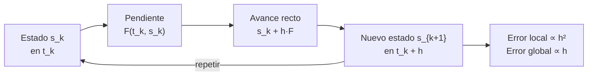

# B11-C05 — Método de Euler

<!-- nav:top -->
<!-- /nav -->

## 1. Ubicación, nivel y alcance

Quinta clase del bloque B11 y primera de los métodos numéricos. En [C04](../B11-C04-sistemas-de-ecuaciones-diferenciales/CLASE.md) escribiste el sistema `s′ = F(t, s)`; aquí aprendes la regla más simple para **avanzar el estado un paso en el tiempo**: el método de Euler. Nivel N2. Verás cómo se construye, qué error comete y por qué, aplicado a una órbita, hace crecer la energía sin parar. No verás métodos de orden superior (C06 y C07) ni análisis de estabilidad (C09).

## 2. Por qué esta clase existe

La mayoría de las ecuaciones del movimiento no tiene solución en forma cerrada. Un computador no resuelve la ecuación: da pasos pequeños, y cada paso usa la pendiente conocida para estimar el estado siguiente. Euler es el esquema más simple, el modelo mínimo de todos los demás; entenderlo bien es entender qué significa «error de truncamiento» y «orden».

La pregunta motivadora: **¿qué tan cerca está la trayectoria calculada de la verdadera, y cómo cambia ese error al reducir el paso?** La decisión central: **cuánto paso `h` usar y qué precisión se puede esperar**.

## 3. Lo que podrás hacer al terminar

1. Escribir la regla `s_{k+1} = s_k + h F(t_k, s_k)` y aplicarla a mano.
2. Distinguir **error local** y **error global**, y explicar por qué el método es de orden 1.
3. Medir el **orden observado** a partir de una tabla de errores.
4. Aplicar Euler a un satélite y detectar la deriva de energía.
5. Estimar cuántos pasos requiere una precisión dada.
6. Decidir cuándo Euler no es aceptable.

La evidencia es el **informe de convergencia** del ejercicio 12 (sección 20).

## 4. Con qué llegas y cómo comprobarlo

Necesitas el sistema de primer orden de [C04](../B11-C04-sistemas-de-ecuaciones-diferenciales/CLASE.md) y el desarrollo en serie de Taylor de primer orden de B09. Cinco preguntas:

1. Si `y(t) = e^{−t}`, ¿cuánto vale `y′(0)`?
2. ¿Qué dice la recta tangente: `y(t₀ + h) ≈ ?`
3. ¿Cuánto es `e^{−0,5}`?
4. ¿Qué es el vector de estado de un satélite plano?
5. ¿Cuánto es `log₂ 4`?

<details>
<summary>Ver respuestas</summary>

1. `−1`. 2. `y(t₀) + h y′(t₀)`. 3. `0,6065`. 4. `(x, y, v_x, v_y)`. 5. `2`.
</details>

Con cuatro o cinco aciertos, sigue; si no, repasa C04 y B09.

## 5. Un caso real: un paso de Euler sobre la órbita de 400 km

Con `GM = 3,986 004 × 10¹⁴ m³ s⁻²` y radio nominal `6,3781 × 10⁶ m` (S1), la órbita circular a 400 km de altitud (valor **ilustrativo**) tiene `a = 6 778,1 km` y velocidad `7 668,58 m/s`. Un solo paso de Euler de `h = 10 s` desde `(a, 0, 0, 7 668,58)` lleva la nave a `r = 6 778 533,8 m`, es decir, **433,8 m más lejos del centro** que el radio exacto, que no debió cambiar. Tras unas pocas vueltas, ese error se acumula. Este es el **ejemplo conductor** de la clase.

## 6. Vocabulario

Un **paso** es el avance de `t_k` a `t_{k+1} = t_k + h`. El **método de Euler explícito** calcula `s_{k+1} = s_k + h F(t_k, s_k)` (también llamado «de las tangentes»). El **error local de truncamiento** es lo que el método se equivoca en un solo paso partiendo del valor exacto. El **error global** es la diferencia acumulada entre la solución numérica y la exacta en un tiempo fijo. El **orden** `p` de un método significa que el error global es proporcional a `h^p`. El **orden observado** se estima como `p ≈ log₂(E(h)/E(h/2))`. Una **evaluación de la función** es una llamada a `F`.

## 7. Modelo mental: seguir la tangente a ciegas

Euler es caminar siguiendo la dirección que marca el terreno *en el punto donde estás*, sin mirar cómo cambia durante el paso. En un terreno que se curva, te desvías siempre hacia el lado convexo.



*Descripción textual:* desde el estado actual se calcula la pendiente, se avanza en línea recta durante `h` y se obtiene el siguiente estado; el proceso se repite. En cada paso se comete un error proporcional a `h²`; tras `T/h` pasos, el error total es proporcional a `h`.

Analogía: conducir de noche siguiendo la dirección de los faros sin girar el volante durante un tramo. Su límite: Euler tiene una regla de corrección posible (los métodos de las clases siguientes), mientras que el conductor corrige continuamente.

## 8. La explicación, paso a paso

### 8.1 De la tangente a la regla

El desarrollo de Taylor de primer orden dice `y(t + h) = y(t) + h y′(t) + (h²/2) y″(ξ)`. Si se desprecia el último término y se sustituye `y′ = f(t, y)`, queda `y_{k+1} = y_k + h f(t_k, y_k)`. Para un sistema, lo mismo con vectores. El término despreciado es el **error local**, de tamaño proporcional a `h²`.

### 8.2 Un ejemplo a mano

`y′ = −y`, `y(0) = 1`, `h = 0,5` hasta `t = 0,5`. Un paso: `y₁ = 1 + 0,5(−1) = 0,5`. Exacto: `e^{−0,5} = 0,6065`. Error: `0,107`. Con `h = 0,25` y dos pasos: `1 → 0,75 → 0,5625`; error `0,044`. Reducir el paso a la mitad bajó el error de `0,107` a `0,044` (razón 2,4 en este tramo tan corto; con pasos más pequeños la razón tiende a 2): señal de orden 1.

### 8.3 Del error local al global

Para llegar de `0` a `T` hacen falta `T/h` pasos. Cada uno agrega un error `∝ h²`; sumados dan `∝ (T/h) h² = T h`. Por eso el método es de **orden 1**: dividir el paso entre 2 divide el error entre 2 (no entre 4 ni entre 16). En el laboratorio, para `y′ = −y` hasta `t = 2`, los errores `1,376 × 10⁻²`, `6,82 × 10⁻³`, `3,40 × 10⁻³`, `1,70 × 10⁻³` con `N = 20, 40, 80, 160` dan órdenes observados `1,012`, `1,006`, `1,003`.

### 8.4 Cuántos pasos hacen falta

Si el error global es `E ≈ C h` con `C` estimado de la tabla (`C ≈ 0,1356` para `t = 2`), para `E = 10⁻³` se necesita `h ≈ 7,4 × 10⁻³`, es decir, unos 270 pasos. Para una precisión mil veces mejor, mil veces más pasos: el costo crece muy rápido. Ésta es la razón de ser de los métodos de orden alto.

### 8.5 Euler sobre una órbita

Aplicado a la órbita circular, el error de posición después de una vuelta es de `9 683 km` con 200 pasos (`h = 27,8 s`), `5 562 km` con 400, `2 993 km` con 800 y `1 553 km` con 1 600 (`h = 3,47 s`). Aunque el orden es 1 (el error se reduce a la mitad, con razones `1,74`, `1,86`, `1,93`), el error absoluto sigue siendo enorme. Además, la órbita **se expande**: con 1 600 pasos el radio terminó en `1,048 a`, y la energía específica aumentó `4,5 %` (de `−2,94 × 10⁷` a un valor menos negativo). Euler explícito añade energía en cada paso a esta órbita; no es azar: el paso se hace sobre la tangente, que siempre está *fuera* de la circunferencia.

### 8.6 Por qué importa para la ciencia espacial

Una deriva de energía del 4,5 % por vuelta equivale a cambiar la altitud de la nave por cientos de kilómetros. Para una órbita larga ese resultado no es utilizable. Euler sirve para ver el concepto, hacer estimaciones muy gruesas y probar un programa; no se usa para propagar trayectorias reales.

## 9. Magnitudes, símbolos y unidades

| Símbolo | Qué es | Unidad | Nota |
|---|---|---|---|
| `h` | tamaño de paso | s | |
| `t_k` | instante `k`-ésimo | s | `t₀ + k h` |
| `s_k` | estado numérico en `t_k` | mezcla | `(x, y, v_x, v_y)` |
| `F` | función derivada | mezcla por s | |
| `E(h)` | error global | unidad de `s` | |
| `p` | orden del método | adimensional | 1 para Euler |
| `N` | número de pasos | adimensional | `T/h` |
| `GM` | parámetro gravitacional | m³ s⁻² | `3,986 004 × 10¹⁴` (S1) |

## 10. Convenciones y referencias

Dos cuerpos, plano, sistema inercial, aritmética de doble precisión. El error de posición se mide como la distancia entre la posición calculada y la exacta tras una vuelta completa. «Más lejos del centro» se refiere al radio `r = √(x² + y²)`.

## 11. De dónde sale lo que afirmamos

| ID | Fuente | Localizador | Respalda | Estado |
|---|---|---|---|---|
| S1 | IAU, Resolución B3 de 2015 | arXiv:1510.07674, https://arxiv.org/pdf/1510.07674 | `(GM)_E^N = 3,986 004 × 10¹⁴ m³ s⁻²`, `R_eE^N = 6,3781 × 10⁶ m` | Texto extraído del PDF el 2026-11-05 |
| S2 | NIST, *DLMF* §3.7, versión 1.2.8 | https://dlmf.nist.gov/3.7 | Contexto: métodos de serie de Taylor y de Runge–Kutta para EDO | Consultada el 2026-11-05 mediante extracción automática |

Límites: la derivación del método de Euler, el error local y el orden son resultados estándar que no se atribuyen a una fuente consultada; las cifras del laboratorio son cálculos propios. S2 sirve de contexto, no respalda directamente la regla de Euler.

## 12. Cómo ver la deriva

Equivalente accesible a una gráfica del radio de la órbita calculada con Euler (cálculo, una vuelta):

| Pasos por vuelta | `h` (s) | `r/a` al final | Error de posición (km) |
|---|---|---|---|
| 200 | 27,77 | 1,3698 | 9 682,7 |
| 400 | 13,88 | 1,1882 | 5 562,1 |
| 800 | 6,94 | 1,0957 | 2 993,0 |
| 1 600 | 3,47 | 1,0485 | 1 553,0 |

Descripción larga: la trayectoria es una espiral que se abre, no un círculo; el ensanchamiento se reduce aproximadamente a la mitad cada vez que se duplica el número de pasos.

## 13. Ejemplo trabajado: un paso sobre la órbita

**Paso 1 · Estado inicial.** `s₀ = (6 778 100 m, 0, 0, 7 668,58 m/s)`, `h = 10 s`.

**Paso 2 · Pendiente.** `F(s₀) = (0, 7 668,58, −8,676, 0)` (C04).

**Paso 3 · Avance.** `x₁ = 6 778 100`, `y₁ = 76 685,79`, `v_{x1} = −86,76`, `v_{y1} = 7 668,58`.

**Paso 4 · Radio.** `r₁ = √(6 778 100² + 76 685,79²) = 6 778 533,8 m`.

**Paso 5 · Diagnóstico.** El radio exacto no cambió: el error en un paso es `433,8 m`. Coincide con la fórmula `a (√(1 + (n h)²) − 1)`, con `n h = 0,0113`.

**Paso 6 · Energía.** La energía específica pasó de `−2,940 355 × 10⁷` a `−2,939 602 × 10⁷ J/kg`: aumentó `7 527 J/kg` (`2,6 × 10⁻⁴` relativo) en un solo paso.

**Paso 7 · Sentido.** Un paso de 10 s ya inyecta una energía no física; con 555 pasos por vuelta el efecto se acumula. Estos cálculos son **simulados** con datos ilustrativos.

## 14. Comparación: más pasos o mejor método

Reducir `h` mejora Euler solo linealmente: para reducir diez veces el error hay que gastar diez veces más evaluaciones. Un método de orden 2 o 4 (C06, C07) reduce el error con `h²` o `h⁴`. Con el mismo costo, los métodos de orden alto ganan por varios órdenes de magnitud (se mide en C07).

## 15. Práctica guiada

**Ejercicio 1 · con los pasos indicados.** Aplica Euler a `y′ = −y`, `y(0) = 1`, con `h = 0,5`, y calcula `y(0,5)` y el error. *Pasos:* regla, evaluar, comparar con `e^{−0,5}` (8.2).

<details><summary>Solución comentada</summary>

`y₁ = 1 + 0,5(−1) = 0,5`; exacto `0,6065`; error `0,1065`.
</details>

**Ejercicio 2 · con una pista.** Repite con `h = 0,25` (dos pasos). *Pista:* el segundo paso parte de `0,75`.

<details><summary>Solución comentada</summary>

`y₁ = 0,75`; `y₂ = 0,75 − 0,25 · 0,75 = 0,5625`; error `0,0440`. Razón entre errores: 2,4.
</details>

**Ejercicio 3 · casi autónomo.** Aplica Euler a `y′ = −0,3 y`, `y(0) = 5`, con `h = 1` hasta `t = 2` y compara con la solución exacta.

<details><summary>Solución comentada</summary>

`y_{k+1} = y_k(1 − 0,3) = 0,7 y_k`: `5 → 3,5 → 2,45`. Exacto `5 e^{−0,6} = 2,744`; error `0,294`.
</details>

## 16. Práctica autónoma, transferencia e integrador

**Ejercicio 4.** Con errores `1,376 × 10⁻²` (`N = 20`) y `6,823 × 10⁻³` (`N = 40`), calcula el orden observado.

<details><summary>Solución comentada</summary>

`log₂(1,376/0,6823) = 1,012` (8.3).
</details>

**Ejercicio 5.** ¿Cuántos pasos requiere Euler para `E = 10⁻³` en `y′ = −y` hasta `t = 2`, con `C = 0,1356`?

<details><summary>Solución comentada</summary>

`h = 10⁻³/0,1356 = 7,37 × 10⁻³`; `N = 2/h ≈ 271` (8.4).
</details>

**Ejercicio 6.** ¿Cuánto error esperas con `N = 640` para `y′ = −y` hasta `t = 2`?

<details><summary>Solución comentada</summary>

`h = 2/640 = 3,125 × 10⁻³`; `E ≈ 0,1356 · 3,125 × 10⁻³ = 4,2 × 10⁻⁴`.
</details>

**Ejercicio 7.** Calcula `r₁ − a` tras un paso de Euler sobre la órbita circular con `h = 5 s`.

<details><summary>Solución comentada</summary>

`n h = 1,1314 × 10⁻³ · 5 = 5,657 × 10⁻³`; `a(√(1 + (nh)²) − 1) ≈ a (nh)²/2 = 6,7781 × 10⁶ · 1,6 × 10⁻⁵ = 108,4 m`. Es la cuarta parte de la de `h = 10 s`: el error local crece como `h²`.
</details>

**Ejercicio 8.** ¿Por qué el error de posición pasó de `9 683 km` a `5 562 km` al duplicar los pasos, y no a `2 421 km`?

<details><summary>Solución comentada</summary>

Porque con pasos todavía grandes no se ha entrado en la zona donde el error es `∝ h`; la razón observada (`1,74`) tiende a 2 al reducir `h` (`1,86`, `1,93`).
</details>

**Ejercicio 9 · transferencia.** Un colega propone «usar `h = 1 s` y listo». Estima el error de posición tras una vuelta con ese paso si el error es `≈ 1 553 km` a `h = 3,47 s`.

<details><summary>Solución comentada</summary>

Proporcional a `h`: `1 553 · (1/3,47) ≈ 448 km`, y con 5 554 pasos por vuelta. Sigue siendo un error enorme para operaciones reales. Estimación por extrapolación del orden observado.
</details>

**Ejercicio 10 · transferencia.** Un programa de propagación con Euler muestra que la energía sube en cada vuelta. ¿Es un error de programación? ¿Cómo lo distinguirías?

<details><summary>Solución comentada</summary>

No necesariamente: es la firma del método. Se distingue reduciendo `h`: si la deriva baja proporcionalmente a `h`, es error de método; si no cambia, hay un fallo en `F` (C04).
</details>

**Ejercicio 11 · transferencia.** Un estudiante usa `h = 10 s` con la energía inicial `−2,94 × 10⁷` y obtiene `+2,0 × 10⁷` tras pocas vueltas. ¿Qué te dice?

<details><summary>Solución comentada</summary>

Energía positiva significa órbita no ligada (C02): un artefacto numérico. El método ya no representa el sistema físico; hay que reducir `h` o cambiar de método.
</details>

**Ejercicio 12 · integrador.** Elabora tu *informe de convergencia*: aplica Euler a `y′ = −y` y a la órbita con tres valores de `h`, tabula el error, calcula el orden observado y la deriva de energía, y concluye cuántos pasos necesitas para un error dado.

<details><summary>Solución modelo</summary>

Tabla con `h`, error, orden observado (≈1), `r/a` y deriva de energía; conclusión con una extrapolación (como en el ejercicio 9) rotulada como estimación; `GM` con fuente y fecha; altitud ilustrativa.
</details>

## 17. Laboratorio: Euler, orden y órbita

El script [euler_orden_y_orbita.py](euler_orden_y_orbita.py) mide el orden observado en `y′ = −y` y el error de posición en la órbita; falla si el orden sale fuera del rango o si la energía no crece.

**Datos:** `GM` y radio nominales IAU; altitud ilustrativa. **Predice antes de ejecutar:** ¿cuánto crece el radio con 1 600 pasos? (≈5 %.) **Ejecución del 2026-11-05 (Python 3.12.9):**

```text
(a) N=  20  h=0.10000  error=1.3759e-02
(a) N=  40  h=0.05000  error=6.8231e-03
(a) N=  80  h=0.02500  error=3.3975e-03
(a) N= 160  h=0.01250  error=1.6952e-03
    orden observado: 1.012 1.006 1.003
(b) N=  200  h=  27.768 s  error de posicion =   9682.674 km  r/a = 1.36978  d(energia)/|e0| = +2.307e-01
(b) N=  400  h=  13.884 s  error de posicion =   5562.096 km  r/a = 1.18820  d(energia)/|e0| = +1.435e-01
(b) N=  800  h=   6.942 s  error de posicion =   2992.960 km  r/a = 1.09566  d(energia)/|e0| = +8.274e-02
(b) N= 1600  h=   3.471 s  error de posicion =   1553.047 km  r/a = 1.04846  d(energia)/|e0| = +4.496e-02
    razones de error: 1.741 1.858 1.927
Pruebas superadas.
```

```bash
python programa/clases/B11/B11-C05-metodo-de-euler/euler_orden_y_orbita.py
```

**Límites:** dos cuerpos, sin perturbaciones; altitud ilustrativa; los resultados son **simulados**.

## 18. Errores frecuentes y cómo corregirlos

**Pensar que Euler «converge rápido» porque la fórmula es simple.** Se corrige con los ejercicios 5 y 6.

**Confundir error local con global.** Se corrige con el ejercicio 4 y la sección 8.3.

**Usar `h` sin relacionarlo con el periodo.** Se corrige con los ejercicios 7 y 9.

**Atribuir la deriva de energía a un error del programa.** Se corrige con el ejercicio 10.

**Dar el resultado con más cifras de las que justifica el método.** Se corrige con el ejercicio 12.

## 19. Cómo sabrás que vas bien

Tras 8.2: ¿repites el paso a mano con otro `h`? Si no, ejercicios 1 y 2. Tras 8.3: ¿por qué el orden global es uno menos que el local? Si no, ejercicio 4. Tras 8.5: ¿por qué crece la energía? Si no lo explicas, ejercicio 10. Tras el laboratorio: ¿cómo sabes que el orden medido es 1? (la razón de errores se acerca a 2).

## 20. Qué entregas y cómo se evalúa

El producto es tu **informe de convergencia** (ejercicio 12).

| Criterio | Inicial | En desarrollo | Logrado | Destacado |
|---|---|---|---|---|
| Aplicación del método | Errores de cálculo | Correcta con ayuda | Pasos correctos a mano y en código | Explica el origen del término de error |
| Orden observado | Ausente | Calculado sin interpretar | Calcula `log₂` de razones | Relaciona local y global |
| Deriva de energía | No la mide | La mide sin explicar | La mide y la explica | La usa para decidir el paso |
| Estimación de pasos | Ausente | Sin justificar | Con `E ≈ C h` | Discute los límites de la extrapolación |
| Fuentes | Sin fuente | Sin fecha | Con localizador y fecha | Rotula simulado e ilustrativo |

**Condiciones críticas (no se compensan con promedio):** medir el orden con al menos tres valores de `h`; rotular lo simulado; citar solo fuentes consultadas.

## 21. Ética, seguridad y límites

Una trayectoria propagada con Euler no sirve para planificar maniobras ni para evaluar riesgo de colisión. Ningún resultado de esta clase es operativo. Accesibilidad: fórmulas en texto, tablas equivalentes a las gráficas, ejercicios sin conexión.

## 22. Para cerrar y seguir

Euler avanza siguiendo la tangente; su error local es `∝ h²` y el global `∝ h`; en una órbita añade energía en cada paso y la espiral se abre. Queda abierta una pregunta: ¿se puede promediar la pendiente al inicio y al final del paso para ganar un orden? Es el método de Heun.

**Glosario español–inglés.** método de Euler · *Euler method*; paso · *step*; error local de truncamiento · *local truncation error*; error global · *global error*; orden observado · *observed order*; evaluación de la función · *function evaluation*; deriva · *drift*.

**Continuidad.** B11-C06 reutiliza tu capacidad de **medir el orden observado** para verificar un método de orden 2.

**Referencias:** ver sección 11.

<!-- nav:bottom -->
<!-- /nav -->
