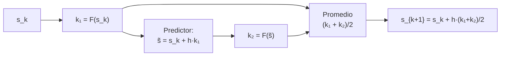

# B11-C06 — Método de Heun

<!-- nav:top -->
[🏠 Programa](../../../../README.md) · [📚 Bloque B11](../../../tronco-comun/B11-ecuaciones-diferenciales-y-simulacion-numerica.md) · [← Anterior: B11-C05 — Método de Euler](../B11-C05-metodo-de-euler/CLASE.md) · [Siguiente: B11-C07 — Runge-Kutta de cuarto orden →](../B11-C07-runge-kutta-de-cuarto-orden/CLASE.md)
<!-- /nav -->

## 1. Ubicación, nivel y alcance

Sexta clase del bloque B11. En [C05](../B11-C05-metodo-de-euler/CLASE.md) viste que Euler sigue la tangente del inicio del paso y por eso se desvía. Aquí aprendes la primera mejora: **promediar la pendiente del inicio con la del final del paso**, el método de Heun (también llamado de Euler mejorado o trapezoidal explícito). Nivel N2. Verás que gana un orden con solo una evaluación más. No verás la familia general de Runge–Kutta (C07) ni el control del paso (C08).

## 2. Por qué esta clase existe

Una evaluación de `F` en un cálculo de trayectorias es cara cuando incluye gravedad de varios cuerpos o un modelo de atmósfera. La pregunta práctica es siempre cuánta precisión compra cada evaluación. Heun es el ejemplo más simple de un método que *gasta más por paso, pero se necesitan muchísimos menos pasos*.

La pregunta motivadora: **¿qué ganancia en precisión justifica el doble de costo por paso?** La decisión central: **comparar métodos a igual número de evaluaciones, no a igual número de pasos**.

## 3. Lo que podrás hacer al terminar

1. Aplicar a mano el método de Heun (predictor y corrector).
2. Explicar por qué es de orden 2 y qué significa «promediar pendientes».
3. Verificar el orden observado con una tabla de errores.
4. Comparar Euler y Heun a igual número de evaluaciones de `F`.
5. Medir el error de un paso sobre la órbita de 400 km.
6. Decidir cuándo un método de orden 2 basta.

La evidencia es la **tabla comparativa a igual costo** del ejercicio 12 (sección 20).

## 4. Con qué llegas y cómo comprobarlo

Necesitas [C05](../B11-C05-metodo-de-euler/CLASE.md): regla de Euler, error local y global, orden observado. Cinco preguntas:

1. Aplica Euler a `y′ = −y`, `y(0) = 1`, `h = 0,5`.
2. ¿Cuál es el orden global de Euler?
3. ¿Qué significa «orden observado»?
4. ¿Cuánto es el promedio de `−1` y `−0,5`?
5. ¿Qué es una evaluación de `F`?

<details>
<summary>Ver respuestas</summary>

1. `y₁ = 0,5`. 2. Uno. 3. `log₂` de la razón de errores al dividir `h` entre 2. 4. `−0,75`. 5. Una llamada a la función derivada.
</details>

Con cuatro o cinco aciertos, sigue; si no, repasa C05.

## 5. Un caso real: el mismo paso de 10 s sobre la órbita

Con `GM = 3,986 004 × 10¹⁴ m³ s⁻²` y radio nominal `6,3781 × 10⁶ m` (S1), la órbita de 400 km (ilustrativa) tiene `a = 6 778,1 km`. Un paso de `h = 10 s` con Euler dejó la nave **433,8 m** fuera del radio correcto (C05). El mismo paso con Heun la deja a **0,0139 m** del radio correcto, es decir, unas 31 000 veces menos. El costo fue el doble. Este es el **ejemplo conductor**: dos evaluaciones por paso en lugar de una compran órdenes de magnitud de precisión.

## 6. Vocabulario

El **método de Heun** da, para `s′ = F(t, s)`: `k₁ = F(t_k, s_k)`; `s̃ = s_k + h k₁` (**predictor**: un paso de Euler); `k₂ = F(t_k + h, s̃)`; `s_{k+1} = s_k + (h/2)(k₁ + k₂)` (**corrector**). Una **pendiente** es el valor de `F` en un punto. Un método **de dos etapas** evalúa `F` dos veces por paso. Un método **explícito** calcula el nuevo estado solo con valores ya conocidos. La **regla del trapecio** promedia los extremos de un intervalo; Heun la usa con el extremo final estimado por el predictor.

## 7. Modelo mental: mirar hacia adelante antes de decidir

Euler decide con la pendiente del punto de partida. Heun se asoma al punto de llegada estimado, mide la pendiente allí y avanza con el promedio de las dos. Es como ajustar el rumbo a medio tramo.



*Descripción textual:* se calcula la pendiente al inicio, un paso de Euler provisional, la pendiente en ese punto provisional, y se avanza con el promedio de ambas pendientes.

Analogía: medir la pendiente de una cuesta a la salida y a la llegada del tramo y tomar el promedio. Su límite: si entre ambos puntos la cuesta cambia bruscamente, el promedio sigue siendo una aproximación.

## 8. La explicación, paso a paso

### 8.1 A mano sobre `y′ = −y`

`y(0) = 1`, `h = 0,5`. `k₁ = −1`. Predictor: `s̃ = 1 + 0,5(−1) = 0,5`. `k₂ = −0,5`. `y₁ = 1 + 0,25(−1 − 0,5) = 0,625`. Exacto: `0,6065`. Error `0,0185` (Euler: `0,1065`). En general, para `y′ = −y` Heun multiplica por `1 − h + h²/2` en cada paso: los tres primeros términos de `e^{−h}`.

### 8.2 Por qué es de orden 2

El error local de Heun es proporcional a `h³` (coincide con el desarrollo de Taylor hasta `h²`). Con `T/h` pasos, el error global es `∝ h²`. Al dividir `h` entre 2 el error se divide entre 4. En el laboratorio, para `y′ = −y` hasta `t = 2`: errores `4,872 × 10⁻⁴`, `1,171 × 10⁻⁴`, `2,873 × 10⁻⁵`, `7,115 × 10⁻⁶` con `N = 20, 40, 80, 160`; órdenes `2,056`, `2,028`, `2,014`.

### 8.3 Dos pasos con h = 0,25

`y′ = −y`: factor por paso `1 − 0,25 + 0,03125 = 0,78125`; dos pasos: `0,6104`. Error `0,0038`, es decir, unas 4,8 veces menos que con `h = 0,5` (`0,0185`): ya cerca de la razón 4.

### 8.4 Heun sobre la órbita

Un solo paso de 10 s: la posición `(6 777 666,2; 76 685,8)` m y la velocidad `(−86,75; 7 668,09)` m/s dan un radio con error de `0,0139 m` y un aumento de energía de `0,24 J/kg` (Euler: `7 527 J/kg`). Tras una vuelta completa, los errores de posición con `N = 100, 200, 400, 800` pasos son `245,8; 59,0; 14,4; 3,55 km`, con razones `4,17`, `4,10`, `4,05`: orden 2. La deriva relativa de energía baja `7,6 × 10⁻⁴`, `9,7 × 10⁻⁵`, `1,2 × 10⁻⁵`, `1,5 × 10⁻⁶`: sigue siendo positiva, es decir, Heun también añade energía, pero mucho menos.

### 8.5 A igual costo

Con 800 evaluaciones de `F`: Euler (800 pasos) da un error de `2 993 km`; Heun (400 pasos) da `14,4 km`. Heun es unas **208 veces** más preciso al mismo costo. Es la lección de la clase: el número de pasos no es la medida del costo; lo es el número de evaluaciones.

### 8.6 Cuándo basta y cuándo no

Para estimaciones rápidas, ejercicios y primeras pruebas de un programa, Heun suele bastar. Para órbitas de largo plazo o precisión alta, sigue acumulando deriva de energía y se prefiere un método de orden 4 (C07), uno adaptativo (C08) o uno que conserve la estructura (C11).

## 9. Magnitudes, símbolos y unidades

| Símbolo | Qué es | Unidad | Nota |
|---|---|---|---|
| `h` | tamaño de paso | s | |
| `k₁`, `k₂` | pendientes en el inicio y el punto predicho | unidad de `s` por s | |
| `s̃` | estado predicho | mezcla | |
| `E(h)` | error global | unidad de `s` | `∝ h²` |
| `p` | orden | adimensional | 2 |
| `a` | radio de la órbita | m | 6 778 100 |
| `GM` | parámetro gravitacional | m³ s⁻² | `3,986 004 × 10¹⁴` (S1) |

## 10. Convenciones y referencias

Las mismas que en C05: dos cuerpos, plano, sistema inercial, doble precisión, error de posición medido al final de una vuelta. «Costo» significa número de evaluaciones de `F`, que es el trabajo dominante en una simulación real.

## 11. De dónde sale lo que afirmamos

| ID | Fuente | Localizador | Respalda | Estado |
|---|---|---|---|---|
| S1 | IAU, Resolución B3 de 2015 | arXiv:1510.07674, https://arxiv.org/pdf/1510.07674 | `(GM)_E^N = 3,986 004 × 10¹⁴ m³ s⁻²`, `R_eE^N = 6,3781 × 10⁶ m` | Texto extraído del PDF el 2026-11-05 |
| S2 | NIST, *DLMF* §3.7, versión 1.2.8 | https://dlmf.nist.gov/3.7 | Contexto: la sección trata el método de Runge–Kutta (error local `O(h⁵)` para la regla de cuarto orden) | Consultada el 2026-11-05 mediante extracción automática |

Límites: la derivación de Heun y su orden son resultados estándar que no se atribuyen a una fuente consultada; los números provienen de cálculos propios del laboratorio, **simulados** con datos ilustrativos.

## 12. Cómo ver la comparación

Equivalente accesible a una gráfica de error frente a evaluaciones (órbita, una vuelta; cálculo):

| Evaluaciones de `F` | Euler (km) | Heun (km) |
|---|---|---|
| 200 | 9 682,7 | 245,8 |
| 400 | 5 562,1 | 59,0 |
| 800 | 2 993,0 | 14,4 |
| 1 600 | 1 553,0 | 3,55 |

(Heun con `N = 100, 200, 400, 800` pasos usa 200, 400, 800 y 1 600 evaluaciones.)

Descripción larga: ambas curvas descienden en escala logarítmica, pero la de Heun lo hace con pendiente doble y queda más de dos órdenes de magnitud por debajo en cuanto el número de evaluaciones supera unos cientos.

## 13. Ejemplo trabajado: un paso de Heun sobre la órbita

**Paso 1 · Datos.** `s₀ = (6 778 100, 0, 0, 7 668,58)`, `h = 10 s`.

**Paso 2 · Primera pendiente.** `k₁ = F(s₀) = (0, 7 668,58, −8,676, 0)`.

**Paso 3 · Predictor.** `s̃ = (6 778 100; 76 685,8; −86,76; 7 668,58)`.

**Paso 4 · Segunda pendiente.** `k₂ = F(s̃)`: en `s̃`, `r̃ = 6 778 533,8 m`, de modo que `a_x ≈ −8,6744 m/s²` y aparece una componente `a_y ≈ −0,0981 m/s²`.

**Paso 5 · Promedio.** `s₁ = s₀ + 5 (k₁ + k₂) = (6 777 666,2; 76 685,8; −86,75; 7 668,09)`.

**Paso 6 · Diagnóstico.** `r₁ − a = 0,0139 m`. Energía: `+0,24 J/kg`.

**Paso 7 · Sentido.** Con el doble de costo se obtuvo un error unas 31 000 veces menor en este paso. Los resultados son **simulados** con datos ilustrativos.

## 14. Comparación: Euler, Heun y métodos mayores

Euler: 1 evaluación, orden 1. Heun: 2 evaluaciones, orden 2. RK4 (C07): 4 evaluaciones, orden 4. A mayor orden, menos pasos para una misma precisión, hasta que el error de redondeo domina (se estudia en C19). Heun es la puerta de entrada a la idea de «etapas».

## 15. Práctica guiada

**Ejercicio 1 · con los pasos indicados.** Aplica Heun a `y′ = −y`, `y(0) = 1`, `h = 0,5`: `k₁`, predictor, `k₂`, `y₁`, error. *Pasos:* 8.1.

<details><summary>Solución comentada</summary>

`k₁ = −1`; `s̃ = 0,5`; `k₂ = −0,5`; `y₁ = 0,625`; error `0,0185`.
</details>

**Ejercicio 2 · con una pista.** Repite con `h = 0,25` y dos pasos. *Pista:* factor `1 − h + h²/2` por paso.

<details><summary>Solución comentada</summary>

`0,78125² = 0,6104`; error `0,0038` (8.3).
</details>

**Ejercicio 3 · casi autónomo.** Heun sobre `y′ = −0,3 y`, `y(0) = 5`, `h = 1`, hasta `t = 2`; compara con Euler (C05, ejercicio 3).

<details><summary>Solución comentada</summary>

Factor `1 − 0,3 + 0,045 = 0,745`: `5 → 3,725 → 2,775`; exacto `2,744`; error `0,031` (Euler: `0,294`, diez veces mayor).
</details>

## 16. Práctica autónoma, transferencia e integrador

**Ejercicio 4.** Con errores `4,872 × 10⁻⁴` (`N = 20`) y `1,171 × 10⁻⁴` (`N = 40`), calcula el orden observado.

<details><summary>Solución comentada</summary>

`log₂(4,872/1,171) = 2,056` (8.2).
</details>

**Ejercicio 5.** Aplica Heun a `y′ = t`, `y(0) = 0`, con `h = 1` hasta `t = 1`. ¿Es exacto? ¿Por qué?

<details><summary>Solución comentada</summary>

`k₁ = 0`; `s̃ = 0`; `k₂ = f(1) = 1`; `y₁ = 0 + 0,5(0 + 1) = 0,5 = t²/2` exacto. La regla del trapecio es exacta para integrandos lineales.
</details>

**Ejercicio 6.** Si con `h = 20 s` Heun da un error de `x`, ¿qué error esperas con `h = 10 s`?

<details><summary>Solución comentada</summary>

Orden 2: `x/4`.
</details>

**Ejercicio 7.** Con 800 evaluaciones, Euler da `2 993 km` y Heun `14,4 km`. ¿Cuántas veces más preciso es Heun?

<details><summary>Solución comentada</summary>

`2 993/14,4 = 208` veces.
</details>

**Ejercicio 8.** Calcula el costo en evaluaciones de una vuelta con Heun y `N = 400`.

<details><summary>Solución comentada</summary>

`2 × 400 = 800` evaluaciones.
</details>

**Ejercicio 9 · transferencia.** Un programa debe propagar una vuelta con error menor que `20 km` y solo puede gastar 1 000 evaluaciones. ¿Basta Heun? Usa la tabla de la sección 12.

<details><summary>Solución comentada</summary>

Con 800 evaluaciones Heun da `14,4 km < 20 km`: basta. Euler no llega ni con 1 600 (`1 553 km`). Conclusión con datos simulados.
</details>

**Ejercicio 10 · transferencia.** Un estudiante propone usar el predictor `s̃` como resultado final. ¿Qué método obtiene y qué orden?

<details><summary>Solución comentada</summary>

Euler: orden 1. Heun existe precisamente por el corrector.
</details>

**Ejercicio 11 · transferencia.** La energía de la simulación con Heun sube `1,5 × 10⁻⁶` relativo por vuelta (`N = 800`). ¿Es aceptable para una simulación de 1 000 vueltas?

<details><summary>Solución comentada</summary>

Si crece linealmente, serían `1,5 × 10⁻³` tras 1 000 vueltas: sirve para estudios cualitativos, no para precisión alta. Una deriva sistemática se corrige con métodos de otro tipo (C10, C11).
</details>

**Ejercicio 12 · integrador.** Elabora tu *tabla comparativa a igual costo*: Euler y Heun sobre `y′ = −y` y sobre la órbita con cuatro presupuestos de evaluaciones, error, orden observado y deriva de energía, con una conclusión sobre cuál elegir.

<details><summary>Solución modelo</summary>

Tabla con evaluaciones, error (Euler y Heun), razón entre ambos, orden observado (1 y 2) y deriva; conclusión que condiciona la elección al presupuesto y a la precisión exigida, con datos rotulados como simulados e ilustrativos.
</details>

## 17. Laboratorio: Heun frente a Euler

El script [heun_frente_a_euler.py](heun_frente_a_euler.py) mide el orden de Heun en `y′ = −y` y en la órbita, y compara con Euler a 800 evaluaciones. Falla si el orden sale fuera de rango o si Heun no es al menos 10 veces mejor.

**Datos:** `GM` y radio nominales IAU; altitud ilustrativa. **Predice antes de ejecutar:** ¿qué razón de errores esperas al duplicar `N`? (≈4.) **Ejecución del 2026-11-05 (Python 3.12.9):**

```text
(a) Heun N= 20  error=4.8717e-04
(a) Heun N= 40  error=1.1714e-04
(a) Heun N= 80  error=2.8732e-05
(a) Heun N=160  error=7.1153e-06
    orden observado: 2.056 2.028 2.014
(b) Heun N= 100  error de posicion =   245.7555 km  d(energia)/|e0| = +7.592e-04
(b) Heun N= 200  error de posicion =    58.9684 km  d(energia)/|e0| = +9.680e-05
(b) Heun N= 400  error de posicion =    14.3889 km  d(energia)/|e0| = +1.216e-05
(b) Heun N= 800  error de posicion =     3.5507 km  d(energia)/|e0| = +1.521e-06
    razones de error: 4.168 4.098 4.052
A 800 evaluaciones: Euler 2992.960 km; Heun 14.389 km (razon 208.0)
Pruebas superadas.
```

```bash
python programa/clases/B11/B11-C06-metodo-de-heun/heun_frente_a_euler.py
```

**Límites:** dos cuerpos, sin perturbaciones; resultados **simulados**.

## 18. Errores frecuentes y cómo corregirlos

**Evaluar `k₂` en `s_k` en lugar de en `s̃`.** Se corrige con el ejercicio 1.

**Promediar mal (olvidar el factor `h/2`).** Se corrige con los ejercicios 1 y 2.

**Comparar a igual número de pasos.** Se corrige con los ejercicios 7 y 9.

**Creer que orden 2 elimina la deriva de energía.** Se corrige con el ejercicio 11.

**Usar `h` sin relación con el periodo.** Se corrige con el ejercicio 6.

## 19. Cómo sabrás que vas bien

Tras 8.1: ¿repites el paso con otro `h`? Si no, ejercicios 1 y 2. Tras 8.2: ¿por qué el error se divide entre 4? Si no, ejercicio 4. Tras 8.5: ¿por qué se compara a igual costo? Si no, ejercicio 7. Tras el laboratorio: ¿qué indicaría un orden observado cercano a 1? (un error en el corrector).

## 20. Qué entregas y cómo se evalúa

El producto es tu **tabla comparativa a igual costo** (ejercicio 12).

| Criterio | Inicial | En desarrollo | Logrado | Destacado |
|---|---|---|---|---|
| Aplicación de Heun | Predictor sin corrector | Correcta con ayuda | Correcta a mano y en código | Explica por qué el promedio gana un orden |
| Orden observado | Ausente | Un solo `h` | Tres o más `h` | Contrasta con el orden teórico |
| Comparación | A igual pasos | A igual costo sin conclusión | A igual costo con conclusión | Condiciona la elección al presupuesto |
| Deriva de energía | No la mide | La mide | La mide y compara métodos | La usa para fijar `h` |
| Fuentes | Sin fuente | Sin fecha | Con localizador y fecha | Rotula simulado e ilustrativo |

**Condiciones críticas (no se compensan con promedio):** comparar a igual número de evaluaciones; rotular lo simulado; citar solo fuentes consultadas.

## 21. Ética, seguridad y límites

Un error de decenas de kilómetros tras una vuelta es aceptable en un ejercicio y totalmente inaceptable en una operación. Los resultados no sirven para planificar maniobras ni evitar colisiones. Accesibilidad: fórmulas en texto, tablas equivalentes a las gráficas, ejercicios sin conexión.

## 22. Para cerrar y seguir

Heun promedia dos pendientes con una evaluación adicional, es de orden 2, y a igual costo supera a Euler en más de dos órdenes de magnitud en la órbita; sin embargo sigue añadiendo energía. Queda abierta una pregunta: ¿cuál es la receta general para combinar varias pendientes y alcanzar orden 4? Es el método de Runge–Kutta clásico.

**Glosario español–inglés.** método de Heun · *Heun's method*; predictor · *predictor*; corrector · *corrector*; método de dos etapas · *two-stage method*; regla del trapecio · *trapezoidal rule*; evaluación de la función · *function evaluation*.

**Continuidad.** B11-C07 reutiliza tu capacidad de **comparar métodos a igual costo** para evaluar un método de cuatro etapas.

**Referencias:** ver sección 11.

<!-- nav:bottom -->
---

[← Anterior: B11-C05 — Método de Euler](../B11-C05-metodo-de-euler/CLASE.md) · [📚 Bloque B11](../../../tronco-comun/B11-ecuaciones-diferenciales-y-simulacion-numerica.md) · [Siguiente: B11-C07 — Runge-Kutta de cuarto orden →](../B11-C07-runge-kutta-de-cuarto-orden/CLASE.md)
<!-- /nav -->
