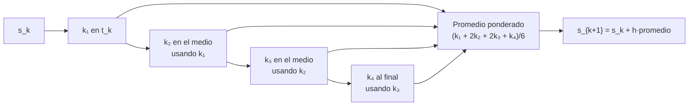

# B11-C07 — Runge-Kutta de cuarto orden

<!-- nav:top -->
[🏠 Programa](../../../../README.md) · [📚 Bloque B11](../../../tronco-comun/B11-ecuaciones-diferenciales-y-simulacion-numerica.md) · [← Anterior: B11-C06 — Método de Heun](../B11-C06-metodo-de-heun/CLASE.md) · [Siguiente: B11-C08 — Integradores de paso adaptativo →](../B11-C08-integradores-de-paso-adaptativo/CLASE.md)
<!-- /nav -->

## 1. Ubicación, nivel y alcance

Séptima clase del bloque B11. Con [Euler](../B11-C05-metodo-de-euler/CLASE.md) y [Heun](../B11-C06-metodo-de-heun/CLASE.md) viste que combinar pendientes dentro de un paso eleva el orden. Aquí aprendes la combinación clásica de **cuatro pendientes**: el método de Runge–Kutta de cuarto orden (RK4), el caballo de batalla de la integración numérica de propósito general. Nivel N2. Verás su construcción, su orden, su eficiencia sobre la órbita de 400 km y por qué, aun así, no conserva exactamente la energía. No verás control de paso (C08) ni métodos que conservan estructura (C11).

## 2. Por qué esta clase existe

La mayoría de los programas de simulación científica usa, de forma directa o como base, un método de la familia Runge–Kutta. Entender RK4 permite leer cualquier código de propagación, estimar cuántos pasos necesita una órbita y saber en qué punto empieza a ser conveniente algo más sofisticado.

La pregunta motivadora: **¿cuánta precisión se gana pasando de dos a cuatro evaluaciones por paso, y cuándo deja de compensar?** La decisión central: **qué orden usar para un presupuesto de evaluaciones dado**.

## 3. Lo que podrás hacer al terminar

1. Aplicar a mano un paso de RK4 con sus cuatro pendientes.
2. Explicar por qué el error local es `∝ h⁵` y el global `∝ h⁴`.
3. Verificar el orden observado con una tabla de errores.
4. Comparar Euler, Heun y RK4 a igual número de evaluaciones.
5. Medir el error de RK4 sobre una vuelta completa de la órbita de 400 km.
6. Reconocer el límite de RK4: una deriva lenta de energía.

La evidencia es el **cuadro de eficiencia de los tres métodos** del ejercicio 12 (sección 20).

## 4. Con qué llegas y cómo comprobarlo

Necesitas Euler y Heun (C05, C06). Cinco preguntas:

1. ¿Cuál es el orden global de Heun?
2. Si el error de Heun es `E` con `h`, ¿cuánto es con `h/2`?
3. ¿Cuántas evaluaciones por paso usa Heun?
4. Calcula `(1 + 2·3 + 2·5 + 4)/6`.
5. ¿Cuánto vale `log₂ 16`?

<details>
<summary>Ver respuestas</summary>

1. Dos. 2. `E/4`. 3. Dos. 4. `21/6 = 3,5`. 5. `4`.
</details>

Con cuatro o cinco aciertos, sigue; si no, repasa C06.

## 5. Un caso real: una vuelta con 800 evaluaciones

Con `GM = 3,986 004 × 10¹⁴ m³ s⁻²` y radio nominal `6,3781 × 10⁶ m` (S1), la órbita de 400 km (ilustrativa) se recorre en `5 553,6 s`. Con 800 evaluaciones de `F`, el error de posición tras una vuelta es: **Euler `2 993 km`**, **Heun `14,4 km`**, **RK4 `1,12 m`**. De Euler a RK4, el mismo costo da un error unas 2,7 millones de veces menor. Este es el **ejemplo conductor**: la elección del orden cambia la respuesta en órdenes de magnitud.

## 6. Vocabulario

El **método RK4 clásico** calcula cuatro pendientes por paso: `k₁ = F(t_k, s_k)`; `k₂ = F(t_k + h/2, s_k + h k₁/2)`; `k₃ = F(t_k + h/2, s_k + h k₂/2)`; `k₄ = F(t_k + h, s_k + h k₃)`; y avanza con `s_{k+1} = s_k + (h/6)(k₁ + 2k₂ + 2k₃ + k₄)`. Una **etapa** es cada evaluación dentro del paso. El **punto medio** es `t_k + h/2`. La **familia Runge–Kutta** agrupa métodos de este tipo con distinto número de etapas. Un método de **orden `p`** tiene error global `∝ h^p`. La *Digital Library of Mathematical Functions* (DLMF) del NIST da la regla de cuarto orden con error local `O(h⁵)` (S2, §3.7(v)).

## 7. Modelo mental: sondear el paso antes de avanzar

RK4 sondea la pendiente en el inicio, dos veces en el medio (con dos estimaciones distintas del estado medio) y en el final, y luego pondera: los puntos medios pesan el doble. Es una regla de Simpson aplicada a la dirección del movimiento.



*Descripción textual:* cada pendiente se calcula usando la anterior para estimar el estado en el punto de sondeo; las cuatro se combinan con pesos 1, 2, 2, 1 sobre 6 para avanzar el estado.

Analogía: un topógrafo que mide la pendiente en el comienzo, dos veces en la mitad y al final del tramo, y promedia con más peso lo medido en el centro. Su límite: el topógrafo sabe cómo es el terreno intermedio; RK4 solo puede estimarlo.

## 8. La explicación, paso a paso

### 8.1 Un paso a mano

`y′ = −y`, `y(0) = 1`, `h = 0,5`. `k₁ = −1`. `k₂ = −(1 + 0,25·(−1)) = −0,75`. `k₃ = −(1 + 0,25·(−0,75)) = −0,8125`. `k₄ = −(1 + 0,5·(−0,8125)) = −0,59375`. Promedio ponderado: `(−1 + 2(−0,75) + 2(−0,8125) − 0,59375)/6 = −4,71875/6 = −0,786458`. `y₁ = 1 + 0,5(−0,786458) = 0,606771`. Exacto: `0,606531`. Error: `2,4 × 10⁻⁴`, frente a `1,85 × 10⁻²` de Heun y `1,07 × 10⁻¹` de Euler con el mismo `h`. Para `y′ = −y`, RK4 multiplica por `1 − h + h²/2 − h³/6 + h⁴/24`, la serie de `e^{−h}` hasta el término de cuarto grado.

### 8.2 Por qué es de orden 4

Los pesos y los puntos de sondeo se eligen para que el desarrollo de Taylor del paso coincida con el exacto hasta `h⁴`. Queda un error local `∝ h⁵` (S2, §3.7(v)). Con `T/h` pasos, el global es `∝ h⁴`: dividir `h` entre 2 divide el error entre 16. En el laboratorio, para `y′ = −y` hasta `t = 2`: errores `2,452 × 10⁻⁷`, `1,470 × 10⁻⁸`, `8,996 × 10⁻¹⁰`, `5,565 × 10⁻¹¹` con `N = 20, 40, 80, 160` y órdenes `4,060`, `4,030`, `4,015`.

### 8.3 Una propiedad exacta

Si `y′ = f(t)` no depende de `y`, RK4 coincide con la regla de Simpson y es exacto para polinomios hasta grado 3 en `f`. En el laboratorio, `y′ = t³` con un solo paso `h = 2` da `y(2) = 4` exacto (la solución es `t⁴/4`). Es una prueba rápida de que el código de RK4 está bien escrito.

### 8.4 RK4 sobre la órbita

Un solo paso de 10 s deja un error de radio de `2 × 10⁻⁷ m` y una posición a `1,0 × 10⁻⁵ m` de la exacta (Heun: `0,0139 m` en radio; Euler: `433,8 m`). Tras una vuelta, con `N = 100, 200, 400, 800` pasos el error de posición es `20,7 m`, `1,12 m`, `6,47 × 10⁻² m` y `3,88 × 10⁻³ m`; las razones son `18,4`, `17,3`, `16,7`, que tienden a 16.

### 8.5 A igual costo

Con 800 evaluaciones: Euler `2,993 × 10⁶ m`; Heun `1,439 × 10⁴ m`; RK4 `1,12 m`. RK4 supera a Heun por más de cuatro órdenes de magnitud. La razón: el error de RK4 baja como `h⁴`, y `h` es cuatro veces mayor que el de Euler pero aun así mucho más preciso.

### 8.6 El límite de RK4

RK4 no conserva la energía de forma exacta: el error se acumula con una tendencia sistemática, aunque muy pequeña. Para una vuelta la deriva es mínima; para miles de vueltas se vuelve visible. Es el tema de C10 y de C11. Además, para órbitas excéntricas conviene un paso variable (C08).

## 9. Magnitudes, símbolos y unidades

| Símbolo | Qué es | Unidad | Nota |
|---|---|---|---|
| `h` | tamaño de paso | s | |
| `k₁…k₄` | cuatro pendientes | unidad de `s` por s | |
| `E(h)` | error global | unidad de `s` | `∝ h⁴` |
| `p` | orden | adimensional | 4 |
| `N` | pasos | adimensional | `T/h` |
| `T` | periodo orbital | s | 5 553,6 |
| `GM` | parámetro gravitacional | m³ s⁻² | `3,986 004 × 10¹⁴` (S1) |

## 10. Convenciones y referencias

Las mismas que en C05 y C06: dos cuerpos, plano, sistema inercial, doble precisión. «Costo» es el número de evaluaciones de `F`; RK4 usa cuatro por paso. Los números del laboratorio son **simulados** con datos ilustrativos.

## 11. De dónde sale lo que afirmamos

| ID | Fuente | Localizador | Respalda | Estado |
|---|---|---|---|---|
| S1 | IAU, Resolución B3 de 2015 | arXiv:1510.07674, https://arxiv.org/pdf/1510.07674 | `(GM)_E^N = 3,986 004 × 10¹⁴ m³ s⁻²`, `R_eE^N = 6,3781 × 10⁶ m` | Texto extraído del PDF el 2026-11-05 |
| S2 | NIST, *DLMF* §3.7(v), versión 1.2.8 | https://dlmf.nist.gov/3.7 | Método de Runge–Kutta de cuarto orden, ecs. 3.7.18–3.7.19; error local `O(h⁵)` | Consultada el 2026-11-05 mediante extracción automática (resumen de la sección) |

Límites: de S2 se leyó un resumen de la sección; los coeficientes `1, 2, 2, 1` sobre 6 y la propiedad de Simpson son resultados estándar comprobados en el laboratorio (el método reproduce los órdenes y la solución exacta de `y′ = t³`). Las cifras son cálculos propios.

## 12. Cómo ver la eficiencia

Equivalente accesible a una gráfica de error frente a evaluaciones (órbita, una vuelta; cálculo):

| Evaluaciones | Euler (m) | Heun (m) | RK4 (m) |
|---|---|---|---|
| 800 | 2,993 × 10⁶ | 1,439 × 10⁴ | 1,12 |
| 1 600 | 1,553 × 10⁶ | 3,55 × 10³ | 6,47 × 10⁻² |
| 3 200 | — | — | 3,88 × 10⁻³ |

(RK4 con `N = 200, 400, 800` pasos usa 800, 1 600 y 3 200 evaluaciones.)

Descripción larga: en escala logarítmica, las tres curvas bajan con pendientes crecientes; la de RK4 es la más empinada y cruza el metro de error con una fracción de los recursos que necesitan las otras.

## 13. Ejemplo trabajado: el paso a mano y el paso orbital

**Paso 1 · Problema de calentamiento.** `y′ = −y`, `h = 0,5`: `k₁ = −1`, `k₂ = −0,75`, `k₃ = −0,8125`, `k₄ = −0,59375`.

**Paso 2 · Combinación.** `(−1 − 1,5 − 1,625 − 0,59375)/6 = −0,786458`; `y₁ = 0,606771` (exacto `0,606531`).

**Paso 3 · Dos pasos de `h = 0,25`.** Factor por paso `1 − 0,25 + 0,03125 − 0,002604 + 0,000163 = 0,778809`; al cuadrado `0,606543`; error `1,2 × 10⁻⁵`. Razón respecto a `2,4 × 10⁻⁴`: `19,7`, cercana a 16.

**Paso 4 · Aplicación orbital.** Un paso de 10 s desde `(a, 0, 0, 7 668,58)`: `s₁ = (6 777 666,202; 76 684,151; −86,7586; 7 668,0879)`.

**Paso 5 · Diagnóstico.** Radio: `r₁ − a = −2 × 10⁻⁷ m`; energía: `−1,7 × 10⁻⁶ J/kg` (Heun: `+0,24`; Euler: `+7 527`).

**Paso 6 · Sentido.** El error de un paso es de unos diez micrómetros; los resultados son **simulados** con datos ilustrativos.

## 14. Comparación: ¿siempre RK4?

RK4 gana cuando la solución es suave y se pide precisión media o alta. No es siempre la mejor opción: con una función muy costosa conviene un método adaptativo que gaste evaluaciones donde hace falta (C08); en simulaciones de muchas vueltas, un método que conserve la estructura (C11); y para sistemas rígidos, métodos implícitos (C09). La elección depende del problema, no de la costumbre.

## 15. Práctica guiada

**Ejercicio 1 · con los pasos indicados.** Calcula las cuatro pendientes y `y₁` para `y′ = −y`, `y(0) = 1`, `h = 0,5`. *Pasos:* sección 8.1.

<details><summary>Solución comentada</summary>

`k₁ = −1`; `k₂ = −0,75`; `k₃ = −0,8125`; `k₄ = −0,59375`; `y₁ = 1 + 0,5 · (−0,786458) = 0,606771`.
</details>

**Ejercicio 2 · con una pista.** Compara el error del ejercicio 1 con el de Heun (`0,0185`). *Pista:* exacto `0,606531`.

<details><summary>Solución comentada</summary>

RK4: `2,4 × 10⁻⁴`; Heun: `1,85 × 10⁻²`; RK4 es unas 77 veces mejor con el doble de etapas.
</details>

**Ejercicio 3 · casi autónomo.** Aplica RK4 a `y′ = t³`, `y(0) = 0`, con `h = 2`, un paso, y compara con `t⁴/4`.

<details><summary>Solución comentada</summary>

`k₁ = 0`; `k₂ = k₃ = 1³ = 1`; `k₄ = 2³ = 8`; promedio `(0 + 2 + 2 + 8)/6 = 2`; `y₁ = 4 = 2⁴/4` exacto (8.3).
</details>

## 16. Práctica autónoma, transferencia e integrador

**Ejercicio 4.** Con errores `2,452 × 10⁻⁷` (`N = 20`) y `1,470 × 10⁻⁸` (`N = 40`), calcula el orden observado.

<details><summary>Solución comentada</summary>

`log₂(2,452 × 10⁻⁷/1,470 × 10⁻⁸) = log₂ 16,68 = 4,06`.
</details>

**Ejercicio 5.** Si con `h = 20 s` RK4 da un error `x`, ¿qué esperas con `h = 5 s`?

<details><summary>Solución comentada</summary>

`h` se divide entre 4, el error entre `4⁴ = 256`: `x/256`.
</details>

**Ejercicio 6.** Calcula el costo en evaluaciones de una vuelta con RK4 y `N = 200`.

<details><summary>Solución comentada</summary>

`4 × 200 = 800` evaluaciones; error `1,12 m`.
</details>

**Ejercicio 7.** ¿Cuántas veces mejor es RK4 que Heun a 800 evaluaciones (órbita)?

<details><summary>Solución comentada</summary>

`1,439 × 10⁴/1,12 ≈ 12 800` veces.
</details>

**Ejercicio 8.** ¿Qué razón de errores esperas al duplicar `N` en RK4? ¿Y qué indicaría una razón cercana a 4?

<details><summary>Solución comentada</summary>

16. Una razón cercana a 4 indicaría un error de implementación (se estaría comportando como un método de orden 2).
</details>

**Ejercicio 9 · transferencia.** Una vuelta debe propagarse con error menor que `1 cm` (`0,01 m`). Con `E ≈ C h⁴` y `C` tomado de `N = 800` (`3,88 × 10⁻³ m`), ¿cuántos pasos necesitas, según la extrapolación?

<details><summary>Solución comentada</summary>

`E ∝ N⁻⁴`: `N = 800 (3,88 × 10⁻³/10⁻²)^{1/4} = 800 · 0,789 = 631` pasos, unas 2 500 evaluaciones. Es una estimación por extrapolación del orden observado, válida si el error de redondeo no domina.
</details>

**Ejercicio 10 · transferencia.** Un colega implementa RK4 con `k₃ = F(s + h k₁/2)` en vez de `F(s + h k₂/2)` y obtiene orden observado cercano a 2. ¿Qué lección sacas?

<details><summary>Solución comentada</summary>

Que el orden observado es una prueba del código: un error en una etapa reduce el orden sin que el programa falle. Por eso siempre se mide el orden y se prueba con `y′ = t³` (ejercicio 3).
</details>

**Ejercicio 11 · transferencia.** La simulación con RK4 de 1 000 vueltas muestra una deriva lenta de la energía. ¿Es un error de programación?

<details><summary>Solución comentada</summary>

No necesariamente: RK4 no conserva la energía; la deriva baja como `h⁴` pero se acumula con las vueltas. Si baja al reducir `h`, es del método; si no, hay un fallo (C10).
</details>

**Ejercicio 12 · integrador.** Elabora tu *cuadro de eficiencia*: Euler, Heun y RK4 sobre `y′ = −y` y sobre la órbita con tres presupuestos de evaluaciones, errores, orden observado y una recomendación razonada.

<details><summary>Solución modelo</summary>

Cuadro con evaluaciones, error de cada método y razones; órdenes observados 1, 2, 4; recomendación que dependa de la precisión pedida y del número de vueltas, y declare los datos como simulados e ilustrativos, con `GM` y fecha de consulta.
</details>

## 17. Laboratorio: RK4 y eficiencia

El script [rk4_orden_y_eficiencia.py](rk4_orden_y_eficiencia.py) mide el orden de RK4, comprueba la exactitud con `y′ = t³` y compara los tres métodos a 800 evaluaciones; falla si el orden o el ordenamiento de errores no se cumple.

**Datos:** `GM` y radio nominales IAU; altitud ilustrativa. **Predice antes de ejecutar:** ¿qué razón de errores esperas al duplicar `N`? (≈16.) **Ejecución del 2026-11-05 (Python 3.12.9):**

```text
(a) RK4 N= 20  error=2.4519e-07
(a) RK4 N= 40  error=1.4698e-08
(a) RK4 N= 80  error=8.9964e-10
(a) RK4 N=160  error=5.5645e-11
    orden observado: 4.060 4.030 4.015
(b) y' = t^3, un solo paso h=2: 4.000000000000000 (exacto 4)
(c) RK4 N= 100  error de posicion = 2.0660e+01 m
(c) RK4 N= 200  error de posicion = 1.1212e+00 m
(c) RK4 N= 400  error de posicion = 6.4748e-02 m
(c) RK4 N= 800  error de posicion = 3.8802e-03 m
    razones de error: 18.43 17.32 16.69
Costo igual: 800 evaluaciones de F
   Euler N= 800  error = 2.9930e+06 m
   Heun  N= 400  error = 1.4389e+04 m
   RK4   N= 200  error = 1.1212e+00 m
Pruebas superadas.
```

```bash
python programa/clases/B11/B11-C07-runge-kutta-de-cuarto-orden/rk4_orden_y_eficiencia.py
```

**Límites:** dos cuerpos, sin perturbaciones; paso fijo; resultados **simulados**.

## 18. Errores frecuentes y cómo corregirlos

**Usar `k₁` en lugar de `k₂` o `k₃` al construir una etapa.** Se corrige con el ejercicio 10.

**Olvidar los pesos 1, 2, 2, 1 o el divisor 6.** Se corrige con los ejercicios 1 y 3.

**Creer que RK4 conserva la energía.** Se corrige con el ejercicio 11.

**Comparar con distinto número de evaluaciones.** Se corrige con los ejercicios 6 y 7.

**Extrapolar el error sin verificar el orden.** Se corrige con los ejercicios 4 y 9.

## 19. Cómo sabrás que vas bien

Tras 8.1: ¿calculas las cuatro pendientes sin mirar? Si no, ejercicio 1. Tras 8.3: ¿qué prueba la exactitud en `y′ = t³`? Si no lo sabes, ejercicio 3. Tras 8.5: ¿por qué RK4 gana a igual costo? Si no lo explicas, ejercicio 7. Tras el laboratorio: ¿qué haría saltar una alarma en el orden observado? (un valor lejos de 4).

## 20. Qué entregas y cómo se evalúa

El producto es tu **cuadro de eficiencia** (ejercicio 12).

| Criterio | Inicial | En desarrollo | Logrado | Destacado |
|---|---|---|---|---|
| Aplicación de RK4 | Pendientes mal evaluadas | Correcta con ayuda | Correcta a mano y en código | Verifica el código con `y′ = t³` |
| Orden observado | Ausente | Un solo `h` | Tres o más `h` | Detecta una desviación del orden |
| Comparación | A igual pasos | A igual costo sin conclusión | A igual costo con razones | Recomendación condicionada al problema |
| Límite de RK4 | No lo menciona | Lo menciona | Mide la deriva de energía | La compara con otros métodos |
| Fuentes | Sin fuente | Sin fecha | Con localizador y fecha | Rotula simulado e ilustrativo |

**Condiciones críticas (no se compensan con promedio):** medir el orden observado; comparar a igual costo; citar solo fuentes consultadas.

## 21. Ética, seguridad y límites

Un error de un metro tras una vuelta con el modelo de dos cuerpos no dice nada sobre el error de una trayectoria real, donde dominan las perturbaciones y los errores del modelo, no el del integrador. Los resultados no son operativos. Accesibilidad: fórmulas en texto, tablas equivalentes a las gráficas, ejercicios sin conexión.

## 22. Para cerrar y seguir

RK4 combina cuatro pendientes con pesos 1, 2, 2, 1; su error global baja como `h⁴`; a igual costo supera por varios órdenes de magnitud a Euler y Heun; pero no conserva la energía y usa paso fijo. Queda abierta una pregunta: ¿cómo se decide el paso automáticamente cuando la órbita pasa de lenta a rápida? Son los integradores de paso adaptativo.

**Glosario español–inglés.** Runge–Kutta de cuarto orden · *fourth-order Runge–Kutta*; etapa · *stage*; pendiente · *slope*; punto medio · *midpoint*; regla de Simpson · *Simpson's rule*; eficiencia · *efficiency*.

**Continuidad.** B11-C08 reutiliza tu capacidad de **estimar el error de un paso** para ajustar el tamaño del paso automáticamente.

**Referencias:** ver sección 11.

<!-- nav:bottom -->
---

[← Anterior: B11-C06 — Método de Heun](../B11-C06-metodo-de-heun/CLASE.md) · [📚 Bloque B11](../../../tronco-comun/B11-ecuaciones-diferenciales-y-simulacion-numerica.md) · [Siguiente: B11-C08 — Integradores de paso adaptativo →](../B11-C08-integradores-de-paso-adaptativo/CLASE.md)
<!-- /nav -->
