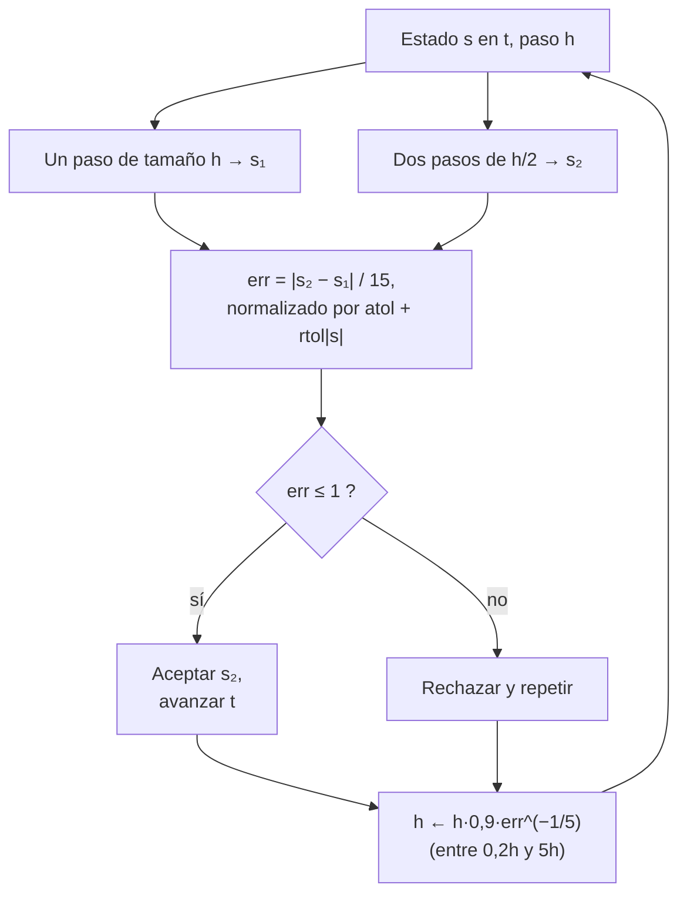

# B11-C08 — Integradores de paso adaptativo

<!-- nav:top -->
<!-- /nav -->

## 1. Ubicación, nivel y alcance

Octava clase del bloque B11. Con [RK4](../B11-C07-runge-kutta-de-cuarto-orden/CLASE.md) usabas un paso `h` fijo. Una órbita muy excéntrica pasa de moverse rápido cerca del astro a moverse despacio lejos de él; un paso que sirve en el perigeo desperdicia trabajo en el apogeo, y uno que sirve en el apogeo falla en el perigeo. Aquí aprendes a **estimar el error de cada paso y ajustar `h` automáticamente**. Nivel N2. Verás el control por duplicación de paso, el criterio de aceptación y rechazo, y la comparación a igual costo. No verás estabilidad (C09) ni conservación de energía (C10).

## 2. Por qué esta clase existe

Casi ninguna simulación espacial tiene un ritmo uniforme: una nave que rodea un planeta con un perigeo bajo, una sonda que pasa cerca de una luna, un encuentro cercano entre dos cuerpos. Escoger `h` a mano es adivinar. Un integrador adaptativo convierte la pregunta «¿qué paso uso?» en «¿qué precisión quiero?».

La pregunta motivadora: **¿puedo pedir una tolerancia de error y dejar que el programa decida los pasos?** La decisión central: **qué tolerancia exigir, y entender que controla el error local, no el global**.

## 3. Lo que podrás hacer al terminar

1. Estimar el error de un paso comparando un paso grande con dos medios.
2. Aplicar el criterio de aceptación o rechazo con tolerancias relativa y absoluta.
3. Actualizar el tamaño de paso con la fórmula `h_nuevo = h · 0,9 · err^{−1/5}`, con topes.
4. Comparar un integrador adaptativo con uno de paso fijo **a igual costo**.
5. Interpretar dónde el programa elige pasos pequeños y grandes en una órbita excéntrica.
6. Distinguir tolerancia local y error global.

La evidencia es el **informe de tolerancia y costo** del ejercicio 12 (sección 20).

## 4. Con qué llegas y cómo comprobarlo

Necesitas RK4 ([C07](../B11-C07-runge-kutta-de-cuarto-orden/CLASE.md)) y el concepto de orden. Cinco preguntas:

1. ¿Cuántas evaluaciones de `F` usa un paso de RK4?
2. Si el error de RK4 baja con `h⁴`, ¿qué pasa al dividir `h` entre 2?
3. ¿Qué es el perigeo? ¿Y el apogeo?
4. Calcula `2⁻⁰'²` (aproximadamente).
5. ¿Qué es una tolerancia relativa?

<details>
<summary>Ver respuestas</summary>

1. Cuatro. 2. El error se divide entre 16. 3. El punto más cercano y el más lejano de la órbita al astro. 4. `0,87`. 5. Un error aceptable expresado como fracción del valor.
</details>

Con cuatro o cinco aciertos, sigue; si no, repasa C07.

## 5. Un caso real: una órbita muy excéntrica

Se propaga una órbita ilustrativa con semieje mayor `a = 26 560 km` y excentricidad `e = 0,74` (valores de **ejemplo**, no una misión concreta; orden de magnitud de las órbitas muy excéntricas de comunicaciones). Con `GM = 3,986 004 × 10¹⁴ m³ s⁻²` (S1), el periodo es `43 077,8 s` (11,97 h), el perigeo está a `6 905,6 km` del centro y el apogeo a `46 214,4 km`: 6,7 veces más lejos. Con tolerancia relativa `10⁻¹⁰`, el integrador usa pasos desde unos `10 s` en el perigeo hasta `858 s` hacia el apogeo, y logra un error de `23 m` tras una vuelta con 201 pasos aceptados. Este es el **ejemplo conductor**.

## 6. Vocabulario

El **error local estimado** es la diferencia entre dos soluciones del mismo paso con distinta precisión. La **duplicación de paso** compara un paso de tamaño `h` con dos de tamaño `h/2`; para un método de orden 4, el error del resultado de dos pasos medios es aproximadamente `|s₂ − s₁|/15` (extrapolación de Richardson). La **tolerancia** combina una parte relativa `rtol` y una absoluta `atol`: la escala de cada componente es `sc_i = atol + rtol |s_i|`. El **error normalizado** `err = máx_i |Δ_i| / sc_i`; el paso se **acepta** si `err ≤ 1` y se **rechaza** si no. Un **par encajado** es un método que entrega dos resultados de distinto orden con las mismas evaluaciones; se menciona aquí solo como alternativa. La **elección del paso nuevo** usa `h · 0,9 · err^{−1/5}` para un método de orden 4, acotado entre `0,2 h` y `5 h`.

## 7. Modelo mental: un conductor que mira la curva

El integrador adaptativo es un conductor que reduce la velocidad antes de una curva cerrada y la aumenta en un tramo recto. Mide la dificultad del tramo comparando su resultado con una versión más fina del mismo, y ajusta.



*Descripción textual:* en cada intento se calculan dos resultados del mismo tramo y se estima el error; si es aceptable se avanza y si no se repite con un paso menor; en ambos casos se calcula el siguiente tamaño de paso a partir del error observado.

Analogía: el conductor que ajusta la velocidad. Su límite: el conductor ve la curva que viene; el integrador solo juzga el tramo que ya intentó, por eso a veces rechaza.

## 8. La explicación, paso a paso

### 8.1 Estimar el error de un paso

Con RK4 y `y′ = −y`, `h = 0,5`: un paso da `y₁ = 0,606771`; dos pasos de `0,25` dan `y₂ = 0,606543`. La diferencia es `2,28 × 10⁻⁴` y la estimación del error de `y₂` es `2,28 × 10⁻⁴/15 = 1,52 × 10⁻⁵`. El error real de `y₂` frente a `e^{−0,5} = 0,606531` es `1,2 × 10⁻⁵`: la estimación acierta en orden de magnitud y por el lado seguro. Factor 15 = `2⁴ − 1`: por el orden 4.

### 8.2 Aceptar o rechazar

Con `rtol = 10⁻⁵` y `atol = 0`, la escala es `10⁻⁵ · 0,6068 = 6,07 × 10⁻⁶`. El error normalizado es `1,52 × 10⁻⁵/6,07 × 10⁻⁶ = 2,5 > 1`: **se rechaza** el paso. Se calcula el nuevo `h = 0,5 · 0,9 · 2,5^{−0,2} = 0,375` y se repite. Un error normalizado de `0,4` se acepta y sugiere ampliar: `0,9 · 0,4^{−0,2} = 1,08`.

### 8.3 Por qué el exponente es −1/5

El error local de RK4 es `∝ h⁵`. Si el error medido fue `err` con el paso `h`, el paso que daría `err = 1` es `h · err^{−1/5}`; el factor `0,9` da margen para no rechazar el siguiente intento. Los topes `0,2` y `5` evitan cambios bruscos.

### 8.4 Tolerancias absoluta y relativa

Los componentes del estado tienen escalas muy distintas: posiciones del orden de `10⁷ m` y velocidades del orden de `10⁴ m/s`. Con `atol = 10⁻³` y `rtol = 10⁻¹⁰`, la escala de una posición de `7 × 10⁶ m` es `7 × 10⁻⁴`, y la de una velocidad de `10⁴ m/s` es `10⁻³`. La parte absoluta evita dividir entre cero cuando una componente pasa por cero (como `y` en el perigeo); la relativa fija la precisión global.

### 8.5 Resultados en la órbita excéntrica

| `rtol` | pasos aceptados | rechazados | error tras 1 periodo | evaluaciones |
|---|---|---|---|---|
| `10⁻⁶` | 53 | 24 | `7 102,6 m` | 924 |
| `10⁻⁸` | 104 | 17 | `350,6 m` | 1 452 |
| `10⁻¹⁰` | 201 | 3 | `23,4 m` | 2 448 |

Cada intento cuesta 12 evaluaciones (tres pasos de RK4). Con `rtol = 10⁻¹⁰`, el paso más grande fue `858 s` hacia el medio periodo (cerca del apogeo, `t = 0,53 T`), y el pequeño, de unos `10 s`, cerca del perigeo. A medio periodo (apogeo, `46 214,4 km`), el error de posición es `2,9 m`. Con `rtol = 10⁻⁸`, el paso mínimo fue `9,5 s` justo al volver al perigeo.

### 8.6 A igual costo

Un paso fijo de RK4 con los mismos 201 pasos (804 evaluaciones) da `194,8 km`; es una comparación injusta, porque el adaptativo gastó 2 448 evaluaciones. A igual costo, un paso fijo con 612 pasos (`h = 70,4 s`) da `1 508 m`, unas **64 veces peor** que los `23,4 m` del adaptativo. La ventaja es real, pero modesta frente a la injusta: siempre compara a igual número de evaluaciones.

### 8.7 Lo que la tolerancia no promete

La tolerancia controla el error **local** de cada paso. El error **global** es la suma de muchos errores locales y no está garantizado: con `rtol = 10⁻⁶` el error tras una vuelta es `7,1 km`, aunque cada paso cumplió. Para un error global dado hay que reducir la tolerancia y verificar con una referencia (C19).

## 9. Magnitudes, símbolos y unidades

| Símbolo | Qué es | Unidad | Nota |
|---|---|---|---|
| `h` | paso | s | variable |
| `rtol`, `atol` | tolerancias relativa y absoluta | adimensional, unidad de `s` | `atol = 10⁻³` |
| `err` | error normalizado | adimensional | acepta si `≤ 1` |
| `a`, `e` | semieje mayor, excentricidad | m, adimensional | 26 560 km, 0,74 (ilustrativos) |
| `T` | periodo orbital | s | 43 077,8 |
| `GM` | parámetro gravitacional | m³ s⁻² | `3,986 004 × 10¹⁴` (S1) |

## 10. Convenciones y referencias

Dos cuerpos, plano orbital, el estado inicial se toma en el perigeo `(a(1 − e), 0)` con velocidad perpendicular. La solución exacta de referencia sale de la ecuación de Kepler `M = E − e sin E` (Newton, tolerancia `10⁻¹⁵`). Los valores de `a` y `e` son **ilustrativos**.

## 11. De dónde sale lo que afirmamos

| ID | Fuente | Localizador | Respalda | Estado |
|---|---|---|---|---|
| S1 | IAU, Resolución B3 de 2015 | arXiv:1510.07674, https://arxiv.org/pdf/1510.07674 | `(GM)_E^N = 3,986 004 × 10¹⁴ m³ s⁻²` | Texto extraído del PDF el 2026-11-05 |
| S2 | Rein, H. y Spiegel, D. S., «IAS15: a fast, adaptive, high-order integrator for gravitational dynamics», arXiv:1409.4779 | https://arxiv.org/abs/1409.4779 | Existencia de integradores gravitacionales con control automático del paso que tratan encuentros cercanos y órbitas de alta excentricidad | Consultada el 2026-11-05 (resumen) |
| S3 | NIST, *DLMF* §3.7(v), versión 1.2.8 | https://dlmf.nist.gov/3.7 | Método de Runge–Kutta de cuarto orden, error local `O(h⁵)` | Consultada el 2026-11-05 mediante extracción automática (resumen de la sección) |

Límites: de S2 se leyó solo el resumen; no se reproduce su algoritmo. La extrapolación de Richardson, el factor 15 y la fórmula del paso nuevo son resultados estándar comprobados en el laboratorio. `a` y `e` son ilustrativos, no de una misión.

## 12. Cómo ver los pasos

Equivalente accesible a una gráfica de `h(t)` (cálculo, `rtol = 10⁻¹⁰`):

| `t/T` | distancia al centro (km) | paso usado (s) |
|---|---|---|
| 0 (perigeo) | 6 905,6 | 10,0 |
| 0,05 | 14 166,2 | 89,5 |
| 0,10 | 22 263,7 | 157,5 |
| 0,25 | 37 780,2 | 366,5 |
| 0,50 (apogeo) | 46 214,4 | 856,0 |
| 0,75 | 37 780,2 | 382,4 |
| 0,95 | 14 166,2 | 93,9 |

(Distancias de la solución de Kepler; pasos aceptados más cercanos a cada instante, `rtol = 10⁻¹⁰`.)

Descripción larga: el paso crece suavemente desde el perigeo hasta el apogeo y decrece de nuevo; la gráfica es una campana con su máximo (856 s) en el apogeo, unas 85 veces el paso del perigeo.

## 13. Ejemplo trabajado: ¿acepto este paso?

**Paso 1 · Datos.** `y′ = −y`, `y(0) = 1`, RK4 con `h = 0,5`; `rtol = 10⁻⁵`, `atol = 0`.

**Paso 2 · Dos resultados.** Un paso grande: `s₁ = 0,606771`. Dos pasos medios: `s₂ = 0,606543`.

**Paso 3 · Estimación.** `err_abs = |s₂ − s₁|/15 = 1,52 × 10⁻⁵`.

**Paso 4 · Normalización.** `sc = 10⁻⁵ · máx(|s₁|, |s₂|) = 6,07 × 10⁻⁶`; `err = 2,5`.

**Paso 5 · Decisión.** `2,5 > 1`: rechazar.

**Paso 6 · Paso nuevo.** `h' = 0,5 · 0,9 · 2,5^{−0,2} = 0,375`. Al repetir con `0,375`, el error baja por un factor `(0,375/0,5)⁵ = 0,24`: `err ≈ 0,6 < 1`, se acepta.

**Paso 7 · Sentido.** El procedimiento convierte la tolerancia en pasos. Las cifras de este ejemplo son un cálculo didáctico; el laboratorio aplica lo mismo a la órbita.

## 14. Comparación: paso fijo, adaptativo y pares encajados

Con paso fijo, el programa es simple y reproducible, pero hay que adivinar `h`. El adaptativo por duplicación gasta tres pasos por intento (12 evaluaciones) pero es fácil de entender y de programar. Los **pares encajados** (Runge–Kutta–Fehlberg y similares) reutilizan etapas y gastan menos evaluaciones por intento; no se desarrollan aquí. Los integradores modernos para dinámica gravitacional combinan orden alto y control del paso (S2).

## 15. Práctica guiada

**Ejercicio 1 · con los pasos indicados.** Con `s₁ = 0,606771` y `s₂ = 0,606543`, calcula la estimación del error de `s₂`. *Pasos:* diferencia, dividir entre 15 (8.1).

<details><summary>Solución comentada</summary>

`|0,606543 − 0,606771|/15 = 2,28 × 10⁻⁴/15 = 1,52 × 10⁻⁵`.
</details>

**Ejercicio 2 · con una pista.** Con `rtol = 10⁻⁵`, `atol = 0`, decide si se acepta ese paso y calcula el paso siguiente si `h = 0,5`. *Pista:* `err = error/(rtol·|s|)`.

<details><summary>Solución comentada</summary>

`err = 2,5`; se rechaza; `h' = 0,5 · 0,9 · 2,5^{−0,2} = 0,375` (8.2).
</details>

**Ejercicio 3 · casi autónomo.** Con `err = 0,4`, ¿se acepta? ¿Cuánto cambia el paso?

<details><summary>Solución comentada</summary>

Se acepta (`0,4 ≤ 1`); el factor es `0,9 · 0,4^{−0,2} = 1,08`: el paso crece un 8 %.
</details>

## 16. Práctica autónoma, transferencia e integrador

**Ejercicio 4.** Con `err = 8`, calcula el factor de paso.

<details><summary>Solución comentada</summary>

`0,9 · 8^{−0,2} = 0,594`: se rechaza y se reduce un 41 %.
</details>

**Ejercicio 5.** Con `err = 10⁻¹⁰`, ¿qué factor de paso se aplica?

<details><summary>Solución comentada</summary>

`0,9 · (10⁻¹⁰)^{−0,2} = 0,9 · 100 = 90`, pero el tope es 5: se aplica 5 (8.3).
</details>

**Ejercicio 6.** ¿Cuántas veces más lejos está el apogeo que el perigeo si `e = 0,74`? Compáralo con `(1 + e)/(1 − e)`.

<details><summary>Solución comentada</summary>

`46 214,4/6 905,6 = 6,69`; `(1 + 0,74)/(1 − 0,74) = 6,69` ✓.
</details>

**Ejercicio 7.** Con los datos de la tabla 8.5, ¿cuántas evaluaciones se gastan con `rtol = 10⁻⁸`?

<details><summary>Solución comentada</summary>

`(104 + 17) · 12 = 1 452`.
</details>

**Ejercicio 8.** Pasar de `rtol = 10⁻⁶` a `10⁻⁸` (100 veces más estricta): ¿cuánto bajó el error y cuántas veces subió el costo?

<details><summary>Solución comentada</summary>

Error: `7 102,6/350,6 = 20` veces menor; costo: `1 452/924 = 1,6` veces mayor. El error global no baja tanto como la tolerancia (8.7).
</details>

**Ejercicio 9 · transferencia.** Estima con la tabla cuántos pasos requeriría `rtol = 10⁻¹²` si cada dos órdenes de magnitud se duplican los pasos.

<details><summary>Solución comentada</summary>

`201 · 2 ≈ 400` pasos aceptados (extrapolación del patrón 53 → 104 → 201; estimación).
</details>

**Ejercicio 10 · transferencia.** Un estudiante usa `atol = 0` y `rtol = 10⁻¹⁰` y el programa se detiene dividiendo entre cero cuando `y` pasa por 0. Explica por qué y cómo se corrige.

<details><summary>Solución comentada</summary>

La escala `rtol |s_i|` vale 0 si `s_i = 0`. Se añade `atol > 0` (8.4).
</details>

**Ejercicio 11 · transferencia.** Un colega afirma que «con `rtol = 10⁻⁶` el error final es 10⁻⁶ relativo». Con el resultado `7,1 km` de la tabla, ¿qué le respondes?

<details><summary>Solución comentada</summary>

El error relativo respecto al radio inicial es `7 102,6/6 905 600 = 1,0 × 10⁻³`, mil veces mayor: la tolerancia es local y el error global se acumula (8.7).
</details>

**Ejercicio 12 · integrador.** Elabora tu *informe de tolerancia y costo*: tres tolerancias, pasos, rechazos, evaluaciones y error tras un periodo en tu órbita excéntrica (cambia `e` o `a`), comparación a igual costo con paso fijo y una recomendación.

<details><summary>Solución modelo</summary>

Tabla con `rtol`, pasos, rechazos, evaluaciones, error frente a la solución de Kepler y el error de un paso fijo de igual costo; conclusión que distinga tolerancia local y error global, rotule la órbita como ilustrativa y los resultados como simulados, con `GM` y fecha.
</details>

## 17. Laboratorio: paso adaptativo en una órbita excéntrica

El script [paso_adaptativo_excentrica.py](paso_adaptativo_excentrica.py) implementa RK4 con duplicación de paso, lo compara con la solución exacta de Kepler y con paso fijo (mismos pasos y mismo costo). Falla si el error supera 1 km, si el paso mínimo no cae cerca del perigeo, si el máximo no cae hacia el apogeo, o si el paso fijo de igual costo no es al menos 10 veces peor.

**Datos:** `GM` nominal IAU; órbita ilustrativa. **Predice antes de ejecutar:** ¿dónde crees que serán los pasos más grandes? (cerca del apogeo.) **Ejecución del 2026-11-05 (Python 3.12.9):**

```text
a = 26560 km, e = 0.74, periodo = 43077.76 s = 11.9660 h, perigeo = 6905.6 km, apogeo = 46214.4 km
estado inicial (perigeo): (6905600.0, 0.0, -0.0, 10021.7319)
rtol=1e-06: pasos=   53 rechazados= 24 error tras 1 periodo =  7102.635539 m  h_min=10.000 s (t=0.000 T)  h_max=3521.28 s (t=0.586 T)
rtol=1e-08: pasos=  104 rechazados= 17 error tras 1 periodo =   350.611007 m  h_min=9.475 s (t=1.000 T)  h_max=1583.12 s (t=0.572 T)
rtol=1e-10: pasos=  201 rechazados=  3 error tras 1 periodo =    23.439177 m  h_min=10.000 s (t=0.000 T)  h_max=858.25 s (t=0.529 T)
a T/2: error de posición = 2.915922 m (distancia 46214.4 km, apogeo)
paso FIJO con los mismos 201 pasos (h = 214.32 s): error = 194801.408 m  (adaptativo: 23.439177 m)
A IGUAL COSTO (2448 evaluaciones): paso fijo con 612 pasos (h = 70.39 s): error = 1508.254 m
Pruebas superadas.
```

```bash
python programa/clases/B11/B11-C08-integradores-de-paso-adaptativo/paso_adaptativo_excentrica.py
```

**Límites:** el paso inicial de `10 s` es una elección del usuario y puede ser el mínimo registrado (`t = 0`); dos cuerpos sin perturbaciones; resultados **simulados**.

## 18. Errores frecuentes y cómo corregirlos

**Confundir tolerancia local con error global.** Se corrige con el ejercicio 11.

**Poner `atol = 0`.** Se corrige con el ejercicio 10.

**Comparar con paso fijo de igual número de pasos y no de evaluaciones.** Se corrige con la sección 8.6.

**Olvidar que un rechazo también cuesta.** Se corrige con el ejercicio 7.

**No poner topes al factor de cambio del paso.** Se corrige con el ejercicio 5.

## 19. Cómo sabrás que vas bien

Tras 8.1: ¿estimas el error de un paso a mano? Si no, ejercicio 1. Tras 8.2: ¿sabes decidir aceptar o rechazar? Si no, ejercicios 2 a 4. Tras 8.6: ¿por qué hay que comparar a igual costo? Si no lo sabes, repasa 8.6. Tras el laboratorio: ¿qué ocurriría con un perigeo más bajo? (pasos más pequeños en la zona rápida y más costo).

## 20. Qué entregas y cómo se evalúa

El producto es tu **informe de tolerancia y costo** (ejercicio 12).

| Criterio | Inicial | En desarrollo | Logrado | Destacado |
|---|---|---|---|---|
| Estimación del error | Ausente | Sin normalizar | Con `atol + rtol|s|` | Explica el factor 15 |
| Control del paso | Paso fijo | Sin topes | Con fórmula y topes | Discute rechazos y costo |
| Comparación | A igual pasos | A igual costo sin análisis | A igual costo con razón | Distingue local y global |
| Interpretación física | Sin relación con la órbita | Cualitativa | Pasos pequeños en el perigeo | Relaciona con escalas de tiempo |
| Fuentes | Sin fuente | Sin fecha | Con localizador y fecha | Rotula simulado e ilustrativo |

**Condiciones críticas (no se compensan con promedio):** comparar a igual costo; distinguir error local y global; citar solo fuentes consultadas.

## 21. Ética, seguridad y límites

Un integrador que acepta todos sus pasos no garantiza que el resultado sea físicamente correcto: el modelo (aquí, dos cuerpos) puede estar incompleto. Ningún resultado de esta clase es operativo. Accesibilidad: fórmulas en texto, tablas equivalentes a las gráficas, ejercicios sin conexión.

## 22. Para cerrar y seguir

Un integrador adaptativo estima el error de cada paso, lo acepta o rechaza según una tolerancia y ajusta `h`; en una órbita excéntrica los pasos son pequeños en el perigeo y grandes en el apogeo; la tolerancia controla el error local, no el global. Queda abierta una pregunta: ¿puede un paso demasiado grande no solo perder precisión, sino hacer que la solución explote? Es la estabilidad numérica.

**Glosario español–inglés.** paso adaptativo · *adaptive step*; tolerancia · *tolerance*; duplicación de paso · *step doubling*; extrapolación de Richardson · *Richardson extrapolation*; error local · *local error*; par encajado · *embedded pair*; excentricidad · *eccentricity*.

**Continuidad.** B11-C09 reutiliza tu capacidad de **elegir `h` con criterio** para entender cuándo un paso demasiado grande vuelve inestable un método.

**Referencias:** ver sección 11.

<!-- nav:bottom -->
<!-- /nav -->
