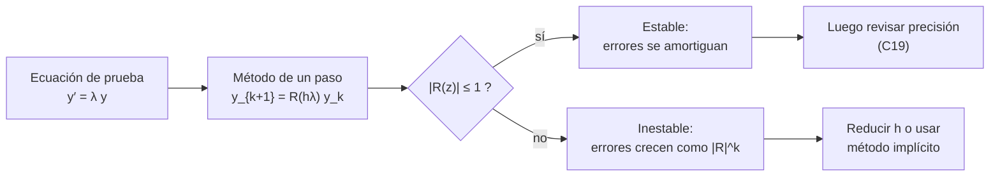

# B11-C09 — Análisis de estabilidad numérica

<!-- nav:top -->
[🏠 Programa](../../../../README.md) · [📚 Bloque B11](../../../tronco-comun/B11-ecuaciones-diferenciales-y-simulacion-numerica.md) · [← Anterior: B11-C08 — Integradores de paso adaptativo](../B11-C08-integradores-de-paso-adaptativo/CLASE.md) · [Siguiente: B11-C10 — Conservación de energía numérica →](../B11-C10-conservacion-de-energia-numerica/CLASE.md)
<!-- /nav -->

## 1. Ubicación, nivel y alcance

Novena clase del bloque B11. En [C08](../B11-C08-integradores-de-paso-adaptativo/CLASE.md) el programa elegía el paso por precisión. Hay otro límite, independiente de la precisión: si el paso es demasiado grande para la dinámica, **el método amplifica los errores en lugar de amortiguarlos** y la solución numérica explota aunque la verdadera sea suave. Aquí aprendes a medir ese límite con la **ecuación de prueba** `y′ = λ y`, el **factor de amplificación** y la **región de estabilidad**. Nivel N2. Verás Euler, Heun y RK4 y la idea de **rigidez** con el método de Euler implícito. No verás conservación de energía (C10) ni métodos simplécticos (C11).

## 2. Por qué esta clase existe

Un modelo térmico de una nave tiene constantes de tiempo que van de segundos (un sensor fino) a horas (un tanque grande). Un método explícito debe usar un paso comparable al más rápido aunque lo único que interese sea lo lento: pagar por una escala que no se observa. Entender la estabilidad permite predecir cuánto cuesta una simulación y cuándo cambiar de método.

La pregunta motivadora: **¿cuál es el paso más grande para el que el método no explota, y qué hago si ese paso es ridículamente pequeño?** La decisión central: **elegir `h` y método según la escala más rápida del sistema, no según la más lenta**.

## 3. Lo que podrás hacer al terminar

1. Escribir el factor de amplificación `R(z)`, `z = h λ`, de un método.
2. Decidir si un paso es estable con `|R(z)| ≤ 1`.
3. Calcular los límites de estabilidad de Euler, Heun y RK4 sobre el eje real.
4. Explicar por qué estabilidad y precisión son requisitos distintos.
5. Reconocer un problema **rígido** y justificar el Euler implícito.
6. Leer la estabilidad de una órbita con valores propios imaginarios.

La evidencia es el **mapa de estabilidad** del ejercicio 12 (sección 20).

## 4. Con qué llegas y cómo comprobarlo

Necesitas Euler, Heun y RK4 ([C05](../B11-C05-metodo-de-euler/CLASE.md), [C06](../B11-C06-metodo-de-heun/CLASE.md), [C07](../B11-C07-runge-kutta-de-cuarto-orden/CLASE.md)) y valores propios ([C04](../B11-C04-sistemas-de-ecuaciones-diferenciales/CLASE.md)). Cinco preguntas:

1. Aplica Euler a `y′ = −y`, `y(0) = 1`, `h = 0,5`: ¿cuánto es `y₁`?
2. ¿Qué significa un valor propio `λ = −50 s⁻¹`?
3. ¿Cuánto es `|1 − 2,5|`?
4. ¿Qué valores propios tiene el oscilador `y″ = −4 y`?
5. ¿Qué es la constante de tiempo de `y′ = −y/τ`?

<details>
<summary>Ver respuestas</summary>

1. `0,5`. 2. Relajación con constante de tiempo `1/50 = 0,02 s`. 3. `1,5`. 4. `±2i`. 5. `τ`.
</details>

Con cuatro o cinco aciertos, sigue; si no, repasa C04 y C05.

## 5. Un caso real: un sensor que se relaja en 20 milisegundos

Un sensor sintético se relaja hacia la temperatura de su soporte con `λ = −50 s⁻¹` (constante de tiempo `0,02 s`; valor **sintético**). Se integra con Euler, Heun y RK4 hasta `t = 2 s`. Con `h = 0,03 s` los tres métodos dan una solución que decae a cero, como la verdadera (`e^{−100} = 3,7 × 10⁻⁴⁴`). Con `h = 0,05 s` Euler da `1,1 × 10⁷` y Heun `2,7 × 10⁸`: **la solución explota**, mientras RK4 sigue estable (`3 × 10⁻⁸`). Nada cambió en la física; cambió el paso. Este es el **ejemplo conductor**.

## 6. Vocabulario

La **ecuación de prueba** es `y′ = λ y`, con `λ` complejo; su solución es `e^{λ t}`, que decae si `Re λ < 0`. Un método de un paso la convierte en `y_{k+1} = R(z) y_k`, con `z = h λ`; `R` es el **factor de amplificación**. El método es **estable** para un `z` si `|R(z)| ≤ 1`; la **región de estabilidad** es el conjunto de `z` donde ocurre. Para los métodos vistos: Euler `R = 1 + z`; Heun `R = 1 + z + z²/2`; RK4 `R = 1 + z + z²/2 + z³/6 + z⁴/24`; **Euler implícito** `y_{k+1} = y_k + h λ y_{k+1}` da `R = 1/(1 − z)`. Un problema es **rígido** cuando contiene escalas de tiempo muy distintas y la más rápida obliga a un paso pequeño sin interés por sí misma. Un método **implícito** define el nuevo estado mediante una ecuación que lo contiene; **A-estable** es el que es estable para todo `Re z < 0`. La **estabilidad** (no explotar) es distinta de la **precisión** (parecerse a la solución).

## 7. Modelo mental: la rueda de hamster y el factor de amplificación

Cada paso multiplica el error por `R`. Si `|R| < 1`, el error se desvanece; si `|R| > 1`, se acumula geométricamente, como una bola de nieve.



*Descripción textual:* la ecuación de prueba reduce cada paso a una multiplicación por `R(hλ)`; si su módulo es menor o igual que uno el método es estable y se pasa a comprobar la precisión; si no, hay que reducir el paso o cambiar a un método implícito.

Analogía: una bola de nieve que rueda cuesta abajo: si cada vuelta añade nieve en proporción a lo que ya tiene, crece sin límite. Su límite: la bola real no crece sin fin; el error numérico sí lo hace hasta desbordar los números de la computadora.

## 8. La explicación, paso a paso

### 8.1 Euler y la ecuación de prueba

Con `λ = −50`, Euler da `y_{k+1} = (1 + hλ) y_k`. Con `h = 0,03`: `1 − 1,5 = −0,5`, `|R| = 0,5`: la solución alterna de signo y decae. Con `h = 0,05`: `1 − 2,5 = −1,5`, `|R| = 1,5`: tras 40 pasos, `1,5⁴⁰ = 1,1 × 10⁷`. El límite está en `|1 + z| = 1`: el método es estable para `−2 ≤ z ≤ 0`, es decir, `h ≤ 2/|λ| = 0,04 s`.

### 8.2 Heun y RK4

Heun: `R = 1 + z + z²/2`; en `z = −2,5` vale `1,625 > 1`; su límite real también es `2`. RK4: `R(−2,5) = 0,648`; su límite real es **`2,7853`**, es decir, `h ≤ 0,0557 s` para `λ = −50`. En el laboratorio, los límites se calcularon por bisección: `2,0000`, `2,0000` y `2,7853`. Un orden mayor amplía algo el rango, pero no lo elimina.

### 8.3 Estabilidad no es precisión

Con `h = 0,03` los tres métodos son estables, pero los valores finales difieren: Euler `−6,8 × 10⁻²¹`, Heun `2,1 × 10⁻¹⁴`, RK4 `1,9 × 10⁻³⁸`, frente al exacto `3,7 × 10⁻⁴⁴`. Todos «decaen»; ninguno es exacto. Y en la fase inicial rápida, un paso de `0,03 s` (superior a la constante de tiempo `0,02 s`) no resuelve la transición. Hay que revisar ambas condiciones: no explotar *y* tener error aceptable.

### 8.4 Sistemas rígidos

Considera `x′ = −k (x − cos t)` con `k = 1000 s⁻¹` (sintético): el sistema sigue una excitación lenta (`cos t`) con una relajación muy rápida (`1/k = 1 ms`). Tras un transitorio de pocos milisegundos, la solución es lisa. Un método explícito debe cumplir `h k ≤ 2` aunque el interés sea la parte lenta: `h ≤ 2 ms`, es decir, más de 500 pasos para `t = 1 s`. Con `h = 0,01` (`h k = 10`), Euler explícito termina en `−2,7 × 10⁹⁵`; con `h = 0,1`, en `−9 × 10¹⁹`.

### 8.5 Euler implícito

`y_{k+1} = y_k + h λ y_{k+1}` ⇒ `y_{k+1} = y_k/(1 − hλ)`, con `|R| = 1/|1 − z| < 1` para todo `z` con `Re z < 0`: **estable sin importar `h`**. Para el sistema rígido, con `h = 0,01` da `x(1) = 0,541 140 5` y con `h = 0,1` da `0,541 114 8`, frente al exacto `0,541 143 2`. Se gana estabilidad a cambio de orden 1 y de resolver una ecuación en cada paso (aquí lineal, trivial; en general, no).

### 8.6 Estabilidad de una órbita

Una órbita circular linealizada es un oscilador con valores propios `± i n`: `z = ± i n h` está sobre el eje imaginario. **Euler**: `|1 + i y| = √(1 + y²) > 1` siempre: nunca es estable, por eso la espiral de C05; con `y = n h = 0,0113` (`h = 10 s`) el radio crece `6,4 × 10⁻⁵` por paso, como midió C05 (433,8 m). **Heun**: `|R|² = 1 + y⁴/4 > 1`: crece muy lentamente. **RK4**: `|R| = 1 − y⁶/144 + …`, **menor que 1** hasta `y = 2√2 = 2,828`; el módulo calculado para `y = 0,1` es `0,999 999 993`. Es lo que se verá en C10: RK4 *disipa* energía, muy poco, pero sistemáticamente.

## 9. Magnitudes, símbolos y unidades

| Símbolo | Qué es | Unidad | Nota |
|---|---|---|---|
| `λ` | valor propio, constante de relajación | s⁻¹ | `−50` y `−1000` (sintéticos) |
| `z` | `h λ` | adimensional | complejo en general |
| `R(z)` | factor de amplificación | adimensional | |
| `h` | paso | s | |
| `k` | rapidez de relajación del sistema rígido | s⁻¹ | 1000 (sintético) |
| `n` | movimiento medio | rad s⁻¹ | `1,131 376 × 10⁻³` (órbita de 400 km, ilustrativa) |
| `GM` | parámetro gravitacional | m³ s⁻² | `3,986 004 × 10¹⁴` (S1) |

## 10. Convenciones y referencias

Se estudia la ecuación de prueba lineal con coeficiente constante; para sistemas no lineales, `λ` se toma de los valores propios del jacobiano local (C04). Los parámetros del sensor y del sistema rígido son **sintéticos**. Los límites de estabilidad son del eje real salvo donde se indique el imaginario.

## 11. De dónde sale lo que afirmamos

| ID | Fuente | Localizador | Respalda | Estado |
|---|---|---|---|---|
| S1 | IAU, Resolución B3 de 2015 | arXiv:1510.07674, https://arxiv.org/pdf/1510.07674 | `(GM)_E^N = 3,986 004 × 10¹⁴ m³ s⁻²`, `R_eE^N = 6,3781 × 10⁶ m` | Texto extraído del PDF el 2026-11-05 |
| S2 | NIST, *DLMF* §3.7(ii), versión 1.2.8 | https://dlmf.nist.gov/3.7 | La estabilidad de una integración depende del sentido en que crecen o decaen las soluciones a lo largo de la trayectoria | Consultada el 2026-11-05 mediante extracción automática (resumen de la sección) |

Límites: los factores de amplificación y los límites `2`, `2,7853` y `2√2` son resultados estándar comprobados con el laboratorio; la rigidez y el Euler implícito se tratan como conceptos estándar sin cita; los parámetros son sintéticos.

## 12. Cómo ver la región de estabilidad

Equivalente accesible a una gráfica de `|R|` frente a `z` real (cálculo):

| `z = h λ` | Euler `|R|` | Heun `|R|` | RK4 `|R|` | Euler implícito `|R|` |
|---|---|---|---|---|
| −0,5 | 0,500 | 0,625 | 0,607 | 0,667 |
| −1,5 | 0,500 | 0,625 | 0,273 | 0,400 |
| −2,5 | 1,500 | 1,625 | 0,648 | 0,286 |
| −3,0 | 2,000 | 2,500 | 1,375 | 0,250 |

Descripción larga: Euler y Heun cruzan la línea `|R| = 1` en `z = −2`; RK4, en `−2,785`; el Euler implícito no la cruza jamás para `z` negativo.

## 13. Ejemplo trabajado: ¿qué paso puedo usar con RK4?

**Paso 1 · Problema.** `y′ = −50 y` (sensor sintético), RK4.

**Paso 2 · Límite.** `|R(z)| ≤ 1` hasta `z = −2,7853`, es decir, `h ≤ 2,7853/50 = 0,0557 s`.

**Paso 3 · Margen.** Se elige `h = 0,04 s` (`z = −2`): `R = 1 − 2 + 2 − 1,333 + 0,667 = 0,333`.

**Paso 4 · Comprobación.** Con `h = 0,05` (`z = −2,5`) el laboratorio dio `|R| = 0,648` y `y(2) = 3 × 10⁻⁸`: estable. Con `h = 0,06` (`z = −3`): `R = 1 − 3 + 4,5 − 4,5 + 3,375 = 1,375 > 1`: inestable.

**Paso 5 · Precisión.** Estable no significa preciso: se comprueba además con el orden y la comparación de C19.

**Paso 6 · Sentido.** El límite se calculó con parámetros **sintéticos** para un caso lineal; en un sistema real, `λ` sale del jacobiano.

## 14. Comparación: explícito, implícito y adaptativo

Explícitos (Euler, Heun, RK4): baratos por paso, límite de estabilidad. Implícitos (Euler implícito, y sus relativos de orden alto): resuelven una ecuación por paso, estables en problemas rígidos. Un control adaptativo (C08) *reduce* `h` si el error crece, y por tanto también detecta la inestabilidad, pero a un costo enorme en problemas rígidos: el paso baja a `2/k` aunque la solución sea lisa. Las órbitas de dos cuerpos no son rígidas; los modelos térmicos y de combustión sí lo son.

## 15. Práctica guiada

**Ejercicio 1 · con los pasos indicados.** Calcula `R` de Euler y de Heun para `z = −1,5`. *Pasos:* sustituir en las fórmulas de la sección 6.

<details><summary>Solución comentada</summary>

Euler: `1 − 1,5 = −0,5`; Heun: `1 − 1,5 + 1,125 = 0,625`.
</details>

**Ejercicio 2 · con una pista.** ¿Cuál es el máximo `h` estable de Euler para `λ = −50`? *Pista:* `−2 ≤ hλ`.

<details><summary>Solución comentada</summary>

`h ≤ 2/50 = 0,04 s` (8.1).
</details>

**Ejercicio 3 · casi autónomo.** Calcula `R(−2,5)` para RK4 y decide si es estable.

<details><summary>Solución comentada</summary>

`1 − 2,5 + 3,125 − 2,604 + 1,628 = 0,648 < 1`: estable.
</details>

## 16. Práctica autónoma, transferencia e integrador

**Ejercicio 4.** Con `|R| = 1,5` y 40 pasos, ¿cuánto crece el error?

<details><summary>Solución comentada</summary>

`1,5⁴⁰ = 1,1 × 10⁷`.
</details>

**Ejercicio 5.** ¿Cuál es el máximo `h` de RK4 para `λ = −1000 s⁻¹`?

<details><summary>Solución comentada</summary>

`2,7853/1000 = 2,79 ms`.
</details>

**Ejercicio 6.** Calcula `R` del Euler implícito para `z = −2,5` y `z = −100`.

<details><summary>Solución comentada</summary>

`1/(1 + 2,5) = 0,286`; `1/101 = 0,0099`. Siempre menor que 1 (8.5).
</details>

**Ejercicio 7.** Para `x′ = −1000 (x − cos t)`, ¿cuántos pasos de Euler explícito requiere llegar a `t = 1` con estabilidad?

<details><summary>Solución comentada</summary>

`h ≤ 2/1000 = 0,002`: al menos 500 pasos (8.4).
</details>

**Ejercicio 8.** Un componente térmico tiene constantes de tiempo de 1 s y de 3 600 s (sintéticas). ¿Qué `h` máximo permite Euler y cuántos pasos requiere simular una hora?

<details><summary>Solución comentada</summary>

`h ≤ 2/1 = 2 s`; 1 800 pasos, aunque la parte lenta se resolvería con unos pocos. Razón de escalas: 3 600 (rigidez).
</details>

**Ejercicio 9 · transferencia.** Con `h = 10 s` y `n = 1,131 × 10⁻³ rad/s`, calcula el factor `|R|` de Euler para la órbita y el crecimiento de radio por paso; compáralo con C05.

<details><summary>Solución comentada</summary>

`y = n h = 0,01131`; `|R| = √(1 + y²) = 1 + 6,4 × 10⁻⁵`; sobre `a = 6 778 100 m`: `+433 m`, como en C05.
</details>

**Ejercicio 10 · transferencia.** Un estudiante dice «mi RK4 es de orden 4, así que con cualquier `h` es mejor que Euler». Con `λ = −50` y `h = 0,06`, ¿qué respondes?

<details><summary>Solución comentada</summary>

`z = −3`: RK4 `|R| = 1,375`, Euler `2`. Ambos inestables. El orden no sustituye la estabilidad (8.2).
</details>

**Ejercicio 11 · transferencia.** El Euler implícito da `0,541 114 8` con `h = 0,1` y el exacto vale `0,541 143 2`. ¿Es bueno? ¿Qué compensación hizo?

<details><summary>Solución comentada</summary>

Error relativo `5 × 10⁻⁵`: bueno para una solución lisa. Se gastó estabilidad incondicional a cambio de orden 1 (8.5); un `h` 200 veces mayor que el límite explícito.
</details>

**Ejercicio 12 · integrador.** Elabora tu *mapa de estabilidad*: tabla de `|R|` de Euler, Heun, RK4 y Euler implícito para cinco valores de `z`, los límites reales, una prueba con `y′ = λ y` que confirme una predicción de estabilidad y otra de inestabilidad, y una recomendación para el sistema rígido.

<details><summary>Solución modelo</summary>

Tabla de `|R|` con límites `2`, `2`, `2,7853` y `∞`; dos iteraciones que coinciden con la predicción (`|R| < 1` decae, `|R| > 1` crece); recomendación del Euler implícito con `h` mucho mayor que `2/k`, y declaración de que los parámetros son sintéticos.
</details>

## 17. Laboratorio: región de estabilidad

El script [region_de_estabilidad.py](region_de_estabilidad.py) calcula por bisección los límites de estabilidad, comprueba con iteraciones que la predicción de `|R|` coincide con el comportamiento y resuelve el sistema rígido con Euler explícito e implícito.

**Datos:** sintéticos. **Predice antes de ejecutar:** ¿qué límite real tiene RK4? (`2,7853`.) **Ejecución del 2026-11-05 (Python 3.12.9):**

```text
limite real de estabilidad Euler : h|lambda| <= 2.0000
limite real de estabilidad Heun  : h|lambda| <= 2.0000
limite real de estabilidad RK4   : h|lambda| <= 2.7853
limite sobre el eje imaginario RK4: 2.8284 (2*sqrt(2) = 2.8284); Euler: 0.0000
modulo de R sobre el eje imaginario, y = 0.1: Euler=1.0049875621 Heun=1.0000124999 RK4=0.9999999931
y' = -50 y hasta t = 2 (exacto e^-100 = 3.7e-44):
  h=0.03  z=-1.5: Euler: |R|=0.500 y_final=-6.776e-21 (estable) | Heun: |R|=0.625 y_final=2.108e-14 (estable) | RK4: |R|=0.273 y_final=1.860e-38 (estable)
  h=0.05  z=-2.5: Euler: |R|=1.500 y_final=1.106e+07 (inestable) | Heun: |R|=1.625 y_final=2.717e+08 (inestable) | RK4: |R|=0.648 y_final=2.983e-08 (estable)
sistema rígido x' = -k (x - cos t), x(1) exacto = 0.541143236
  h=0.0005  h*k=   0.5: Euler explícito x(1) =  5.4114e-01 | Euler implícito x(1) =  0.541143100
  h=0.01    h*k=  10.0: Euler explícito x(1) = -2.6562e+95 | Euler implícito x(1) =  0.541140512
  h=0.1     h*k= 100.0: Euler explícito x(1) = -9.0443e+19 | Euler implícito x(1) =  0.541114761
Pruebas superadas.
```

```bash
python programa/clases/B11/B11-C09-analisis-de-estabilidad-numerica/region_de_estabilidad.py
```

**Límites:** ecuación de prueba lineal; parámetros sintéticos; resultados **simulados**.

## 18. Errores frecuentes y cómo corregirlos

**Pensar que un paso más pequeño siempre arregla la precisión sin pagar costo.** Se corrige con el ejercicio 8.

**Confundir estabilidad con precisión.** Se corrige con el ejercicio 10 y la sección 8.3.

**Aplicar la prueba de estabilidad con el signo de `λ` equivocado.** Se corrige con los ejercicios 1 a 3.

**Creer que un método de alto orden es estable para cualquier paso.** Se corrige con el ejercicio 10.

**Usar un método explícito para un problema rígido y culpar al código.** Se corrige con el ejercicio 7.

## 19. Cómo sabrás que vas bien

Tras 8.1: ¿calculas el límite de Euler para un `λ` dado? Si no, ejercicio 2. Tras 8.3: ¿distingues explotar de ser impreciso? Si no, ejercicio 10. Tras 8.5: ¿por qué el implícito acepta cualquier `h`? Si no lo explicas, ejercicio 6. Tras el laboratorio: ¿qué indicaría un `y_final` enorme con `|R| < 1` predicho? (un error de programación).

## 20. Qué entregas y cómo se evalúa

El producto es tu **mapa de estabilidad** (ejercicio 12).

| Criterio | Inicial | En desarrollo | Logrado | Destacado |
|---|---|---|---|---|
| Factor `R(z)` | No lo escribe | Con errores | Correcto para tres métodos | Incluye el implícito |
| Límites | Ausentes | Solo Euler | Los cuatro | Los verifica con iteraciones |
| Estabilidad vs. precisión | Los confunde | Los menciona | Los distingue con ejemplo | Los combina en la elección de `h` |
| Rigidez | No la reconoce | La describe | La identifica en el caso | Justifica el método implícito |
| Fuentes | Sin fuente | Sin fecha | Con localizador y fecha | Rotula sintético y simulado |

**Condiciones críticas (no se compensan con promedio):** contrastar una predicción de estabilidad con una iteración real; rotular lo sintético; citar solo fuentes consultadas.

## 21. Ética, seguridad y límites

Un cálculo inestable puede producir números enormes pero también, con mala suerte, números que parecen razonables durante un tiempo; no basta mirar el resultado final. Los parámetros de esta clase son sintéticos y no sirven para diseñar sistemas térmicos reales. Accesibilidad: fórmulas en texto, tablas equivalentes a las gráficas, ejercicios sin conexión.

## 22. Para cerrar y seguir

Cada paso multiplica el error por `R(hλ)`; la estabilidad exige `|R| ≤ 1`; el límite real es `2` para Euler y Heun, `2,7853` para RK4, y ninguno para el Euler implícito; las escalas muy distintas vuelven rígido un problema. Queda abierta una pregunta: incluso un método estable en la órbita pierde energía. ¿Cuánto, y qué cantidades deberían conservarse? Es la conservación de energía numérica.

**Glosario español–inglés.** estabilidad numérica · *numerical stability*; ecuación de prueba · *test equation*; factor de amplificación · *amplification factor*; región de estabilidad · *stability region*; rigidez · *stiffness*; Euler implícito · *backward (implicit) Euler*; A-estable · *A-stable*.

**Continuidad.** B11-C10 reutiliza tu capacidad de **leer `|R|` sobre el eje imaginario** para explicar la deriva de energía en órbitas.

**Referencias:** ver sección 11.

<!-- nav:bottom -->
---

[← Anterior: B11-C08 — Integradores de paso adaptativo](../B11-C08-integradores-de-paso-adaptativo/CLASE.md) · [📚 Bloque B11](../../../tronco-comun/B11-ecuaciones-diferenciales-y-simulacion-numerica.md) · [Siguiente: B11-C10 — Conservación de energía numérica →](../B11-C10-conservacion-de-energia-numerica/CLASE.md)
<!-- /nav -->
