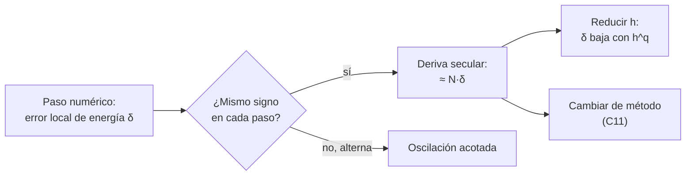

# B11-C10 — Conservación de energía numérica

<!-- nav:top -->
[🏠 Programa](../../../../README.md) · [📚 Bloque B11](../../../tronco-comun/B11-ecuaciones-diferenciales-y-simulacion-numerica.md) · [← Anterior: B11-C09 — Análisis de estabilidad numérica](../B11-C09-analisis-de-estabilidad-numerica/CLASE.md) · [Siguiente: B11-C11 — Métodos simplécticos →](../B11-C11-metodos-simplecticos/CLASE.md)
<!-- /nav -->

## 1. Ubicación, nivel y alcance

Décima clase del bloque B11. En [C09](../B11-C09-analisis-de-estabilidad-numerica/CLASE.md) viste que el módulo del factor de amplificación decide si el error crece o decae. Aquí lo aplicas a una pregunta física: **¿una simulación larga de una órbita conserva la energía y el momento angular, que en la realidad son constantes?** Nivel N2. Verás la deriva de energía de Euler, Heun y RK4 en cientos de vueltas, cómo escala con el paso y cómo usarla como prueba de calidad. No verás aún métodos que la evitan por construcción (C11).

## 2. Por qué esta clase existe

Un análisis de misión puede necesitar propagar un satélite durante años, es decir, decenas de miles de vueltas. Si cada vuelta añade o quita un poco de energía, la altura de la órbita cambia solo por culpa del programa. La deriva de energía es la señal más barata de que el integrador falla, y con ella se decide el paso y el método.

La pregunta motivadora: **¿cuánta energía «inventa» o pierde mi integrador por vuelta, y cuánto error acumula tras miles de vueltas?** La decisión central: **elegir paso y método para que la deriva sea tolerable en toda la duración de la simulación**.

## 3. Lo que podrás hacer al terminar

1. Calcular el error relativo de energía y de momento angular a lo largo de una integración.
2. Distinguir deriva **secular** (crece sin cesar) de oscilación acotada.
3. Medir cómo escala la deriva de energía con el paso.
4. Traducir una deriva de energía a un cambio de semieje mayor.
5. Extrapolar la deriva a muchas vueltas y decidir si es aceptable.
6. Usar la conservación como prueba de un programa de propagación.

La evidencia es el **informe de deriva** del ejercicio 12 (sección 20).

## 4. Con qué llegas y cómo comprobarlo

Necesitas la energía y el momento angular específicos ([C04](../B11-C04-sistemas-de-ecuaciones-diferenciales/CLASE.md)) y los métodos de C05 a C07. Cinco preguntas:

1. ¿Cuánto vale `ε` de una órbita circular en función de `a`?
2. ¿Qué es el error relativo de una cantidad `q` respecto de `q₀`?
3. Si algo crece 1 % por vuelta, ¿cuánto crece en 100 vueltas (aproximadamente)?
4. ¿Qué dice `|R| < 1` sobre un método en una oscilación?
5. ¿Qué relación liga `ε` y `a` en dos cuerpos?

<details>
<summary>Ver respuestas</summary>

1. `ε = −GM/(2a)`. 2. `(q − q₀)/|q₀|`. 3. Cerca de 170 % compuesto (`1,01¹⁰⁰ = 2,7`), o 100 % si es lineal. 4. Que el método amortigua la amplitud. 5. `ε = −GM/(2a)`.
</details>

Con cuatro o cinco aciertos, sigue; si no, repasa C04 y C09.

## 5. Un caso real: cien vueltas a 400 km

Con `GM = 3,986 004 × 10¹⁴ m³ s⁻²` y radio nominal `6,3781 × 10⁶ m` (S1), la órbita circular de 400 km (ilustrativa) tiene `ε₀ = −2,940 355 × 10⁷ J/kg` y `h₀ = 5,197 839 × 10¹⁰ m²/s`. Tras 100 vueltas con 200 pasos por vuelta, la energía cambió: Heun **+0,94 %**, RK4 **−5,3 × 10⁻⁵ %** (`−5,3 × 10⁻⁷` relativo); Euler, en solo 5 vueltas, **+48 %**, con el radio ya duplicado. Los tres integran la misma ley; solo cambia el método. Este es el **ejemplo conductor**.

## 6. Vocabulario

Una **cantidad conservada** es una función del estado que no cambia en la solución exacta (aquí `ε` y `h`, C04). La **deriva** es su cambio numérico. Es **secular** si crece de forma sistemática con el tiempo (lineal en el número de vueltas) y **acotada u oscilante** si sube y baja sin acumularse. El **error relativo de energía** es `(ε − ε₀)/|ε₀|`. Un método es **disipativo** si reduce la energía y **antidisipativo** si la aumenta. La **vuelta** es un periodo orbital `T`. El **semieje mayor** `a` se relaciona con la energía por `ε = −GM/(2a)`.

## 7. Modelo mental: un grifo que gotea

Cada paso introduce un error diminuto de energía; si todos gotean en el mismo sentido, el depósito se vacía o se llena en proporción al número de pasos. Si gotean al azar o alternan, se compensan.



*Descripción textual:* cada paso aporta un error de energía; si todos tienen el mismo signo se acumulan linealmente con el número de pasos y la deriva es secular; si alternan, queda acotada. La deriva secular se reduce disminuyendo el paso o cambiando de método.

Analogía: un reloj que atrasa un segundo por día; tras un año, seis minutos. Su límite: un reloj real también puede variar con la temperatura; la deriva numérica es determinista y repetible.

## 8. La explicación, paso a paso

### 8.1 Qué se mide

Se integra una órbita y, al final de cada vuelta, se evalúa `ε = (v_x² + v_y²)/2 − GM/r` y `h = x v_y − y v_x`. El laboratorio verifica antes que la **solución analítica** conserva `ε` a `10⁻¹²` relativo en cuatro instantes: así se sabe que cualquier deriva posterior viene del integrador, no de la fórmula.

### 8.2 Euler: se dispara

Con 200 pasos por vuelta, la energía de Euler sube `+23 %` tras una vuelta (`r/a = 1,37`) y `+48 %` tras cinco (`r/a = 2,06`). Es antidisipativo y no sirve para ninguna propagación seria.

### 8.3 Heun: lenta pero sistemática

Heun, con 200 pasos por vuelta: `+9,68 × 10⁻⁵` (vuelta 1), `+9,65 × 10⁻⁴` (vuelta 10) y `+9,37 × 10⁻³` (vuelta 100). Cada multiplicación de las vueltas por diez multiplica la deriva por diez: **crecimiento lineal**, es decir, secular. Al cabo de 100 vueltas, la energía implica un semieje mayor unos `0,94 %` mayor: unos 64 km. Para una operación real es inaceptable.

### 8.4 RK4: disipativo y mucho menor

RK4, 200 pasos por vuelta: `−5,34 × 10⁻⁹` por vuelta (`−5,34 × 10⁻⁸` a las 10; `−5,34 × 10⁻⁷` a las 100). También lineal en el número de vueltas, y con signo negativo (disipativo): el análisis de C09 lo anticipaba, porque `|R| = 1 − y⁶/144 < 1` sobre el eje imaginario. Equivale a bajar el semieje mayor unos `3,6 m` en 100 vueltas. El momento angular deriva la mitad que la energía (`−2,67 × 10⁻⁷`).

### 8.5 Cómo escala con el paso

Con RK4 a 100 vueltas, `N = 100` pasos por vuelta da `−1,711 × 10⁻⁵` y `N = 200` da `−5,342 × 10⁻⁷`: la razón es **`32,0`**, es decir, `2⁵`. La deriva por vuelta baja como `h⁵`. Es coherente con el análisis lineal: la amortiguación por paso es `O(h⁶)` y hay `N ∝ 1/h` pasos por vuelta. (Es una explicación cualitativa de la potencia, no una deducción completa; la medición en el laboratorio es la evidencia.)

### 8.6 Otra órbita

En una órbita elíptica ilustrativa (`a = 26 560 km`, `e = 0,30`; 400 pasos por vuelta), RK4 deriva `−1,51 × 10⁻⁹` por vuelta y `−1,51 × 10⁻⁷` en 100 vueltas; el momento angular, `−4,17 × 10⁻⁸`. Mismo patrón: lineal en las vueltas.

### 8.7 Extrapolar con cuidado

Si la deriva es lineal, 1 000 vueltas de RK4 (200 pasos) darían `≈ −5,3 × 10⁻⁶`, y 10 000 vueltas `≈ −5,3 × 10⁻⁵`. Es una **extrapolación**: vale mientras el comportamiento siga lineal y el error de redondeo no domine. Para conocer la deriva en una simulación real, hay que medirla en esa simulación.

## 9. Magnitudes, símbolos y unidades

| Símbolo | Qué es | Unidad | Nota |
|---|---|---|---|
| `ε` | energía específica | J/kg | `ε₀ = −2,940 355 × 10⁷` |
| `h` | momento angular específico | m²/s | `5,197 839 × 10¹⁰` |
| `(ε − ε₀)/|ε₀|` | error relativo de energía | adimensional | |
| `N` | pasos por vuelta | adimensional | |
| `T` | periodo | s | 5 553,6 |
| `a` | semieje mayor | m | `−GM/(2ε)` |
| `GM` | parámetro gravitacional | m³ s⁻² | `3,986 004 × 10¹⁴` (S1) |

## 10. Convenciones y referencias

Dos cuerpos, plano, sistema inercial. Todas las derivas se miden respecto del valor inicial. Las órbitas son **ilustrativas** y los números, **simulados**. El signo positivo indica energía ganada (antidisipación).

## 11. De dónde sale lo que afirmamos

| ID | Fuente | Localizador | Respalda | Estado |
|---|---|---|---|---|
| S1 | IAU, Resolución B3 de 2015 | arXiv:1510.07674, https://arxiv.org/pdf/1510.07674 | `(GM)_E^N = 3,986 004 × 10¹⁴ m³ s⁻²`, `R_eE^N = 6,3781 × 10⁶ m` | Texto extraído del PDF el 2026-11-05 |
| S2 | Rein, H. y Tamayo, D., «WHFast», arXiv:1506.01084 | https://arxiv.org/abs/1506.01084 | Resumen: en integradores simplécticos con paso pequeño, el error de energía se debe a redondeo y se comporta como un paseo aleatorio (ley de Brouwer) | Consultada el 2026-11-05 (resumen) |

Límites: de S2 solo se leyó el resumen. La relación `ε = −GM/(2a)` y las conservaciones son resultados estándar; la escala `h⁵` es una **observación** del laboratorio, no un teorema citado.

## 12. Cómo ver la deriva

Equivalente accesible a una gráfica de error de energía frente a vueltas (200 pasos por vuelta; cálculo):

| Vueltas | Heun | RK4 |
|---|---|---|
| 1 | `+9,68 × 10⁻⁵` | `−5,34 × 10⁻⁹` |
| 10 | `+9,65 × 10⁻⁴` | `−5,34 × 10⁻⁸` |
| 100 | `+9,37 × 10⁻³` | `−5,34 × 10⁻⁷` |

Descripción larga: en escala logarítmica ambas son rectas de pendiente 1 (deriva lineal); la de Heun está unas cuatro órdenes de magnitud por encima de la de RK4 y con signo contrario.

## 13. Ejemplo trabajado: ¿cuántos pasos por vuelta necesito?

**Paso 1 · Meta.** Que la energía no cambie más de `10⁻⁶` relativo en 1 000 vueltas de la órbita de 400 km con RK4.

**Paso 2 · Deriva actual.** Con `N = 200`, `−5,34 × 10⁻⁹` por vuelta: en 1 000 vueltas, `−5,34 × 10⁻⁶` (extrapolación lineal).

**Paso 3 · Factor necesario.** `5,34 × 10⁻⁶/10⁻⁶ = 5,34`.

**Paso 4 · Escala.** Deriva `∝ N⁻⁵`: `N = 200 · 5,34^{1/5} = 200 · 1,40 = 280`.

**Paso 5 · Traducción física.** `10⁻⁶` en energía equivale a `10⁻⁶ · 6 778 100 m = 6,8 m` en semieje mayor.

**Paso 6 · Sentido.** Para 1 000 vueltas bastan unos 280 pasos por vuelta con RK4 **si** la extrapolación se cumple; se verifica con una corrida corta. Resultado de una **simulación** con datos ilustrativos.

## 14. Comparación: qué hacer ante la deriva

Opciones: reducir el paso (la deriva baja con `h⁵` en RK4, pero cuesta más pasos); usar un método de orden superior; o cambiar a un método que **no tiene deriva secular por construcción** (C11). La energía se vigila como indicador, pero ojo: conservar la energía no garantiza que la posición sea correcta (se verá en C11 con el error de fase).

## 15. Práctica guiada

**Ejercicio 1 · con los pasos indicados.** Calcula `ε₀` de la órbita circular de 400 km con `ε = −GM/(2a)`, `a = 6 778 100 m`. *Pasos:* sustituir `GM`, dividir.

<details><summary>Solución comentada</summary>

`−3,986 004 × 10¹⁴/(2 · 6,7781 × 10⁶) = −2,9404 × 10⁷ J/kg`.
</details>

**Ejercicio 2 · con una pista.** Si RK4 deriva `−5,34 × 10⁻⁷` en 100 vueltas, ¿cuánto en 1 000 vueltas si es lineal? *Pista:* multiplicar por 10.

<details><summary>Solución comentada</summary>

`−5,34 × 10⁻⁶` (8.7).
</details>

**Ejercicio 3 · casi autónomo.** Traduce un error relativo de energía de `+9,37 × 10⁻³` a un cambio de semieje mayor en una órbita con `a = 6 778,1 km`.

<details><summary>Solución comentada</summary>

`ε = −GM/(2a)` ⇒ `|ε| ∝ 1/a`: `Δa/a ≈ 9,37 × 10⁻³` (aumento): `+63,5 km` (8.3).
</details>

## 16. Práctica autónoma, transferencia e integrador

**Ejercicio 4.** Con deriva de `−1,711 × 10⁻⁵` (`N = 100`) y `−5,342 × 10⁻⁷` (`N = 200`), calcula el exponente `q` de `N^{−q}`.

<details><summary>Solución comentada</summary>

`log₂(1,711 × 10⁻⁵/5,342 × 10⁻⁷) = log₂ 32,0 = 5,0`.
</details>

**Ejercicio 5.** Estima la deriva de RK4 con `N = 400` tras 100 vueltas.

<details><summary>Solución comentada</summary>

`−5,342 × 10⁻⁷/32 = −1,67 × 10⁻⁸` (estimación por el exponente 5).
</details>

**Ejercicio 6.** ¿Qué signo tiene la deriva de Euler y qué implica para la altitud?

<details><summary>Solución comentada</summary>

Positivo: gana energía y la órbita sube (el radio se duplicó en 5 vueltas con 200 pasos).
</details>

**Ejercicio 7.** ¿Por qué se verifica primero que la solución analítica conserva `ε`?

<details><summary>Solución comentada</summary>

Para descartar errores de la fórmula de `ε`: si la solución exacta mostrara deriva, el fallo estaría en la fórmula o en la implementación de la prueba (8.1).
</details>

**Ejercicio 8.** Convierte `−5,34 × 10⁻⁷` de energía en cambio de semieje mayor para `a = 6 778,1 km`.

<details><summary>Solución comentada</summary>

`|Δa| ≈ 5,34 × 10⁻⁷ · 6,7781 × 10⁶ = 3,6 m`; signo negativo: baja.
</details>

**Ejercicio 9 · transferencia.** Quieres simular 10 000 vueltas con RK4 y `N = 200`. Extrapola la deriva y decide si es aceptable para un estudio que exige `10⁻⁵`.

<details><summary>Solución comentada</summary>

`≈ −5,3 × 10⁻⁵`: supera `10⁻⁵`; hay que subir `N` (factor `(5,3)^{1/5} = 1,4` ⇒ `N ≈ 280`) o cambiar de método.
</details>

**Ejercicio 10 · transferencia.** Tu programa muestra una oscilación de energía de `10⁻⁴` que no crece con las vueltas. ¿Cómo lo interpretas frente a una deriva secular?

<details><summary>Solución comentada</summary>

Es acotada: no se acumula; típica de métodos que conservan estructura (C11) o de errores de fase. No obliga a reducir el paso por esta causa.
</details>

**Ejercicio 11 · transferencia.** El momento angular de RK4 deriva la mitad que la energía (`−2,67 × 10⁻⁷` frente a `−5,34 × 10⁻⁷`). ¿Qué relación esperas para una órbita circular entre `δε/ε` y `δh/h`?

<details><summary>Solución comentada</summary>

Para órbitas circulares `ε = −GM/(2a)` y `h = √(GM a)`: `δε/ε = −δa/a` en valor y `δh/h = δa/(2a)`: la razón es 2, como en la medición (la razón numérica coincide).
</details>

**Ejercicio 12 · integrador.** Elabora tu *informe de deriva*: para dos métodos y dos pasos, tabla de deriva de energía y de momento angular a 1, 10 y 100 vueltas, el exponente `q` medido, la traducción a semieje mayor y la extrapolación a 10 000 vueltas con su límite.

<details><summary>Solución modelo</summary>

Tablas con ε y h; exponente medido (≈5 para RK4); cambio de semieje en metros; extrapolación rotulada como estimación; comentario de que la energía no prueba la posición; fuentes con fecha; datos ilustrativos y simulados.
</details>

## 17. Laboratorio: deriva de energía

El script [deriva_de_energia.py](deriva_de_energia.py) integra órbitas con Euler, Heun y RK4, verifica la constancia de `ε` en la solución analítica, mide el exponente de la deriva y falla si los resultados salen de lo esperado.

**Datos:** `GM` y radio nominales IAU; órbitas ilustrativas. **Predice antes de ejecutar:** ¿qué signo tendrá la deriva de RK4? (negativo.) **Ejecución del 2026-11-05 (Python 3.12.9):**

```text
eps0 = -2.940355e+07 J/kg ; h0 = 5.197839e+10 m2/s ; T = 5553.6 s

Órbita circular de 400 km, N = 200 pasos por vuelta, error relativo de la energía:
  Euler vuelta   1: d(eps)/|eps0| = +2.307e-01   d(h)/h0 = +1.384e-01   r/a = 1.369784
  Euler vuelta   5: d(eps)/|eps0| = +4.776e-01   d(h)/h0 = +3.794e-01   r/a = 2.058720
  Heun  vuelta   1: d(eps)/|eps0| = +9.680e-05   d(h)/h0 = +4.841e-05   r/a = 1.000096
  Heun  vuelta  10: d(eps)/|eps0| = +9.651e-04   d(h)/h0 = +4.829e-04   r/a = 1.000964
  Heun  vuelta 100: d(eps)/|eps0| = +9.371e-03   d(h)/h0 = +4.718e-03   r/a = 1.010199
  RK4   vuelta   1: d(eps)/|eps0| = -5.342e-09   d(h)/h0 = -2.671e-09   r/a = 1.000000
  RK4   vuelta  10: d(eps)/|eps0| = -5.342e-08   d(h)/h0 = -2.671e-08   r/a = 1.000000
  RK4   vuelta 100: d(eps)/|eps0| = -5.342e-07   d(h)/h0 = -2.671e-07   r/a = 0.999999

RK4, deriva tras 100 vueltas según el paso (N pasos por vuelta):
  N=100: d(eps)/|eps0| = -1.7107e-05   d(h)/h0 = -8.553e-06
  N=200: d(eps)/|eps0| = -5.3421e-07   d(h)/h0 = -2.671e-07
  razón de derivas N=100/N=200 = 32.02 (se espera 32 si la deriva por vuelta escala como h^5)

Órbita elíptica ilustrativa (a = 26 560 km, e = 0.30), RK4, N = 400:
  vuelta   1: d(eps)/|eps0| = -1.512e-09   d(h)/h0 = -4.171e-10
  vuelta  10: d(eps)/|eps0| = -1.512e-08   d(h)/h0 = -4.171e-09
  vuelta 100: d(eps)/|eps0| = -1.512e-07   d(h)/h0 = -4.171e-08
Pruebas superadas.
```

```bash
python programa/clases/B11/B11-C10-conservacion-de-energia-numerica/deriva_de_energia.py
```

**Límites:** dos cuerpos, sin perturbaciones; paso fijo; resultados **simulados**.

## 18. Errores frecuentes y cómo corregirlos

**Creer que energía constante implica trayectoria correcta.** Se corrige con la sección 14 y el ejercicio 10.

**Extrapolar linealmente sin medir.** Se corrige con el ejercicio 9.

**Confundir error relativo con absoluto.** Se corrige con los ejercicios 3 y 8.

**Atribuir toda deriva a un error del programa.** Se corrige con la sección 8.1 y el ejercicio 7.

**Cambiar el paso sin medir el exponente.** Se corrige con el ejercicio 4.

## 19. Cómo sabrás que vas bien

Tras 8.1: ¿mides la deriva de energía sin ayuda? Si no, ejercicio 1. Tras 8.5: ¿cómo escala con el paso? Si no lo sabes, ejercicio 4. Tras 8.7: ¿qué hace falta para fiarse de una extrapolación? Si dudas, ejercicio 9. Tras el laboratorio: ¿qué dice un signo positivo de la deriva? (antidisipación).

## 20. Qué entregas y cómo se evalúa

El producto es tu **informe de deriva** (ejercicio 12).

| Criterio | Inicial | En desarrollo | Logrado | Destacado |
|---|---|---|---|---|
| Medición | Una sola cifra | Una vuelta | Varias vueltas y cantidades | Verifica antes la solución analítica |
| Escala con el paso | Ausente | Cualitativa | Exponente medido | Lo contrasta con el análisis de C09 |
| Traducción física | Ausente | Sin unidades | Cambio de semieje con unidades | Discute su impacto operativo |
| Extrapolación | Sin límite | Con límite genérico | Con supuestos declarados | La valida con una corrida |
| Fuentes | Sin fuente | Sin fecha | Con localizador y fecha | Rotula simulado e ilustrativo |

**Condiciones críticas (no se compensan con promedio):** verificar primero que la solución analítica conserva la cantidad; rotular lo extrapolado como estimación; citar solo fuentes consultadas.

## 21. Ética, seguridad y límites

Una deriva pequeña en energía puede ocultar errores grandes de fase o de modelo. Los resultados son de dos cuerpos con datos ilustrativos y no sirven para operar naves ni para pronosticar reentradas. Accesibilidad: fórmulas en texto, tablas equivalentes a las gráficas, ejercicios sin conexión.

## 22. Para cerrar y seguir

La energía y el momento angular son pruebas baratas; Euler y Heun derivan de forma secular y grande, RK4 de forma secular pero mínima (disipativa, `∝ h⁵` por vuelta); la deriva se traduce a metros de semieje mayor y se extrapola con cautela. Queda abierta una pregunta: ¿existen métodos cuyo error de energía no crece con las vueltas? Son los métodos simplécticos.

**Glosario español–inglés.** deriva · *drift*; deriva secular · *secular drift*; disipativo · *dissipative*; energía específica · *specific energy*; momento angular específico · *specific angular momentum*; semieje mayor · *semi-major axis*; vuelta · *revolution*.

**Continuidad.** B11-C11 reutiliza tu capacidad de **medir la deriva** para demostrar que un método simpléctico la mantiene acotada.

**Referencias:** ver sección 11.

<!-- nav:bottom -->
---

[← Anterior: B11-C09 — Análisis de estabilidad numérica](../B11-C09-analisis-de-estabilidad-numerica/CLASE.md) · [📚 Bloque B11](../../../tronco-comun/B11-ecuaciones-diferenciales-y-simulacion-numerica.md) · [Siguiente: B11-C11 — Métodos simplécticos →](../B11-C11-metodos-simplecticos/CLASE.md)
<!-- /nav -->
