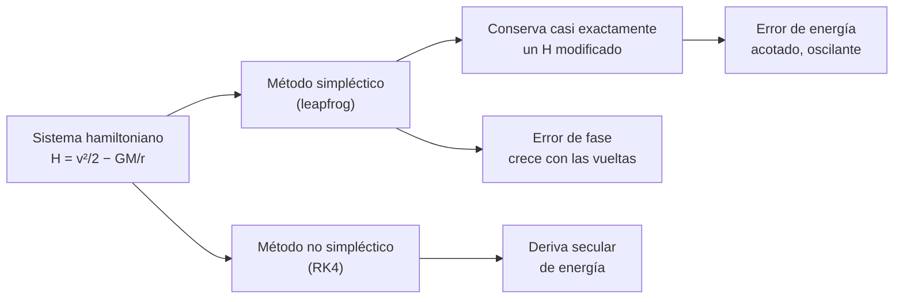

# B11-C11 — Métodos simplécticos

<!-- nav:top -->
<!-- /nav -->

## 1. Ubicación, nivel y alcance

Undécima clase del bloque B11. En [C10](../B11-C10-conservacion-de-energia-numerica/CLASE.md) mediste que Heun y RK4 derivan en energía de forma sistemática. Aquí conoces la alternativa para integraciones largas de sistemas mecánicos: los **métodos simplécticos**, que no minimizan el error de energía sino que lo mantienen **acotado**. Nivel N2. Verás el *leapfrog* (Störmer–Verlet), su reversibilidad, su comportamiento en 1 000 vueltas frente a RK4 y su precio: un error de fase que crece. No verás problemas de frontera (C12) ni integradores simplécticos de orden alto.

## 2. Por qué esta clase existe

Para el sistema solar, anillos planetarios o constelaciones se necesitan integraciones de millones de vueltas. Un método que añade o quita un poco de energía en cada vuelta termina destruyendo la órbita. Los integradores simplécticos se usan por eso en dinámica planetaria de largo plazo, con variantes específicas (S1).

La pregunta motivadora: **¿puede un método garantizar que el error de energía no se acumule, y qué da a cambio?** La decisión central: **elegir entre precisión de posición a corto plazo y estructura correcta a largo plazo**.

## 3. Lo que podrás hacer al terminar

1. Aplicar un paso de leapfrog (impulso–deriva–impulso) a mano.
2. Explicar qué significa «simpléctico» y «reversible».
3. Comprobar la reversibilidad de un integrador.
4. Comparar leapfrog y RK4 en 1 000 vueltas, a igual costo y con 4 veces el costo.
5. Reconocer el error de fase como precio de la estructura.
6. Decidir cuándo conviene un método simpléctico.

La evidencia es el **cuadro de comparación a largo plazo** del ejercicio 12 (sección 20).

## 4. Con qué llegas y cómo comprobarlo

Necesitas la deriva de energía ([C10](../B11-C10-conservacion-de-energia-numerica/CLASE.md)) y el sistema posición–velocidad ([C04](../B11-C04-sistemas-de-ecuaciones-diferenciales/CLASE.md)). Cinco preguntas:

1. ¿Qué signo tiene la deriva de energía de RK4 y de Heun?
2. ¿Qué es la aceleración gravitatoria en `(a, 0)`?
3. ¿Cuántas evaluaciones de fuerza usa un paso de RK4?
4. Si `x(t + h) = x + h v`, ¿cuánto vale `x` tras un paso con `v = 7 668 m/s`, `h = 10 s`, `x = 0`?
5. ¿Qué diferencia hay entre error de energía y error de posición?

<details>
<summary>Ver respuestas</summary>

1. RK4 negativo; Heun positivo. 2. `−GM/a²`, hacia el centro. 3. Cuatro. 4. `76 680 m`. 5. Uno mide si la órbita conserva su tamaño; el otro, dónde está la nave.
</details>

Con cuatro o cinco aciertos, sigue; si no, repasa C10.

## 5. Un caso real: mil vueltas con cien evaluaciones por vuelta

Con `GM = 3,986 004 × 10¹⁴ m³ s⁻²` y radio nominal `6,3781 × 10⁶ m` (S2), una órbita circular a 400 km (ilustrativa) se integra durante **1 000 vueltas** gastando 100 evaluaciones de la fuerza por vuelta. El **leapfrog** mantiene el error relativo de energía por debajo de **`3,9 × 10⁻⁶`** durante todo el cálculo. **RK4**, con el mismo costo, pierde energía cada vuelta (`−1,8 × 10⁻³` en 10 vueltas, `−2 × 10⁻²` en 100) y acaba destruyendo la órbita. Con 4 veces el costo, RK4 deriva `−1,7 × 10⁻⁴` a las 1 000 vueltas: sigue creciendo. Este es el **ejemplo conductor**; y también su contrapartida: el leapfrog, tras 1 000 vueltas, ya tiene la nave en un punto distinto del orbital correcto.

## 6. Vocabulario

Un sistema **hamiltoniano** tiene una función de energía `H(q, p)` que determina el movimiento (aquí `q` es la posición y `p` la velocidad por unidad de masa, con `H = v²/2 − GM/r`). Un método es **simpléctico** si preserva el área (volumen) del espacio de fases, propiedad de los flujos hamiltonianos. El **leapfrog** (Störmer–Verlet) en la forma «impulso–deriva–impulso»: `v_{1/2} = v + (h/2) a(x)`; `x' = x + h v_{1/2}`; `v' = v_{1/2} + (h/2) a(x')`. Una **reversibilidad temporal** significa que avanzar y luego invertir la velocidad y avanzar vuelve al inicio. El **hamiltoniano modificado** (o «de sombra») es una energía ligeramente distinta que el método conserva con mucha precisión. El **error de fase** es el adelanto o retraso a lo largo de la órbita. El **Euler simpléctico** actualiza primero la velocidad y luego la posición con la velocidad nueva, orden 1.

## 7. Modelo mental: patinar en una pista que es casi la correcta

Un método simpléctico no recorre la órbita verdadera sino otra, muy cercana, que conserva *exactamente* su propia energía. El error de energía respecto de la órbita verdadera oscila, pero no crece; lo que sí crece es el desfase con que se recorre.



*Descripción textual:* un método simpléctico aplicado a un sistema hamiltoniano conserva muy bien una energía modificada, por lo que el error de la energía real queda acotado y oscilante, pero acumula un error de fase; un método no simpléctico como RK4 deriva en energía de forma secular.

Analogía: un tren que sigue un carril paralelo al correcto sin abandonarlo nunca, pero llega con retraso creciente. Su límite: la ganancia exige paso fijo y un sistema hamiltoniano; con fuerzas disipativas (atmósfera) ya no vale.

## 8. La explicación, paso a paso

### 8.1 Un paso de leapfrog a mano

Órbita de 400 km, `h = 10 s`, estado `(a, 0, 0, 7 668,58)`. (1) Impulso medio: `a_x = −8,676`; `v_x = −43,38 m/s`. (2) Deriva: `x = 6 778 100 − 433,8 = 6 777 666,2`; `y = 76 685,8`. (3) Nueva aceleración: `(−8,6755; −0,0982)` m/s². (4) Impulso medio: `v = (−86,758; 7 668,088)`. Resultado: radio con error `0,0139 m`, y energía que cambió **`+3,9 × 10⁻⁶ J/kg`**, es decir, `1,3 × 10⁻¹³` relativo. Con una sola evaluación nueva por paso, es unas 60 000 veces mejor en energía que Heun en el mismo paso (`0,24 J/kg`).

### 8.2 Reversibilidad

Avanzar 1 000 pasos de `T/100`, invertir la velocidad y avanzar otros 1 000 devuelve la nave a **`1,3 × 10⁻⁶ m`** del inicio (el ruido de redondeo). RK4, en la misma prueba, termina a **`1 093 m`**: no es reversible. La reversibilidad es una propiedad estructural que se puede verificar sin conocer la solución.

### 8.3 Energía acotada en mil vueltas

Con 100 pasos por vuelta, el error relativo de energía del leapfrog alcanza un máximo de **`3,87 × 10⁻⁶`** y no lo supera en 1 000 vueltas (medido en cada paso). El Euler simpléctico queda acotado también, pero en un valor mucho mayor (`3,95 × 10⁻³`), porque es de orden 1. RK4 con 4 veces el costo (100 pasos por vuelta) deriva `−1,71 × 10⁻⁶`, `−1,71 × 10⁻⁵`, `−1,71 × 10⁻⁴` a las 10, 100 y 1 000 vueltas: crece linealmente. RK4 con el mismo costo (25 pasos) llega a `−1,95 × 10⁻²` en 100 vueltas y a `2 × 10²` al cabo de las 1 000: la órbita se destruyó.

### 8.4 El precio: error de fase

El leapfrog no conserva la posición: su error de posición respecto de la órbita exacta es `56,0 km` tras 1 vuelta, `559 km` tras 10, `5 438 km` tras 100 y `11 306 km` tras 1 000 (ya saturado: la nave dio una vuelta distinta a la verdadera, y la distancia máxima entre dos puntos de la órbita es `13 556 km`). Es crecimiento **lineal** hasta que el desfase se acerca a una vuelta. La energía está bien; la fecha de paso por un punto, no. Para saber *dónde* está la nave a largo plazo se necesita otro método o un paso mucho menor.

### 8.5 Órbita elíptica

En una elíptica ilustrativa (`e = 0,30`, 400 evaluaciones por vuelta, 100 vueltas) el leapfrog tiene un máximo de energía de `1,34 × 10⁻⁴` y termina con `+6,1 × 10⁻⁶`; RK4 tiene máximo `1,55 × 10⁻⁴` y termina con `−1,55 × 10⁻⁴`: ya en la deriva sistemática. Con el mismo costo el leapfrog acaba mejor y su error no acumula.

### 8.6 Cuándo usar uno y cuándo no

Simpléctico: integraciones muy largas de sistemas mecánicos conservativos (planetas, partículas, constelaciones sin disipación) donde importa la estabilidad de las órbitas; existen versiones de orden más alto y específicas, como el integrador tipo Wisdom–Holman WHFast, de uso en planetología (S1, resumen). No simpléctico (RK4, adaptativos): trayectorias de corto plazo con fuerzas disipativas, maniobras, atmósfera, empuje y requisitos de posición precisa. Con paso variable el carácter simpléctico se pierde (salvo diseños especiales).

## 9. Magnitudes, símbolos y unidades

| Símbolo | Qué es | Unidad | Nota |
|---|---|---|---|
| `x`, `v` | posición y velocidad | m, m/s | |
| `a(x)` | aceleración gravitatoria | m/s² | `−GM x/r³` |
| `h` | paso | s | fijo |
| `H` | energía específica | J/kg | `v²/2 − GM/r` |
| `T` | periodo orbital | s | 5 553,6 |
| `GM` | parámetro gravitacional | m³ s⁻² | `3,986 004 × 10¹⁴` (S2) |

## 10. Convenciones y referencias

Dos cuerpos, plano, sistema inercial. «Mismo costo» significa mismo número de evaluaciones de la fuerza por vuelta. Todas las órbitas son **ilustrativas** y los resultados, **simulados**. Los métodos simplécticos aquí son de paso fijo.

## 11. De dónde sale lo que afirmamos

| ID | Fuente | Localizador | Respalda | Estado |
|---|---|---|---|---|
| S1 | Rein, H. y Tamayo, D., «WHFast: a fast and unbiased implementation of a symplectic Wisdom–Holman integrator for long-term gravitational simulations», arXiv:1506.01084 | https://arxiv.org/abs/1506.01084 | Resumen: integrador simpléctico de Wisdom–Holman para simulaciones gravitacionales de largo plazo; con paso pequeño el error de energía es un paseo aleatorio por redondeo (ley de Brouwer) | Consultada el 2026-11-05 (resumen) |
| S2 | IAU, Resolución B3 de 2015 | arXiv:1510.07674, https://arxiv.org/pdf/1510.07674 | `(GM)_E^N = 3,986 004 × 10¹⁴ m³ s⁻²`, `R_eE^N = 6,3781 × 10⁶ m` | Texto extraído del PDF el 2026-11-05 |

Límites: de S1 solo se leyó el resumen; las propiedades del leapfrog (simpléctico, reversible, hamiltoniano modificado) son resultados estándar que se comprobaron numéricamente aquí (reversibilidad, acotación), no citados. El error de fase se midió, no se dedujo.

## 12. Cómo ver la comparación

Equivalente accesible a una gráfica de error de energía frente a vueltas (circular, 100 evaluaciones por vuelta; cálculo):

| Vueltas | Leapfrog (máx.) | Euler simpléctico (máx.) | RK4, mismo costo | RK4, 4× costo |
|---|---|---|---|---|
| 10 | `3,9 × 10⁻⁶` | `4,0 × 10⁻³` | `−1,8 × 10⁻³` | `−1,7 × 10⁻⁶` |
| 100 | `3,9 × 10⁻⁶` | `4,0 × 10⁻³` | `−2,0 × 10⁻²` | `−1,7 × 10⁻⁵` |
| 1 000 | `3,9 × 10⁻⁶` | `4,0 × 10⁻³` | `+2 × 10²` | `−1,7 × 10⁻⁴` |

Descripción larga: la curva del leapfrog es una franja horizontal; la de RK4 con 4× costo, una recta ascendente en escala logarítmica; la de RK4 de igual costo se dispara hacia el final.

## 13. Ejemplo trabajado: ¿leapfrog o RK4 para 1 000 vueltas?

**Paso 1 · Requisito.** Error de energía `< 10⁻⁴` en 1 000 vueltas, con 100 evaluaciones de fuerza por vuelta.

**Paso 2 · Leapfrog.** Máximo `3,9 × 10⁻⁶` en todo el recorrido: cumple, con margen de 25.

**Paso 3 · RK4 (mismo costo).** `−1,95 × 10⁻²` ya a las 100 vueltas: no cumple.

**Paso 4 · RK4 (4× costo).** `−1,7 × 10⁻⁴` a las 1 000 vueltas y en crecimiento: no cumple, y empeora con las vueltas.

**Paso 5 · Revisión de posición.** Si el requisito incluye la posición dentro de un kilómetro, el leapfrog con 100 pasos por vuelta ya falla en la primera vuelta (`56 km`).

**Paso 6 · Decisión.** Para estabilidad orbital, leapfrog; para posición precisa en pocas vueltas, RK4 o un adaptativo. Conclusión de una **simulación** con datos ilustrativos.

## 14. Comparación de familias

| Propiedad | Leapfrog | RK4 | Adaptativo (C08) |
|---|---|---|---|
| Orden | 2 | 4 | 4 o más |
| Evaluaciones por paso | 1 | 4 | 12 o más |
| Energía a largo plazo | acotada | deriva secular | deriva secular |
| Reversible | sí | no | no |
| Paso variable | pierde la propiedad | sí | sí |

## 15. Práctica guiada

**Ejercicio 1 · con los pasos indicados.** Haz el primer impulso medio de un paso de leapfrog con `h = 10 s`, `a_x = −8,676 m/s²`, `v_x = 0`. *Pasos:* `v_x ← v_x + (h/2) a_x`.

<details><summary>Solución comentada</summary>

`v_x = 0 + 5 · (−8,676) = −43,38 m/s` (8.1).
</details>

**Ejercicio 2 · con una pista.** Con ese `v_x` y `v_y = 7 668,58 m/s`, calcula la deriva (`x`, `y`) con `h = 10`. *Pista:* `x ← x + h v_x`.

<details><summary>Solución comentada</summary>

`x = 6 778 100 − 433,8 = 6 777 666,2`; `y = 76 685,8`.
</details>

**Ejercicio 3 · casi autónomo.** Calcula el cambio de radio y de energía tras ese paso completo (con el segundo impulso) y compáralo con Heun.

<details><summary>Solución comentada</summary>

Radio `+0,0139 m`; energía `+3,9 × 10⁻⁶ J/kg` (Heun: `+0,24 J/kg`). Mismo radio, 60 000 veces menos energía añadida.
</details>

## 16. Práctica autónoma, transferencia e integrador

**Ejercicio 4.** ¿Qué prueba demuestra que un integrador es reversible y qué resultado esperas del leapfrog?

<details><summary>Solución comentada</summary>

Avanzar `N` pasos, invertir la velocidad y avanzar `N`: debe volver al inicio salvo redondeo (`≈ 10⁻⁶ m`) (8.2).
</details>

**Ejercicio 5.** Si el error de energía máximo del leapfrog tras 10 vueltas es `3,9 × 10⁻⁶`, ¿qué esperas tras 10 000 vueltas?

<details><summary>Solución comentada</summary>

Aproximadamente lo mismo (acotado), siempre que el paso sea fijo y no haya resonancias (8.3). Es una extrapolación del comportamiento observado.
</details>

**Ejercicio 6.** RK4 con 4× costo da `−1,7 × 10⁻⁴` a las 1 000 vueltas. Extrapola linealmente a 100 000 vueltas.

<details><summary>Solución comentada</summary>

`−1,7 × 10⁻²`: un 1,7 % de energía, equivalente a bajar el semieje unos 115 km. Estimación bajo crecimiento lineal.
</details>

**Ejercicio 7.** Estima el error de posición del leapfrog tras 20 vueltas, suponiendo crecimiento lineal de `56 km` por vuelta.

<details><summary>Solución comentada</summary>

`≈ 56 · 20 = 1 120 km` (la medición a 10 vueltas dio 559 km, de modo que la hipótesis lineal vale mientras el desfase sea pequeño).
</details>

**Ejercicio 8.** ¿Qué distancia máxima puede haber entre dos puntos de una órbita circular de radio 6 778,1 km?

<details><summary>Solución comentada</summary>

El diámetro: `13 556 km`. Por eso `11 306 km` indica error de fase saturado.
</details>

**Ejercicio 9 · transferencia.** Debes predecir la posición de un satélite con error menor de 1 km al cabo de 10 vueltas. ¿Sirve el leapfrog con 100 pasos por vuelta?

<details><summary>Solución comentada</summary>

No: ya a 10 vueltas el error es `559 km`. Habría que aumentar mucho los pasos (el error de fase baja con el cuadrado del paso, aproximadamente) o usar RK4/adaptativo.
</details>

**Ejercicio 10 · transferencia.** Un colega añade un freno atmosférico al modelo y sigue usando leapfrog esperando «energía acotada». ¿Qué le respondes?

<details><summary>Solución comentada</summary>

La energía ya no es constante en la física (el freno la disipa); el leapfrog solo garantiza acotación para sistemas hamiltoniano conservativos. El error no se separa del cambio físico: conviene un método de otra clase y verificación independiente.
</details>

**Ejercicio 11 · transferencia.** ¿Por qué cambiar el paso a mitad de la integración puede destruir la propiedad simpléctica?

<details><summary>Solución comentada</summary>

Porque el hamiltoniano modificado depende de `h`; al cambiar `h` se cambia de «pista», y los errores no se compensan. Por eso se usa paso fijo o formulaciones especiales (8.6).
</details>

**Ejercicio 12 · integrador.** Elabora tu *cuadro de comparación a largo plazo*: leapfrog, RK4 de igual costo y RK4 con 4× costo en 100 y 1 000 vueltas; error de energía máximo, reversibilidad y error de posición; y una recomendación para dos escenarios (estabilidad de largo plazo; posición precisa de corto plazo).

<details><summary>Solución modelo</summary>

Cuadro con las tres columnas; reversibilidad medida (`10⁻⁶` frente a `10³ m`); error de fase del leapfrog; recomendación por escenario con sus límites (paso fijo, sin disipación); datos ilustrativos y simulados; fuentes con fecha.
</details>

## 17. Laboratorio: leapfrog frente a RK4

El script [leapfrog_frente_a_rk4.py](leapfrog_frente_a_rk4.py) compara leapfrog, Euler simpléctico y RK4 en 1 000 vueltas, comprueba la reversibilidad y mide el error de fase. Falla si el leapfrog no es reversible, si su energía no queda acotada o si RK4 no deriva más.

**Datos:** `GM` y radio nominales IAU; órbitas ilustrativas. **Predice antes de ejecutar:** ¿crecerá el error de energía del leapfrog con las vueltas? (no, queda acotado.) **Ejecución del 2026-11-05 (Python 3.12.9):**

```text
reversibilidad tras 1000 pasos: leapfrog 1.325e-06 m ; RK4 1.093e+03 m

Órbita circular, 1000 vueltas, 100 evaluaciones de la fuerza por vuelta:
  leapfrog (h=T/100)           vuelta   10: d(eps)/|eps0| = +4.223e-10   máximo hasta ahí = 3.873e-06
  leapfrog (h=T/100)           vuelta  100: d(eps)/|eps0| = +4.207e-08   máximo hasta ahí = 3.873e-06
  leapfrog (h=T/100)           vuelta 1000: d(eps)/|eps0| = +2.885e-06   máximo hasta ahí = 3.873e-06
  Euler simpléctico (h=T/100)  vuelta   10: d(eps)/|eps0| = +1.268e-05   máximo hasta ahí = 3.952e-03
  Euler simpléctico (h=T/100)  vuelta  100: d(eps)/|eps0| = +1.028e-03   máximo hasta ahí = 3.952e-03
  Euler simpléctico (h=T/100)  vuelta 1000: d(eps)/|eps0| = +1.423e-03   máximo hasta ahí = 3.952e-03
  RK4 (h=T/25), mismo costo    vuelta   10: d(eps)/|eps0| = -1.789e-03   máximo hasta ahí = 1.789e-03
  RK4 (h=T/25), mismo costo    vuelta  100: d(eps)/|eps0| = -1.951e-02   máximo hasta ahí = 1.951e-02
  RK4 (h=T/25), mismo costo    vuelta 1000: d(eps)/|eps0| = +2.000e+02   máximo hasta ahí = 2.000e+02
  RK4 (h=T/100), 4x el costo   vuelta   10: d(eps)/|eps0| = -1.711e-06   máximo hasta ahí = 1.711e-06
  RK4 (h=T/100), 4x el costo   vuelta  100: d(eps)/|eps0| = -1.711e-05   máximo hasta ahí = 1.711e-05
  RK4 (h=T/100), 4x el costo   vuelta 1000: d(eps)/|eps0| = -1.712e-04   máximo hasta ahí = 1.712e-04

Error de posición del leapfrog frente a la solución exacta (circular, h = T/100):
  tras    1 vueltas:     55.960 km
  tras   10 vueltas:    559.441 km
  tras  100 vueltas:   5438.457 km
  tras 1000 vueltas:  11305.918 km
  RK4 (h = T/25) tras 1000 vueltas: 2.267e+08 km (órbita destruida)

Órbita elíptica ilustrativa (e = 0.30), 100 vueltas, 400 evaluaciones de fuerza por vuelta:
  leapfrog: máximo |d eps|/|eps0| = 1.342e-04, tras 100 vueltas +6.140e-06
  RK4     : máximo |d eps|/|eps0| = 1.552e-04, tras 100 vueltas -1.548e-04
Pruebas superadas.
```

```bash
python programa/clases/B11/B11-C11-metodos-simplecticos/leapfrog_frente_a_rk4.py
```

**Límites:** dos cuerpos, paso fijo, sin disipación; resultados **simulados**.

## 18. Errores frecuentes y cómo corregirlos

**Creer que «simpléctico» significa «preciso».** Se corrige con la sección 8.4 y el ejercicio 9.

**Cambiar el paso durante la integración.** Se corrige con el ejercicio 11.

**Usar un método simpléctico con fuerzas disipativas.** Se corrige con el ejercicio 10.

**Evaluar solo la energía y olvidar la posición.** Se corrige con el ejercicio 7.

**Comparar a distinto costo.** Se corrige con el ejercicio 12.

## 19. Cómo sabrás que vas bien

Tras 8.1: ¿haces el paso a mano? Si no, ejercicios 1 a 3. Tras 8.3: ¿por qué el error de energía queda acotado? Si no lo explicas, repasa el modelo mental (sección 7). Tras 8.4: ¿qué se pierde? Si no lo dices, ejercicio 9. Tras el laboratorio: ¿qué indica una reversibilidad de `10³ m`? (que el método no es reversible).

## 20. Qué entregas y cómo se evalúa

El producto es tu **cuadro de comparación a largo plazo** (ejercicio 12).

| Criterio | Inicial | En desarrollo | Logrado | Destacado |
|---|---|---|---|---|
| Aplicación del leapfrog | Orden de operaciones errado | Correcto con ayuda | Paso correcto a mano y en código | Verifica reversibilidad |
| Comparación | A distinto costo | A igual costo sin análisis | A igual costo y 4× costo | Incluye error de fase |
| Interpretación | «Conserva energía» sin matiz | Menciona acotación | Distingue energía y posición | Fija criterios por escenario |
| Límites | Ausentes | Genéricos | Paso fijo y sin disipación | Propone alternativa |
| Fuentes | Sin fuente | Sin fecha | Con localizador y fecha | Rotula simulado e ilustrativo |

**Condiciones críticas (no se compensan con promedio):** medir el error de posición además del de energía; comparar a igual costo; citar solo fuentes consultadas.

## 21. Ética, seguridad y límites

Un método que conserva la energía no está por eso libre de errores: puede ubicar mal a la nave. Ningún resultado de esta clase es operativo ni sirve para predecir encuentros o reentradas. Accesibilidad: fórmulas en texto, tablas equivalentes a las gráficas, ejercicios sin conexión.

## 22. Para cerrar y seguir

El leapfrog es de orden 2, reversible y simpléctico: su error de energía queda acotado en mil vueltas (máximo `3,9 × 10⁻⁶`) mientras RK4 deriva; el precio es un error de fase que crece linealmente; solo vale con paso fijo y sin disipación. Queda abierta una pregunta: hasta ahora los datos estaban en el instante inicial. ¿Qué pasa si se conocen condiciones en dos instantes o en dos extremos? Son los problemas de frontera.

**Glosario español–inglés.** método simpléctico · *symplectic method*; leapfrog · *leapfrog*; reversibilidad · *reversibility*; hamiltoniano modificado · *modified Hamiltonian*; error de fase · *phase error*; espacio de fases · *phase space*; Euler simpléctico · *symplectic Euler*.

**Continuidad.** B11-C12 reutiliza tu capacidad de **integrar y comparar con una referencia** para resolver problemas con condiciones en dos extremos.

**Referencias:** ver sección 11.

<!-- nav:bottom -->
<!-- /nav -->
