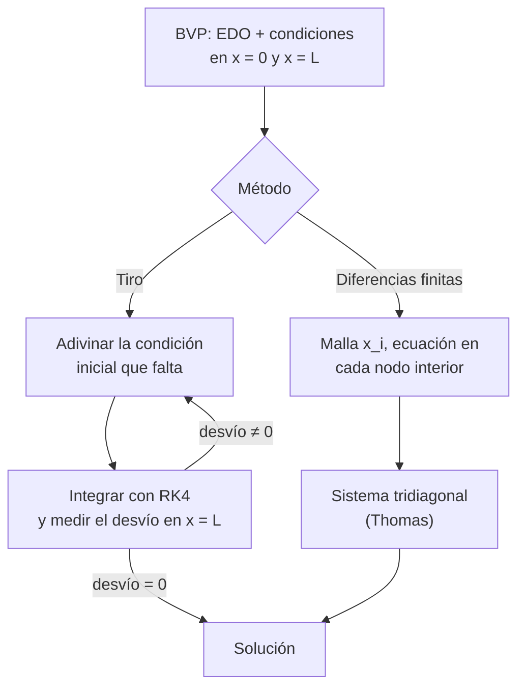

# B11-C12 — Problemas de frontera

<!-- nav:top -->
[🏠 Programa](../../../../README.md) · [📚 Bloque B11](../../../tronco-comun/B11-ecuaciones-diferenciales-y-simulacion-numerica.md) · [← Anterior: B11-C11 — Métodos simplécticos](../B11-C11-metodos-simplecticos/CLASE.md) · [Siguiente: B11-C13 — Ecuaciones en derivadas parciales →](../B11-C13-ecuaciones-en-derivadas-parciales/CLASE.md)
<!-- /nav -->

## 1. Ubicación, nivel y alcance

Duodécima clase del bloque B11. Hasta aquí todos los datos se daban en el instante inicial. Aquí los datos se reparten **en dos extremos**: la temperatura en los dos bordes de una aleta, o la posición de salida y la de llegada de una nave. Es el **problema de frontera** (BVP). Nivel N2. Verás qué cambia respecto del problema de valor inicial, y dos métodos: **diferencias finitas** (un sistema tridiagonal) y **tiro** (disparar y corregir). No verás ecuaciones en derivadas parciales (C13) ni elementos finitos (C15).

## 2. Por qué esta clase existe

En ingeniería espacial las condiciones suelen estar en dos extremos: una aleta térmica con temperaturas conocidas en la raíz y en la punta; una transferencia que debe partir de un punto y llegar a otro en un tiempo dado. Un problema de frontera puede tener una solución, ninguna o varias, y los métodos para resolverlo reutilizan los de valor inicial.

La pregunta motivadora: **¿cómo encuentro la solución que cumple condiciones en los dos extremos, y cuándo existe?** La decisión central: **plantear como sistema algebraico (diferencias finitas) o como búsqueda de la condición inicial correcta (tiro)**.

## 3. Lo que podrás hacer al terminar

1. Distinguir un problema de valor inicial de uno de frontera.
2. Plantear diferencias finitas centrales para una EDO lineal de segundo orden.
3. Resolver el sistema tridiagonal resultante.
4. Resolver un BVP lineal por **tiro** con dos disparos.
5. Resolver un BVP no lineal por tiro con el método de la secante.
6. Comprobar con una solución exacta y medir el orden observado.

La evidencia es el **informe de frontera** del ejercicio 12 (sección 20).

## 4. Con qué llegas y cómo comprobarlo

Necesitas RK4 ([C07](../B11-C07-runge-kutta-de-cuarto-orden/CLASE.md)), la derivada segunda por diferencias (S1) y el concepto de condición inicial ([C02](../B11-C02-problemas-de-valor-inicial/CLASE.md)). Cinco preguntas:

1. ¿Cuántas condiciones necesita una EDO de segundo orden?
2. Escribe la aproximación central de `y″`.
3. ¿Cuánto es `sinh 2`? (aprox.)
4. Resuelve `3θ = 70`.
5. ¿Qué es un sistema de ecuaciones lineales?

<details>
<summary>Ver respuestas</summary>

1. Dos. 2. `(y_{i+1} − 2y_i + y_{i−1})/h²`. 3. `3,6269`. 4. `23,33`. 5. Varias ecuaciones lineales con las mismas incógnitas.
</details>

Con cuatro o cinco aciertos, sigue; si no, repasa C02 y C07.

## 5. Un caso real: una aleta que irradia hacia el espacio

Una aleta sintética de `L = 1 m` conduce calor desde una pared a `300 K` hacia un extremo a `270 K` mientras cede calor al entorno, que está a `250 K`. Con la forma simplificada `T″ = m² (T − T_amb)` y `m = 2 m⁻¹` (valores **sintéticos**), la temperatura a media longitud es `272,68 K`. Un segundo caso: lanzar una carga verticalmente desde `R = 6 378,1 km` del centro de la Tierra y que **esté a 1 000 km más de altura exactamente 300 s después** (datos **sintéticos**). El BVP dice que la velocidad inicial debe ser `4 641,7 m/s`. Con `GM = 3,986 004 × 10¹⁴ m³ s⁻²` y radio nominal (S2). Este es el **ejemplo conductor**: dos problemas de frontera, uno lineal y uno no lineal.

## 6. Vocabulario

Un **problema de frontera** es una EDO con condiciones en dos puntos distintos `x = 0` y `x = L`. Las condiciones pueden ser de **Dirichlet** (valor de la función), **Neumann** (valor de la derivada) o **mixtas**. Una **malla** es el conjunto de nodos `x_i = i h`, `h = L/N`. El **esquema de diferencias centrales** aproxima `y″(x_i) ≈ (y_{i+1} − 2y_i + y_{i−1})/h²`, con error `O(h²)` (S1, §3.4). Un sistema **tridiagonal** solo tiene tres diagonales distintas de cero y se resuelve con el **algoritmo de Thomas** (eliminación sin pivoteo, `O(N)`). El **tiro** (*shooting*) convierte el BVP en un IVP: se adivina la condición inicial que falta, se integra y se corrige hasta cumplir la condición del otro extremo.

## 7. Modelo mental: el arquero y el blanco

El problema de valor inicial es disparar y mirar dónde cae. El de frontera es acertar a un blanco fijo: se dispara, se mide la desviación y se corrige el ángulo. El método de diferencias finitas es distinto: se pide a **todos** los puntos de la malla que se acomoden a la vez entre las dos paredes.



*Descripción textual:* un BVP se resuelve de dos maneras: con diferencias finitas se plantea una ecuación en cada nodo y se resuelve un sistema tridiagonal; con tiro se prueba una condición inicial, se integra y se corrige según el desvío en el extremo hasta que se anule.

Analogía: un arquero que corrige tras cada flecha (tiro) frente a un tejedor que fija ambos extremos de una cuerda y deja que se acomode (diferencias). Su límite: el arquero solo prueba una trayectoria a la vez; la cuerda, toda la malla simultáneamente.

## 8. La explicación, paso a paso

### 8.1 Qué cambia respecto del valor inicial

Con datos iniciales, la solución existe y es única si `f` es lipschitziana (C02). En un BVP no hay esa garantía: `θ″ = −k² θ` con `θ(0) = θ(L) = 0` tiene solución nula siempre, pero si `k L = π` también tiene `θ = c sin(π x/L)` para cualquier `c`: **infinitas soluciones**. Por eso en un BVP siempre se pregunta antes si hay solución y si es única.

### 8.2 Diferencias finitas para la aleta

Se define `θ = T − T_amb`; la ecuación es `θ″ = m² θ` con `θ(0) = 50 K`, `θ(L) = 20 K`. En cada nodo interior: `θ_{i−1} − (2 + (m h)²) θ_i + θ_{i+1} = 0`. Con `N = 2` (un nodo interior, `h = 0,5`, `(m h)² = 1`): `50 − 3θ₁ + 20 = 0`, `θ₁ = 23,33 K`, es decir, `T = 273,33 K` frente al exacto `272,68 K` (error `0,65 K`). Con `N = 4` (`(m h)² = 0,25`): `θ = (50; 32,381; 22,857; 19,048; 20)`; el central vale `22,857` (exacto `22,682`).

### 8.3 Orden observado

Los errores máximos del laboratorio con `N = 10, 20, 40, 80` son `2,900 × 10⁻²`, `7,296 × 10⁻³`, `1,827 × 10⁻³`, `4,569 × 10⁻⁴ K`; las razones son `3,975`, `3,993`, `3,999`: **orden 2**. La temperatura a media longitud pasa de `272,7106` a `272,6824 K` (exacto `272,6819 K`).

### 8.4 Tiro lineal: dos disparos

Como la ecuación es lineal, `θ(L)` depende linealmente de la pendiente inicial `s = θ′(0)`: `θ(L; s) = A + B s`. Un disparo con `s = 0` da `A = 188,11` (que es `50 cosh 2`); un disparo con `s = 1` da `A + B`, con `B = 1,8134` (que es `sinh 2 / 2`). Imponer `θ(L) = 20`: `s = (20 − 188,11)/1,8134 = −92,7026 K/m`. El laboratorio con RK4 da `−92,702 649 481` frente al exacto `−92,702 649 482`.

### 8.5 Tiro no lineal: secante

Para `r″ = −GM/r²`, `r(0) = R`, `r(T) = R + h`, `r(T)` depende de `v₀` de forma no lineal. Se parte de dos estimaciones (`4 500` y `5 000 m/s`) y se aplica la secante: `v_{k+1} = v_k − f(v_k)(v_k − v_{k−1})/(f(v_k) − f(v_{k−1}))`, con `f(v) = r(T; v) − (R + h)`. Converge a `v₀ = 4 641,696 149 m/s` con residuo `9 × 10⁻¹⁰ m`; con la integración a paso mitad se obtiene el mismo valor a `10⁻⁶ m/s`. La estimación con gravedad constante (`h/T + g T/2`, `g = GM/R²`) da `4 803,1 m/s`, un `3,5 %` más: la gravedad disminuye con la altura y se necesita menos velocidad.

### 8.6 Cuál elegir

Diferencias finitas: robusto para problemas lineales y para mallas con muchos nodos; produce toda la solución a la vez. Tiro: simple de programar sobre un integrador ya validado; puede ser muy sensible si el problema es inestable (pequeños cambios en `v₀` producen grandes cambios en el extremo). En ambos, la solución exacta de un caso lineal es el patrón contra el que se verifican.

## 9. Magnitudes, símbolos y unidades

| Símbolo | Qué es | Unidad | Nota |
|---|---|---|---|
| `x`, `L` | coordenada y longitud de la aleta | m | `L = 1` (sintético) |
| `m` | parámetro de la aleta | m⁻¹ | 2 (sintético) |
| `θ` | exceso de temperatura `T − T_amb` | K | 50 y 20 en los bordes |
| `h`, `N` | paso de malla y número de intervalos | m, — | `h = L/N` |
| `s` | pendiente inicial `θ′(0)` | K/m | `−92,7026` |
| `v₀` | velocidad inicial del tiro | m/s | `4 641,7` |
| `GM`, `R` | parámetro gravitacional, radio | m³ s⁻², m | `3,986 004 × 10¹⁴`, `6,3781 × 10⁶` (S2) |

## 10. Convenciones y referencias

La aleta es un modelo unidimensional lineal sintético (el término radiativo real no es lineal en `T`). El tiro vertical es radial, sin atmósfera, con Tierra esférica; el tiempo `T = 300 s` y la altura `h = 1 000 km` son sintéticos. Las condiciones de borde son de Dirichlet.

## 11. De dónde sale lo que afirmamos

| ID | Fuente | Localizador | Respalda | Estado |
|---|---|---|---|---|
| S1 | NIST, *DLMF* §3.4, versión 1.2.8 | https://dlmf.nist.gov/3.4 | Fórmula de tres puntos para derivadas (ec. 3.4.6) | Consultada el 2026-11-05 mediante extracción automática |
| S2 | IAU, Resolución B3 de 2015 | arXiv:1510.07674, https://arxiv.org/pdf/1510.07674 | `(GM)_E^N = 3,986 004 × 10¹⁴ m³ s⁻²`, `R_eE^N = 6,3781 × 10⁶ m` | Texto extraído del PDF el 2026-11-05 |
| S3 | NIST, *DLMF* §3.7(iii), versión 1.2.8 | https://dlmf.nist.gov/3.7 | Problemas de frontera lineales de segundo orden resueltos con un sistema de bloques tridiagonal; sistema tridiagonal por eliminación gaussiana | Consultada el 2026-11-05 mediante extracción automática (resumen de la sección) |

Límites: el algoritmo de Thomas y el tiro con secante son técnicas estándar no atribuidas a una fuente consultada; el ejemplo de infinitas soluciones se verifica analíticamente. Todos los datos de la aleta y del tiro vertical son sintéticos.

## 12. Cómo ver la solución

Equivalente accesible a una gráfica de `T(x)` (exacta, aleta sintética):

| `x` (m) | `T` exacta (K) | `T` con `N = 4` (K) |
|---|---|---|
| 0 | 300,00 | 300,00 |
| 0,25 | 282,23 | 282,38 |
| 0,50 | 272,68 | 272,86 |
| 0,75 | 268,93 | 269,05 |
| 1,00 | 270,00 | 270,00 |

Descripción larga: la temperatura baja desde 300 K en la pared, pasa por un mínimo cercano a 268,9 K antes de la punta y sube ligeramente hasta 270 K; la curva con `N = 4` queda apenas por encima de la exacta.

## 13. Ejemplo trabajado: la aleta con tres intervalos de comprobación

**Paso 1 · Problema.** `θ″ = 4 θ`, `θ(0) = 50`, `θ(1) = 20`.

**Paso 2 · Malla.** `N = 4`, `h = 0,25`, `(m h)² = 0,25`.

**Paso 3 · Ecuaciones.** Tres nodos interiores: `50 − 2,25 θ₁ + θ₂ = 0`; `θ₁ − 2,25 θ₂ + θ₃ = 0`; `θ₂ − 2,25 θ₃ + 20 = 0`.

**Paso 4 · Solución.** `θ₁ = 32,381`, `θ₂ = 22,857`, `θ₃ = 19,048`.

**Paso 5 · Comparación.** Exacto: `32,228; 22,682; 18,926`. Error máximo: `0,175 K` (con `N = 80`, `4,6 × 10⁻⁴ K`).

**Paso 6 · Sentido.** Los valores en kelvin son `282,38; 272,86; 269,05 K`. El mínimo de temperatura cerca de la punta es consecuencia del equilibrio entre conducción y pérdida. Todo con datos **sintéticos**.

## 14. Comparación: diferencias finitas y tiro

Diferencias finitas: orden 2 verificable, un único sistema, sin riesgo de explosión. Tiro: aprovecha un integrador existente (RK4, C07) y se extiende al caso no lineal con una iteración, pero es sensible si las soluciones divergen rápidamente. Para una transferencia orbital real se utilizan variantes de tiro con otras variables (más allá de esta clase).

## 15. Práctica guiada

**Ejercicio 1 · con los pasos indicados.** Resuelve la aleta con `N = 2`. *Pasos:* una ecuación `θ₀ − (2 + (m h)²) θ₁ + θ₂ = 0` (8.2).

<details><summary>Solución comentada</summary>

`50 − 3θ₁ + 20 = 0`, `θ₁ = 23,333`, `T = 273,33 K`; error `0,65 K` respecto del exacto `272,68 K`.
</details>

**Ejercicio 2 · con una pista.** Verifica que `θ₁ = 32,381`, `θ₂ = 22,857`, `θ₃ = 19,048` cumplen las tres ecuaciones del ejemplo 13. *Pista:* sustituye.

<details><summary>Solución comentada</summary>

`50 − 2,25 · 32,381 + 22,857 = 0,00`; `32,381 − 2,25 · 22,857 + 19,048 = 0,00`; `22,857 − 2,25 · 19,048 + 20 = 0,00`.
</details>

**Ejercicio 3 · casi autónomo.** Con `A = 188,11` y `B = 1,8134` calcula la pendiente de tiro `s` para `θ(L) = 20`.

<details><summary>Solución comentada</summary>

`s = (20 − 188,11)/1,8134 = −92,70 K/m` (8.4).
</details>

## 16. Práctica autónoma, transferencia e integrador

**Ejercicio 4.** Clasifica como IVP o BVP: (a) `y″ = −y`, `y(0) = 1`, `y′(0) = 0`; (b) `y″ = −y`, `y(0) = 1`, `y(π/2) = 0`; (c) `r″ = −GM/r²`, `r(0) = R`, `r(300) = R + 10⁶`.

<details><summary>Solución comentada</summary>

(a) IVP; (b) BVP; (c) BVP (condiciones en dos instantes).
</details>

**Ejercicio 5.** ¿Qué tamaño tiene el sistema tridiagonal con `N = 80` intervalos?

<details><summary>Solución comentada</summary>

`N − 1 = 79` incógnitas, matriz de `79 × 79`.
</details>

**Ejercicio 6.** Con errores `2,900 × 10⁻²` (`N = 10`) y `7,296 × 10⁻³` (`N = 20`), calcula el orden observado.

<details><summary>Solución comentada</summary>

`log₂(2,900/0,7296) = 1,99`.
</details>

**Ejercicio 7.** Estima el `N` necesario para un error máximo menor que `10⁻³ K` si el error es `2,9 × 10⁻² (10/N)²`.

<details><summary>Solución comentada</summary>

`(10/N)² < 10⁻³/2,9 × 10⁻² = 0,0345` ⇒ `N > 10/0,1857 = 53,9`: `N = 54` (estimación).
</details>

**Ejercicio 8.** ¿Cuánto más alta es la estimación con `g` constante (`4 803,1`) que el resultado del tiro (`4 641,7`)?

<details><summary>Solución comentada</summary>

`(4 803,1 − 4 641,7)/4 641,7 = 3,5 %`.
</details>

**Ejercicio 9 · transferencia.** `θ″ = −k² θ`, `θ(0) = θ(L) = 0`, con `k L = π`. Demuestra que `θ = c sin(π x/L)` es solución para todo `c`. ¿Qué dice esto del tiro?

<details><summary>Solución comentada</summary>

`θ″ = −(π/L)² θ` ✓; `θ(0) = θ(L) = 0` ✓. Hay infinitas soluciones: el tiro (que busca un valor único de `θ′(0)`) no converge a uno solo.
</details>

**Ejercicio 10 · transferencia.** Plantea cómo usar el tiro para que una nave vaya de un punto a otro en un tiempo dado en dos dimensiones. ¿Cuántas incógnitas y cuántas ecuaciones?

<details><summary>Solución comentada</summary>

Incógnitas: las dos componentes de la velocidad inicial; ecuaciones: dos (posición final en `x` e `y` igual a la deseada). Se resuelve con la versión vectorial de la secante o de Newton. Es la estructura general de los problemas de transferencia (descripción cualitativa).
</details>

**Ejercicio 11 · transferencia.** El residuo `r(T) − (R + h)` es `9 × 10⁻¹⁰ m`. ¿Basta para aceptar `v₀`? ¿Qué otra comprobación del laboratorio lo respalda?

<details><summary>Solución comentada</summary>

El residuo mide solo que se cumple la frontera con **esa** integración. Se respalda al repetir con el paso mitad: el mismo `v₀` a `10⁻⁶ m/s`.
</details>

**Ejercicio 12 · integrador.** Elabora tu *informe de frontera*: resuelve la aleta con diferencias finitas y con tiro lineal, tabula los errores con cuatro mallas y el orden observado, resuelve el tiro no lineal para una altura distinta (`500 km`) y explica cuándo un BVP puede tener infinitas soluciones.

<details><summary>Solución modelo</summary>

Tablas de error (razón ≈ 4), pendiente de tiro comparada con la exacta, `v₀` para 500 km con residuo y comprobación a paso mitad, ejemplo de no unicidad (ejercicio 9) y rótulo de datos sintéticos, con fuentes y fecha.
</details>

## 17. Laboratorio: aleta y tiro

El script [frontera_aleta_y_tiro.py](frontera_aleta_y_tiro.py) resuelve el BVP de la aleta por diferencias finitas (Thomas) y por tiro lineal con RK4, y el tiro no lineal con secante; falla si el orden o los residuos salen de rango.

**Datos:** aleta y tiro sintéticos; `GM` y radio nominales IAU. **Predice antes de ejecutar:** ¿qué razón de errores esperas al duplicar `N`? (≈4.) **Ejecución del 2026-11-05 (Python 3.12.9):**

```text
(a) diferencias finitas N= 10: error máximo = 2.9003e-02 K ; T(L/2) = 272.71057 K
(a) diferencias finitas N= 20: error máximo = 7.2961e-03 K ; T(L/2) = 272.68909 K
(a) diferencias finitas N= 40: error máximo = 1.8270e-03 K ; T(L/2) = 272.68370 K
(a) diferencias finitas N= 80: error máximo = 4.5691e-04 K ; T(L/2) = 272.68235 K
    razones: 3.975 3.993 3.999
    exacto T(L/2) = 272.68190 K
(a) tiro lineal: theta'(0) = -92.702649481 K/m (exacto -92.702649482); theta(L) = 20.000000000 (objetivo 20.0)
(b) tiro no lineal: v0 = 4641.696149 m/s ; residuo r(T) - (R + h) = 9.31e-10 m
    con paso mitad: v0 = 4641.696149 m/s ; estimación con g constante: 4803.093 m/s
Pruebas superadas.
```

```bash
python programa/clases/B11/B11-C12-problemas-de-frontera/frontera_aleta_y_tiro.py
```

**Límites:** modelo lineal de aleta sintético; tiro radial sin atmósfera; resultados **simulados**.

## 18. Errores frecuentes y cómo corregirlos

**Tratar un BVP como un IVP y dar datos en un solo extremo.** Se corrige con el ejercicio 4.

**Olvidar las condiciones de borde en el sistema (primera y última ecuación).** Se corrige con los ejercicios 1 y 2.

**Suponer que siempre hay solución única.** Se corrige con el ejercicio 9.

**Aceptar el tiro sin verificar con otro paso.** Se corrige con el ejercicio 11.

**Aplicar un orden sin medirlo.** Se corrige con el ejercicio 6.

## 19. Cómo sabrás que vas bien

Tras 8.2: ¿planteas la ecuación de un nodo? Si no, ejercicio 1. Tras 8.4: ¿por qué bastan dos disparos? Si no lo sabes, ejercicio 3. Tras 8.5: ¿qué cambia en el caso no lineal? Si dudas, repasa 8.5. Tras el laboratorio: ¿cómo detectarías un error en la condición de borde? (el orden observado dejaría de ser 2).

## 20. Qué entregas y cómo se evalúa

El producto es tu **informe de frontera** (ejercicio 12).

| Criterio | Inicial | En desarrollo | Logrado | Destacado |
|---|---|---|---|---|
| Planteamiento | Datos en un extremo | Con errores en los bordes | Ecuación por nodo con bordes | Discute existencia y unicidad |
| Resolución | Sin comprobar | Con un método | Dos métodos coinciden | Mide orden y sensibilidad |
| Verificación | Ausente | Visual | Frente a solución exacta | Con paso mitad en el tiro |
| Interpretación física | Sin unidades | Unidades parciales | Temperatura y velocidad con unidades | Compara con estimación simple |
| Fuentes | Sin fuente | Sin fecha | Con localizador y fecha | Rotula sintético y simulado |

**Condiciones críticas (no se compensan con promedio):** verificar frente a una solución exacta o a una segunda vía; rotular lo sintético; citar solo fuentes consultadas.

## 21. Ética, seguridad y límites

Una aleta sintética no sirve para diseñar un radiador y un tiro radial sin atmósfera no sirve para planificar un lanzamiento ni una transferencia real. Accesibilidad: fórmulas en texto, tablas equivalentes a las gráficas, ejercicios sin conexión.

## 22. Para cerrar y seguir

Un BVP pone condiciones en dos extremos y puede tener cero, una o varias soluciones; las diferencias finitas dan un sistema tridiagonal de orden 2; el tiro reutiliza un integrador y se corrige con secante. Queda abierta una pregunta: ¿qué pasa cuando la incógnita depende de varias variables independientes, por ejemplo de `x` y `t`? Son las ecuaciones en derivadas parciales.

**Glosario español–inglés.** problema de frontera · *boundary value problem (BVP)*; condición de Dirichlet · *Dirichlet condition*; diferencias finitas · *finite differences*; tiro · *shooting*; método de la secante · *secant method*; matriz tridiagonal · *tridiagonal matrix*; malla · *mesh/grid*.

**Continuidad.** B11-C13 reutiliza tu capacidad de **plantear ecuaciones por nodo** para discretizar derivadas en varias variables.

**Referencias:** ver sección 11.

<!-- nav:bottom -->
---

[← Anterior: B11-C11 — Métodos simplécticos](../B11-C11-metodos-simplecticos/CLASE.md) · [📚 Bloque B11](../../../tronco-comun/B11-ecuaciones-diferenciales-y-simulacion-numerica.md) · [Siguiente: B11-C13 — Ecuaciones en derivadas parciales →](../B11-C13-ecuaciones-en-derivadas-parciales/CLASE.md)
<!-- /nav -->
