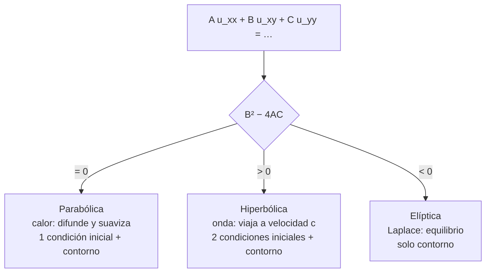

# B11-C13 — Ecuaciones en derivadas parciales

<!-- nav:top -->
<!-- /nav -->

## 1. Ubicación, nivel y alcance

Decimotercera clase del bloque B11. Hasta aquí la incógnita dependía de **una** variable (el tiempo o la posición). Aquí aparecen dos o más a la vez: la temperatura de una placa depende de dónde y de cuándo. Una ecuación con derivadas parciales respecto de varias variables es una **EDP**. Nivel N2. Verás cuatro ecuaciones modelo (calor, onda, Laplace y advección), su clasificación, las condiciones que necesitan y soluciones exactas por separación de variables con las que se probarán los métodos de C14 a C16. No verás aún su discretización.

## 2. Por qué esta clase existe

El calor que atraviesa un escudo, las ondas en una estructura, el potencial gravitatorio de un cuerpo extenso, el transporte de partículas en un plasma: todos son EDP. Antes de discretizar hay que saber *qué tipo de problema es* (qué datos pide, cómo viaja la información) porque de ello depende el método.

La pregunta motivadora: **¿qué tipo de ecuación tengo, qué condiciones necesito y cómo reconozco una solución exacta?** La decisión central: **clasificar antes de calcular**.

## 3. Lo que podrás hacer al terminar

1. Escribir las EDP del calor, de la onda, de Laplace y de la advección.
2. Clasificar una EDP lineal de segundo orden con `B² − 4AC`.
3. Decir qué condiciones iniciales y de contorno exige cada tipo.
4. Comprobar una solución exacta calculando el residuo.
5. Obtener el tiempo característico de difusión de una placa.
6. Interpretar la solución por separación de variables.

La evidencia es la **ficha de clasificación y solución exacta** del ejercicio 12 (sección 20).

## 4. Con qué llegas y cómo comprobarlo

Necesitas EDO ([C01](../B11-C01-ecuaciones-diferenciales-ordinarias/CLASE.md), [C03](../B11-C03-ecuaciones-de-primer-orden/CLASE.md)), derivadas parciales de B09 y condiciones de frontera ([C12](../B11-C12-problemas-de-frontera/CLASE.md)). Cinco preguntas:

1. Si `u = x² y`, ¿cuánto es `∂u/∂x`? ¿y `∂²u/∂y²`?
2. ¿Qué solución tiene `y′ = −k y`?
3. ¿Cuánto es `sin π`?
4. ¿Qué condiciones necesita una EDO de segundo orden?
5. ¿Cuánto es `e^{−1}`?

<details>
<summary>Ver respuestas</summary>

1. `2xy` y `0`. 2. `C e^{−k t}`. 3. `0`. 4. Dos (iniciales o de frontera). 5. `0,3679`.
</details>

Con cuatro o cinco aciertos, sigue; si no, repasa C01, C03 y C12.

## 5. Un caso real: el calor atravesando una placa aislante

Una placa **sintética** de `L = 0,05 m` de espesor, con difusividad térmica `α = 1,0 × 10⁻⁶ m²/s` (orden de magnitud de un material aislante; valor de ejemplo), está inicialmente más caliente en el centro y se mantiene a temperatura cero en sus dos caras. Si el perfil inicial es `sin(π x/L)`, la temperatura del centro decae como `e^{−α π² t/L²}`: el tiempo en que cae a `1/e` es `τ = L²/(π² α) = 253,3 s`, y a los 100 s vale `0,6738` de su valor inicial. Este es el **ejemplo conductor**: la misma placa se resolverá numéricamente en C14, C15 y C16.

## 6. Vocabulario

Una **EDP** relaciona una función de varias variables con sus derivadas parciales. Para `A u_xx + B u_xy + C u_yy + (términos de orden menor) = 0`, el signo de `B² − 4AC` la clasifica: **parabólica** (`= 0`; ejemplo: calor `u_t = α u_xx`), **hiperbólica** (`> 0`; ejemplo: onda `u_tt = c² u_xx`) o **elíptica** (`< 0`; ejemplo: Laplace `u_xx + u_yy = 0`). La **advección** `u_t + c u_x = 0` es de primer orden: transporta el perfil con velocidad `c`. Una **condición inicial** fija `u` (y `u_t` en la onda) en `t = 0`; una **condición de contorno** (o de frontera) fija `u` o su derivada en los bordes. La **separación de variables** busca soluciones `u = X(x) T(t)`. El **tiempo de difusión** es `L²/α` salvo un factor numérico.

## 7. Modelo mental: cómo viaja la información

En una ecuación parabólica la información se difunde y se suaviza: el pasado se olvida. En la hiperbólica viaja con velocidad finita sin disiparse. En la elíptica no hay tiempo: todo el contorno determina el interior de golpe.



*Descripción textual:* según el signo del discriminante, la ecuación es parabólica, hiperbólica o elíptica; la primera necesita una condición inicial y de contorno, la segunda dos iniciales y de contorno, y la tercera solo condiciones de contorno.

Analogía: una gota de tinta en agua quieta (difusión), una onda en una cuerda (propagación) y la forma de una membrana tensa fija en un marco (equilibrio). Su límite: estas imágenes son ideales; los problemas reales mezclan los tres comportamientos.

## 8. La explicación, paso a paso

### 8.1 Las cuatro ecuaciones modelo

Calor: `u_t = α u_xx`. Onda: `u_tt = c² u_xx`. Laplace: `u_xx + u_yy = 0`. Advección: `u_t + c u_x = 0`. Se clasifican con `A, B, C`: calor `(1, 0, 0)` ⇒ `B² − 4AC = 0` (parabólica); onda `(−1, 0, 1)` (al pasar todo a un lado) ⇒ `+4` (hiperbólica); Laplace `(1, 0, 1)` ⇒ `−4` (elíptica). El laboratorio reproduce estos valores.

### 8.2 Separación de variables para el calor

Se busca `u = X(x) T(t)`. Sustituir da `T′/(α T) = X″/X = −λ`, constante: `T = e^{−α λ t}` y `X″ = −λ X`. Con `X(0) = X(L) = 0`, `λ = (n π/L)²`. El modo fundamental (`n = 1`) es

`u(x, t) = sin(π x/L) e^{−α π² t/L²}`.

Cumple `u(0, t) = u(L, t) = 0` y `u(x, 0) = sin(π x/L)`. Los modos más altos decaen `n²` veces más rápido: el calor **suaviza**.

### 8.3 Tiempo característico

El modo fundamental decae a `1/e` en `τ = L²/(π² α)`. Para la placa: `τ = (0,05)²/(π² · 10⁻⁶) = 253,3 s`. Si el espesor se multiplica por 2, el tiempo se multiplica por 4 (escala con `L²`). El centro llega al 1 % de su valor en `τ ln 100 = 1 166 s`. La estimación gruesa `L²/α = 2 500 s` es un orden de magnitud mayor que `τ` por el factor `π²`.

### 8.4 Onda y Laplace

Onda: `u = sin(π x/L) cos(c π t/L)` cumple `u_tt = c² u_xx`; el periodo del modo es `2L/c` (con `c = 3 m/s`, `L = 0,05 m`: `0,0333 s`). Laplace: `u = sin(π x/L) sinh(π y/L)` cumple `u_xx + u_yy = 0`: `−(π/L)² u + (π/L)² u = 0`. Una función que cumple Laplace se llama **armónica** y toma sus valores máximo y mínimo en el contorno.

### 8.5 Advección

Cualquier `u = f(x − c t)` cumple `u_t + c u_x = 0`: `−c f′ + c f′ = 0`. El perfil `f` viaja sin cambiar de forma a velocidad `c`. Con `f = e^{−s²}` y `c = 2 m/s`, en `t = 0,3 s` el pico está en `x = 0,6` y en `x = 0,7` se cumple `u_t = +0,39602`, `c u_x = −0,39602`.

### 8.6 Comprobar con el residuo numérico

Se sustituye la solución y se aproxima cada derivada con diferencias centrales (S1, ec. 3.4.6; las parciales se tratan como en §3.4(iii)). Resultados del laboratorio: calor `3,9 × 10⁻⁶` relativo; onda `1,4 × 10⁻⁷`; Laplace `6,5 × 10⁻⁸`; advección `1,2 × 10⁻¹⁰` absoluto. Un candidato incorrecto (el calor con `e^{−α π t/L²}`, sin el segundo `π`) da residuo relativo `0,85`: la prueba detecta el error.

## 9. Magnitudes, símbolos y unidades

| Símbolo | Qué es | Unidad | Nota |
|---|---|---|---|
| `u(x, t)` | temperatura o amplitud | K (o normalizada) | |
| `x`, `y` | coordenadas | m | |
| `t` | tiempo | s | |
| `α` | difusividad térmica | m²/s | `10⁻⁶` (sintética) |
| `L` | espesor | m | 0,05 |
| `c` | velocidad de onda o advección | m/s | 3 y 2 (sintéticas) |
| `τ` | tiempo de difusión del modo 1 | s | `L²/(π² α)` = 253,3 |
| `A, B, C` | coeficientes de las derivadas segundas | según el caso | |

## 10. Convenciones y referencias

Placa unidimensional con caras a temperatura fija cero (condición de Dirichlet homogénea). Todos los parámetros son **sintéticos**. Las parciales se denotan con subíndices (`u_t = ∂u/∂t`). Las comprobaciones son residuos numéricos de una solución exacta, no simulaciones.

## 11. De dónde sale lo que afirmamos

| ID | Fuente | Localizador | Respalda | Estado |
|---|---|---|---|---|
| S1 | NIST, *DLMF* §3.4, versión 1.2.8 | https://dlmf.nist.gov/3.4 | Fórmulas de diferencias para derivadas (ec. 3.4.6) y parciales (3.4.20–3.4.28) | Consultada el 2026-11-05 mediante extracción automática |

Límites: la clasificación por `B² − 4AC` y la separación de variables son resultados estándar que no se atribuyen a una fuente consultada; las soluciones exactas se comprobaron con el laboratorio. Todos los parámetros físicos son sintéticos.

## 12. Cómo ver la solución

Equivalente accesible a una gráfica de `u(L/2, t)` (cálculo, `α = 10⁻⁶ m²/s`, `L = 0,05 m`):

| `t` (s) | `u(L/2, t)` |
|---|---|
| 0 | 1,0000 |
| 100 | 0,6738 |
| 253,3 (`τ`) | 0,3679 |
| 500 | 0,1389 |
| 1 166 | 0,0100 |

Descripción larga: una exponencial decreciente que baja a un tercio en unos 250 s y a un uno por ciento en unos 1 170 s.

## 13. Ejemplo trabajado: ¿es solución y cuánto tarda?

**Paso 1 · Candidata.** `u = sin(π x/L) e^{−α π² t/L²}`.

**Paso 2 · Derivadas.** `u_t = −α (π/L)² u`; `u_xx = −(π/L)² u`.

**Paso 3 · Sustitución.** `u_t − α u_xx = −α (π/L)² u + α (π/L)² u = 0` ✓.

**Paso 4 · Contorno e inicial.** `u(0, t) = 0`, `u(L, t) = sin π · … = 0`, `u(x, 0) = sin(π x/L)`.

**Paso 5 · Tiempo.** `τ = L²/(π² α) = 2,5 × 10⁻³/(9,8696 × 10⁻⁶) = 253,3 s`.

**Paso 6 · Sentido.** Un espesor de 5 cm de material con difusividad `10⁻⁶ m²/s` responde en minutos, no en segundos. Valores sintéticos.

## 14. Comparación: solución exacta o numérica

La separación de variables da la solución exacta solo para geometrías simples, coeficientes constantes y condiciones sencillas. Los métodos numéricos (C14 a C16) la reproducen donde existe y siguen funcionando donde no. Por eso estas soluciones exactas son el patrón con el que se verifican.

## 15. Práctica guiada

**Ejercicio 1 · con los pasos indicados.** Clasifica: (a) `u_xx + 4 u_yy = 0`; (b) `u_xx − 4 u_yy = 0`; (c) `u_xx + 2 u_xy + u_yy = 0`. *Pasos:* `A, B, C` y `B² − 4AC`.

<details><summary>Solución comentada</summary>

(a) `0 − 16 = −16`: elíptica; (b) `0 + 16 = 16`: hiperbólica; (c) `4 − 4 = 0`: parabólica.
</details>

**Ejercicio 2 · con una pista.** Comprueba que `u = x² − y²` cumple Laplace. *Pista:* calcula `u_xx` y `u_yy`.

<details><summary>Solución comentada</summary>

`u_xx = 2`, `u_yy = −2`; suma `0` ✓.
</details>

**Ejercicio 3 · casi autónomo.** Comprueba las condiciones de contorno e inicial de `sin(π x/L) e^{−α π² t/L²}`.

<details><summary>Solución comentada</summary>

`x = 0` y `x = L` dan `sin 0 = sin π = 0`; `t = 0` da `sin(π x/L)` (13).
</details>

## 16. Práctica autónoma, transferencia e integrador

**Ejercicio 4.** ¿Cuánto vale `τ` si el espesor es `0,10 m`?

<details><summary>Solución comentada</summary>

`τ ∝ L²`: `4 × 253,3 = 1 013 s`.
</details>

**Ejercicio 5.** Calcula `u(L/2, 500 s)`.

<details><summary>Solución comentada</summary>

`e^{−500/253,3} = e^{−1,974} = 0,139`.
</details>

**Ejercicio 6.** ¿Cuánto tarda el centro en llegar al 1 % de su valor inicial?

<details><summary>Solución comentada</summary>

`τ ln 100 = 253,3 · 4,605 = 1 166 s`.
</details>

**Ejercicio 7.** Verifica que `u = f(x − c t)` cumple `u_t + c u_x = 0` para una `f` cualquiera derivable.

<details><summary>Solución comentada</summary>

Regla de la cadena: `u_t = −c f′`, `u_x = f′`; `u_t + c u_x = 0` (8.5).
</details>

**Ejercicio 8.** ¿Qué condiciones necesita cada ecuación: calor, onda y Laplace?

<details><summary>Solución comentada</summary>

Calor: inicial `u(x, 0)` + contorno. Onda: `u(x, 0)` y `u_t(x, 0)` + contorno. Laplace: solo contorno (sección 7).
</details>

**Ejercicio 9 · transferencia.** Una pieza aislante sintética de `5 cm` con `α = 10⁻⁶ m²/s` es sometida a calor por una cara. Estima el orden de magnitud del tiempo para que el calor la atraviese.

<details><summary>Solución comentada</summary>

`L²/α = 2,5 × 10⁻³/10⁻⁶ = 2 500 s`, unos 40 minutos (orden de magnitud). El tiempo del modo fundamental, `253 s`, es `π²` veces menor.
</details>

**Ejercicio 10 · transferencia.** Un compañero propone `u = sin(π x/L) e^{−α π t/L²}`. Sustituye y explica por qué falla.

<details><summary>Solución comentada</summary>

`u_t = −α (π/L²) u`; `α u_xx = −α (π/L)² u`. Difieren por un factor `π`: el residuo relativo es `0,85` en el laboratorio. Faltaba el `π` del exponente (8.6).
</details>

**Ejercicio 11 · transferencia.** En una placa delgada en equilibrio, la temperatura cumple Laplace. ¿Dónde está la temperatura máxima y por qué?

<details><summary>Solución comentada</summary>

En el contorno: las funciones armónicas no tienen máximos interiores (8.4).
</details>

**Ejercicio 12 · integrador.** Elabora tu *ficha de clasificación y solución exacta*: las cuatro ecuaciones modelo con su tipo, sus condiciones, una solución exacta con su residuo exacto y numérico, el tiempo característico de la placa para dos espesores y un candidato incorrecto detectado.

<details><summary>Solución modelo</summary>

Ficha con ecuación, `A, B, C`, tipo, condiciones, solución, residuo exacto (0) y numérico con `h` declarado; `τ` para `0,05` y `0,10 m`; un candidato fallido con su residuo; parámetros rotulados como sintéticos; fuente con fecha.
</details>

## 17. Laboratorio: clasificación y residuos

El script [edp_clasificacion_y_soluciones.py](edp_clasificacion_y_soluciones.py) clasifica las ecuaciones y comprueba por residuo las soluciones exactas del calor, la onda, Laplace y la advección; falla si el candidato incorrecto no es detectado.

**Datos:** sintéticos. **Predice antes de ejecutar:** ¿qué residuo tendrá el candidato con `e^{−α π t/L²}`? (grande, del orden de la unidad.) **Ejecución del 2026-11-05 (Python 3.12.9):**

```text
Clasificación (A, B, C de A u_xx + B u_xy + C u_yy):
  calor (u_t = a u_xx)     B^2-4AC = +0 -> parabólica
  onda (u_tt = c2 u_xx)    B^2-4AC = +4 -> hiperbólica
  Laplace                  B^2-4AC = -4 -> elíptica
calor, solución correcta : residuo relativo = 3.94e-06
calor, candidato erróneo : residuo relativo = 8.45e-01
  contorno u(0,t) = 0.0e+00, u(L,t) = 1.0e-16; u(L/2, 0) = 1.000
  tiempo de difusión del modo fundamental tau = L^2/(pi^2 alpha) = 253.3 s ; u(L/2, tau) = 0.36788 (1/e = 0.36788)
onda, residuo relativo   = 1.40e-07
Laplace, residuo relativo= 6.50e-08
advección, residuo abs   = -1.17e-10 (u_t = +0.39602)
Pruebas superadas.
```

```bash
python programa/clases/B11/B11-C13-ecuaciones-en-derivadas-parciales/edp_clasificacion_y_soluciones.py
```

**Límites:** parámetros sintéticos; el residuo en un punto no es una demostración.

## 18. Errores frecuentes y cómo corregirlos

**Confundir EDO y EDP.** Se corrige con el ejercicio 1 y el vocabulario (sección 6).

**Pedir las condiciones equivocadas.** Se corrige con el ejercicio 8.

**Olvidar un `π` o un `L` en el exponente.** Se corrige con el ejercicio 10.

**Esperar que la elíptica evolucione en el tiempo.** Se corrige con el ejercicio 11.

**Tomar la estimación `L²/α` como tiempo exacto.** Se corrige con el ejercicio 9.

## 19. Cómo sabrás que vas bien

Tras 8.1: ¿clasificas `u_xx − 4u_yy`? Si no, ejercicio 1. Tras 8.2: ¿por qué aparece `e^{−α λ t}`? Si no lo sabes, repasa 8.2. Tras 8.3: ¿cómo cambia `τ` con `L`? Si dudas, ejercicio 4. Tras el laboratorio: ¿qué indica un residuo de orden 1? (que la candidata no es solución).

## 20. Qué entregas y cómo se evalúa

El producto es tu **ficha de clasificación y solución exacta** (ejercicio 12).

| Criterio | Inicial | En desarrollo | Logrado | Destacado |
|---|---|---|---|---|
| Clasificación | Sin criterio | Parcial | Correcta con `B² − 4AC` | Justifica con el comportamiento físico |
| Condiciones | Ausentes | Incompletas | Las correctas por tipo | Relaciona con la unicidad |
| Verificación | Solo gráfica | Residuo exacto | Exacto y numérico | Detecta un candidato fallido |
| Escala de tiempo | Ausente | Sin unidades | `τ` con unidades | Compara dos espesores |
| Fuentes | Sin fuente | Sin fecha | Con localizador y fecha | Rotula lo sintético |

**Condiciones críticas (no se compensan con promedio):** incluir un candidato incorrecto detectado; rotular lo sintético; citar solo fuentes consultadas.

## 21. Ética, seguridad y límites

Estos modelos unidimensionales y sintéticos no sirven para diseñar escudos térmicos ni estructuras. Un perfil de temperatura real exige propiedades medidas, geometrías reales y validación experimental. Accesibilidad: fórmulas en texto, tablas equivalentes a las gráficas, ejercicios sin conexión.

## 22. Para cerrar y seguir

Las EDP se clasifican en parabólicas, hiperbólicas y elípticas; cada tipo pide condiciones distintas y transporta la información de manera distinta; la separación de variables da soluciones exactas que sirven de patrón. Queda abierta una pregunta: ¿cómo se reemplazan las derivadas parciales por diferencias en una malla? Son las diferencias finitas.

**Glosario español–inglés.** ecuación en derivadas parciales · *partial differential equation (PDE)*; parabólica · *parabolic*; hiperbólica · *hyperbolic*; elíptica · *elliptic*; separación de variables · *separation of variables*; difusividad · *diffusivity*; condición de contorno · *boundary condition*; advección · *advection*.

**Continuidad.** B11-C14 reutiliza tu capacidad de **verificar con soluciones exactas** para medir el orden de un esquema en diferencias finitas.

**Referencias:** ver sección 11.

<!-- nav:bottom -->
<!-- /nav -->
