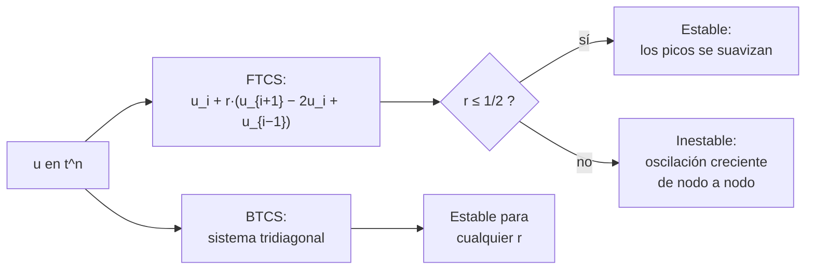

# B11-C14 — Diferencias finitas

<!-- nav:top -->
[🏠 Programa](../../../../README.md) · [📚 Bloque B11](../../../tronco-comun/B11-ecuaciones-diferenciales-y-simulacion-numerica.md) · [← Anterior: B11-C13 — Ecuaciones en derivadas parciales](../B11-C13-ecuaciones-en-derivadas-parciales/CLASE.md) · [Siguiente: B11-C15 — Elementos finitos introductorios →](../B11-C15-elementos-finitos-introductorios/CLASE.md)
<!-- /nav -->

## 1. Ubicación, nivel y alcance

Decimocuarta clase del bloque B11. En [C13](../B11-C13-ecuaciones-en-derivadas-parciales/CLASE.md) obtuviste soluciones exactas de la ecuación del calor. Aquí las usas como patrón para un **método numérico**: cubrir el dominio con una malla y reemplazar cada derivada por una combinación de valores vecinos. Nivel N2. Verás el esquema explícito FTCS y el implícito BTCS para el calor, la condición de estabilidad `r ≤ 1/2`, la advección con contracorriente y el número de Courant. No verás elementos finitos (C15) ni métodos espectrales (C16).

## 2. Por qué esta clase existe

Casi todo código de simulación de calor, fluidos o plasma en una malla regular usa diferencias finitas. Elegir el paso de tiempo equivocado no da un resultado ligeramente malo: da un resultado que explota. Y duplicar la resolución espacial no cuesta el doble, cuesta ocho veces más. Saber esas dos cosas evita errores caros.

La pregunta motivadora: **¿qué pasos de espacio y de tiempo puedo usar para que el esquema sea estable y preciso, y cuánto cuesta cada mejora?** La decisión central: **elegir `Δx` por precisión y `Δt` por estabilidad**.

## 3. Lo que podrás hacer al terminar

1. Obtener una aproximación de `u_xx` por diferencias centrales y su error de truncamiento.
2. Escribir y aplicar a mano el esquema FTCS del calor.
3. Comprobar el orden espacial 2 con una solución exacta.
4. Aplicar la condición de estabilidad `r = α Δt/Δx² ≤ 1/2`.
5. Usar el esquema implícito BTCS con un sistema tridiagonal.
6. Aplicar la condición de Courant `ν = c Δt/Δx ≤ 1` a la advección.

La evidencia es el **informe de malla y estabilidad** del ejercicio 12 (sección 20).

## 4. Con qué llegas y cómo comprobarlo

Necesitas la placa de [C13](../B11-C13-ecuaciones-en-derivadas-parciales/CLASE.md), la estabilidad de C09 y el sistema tridiagonal de [C12](../B11-C12-problemas-de-frontera/CLASE.md). Cinco preguntas:

1. ¿Cuánto vale `τ` de la placa de C13?
2. ¿Qué factor de amplificación `R` tiene Euler explícito para `z = −3`?
3. ¿Cuál es la aproximación central de `u_xx`?
4. ¿Por qué un método implícito es estable con pasos grandes?
5. Resuelve `0,4 · 4 = ?` y `1 − 4 · 0,6 = ?`.

<details>
<summary>Ver respuestas</summary>

1. `253,3 s`. 2. `−2` (módulo `2`). 3. `(u_{i+1} − 2u_i + u_{i−1})/h²`. 4. Porque su factor de amplificación `1/(1 − z)` tiene módulo menor que 1 para `Re z < 0`. 5. `1,6` y `−1,4`.
</details>

Con cuatro o cinco aciertos, sigue; si no, repasa C09, C12 y C13.

## 5. Un caso real: la placa aislante en una malla

La placa sintética de C13 (`L = 0,05 m`, `α = 1,0 × 10⁻⁶ m²/s`, perfil inicial `sin(π x/L)`, caras a cero) se simula 100 s. La solución exacta en el centro es `0,673825`. Con el esquema FTCS y `r = 0,4`, una malla de 10, 20 y 40 intervalos da `0,670709`, `0,673056` y `0,673634`: el error baja a la cuarta parte cada vez que se duplica la malla. Pero con `r = 0,593` una perturbación de `10⁻³` crece hasta un error de `4,6` en 27 pasos: **el esquema explota**. Este es el **ejemplo conductor**.

## 6. Vocabulario

Una **malla** uniforme tiene nodos `x_i = i Δx`, `Δx = L/N`, e instantes `t^n = n Δt`; `u_i^n` aproxima `u(x_i, t^n)`. El **esquema FTCS** (*forward time, centered space*) es `u_i^{n+1} = u_i^n + r (u_{i+1}^n − 2u_i^n + u_{i−1}^n)`, con `r = α Δt/Δx²`. El **esquema BTCS** (*backward time, centered space*) evalúa el término espacial en el instante nuevo: `−r u_{i−1}^{n+1} + (1 + 2r) u_i^{n+1} − r u_{i+1}^{n+1} = u_i^n`. El **error de truncamiento** es lo que sobra al sustituir la solución exacta en el esquema; para la derivada segunda central vale `(Δx²/12) u⁗` (S1, §3.4(iii)). La **consistencia** es que el error de truncamiento tienda a cero; la **estabilidad**, que los errores no crezcan. El **número de Courant** es `ν = c Δt/Δx`. El esquema **contracorriente** (*upwind*) para `u_t + c u_x = 0` con `c > 0` usa el nodo de aguas arriba: `u_i^{n+1} = u_i^n − ν (u_i^n − u_{i−1}^n)`.

## 7. Modelo mental: cada nodo promedia con sus vecinos

FTCS hace que cada nodo se acerque al promedio de sus vecinos con un peso `r`. Si `r` es pequeño, se acerca despacio; si pasa de `1/2`, se pasa del promedio y el signo se invierte en cada paso, amplificando lo que debería suavizar.



*Descripción textual:* con FTCS, cada nodo se actualiza con sus vecinos; si `r ≤ 1/2` el esquema es estable y suaviza, y si no, las oscilaciones de nodo a nodo crecen; BTCS requiere resolver un sistema tridiagonal pero es estable para cualquier `r`.

Analogía: un grupo de personas que corrigen su posición promediando con sus vecinas; si cada una se corrige demasiado, el grupo oscila cada vez más. Su límite: no hay ninguna persona real con memoria negativa; la analogía solo explica el signo.

## 8. La explicación, paso a paso

### 8.1 De la derivada a la diferencia

Con la serie de Taylor: `u(x ± Δx) = u ± Δx u′ + (Δx²/2) u″ ± (Δx³/6) u‴ + (Δx⁴/24) u⁗`. Sumando: `u_{i+1} − 2u_i + u_{i−1} = Δx² u″ + (Δx⁴/12) u⁗ + …`. Luego `u″ ≈ (u_{i+1} − 2u_i + u_{i−1})/Δx²` con error `(Δx²/12) u⁗`: **orden 2**. Para `sin(π x/L)` con 10 intervalos, el error relativo es `(π/10)²/12 = 0,8 %`. Es la fórmula de tres puntos de la DLMF (S1, ec. 3.4.6 y 3.4.22).

### 8.2 FTCS a mano

Con `N = 4` (`Δx = 0,0125 m`) y `r = 0,4`: `Δt = r Δx²/α = 62,5 s`. El perfil inicial interior es `(0,7071; 1; 0,7071)`. Primer paso: `u₁ = 0,7071 + 0,4 (1 − 1,4142 + 0) = 0,5414`; `u₂ = 1 + 0,4 (1,4142 − 2) = 0,7657`. La solución exacta, tras 62,5 s, es el perfil por `e^{−0,2467} = 0,7813`: `(0,5524; 0,7813)`. La malla de cuatro intervalos es muy gruesa y el error es de `2 %`; aun así el esquema captura la caída.

### 8.3 Orden observado

Con `r` fijo en `0,4`, `Δt ∝ Δx²`. Errores máximos a 100 s: `3,116 × 10⁻³` (`N = 10`, 10 pasos), `7,690 × 10⁻⁴` (`N = 20`, 40 pasos), `1,916 × 10⁻⁴` (`N = 40`, 160 pasos). Razones `4,05` y `4,01`: **orden 2** en espacio (y 1 en tiempo, de modo que el error total se reduce con `Δx²`). Duplicar `N` multiplica por 4 el número de pasos y por 2 los nodos: **8 veces más trabajo** para dividir el error entre 4.

### 8.4 La condición de estabilidad

Una perturbación alternante `(−1)^i` se multiplica por `1 − 4r` en cada paso. Para `r = 0,4`: `−0,6`, decae; para `r = 0,593`: `−1,37`, crece como `1,37^n`. De ahí `r ≤ 1/2` (el límite `|1 − 4r| = 1`). En el laboratorio, con una perturbación de `10⁻³`, el error a 100 s es `7,7 × 10⁻⁴` con `r = 0,4` (la perturbación se disipó) y `4,57` con `r = 0,593` tras 27 pasos. Para `N = 20`, el paso máximo estable es `Δt = 0,5 Δx²/α = 3,125 s`; para `N = 40`, `0,78 s`: el costo crece como `N³`.

### 8.5 BTCS

BTCS es estable para cualquier `r`. Con `N = 20` y solo 3 pasos (`Δt = 33,3 s`, `r = 5,33`), el máximo de `u` es `0,6906` (acotado) y el error máximo `1,68 × 10⁻²`: grande porque el orden en el tiempo es 1, pero estable. Con 2 000 pasos (`r = 0,008`) el error es `5,7 × 10⁻⁴`, dominado por el error espacial. Se paga resolver un sistema tridiagonal por paso (C12), que es barato.

### 8.6 Advección y Courant

Para `u_t + c u_x = 0`, el esquema contracorriente es estable si `ν = c Δt/Δx ≤ 1`: la información no puede cruzar más de una celda por paso. El laboratorio, con un pulso más una perturbación alternante, da tras 60 pasos un máximo `0,85` con `ν = 0,8` y `5,9 × 10⁵` con `ν = 1,2`. El factor de amplificación de la perturbación es `|1 − 2ν|`: `0,6` frente a `1,4`.

## 9. Magnitudes, símbolos y unidades

| Símbolo | Qué es | Unidad | Nota |
|---|---|---|---|
| `Δx`, `Δt` | pasos de espacio y de tiempo | m, s | |
| `u_i^n` | valor numérico en el nodo `i`, paso `n` | K | |
| `r` | `α Δt/Δx²` | adimensional | `≤ 1/2` para FTCS |
| `ν` | `c Δt/Δx` (Courant) | adimensional | `≤ 1` |
| `α` | difusividad | m²/s | `10⁻⁶` (sintética) |
| `L`, `N` | espesor y número de intervalos | m, — | 0,05 |
| `t_f` | tiempo final | s | 100 |

## 10. Convenciones y referencias

Caras a temperatura cero, perfil inicial `sin(π x/L)`, exacta `sin(π x/L) e^{−α π² t/L²}` (C13). Los errores se miden como el máximo sobre los nodos a `t_f = 100 s`. Todos los parámetros son **sintéticos**.

## 11. De dónde sale lo que afirmamos

| ID | Fuente | Localizador | Respalda | Estado |
|---|---|---|---|---|
| S1 | NIST, *DLMF* §3.4, versión 1.2.8 | https://dlmf.nist.gov/3.4 | Fórmulas de diferencias centrales para derivadas primeras, segundas y parciales (ecs. 3.4.6, 3.4.20–3.4.29) con error `O(h²)` | Consultada el 2026-11-05 mediante extracción automática |

Límites: la condición `r ≤ 1/2` y la condición de Courant son resultados estándar que se comprobaron con el laboratorio, no citados; el desarrollo de Taylor del error de truncamiento es propio. Los datos son sintéticos.

## 12. Cómo ver la convergencia

Equivalente accesible a una gráfica de error frente a `Δx` (FTCS, `r = 0,4`; cálculo):

| `N` | `Δx` (m) | pasos | `u(L/2)` | error máximo |
|---|---|---|---|---|
| 10 | 0,005 | 10 | 0,670709 | `3,116 × 10⁻³` |
| 20 | 0,0025 | 40 | 0,673056 | `7,690 × 10⁻⁴` |
| 40 | 0,00125 | 160 | 0,673634 | `1,916 × 10⁻⁴` |

(Exacto: `0,673825`.)

Descripción larga: en escala logarítmica los puntos caen sobre una recta de pendiente 2; cada duplicación de la malla baja el error a la cuarta parte.

## 13. Ejemplo trabajado: ¿qué `Δt` uso?

**Paso 1 · Datos.** `N = 40`, `L = 0,05 m` ⇒ `Δx = 1,25 × 10⁻³ m`; `α = 10⁻⁶ m²/s`.

**Paso 2 · Límite FTCS.** `Δt ≤ Δx²/(2α) = 1,5625 × 10⁻⁶/(2 × 10⁻⁶) = 0,78125 s`.

**Paso 3 · Elección.** Con margen, `r = 0,4`: `Δt = 0,625 s`; para 100 s, 160 pasos.

**Paso 4 · Resultado.** Error máximo `1,92 × 10⁻⁴`, centro `0,673634` frente a `0,673825`.

**Paso 5 · Alternativa.** BTCS con 20 pasos (`Δt = 5 s`, `r = 8`) da un error dominado por el tiempo (primer orden); para igual precisión que FTCS necesita más pasos, pero no tiene límite de estabilidad.

**Paso 6 · Sentido.** El `Δt` se fija por estabilidad; el `Δx`, por la precisión espacial. Resultado **simulado** con datos sintéticos.

## 14. Comparación: FTCS, BTCS y contracorriente

FTCS: explícito, barato por paso, orden 2 en espacio y 1 en tiempo, límite `r ≤ 1/2`. BTCS: implícito, sistema tridiagonal por paso, estable siempre, orden 1 en tiempo. Contracorriente: para advección, orden 1, estable con `ν ≤ 1` y que difunde el pulso (suaviza la forma). Los esquemas de orden mayor (Crank–Nicolson, Lax–Wendroff, etc.) existen y no se tratan aquí.

## 15. Práctica guiada

**Ejercicio 1 · con los pasos indicados.** Aplica un paso FTCS con `r = 0,4` al perfil interior `(0,7071; 1; 0,7071)` con extremos 0. *Pasos:* fórmula de 6.

<details><summary>Solución comentada</summary>

`u₁ = 0,7071 + 0,4(1 − 1,4142) = 0,5414`; `u₂ = 1 + 0,4(0,7071 · 2 − 2) = 0,7657`; `u₃ = 0,5414` por simetría.
</details>

**Ejercicio 2 · con una pista.** Calcula `Δt` para `N = 20` y `r = 0,4`. *Pista:* `Δt = r Δx²/α`.

<details><summary>Solución comentada</summary>

`Δx = 0,0025`; `Δt = 0,4 · 6,25 × 10⁻⁶/10⁻⁶ = 2,5 s`; 40 pasos para 100 s.
</details>

**Ejercicio 3 · casi autónomo.** ¿Cuál es el `Δt` máximo estable de FTCS para `N = 20`?

<details><summary>Solución comentada</summary>

`r = 0,5`: `Δt = 0,5 · 6,25 × 10⁻⁶/10⁻⁶ = 3,125 s`.
</details>

## 16. Práctica autónoma, transferencia e integrador

**Ejercicio 4.** Con errores `3,116 × 10⁻³` y `7,690 × 10⁻⁴` para `N = 10` y `20`, calcula el orden observado.

<details><summary>Solución comentada</summary>

`log₂(3,116/0,769) = 2,02`.
</details>

**Ejercicio 5.** ¿Cuántas veces más trabajo requiere duplicar `N` con `r` fijo?

<details><summary>Solución comentada</summary>

Nodos ×2 y pasos ×4: ×8.
</details>

**Ejercicio 6.** Calcula el factor de amplificación de la perturbación alternante con `r = 0,6`. ¿Estable?

<details><summary>Solución comentada</summary>

`1 − 4 · 0,6 = −1,4`; módulo `1,4 > 1`: inestable.
</details>

**Ejercicio 7.** Estima cuánto vale el error espacial relativo de la derivada segunda de `sin(π x/L)` con `N = 20`.

<details><summary>Solución comentada</summary>

`(π/20)²/12 = 0,0021`, un `0,2 %` (8.1).
</details>

**Ejercicio 8.** Con `c = 2 m/s`, `Δx = 0,01 m`, ¿qué `Δt` máximo permite el contracorriente?

<details><summary>Solución comentada</summary>

`ν ≤ 1`: `Δt ≤ 0,01/2 = 5 × 10⁻³ s`.
</details>

**Ejercicio 9 · transferencia.** Para resolver el calor en la placa con `N = 80` y FTCS estable, ¿cuántos pasos hacen falta hasta 100 s? ¿Y con `N = 20`?

<details><summary>Solución comentada</summary>

`Δx = 6,25 × 10⁻⁴`; `Δt ≤ 0,5 · 3,906 × 10⁻⁷/10⁻⁶ = 0,195 s` ⇒ ≥ 512 pasos. Con `N = 20`: `Δt ≤ 3,125 s` ⇒ ≥ 32 pasos. Dieciséis veces más pasos (por `N²`) y cuatro veces más nodos: 64 veces más trabajo.
</details>

**Ejercicio 10 · transferencia.** Con BTCS, `N = 20` y 3 pasos, el máximo de `u` es `0,69` y el error `1,7 × 10⁻²`. ¿Por qué es estable pero impreciso, y cómo mejorarías?

<details><summary>Solución comentada</summary>

Estable porque el factor de amplificación implícito tiene módulo < 1; impreciso por el error de primer orden en el tiempo con `Δt` grande. Se mejora reduciendo `Δt` (a 2 000 pasos el error baja a `5,7 × 10⁻⁴`) o con un esquema de segundo orden en el tiempo.
</details>

**Ejercicio 11 · transferencia.** Un colega baja `Δx` a la mitad y deja `Δt` igual: el programa explota. ¿Por qué?

<details><summary>Solución comentada</summary>

`r = α Δt/Δx²` se multiplica por 4: si antes era `0,4`, ahora vale `1,6 > 1/2` (8.4).
</details>

**Ejercicio 12 · integrador.** Elabora tu *informe de malla y estabilidad*: tabla de error para tres mallas con `r = 0,4`, el orden observado, una corrida inestable con `r > 1/2` y su explicación, una corrida BTCS con `r` grande y una estimación del costo de duplicar la malla.

<details><summary>Solución modelo</summary>

Tablas con `N`, pasos, error, razones (≈4), orden (≈2); corrida con `r = 0,6` y perturbación que explota; BTCS acotado con su error de primer orden; costo ×8 por duplicar `N`; parámetros rotulados como sintéticos; fuente con fecha.
</details>

## 17. Laboratorio: FTCS, BTCS y Courant

El script [ftcs_btcs_y_courant.py](ftcs_btcs_y_courant.py) integra el calor con FTCS y BTCS, mide el orden y demuestra la inestabilidad con `r > 1/2`; después hace lo mismo con la condición de Courant en la advección.

**Datos:** sintéticos. **Predice antes de ejecutar:** ¿qué razón de errores esperas al duplicar `N` con `r` fijo? (≈4.) **Ejecución del 2026-11-05 (Python 3.12.9):**

```text
u(L/2, 100 s) exacto = 0.673825
FTCS N= 10 r=0.400 pasos=    10: error máx = 3.1162e-03 ; u(L/2) = 0.670709
FTCS N= 20 r=0.400 pasos=    40: error máx = 7.6903e-04 ; u(L/2) = 0.673056
FTCS N= 40 r=0.400 pasos=   160: error máx = 1.9164e-04 ; u(L/2) = 0.673634
  razones de error: 4.052 4.013
FTCS N=20 r=0.400 con perturbación 1e-3: error máx tras 40 pasos = 7.737e-04
FTCS N=20 r=0.593 con perturbación 1e-3: error máx tras 27 pasos = 4.571e+00
BTCS N=20 pasos=3 r=5.33: error máx = 1.6794e-02 ; máx|u| = 0.6906
BTCS N=20 pasos=2000 r=0.008: error máx = 5.7291e-04
upwind: máx|u| tras 60 pasos con nu=0.8: 0.8499 ; con nu=1.2: 5.857e+05
Pruebas superadas.
```

```bash
python programa/clases/B11/B11-C14-diferencias-finitas/ftcs_btcs_y_courant.py
```

**Límites:** problema lineal de coeficientes constantes con solución exacta; resultados **simulados** con datos sintéticos.

## 18. Errores frecuentes y cómo corregirlos

**Reducir `Δx` sin reducir `Δt` en FTCS.** Se corrige con el ejercicio 11.

**Confundir estabilidad con precisión.** Se corrige con el ejercicio 10.

**Olvidar los extremos (condiciones de contorno) al actualizar.** Se corrige con el ejercicio 1.

**No medir el orden.** Se corrige con el ejercicio 4.

**Subestimar el costo de refinar la malla.** Se corrige con los ejercicios 5 y 9.

## 19. Cómo sabrás que vas bien

Tras 8.2: ¿haces un paso FTCS a mano? Si no, ejercicio 1. Tras 8.4: ¿por qué `r ≤ 1/2`? Si no lo sabes, ejercicio 6. Tras 8.5: ¿qué ganó y qué perdió BTCS? Si dudas, ejercicio 10. Tras el laboratorio: ¿cómo distingues un error de programación de una inestabilidad? (la perturbación crece como `|1 − 4r|^n`).

## 20. Qué entregas y cómo se evalúa

El producto es tu **informe de malla y estabilidad** (ejercicio 12).

| Criterio | Inicial | En desarrollo | Logrado | Destacado |
|---|---|---|---|---|
| Esquema | Fórmula con errores | Correcto con ayuda | Correcto a mano y en código | Deriva el error de truncamiento |
| Convergencia | Una malla | Dos mallas | Tres o más y orden observado | Relaciona con el costo |
| Estabilidad | Ausente | Cita la regla | Demuestra con una corrida | Deduce `1 − 4r` |
| Comparación | Solo FTCS | FTCS y BTCS sin análisis | Con compensaciones | Recomienda según el problema |
| Fuentes | Sin fuente | Sin fecha | Con localizador y fecha | Rotula sintético y simulado |

**Condiciones críticas (no se compensan con promedio):** demostrar la inestabilidad con una corrida; medir el orden; citar solo fuentes consultadas.

## 21. Ética, seguridad y límites

Una malla fina con un `Δt` inestable puede producir números que parecen una simulación. Estos modelos lineales y sintéticos no sirven para diseñar sistemas térmicos reales. Accesibilidad: fórmulas en texto, tablas equivalentes a las gráficas, ejercicios sin conexión.

## 22. Para cerrar y seguir

Las diferencias centrales dan orden 2 en espacio; FTCS exige `r ≤ 1/2` y su costo crece como `N³`; BTCS es estable a cambio de un sistema tridiagonal; el contracorriente exige `ν ≤ 1`. Queda abierta una pregunta: ¿hay una forma de discretizar que sirva en geometrías irregulares y que parta de una formulación integral? Son los elementos finitos.

**Glosario español–inglés.** diferencias finitas · *finite differences*; malla · *grid*; error de truncamiento · *truncation error*; consistencia · *consistency*; número de Courant · *Courant number*; contracorriente · *upwind*; esquema implícito · *implicit scheme*.

**Continuidad.** B11-C15 reutiliza tu capacidad de **medir el orden de un esquema** para verificar la convergencia de elementos finitos.

**Referencias:** ver sección 11.

<!-- nav:bottom -->
---

[← Anterior: B11-C13 — Ecuaciones en derivadas parciales](../B11-C13-ecuaciones-en-derivadas-parciales/CLASE.md) · [📚 Bloque B11](../../../tronco-comun/B11-ecuaciones-diferenciales-y-simulacion-numerica.md) · [Siguiente: B11-C15 — Elementos finitos introductorios →](../B11-C15-elementos-finitos-introductorios/CLASE.md)
<!-- /nav -->
