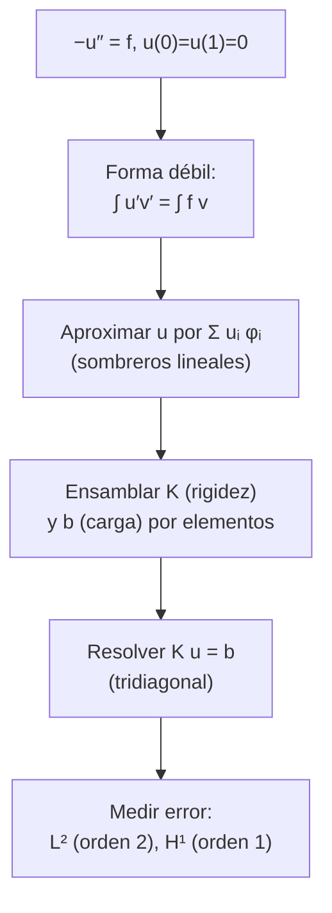

# B11-C15 — Elementos finitos introductorios

<!-- nav:top -->
[🏠 Programa](../../../../README.md) · [📚 Bloque B11](../../../tronco-comun/B11-ecuaciones-diferenciales-y-simulacion-numerica.md) · [← Anterior: B11-C14 — Diferencias finitas](../B11-C14-diferencias-finitas/CLASE.md) · [Siguiente: B11-C16 — Métodos espectrales iniciales →](../B11-C16-metodos-espectrales-iniciales/CLASE.md)
<!-- /nav -->

## 1. Ubicación, nivel y alcance

Decimoquinta clase del bloque B11. Las diferencias finitas de [C14](../B11-C14-diferencias-finitas/CLASE.md) reemplazan derivadas por diferencias en una malla regular. Aquí conoces otra idea: **aproximar la solución misma con funciones sencillas a trozos** y exigir que la ecuación se cumpla «en promedio» (forma débil). Es la base del método de elementos finitos, que se adapta a geometrías complicadas. Nivel N2. Verás el caso unidimensional con funciones lineales a trozos: forma débil, ensamblaje de la matriz y el vector, resolución y medición del error. No verás elementos en 2D o 3D ni elementos de orden alto.

## 2. Por qué esta clase existe

Las estructuras y los escudos de una nave no son barras rectas con mallas regulares. El análisis térmico y estructural de ingeniería espacial se hace casi siempre con elementos finitos sobre geometrías reales. Entender el caso 1D da el vocabulario (rigidez, carga, ensamblaje) y la medida del error que se usan después en programas comerciales.

La pregunta motivadora: **¿cómo reduzco un problema continuo a un sistema de ecuaciones usando funciones de base, y cómo verifico que converge?** La decisión central: **qué espacio de funciones aproximantes y qué malla usar**.

## 3. Lo que podrás hacer al terminar

1. Pasar de la ecuación `−u″ = f` a su **forma débil**.
2. Construir las funciones de base lineales a trozos («sombrero»).
3. Ensamblar la matriz de rigidez y el vector de carga y resolver.
4. Comprobar la solución nodal exacta para una carga uniforme.
5. Medir el orden de convergencia en norma `L²` y en la seminorma `H¹`.
6. Explicar la diferencia entre el error en los nodos y entre ellos.

La evidencia es el **informe de convergencia de elementos finitos** del ejercicio 12 (sección 20).

## 4. Con qué llegas y cómo comprobarlo

Necesitas el sistema tridiagonal de [C12](../B11-C12-problemas-de-frontera/CLASE.md), orden observado (C05 a C07, C14) e integración por partes de B09. Cinco preguntas:

1. Integra por partes `∫₀¹ u″ v dx` con `v(0) = v(1) = 0`.
2. ¿Qué es una cuadratura de Gauss de 3 puntos?
3. Si el error baja a la cuarta parte al duplicar `N`, ¿qué orden tiene?
4. ¿Cuánto vale `∫₀¹ sin(π x) dx`?
5. ¿Qué forma tiene la matriz tridiagonal `[2, −1; −1, 2]`?

<details>
<summary>Ver respuestas</summary>

1. `−∫₀¹ u′ v′ dx`. 2. Una regla para aproximar una integral con tres puntos y pesos, exacta para polinomios de grado 5. 3. Orden 2. 4. `2/π = 0,6366`. 5. Simétrica con diagonal `2` y subdiagonales `−1`.
</details>

Con cuatro o cinco aciertos, sigue; si no, repasa C12 y C14.

## 5. Un caso real: una placa con generación interna de calor

Una placa **sintética** de `L = 0,1 m`, con generación interna uniforme `q = 10⁴ W/m³`, conductividad `k = 2 W/(m K)` y caras a `300 K` (valores de ejemplo), cumple `−k T″ = q`. La solución exacta es una parábola con máximo `300 + q L²/(8k) = 306,25 K` en el centro. Con solo **4 elementos** lineales, los valores en los nodos salen `300; 304,6875; 306,25; 304,6875; 300 K`, exactos hasta el redondeo. Con una carga no uniforme, `f = π² sin(π x)`, el error entre nodos sí es visible: `3,9 × 10⁻²` en norma `L²` con 4 elementos y `1,6 × 10⁻⁴` con 64. Este es el **ejemplo conductor**.

## 6. Vocabulario

La **forma débil** de `−u″ = f` con `u(0) = u(1) = 0` multiplica por una **función de prueba** `v` (también nula en los extremos) e integra por partes: `∫ u′ v′ dx = ∫ f v dx` para toda `v`. Una **malla** divide el intervalo en `N` **elementos** de longitud `h`. La **función sombrero** (o de base lineal) `φ_i` vale 1 en el nodo `i`, 0 en los demás y es lineal a trozos. La solución aproximada es `u_h = Σ u_i φ_i`. La **matriz de rigidez** `K_ij = ∫ φ_i′ φ_j′ dx` y el **vector de carga** `b_i = ∫ f φ_i dx` forman `K u = b`. El **ensamblaje** suma las contribuciones de cada elemento. La norma `L²` mide el error de la función `‖e‖ = (∫ e² dx)^{1/2}`; la seminorma `H¹`, el de la pendiente `(∫ e′² dx)^{1/2}`.

## 7. Modelo mental: armar la curva con segmentos

La solución se construye uniendo segmentos de recta cuyos vértices (los valores nodales) se eligen para que la ecuación se cumpla lo mejor posible *en promedio*, no punto a punto.



*Descripción textual:* de la ecuación se pasa a la forma débil; se aproxima la solución con funciones sombrero; se ensambla el sistema `K u = b` sumando las contribuciones de los elementos; se resuelve y se mide el error en las normas `L²` y `H¹`.

Analogía: reproducir una curva con tramos de regla. Su límite: el método no copia la curva, la «mejora» entre los puntos según la ecuación; por eso en 1D acierta los nodos aunque las rectas se aparten entre ellos.

## 8. La explicación, paso a paso

### 8.1 Del problema a la forma débil

Multiplica `−u″ = f` por `v` con `v(0) = v(1) = 0` e integra: `−∫ u″ v = ∫ f v`. Por partes: `−[u′ v]₀¹ + ∫ u′ v′ = ∫ f v`, y el término de borde se anula. Queda `∫ u′ v′ dx = ∫ f v dx`. Pide menos derivabilidad a `u` (basta una derivada), por lo que sirven funciones lineales a trozos.

### 8.2 La matriz de rigidez

Con malla uniforme, `φ_i′ = ±1/h` en los dos elementos que comparten el nodo `i`. Entonces `K_ii = ∫ (φ_i′)² = 2/h`, `K_{i,i±1} = −1/h` y los demás son 0. Es la matriz tridiagonal `(1/h) [2, −1; −1, 2, −1; …]`: la misma estructura de C12, ahora derivada de una formulación integral.

### 8.3 El vector de carga

`b_i = ∫ f φ_i dx` se calcula elemento a elemento con cuadratura de Gauss de 3 puntos (exacta para polinomios de grado 5, aproximación excelente para funciones suaves). En un elemento `[x_l, x_r]`, el sombrero que sube en `x_r` aporta `f(x)(x − x_l)/h` al nodo derecho, y el que baja, `f(x)(x_r − x)/h`, al nodo izquierdo.

### 8.4 Un ejemplo a mano con dos elementos

`N = 2`, `h = 0,5`, un nodo interior. `K = 2/h = 4`. Con `f = π² sin(π x)`: `b₁ = ∫ π² sin(π x) φ₁ dx = 2(1 − cos(π h))/h = 4`. Luego `u₁ = b₁/K = 1`. La solución exacta en `x = 0,5` es `sin(π/2) = 1`: **exacta en el nodo**. Pero la solución aproximada es una tienda (triángulo) de altura 1, y entre nodos, por ejemplo en `x = 0,25`, vale `0,5` frente al exacto `0,7071`. Con `N = 4` los nodos dan `0,70711; 1; 0,70711`, otra vez exactos hasta 5 decimales.

### 8.5 Carga uniforme: nodos exactos

Para `−u″ = 1` (o `−k T″ = q`), la solución exacta es cuadrática y los valores nodales del método lineal resultan **exactos** (propiedad de los elementos lineales 1D). El laboratorio lo confirma con la placa: `300; 304,6875; 306,25; 304,6875; 300 K`, diferencia máxima `< 10⁻¹²` relativa.

### 8.6 Orden de convergencia

Con `f = π² sin(π x)` y `N = 4, 8, 16, 32, 64`: error `L²` `3,929 × 10⁻²`, `9,921 × 10⁻³`, `2,487 × 10⁻³`, `6,220 × 10⁻⁴`, `1,555 × 10⁻⁴`: razones `3,96`, `3,99`, `4,00`, `4,00`: **orden 2**. Error en `H¹`: `0,4985`, `0,2512`, `0,1258`, `0,0629`, `0,0315`: razones `≈ 2`: **orden 1** (la pendiente es constante a trozos). El error nodal máximo cae mucho más rápido, de `6,0 × 10⁻⁷` a `4,4 × 10⁻¹⁴` (aquí dominado por la cuadratura); es una propiedad del caso 1D, no se extiende a 2D sin matices.

## 9. Magnitudes, símbolos y unidades

| Símbolo | Qué es | Unidad | Nota |
|---|---|---|---|
| `u`, `T` | solución, temperatura | K | |
| `f`, `q` | carga, generación interna | según el caso, W/m³ | `q = 10⁴` (sintética) |
| `k` | conductividad térmica | W/(m K) | 2 (sintética) |
| `φ_i` | función sombrero | adimensional | |
| `K`, `b` | matriz de rigidez y vector de carga | según el caso | |
| `h`, `N` | longitud de elemento y número de elementos | m, — | |
| `‖e‖_{L²}`, `|e|_{H¹}` | normas del error | según el caso | |

## 10. Convenciones y referencias

Problema 1D con condiciones de Dirichlet homogéneas (en la placa se resta la temperatura de pared). Malla uniforme y cuadratura de Gauss de 3 puntos; el error se mide con la misma cuadratura. Los valores de la placa son **sintéticos**.

## 11. De dónde sale lo que afirmamos

| ID | Fuente | Localizador | Respalda | Estado |
|---|---|---|---|---|
| S1 | NIST, *DLMF* §3.4, versión 1.2.8 | https://dlmf.nist.gov/3.4 | Contexto: fórmulas de diferencias (comparación con C14) | Consultada el 2026-11-05 mediante extracción automática |

Límites: la forma débil, las funciones sombrero, la cuadratura de Gauss y las normas del error son resultados estándar que no se atribuyen a una fuente consultada; las afirmaciones numéricas son medidas del laboratorio. S1 solo sirve de contexto.

## 12. Cómo ver la solución

Equivalente accesible a una gráfica de la placa (4 elementos; cálculo con valores sintéticos):

| `x` (m) | `T` FEM (K) | `T` exacta (K) |
|---|---|---|
| 0 | 300,0000 | 300,0000 |
| 0,025 | 304,6875 | 304,6875 |
| 0,050 | 306,2500 | 306,2500 |
| 0,075 | 304,6875 | 304,6875 |
| 0,100 | 300,0000 | 300,0000 |

Descripción larga: los valores nodales caen sobre la parábola; entre nodos, la solución es una poligonal que queda por debajo de la curva exacta (la parábola es cóncava).

## 13. Ejemplo trabajado: convergencia con carga no uniforme

**Paso 1 · Problema.** `−u″ = π² sin(π x)`, `u(0) = u(1) = 0`; exacta `sin(π x)`.

**Paso 2 · Malla.** `N = 4`, `h = 0,25`.

**Paso 3 · Sistema.** `K = (1/h) tridiag(−1, 2, −1)` de `3 × 3`; `b_i = ∫ f φ_i dx`.

**Paso 4 · Solución.** `u = (0,70711; 1,00000; 0,70711)` frente a `(0,70711; 1; 0,70711)`.

**Paso 5 · Error entre nodos.** `‖e‖_{L²} = 3,93 × 10⁻²` y `|e|_{H¹} = 0,50`.

**Paso 6 · Refinar.** Con `N = 8`, `‖e‖_{L²} = 9,92 × 10⁻³`: cuarta parte; `|e|_{H¹} = 0,251`: mitad. Orden 2 y 1.

**Paso 7 · Sentido.** La solución nodal es excelente pero la derivada es solo de primer orden: en una aplicación térmica, el flujo de calor (que depende de `T′`) es menos preciso que la temperatura. Cálculo **simulado**.

## 14. Comparación: diferencias finitas y elementos finitos

En 1D con malla uniforme los dos producen sistemas tridiagonales casi idénticos. La diferencia está en lo que generalizan: las diferencias finitas dependen de mallas regulares; los elementos finitos admiten mallas irregulares, geometrías complejas y condiciones naturales de borde, con una teoría de error uniforme. Por eso los programas de análisis térmico-estructural usan elementos finitos.

## 15. Práctica guiada

**Ejercicio 1 · con los pasos indicados.** Calcula `K` y `u₁` para `N = 2` con `−u″ = 1` en `[0, 1]`. *Pasos:* `K = 2/h`, `b₁ = ∫ φ₁ dx = h`.

<details><summary>Solución comentada</summary>

`h = 0,5`; `K = 4`; `b₁ = 0,5`; `u₁ = 0,125 = x(1 − x)/2` en `x = 0,5`: exacto (8.5).
</details>

**Ejercicio 2 · con una pista.** Con la placa sintética, calcula `T_max = 300 + q L²/(8k)`. *Pista:* `L = 0,1`.

<details><summary>Solución comentada</summary>

`10⁴ · 0,01/(8 · 2) = 6,25`; `T_max = 306,25 K`.
</details>

**Ejercicio 3 · casi autónomo.** Para `N = 2` y `f = π² sin(π x)`, calcula `u₁` y el valor aproximado en `x = 0,25`.

<details><summary>Solución comentada</summary>

`u₁ = 1`; en `x = 0,25` la tienda vale `0,5` (exacto `0,7071`) (8.4).
</details>

## 16. Práctica autónoma, transferencia e integrador

**Ejercicio 4.** Con errores `L²` `3,929 × 10⁻²` (`N = 4`) y `9,921 × 10⁻³` (`N = 8`), calcula el orden.

<details><summary>Solución comentada</summary>

`log₂(3,929/0,9921) = 1,99`.
</details>

**Ejercicio 5.** Con errores `H¹` `0,4985` y `0,2512`, calcula el orden.

<details><summary>Solución comentada</summary>

`log₂(0,4985/0,2512) = 0,99`: orden 1.
</details>

**Ejercicio 6.** Estima el error `L²` con `N = 128`.

<details><summary>Solución comentada</summary>

`1,555 × 10⁻⁴/4 = 3,9 × 10⁻⁵` (estimación).
</details>

**Ejercicio 7.** Escribe la matriz de rigidez de `N = 4` en `[0, 1]`.

<details><summary>Solución comentada</summary>

`h = 0,25`, `1/h = 4`: `4 · [2, −1, 0; −1, 2, −1; 0, −1, 2]`.
</details>

**Ejercicio 8.** ¿Por qué el término de borde `[u′ v]₀¹` desaparece?

<details><summary>Solución comentada</summary>

Porque se exige `v(0) = v(1) = 0` (8.1).
</details>

**Ejercicio 9 · transferencia.** El flujo de calor es `−k T′`. Con la solución FEM de la placa a 4 elementos, ¿qué flujo da en el primer elemento (`x ∈ [0, 0,025]`) y cuál es el exacto en `x = 0`?

<details><summary>Solución comentada</summary>

Pendiente FEM: `(304,6875 − 300)/0,025 = 187,5 K/m`; flujo `−2 · 187,5 = −375 W/m²`. Exacto: `T′(0) = q L/(2k) = 10⁴ · 0,1/4 = 250 K/m`; flujo `−500 W/m²`. El flujo FEM es un 25 % menor en ese elemento: la derivada es de primer orden.
</details>

**Ejercicio 10 · transferencia.** Un colega refina la malla y ve el error nodal bajar a `10⁻¹⁴`. ¿Concluye que el flujo es igual de preciso?

<details><summary>Solución comentada</summary>

No: el error del flujo sigue el de `H¹` (orden 1); el nodal es excepcionalmente bueno en 1D (8.6).
</details>

**Ejercicio 11 · transferencia.** ¿Qué ventaja de los elementos finitos permitiría modelar un escudo térmico de forma irregular que las diferencias finitas en malla regular no ofrecen?

<details><summary>Solución comentada</summary>

Que la malla se adapta a la geometría (elementos de tamaño y forma variables) y la condición de borde se incorpora en la forma débil (14).
</details>

**Ejercicio 12 · integrador.** Elabora tu *informe de convergencia de elementos finitos*: placa con generación uniforme (nodos exactos) y problema con `f = π² sin(π x)` con cinco mallas, los errores `L²` y `H¹`, sus órdenes observados, el flujo en la pared comparado con el exacto y una explicación de la diferencia entre error nodal y de pendiente.

<details><summary>Solución modelo</summary>

Tabla de errores y razones (≈4 y ≈2), nodos exactos de la placa, flujo `−375` frente a `−500 W/m²` (4 elementos), conclusión sobre el orden de la pendiente, parámetros rotulados como sintéticos y fuentes con fecha.
</details>

## 17. Laboratorio: elementos finitos 1D

El script [fem_1d_lineal.py](fem_1d_lineal.py) ensambla `K` y `b` por elementos, resuelve, comprueba los nodos exactos de la placa y mide los órdenes de convergencia; falla si no se cumplen.

**Datos:** sintéticos. **Predice antes de ejecutar:** ¿qué razón esperas en `L²` al duplicar `N`? (≈4.) **Ejecución del 2026-11-05 (Python 3.12.9, NumPy 2.4.4):**

```text
placa, N=4: x (m) = [0.    0.025 0.05  0.075 0.1  ] 
            T (K) = [300.     304.6875 306.25   304.6875 300.    ] 
          exacto  = [300.     304.6875 306.25   304.6875 300.    ]
  temperatura máxima = 306.2500 K (exacta 306.2500 K)
N=  4 h=0.25000: error L2 = 3.9292e-02  error H1 (seminorma) = 4.9851e-01  error nodal máx = 5.9961e-07
N=  8 h=0.12500: error L2 = 9.9214e-03  error H1 (seminorma) = 2.5118e-01  error nodal máx = 9.1629e-09
N= 16 h=0.06250: error L2 = 2.4865e-03  error H1 (seminorma) = 1.2583e-01  error nodal máx = 1.4238e-10
N= 32 h=0.03125: error L2 = 6.2202e-04  error H1 (seminorma) = 6.2947e-02  error nodal máx = 2.2240e-12
N= 64 h=0.01562: error L2 = 1.5553e-04  error H1 (seminorma) = 3.1477e-02  error nodal máx = 4.4187e-14
  razones L2: 3.960 3.990 3.998 3.999 | razones H1: 1.985 1.996 1.999 2.000
Pruebas superadas.
```

```bash
python programa/clases/B11/B11-C15-elementos-finitos-introductorios/fem_1d_lineal.py
```

**Límites:** 1D, malla uniforme, elementos lineales; propiedades de la placa sintéticas; resultados **simulados**.

## 18. Errores frecuentes y cómo corregirlos

**Olvidar que las funciones de prueba deben anularse en el borde.** Se corrige con el ejercicio 8.

**Confundir el orden de la solución con el de su derivada.** Se corrige con los ejercicios 5, 9 y 10.

**Ensamblar mal la carga en los extremos.** Se corrige con los ejercicios 1 y 3.

**Creer que «nodos exactos» implica solución exacta entre nodos.** Se corrige con el ejercicio 3.

**No medir el error con una norma definida.** Se corrige con el ejercicio 12.

## 19. Cómo sabrás que vas bien

Tras 8.2: ¿escribes `K` para `N = 4`? Si no, ejercicio 7. Tras 8.4: ¿por qué la tienda queda por debajo de la curva? Si dudas, ejercicio 3. Tras 8.6: ¿por qué `H¹` es de orden 1? Si no lo sabes, ejercicio 5. Tras el laboratorio: ¿qué haría saltar una alarma? (una razón `L²` lejos de 4).

## 20. Qué entregas y cómo se evalúa

El producto es tu **informe de convergencia de elementos finitos** (ejercicio 12).

| Criterio | Inicial | En desarrollo | Logrado | Destacado |
|---|---|---|---|---|
| Forma débil | Ausente | Con errores | Correcta con borde | Explica por qué baja la exigencia |
| Ensamblaje | Sin hacerlo | Matriz sin carga | `K` y `b` correctos | Verifica nodos exactos |
| Convergencia | Una malla | Dos mallas | Cinco mallas y órdenes | Distingue `L²`, `H¹` y nodal |
| Interpretación | Sin unidades | Parcial | Temperatura y flujo con unidades | Compara con diferencias finitas |
| Fuentes | Sin fuente | Sin fecha | Con localizador y fecha | Rotula sintético y simulado |

**Condiciones críticas (no se compensan con promedio):** medir el orden observado; distinguir error nodal y de pendiente; citar solo fuentes consultadas.

## 21. Ética, seguridad y límites

Un caso 1D con malla uniforme no es un análisis estructural ni térmico de una nave. Los resultados de elementos finitos reales dependen de propiedades medidas, calidad de malla y validación; este ejercicio es una introducción con datos sintéticos. Accesibilidad: fórmulas en texto, tablas equivalentes a las gráficas, ejercicios sin conexión.

## 22. Para cerrar y seguir

La forma débil pide menos derivadas; las funciones sombrero llevan a un sistema tridiagonal; el error converge con orden 2 en `L²` y 1 en `H¹`; en 1D los nodos son excepcionalmente precisos. Queda abierta una pregunta: ¿qué ocurre si en vez de funciones a trozos usamos funciones suaves de toda la región, como senos y cosenos? Son los métodos espectrales.

**Glosario español–inglés.** elementos finitos · *finite elements*; forma débil · *weak form*; función de prueba · *test function*; función sombrero · *hat function*; matriz de rigidez · *stiffness matrix*; ensamblaje · *assembly*; seminorma · *seminorm*.

**Continuidad.** B11-C16 reutiliza tu capacidad de **medir normas de error** para comparar la convergencia espectral con la de diferencias y elementos finitos.

**Referencias:** ver sección 11.

<!-- nav:bottom -->
---

[← Anterior: B11-C14 — Diferencias finitas](../B11-C14-diferencias-finitas/CLASE.md) · [📚 Bloque B11](../../../tronco-comun/B11-ecuaciones-diferenciales-y-simulacion-numerica.md) · [Siguiente: B11-C16 — Métodos espectrales iniciales →](../B11-C16-metodos-espectrales-iniciales/CLASE.md)
<!-- /nav -->
