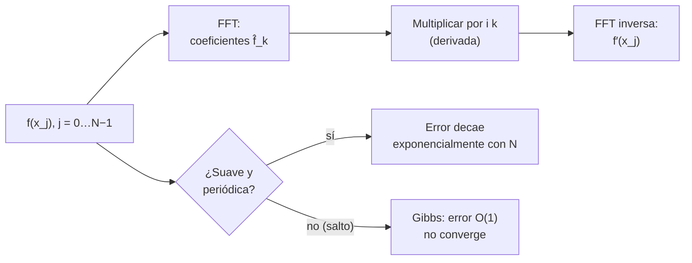

# B11-C16 — Métodos espectrales iniciales

<!-- nav:top -->
[🏠 Programa](../../../../README.md) · [📚 Bloque B11](../../../tronco-comun/B11-ecuaciones-diferenciales-y-simulacion-numerica.md) · [← Anterior: B11-C15 — Elementos finitos introductorios](../B11-C15-elementos-finitos-introductorios/CLASE.md) · [Siguiente: B11-C17 — Optimización numérica →](../../../tronco-comun/B11-ecuaciones-diferenciales-y-simulacion-numerica.md#b11-c17)
<!-- /nav -->

## 1. Ubicación, nivel y alcance

Decimosexta clase del bloque B11. Con [diferencias finitas](../B11-C14-diferencias-finitas/CLASE.md) y [elementos finitos](../B11-C15-elementos-finitos-introductorios/CLASE.md) la solución se representa con funciones locales y el error baja como una potencia de `h`. Aquí usas **funciones globales** —senos y cosenos— y descubres que, para soluciones suaves y periódicas, el error baja **más rápido que cualquier potencia**: convergencia exponencial. Nivel N2. Verás la derivada por transformada de Fourier, el aliasing, el fenómeno de Gibbs y la solución exacta por modo del calor periódico. No verás Chebyshev ni condiciones no periódicas (queda para B11-C24).

## 2. Por qué esta clase existe

Cuando la solución es suave y periódica —una señal a lo largo de una órbita, un perfil de temperatura alrededor de un vehículo que gira, el campo en una caja periódica—, un método espectral logra con 24 puntos lo que unas diferencias finitas lograrían con millones. Saber cuándo es aplicable y cuándo falla (señales con saltos) permite elegirlo bien.

La pregunta motivadora: **¿cuántos puntos necesito para derivar con precisión una señal periódica y qué la rompe?** La decisión central: **elegir una base global solo cuando la solución es suave y periódica**.

## 3. Lo que podrás hacer al terminar

1. Calcular una derivada multiplicando los coeficientes de Fourier por `i k`.
2. Medir la convergencia exponencial frente a la polinómica.
3. Explicar y predecir el aliasing.
4. Reconocer el fenómeno de Gibbs en una señal con salto.
5. Resolver el calor periódico exactamente por modo.
6. Decidir entre diferencias finitas, elementos finitos y métodos espectrales.

La evidencia es la **comparación espectral frente a diferencias** del ejercicio 12 (sección 20).

## 4. Con qué llegas y cómo comprobarlo

Necesitas diferencias finitas ([C14](../B11-C14-diferencias-finitas/CLASE.md)), la solución del calor por modos ([C13](../B11-C13-ecuaciones-en-derivadas-parciales/CLASE.md)) y la transformada de Fourier discreta de B15 (primera idea). Cinco preguntas:

1. ¿Cuál es la derivada de `sin(3x)`?
2. ¿Cuánto es `e^{−1,8}`?
3. ¿Qué es una función periódica de periodo `2π`?
4. ¿Qué orden tiene la diferencia central?
5. ¿Qué es la frecuencia de Nyquist de una señal muestreada con `N` puntos?

<details>
<summary>Ver respuestas</summary>

1. `3 cos(3x)`. 2. `0,1653`. 3. Una que cumple `f(x + 2π) = f(x)`. 4. Dos. 5. La mayor frecuencia representable: `N/2` ciclos por periodo.
</details>

Con cuatro o cinco aciertos, sigue; si no, repasa C13, C14 y B15.

## 5. Un caso real: una señal periódica a lo largo de una vuelta

Una señal **sintética** `f(x) = exp(sin x)` representa, normalizada, una temperatura que varía suavemente alrededor de un vehículo que gira (`x` es el ángulo). Para derivarla con error menor que `10⁻¹²`, un método espectral necesita **24 puntos** (error `9,5 × 10⁻¹³`); la diferencia central de tres puntos, con **64 puntos**, tiene todavía un error de `6,5 × 10⁻³`. Extrapolando su orden 2, necesitaría millones de puntos. Con una señal con un salto (un diente de sierra), en cambio, el método espectral no converge. Este es el **ejemplo conductor**.

## 6. Vocabulario

Una función periódica muestreada en `N` puntos uniformes `x_j = 2π j/N` se escribe como suma de modos `e^{i k x}`, con `k` entero entre `−N/2 + 1` y `N/2`. La **transformada discreta de Fourier** (DFT) da los coeficientes `f̂_k`; la **transformada rápida** (FFT) la calcula con `O(N log N)` operaciones. La **derivada espectral** es `f′(x_j) = Σ i k f̂_k e^{i k x_j}`. La **convergencia espectral** (o exponencial) es un error que decae como `e^{−c N}`. El **aliasing** es que una frecuencia mayor que Nyquist (`N/2`) aparece disfrazada de una menor. El **fenómeno de Gibbs** es la oscilación persistente cerca de un salto. La **frecuencia de Nyquist** es `k = N/2`; su modo no tiene derivada bien definida y se anula en la derivada primera.

## 7. Modelo mental: afinar un instrumento con armónicos

En lugar de describir la señal punto a punto, se descompone en sus armónicos. Derivar es multiplicar cada armónico por su frecuencia. Si la señal es suave, los armónicos altos son diminutos y bastan pocos.



*Descripción textual:* los valores en la malla se transforman con la FFT, cada coeficiente se multiplica por `i k`, y la FFT inversa devuelve la derivada; si la señal es suave y periódica el error cae exponencialmente con `N`, y si tiene un salto, aparecen oscilaciones de Gibbs y no converge.

Analogía: un acorde se descompone en notas; para saber cómo cambia en el tiempo se mira cómo cambia cada nota. Su límite: un golpe seco (un salto) necesita infinitas notas y por eso el método falla.

## 8. La explicación, paso a paso

### 8.1 Derivar multiplicando

Para `f = sin(3x)`, el único modo activo es `k = ±3`; multiplicar por `i k` da `3 cos(3x)`. Con `N = 4` puntos de `sin x`, `(0, 1, 0, −1)`, la derivada espectral devuelve `(1, 0, −1, 0)`, que son los valores de `cos x`: exacto. Para una suma de modos, cada uno se deriva por separado.

### 8.2 Convergencia exponencial

Con `f = exp(sin x)`, error máximo de la derivada (laboratorio): `N = 4`: `1,75 × 10⁻¹`; `8`: `4,32 × 10⁻³`; `12`: `3,83 × 10⁻⁵`; `16`: `1,76 × 10⁻⁷`; `24`: `9,5 × 10⁻¹³`; `32`: `3,1 × 10⁻¹⁵`; a partir de ahí domina el redondeo (`1,2 × 10⁻¹⁴` con `N = 64`). Cada incremento de 4 puntos baja el error unas 100 veces: crecimiento lineal del exponente. Una diferencia central, con los mismos puntos: `0,252` (4), `0,340` (8), `0,167` (12), `0,0936` (16), `0,0445` (24), `0,0258` (32), `6,5 × 10⁻³` (64); razones `3,62` y `3,97`: orden 2 (S1, §3.4: error `O(h²)`).

### 8.3 Aliasing

Con `N = 8` puntos, `sin(5x)` y `−sin(3x)` toman los mismos valores en la malla (diferencia `1,2 × 10⁻¹⁵`). La malla no puede distinguirlas: la frecuencia 5 «se pliega» sobre `5 − 8 = −3`. Regla: una frecuencia `k` se confunde con `k ± N`. Para evitarlo, la señal debe tener contenido insignificante por encima de `N/2`.

### 8.4 Gibbs

Un diente de sierra, `(x − π)/π` en `[0, 2π)`, tiene pendiente `1/π = 0,318` salvo en el salto. Su derivada espectral, medida lejos del salto, tiene error `0,83`, `0,88`, `0,91` y `0,92` con `N = 32, 64, 128, 256`: **no converge**; encima, el máximo de la derivada crece de `6,7` a `56,2` (aproximando el pico del salto). Con un salto, la base global propaga oscilaciones a toda la malla.

### 8.5 El calor periódico, exacto por modo

`u_t = α u_xx` con condición periódica y `u(x, 0) = sin x + 0,5 sin 3x` se resuelve multiplicando cada modo por `e^{−α k² t}`. Con `α = 0,1` y `t = 2`: modo 1 → `e^{−0,2} = 0,8187`; modo 3 → `e^{−1,8} = 0,1653`. En `x = π/2`: `0,8187 + 0,5 · 0,1653 · (−1) = 0,7361`. El laboratorio da `0,736081` con error `4,4 × 10⁻¹⁶`. No hay restricción de estabilidad ni de paso: se evalúa en cualquier `t` en un solo paso, y se compara con los `r ≤ 1/2` de C14.

### 8.6 Cuándo y cuándo no

Espectral: soluciones suaves y periódicas, geometrías simples (cajas periódicas, esferas con armónicos), precisión alta con pocos puntos. No: soluciones con saltos o choques, geometrías complejas, condiciones de contorno no periódicas (necesitan otras bases, B11-C24). Elementos finitos y diferencias finitas dominan donde la geometría es irregular.

## 9. Magnitudes, símbolos y unidades

| Símbolo | Qué es | Unidad | Nota |
|---|---|---|---|
| `x_j` | nodos `2π j/N` | rad | |
| `N` | número de puntos | — | par |
| `k` | número de onda (entero) | adimensional | `|k| ≤ N/2` |
| `f̂_k` | coeficiente de Fourier discreto | unidad de `f` | |
| `α` | difusividad | unidades normalizadas | 0,1 (sintética) |
| `t` | tiempo | unidades normalizadas | 2 |
| `e` | error máximo de la derivada | unidad de `f′` | |

## 10. Convenciones y referencias

Señales periódicas de periodo `2π`, muestreadas en malla uniforme. El modo de Nyquist se anula en la primera derivada. Todos los problemas son **sintéticos** y normalizados. Los resultados provienen de la FFT de NumPy; se imprime su versión.

## 11. De dónde sale lo que afirmamos

| ID | Fuente | Localizador | Respalda | Estado |
|---|---|---|---|---|
| S1 | NIST, *DLMF* §3.4, versión 1.2.8 | https://dlmf.nist.gov/3.4 | Diferencia central de tres puntos y su error `O(h²)` (ec. 3.4.6) | Consultada el 2026-11-05 mediante extracción automática |

Límites: la derivada por FFT, el aliasing, el fenómeno de Gibbs y la convergencia exponencial son resultados estándar que no se atribuyen a una fuente consultada; las cifras se midieron en el laboratorio. La señal es sintética.

## 12. Cómo ver la convergencia

Equivalente accesible a una gráfica del error frente a `N` en escala logarítmica (cálculo):

| `N` | error espectral | error de la diferencia central |
|---|---|---|
| 8 | `4,3 × 10⁻³` | `0,34` |
| 16 | `1,8 × 10⁻⁷` | `9,4 × 10⁻²` |
| 24 | `9,5 × 10⁻¹³` | `4,5 × 10⁻²` |
| 32 | `3,1 × 10⁻¹⁵` | `2,6 × 10⁻²` |
| 64 | `1,2 × 10⁻¹⁴` | `6,5 × 10⁻³` |

Descripción larga: la curva espectral cae casi vertical hasta el nivel del redondeo (`10⁻¹⁴`) y se aplana; la de diferencias baja como una recta de pendiente −2 y nunca llega al redondeo con estos `N`.

## 13. Ejemplo trabajado: ¿cuántos puntos para `10⁻¹²`?

**Paso 1 · Señal.** `f = exp(sin x)`, periódica y analítica.

**Paso 2 · Espectral.** La tabla da `9,5 × 10⁻¹³` en `N = 24`: basta.

**Paso 3 · Diferencia central.** Error `2,58 × 10⁻²` en `N = 32`; con `E ∝ N⁻²`, para `10⁻¹²`: `N = 32 √(2,58 × 10⁻²/10⁻¹²) = 32 · 1,6 × 10⁵ ≈ 5 × 10⁶` puntos (extrapolación).

**Paso 4 · Cociente.** `5 × 10⁶/24 ≈ 2 × 10⁵` veces más puntos.

**Paso 5 · Costo.** La FFT cuesta `N log N`: unos `24 · 4,6 ≈ 110` operaciones frente a `10⁸` de la otra.

**Paso 6 · Sentido.** La ventaja es enorme para señales suaves y periódicas; para otras, no existe. Resultado **simulado** con una señal sintética.

## 14. Comparación de los tres enfoques

Diferencias finitas: simples, orden bajo, convergencia polinómica, mallas regulares. Elementos finitos: geometría arbitraria, convergencia polinómica con teoría sólida. Espectral: convergencia exponencial en dominios simples con soluciones suaves; delicado con saltos y con condiciones de borde no periódicas. En la práctica se combinan (por ejemplo, espectral en una dirección y diferencias en otra).

## 15. Práctica guiada

**Ejercicio 1 · con los pasos indicados.** Deriva espectralmente `sin(3x)`. *Pasos:* modo `k = 3`, multiplicar por `i k`.

<details><summary>Solución comentada</summary>

`3 cos(3x)` (8.1).
</details>

**Ejercicio 2 · con una pista.** Con `N = 8`, ¿con qué frecuencia se confunde `k = 5`? *Pista:* `k − N`.

<details><summary>Solución comentada</summary>

`5 − 8 = −3`: `sin(5x) ≡ −sin(3x)` en la malla (8.3).
</details>

**Ejercicio 3 · casi autónomo.** Calcula `u(π/2, 2)` para `u₀ = sin x + 0,5 sin 3x`, `α = 0,1`.

<details><summary>Solución comentada</summary>

`e^{−0,2} − 0,5 e^{−1,8} = 0,8187 − 0,0826 = 0,7361` (8.5).
</details>

## 16. Práctica autónoma, transferencia e integrador

**Ejercicio 4.** ¿Cuánto cae el error espectral al pasar de `N = 12` a `N = 16`?

<details><summary>Solución comentada</summary>

`3,83 × 10⁻⁵/1,76 × 10⁻⁷ = 217` veces.
</details>

**Ejercicio 5.** Calcula el orden de la diferencia central entre `N = 32` y `N = 64`.

<details><summary>Solución comentada</summary>

`log₂(2,58 × 10⁻²/6,51 × 10⁻³) = 1,99`.
</details>

**Ejercicio 6.** Con `N = 16`, ¿cuál es la mayor frecuencia representable y con qué se confunde `k = 9`?

<details><summary>Solución comentada</summary>

Nyquist `k = 8`; `9 − 16 = −7`.
</details>

**Ejercicio 7.** ¿Por qué el error del diente de sierra no baja al aumentar `N`?

<details><summary>Solución comentada</summary>

Por el salto: su espectro decae solo como `1/k` y las oscilaciones de Gibbs no se reducen (8.4).
</details>

**Ejercicio 8.** Compara `N log₂ N` con `N²` para `N = 1 024`.

<details><summary>Solución comentada</summary>

`1 024 · 10 = 10 240` frente a `1 048 576`: unas 100 veces menos.
</details>

**Ejercicio 9 · transferencia.** Con la señal sintética `exp(sin θ)` en un vehículo que gira, ¿con cuántos puntos por vuelta tienes el gradiente con error `< 10⁻⁶` según la tabla?

<details><summary>Solución comentada</summary>

`N = 16` da `1,8 × 10⁻⁷ < 10⁻⁶`; `N = 12` da `3,8 × 10⁻⁵`, insuficiente.
</details>

**Ejercicio 10 · transferencia.** Un colega deriva espectralmente `f(x) = x` en `[0, 2π)` y obtiene valores erróneos. ¿Por qué?

<details><summary>Solución comentada</summary>

La extensión periódica de `x` tiene un salto de `2π` en el extremo: es un diente de sierra, y aparece Gibbs (8.4).
</details>

**Ejercicio 11 · transferencia.** Con `α = 0,1`, `N = 32` (`Δx = 0,196`), ¿cuántos pasos mínimos requiere FTCS para llegar a `t = 2`, y cuántos el método espectral por modo?

<details><summary>Solución comentada</summary>

FTCS: `Δt ≤ Δx²/(2α) = 0,0385/0,2 = 0,193 s` ⇒ al menos 11 pasos. Espectral por modo: 1 evaluación para cualquier `t` (8.5).
</details>

**Ejercicio 12 · integrador.** Elabora tu *comparación espectral frente a diferencias*: tabla de error de la derivada de `exp(sin x)` para siete valores de `N`, orden observado de la diferencia central, ejemplo de aliasing, caso del diente de sierra y la solución del calor periódico con su error.

<details><summary>Solución modelo</summary>

Tablas de error para ambos métodos; razones ≈4 para la diferencia central; aliasing `sin 5x ≡ −sin 3x` para `N = 8`; diente de sierra con error O(1); calor `0,736081` con error `10⁻¹⁶`; datos rotulados como sintéticos, con versiones y fuente fechada.
</details>

## 17. Laboratorio: derivada espectral

El script [derivada_espectral.py](derivada_espectral.py) calcula derivadas por FFT, las compara con la analítica y con la diferencia central, demuestra el aliasing y el fenómeno de Gibbs, y resuelve el calor periódico por modo; falla si la convergencia o los errores salen de rango.

**Datos:** sintéticos. **Predice antes de ejecutar:** ¿cuántos puntos darán `10⁻¹²`? (24.) **Ejecución del 2026-11-05 (Python 3.12.9, NumPy 2.4.4):**

```text
señal suave exp(sin x): error máximo de la derivada
  N=  4: espectral = 1.752e-01 | diferencia central = 2.518e-01
  N=  8: espectral = 4.318e-03 | diferencia central = 3.402e-01
  N= 12: espectral = 3.825e-05 | diferencia central = 1.674e-01
  N= 16: espectral = 1.762e-07 | diferencia central = 9.359e-02
  N= 24: espectral = 9.546e-13 | diferencia central = 4.452e-02
  N= 32: espectral = 3.109e-15 | diferencia central = 2.583e-02
  N= 64: espectral = 1.210e-14 | diferencia central = 6.512e-03
  razones de la diferencia central: 3.623 3.967
  la diferencia central en N=64 sigue en 6.51e-03; espectral logra <1e-12 con N=24 -> 9.55e-13
aliasing: sin(5x) muestreada con N=8 coincide con -sin(3x) (diferencia 1.2e-15)
diente de sierra (no suave), error en puntos lejos del salto:
  N= 32: error = 8.269e-01 (oscilaciones de Gibbs; máx|ds| = 6.73)
  N= 64: error = 8.805e-01 (oscilaciones de Gibbs; máx|ds| = 13.80)
  N=128: error = 9.079e-01 (oscilaciones de Gibbs; máx|ds| = 27.92)
  N=256: error = 9.216e-01 (oscilaciones de Gibbs; máx|ds| = 56.16)
calor periódico (alpha=0.1, t=2.0): error máximo = 4.44e-16; u(pi/2) = 0.736081 (exacto 0.736081)
Pruebas superadas.
```

```bash
python programa/clases/B11/B11-C16-metodos-espectrales-iniciales/derivada_espectral.py
```

**Límites:** funciones periódicas con malla uniforme; señales sintéticas; resultados **simulados**.

## 18. Errores frecuentes y cómo corregirlos

**Aplicar el método espectral a una función no periódica.** Se corrige con el ejercicio 10.

**Ignorar el aliasing al elegir `N`.** Se corrige con los ejercicios 2 y 6.

**Esperar convergencia con saltos.** Se corrige con el ejercicio 7.

**Pedir precisión por debajo del redondeo (`10⁻¹⁵`).** Se corrige con la tabla de 8.2 (el error se estanca en `10⁻¹⁴`).

**Comparar con distinto número de puntos sin análisis.** Se corrige con el ejercicio 12.

## 19. Cómo sabrás que vas bien

Tras 8.1: ¿derivas `sin(3x)` espectralmente? Si no, ejercicio 1. Tras 8.3: ¿predices el aliasing? Si no, ejercicio 2. Tras 8.4: ¿por qué falla con saltos? Si no, ejercicio 7. Tras el laboratorio: ¿qué indicaría un error espectral que no baja al aumentar `N`? (una señal no suave o no periódica).

## 20. Qué entregas y cómo se evalúa

El producto es tu **comparación espectral frente a diferencias** (ejercicio 12).

| Criterio | Inicial | En desarrollo | Logrado | Destacado |
|---|---|---|---|---|
| Derivada espectral | Sin entender | Con ayuda | Correcta con FFT | Explica el modo de Nyquist |
| Convergencia | Una malla | Dos mallas | Tabla amplia y razón | Distingue exponencial y polinómica |
| Aliasing y Gibbs | Ausentes | Uno de los dos | Ambos con ejemplo | Predice el alias numéricamente |
| Elección de método | Sin criterio | Genérica | Justifica por suavidad y periodicidad | Propone híbrido |
| Fuentes | Sin fuente | Sin fecha | Con localizador, versiones y fecha | Rotula sintético y simulado |

**Condiciones críticas (no se compensan con promedio):** incluir un caso en que el método falla (salto o aliasing); rotular lo sintético; citar solo fuentes consultadas.

## 21. Ética, seguridad y límites

La precisión de un método espectral solo vale si se cumplen sus supuestos (suavidad y periodicidad); fuera de ellos puede producir oscilaciones espurias con apariencia convincente. Las señales aquí son sintéticas. Accesibilidad: fórmulas en texto, tablas equivalentes a las gráficas, ejercicios sin conexión.

## 22. Para cerrar y seguir

Derivar es multiplicar por `i k` en el espacio de Fourier; la convergencia es exponencial para señales suaves y periódicas (24 puntos para `10⁻¹²`); el aliasing pliega las frecuencias altas; un salto destruye la convergencia (Gibbs); el calor periódico se resuelve exactamente por modo. Queda abierta una pregunta: hasta ahora todo era resolver ecuaciones; ¿cómo se *busca* el mejor valor de un parámetro, como el que minimiza un error o un costo? Es la optimización numérica.

**Glosario español–inglés.** método espectral · *spectral method*; transformada rápida de Fourier · *fast Fourier transform (FFT)*; aliasing · *aliasing*; fenómeno de Gibbs · *Gibbs phenomenon*; frecuencia de Nyquist · *Nyquist frequency*; convergencia exponencial · *exponential (spectral) convergence*; número de onda · *wavenumber*.

**Continuidad.** B11-C17 reutiliza tu capacidad de **medir el error y la convergencia de un cálculo** para estudiar métodos que buscan mínimos.

**Referencias:** ver sección 11.

<!-- nav:bottom -->
---

[← Anterior: B11-C15 — Elementos finitos introductorios](../B11-C15-elementos-finitos-introductorios/CLASE.md) · [📚 Bloque B11](../../../tronco-comun/B11-ecuaciones-diferenciales-y-simulacion-numerica.md) · [Siguiente: B11-C17 — Optimización numérica →](../../../tronco-comun/B11-ecuaciones-diferenciales-y-simulacion-numerica.md#b11-c17)
<!-- /nav -->
