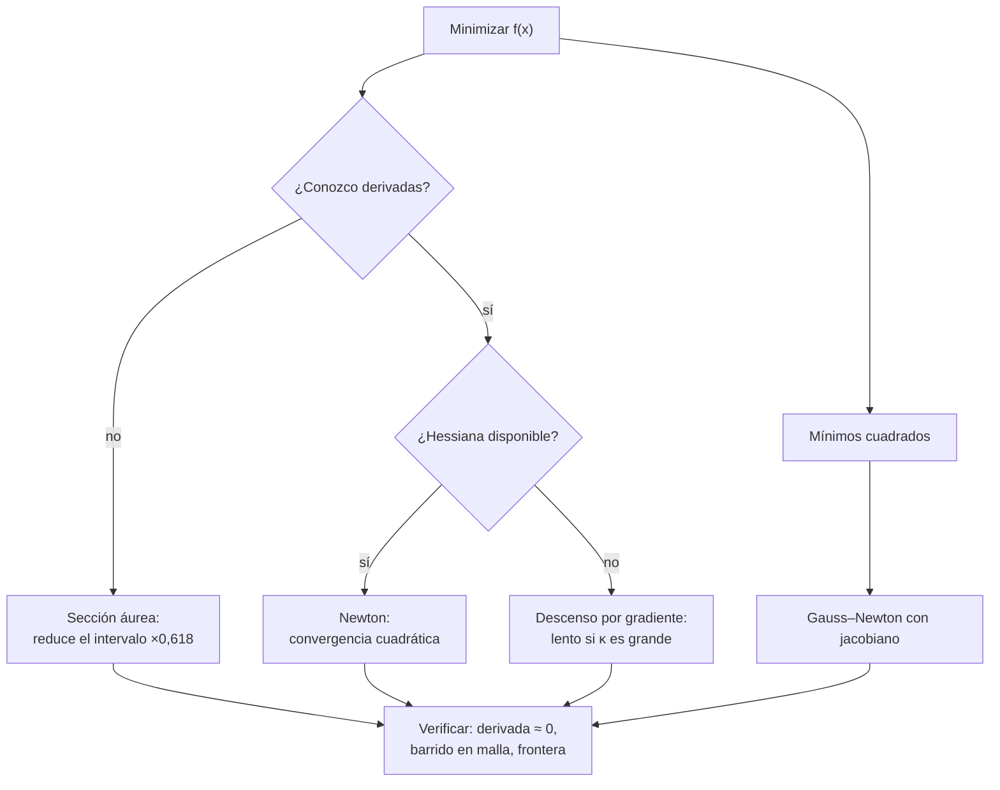

# B11-C17 — Optimización numérica

<!-- nav:top -->
<!-- /nav -->

## 1. Ubicación, nivel y alcance

Decimoséptima clase del bloque B11. Con los métodos anteriores *resolvías* ecuaciones; aquí *buscas el mejor valor* de uno o varios parámetros: el que minimiza un costo de combustible, un error de ajuste o un tiempo. Nivel N2. Verás la sección áurea (sin derivadas), Newton (con derivada), Gauss–Newton para mínimos cuadrados y el descenso por gradiente con su dependencia del condicionamiento. No verás optimización con restricciones formales (queda para B11-C23).

## 2. Por qué esta clase existe

Diseñar una transferencia, ajustar un modelo a datos de seguimiento o calibrar un instrumento son problemas de optimización. Un algoritmo de búsqueda siempre devuelve *algún* número: la tarea del ingeniero es saber si es un mínimo, si es el global, si está en una frontera y con qué incertidumbre.

La pregunta motivadora: **¿cómo encuentro el mínimo de una función, y cómo sé que lo que encontré lo es?** La decisión central: **elegir el método según lo que se conoce de la función y verificar el resultado con una prueba independiente**.

## 3. Lo que podrás hacer al terminar

1. Minimizar una función de una variable con la sección áurea.
2. Aplicar Newton para hallar ceros y mínimos, y reconocer su convergencia rápida.
3. Ajustar un modelo no lineal por Gauss–Newton y estimar incertidumbres.
4. Explicar por qué el descenso por gradiente se vuelve lento con el mal condicionamiento.
5. Reconocer un mínimo en la frontera, un máximo local y un mínimo local.
6. Verificar un óptimo con barrido en malla y con la derivada.

La evidencia es el **informe de optimización con verificación** del ejercicio 12 (sección 20).

## 4. Con qué llegas y cómo comprobarlo

Necesitas derivadas y mínimos de B09 y el sistema lineal `2 × 2`. Cinco preguntas:

1. ¿Qué cumple la derivada en un mínimo interior de una función derivable?
2. ¿Cuál es la segunda derivada de `(x − 2)²`?
3. Resuelve `x² − 2 = 0` aproximadamente.
4. ¿Qué es un residuo en un ajuste?
5. ¿Cuánto es `0,618²`?

<details>
<summary>Ver respuestas</summary>

1. Se anula. 2. `2`. 3. `x ≈ 1,4142`. 4. La diferencia entre el dato y el modelo. 5. `0,382`.
</details>

Con cuatro o cinco aciertos, sigue; si no, repasa B09.

## 5. Un caso real: ¿vale la pena una transferencia bielíptica?

Para pasar de una órbita circular de radio `r₁` a otra con `r₂ = 13 r₁` (razón **ilustrativa**; con la órbita de 400 km serían unos 88 000 km), la transferencia de Hohmann cuesta `Δv = 0,535 292 v₁` (con `v₁` la velocidad circular inicial) y tarda `58,2` unidades de tiempo, unas 14,3 h con las constantes de C07. Una transferencia **bielíptica** (dos elipses unidas en un apoastro lejano `x r₁`) puede costar menos, pero tarda mucho más. Si solo se minimiza `Δv`, el mínimo se va a la frontera (`x` tan grande como se permita). Con un peso `λ = 10⁻⁶` por unidad de tiempo aparece un mínimo interior en `x = 93,77 r₁`, con `Δv = 0,532 919 v₁` (0,44 % menos) y 23 días de vuelo. Este es el **ejemplo conductor**.

## 6. Vocabulario

Un **mínimo local** es un punto donde la función no baja en su entorno; el **global**, el más bajo de todo el dominio. Una **función unimodal** en un intervalo tiene un solo mínimo. La **sección áurea** reduce un intervalo `[a, b]` por el factor `0,618` por evaluación, usando solo valores de la función. El **método de Newton** para `f(x) = 0` itera `x ← x − f(x)/f′(x)`; para minimizar `g`, se aplica a `g′`. **Mínimos cuadrados** minimizan `Σ rᵢ²`. **Gauss–Newton** linealiza el modelo con el jacobiano `J` y resuelve `(JᵀJ) δ = Jᵀ r`. El **descenso por gradiente** avanza `x ← x − η ∇f`. El **número de condición** `κ` de una cuadrática `½ xᵀ A x` es la razón entre su mayor y menor valor propio. La **covarianza** estimada de los parámetros es `σ̂² (JᵀJ)⁻¹`.

## 7. Modelo mental: bajar por un valle a ciegas

Se busca el fondo de un valle con niebla. Con la sección áurea se sondean dos puntos y se descarta el tramo peor; con el gradiente se baja por la pendiente; con Newton se supone que el valle es una parábola y se salta a su fondo.



*Descripción textual:* según se conozcan o no las derivadas se elige sección áurea, Newton o descenso por gradiente; para ajustes se usa Gauss–Newton; en todos los casos el resultado se verifica con la derivada, un barrido en malla y revisando si cae en una frontera.

Analogía: un excursionista con niebla en un valle. Su límite: un paisaje real tiene varios valles; el excursionista puede quedar en uno que no es el más profundo.

## 8. La explicación, paso a paso

### 8.1 Sección áurea a mano

Para `f(x) = (x − 2)²` en `[0, 5]`: puntos interiores `c = 5 − 0,618 · 5 = 1,91` y `d = 3,09`; `f(c) = 0,008`, `f(d) = 1,188`. Como `f(c) < f(d)`, el mínimo está en `[0, 3,09]`. Se repite reutilizando un punto. Tras `n` evaluaciones el intervalo mide `5 · 0,618ⁿ`; para `10⁻¹⁰` hacen falta unas 52.

### 8.2 Newton

Para `x² − 2 = 0` desde `x = 1`: `1,5`; `1,41667`; `1,414216`; el número de cifras correctas se duplica. Para la ecuación de Kepler `E − e sin E = M` con `e = 0,74` y `M = 1`, desde `E = π`: `f = 2,1416`, `f′ = 1 − e cos π = 1,74`, `E₁ = 1,9108`; tras 6 iteraciones el laboratorio da `E = 1,730 574 342 626 640` con residuo cero (hasta el redondeo). Esta es la ecuación que usan C08 y C20.

### 8.3 Mínimos cuadrados con Gauss–Newton

Datos **sintéticos** `y = 5 e^{−0,3 t}` + ruido gaussiano de desviación `0,05` en 21 puntos. Partiendo de `a = 4`, `b = 0,2`, en 8 iteraciones: `a = 5,0180 ± 0,0360`, `b = 0,30387 ± 0,00341`; la desviación residual es `0,0528`; el gradiente en el óptimo, `1,8 × 10⁻¹⁴`. Los valores verdaderos (`5` y `0,3`) quedan dentro de 1,1 desviaciones: coherente. Una estimación sin su incertidumbre no es un resultado.

### 8.4 El descenso por gradiente y el condicionamiento

Para `f = ½ (x₁² + κ x₂²)` con el paso óptimo `η = 2/(1 + κ)`, cada paso multiplica el error por `(κ − 1)/(κ + 1)`. Pasos hasta una reducción de `10⁻¹²` en `f`: `κ = 2`: 13 (predicción 12,6); `κ = 10`: 69 (68,8); `κ = 100`: 691 (690,8). Newton, que usa la curvatura, resuelve la cuadrática en 1 paso. El mal condicionamiento es el enemigo del gradiente.

### 8.5 La transferencia: mínimo en la frontera y mínimo interior

Con la razón `R = 13`: `Δv` de Hohmann `0,535 292`; de la bielíptica con `x → ∞`, `0,529 096`. Sin penalizar el tiempo, la sección áurea en `[13, 200]` devuelve la frontera `x = 200` (`Δv = 0,531 067`, derivada `−9 × 10⁻⁶`, no nula: no es un mínimo interior). El costo `J(x) = Δv + λ T(x)` con `λ = 10⁻⁶` (peso sintético) tiene valores `J(13) = 0,535 5`, `J(25) = 0,537 9` (más alto que sus vecinos: hay un máximo local entre 13 y 50), `J(50) = 0,536 2`, `J(94) = 0,535 17`, `J(200) = 0,537 7`: hay un mínimo local en la zona de Hohmann, un máximo, y un mínimo interior en `x = 93,77` (derivada `−4 × 10⁻¹²`, barrido en malla coincidente). Como `J(Hohmann) = 0,535 350` y `J(mín) = 0,535 170`, el mínimo interior gana por poco. Para usar sección áurea hay que acotar un intervalo donde `J` sea unimodal (aquí `[40, 400]`).

### 8.6 Verificar un óptimo

Tres pruebas: la derivada numérica casi cero en un interior; un barrido en malla fina que no encuentre algo mejor; y comprobar que no está en la frontera. Si está en la frontera, el problema es de optimización restringida.

## 9. Magnitudes, símbolos y unidades

| Símbolo | Qué es | Unidad | Nota |
|---|---|---|---|
| `x` | apoastro intermedio en unidades de `r₁` | adimensional | |
| `R` | razón de radios `r₂/r₁` | adimensional | 13 (ilustrativa) |
| `Δv` | costo en unidades de `v₁` | adimensional | |
| `T` | tiempo de vuelo | `√(r₁³/μ)` | ×883,9 s en la órbita de 400 km |
| `λ` | peso del tiempo | por unidad de tiempo | `10⁻⁶` (sintético) |
| `J` | costo penalizado `Δv + λ T` | adimensional | |
| `a`, `b` | parámetros del ajuste | según el caso | 5 y 0,3 (verdaderos, sintéticos) |
| `κ` | número de condición | adimensional | |

## 10. Convenciones y referencias

Órbitas circulares coplanares, impulsos instantáneos, dos cuerpos; saltos de velocidad por la ecuación vis-viva. Los datos del ajuste son **sintéticos** (semilla fija `2026`). Las constantes de la órbita de 400 km (periodo 5 553,6 s, unidad 883,9 s) vienen de C04 con los valores nominales IAU (S1).

## 11. De dónde sale lo que afirmamos

| ID | Fuente | Localizador | Respalda | Estado |
|---|---|---|---|---|
| S1 | IAU, Resolución B3 de 2015 | arXiv:1510.07674, https://arxiv.org/pdf/1510.07674 | `(GM)_E^N = 3,986 004 × 10¹⁴ m³ s⁻²`, `R_eE^N = 6,3781 × 10⁶ m` (unidad de tiempo de la órbita de 400 km) | Texto extraído del PDF el 2026-11-05 |

Límites: la sección áurea, Newton, Gauss–Newton y el descenso por gradiente son técnicas estándar no atribuidas a una fuente consultada; los umbrales de razón de radios de la transferencia bielíptica no se citan (se calculó el caso `R = 13` directamente). Los datos son sintéticos o ilustrativos.

## 12. Cómo ver el costo

Equivalente accesible a una gráfica de `J(x)` (cálculo, `R = 13`, `λ = 10⁻⁶`):

| `x` (en `r₁`) | `J(x)` |
|---|---|
| 13 | 0,535 497 |
| 25 | 0,537 914 |
| 50 | 0,536 164 |
| 94 | 0,535 170 |
| 200 | 0,537 685 |
| 400 | 0,548 365 |

Descripción larga: sube desde 13 hasta un máximo local entre 13 y 50, baja hasta un mínimo en 94 y vuelve a subir porque el tiempo domina.

## 13. Ejemplo trabajado: ¿ganar 0,44 % de `Δv` justifica 23 días?

**Paso 1 · Referencia.** Hohmann: `Δv = 0,535 292`, 14,3 h.

**Paso 2 · Candidato.** Bielíptica con `x = 93,77`: `Δv = 0,532 919`, `T = 2 250` unidades = 23,0 días.

**Paso 3 · Ahorro.** `(0,535 292 − 0,532 919)/0,535 292 = 0,44 %`.

**Paso 4 · Costo en tiempo.** `2 250/58,2 = 38,7` veces más.

**Paso 5 · Verificación.** Derivada de `J` en `x = 93,77`: `−4 × 10⁻¹²`; el barrido en malla coincide.

**Paso 6 · Decisión.** Con ese peso `λ`, el candidato gana por `1,8 × 10⁻⁴` en `J`; la decisión depende de `λ`, que es una elección de la misión, no de la matemática. Cálculo **simulado** con valores ilustrativos.

## 14. Comparación de métodos

Sección áurea: robusta, sin derivadas, lenta (lineal) y solo 1D. Newton: rápida (cuadrática) cerca del óptimo, necesita derivadas y buen punto inicial. Gauss–Newton: ideal para mínimos cuadrados. Descenso por gradiente: barato por paso, lento si `κ` es grande. Ninguno garantiza el mínimo global en una función no convexa.

## 15. Práctica guiada

**Ejercicio 1 · con los pasos indicados.** Haz un paso de sección áurea para `f(x) = (x − 2)²` en `[0, 5]`. *Pasos:* 8.1.

<details><summary>Solución comentada</summary>

`c = 1,91`, `d = 3,09`; `f(c) = 0,008 < f(d) = 1,19`; nuevo intervalo `[0, 3,09]`.
</details>

**Ejercicio 2 · con una pista.** Aplica dos iteraciones de Newton a `x² − 2` desde `x = 1`. *Pista:* `x − (x² − 2)/(2x)`.

<details><summary>Solución comentada</summary>

`1,5`; `1,5 − 0,25/3 = 1,41667`.
</details>

**Ejercicio 3 · casi autónomo.** Calcula una iteración de Newton para Kepler con `e = 0,74`, `M = 1`, desde `E = π`.

<details><summary>Solución comentada</summary>

`f = π − 1 = 2,1416`; `f′ = 1 + 0,74 = 1,74`; `E₁ = π − 1,2308 = 1,9108` (8.2).
</details>

## 16. Práctica autónoma, transferencia e integrador

**Ejercicio 4.** ¿Cuánto vale el factor de contracción del descenso por gradiente con `κ = 100`?

<details><summary>Solución comentada</summary>

`99/101 = 0,980`.
</details>

**Ejercicio 5.** ¿Cuántas evaluaciones necesita la sección áurea para reducir un intervalo de `5` a `10⁻¹⁰`?

<details><summary>Solución comentada</summary>

`0,618ⁿ = 2 × 10⁻¹¹` ⇒ `n = ln(2 × 10⁻¹¹)/ln 0,618 = 51,2`: 52 evaluaciones.
</details>

**Ejercicio 6.** ¿Cuánto es el ahorro porcentual de `Δv` y el aumento de tiempo de la bielíptica óptima frente a Hohmann?

<details><summary>Solución comentada</summary>

`0,44 %` menos de `Δv`; `38,7` veces más tiempo (13).
</details>

**Ejercicio 7.** Con `a = 5,0180 ± 0,0360`, ¿cuántas desviaciones separan la estimación de `5`?

<details><summary>Solución comentada</summary>

`0,0180/0,0360 = 0,5`: compatible.
</details>

**Ejercicio 8.** Estima los pasos del descenso por gradiente con `κ = 1000` para reducir `f` a `10⁻¹²`.

<details><summary>Solución comentada</summary>

`ln 10⁻¹²/(2 ln(999/1001)) = 6 908` pasos (predicción).
</details>

**Ejercicio 9 · transferencia.** El mínimo sin penalizar cayó en la frontera `x = 200` con derivada `−9 × 10⁻⁶`. ¿Qué te dice y qué cambiarías?

<details><summary>Solución comentada</summary>

Que no es un mínimo interior (la derivada no se anula): el óptimo está limitado por el intervalo. Hay que añadir una restricción o un costo que penalice el tiempo.
</details>

**Ejercicio 10 · transferencia.** Un colega afirma «mi ajuste dio `b = 0,304`, luego `b = 0,304` exactamente». ¿Qué le falta?

<details><summary>Solución comentada</summary>

La incertidumbre: `0,3039 ± 0,0034`. Con ella, el valor verdadero `0,3` queda a 1,1 desviaciones.
</details>

**Ejercicio 11 · transferencia.** ¿Por qué se usó el intervalo `[40, 400]` para la sección áurea con `λ = 10⁻⁶` y no `[13, 400]`?

<details><summary>Solución comentada</summary>

En `[13, 400]` hay un mínimo local en 13, un máximo entre 13 y 50 y otro mínimo en 94: no es unimodal y la sección áurea puede converger a cualquiera de los puntos estacionarios. `[40, 400]` contiene solo el mínimo interior.
</details>

**Ejercicio 12 · integrador.** Elabora tu *informe de optimización con verificación*: la transferencia con un `λ` distinto (justificado), el ajuste de datos sintéticos con incertidumbres, Newton para Kepler y el descenso por gradiente con dos números de condición; cada óptimo con su verificación (derivada, barrido, frontera).

<details><summary>Solución modelo</summary>

Para cada problema: método, resultado, verificación independiente, advertencia sobre mínimos locales y fronteras, incertidumbre del ajuste y pasos del gradiente frente a la predicción; datos rotulados como sintéticos e ilustrativos, con fuentes y fecha.
</details>

## 17. Laboratorio: optimización con verificación

El script [optimizacion_con_verificacion.py](optimizacion_con_verificacion.py) ejecuta las cuatro partes y falla si un óptimo no pasa su verificación.

**Datos:** ilustrativos y sintéticos. **Predice antes de ejecutar:** ¿en qué punto cae el mínimo sin penalizar? (en la frontera.) **Ejecución del 2026-11-05 (Python 3.12.9):**

```text
(a) R = 13.0: Hohmann Dv = 0.535292 v1, tiempo 58.2 (x 883.9 s en la órbita de 400 km = 14.3 h)
    biela con x -> infinito: Dv = 0.529096 (límite, tiempo infinito)
    SIN penalizar el tiempo, el mínimo en [R, 200] cae en la frontera: x = 200.000 ; Dv = 0.531067 ; derivada = -9.04e-06 (no es cero)
    J(x) en puntos: x=13: 0.535497  x=25: 0.537914  x=50: 0.536164  x=94: 0.535170  x=200: 0.537685  x=400: 0.548365
    CON penalización lam = 1e-06 por unidad de tiempo: mínimo interior x = 93.773 r1 ; Dv = 0.532919 ; tiempo = 2250 (23.0 d)
    barrido en malla: x = 93.773 ; derivada de J en el mínimo = -3.89e-12 ; J(Hohmann) = 0.535350 ; J(mínimo) = 0.535170
(b) Kepler e=0.74, M=1.0: E = 1.730574342626640 tras 6 iteraciones ; residuo = 0.00e+00
(c) Gauss-Newton (8 iteraciones): a = 5.0180 ± 0.0360 (verdadero 5) ; b = 0.30387 ± 0.00341 (verdadero 0.3) ; ||gradiente|| = 1.8e-14
    desviación residual = 0.0528 (ruido sintético 0.05)
(d) kappa =    2.0: descenso por gradiente    13 pasos (predicción    12.6) ; Newton: 1 paso
(d) kappa =   10.0: descenso por gradiente    69 pasos (predicción    68.8) ; Newton: 1 paso
(d) kappa =  100.0: descenso por gradiente   691 pasos (predicción   690.8) ; Newton: 1 paso
Pruebas superadas.
```

```bash
python programa/clases/B11/B11-C17-optimizacion-numerica/optimizacion_con_verificacion.py
```

**Límites:** la línea «Newton: 1 paso» es la propiedad teórica para cuadráticas (no se itera en el script); impulsos instantáneos; resultados **simulados**.

## 18. Errores frecuentes y cómo corregirlos

**Aceptar un óptimo sin verificarlo.** Se corrige con el ejercicio 12.

**Confundir un máximo o un punto de frontera con un mínimo.** Se corrige con los ejercicios 9 y 11.

**Dar un ajuste sin incertidumbre.** Se corrige con los ejercicios 7 y 10.

**Usar descenso por gradiente con mal condicionamiento.** Se corrige con el ejercicio 8.

**Aplicar sección áurea sin unimodalidad.** Se corrige con el ejercicio 11.

## 19. Cómo sabrás que vas bien

Tras 8.1: ¿haces un paso de sección áurea? Si no, ejercicio 1. Tras 8.3: ¿qué significa `± 0,036`? Si dudas, ejercicio 7. Tras 8.5: ¿por qué el mínimo estaba en la frontera? Si no lo explicas, ejercicio 9. Tras el laboratorio: ¿qué verificarías en cualquier óptimo? (derivada, barrido, frontera).

## 20. Qué entregas y cómo se evalúa

El producto es tu **informe de optimización con verificación** (ejercicio 12).

| Criterio | Inicial | En desarrollo | Logrado | Destacado |
|---|---|---|---|---|
| Elección del método | Al azar | Con ayuda | Justificada por lo que se conoce | Compara costos |
| Verificación | Ausente | Una prueba | Derivada, barrido y frontera | Explica un óptimo local |
| Ajuste | Sin incertidumbre | Con error sin interpretar | Con incertidumbre interpretada | Contrasta con el valor verdadero |
| Interpretación física | Sin unidades | Parcial | Compromiso `Δv`–tiempo explicado | Discute la elección de `λ` |
| Fuentes | Sin fuente | Sin fecha | Con localizador y fecha | Rotula sintético e ilustrativo |

**Condiciones críticas (no se compensan con promedio):** verificar cada óptimo con una prueba independiente; reportar incertidumbre del ajuste; citar solo fuentes consultadas.

## 21. Ética, seguridad y límites

Un óptimo matemático depende de la función de costo elegida y de sus pesos; no es una decisión de misión. Los valores de esta clase son ilustrativos y no sirven para diseñar una transferencia. Accesibilidad: fórmulas en texto, tablas equivalentes a las gráficas, ejercicios sin conexión.

## 22. Para cerrar y seguir

La sección áurea busca sin derivadas, Newton converge cuadráticamente, Gauss–Newton ajusta modelos con incertidumbre y el gradiente sufre con el mal condicionamiento; todo óptimo se verifica y se vigilan las fronteras y los mínimos locales. Queda abierta una pregunta: muchos cálculos de este bloque usaron valores tabulados; ¿cómo se evalúa una función entre dos puntos de una tabla y qué riesgo hay fuera de ella? Es la interpolación y la extrapolación.

**Glosario español–inglés.** optimización · *optimization*; sección áurea · *golden-section search*; método de Newton · *Newton's method*; mínimos cuadrados · *least squares*; descenso por gradiente · *gradient descent*; número de condición · *condition number*; mínimo local · *local minimum*; transferencia bielíptica · *bi-elliptic transfer*.

**Continuidad.** B11-C18 reutiliza tu capacidad de **verificar un resultado numérico con una prueba independiente** para evaluar la interpolación.

**Referencias:** ver sección 11.

<!-- nav:bottom -->
<!-- /nav -->
