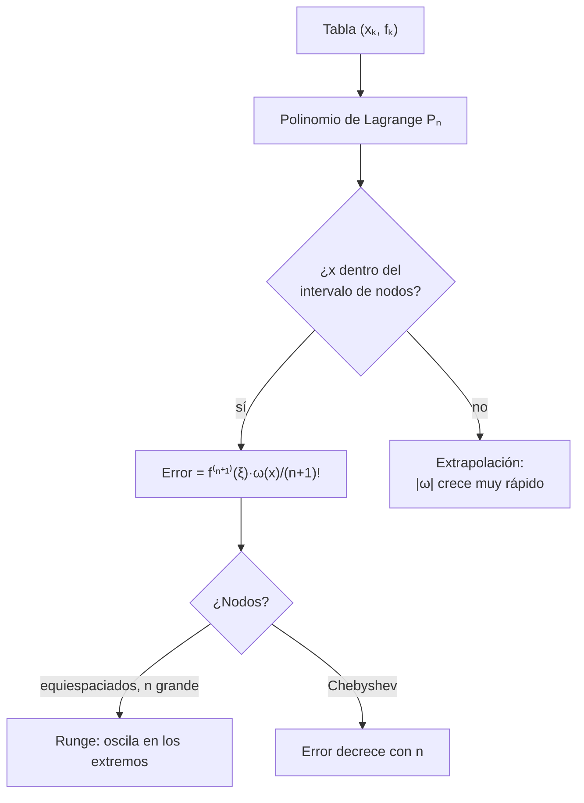

# B11-C18 — Interpolación y extrapolación

<!-- nav:top -->
<!-- /nav -->

## 1. Ubicación, nivel y alcance

Decimoctava clase del bloque B11. Muchas cantidades espaciales no se calculan en cada instante: se **tabulan** a intervalos y se leen entre las filas. Una efeméride es una tabla de posiciones; una curva de calibración, una tabla de pares. Aquí aprendes a construir el polinomio que pasa por los puntos (Lagrange), a conocer su error, a ver cuándo falla (fenómeno de Runge) y por qué salir de la tabla (extrapolar) es peligroso. Nivel N2. No verás splines ni interpolación en varias variables.

## 2. Por qué esta clase existe

Si una nave debe saber dónde está un cuerpo en un instante que no figura en la tabla, interpola. Si interpola con un grado equivocado o fuera del rango, el error puede pasar de metros a miles de kilómetros sin que el programa avise. Entender el error de interpolación convierte una tabla en una herramienta fiable.

La pregunta motivadora: **¿qué grado y qué nodos necesito para leer entre filas con el error que exijo, y qué pasa fuera de la tabla?** La decisión central: **elegir grado y nodos, y no extrapolar sin una cota**.

## 3. Lo que podrás hacer al terminar

1. Construir el polinomio de Lagrange de grado `n` por `n + 1` puntos.
2. Estimar el error con la cota `|f^{(n+1)}| |ω(x)|/(n + 1)!`.
3. Reconocer el fenómeno de Runge con nodos equiespaciados.
4. Usar nodos de Chebyshev para evitarlo.
5. Elegir el grado de interpolación de una efeméride tabulada.
6. Explicar por qué la extrapolación pierde precisión rápidamente.

La evidencia es la **tabla de interpolación con cota de error** del ejercicio 12 (sección 20).

## 4. Con qué llegas y cómo comprobarlo

Necesitas derivadas de orden superior (B09), la efeméride de Kepler de [C08](../B11-C08-integradores-de-paso-adaptativo/CLASE.md) y el orden observado. Cinco preguntas:

1. ¿Cuántos puntos determinan una parábola?
2. ¿Cuánto es `3!`?
3. Si el error se multiplica por 10 al pasar de `n = 16` a `n = 20`, ¿mejora o empeora?
4. ¿Qué es `cos(π/6)`?
5. ¿Qué es una efeméride?

<details>
<summary>Ver respuestas</summary>

1. Tres. 2. `6`. 3. Empeora. 4. `0,866`. 5. Una tabla de posiciones de un cuerpo en función del tiempo.
</details>

Con cuatro o cinco aciertos, sigue; si no, repasa B09 y C08.

## 5. Un caso real: leer una efeméride entre dos filas

Una efeméride **sintética** de una órbita ilustrativa (`a = 26 560 km`, `e = 0,30`, con `GM = 3,986 004 × 10¹⁴ m³ s⁻²` nominal, S2) se tabula cada `T/24 = 1 794,9 s` (29,9 min). Interpolando entre filas con polinomios de grado 3, 5, 7 y 9, el error máximo de posición es `615 m`, `17,3 m`, `0,93 m` y `0,089 m`. Pero si se extrapola con un polinomio de 6 nodos más allá de la última fila, el error es `684 m` a medio paso, `3 km` a un paso, `20 km` a dos, `237 km` a cuatro y `5 560 km` a ocho pasos. Este es el **ejemplo conductor**.

## 6. Vocabulario

Dados `n + 1` nodos distintos `x_k` con valores `f_k`, el **polinomio de Lagrange** `P_n` es el único polinomio de grado `≤ n` con `P_n(x_k) = f_k` (S1, §3.3(i), ec. 3.3.1). Se escribe `P_n(x) = Σ f_k ℓ_k(x)` con `ℓ_k(x) = Π_{j≠k} (x − x_j)/(x_k − x_j)`. El **polinomio nodal** es `ω(x) = Π (x − x_k)`. Si `f` tiene derivada continua de orden `n + 1`, el **error** es `f(x) − P_n(x) = f^{(n+1)}(ξ) ω(x)/(n + 1)!` para algún `ξ` en el intervalo (S1, ec. 3.3.5). **Interpolar** es evaluar dentro del intervalo de los nodos; **extrapolar**, fuera. Los **nodos equiespaciados** están a igual distancia; los de **Chebyshev** son `cos(π(2i + 1)/(2(n + 1)))` y se acumulan hacia los extremos. El **fenómeno de Runge** es la oscilación creciente en los extremos al subir el grado con nodos equiespaciados.

## 7. Modelo mental: pasar una curva por clavos

Los nodos son clavos y el polinomio es una varilla flexible obligada a pasar por todos. Con pocos clavos, la varilla es suave; con muchos y mal repartidos, se dobla violentamente cerca de los extremos.



*Descripción textual:* de la tabla se construye el polinomio; si el punto está dentro del intervalo, el error está dado por la derivada de orden `n + 1` y el polinomio nodal; si está fuera, `|ω|` crece muy rápido; con nodos equiespaciados y grado alto aparece Runge, y con Chebyshev el error decrece.

Analogía: una varilla flexible clavada en puntos. Su límite: una varilla real tiene rigidez mínima; el polinomio puede doblarse sin ese límite.

## 8. La explicación, paso a paso

### 8.1 Un ejemplo exacto

Para `f = x² + 1` en los nodos `0, 1, 2` (valores `1, 2, 5`), `P₂(1,5) = 3,25 = 1,5² + 1`: un polinomio de grado `≤ n` se reproduce **exactamente**, porque su derivada de orden `n + 1` es cero.

### 8.2 Interpolar el seno

Con `sin x` en `0, π/2, π` (valores `0, 1, 0`): `P₂(x) = −4 x (x − π)/π²`. En `x = π/4`: `P₂ = 0,75` frente a `sin(π/4) = 0,7071`; error `0,043`. La cota es `|ω(π/4)|/3! = (π/4)(π/4)(3π/4)/6 = 0,242`: el error real queda por debajo. En el laboratorio, con nodos equiespaciados en `[0, 2π]`: `n = 4`: error `0,181` (cota `0,289`); `n = 6`: `0,0189` (`0,0263`); `n = 8`: `0,00121` (`0,00154`). Siempre bajo la cota de DLMF 3.3.5 con `|f^{(n+1)}| ≤ 1`.

### 8.3 Runge

Para `1/(1 + 25 x²)` en `[−1, 1]`, el error máximo con nodos equiespaciados crece con el grado: `0,44` (n = 4), `1,05` (8), `3,66` (12), `14,4` (16), `59,8` (20). Con nodos de Chebyshev decrece: `0,40`, `0,17`, `0,069`, `0,033`, `0,015`. Más puntos no siempre es mejor: dependen de dónde se pongan.

### 8.4 Una efeméride

Los polinomios de grado 3, 5, 7, 9 sobre filas consecutivas dan, entre las dos filas centrales: `615,3`; `17,26`; `0,927`; `0,0891 m`. Cada incremento de grado en 2 reduce el error en un factor de 10 a 36, mientras el paso de `29,9 min` represente una órbita suave. Es el compromiso habitual entre densidad de la tabla y grado.

### 8.5 Extrapolar

Con 6 nodos (grado 5) y evaluando fuera: `+0,5` paso: `684,8 m`; `+1`: `2 981 m`; `+2`: `20 262 m`; `+4`: `237 300 m`; `+8`: `5,56 × 10⁶ m`. Fuera del intervalo, `|ω(x)|` crece como una potencia del alejamiento de grado `n + 1` y el error explota. La regla práctica: **no extrapolar**; si hace falta, ampliar la tabla.

### 8.6 Interpolación no es ajuste

El polinomio de Lagrange pasa por *todos* los puntos, incluido el ruido. Con datos ruidosos se usa un ajuste (C17), no interpolación de alto grado.

## 9. Magnitudes, símbolos y unidades

| Símbolo | Qué es | Unidad | Nota |
|---|---|---|---|
| `x_k`, `f_k` | nodos y valores | según el caso | |
| `n` | grado | adimensional | `n + 1` nodos |
| `ω(x)` | polinomio nodal | `[x]^{n+1}` | |
| `Δt` | paso de la tabla | s | `T/24` = 1 794,9 s |
| `T` | periodo orbital | s | 43 077,8 |
| `a`, `e` | semieje y excentricidad | m, — | 26 560 km, 0,30 (ilustrativos) |
| `GM` | parámetro gravitacional | m³ s⁻² | `3,986 004 × 10¹⁴` (S2) |

## 10. Convenciones y referencias

Datos exactos sin ruido; la efeméride **sintética** se genera con la solución de la ecuación de Kepler (Newton, tolerancia `10⁻¹⁵`) y se interpola cada coordenada por separado. El error de posición es la distancia entre el punto interpolado y el exacto.

## 11. De dónde sale lo que afirmamos

| ID | Fuente | Localizador | Respalda | Estado |
|---|---|---|---|---|
| S1 | NIST, *DLMF* §3.3, versión 1.2.8 | https://dlmf.nist.gov/3.3 | Polinomio de Lagrange (ecs. 3.3.1–3.3.3) y error con derivada de orden `n + 1` y polinomio nodal (ecs. 3.3.4–3.3.5) | Consultada el 2026-11-05 mediante extracción automática |
| S2 | IAU, Resolución B3 de 2015 | arXiv:1510.07674, https://arxiv.org/pdf/1510.07674 | `(GM)_E^N = 3,986 004 × 10¹⁴ m³ s⁻²` | Texto extraído del PDF el 2026-11-05 |

Límites: la fórmula de los nodos de Chebyshev y el fenómeno de Runge son resultados estándar comprobados con el laboratorio, no citados. La efeméride es sintética y ilustrativa.

## 12. Cómo ver el error

Equivalente accesible a una gráfica de error frente a grado (efeméride, cálculo):

| Grado | error entre nodos centrales (m) |
|---|---|
| 3 | 615,3 |
| 5 | 17,26 |
| 7 | 0,927 |
| 9 | 0,0891 |

Descripción larga: en escala logarítmica los puntos caen casi en línea recta descendente; cada incremento de dos grados reduce el error entre 10 y 36 veces.

## 13. Ejemplo trabajado: ¿qué grado necesito para 1 m?

**Paso 1 · Requisito.** Error de posición `< 1 m` entre filas separadas 29,9 min.

**Paso 2 · Tabla.** Grado 5: `17,3 m`; grado 7: `0,927 m`.

**Paso 3 · Decisión.** Grado 7 (8 nodos) cumple; margen `7 %`.

**Paso 4 · Rango.** Las lecturas deben quedar entre los nodos centrales; en los extremos de la tabla, el polinomio no tiene nodos a ambos lados y el error sube.

**Paso 5 · Extrapolación.** Para un instante a un paso fuera, el error con grado 5 es `3 km`: no cumple. Hay que ampliar la tabla.

**Paso 6 · Sentido.** El resultado depende de la suavidad de la órbita; una órbita más excéntrica exigiría paso más corto o grado mayor. Cifras **simuladas** con una efeméride sintética.

## 14. Comparación: grado alto, grado bajo por tramos

Un grado alto sobre toda la tabla es peligroso con nodos equiespaciados (Runge). Se prefiere un grado moderado sobre los nodos cercanos al punto consultado (interpolación por tramos). Con nodos de Chebyshev, el grado alto converge para funciones suaves. Los *splines* (no tratados aquí) generalizan la idea por tramos.

## 15. Práctica guiada

**Ejercicio 1 · con los pasos indicados.** Interpola linealmente `sin x` entre `0` y `π/2` en `x = π/4` y acota el error. *Pasos:* recta por `(0, 0)` y `(π/2, 1)`; cota `|ω|/2!`.

<details><summary>Solución comentada</summary>

`P₁(π/4) = 0,5`; `sin(π/4) = 0,7071`; error `0,207`. Cota: `(π/4)(π/4)/2 = 0,308 ≥ 0,207` ✓.
</details>

**Ejercicio 2 · con una pista.** Usa los nodos `0, π/2, π` para estimar `sin(π/4)`. *Pista:* `P₂ = −4x(x − π)/π²`.

<details><summary>Solución comentada</summary>

`0,75`; error `0,043` (8.2).
</details>

**Ejercicio 3 · casi autónomo.** Calcula la cota de error del ejercicio 2.

<details><summary>Solución comentada</summary>

`|ω| = (π/4)(π/4)(3π/4) = 1,453`; `/3! = 0,242`.
</details>

## 16. Práctica autónoma, transferencia e integrador

**Ejercicio 4.** ¿Cuántas veces crece el error de Runge equiespaciado de `n = 12` a `n = 20`?

<details><summary>Solución comentada</summary>

`59,8/3,66 = 16` veces (empeora).
</details>

**Ejercicio 5.** Calcula los nodos de Chebyshev para `n = 2`.

<details><summary>Solución comentada</summary>

`cos(π/6) = 0,866`; `cos(π/2) = 0`; `cos(5π/6) = −0,866`.
</details>

**Ejercicio 6.** ¿Qué grado elegirías para un error menor que `1 m` en la efeméride y cuántos nodos usa?

<details><summary>Solución comentada</summary>

Grado 7, 8 nodos (`0,927 m`).
</details>

**Ejercicio 7.** ¿Cuántas veces crece el error de extrapolación entre `+1` y `+2` pasos?

<details><summary>Solución comentada</summary>

`20 262/2 981 = 6,8` veces.
</details>

**Ejercicio 8.** ¿Cuántas filas hay por órbita en la efeméride (paso `T/24`)? ¿Y cuánto dura el paso?

<details><summary>Solución comentada</summary>

24 filas; `29,9 min`.
</details>

**Ejercicio 9 · transferencia.** Debes consultar la posición a `+1,5` pasos de la última fila de una tabla de 6 nodos. ¿Qué haces?

<details><summary>Solución comentada</summary>

No extrapolar: ampliar la tabla (generar más filas con el integrador). La extrapolación a un paso ya da `3 km` y a dos, `20 km` (8.5).
</details>

**Ejercicio 10 · transferencia.** Un compañero interpola una curva de calibración con 21 puntos equiespaciados y aparecen oscilaciones fuertes en los bordes. Diagnostica y propone dos soluciones.

<details><summary>Solución comentada</summary>

Runge (8.3). Soluciones: nodos de Chebyshev, o interpolación por tramos de grado bajo (o splines).
</details>

**Ejercicio 11 · transferencia.** Datos medidos con ruido de `±0,5 m` se interpolan con un polinomio de grado 9. ¿Por qué es mala idea y qué usarías?

<details><summary>Solución comentada</summary>

El polinomio pasa por el ruido y lo amplifica entre puntos; se usa un ajuste de mínimos cuadrados de menor grado (C17).
</details>

**Ejercicio 12 · integrador.** Elabora tu *tabla de interpolación con cota de error*: seno con tres grados y su cota (DLMF 3.3.5), Runge con nodos equiespaciados y de Chebyshev, una efeméride sintética con cuatro grados, y la extrapolación a cuatro distancias.

<details><summary>Solución modelo</summary>

Tablas con error real y cota (error ≤ cota), crecimiento de Runge frente a decrecimiento de Chebyshev, errores de la efeméride por grado, crecimiento de la extrapolación y una regla de uso; datos rotulados como sintéticos, con fuentes y fecha.
</details>

## 17. Laboratorio: Lagrange, Runge y efeméride

El script [lagrange_runge_efemeride.py](lagrange_runge_efemeride.py) implementa el polinomio de Lagrange, verifica la cota de error, muestra Runge y mide el error de la efeméride y de la extrapolación.

**Datos:** sintéticos; `GM` nominal IAU. **Predice antes de ejecutar:** ¿qué grado dará menos de 1 m? (7.) **Ejecución del 2026-11-05 (Python 3.12.9):**

```text
(a) sin x en [0, 2pi]: error máximo de la interpolación frente a la cota |omega|/(n+1)!
    n=2: error = 1.000e+00 ; cota = 1.989e+00
    n=4: error = 1.808e-01 ; cota = 2.894e-01
    n=6: error = 1.890e-02 ; cota = 2.626e-02
    n=8: error = 1.206e-03 ; cota = 1.544e-03
(b) Runge 1/(1+25x^2): error máximo en [-1, 1]
    n= 4: equiespaciados = 4.384e-01 ; Chebyshev = 4.020e-01
    n= 8: equiespaciados = 1.045e+00 ; Chebyshev = 1.708e-01
    n=12: equiespaciados = 3.663e+00 ; Chebyshev = 6.922e-02
    n=16: equiespaciados = 1.439e+01 ; Chebyshev = 3.261e-02
    n=20: equiespaciados = 5.982e+01 ; Chebyshev = 1.533e-02
(c) efeméride sintética: paso 1794.9 s (29.9 min), periodo 43077.8 s
    grado 3: error máximo de posición entre nodos centrales =   615.3170 m
    grado 5: error máximo de posición entre nodos centrales =    17.2559 m
    grado 7: error máximo de posición entre nodos centrales =     0.9271 m
    grado 9: error máximo de posición entre nodos centrales =     0.0891 m
    extrapolación con 6 nodos (t en pasos desde el último nodo):
      +0.5 pasos: error = 6.8477e+02 m
      +  1 pasos: error = 2.9806e+03 m
      +  2 pasos: error = 2.0262e+04 m
      +  4 pasos: error = 2.3730e+05 m
      +  8 pasos: error = 5.5598e+06 m
Pruebas superadas.
```

```bash
python programa/clases/B11/B11-C18-interpolacion-y-extrapolacion/lagrange_runge_efemeride.py
```

**Límites:** datos exactos sin ruido; efeméride sintética; resultados **simulados**.

## 18. Errores frecuentes y cómo corregirlos

**Extrapolar sin cota.** Se corrige con el ejercicio 9.

**Subir el grado con nodos equiespaciados.** Se corrige con el ejercicio 10.

**Interpolar datos ruidosos.** Se corrige con el ejercicio 11.

**Olvidar la cota del error.** Se corrige con los ejercicios 1 a 3.

**Elegir el grado sin medir.** Se corrige con el ejercicio 6.

## 19. Cómo sabrás que vas bien

Tras 8.1: ¿construyes `P₂`? Si no, ejercicio 2. Tras 8.2: ¿calculas la cota? Si no, ejercicio 3. Tras 8.3: ¿por qué Chebyshev ayuda? Si dudas, ejercicio 5. Tras el laboratorio: ¿qué indicaría un error real por encima de la cota? (un error de implementación o una derivada mal acotada).

## 20. Qué entregas y cómo se evalúa

El producto es tu **tabla de interpolación con cota de error** (ejercicio 12).

| Criterio | Inicial | En desarrollo | Logrado | Destacado |
|---|---|---|---|---|
| Construcción | Errores de nodos | Correcta con ayuda | Lagrange a mano y en código | Barycentric/mejoras |
| Cota de error | Ausente | Sin derivada | Cota con `ω` y derivada | Verifica error ≤ cota |
| Runge | No lo menciona | Lo describe | Lo mide y propone Chebyshev | Lo relaciona con la cota |
| Extrapolación | Sin advertencia | Cualitativa | Mide su crecimiento | Fija una regla de uso |
| Fuentes | Sin fuente | Sin fecha | Con localizador y fecha | Rotula sintético y simulado |

**Condiciones críticas (no se compensan con promedio):** contrastar el error real con la cota; incluir la advertencia de extrapolación medida; citar solo fuentes consultadas.

## 21. Ética, seguridad y límites

Una interpolación suave puede ocultar una función que no lo es: la cota solo vale si la derivada existe y está acotada. La efeméride de esta clase es sintética y no sirve para ubicar cuerpos reales. Accesibilidad: fórmulas en texto, tablas equivalentes a las gráficas, ejercicios sin conexión.

## 22. Para cerrar y seguir

El polinomio de Lagrange pasa por los nodos; su error lo dicta la derivada de orden `n + 1` y el polinomio nodal; con nodos equiespaciados puede oscilar (Runge); extrapolar hace explotar el error. Queda abierta una pregunta: hemos medido errores en muchos lugares; ¿cómo se separan y se resumen en un presupuesto: truncamiento, redondeo y modelo? Es la estimación de error y convergencia.

**Glosario español–inglés.** interpolación · *interpolation*; extrapolación · *extrapolation*; polinomio de Lagrange · *Lagrange polynomial*; polinomio nodal · *nodal polynomial*; fenómeno de Runge · *Runge phenomenon*; nodos de Chebyshev · *Chebyshev nodes*; efeméride · *ephemeris*.

**Continuidad.** B11-C19 reutiliza tu capacidad de **comparar error real con una cota** para construir un presupuesto de error.

**Referencias:** ver sección 11.

<!-- nav:bottom -->
<!-- /nav -->
