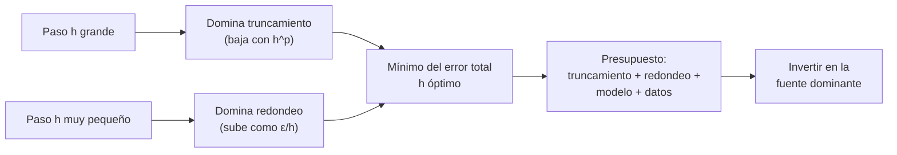

# B11-C19 — Estimación de error y convergencia

<!-- nav:top -->
[🏠 Programa](../../../../README.md) · [📚 Bloque B11](../../../tronco-comun/B11-ecuaciones-diferenciales-y-simulacion-numerica.md) · [← Anterior: B11-C18 — Interpolación y extrapolación](../B11-C18-interpolacion-y-extrapolacion/CLASE.md) · [Siguiente: B11-C20 — Propagador reproducible de trayectoria →](../B11-C20-propagador-reproducible-de-trayectoria/CLASE.md)
<!-- /nav -->

## 1. Ubicación, nivel y alcance

Decimonovena clase del bloque B11. En todo el bloque mediste errores comparando con una solución exacta; en un problema real **no hay solución exacta**. Aquí aprendes a estimar el error sin ella (Richardson y autoconvergencia), a separar el error de truncamiento del de redondeo y a armar un **presupuesto de error** que compare el del método con el que viene de los datos. Nivel N2. No verás propagación estadística avanzada.

## 2. Por qué esta clase existe

Un resultado numérico sin cota de error es una cifra sin sentido. Y gastar horas de cálculo para reducir un error de método que ya es menor que la incertidumbre de los datos es un desperdicio. El presupuesto de error dice dónde conviene invertir.

La pregunta motivadora: **¿qué tan lejos puede estar mi resultado de la verdad, y qué parte de ese error puedo reducir?** La decisión central: **atacar la fuente de error dominante**.

## 3. Lo que podrás hacer al terminar

1. Explicar el compromiso entre error de truncamiento y de redondeo.
2. Calcular el paso óptimo de una diferencia finita.
3. Estimar el error por extrapolación de Richardson.
4. Medir el orden por autoconvergencia sin solución exacta.
5. Armar un presupuesto de error con truncamiento, redondeo e incertidumbre de datos.
6. Decidir cuántos pasos usar según la fuente dominante.

La evidencia es el **estudio de convergencia con presupuesto de error** del ejercicio 12 (sección 20).

## 4. Con qué llegas y cómo comprobarlo

Necesitas el orden observado ([C05](../B11-C05-metodo-de-euler/CLASE.md) a C07), la diferencia central ([C14](../B11-C14-diferencias-finitas/CLASE.md)) y la deriva de energía ([C10](../B11-C10-conservacion-de-energia-numerica/CLASE.md)). Cinco preguntas:

1. Si el error baja a la mitad al duplicar `N`, ¿qué orden tiene?
2. ¿Cuánto es `√(2,2 × 10⁻¹⁶)`?
3. ¿Qué es el redondeo en doble precisión?
4. ¿Cuánto vale `log₂ 16`?
5. ¿Qué es una incertidumbre en un parámetro?

<details>
<summary>Ver respuestas</summary>

1. Uno. 2. `1,5 × 10⁻⁸`. 3. El error por representar números con 53 bits de mantisa, relativo `≈ 1,1 × 10⁻¹⁶`. 4. `4`. 5. El rango dentro del cual se cree que está el valor verdadero.
</details>

Con cuatro o cinco aciertos, sigue; si no, repasa C05, C14 y B01-C18.

## 5. Un caso real: ¿cuánto vale un metro de error?

Una vuelta de la órbita de 400 km (ilustrativa), con RK4 y 200 pasos, tiene un error de truncamiento de `1,12 m`. Con `GM = 3,986 004 × 10¹⁴ m³ s⁻²` (S1), si su incertidumbre relativa fuera `10⁻⁸` (valor **sintético** para el ejemplo), la posición tras una vuelta cambiaría `0,85 m`: del mismo orden. El error de redondeo, en cambio, es de unos `3 × 10⁻⁷ m`, cuatro millones de veces menor. Refinar el paso hasta bajar el truncamiento a `1 mm` no cambiaría nada útil: la incertidumbre de `GM` domina. Este es el **ejemplo conductor**.

## 6. Vocabulario

El **error de truncamiento** viene de aproximar (cortar una serie, discretizar). El **error de redondeo** viene de la aritmética finita; en doble precisión el épsilon de máquina es `ε = 2,22 × 10⁻¹⁶`. El **error de modelo** viene de simplificar la física. El **error de datos** viene de la incertidumbre de los parámetros. La **extrapolación de Richardson** estima el error de un método de orden `p` comparando resultados con `h` y `h/2`: `error(h/2) ≈ |y_{h/2} − y_h|/(2^p − 1)`. La **autoconvergencia** estima el orden con tres resoluciones: `p ≈ log₂(|y_h − y_{h/2}|/|y_{h/2} − y_{h/4}|)`. Un **presupuesto de error** suma (o combina en cuadratura) las contribuciones de cada fuente.

## 7. Modelo mental: dos curvas que se cruzan

Al achicar el paso, el error de truncamiento baja pero el de redondeo sube (más operaciones, restas de números cercanos). La suma tiene un mínimo: hay un paso óptimo y, más allá, achicar empeora.



*Descripción textual:* con pasos grandes domina el error de truncamiento; con pasos muy pequeños, el de redondeo; el error total tiene un mínimo; el presupuesto compara todas las fuentes para decidir dónde invertir.

Analogía: afinar un instrumento; hasta cierto punto, más ajuste mejora, pero llega un momento en que el ruido del propio instrumento limita. Su límite: el ruido del instrumento es aleatorio; el redondeo es determinista aunque parezca aleatorio.

## 8. La explicación, paso a paso

### 8.1 La curva en V de una derivada

Para `f = sin x` en `x = 1` (derivada exacta `cos 1 = 0,5403`): con la diferencia hacia adelante el error es `4,29 × 10⁻²` (`h = 10⁻¹`), `4,2 × 10⁻⁴` (`10⁻³`), `4,2 × 10⁻⁶` (`10⁻⁵`), `3,0 × 10⁻⁹` (`10⁻⁸`), `1,2 × 10⁻⁶` (`10⁻¹¹`), `3,7 × 10⁻³` (`10⁻¹⁴`). La diferencia central: `9,0 × 10⁻⁴`, `9,0 × 10⁻⁸`, `1,1 × 10⁻¹¹`, `2,6 × 10⁻⁹`, `1,2 × 10⁻⁶`, `3,7 × 10⁻³`. Al principio el error baja con `h` (orden 1) o `h²` (orden 2); después sube como `ε/h`: la resta de dos números casi iguales **cancela las cifras buenas**.

### 8.2 El paso óptimo

Truncamiento `~ h` y redondeo `~ ε/h` se igualan en `h ≈ √ε = 1,5 × 10⁻⁸` para la hacia adelante; el mínimo medido fue `2,5 × 10⁻⁹` en `h = 5,6 × 10⁻⁹`. Para la central (truncamiento `~ h²`) es `h ≈ ε^{1/3} = 6,1 × 10⁻⁶`; el mínimo medido fue `3,8 × 10⁻¹³` en `5,6 × 10⁻⁶`. Con orden más alto se logra más precisión, pero con paso mayor.

### 8.3 Richardson en la órbita

Resultados de RK4 tras una vuelta con `N` y `2N` pasos: la estimación `|y_{2N} − y_N|/15` frente al error verdadero de `y_{2N}`: `N = 50`: `26,4 m` frente a `20,7 m`; `N = 100`: `1,30 m` frente a `1,12 m`; `N = 200`: `0,070 m` frente a `0,065 m`. La razón (estimado/verdadero) es `1,28`, `1,16`, `1,09`: conservadora y cada vez más fiel. Con Euler (C05) en `y′ = −y`: `y₂₀ = 0,12158`, `y₄₀ = 0,12851`; estimación `|y₄₀ − y₂₀|/(2 − 1) = 6,93 × 10⁻³` frente a un error verdadero de `6,82 × 10⁻³` (razón `1,02`).

### 8.4 Autoconvergencia

Sin conocer la solución, con tres resoluciones `N = 100, 200, 400` las diferencias consecutivas son `19,54 m` y `1,056 m`: `p = log₂(19,54/1,056) = 4,21`. Concuerda con el orden 4 del método. Si saliera 2, habría un error en el código; es la prueba que se usa en simulaciones reales cuando no hay referencia exacta.

### 8.5 Presupuesto de error

Una vuelta de la órbita de 400 km con RK4 y 200 pasos: truncamiento `1,12 m`; redondeo `≈ ε · a · N = 3 × 10⁻⁷ m`; incertidumbre de `GM`. Con el estado inicial fijo (medido) y `GM` con error relativo `δ`, la órbita real tiene semieje `a(1 − δ)` y periodo `T(1 − 2δ)`, de modo que tras un periodo la fase se adelanta `4πδ` y la posición cambia `4π a δ`: con `δ = 10⁻⁸`, `0,852 m` (el laboratorio da `0,8518 m`). Decisión: el truncamiento (1,12 m) y el dato (0,85 m) son comparables; bajarlo a `0,1 m` requiere `N ≈ 366` y mejora el total de `1,4 m` a `0,86 m`; bajarlo más no sirve.

### 8.6 Tres fuentes, una regla

Cuando las fuentes son independientes, el error total se estima en cuadratura: `√(e₁² + e₂² + …)`. Aquí, `√(1,12² + 0,85²) = 1,41 m`. La regla de decisión: reducir la fuente dominante hasta que deje de serlo.

## 9. Magnitudes, símbolos y unidades

| Símbolo | Qué es | Unidad | Nota |
|---|---|---|---|
| `h` | paso | según el caso | |
| `p` | orden del método | adimensional | 4 (RK4) |
| `ε` | épsilon de máquina | adimensional | `2,22 × 10⁻¹⁶` |
| `δ` | incertidumbre relativa de `GM` | adimensional | `10⁻⁸` (sintética) |
| `E_trunc`, `E_red`, `E_dat` | errores por fuente | m | 1,12; `3 × 10⁻⁷`; 0,85 |
| `a`, `T` | radio y periodo de la órbita | m, s | 6 778 100; 5 553,6 |
| `GM` | parámetro gravitacional | m³ s⁻² | `3,986 004 × 10¹⁴` (S1) |

## 10. Convenciones y referencias

Aritmética de doble precisión (IEEE 754). Todos los errores de la órbita son de la posición tras una vuelta, comparados con la circular exacta. La incertidumbre de `GM` es un valor **sintético** de ejemplo y no el real del parámetro.

## 11. De dónde sale lo que afirmamos

| ID | Fuente | Localizador | Respalda | Estado |
|---|---|---|---|---|
| S1 | IAU, Resolución B3 de 2015 | arXiv:1510.07674, https://arxiv.org/pdf/1510.07674 | `(GM)_E^N = 3,986 004 × 10¹⁴ m³ s⁻²`, `R_eE^N = 6,3781 × 10⁶ m` | Texto extraído del PDF el 2026-11-05 |
| S2 | NIST, *DLMF* §3.4, versión 1.2.8 | https://dlmf.nist.gov/3.4 | Fórmulas de diferenciación con errores `O(h)` y `O(h²)` | Consultada el 2026-11-05 mediante extracción automática |
| S3 | Rein, H. y Tamayo, D., «WHFast», arXiv:1506.01084 | https://arxiv.org/abs/1506.01084 | Resumen: con paso pequeño el error de energía de integradores simplécticos es un paseo aleatorio por redondeo (ley de Brouwer) | Consultada el 2026-11-05 (resumen) |

Límites: el épsilon de máquina, el paso óptimo, Richardson y la autoconvergencia son resultados estándar que se comprobaron con el laboratorio; S3 solo contextualiza el papel del redondeo en integraciones largas. La incertidumbre de `GM` es sintética.

## 12. Cómo ver la curva en V

Equivalente accesible a una gráfica de error frente a `h` en escala logarítmica (derivada de `sin x` en `x = 1`):

| `h` | hacia adelante | central |
|---|---|---|
| `10⁻¹` | `4,3 × 10⁻²` | `9,0 × 10⁻⁴` |
| `10⁻⁵` | `4,2 × 10⁻⁶` | `1,1 × 10⁻¹¹` |
| `10⁻⁸` | `3,0 × 10⁻⁹` | `2,6 × 10⁻⁹` |
| `10⁻¹¹` | `1,2 × 10⁻⁶` | `1,2 × 10⁻⁶` |
| `10⁻¹⁴` | `3,7 × 10⁻³` | `3,7 × 10⁻³` |

Descripción larga: las curvas bajan con pendiente 1 y 2 hasta un mínimo y luego suben con pendiente −1; la central llega más abajo.

## 13. Ejemplo trabajado: ¿cuántos pasos bastan?

**Paso 1 · Fuentes.** Truncamiento (RK4, 200 pasos) `1,12 m`; datos `0,85 m`; redondeo `3 × 10⁻⁷ m`.

**Paso 2 · Total.** `√(1,12² + 0,85²) = 1,41 m`.

**Paso 3 · Objetivo.** Dejar el truncamiento en `0,1 m` (una décima del dato).

**Paso 4 · Pasos.** Orden 4: `N = 200 (1,12/0,1)^{1/4} = 200 · 1,83 = 366` (el laboratorio de C07 da `0,065 m` con 400).

**Paso 5 · Nuevo total.** `√(0,1² + 0,85²) = 0,86 m`: mejora del `39 %`.

**Paso 6 · Decisión.** Pasar de 200 a ~370 pasos; ir más allá no reduce el total de forma útil. Cálculo **simulado** con datos ilustrativos y una incertidumbre sintética.

## 14. Comparación: referencia exacta, Richardson y autoconvergencia

Con solución exacta el error se mide. Con Richardson se estima si se conoce el orden. Con autoconvergencia se verifica el orden y se confirma que el código está en régimen asintótico. Las tres se complementan; la última no detecta un error que se repita en todas las resoluciones (un modelo equivocado converge, con precisión, a un valor equivocado).

## 15. Práctica guiada

**Ejercicio 1 · con los pasos indicados.** Con Euler en `y′ = −y` hasta `t = 2`, `y₂₀ = 0,12158` y `y₄₀ = 0,12851`, estima el error de `y₄₀`. *Pasos:* `|Δ|/(2^p − 1)`, `p = 1`.

<details><summary>Solución comentada</summary>

`|0,12851 − 0,12158|/1 = 6,93 × 10⁻³`; el error verdadero es `6,82 × 10⁻³` (8.3).
</details>

**Ejercicio 2 · con una pista.** ¿Cuál es el paso óptimo de la diferencia hacia adelante en doble precisión? *Pista:* `√ε`.

<details><summary>Solución comentada</summary>

`1,5 × 10⁻⁸`; el mínimo medido fue en `5,6 × 10⁻⁹` (8.2).
</details>

**Ejercicio 3 · casi autónomo.** Con diferencias consecutivas `19,54 m` y `1,056 m`, calcula el orden por autoconvergencia.

<details><summary>Solución comentada</summary>

`log₂(19,54/1,056) = 4,21` (8.4).
</details>

## 16. Práctica autónoma, transferencia e integrador

**Ejercicio 4.** Calcula el error total en cuadratura de `1,12 m` y `0,85 m`.

<details><summary>Solución comentada</summary>

`√(1,2544 + 0,7225) = 1,41 m`.
</details>

**Ejercicio 5.** ¿Cuántos pasos requiere RK4 para que el truncamiento sea `0,1 m`, a partir de `1,12 m` con `N = 200`?

<details><summary>Solución comentada</summary>

`200 · 11,2^{1/4} = 366`.
</details>

**Ejercicio 6.** Estima el redondeo `ε a N` para `N = 200` y `a = 6 778 100 m`.

<details><summary>Solución comentada</summary>

`2,22 × 10⁻¹⁶ · 6,7781 × 10⁶ · 200 = 3,0 × 10⁻⁷ m`.
</details>

**Ejercicio 7.** ¿Qué efecto tiene en la posición tras una vuelta una incertidumbre `δ = 10⁻⁹` en `GM`?

<details><summary>Solución comentada</summary>

`4π a δ = 4π · 6,7781 × 10⁶ · 10⁻⁹ = 0,085 m`.
</details>

**Ejercicio 8.** Con errores estimados `1,28`, `1,16`, `1,09` veces el verdadero, ¿qué dice la tendencia?

<details><summary>Solución comentada</summary>

Que la estimación de Richardson es conservadora y se acerca al error verdadero a medida que se afina el paso.
</details>

**Ejercicio 9 · transferencia.** Quieres un error de truncamiento de `1 mm` tras una vuelta con RK4. Con `E = 3,88 × 10⁻³ m` en `N = 800`, ¿cuántos pasos?

<details><summary>Solución comentada</summary>

`800 · (3,88)^{1/4} = 800 · 1,40 = 1 122` pasos (extrapolación del orden 4; verificar que el redondeo no domine: `≈ 1,7 × 10⁻⁶ m`).
</details>

**Ejercicio 10 · transferencia.** Un colega compara dos corridas del mismo programa con distinto `h`, ve que coinciden a `10⁻¹²` y afirma que el error es `10⁻¹²`. ¿Qué le falta?

<details><summary>Solución comentada</summary>

Autoconvergencia no es exactitud: si el modelo o el código tienen un error sistemático, ambas corridas coincidirán en un valor equivocado. Hay que comparar con una referencia independiente (solución exacta, otro método, otro código) (14).
</details>

**Ejercicio 11 · transferencia.** Con `h = 10⁻¹⁴` la diferencia central da un error de `3,7 × 10⁻³`. Explica por qué empeora al achicar `h`.

<details><summary>Solución comentada</summary>

Cancelación: `sin(1 + h) − sin(1 − h)` resta números casi iguales y pierde cifras; el error de redondeo `~ ε/h = 2 × 10⁻² ` domina (8.1).
</details>

**Ejercicio 12 · integrador.** Elabora tu *estudio de convergencia con presupuesto de error*: la curva en V de una derivada (dos fórmulas), Richardson y autoconvergencia de un integrador en tu órbita, y un presupuesto con truncamiento, redondeo y una incertidumbre de datos rotulada, con la decisión de cuántos pasos usar.

<details><summary>Solución modelo</summary>

Tabla de error frente a `h` con el mínimo; error estimado frente a verdadero (razón ≈ 1); orden por autoconvergencia (≈ 4); presupuesto en cuadratura y recomendación del número de pasos; incertidumbre sintética rotulada; versiones y fuentes con fecha.
</details>

## 17. Laboratorio: presupuesto de error

El script [presupuesto_de_error.py](presupuesto_de_error.py) mide la curva en V, aplica Richardson y autoconvergencia a RK4 en la órbita y calcula el efecto de una incertidumbre de `GM`; falla si alguna estimación se aleja de lo esperado.

**Datos:** `GM` nominal IAU; órbita ilustrativa; `δ` sintética. **Predice antes de ejecutar:** ¿qué paso minimiza el error de la diferencia central? (≈ `6 × 10⁻⁶`.) **Ejecución del 2026-11-05 (Python 3.12.9):**

```text
Python 3.12.9; eps = 2.220e-16
(a) derivada de sin x en x = 1: error frente a h
    h = 1e-01: hacia adelante 4.294e-02 | central 9.001e-04
    h = 1e-03: hacia adelante 4.208e-04 | central 9.005e-08
    h = 1e-05: hacia adelante 4.207e-06 | central 1.114e-11
    h = 1e-08: hacia adelante 2.970e-09 | central 2.581e-09
    h = 1e-11: hacia adelante 1.169e-06 | central 1.169e-06
    h = 1e-14: hacia adelante 3.707e-03 | central 3.707e-03
    mínimo hacia adelante: 2.53e-09 en h = 5.6e-09 (teoría sqrt(eps) = 1.5e-08)
    mínimo central       : 3.76e-13 en h = 5.6e-06 (teoría eps^(1/3) = 6.1e-06)
(b) Richardson (RK4, p = 4): error estimado frente a verdadero tras 1 vuelta
    N= 50->100: estimado = 2.6444e+01 m ; verdadero = 2.0660e+01 m ; razón = 1.28
    N=100->200: estimado = 1.3026e+00 m ; verdadero = 1.1212e+00 m ; razón = 1.16
    N=200->400: estimado = 7.0429e-02 m ; verdadero = 6.4748e-02 m ; razón = 1.09
(c) autoconvergencia sin solución exacta: orden observado = 4.209 (diferencias 1.954e+01 y 1.056e+00 m)
(d) presupuesto de error de una vuelta (N=200):
    truncamiento del integrador       = 1.121e+00 m
    incertidumbre de GM (1e-8 relativo) = 8.518e-01 m (estimación 4*pi*a*delta = 8.518e-01 m)
    redondeo (eps * a * pasos)         ~ 3.0e-07 m
Pruebas superadas.
```

```bash
python programa/clases/B11/B11-C19-estimacion-de-error-y-convergencia/presupuesto_de_error.py
```

**Límites:** órbita de dos cuerpos; incertidumbre de `GM` sintética; el redondeo es una estimación gruesa; resultados **simulados**.

## 18. Errores frecuentes y cómo corregirlos

**Pensar que un paso más pequeño siempre mejora.** Se corrige con el ejercicio 11.

**Confundir autoconvergencia con exactitud.** Se corrige con el ejercicio 10.

**Gastar cálculo en reducir una fuente que no domina.** Se corrige con el ejercicio 5 y la sección 8.5.

**Sumar errores independientes linealmente sin criterio.** Se corrige con el ejercicio 4.

**No separar truncamiento de redondeo.** Se corrige con los ejercicios 2 y 6.

## 19. Cómo sabrás que vas bien

Tras 8.2: ¿calculas el paso óptimo? Si no, ejercicio 2. Tras 8.3: ¿estimas un error por Richardson? Si no, ejercicio 1. Tras 8.5: ¿decides cuántos pasos usar? Si no, ejercicio 5. Tras el laboratorio: ¿qué indicaría un orden por autoconvergencia de 2 en un método de orden 4? (un error en el código o fuera del régimen asintótico).

## 20. Qué entregas y cómo se evalúa

El producto es tu **estudio de convergencia con presupuesto de error** (ejercicio 12).

| Criterio | Inicial | En desarrollo | Logrado | Destacado |
|---|---|---|---|---|
| Truncamiento y redondeo | Los confunde | Los nombra | Los separa y mide el paso óptimo | Explica la cancelación |
| Estimación de error | Solo un valor | Richardson sin comparar | Estimado frente a verdadero | Con autoconvergencia |
| Presupuesto | Una fuente | Dos sin combinar | En cuadratura con datos | Decide con criterio |
| Decisión | Sin justificación | Cualitativa | Con número de pasos | Evalúa el beneficio marginal |
| Fuentes | Sin fuente | Sin fecha | Con localizador y fecha | Rotula sintético y simulado |

**Condiciones críticas (no se compensan con promedio):** incluir una referencia independiente además de la autoconvergencia; rotular la incertidumbre sintética; citar solo fuentes consultadas.

## 21. Ética, seguridad y límites

Un presupuesto de error con una incertidumbre inventada sirve para aprender, no para respaldar un resultado. En trabajo real las incertidumbres de los parámetros salen de fuentes con procedencia, y la validación exige datos independientes. Accesibilidad: fórmulas en texto, tablas equivalentes a las gráficas, ejercicios sin conexión.

## 22. Para cerrar y seguir

El error total tiene truncamiento (baja con `h^p`), redondeo (sube como `ε/h`), modelo y datos; Richardson y la autoconvergencia estiman el error sin solución exacta; el presupuesto dice cuál fuente dominar. Queda abierta una pregunta: ¿cómo reunir todo en un programa de propagación que otra persona pueda reproducir bit a bit y con pruebas? Es el propagador reproducible de trayectoria.

**Glosario español–inglés.** error de truncamiento · *truncation error*; error de redondeo · *round-off error*; épsilon de máquina · *machine epsilon*; extrapolación de Richardson · *Richardson extrapolation*; autoconvergencia · *self-convergence*; presupuesto de error · *error budget*; cancelación · *cancellation*.

**Continuidad.** B11-C20 reutiliza tu capacidad de **verificar con una referencia independiente** para construir un propagador con pruebas.

**Referencias:** ver sección 11.

<!-- nav:bottom -->
---

[← Anterior: B11-C18 — Interpolación y extrapolación](../B11-C18-interpolacion-y-extrapolacion/CLASE.md) · [📚 Bloque B11](../../../tronco-comun/B11-ecuaciones-diferenciales-y-simulacion-numerica.md) · [Siguiente: B11-C20 — Propagador reproducible de trayectoria →](../B11-C20-propagador-reproducible-de-trayectoria/CLASE.md)
<!-- /nav -->
