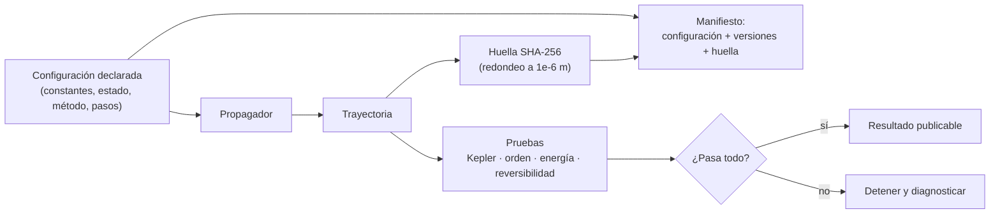

# B11-C20 — Propagador reproducible de trayectoria

<!-- nav:top -->
[🏠 Programa](../../../../README.md) · [📚 Bloque B11](../../../tronco-comun/B11-ecuaciones-diferenciales-y-simulacion-numerica.md) · [← Anterior: B11-C19 — Estimación de error y convergencia](../B11-C19-estimacion-de-error-y-convergencia/CLASE.md) · [Siguiente: B11-C21 — Integración numérica de alta precisión →](../B11-C21-integracion-numerica-de-alta-precision/CLASE.md)
<!-- /nav -->

## 1. Ubicación, nivel y alcance

Vigésima y última clase de la línea base del bloque B11. Reúnes todo: el sistema de [C04](../B11-C04-sistemas-de-ecuaciones-diferenciales/CLASE.md), los integradores de [C05](../B11-C05-metodo-de-euler/CLASE.md) a [C08](../B11-C08-integradores-de-paso-adaptativo/CLASE.md), la conservación de [C10](../B11-C10-conservacion-de-energia-numerica/CLASE.md) y [C11](../B11-C11-metodos-simplecticos/CLASE.md), y el presupuesto de error de [C19](../B11-C19-estimacion-de-error-y-convergencia/CLASE.md), en un **propagador de trayectoria reproducible**: un programa cuya entrada está declarada, cuyas versiones se imprimen, cuyos resultados tienen huella y que se prueba contra una referencia independiente. Nivel N2. No incluye perturbaciones realistas (achatamiento, atmósfera, terceros cuerpos).

## 2. Por qué esta clase existe

Un resultado numérico que nadie puede reproducir no es ciencia. Si dentro de un año hay que saber por qué una trayectoria salió así, hacen falta la configuración exacta, las versiones del software y pruebas que digan si el programa sigue funcionando. Eso distingue un cálculo de una herramienta.

La pregunta motivadora: **¿qué debo declarar, probar y guardar para que otra persona, o yo mismo dentro de un año, reproduzca y confíe en esta trayectoria?** La decisión central: **definir qué es la entrada, qué es el resultado y qué prueba lo respalda**.

## 3. Lo que podrás hacer al terminar

1. Encapsular toda la entrada de una propagación en una configuración declarada.
2. Elegir método y paso con criterio y registrar la elección.
3. Probar el programa contra una solución de referencia independiente (Kepler).
4. Verificar orden de convergencia, conservación y reversibilidad.
5. Generar una huella reproducible del resultado y reconocer sus límites.
6. Documentar datos, supuestos, validez y tolerancia del propagador.

La evidencia es el **propagador con pruebas y huella reproducible** del ejercicio 12 (sección 20).

## 4. Con qué llegas y cómo comprobarlo

Necesitas RK4 y leapfrog (C07, C11), Kepler (C08) y el presupuesto de error (C19). Cinco preguntas:

1. ¿Qué estado inicial da una órbita circular de radio `a`?
2. ¿Qué orden tiene RK4 y cómo se verifica?
3. ¿Cuántas evaluaciones de la fuerza usa un paso de leapfrog?
4. ¿Qué mide `(E − E₀)/|E₀|`?
5. ¿Qué es una función de resumen (hash)?

<details>
<summary>Ver respuestas</summary>

1. `(a, 0, 0, √(GM/a))`. 2. Orden 4, con la razón de errores `≈ 16` al duplicar `N`. 3. Una (por paso). 4. El error relativo de energía. 5. Una función que convierte datos en una cadena corta; datos distintos dan resúmenes distintos (con altísima probabilidad).
</details>

Con cuatro o cinco aciertos, sigue; si no, repasa C07, C08 y C11.

## 5. Un caso real: una vuelta a 400 km, con huella

Con `GM = 3,986 004 × 10¹⁴ m³ s⁻²` y radio nominal `6,3781 × 10⁶ m` (S1), el propagador del laboratorio recorre una vuelta de la órbita circular de 400 km (ilustrativa) con 400 pasos de RK4: error máximo de posición `6,5 × 10⁻² m`, deriva relativa de energía `−1,7 × 10⁻¹⁰`, y una huella SHA-256 de la trayectoria que empieza por `42a7191a…`. Dos corridas dan la misma huella; cambiar el número de pasos o añadir una aceleración de `10⁻⁹ m/s²` la cambia. Este es el **ejemplo conductor**: lo que se produce no es solo un número, sino un número con su historia.

## 6. Vocabulario

Una **configuración** es el conjunto completo de entradas (constantes, estado inicial, duración, método, pasos). Una **huella** (*hash*) es un resumen criptográfico (aquí SHA-256) de la configuración y de la trayectoria redondeada; si cualquier cosa cambia, cambia la huella. Un **manifiesto** guarda la configuración, las versiones del software y la huella. Una **referencia independiente** es un cálculo hecho con otro método (aquí, la solución de Kepler). Una **prueba de regresión** vuelve a ejecutar un caso conocido y exige el mismo resultado. **Reproducibilidad** es obtener el mismo resultado con los mismos datos y código; **replicabilidad**, llegar al mismo resultado con otro código. Una **perturbación sintética** es una aceleración constante de ejemplo, sin significado físico real.

## 7. Modelo mental: una receta con ingredientes, balanza y sello

La configuración es la receta con todos sus ingredientes y medidas; las pruebas son la balanza que verifica que el plato sale como se espera; la huella es el sello que prueba que el plato es el de la receta.



*Descripción textual:* la configuración alimenta al propagador, que produce la trayectoria; esta se somete a pruebas (referencia de Kepler, orden de convergencia, energía y reversibilidad) y se resume en una huella; configuración, versiones y huella forman el manifiesto; solo si todas las pruebas pasan el resultado se considera publicable.

Analogía: una receta de laboratorio con registro de lote. Su límite: un plato puede ser distinto cada vez; una trayectoria determinista debe salir igual, aunque la última cifra pueda variar entre máquinas.

## 8. La explicación, paso a paso

### 8.1 Declarar la entrada

El laboratorio define una clase inmutable `Config` con: `GM`, posición y velocidad iniciales, duración, número de pasos, método (`rk4` o `leapfrog`) y una aceleración de perturbación sintética (por defecto cero). Todo lo que influye en el resultado está ahí; nada vive en variables globales o en el código disperso. Con una configuración inmutable, «qué se corrió» queda definido por un objeto.

### 8.2 El propagador

El propagador avanza el estado `(x, y, v_x, v_y)` con el método elegido y guarda toda la trayectoria. La aceleración incluye la gravedad puntual `−GM r/|r|³` y, si se pide, la perturbación constante. RK4 (C07) y leapfrog (C11) comparten la interfaz: se cambian con una palabra.

### 8.3 Pruebas contra una referencia

Para el caso sin perturbación, la solución de Kepler (Newton sobre `M = E − e sin E`, C17) da la referencia. **Circular, 400 pasos, una vuelta**: error máximo `6,54 × 10⁻² m`; **orden**: errores `20,66`, `1,121`, `6,54 × 10⁻²`, `3,95 × 10⁻³ m` con `N = 100…800` y órdenes `4,20`, `4,10`, `4,05`. **Elíptica** (`a = 26 560 km`, `e = 0,30`, 1 000 pasos por vuelta, 5 vueltas): error máximo `0,306 m`, deriva de energía `−7,7 × 10⁻¹¹`. Cada prueba falla el programa si no se cumple.

### 8.4 Conservación y reversibilidad

La deriva de energía de la circular es `−1,67 × 10⁻¹⁰` en una vuelta. El leapfrog con 200 pasos por vuelta, 10 vueltas y la velocidad invertida regresa a `3,6 × 10⁻⁸ m` del origen: reversibilidad probada. Son pruebas que no necesitan referencia exacta.

### 8.5 La huella

La huella se calcula sobre el JSON ordenado de la configuración y las posiciones y velocidades redondeadas a `10⁻⁶` en cada paso. Dos corridas idénticas dan la misma; cambiar de 400 a 401 pasos o añadir `10⁻⁹ m/s²` de aceleración la cambia. La perturbación de `10⁻⁹ m/s²` mueve la posición final `0,029 m` (la estimación gruesa `½ a t² = 0,015 m` está en el orden). **Límite honesto**: el redondeo evita diferencias de la última cifra, pero la igualdad bit a bit entre plataformas no está garantizada: las funciones matemáticas de distintas bibliotecas pueden diferir en el último dígito. En ese caso se compara con tolerancia.

### 8.6 El manifiesto

Al final el programa imprime: versión de Python, plataforma, configuración, huella y un rótulo de procedencia («simulados; GM nominal IAU 2015; órbita ilustrativa»). Eso es lo mínimo que acompaña a cualquier cifra que salga del propagador.

## 9. Magnitudes, símbolos y unidades

| Símbolo | Qué es | Unidad | Nota |
|---|---|---|---|
| `GM` | parámetro gravitacional | m³ s⁻² | `3,986 004 × 10¹⁴` (S1) |
| `(x₀, y₀)`, `(v_x0, v_y0)` | estado inicial | m, m/s | `(6 778 100, 0)`, `(0, 7 668,58)` |
| `t_final`, `N` | duración y número de pasos | s, — | 5 553,6 s; 400 |
| `(a_x, a_y)` pert. | perturbación sintética | m/s² | `0` por defecto |
| `e_pos` | error máximo de posición | m | frente a Kepler |
| `ΔE/|E₀|` | deriva relativa de energía | adimensional | |
| huella | SHA-256 (64 caracteres hexadecimales) | — | |

## 10. Convenciones y referencias

Dos cuerpos, plano inercial, estado inicial en el perigeo, doble precisión. Los datos son **simulados**; la órbita de 400 km y la elíptica son ilustrativas. La huella usa redondeo a `10⁻⁶ m` (y `m/s`).

## 11. De dónde sale lo que afirmamos

| ID | Fuente | Localizador | Respalda | Estado |
|---|---|---|---|---|
| S1 | IAU, Resolución B3 de 2015 | arXiv:1510.07674, https://arxiv.org/pdf/1510.07674 | `(GM)_E^N = 3,986 004 × 10¹⁴ m³ s⁻²`, `R_eE^N = 6,3781 × 10⁶ m` | Texto extraído del PDF el 2026-11-05 |
| S2 | NIST, *DLMF* §3.7(v), versión 1.2.8 | https://dlmf.nist.gov/3.7 | Método de Runge–Kutta de cuarto orden, error local `O(h⁵)` | Consultada el 2026-11-05 mediante extracción automática (resumen) |
| S3 | Rein, H. y Spiegel, D. S., «IAS15», arXiv:1409.4779 | https://arxiv.org/abs/1409.4779 | Resumen: integradores gravitacionales de alta precisión existen y se validan por la conservación de la energía | Consultada el 2026-11-05 (resumen) |

Límites: la huella SHA-256 y la regresión son prácticas estándar de ingeniería de software no atribuidas a una fuente; el propagador es de dos cuerpos y **no** reproduce trayectorias reales (no incluye perturbaciones). Los resultados son simulados.

## 12. Cómo ver los resultados

Equivalente accesible a una tabla de pruebas (cálculo):

| Prueba | Resultado | Criterio |
|---|---|---|
| Error de posición, circular, 1 vuelta, 400 pasos | `6,54 × 10⁻² m` | `< 1 m` |
| Orden observado RK4 (`N = 100…800`) | `4,20; 4,10; 4,05` | `3,5 – 4,5` |
| Deriva de energía, circular | `−1,67 × 10⁻¹⁰` | `< 10⁻⁷` |
| Error de posición, elíptica, 5 vueltas | `0,306 m` | `< 100 m` |
| Reversibilidad del leapfrog | `3,6 × 10⁻⁸ m` | `< 10⁻⁴ m` |
| Huella idéntica en dos corridas | sí | exigido |
| Huella distinta al cambiar la configuración | sí | exigido |

Descripción larga: todas las pruebas pasan con holgura de uno a seis órdenes de magnitud; la menos holgada es el orden observado.

## 13. Ejemplo trabajado: una prueba de regresión

**Paso 1 · Caso.** Circular de 400 km, RK4, 400 pasos, una vuelta.

**Paso 2 · Resultado esperado.** Error `6,5 × 10⁻² m`, energía `−1,7 × 10⁻¹⁰`, huella `42a7191a…`.

**Paso 3 · Cambio.** Un colega modifica el código del paso RK4 «para optimizar».

**Paso 4 · Ejecución.** Si el error pasa a `20 m` o el orden a 2, la prueba falla antes de publicar.

**Paso 5 · Diagnóstico.** La huella cambia aunque el código parezca equivalente; si el error físico está dentro de la tolerancia y la huella cambia por última cifra, se compara con tolerancia y se actualiza la referencia con justificación.

**Paso 6 · Sentido.** La regresión protege el trabajo futuro. Resultados **simulados** con datos ilustrativos.

## 14. Comparación: reproducir, replicar y validar

Reproducir: mismo código y datos, mismo resultado (la huella). Replicar: otro código llega al mismo resultado (la referencia de Kepler cumple esa función). Validar: el modelo representa la realidad (requiere datos observados; este propagador **no** está validado). Un propagador serio exige las tres cosas, y este bloque cubre las dos primeras.

## 15. Práctica guiada

**Ejercicio 1 · con los pasos indicados.** Lista lo que debe contener la configuración para reproducir la corrida circular. *Pasos:* sección 8.1.

<details><summary>Solución comentada</summary>

`GM`, `x₀`, `y₀`, `v_x0`, `v_y0`, `t_final`, número de pasos, método y perturbación (cero).
</details>

**Ejercicio 2 · con una pista.** Calcula el orden observado con errores `20,66` y `1,121 m`. *Pista:* `log₂` de la razón.

<details><summary>Solución comentada</summary>

`log₂(20,66/1,121) = 4,20`.
</details>

**Ejercicio 3 · casi autónomo.** Convierte la deriva de energía `−1,67 × 10⁻¹⁰` a cambio de energía específica con `|E₀| = 2,94 × 10⁷ J/kg`.

<details><summary>Solución comentada</summary>

`1,67 × 10⁻¹⁰ · 2,94 × 10⁷ = 4,9 × 10⁻³ J/kg` (perdidos).
</details>

## 16. Práctica autónoma, transferencia e integrador

**Ejercicio 4.** ¿Qué fracción del radio orbital es el error de `0,306 m` de la elíptica? (`a = 26 560 km`.)

<details><summary>Solución comentada</summary>

`0,306/2,656 × 10⁷ = 1,2 × 10⁻⁸`.
</details>

**Ejercicio 5.** ¿Por qué se redondean las posiciones a `10⁻⁶ m` antes de calcular la huella?

<details><summary>Solución comentada</summary>

Para que diferencias de la última cifra binaria (por la biblioteca matemática o la plataforma) no cambien la huella (8.5).
</details>

**Ejercicio 6.** ¿Qué error de retorno tuvo el leapfrog en la prueba de reversibilidad y qué demuestra?

<details><summary>Solución comentada</summary>

`3,6 × 10⁻⁸ m`: que el método es reversible (hasta redondeo).
</details>

**Ejercicio 7.** Un error de signo en la gravedad (`+GM r/|r|³`) ¿qué prueba lo detecta primero?

<details><summary>Solución comentada</summary>

El error contra Kepler (la nave escaparía) y la energía; también el orden observado.
</details>

**Ejercicio 8.** Un error de unidades (`GM` en km³/s² con distancias en m): ¿qué detecta la prueba de Kepler?

<details><summary>Solución comentada</summary>

La referencia de Kepler usa la misma `GM` y no detecta la inconsistencia por sí sola; la detecta la energía fuera de rango y la velocidad circular absurda (`√(GM/a)` de unos `10⁻³ m/s`). Conviene una prueba de sanidad del periodo (`≈ 5 554 s`).
</details>

**Ejercicio 9 · transferencia.** Añade una perturbación de `10⁻⁹ m/s²` y estima su efecto en la posición tras una vuelta. Compáralo con el error del integrador (`0,065 m`).

<details><summary>Solución comentada</summary>

Efecto medido `0,029 m` (estimación `½ a t² = 0,015 m`): menor que el error del integrador de 400 pasos. Para distinguir una perturbación tan pequeña hay que reducir el truncamiento (más pasos) o usar el presupuesto de C19.
</details>

**Ejercicio 10 · transferencia.** Redacta el encabezado de documentación del propagador con datos, modelo, supuestos, validez y tolerancia.

<details><summary>Solución comentada</summary>

Como la cabecera del laboratorio: datos (`GM` nominal IAU 2015, órbita ilustrativa), modelo (dos cuerpos), supuestos (sin perturbaciones realistas), validez (`n h ≪ 1`), tolerancia (error `< 1 m`, orden `3,5–4,5`, deriva `< 10⁻⁷`).
</details>

**Ejercicio 11 · transferencia.** La huella de tu corrida difiere de la de un colega en otra plataforma, pero las trayectorias coinciden a `10⁻⁹ m`. ¿Qué haces?

<details><summary>Solución comentada</summary>

Comparar con tolerancia (diferencia máxima de posición), documentar la diferencia de huella como esperada por la biblioteca matemática y registrar versiones de ambos entornos.
</details>

**Ejercicio 12 · integrador.** Elabora tu *propagador con pruebas y huella reproducible*: configuración inmutable, dos métodos, pruebas contra Kepler (circular y elíptica), orden de convergencia, conservación, reversibilidad, huella, manifiesto con versiones y una sección que declare qué **no** valida.

<details><summary>Solución modelo</summary>

Código con `Config`, `propagar`, pruebas que detienen la ejecución si fallan, tabla de resultados con sus criterios (como la sección 12), manifiesto y declaración de límites: dos cuerpos, sin perturbaciones, sin validación contra datos observados; fuentes con fecha.
</details>

## 17. Laboratorio: el propagador

El script [propagador.py](propagador.py) implementa el propagador con configuración inmutable, los dos métodos, las pruebas y la huella; falla si alguna prueba no se cumple.

**Datos:** `GM` nominal IAU; órbitas ilustrativas. **Predice antes de ejecutar:** ¿qué orden observará RK4? (≈4.) **Ejecución del 2026-11-05 (Python 3.12.9):**

```text
Python 3.12.9 en Windows (AMD64)
[circular, RK4, 400 pasos, 1 vuelta] error máx de posición = 6.5378e-02 m ; d(energía)/|e0| = -1.669e-10
  huella SHA-256: 42a7191a1bf96739732c67d6f93c5c7e8de22700a6f7077eba14b27654750188
  determinismo: dos corridas dan la misma huella; cambiar pasos o añadir 1e-9 m/s2 la cambia
  error máx por N=100,200,400,800: 2.066e+01, 1.121e+00, 6.538e-02, 3.951e-03 m ; órdenes 4.20 4.10 4.05
[elíptica e=0.30, RK4, 1000 pasos/vuelta, 5 vueltas] error máx = 3.0573e-01 m ; d(energía)/|e0| = -7.743e-11
  huella SHA-256: bfc7f5a2b8951d9ae6015617cb4cc3fa2f9a9003f96f1c82a1b50392771d16d6
[leapfrog, 10 vueltas, 200 pasos] vuelta atrás: error de retorno = 3.57e-08 m
manifiesto de resultado: {"configuracion": {"gm": 398600400000000.0, "metodo": "rk4", "n_pasos": 400, "pert_ax": 0.0, "pert_ay": 0.0, "t_final": 5553.5790889288455, "vx0": 0.0, "vy0": 7668.578703685696, "x0": 6778100.0, "y0":...
Pruebas superadas.
```

```bash
python programa/clases/B11/B11-C20-propagador-reproducible-de-trayectoria/propagador.py
```

**Límites:** dos cuerpos; las huellas pueden diferir entre plataformas; el propagador **no** está validado contra datos observados; resultados **simulados**.

## 18. Errores frecuentes y cómo corregirlos

**Dejar entradas fuera de la configuración.** Se corrige con el ejercicio 1.

**Confiar en una sola prueba.** Se corrige con los ejercicios 7 y 8.

**Exigir igualdad bit a bit entre plataformas.** Se corrige con los ejercicios 5 y 11.

**No registrar versiones.** Se corrige con el ejercicio 12.

**Presentar el propagador como validado.** Se corrige con la sección 14 y la declaración de límites.

## 19. Cómo sabrás que vas bien

Tras 8.1: ¿tu configuración basta para reproducir la corrida? Si no, ejercicio 1. Tras 8.3: ¿qué prueba detecta un error de signo? Si dudas, ejercicio 7. Tras 8.5: ¿qué garantiza y qué no la huella? Si no lo sabes, ejercicio 11. Tras el laboratorio: ¿qué dejaría de cumplirse si cambias RK4 por Euler? (orden y energía).

## 20. Qué entregas y cómo se evalúa

El producto es tu **propagador con pruebas y huella reproducible** (ejercicio 12).

| Criterio | Inicial | En desarrollo | Logrado | Destacado |
|---|---|---|---|---|
| Configuración | Dispersa en el código | Parcial | Completa e inmutable | Con validación de entradas |
| Pruebas | Ninguna | Una | Kepler, orden, energía, reversibilidad | Una prueba por clase de error posible |
| Reproducibilidad | Sin versiones | Versiones sin huella | Huella y manifiesto | Comparación con tolerancia entre plataformas |
| Declaración de límites | Ausente | Genérica | Qué valida y qué no | Cuantifica el alcance |
| Fuentes | Sin fuente | Sin fecha | Con localizador y fecha | Rotula simulado e ilustrativo |

**Condiciones críticas (no se compensan con promedio):** probar contra una referencia independiente; declarar que el propagador no está validado con datos observados; citar solo fuentes consultadas.

## 21. Ética, seguridad y límites

Este propagador es un instrumento de aprendizaje: no incluye las perturbaciones que dominan una trayectoria real y no debe usarse para planificar maniobras, predecir reentradas ni evaluar riesgo de colisión. Una huella reproducible prueba que el cálculo se repite, no que sea correcto. Accesibilidad: fórmulas en texto, tablas equivalentes a las gráficas, ejercicios sin conexión.

## 22. Para cerrar y seguir

Un propagador reproducible tiene configuración declarada, métodos intercambiables, pruebas contra una referencia independiente, huella y manifiesto con versiones, y declara lo que no valida. Con esto termina la línea base del bloque B11. Siguen las clases programadas (C21 a C26): alta precisión, métodos implícitos, optimización restringida, métodos espectrales avanzados, punto flotante y comparaciones de algoritmos.

**Glosario español–inglés.** propagador · *propagator*; configuración · *configuration*; huella · *hash/fingerprint*; manifiesto · *manifest*; prueba de regresión · *regression test*; reproducibilidad · *reproducibility*; referencia independiente · *independent reference*.

**Continuidad.** B11-C21 amplía este propagador con **integración numérica de alta precisión**.

**Referencias:** ver sección 11.

<!-- nav:bottom -->
---

[← Anterior: B11-C19 — Estimación de error y convergencia](../B11-C19-estimacion-de-error-y-convergencia/CLASE.md) · [📚 Bloque B11](../../../tronco-comun/B11-ecuaciones-diferenciales-y-simulacion-numerica.md) · [Siguiente: B11-C21 — Integración numérica de alta precisión →](../B11-C21-integracion-numerica-de-alta-precision/CLASE.md)
<!-- /nav -->
