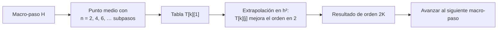

# B11-C21 — Integración numérica de alta precisión

<!-- nav:top -->
<!-- /nav -->

## 1. Ubicación, nivel y alcance

Clase programada de ampliación del bloque B11 (la 21.ª). [RK4](../B11-C07-runge-kutta-de-cuarto-orden/CLASE.md) y el [paso adaptativo](../B11-C08-integradores-de-paso-adaptativo/CLASE.md) cubren la mayoría de los usos, pero no la integración de trayectorias largas con precisión cercana al límite de la máquina. Aquí conoces dos ideas: **métodos de orden alto por extrapolación** (Gragg–Bulirsch–Stoer) y **aritmética extendida** para medir el redondeo acumulado. Nivel N2. No cubre Gauss–Radau ni el método de Taylor con derivación automática: se nombran y se enlazan a la literatura.

## 2. Por qué esta clase existe

Una trayectoria de millones de vueltas, un encuentro cercano que exige metros de precisión o una comprobación contra otro código piden errores de truncamiento muy por debajo del que da RK4 a costo razonable. A orden alto el costo por precisión baja mucho, pero el error de redondeo pasa a ser el límite.

La pregunta motivadora: **¿cómo se obtiene un error diminuto sin multiplicar el costo, y cuándo el redondeo manda?** La decisión central: **elegir el orden y la precisión aritmética según la tolerancia exigida**.

## 3. Lo que podrás hacer al terminar

1. Aplicar el punto medio modificado y extrapolar con Richardson en `h²`.
2. Construir la tabla de extrapolación de orden `2K`.
3. Comparar un método de orden alto con RK4 a igual número de evaluaciones.
4. Medir el orden observado de la extrapolación.
5. Medir el redondeo acumulado con aritmética decimal de 40 dígitos.
6. Decidir cuándo conviene orden alto.

La evidencia es el **comparación de integradores de alta precisión** del ejercicio 12 (sección 20).

## 4. Con qué llegas y cómo comprobarlo

Necesitas RK4 (C07), Richardson (C19) y orden observado. Cinco preguntas:

1. ¿Qué orden tiene RK4?
2. ¿Cuánto es `(4/2)² − 1`?
3. Si un error es `10⁻³` con `h` y el método es de orden 6, ¿cuánto con `h/2`?
4. ¿Qué es el épsilon de máquina?
5. ¿Cuántas evaluaciones usa un paso de RK4?

<details>
<summary>Ver respuestas</summary>

1. Cuatro. 2. `3`. 3. `10⁻³/64 = 1,6 × 10⁻⁵`. 4. `2,2 × 10⁻¹⁶` (doble precisión). 5. Cuatro.
</details>

Con cuatro o cinco aciertos, sigue; si no, repasa C07 y C19.

## 5. Un caso real: una vuelta con 480 evaluaciones

Con `GM = 3,986 004 × 10¹⁴ m³ s⁻²` (S1), una vuelta de la órbita de 400 km (ilustrativa) con **480 evaluaciones** de la fuerza deja un error de posición de **`9,5 m` con RK4** y de **`4,1 × 10⁻³ m` con una extrapolación de orden 12** (10 macro-pasos): 2 300 veces menos. Con 960 evaluaciones, orden 8: `1,6 × 10⁻⁴ m` frente a `0,53 m`. Este es el **ejemplo conductor**.

## 6. Vocabulario

El **punto medio modificado** con `n` subpasos de tamaño `h = H/n` es: `z₁ = z₀ + h f(z₀)`, `z_{m+1} = z_{m−1} + 2h f(z_m)` y `y(H) ≈ ½[z_n + z_{n−1} + h f(z_n)]`; su error es un desarrollo en potencias pares de `h`. Esa propiedad permite la **extrapolación de Richardson** repetida: `T_{k,j} = T_{k,j−1} + (T_{k,j−1} − T_{k−1,j−1})/((n_k/n_{k−j})² − 1)`, y la columna `j` tiene orden `2j`. Con `n_k = 2, 4, 6, …` y `K` columnas se tiene el método de **Gragg–Bulirsch–Stoer**. Un **macro-paso** es el avance `H`. La **aritmética extendida** usa más dígitos que la doble precisión (aquí el módulo `decimal` con 40 dígitos, S2).

## 7. Modelo mental: afinar con varias miradas

Mirar el mismo tramo con 2, 4, 6… subpasos da respuestas cada vez mejores, y los errores siguen un patrón predecible; con ese patrón se «adivina» el límite a paso cero.



*Descripción textual:* en cada macro-paso se calcula el punto medio con varios números de subpasos, se arma una tabla y se extrapola en `h²`; la última entrada tiene orden `2K` y es el nuevo estado.

Analogía: medir una distancia con reglas cada vez más finas y deducir el límite. Su límite: solo funciona si la solución es suave en todo el macro-paso.

## 8. La explicación, paso a paso

### 8.1 Un macro-paso a mano

`y′ = y`, `y(0) = 1`, `H = 1`. Con `n = 2`: `z₁ = 1,5`; `z₂ = 1 + 2·0,5·1,5 = 2,5`; resultado `½(2,5 + 1,5 + 0,5·2,5) = 2,625`. Con `n = 4`: `2,691 41`. Extrapolando: `T₂₂ = 2,691 41 + (2,691 41 − 2,625)/((4/2)² − 1) = 2,713 54`. El valor exacto es `e = 2,718 28`: error `0,0047`, frente a `0,0269` del `n = 4`.

### 8.2 Costo

Cada columna `k` cuesta `n_k + 1` evaluaciones. Con `K = 4` (`n = 2, 4, 6, 8`): `3 + 5 + 7 + 9 = 24` evaluaciones por macro-paso; con 10 macro-pasos, 240.

### 8.3 Resultados en la órbita

Una vuelta, error de posición y evaluaciones (RK4 al mismo costo):

| macro-pasos `M` | `K` (orden) | evaluaciones | extrapolación | RK4 |
|---|---|---|---|---|
| 10 | 6 (12) | 480 | `4,1 × 10⁻³ m` | `9,5 m` |
| 20 | 4 (8) | 480 | `5,5 × 10⁻² m` | `9,5 m` |
| 40 | 4 (8) | 960 | `1,6 × 10⁻⁴ m` | `0,53 m` |
| 40 | 3 (6) | 600 | `1,56 m` | `3,7 m` |
| 80 | 3 (6) | 1 200 | `2,2 × 10⁻² m` | `0,21 m` |

El orden observado de `K = 3` (de `M = 40` a `80`) es `6,16`. Con macro-pasos relativamente grandes (`M = 40`, `K = 3`) la ventaja es de solo 2,4 veces (`1,56 m` frente a `3,7 m`), y con `M = 80` es de 9,6 veces: aún no está en régimen asintótico. Con aún menos macro-pasos puede incluso perder frente a RK4.

### 8.4 El redondeo manda al final

RK4 sobre `y″ = −y` con `h = 0,01` hasta `t = 1 000` (100 000 pasos): en doble precisión `y = 0,562 379 144 804 304`; en decimal de 40 dígitos `0,562 379 144 804 332`. La diferencia, `2,8 × 10⁻¹⁴`, es el **redondeo acumulado**. El error de truncamiento frente a `cos t = 0,562 379 076 290 703` es `6,9 × 10⁻⁸`, un millón de veces mayor: el redondeo no importa con RK4 a este paso. Con un método de orden alto y errores `10⁻¹²`, sí.

### 8.5 Otros métodos de orden alto

El método de **Taylor** (DLMF §3.7(ii) lo describe para ecuaciones lineales de segundo orden, S4) y los integradores **Gauss–Radau** de paso adaptativo como IAS15 (S3, resumen) alcanzan precisión de máquina en integraciones muy largas; no se desarrollan aquí.

## 9. Magnitudes, símbolos y unidades

| Símbolo | Qué es | Unidad | Nota |
|---|---|---|---|
| `H`, `M` | macro-paso y su número | s, — | `H = T/M` |
| `n_k`, `K` | subpasos y columnas | — | `2k`, 6 |
| `T_{k,j}` | tabla de extrapolación | del estado | |
| `p` | orden `2K` | — | |
| `ε_dec` | precisión decimal | — | `10⁻⁴⁰` |
| `a`, `T` | radio y periodo | m, s | 6 778 100; 5 553,6 |
| `GM` | parámetro gravitacional | m³ s⁻² | `3,986 004 × 10¹⁴` (S1) |

## 10. Convenciones y referencias

Dos cuerpos, plano, órbita circular ilustrativa, doble precisión salvo el ensayo decimal. «Mismo costo» significa mismo número de evaluaciones de la fuerza. Todo es **simulado**.

## 11. De dónde sale lo que afirmamos

| ID | Fuente | Localizador | Respalda | Estado |
|---|---|---|---|---|
| S1 | IAU, Resolución B3 de 2015 | arXiv:1510.07674, https://arxiv.org/pdf/1510.07674 | `(GM)_E^N = 3,986 004 × 10¹⁴ m³ s⁻²` | Texto extraído del PDF el 2026-11-05 |
| S2 | Python Software Foundation, *decimal* (documentación de Python 3.15.2) | https://docs.python.org/3/library/decimal.html | Aritmética decimal de precisión ajustable (28 dígitos por defecto) | Consultada el 2026-11-06 mediante extracción automática |
| S3 | Rein, H. y Spiegel, D. S., «IAS15», arXiv:1409.4779 | https://arxiv.org/abs/1409.4779 | Resumen: integrador de orden 15 con paso adaptativo, errores sistemáticos bajo la precisión de máquina | Consultada el 2026-11-05 (resumen) |
| S4 | NIST, *DLMF* §3.7(ii), versión 1.2.8 | https://dlmf.nist.gov/3.7 | Método de series de Taylor para EDO lineales | Consultada el 2026-11-05 mediante extracción automática (resumen) |

Límites: la extrapolación de Gragg–Bulirsch–Stoer es una técnica estándar no atribuida a una fuente consultada; las cifras son del laboratorio. S3 y S4 solo contextualizan.

## 12. Cómo ver la eficiencia

Equivalente accesible a una gráfica de error frente a evaluaciones: ver la tabla de 8.3. Descripción larga: en escala logarítmica, la curva de la extrapolación cae con pendiente mayor y, desde unos 500 evaluaciones, queda tres órdenes de magnitud bajo la de RK4; con pocos macro-pasos la ventaja es pequeña.

## 13. Ejemplo trabajado: ¿cuánto cuesta 1 mm?

**Paso 1 · Meta.** Error de posición `≈ 4 mm` en una vuelta.

**Paso 2 · Extrapolación.** `M = 10`, `K = 6`: `4,1 × 10⁻³ m` con 480 evaluaciones.

**Paso 3 · RK4.** Error `9,5 m` con 480. Para `4 mm`: factor `2 300`; orden 4: `2 300^{1/4} = 6,9` veces más pasos ⇒ unas 3 300 evaluaciones.

**Paso 4 · Comparación.** 480 contra 3 300: la extrapolación cuesta 7 veces menos.

**Paso 5 · Redondeo.** Con errores de milímetros, el redondeo (`~10⁻⁷ m`) sigue siendo despreciable.

**Paso 6 · Sentido.** La ventaja crece al exigir más precisión; resultado **simulado** con datos ilustrativos.

## 14. Comparación: orden alto, paso adaptativo y precisión extendida

Orden alto: mejor para soluciones suaves y tolerancias estrictas. Paso adaptativo (C08): imprescindible con encuentros cercanos o excentricidades altas; puede combinarse con orden alto. Precisión extendida: solo cuando el redondeo domina (integraciones larguísimas o errores `< 10⁻¹²` relativos); cuesta mucho más por operación.

## 15. Práctica guiada

**Ejercicio 1 · con los pasos indicados.** Calcula el punto medio modificado con `n = 2` para `y′ = y`, `H = 1`. *Pasos:* 8.1.

<details><summary>Solución comentada</summary>

`z₁ = 1,5`, `z₂ = 2,5`; `½(2,5 + 1,5 + 0,5 · 2,5) = 2,625`.
</details>

**Ejercicio 2 · con una pista.** Extrapola `T₁₁ = 2,625` y `T₂₁ = 2,691 41`. *Pista:* `(n₂/n₁)² − 1 = 3`.

<details><summary>Solución comentada</summary>

`2,691 41 + 0,066 41/3 = 2,713 54`.
</details>

**Ejercicio 3 · casi autónomo.** Calcula las evaluaciones por macro-paso con `K = 5` (`n = 2…10`).

<details><summary>Solución comentada</summary>

`3 + 5 + 7 + 9 + 11 = 35`.
</details>

## 16. Práctica autónoma, transferencia e integrador

**Ejercicio 4.** ¿Qué orden tiene la columna `j = 3` de la tabla?

<details><summary>Solución comentada</summary>

`2j = 6`.
</details>

**Ejercicio 5.** Con errores `1,561 m` (`M = 40`) y `2,19 × 10⁻² m` (`M = 80`) para `K = 3`, calcula el orden.

<details><summary>Solución comentada</summary>

`log₂(71,3) = 6,16`.
</details>

**Ejercicio 6.** ¿Cuántas veces mejor es la extrapolación (10, 6) que RK4 a 480 evaluaciones?

<details><summary>Solución comentada</summary>

`9,526/4,10 × 10⁻³ = 2 320`.
</details>

**Ejercicio 7.** ¿Qué precisión relativa tiene la aritmética decimal de 40 dígitos frente al épsilon de la doble precisión?

<details><summary>Solución comentada</summary>

`10⁻⁴⁰` frente a `2,2 × 10⁻¹⁶`: unas `10²⁴` veces más fina.
</details>

**Ejercicio 8.** ¿Por qué el redondeo acumulado (`2,8 × 10⁻¹⁴`) no cambia la conclusión sobre RK4 en el ensayo del oscilador?

<details><summary>Solución comentada</summary>

Porque es seis órdenes de magnitud menor que el truncamiento (`6,9 × 10⁻⁸`): domina el truncamiento.
</details>

**Ejercicio 9 · transferencia.** Con `K = 3`, la extrapolación gana solo 2,4 veces a RK4 con `M = 40` y 9,6 veces con `M = 80`. ¿Qué ocurre y qué harías?

<details><summary>Solución comentada</summary>

Con `M = 40` el macro-paso (`139 s`, unos `0,16 rad` de órbita) aún es grande para orden 6: el método no está en régimen asintótico. Se aumenta `M` o `K` hasta ver el orden esperado (6,16 entre `M = 40` y `80`).
</details>

**Ejercicio 10 · transferencia.** Un colega usa orden 12 en una trayectoria con un encuentro cercano que tiene cambios bruscos. ¿Por qué podría fallar?

<details><summary>Solución comentada</summary>

La extrapolación supone una expansión suave en `h²`; con cambios bruscos la suposición falla. Se necesita control del paso o un integrador diseñado para encuentros (S3).
</details>

**Ejercicio 11 · transferencia.** Quieres comprobar que un integrador de orden alto está bien implementado. Lista tres pruebas.

<details><summary>Solución comentada</summary>

(1) Orden observado cercano al esperado; (2) comparación con la solución exacta circular o de Kepler; (3) deriva de energía mínima y sin tendencia clara; (4) opcional, comparar con precisión extendida.
</details>

**Ejercicio 12 · integrador.** Elabora tu *comparación de integradores de alta precisión*: extrapolación (dos configuraciones) y RK4 a igual costo, orden observado, redondeo medido con decimal y recomendación por tolerancia.

<details><summary>Solución modelo</summary>

Tabla de error frente a evaluaciones, razones respecto de RK4, orden observado (≈6), redondeo `10⁻¹⁴` frente a truncamiento, límites del régimen asintótico, y recomendación; datos rotulados como ilustrativos y simulados, con fuentes y fecha.
</details>

## 17. Laboratorio: extrapolación y precisión extendida

El script [extrapolacion_y_precision_extendida.py](extrapolacion_y_precision_extendida.py) implementa el método y las pruebas; falla si no supera a RK4 por dos órdenes en las dos configuraciones indicadas o si el orden sale de rango.

**Datos:** ilustrativos y sintéticos. **Predice antes de ejecutar:** ¿qué orden medirá `K = 3`? (≈6.) **Ejecución del 2026-11-06 (Python 3.12.9):**

```text
(a) una vuelta de la órbita de 400 km: error de posición frente a la circular exacta
    extrapolación M=10, K=6 (orden 12): error = 4.102e-03 m con  480 evaluaciones | RK4 con  480: 9.526e+00 m
    extrapolación M=20, K=4 (orden 8): error = 5.511e-02 m con  480 evaluaciones | RK4 con  480: 9.526e+00 m
    extrapolación M=40, K=4 (orden 8): error = 1.647e-04 m con  960 evaluaciones | RK4 con  960: 5.270e-01 m
    extrapolación M=40, K=3 (orden 6): error = 1.561e+00 m con  600 evaluaciones | RK4 con  600: 3.723e+00 m
    extrapolación M=80, K=3 (orden 6): error = 2.190e-02 m con 1200 evaluaciones | RK4 con 1200: 2.102e-01 m
    orden observado de K=3 (M=40 -> 80): 6.16
(b) RK4 sobre y''=-y, h=0.01, t=1000: y_float = 0.562379144804304 ; y_decimal(40 dígitos) = 0.562379144804332
    diferencia float-decimal (redondeo acumulado) = 2.822e-14 ; y exacta cos(t) = 0.562379076290703
    error de truncamiento (decimal frente a cos t) = 6.851e-08
Pruebas superadas.
```

```bash
python programa/clases/B11/B11-C21-integracion-numerica-de-alta-precision/extrapolacion_y_precision_extendida.py
```

**Límites:** órbita circular de dos cuerpos; paso macro fijo; resultados **simulados**.

## 18. Errores frecuentes y cómo corregirlos

**Usar orden alto con macro-pasos enormes.** Se corrige con el ejercicio 9.

**Aplicarlo a soluciones no suaves.** Se corrige con el ejercicio 10.

**Pensar que más dígitos siempre ayuda.** Se corrige con el ejercicio 8.

**Comparar sin igualar evaluaciones.** Se corrige con el ejercicio 6.

**No verificar el orden del código.** Se corrige con el ejercicio 11.

## 19. Cómo sabrás que vas bien

Tras 8.1: ¿extrapolas a mano? Si no, ejercicio 2. Tras 8.3: ¿por qué falla con pocos macro-pasos? Si no, ejercicio 9. Tras 8.4: ¿cuándo importa el redondeo? Si dudas, ejercicio 8. Tras el laboratorio: ¿qué indicaría un orden observado de 2? (un error de implementación).

## 20. Qué entregas y cómo se evalúa

El producto es tu **comparación de integradores de alta precisión** (ejercicio 12).

| Criterio | Inicial | En desarrollo | Logrado | Destacado |
|---|---|---|---|---|
| Aplicación | Fórmula con errores | Con ayuda | Tabla de extrapolación correcta | Explica por qué solo hay potencias pares |
| Comparación | A distinto costo | A igual costo sin análisis | A igual costo con razones | Identifica el régimen asintótico |
| Redondeo | No lo trata | Lo menciona | Lo mide con decimal | Lo compara con el truncamiento |
| Recomendación | Sin criterio | Genérica | Según tolerancia | Con límites de aplicabilidad |
| Fuentes | Sin fuente | Sin fecha | Con localizador y fecha | Rotula simulado e ilustrativo |

**Condiciones críticas (no se compensan con promedio):** comparar a igual número de evaluaciones; medir el orden observado; citar solo fuentes consultadas.

## 21. Ética, seguridad y límites

La alta precisión de un integrador no mejora un modelo incompleto: una trayectoria real está dominada por perturbaciones y por la incertidumbre de los parámetros (C19). Nada de esta clase es operativo. Accesibilidad: fórmulas en texto, tablas equivalentes a las gráficas, ejercicios sin conexión.

## 22. Para cerrar y seguir

La extrapolación de Richardson sobre el punto medio modificado da métodos de orden `2K`; a igual costo supera a RK4 en miles de veces cuando está en régimen asintótico; el redondeo, medido con aritmética decimal, solo domina cuando el truncamiento es diminuto. Queda abierta una pregunta: ¿qué se hace cuando el sistema es rígido y los explícitos de orden alto no sirven? Son los métodos implícitos.

**Glosario español–inglés.** punto medio modificado · *modified midpoint method*; extrapolación de Richardson · *Richardson extrapolation*; Gragg–Bulirsch–Stoer · *Gragg–Bulirsch–Stoer*; macro-paso · *macro-step*; aritmética extendida · *extended-precision arithmetic*; régimen asintótico · *asymptotic regime*.

**Continuidad.** B11-C22 reutiliza tu capacidad de **elegir método según el problema** para atacar sistemas rígidos.

**Referencias:** ver sección 11.

<!-- nav:bottom -->
<!-- /nav -->
