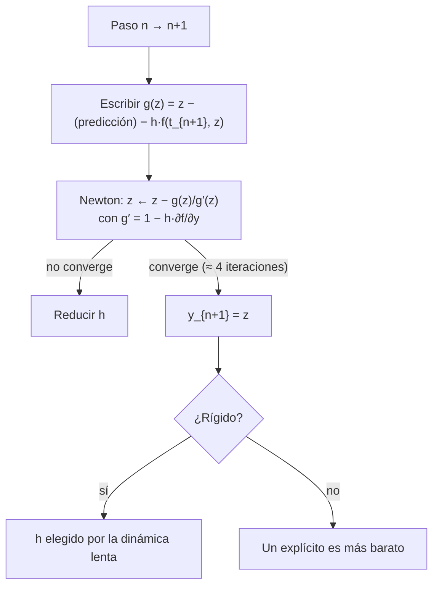

# B11-C22 — Métodos implícitos y sistemas rígidos

<!-- nav:top -->
[🏠 Programa](../../../../README.md) · [📚 Bloque B11](../../../tronco-comun/B11-ecuaciones-diferenciales-y-simulacion-numerica.md) · [← Anterior: B11-C21 — Integración numérica de alta precisión](../B11-C21-integracion-numerica-de-alta-precision/CLASE.md) · [Siguiente: B11-C23 — Optimización restringida: Lagrange, KKT y SQP →](../B11-C23-optimizacion-restringida-lagrange-kkt-y-sqp/CLASE.md)
<!-- /nav -->

## 1. Ubicación, nivel y alcance

Clase programada de ampliación del bloque B11 (la 22.ª). En [C09](../B11-C09-analisis-de-estabilidad-numerica/CLASE.md) viste que un problema rígido obliga a un método explícito a usar un paso diminuto y que el Euler implícito escapa a ese límite. Aquí completas la historia: **qué hacen los métodos implícitos en cada paso** (resolver una ecuación con Newton), la familia **BDF** y la regla trapezoidal, y por qué la propiedad de amortiguar transitorios (L-estabilidad) importa. Nivel N2. No cubre integradores implícitos de orden alto ni sistemas grandes con matrices dispersas.

## 2. Por qué esta clase existe

Los modelos térmicos, de combustión, de propulsión y de química atmosférica mezclan escalas de microsegundos con horas. Un integrador explícito pagaría el paso del más rápido durante toda la simulación. Un implícito paga más por paso pero avanza con pasos mil veces mayores.

La pregunta motivadora: **¿cuándo compensa resolver una ecuación en cada paso para poder usar pasos enormes?** La decisión central: **elegir entre explícito e implícito según la rigidez y el costo por paso**.

## 3. Lo que podrás hacer al terminar

1. Plantear un paso de Euler implícito, de BDF2 y trapezoidal.
2. Resolver cada paso con el método de Newton y su jacobiano.
3. Medir el orden observado de cada método.
4. Mostrar que un explícito diverge en un problema rígido con el mismo paso.
5. Distinguir A-estable y L-estable con un ejemplo de transitorio.
6. Estimar el costo comparado de explícito e implícito.

La evidencia es el **informe de un problema rígido** del ejercicio 12 (sección 20).

## 4. Con qué llegas y cómo comprobarlo

Necesitas estabilidad (C09), Newton (C17) y los métodos de un paso. Cinco preguntas:

1. ¿Qué factor de amplificación tiene el Euler implícito?
2. ¿Qué es un problema rígido?
3. ¿Cuántas iteraciones de Newton necesita una ecuación lineal?
4. ¿Qué es el jacobiano de un escalar `f(y)`?
5. ¿Qué orden tiene el método trapezoidal?

<details>
<summary>Ver respuestas</summary>

1. `1/(1 − z)`. 2. Uno con escalas de tiempo muy distintas que obliga a un explícito a pasos pequeños. 3. Una. 4. `df/dy`. 5. Dos.
</details>

Con cuatro o cinco aciertos, sigue; si no, repasa C09 y C17.

## 5. Un caso real: una relajación rápida con solución conocida

Un problema **sintético** de solución fabricada: `y′ = y*′ − k(y³ − y*³)` con `y*(t) = 2 + cos t` y `k = 1 000 s⁻¹`. La solución lenta es `y*`; cualquier desvío se corrige con una relajación de rapidez `3 k y² = 3 000 … 27 000 s⁻¹`. Con paso `h = 0,01 s` (producto `h|J|` entre 30 y 270), RK4 explícito **diverge**; los métodos implícitos dan errores de `10⁻⁸ … 10⁻¹⁰` en `t = 2`. Un explícito necesitaría `h < 1 × 10⁻⁴ s`: unos 19 400 pasos frente a 200. Este es el **ejemplo conductor**.

## 6. Vocabulario

Un método **implícito** define el nuevo estado mediante una ecuación que lo contiene. **Euler implícito**: `y_{n+1} = y_n + h f(t_{n+1}, y_{n+1})`. **BDF2** (fórmula de diferenciación hacia atrás de orden 2): `y_{n+1} = (4 y_n − y_{n−1})/3 + (2h/3) f(t_{n+1}, y_{n+1})`. **Trapezoidal**: `y_{n+1} = y_n + (h/2)[f(t_n, y_n) + f(t_{n+1}, y_{n+1})]`. **Newton** resuelve `g(z) = 0` con `z ← z − g(z)/g′(z)`; aquí `g′` incluye el **jacobiano** `df/dy`. Un método es **A-estable** si es estable para todo `Re z < 0` y **L-estable** si además `|R(z)| → 0` cuando `z → −∞`: amortigua del todo los modos muy rápidos. Euler implícito y BDF2 son L-estables; el trapezoidal es A-estable pero no L-estable (`R → −1`).

## 7. Modelo mental: pagar por paso para ganar en paso

El explícito calcula barato pero tiene que ir despacio por la parte rápida. El implícito resuelve una ecuación en cada paso (más caro) pero la parte rápida queda bajo control, y el paso lo decide la parte lenta.



*Descripción textual:* cada paso implícito plantea una ecuación para el nuevo estado y la resuelve con Newton usando el jacobiano; si converge (unas 4 iteraciones), se avanza; en problemas rígidos el paso lo fija la parte lenta, y en los no rígidos un explícito suele costar menos.

Analogía: pedir el ajuste final a un sistema de resortes duros en vez de simular cada vibración. Su límite: si el sistema no es rígido, se paga de más.

## 8. La explicación, paso a paso

### 8.1 Un paso de Euler implícito

`y′ = −50 y`, `h = 0,1`: `y₁ = y₀ + h(−50) y₁` ⇒ `y₁ = y₀/(1 + 5) = 0,1667` (exacto `e^{−5} = 0,0067`). Es estable pese a que `h|λ| = 5`; no es preciso, pero no explota. Con un explícito (`1 − 5 = −4`) el factor sería `−4`.

### 8.2 Un paso de BDF2

Para `y′ = λ y`: `y_{n+1} = (4 y_n − y_{n−1})/(3 − 2hλ)`. Con `λ = −50`, `h = 0,1`, `y₀ = 1`, `y₁ = 0,1667`: `y₂ = (4·0,1667 − 1)/(3 + 10) = −0,0256`. Un valor pequeño: amortiguado.

### 8.3 Newton en cada paso

En el problema no lineal se resuelve `z − y_n − h f(t_{n+1}, z) = 0`. El jacobiano es `1 − h ∂f/∂y = 1 + 3 k h z²`, que es muy grande: Newton converge en unas 4 iteraciones por paso (valor medio medido) partiendo de la predicción del paso anterior.

### 8.4 Órdenes observados

Con `y(0) = 3` (sobre la solución lenta) y `N = 100, 200, 400, 800` pasos hasta `t = 2`: Euler implícito `5,4 × 10⁻⁷ … 6,9 × 10⁻⁸`, órdenes `0,99; 0,99; 1,00`; BDF2 `1,6 × 10⁻⁸ … 2,5 × 10⁻¹⁰`, órdenes `2,00`; trapezoidal `4,0 × 10⁻⁹ … 6,3 × 10⁻¹¹`, órdenes `2,00`. Los órdenes coinciden con los de los métodos no rígidos: el problema rígido se trata sin perder orden.

### 8.5 Explícito frente a implícito

RK4 explícito con `h = 0,01` termina en `∞`. Su límite de estabilidad (C09) da `h < 2,785/(27 000) = 1,03 × 10⁻⁴ s`: 19 390 pasos para llegar a `t = 2`. Los implícitos usan 200 pasos con ≈ 4 evaluaciones de `f` y de su jacobiano cada uno (unas 800 de `f`), frente a `19 390 × 4 = 77 560` evaluaciones de RK4: unas 100 veces menos trabajo. La ventaja crece con la rigidez.

### 8.6 L-estabilidad y transitorios

Con una condición inicial fuera de la solución lenta (`y(0) = 3,5`) y `h = 0,01`: BDF2 elimina el transitorio (desvío `4 × 10⁻⁹` en la mitad final); Euler implícito (`2,7 × 10⁻⁷` en `t = 2`), igual; el trapezoidal conserva una oscilación de **`0,157`** que no se apaga, porque su factor de amplificación tiende a `−1`, no a 0 (por ejemplo, con `z = −100`, `(1 − 50)/(1 + 50) = −0,96`). Para problemas rígidos con transitorios se prefiere BDF o Euler implícito.

## 9. Magnitudes, símbolos y unidades

| Símbolo | Qué es | Unidad | Nota |
|---|---|---|---|
| `k` | rapidez de relajación | s⁻¹ | 1 000 (sintética) |
| `y*(t)` | solución lenta | según el caso | `2 + cos t` |
| `h` | paso | s | 0,01 |
| `J = ∂f/∂y` | jacobiano | s⁻¹ | `−3 k y²` |
| `z` | `h λ` | adimensional | |
| `R(z)` | factor de amplificación | adimensional | |
| `N` | pasos | — | 100…800 |

## 10. Convenciones y referencias

Problema escalar con solución fabricada: se elige primero la solución y se construye la ecuación para que la cumpla (técnica de verificación). Todos los datos son **sintéticos**. Newton con jacobiano analítico y tolerancia relativa `10⁻¹³`.

## 11. De dónde sale lo que afirmamos

| ID | Fuente | Localizador | Respalda | Estado |
|---|---|---|---|---|
| S1 | NIST, *DLMF* §3.7(ii), versión 1.2.8 | https://dlmf.nist.gov/3.7 | La estabilidad de la integración numérica de una EDO depende de si la solución buscada crece o decae más rápido a lo largo del camino | Consultada el 2026-11-05 mediante extracción automática (resumen) |

Límites: las fórmulas de Euler implícito, BDF2 y trapezoidal y los conceptos de A- y L-estabilidad son resultados estándar no atribuidos a una fuente consultada, y se comprobaron numéricamente. El problema es sintético.

## 12. Cómo ver la comparación

Equivalente accesible a una tabla (cálculo):

| Método | Orden medido | Error en `t = 2` con `N = 800` | Con transitorio `y₀ = 3,5` |
|---|---|---|---|
| Euler implícito | 1,00 | `6,9 × 10⁻⁸` | `2,7 × 10⁻⁷` |
| BDF2 | 2,00 | `2,5 × 10⁻¹⁰` | `4 × 10⁻⁹` (mitad final) |
| Trapezoidal | 2,00 | `6,3 × 10⁻¹¹` | `0,157` (oscilación persistente) |
| RK4 explícito `h = 0,01` | — | diverge | — |

Descripción larga: los tres implícitos son precisos y estables con `h|J| ≈ 30–270`; el trapezoidal pierde con el transitorio.

## 13. Ejemplo trabajado: elegir método para el sensor rápido

**Paso 1 · Problema.** Dinámica lenta (escala 1 s) con relajación de `3 000–27 000 s⁻¹`.

**Paso 2 · Explícito.** `h ≤ 1 × 10⁻⁴ s` ⇒ 19 390 pasos para 2 s.

**Paso 3 · Implícito.** `h = 0,01 s` ⇒ 200 pasos × 4 iteraciones ≈ 800 evaluaciones de `f` (y del jacobiano).

**Paso 4 · Calidad.** BDF2 con `N = 200` (`h = 0,01`): error `4,0 × 10⁻⁹` en `t = 2`.

**Paso 5 · Transitorio.** Si hay transitorios, evitar el trapezoidal.

**Paso 6 · Decisión.** BDF2. Cálculo **simulado** con un problema sintético.

## 14. Comparación: explícitos, implícitos y adaptativos

Explícitos: baratos, simples, límites de estabilidad. Implícitos: caros por paso, estables; necesitan jacobiano (analítico o numérico). Los códigos de propósito general combinan BDF de orden y paso variables (no se desarrollan aquí). En órbitas de dos cuerpos, un implícito de primer orden **disipa** la energía de forma artificial: no es la herramienta para eso (C10, C11).

## 15. Práctica guiada

**Ejercicio 1 · con los pasos indicados.** Un paso de Euler implícito para `y′ = −50 y`, `y₀ = 1`, `h = 0,1`. *Pasos:* 8.1.

<details><summary>Solución comentada</summary>

`y₁ = 1/(1 + 5) = 0,1667`.
</details>

**Ejercicio 2 · con una pista.** Calcula `y₂` de BDF2 con los mismos datos. *Pista:* `(4 y₁ − y₀)/(3 − 2hλ)`.

<details><summary>Solución comentada</summary>

`(0,6667 − 1)/13 = −0,0256`.
</details>

**Ejercicio 3 · casi autónomo.** Calcula `R(z)` del trapezoidal para `z = −100` y del Euler implícito.

<details><summary>Solución comentada</summary>

Trapezoidal `−0,96`; Euler implícito `1/101 = 0,0099` (8.6).
</details>

## 16. Práctica autónoma, transferencia e integrador

**Ejercicio 4.** Con errores `1,622 × 10⁻⁸` y `4,041 × 10⁻⁹` de BDF2, calcula el orden.

<details><summary>Solución comentada</summary>

`log₂(4,014) = 2,00`.
</details>

**Ejercicio 5.** ¿Cuántas veces más pasos requiere el explícito que el implícito en el problema rígido?

<details><summary>Solución comentada</summary>

`19 390/200 = 97`.
</details>

**Ejercicio 6.** Estima el trabajo del implícito en evaluaciones y compáralo con el del explícito.

<details><summary>Solución comentada</summary>

200 pasos × 4 iteraciones = 800 evaluaciones de `f` (más jacobianos) frente a `19 390 × 4 = 77 560` de RK4: unas 100 veces menos trabajo (8.5).
</details>

**Ejercicio 7.** ¿Qué es el jacobiano en este problema y cuánto vale en `y = 2`, `k = 1 000`?

<details><summary>Solución comentada</summary>

`df/dy = −3 k y² = −12 000 s⁻¹`.
</details>

**Ejercicio 8.** ¿Por qué se parte de la predicción del paso anterior para Newton?

<details><summary>Solución comentada</summary>

Porque está cerca de la raíz y Newton converge muy rápido (4 iteraciones); un mal punto de partida puede no converger.
</details>

**Ejercicio 9 · transferencia.** El trapezoidal deja una oscilación de `0,157` en el transitorio. ¿Por qué, y qué método usarías?

<details><summary>Solución comentada</summary>

Su amplificación tiende a `−1` para modos muy rápidos: los alterna en signo sin apagarlos. Usar BDF2 o Euler implícito (L-estables).
</details>

**Ejercicio 10 · transferencia.** Un colega usa un jacobiano aproximado y Newton necesita 12 iteraciones en vez de 4. ¿Es un error?

<details><summary>Solución comentada</summary>

No: un jacobiano aproximado (o congelado) sigue convergiendo, pero más despacio. Se compensa el costo ahorrado de evaluarlo con el de más iteraciones.
</details>

**Ejercicio 11 · transferencia.** ¿Por qué no usarías Euler implícito para propagar una órbita circular durante 1 000 vueltas?

<details><summary>Solución comentada</summary>

Disipa energía (su factor sobre el eje imaginario tiene módulo `< 1`): la órbita se encogería artificialmente. Para eso, un simpléctico (C11).
</details>

**Ejercicio 12 · integrador.** Elabora tu *informe de un problema rígido*: define un problema con solución fabricada y una rigidez distinta (`k = 100` o `10⁴`), muestra que un explícito falla, mide el orden de dos implícitos, compara el costo y discute el transitorio.

<details><summary>Solución modelo</summary>

Tabla de errores y órdenes; paso máximo explícito `2,785/|J|`; costo comparado; comportamiento con transitorio; recomendación; datos rotulados como sintéticos, con fuentes y fecha.
</details>

## 17. Laboratorio: implícitos en un problema rígido

El script [implicitos_en_sistema_rigido.py](implicitos_en_sistema_rigido.py) implementa los tres métodos con Newton y los compara con RK4 explícito; falla si los órdenes salen de rango o si RK4 no diverge.

**Datos:** sintéticos. **Predice antes de ejecutar:** ¿divergirá RK4 con `h = 0,01`? (sí.) **Ejecución del 2026-11-06 (Python 3.12.9):**

```text
y*(2) = 1.583853163453; |J| entre 3000 y 27000 1/s; h = 0.01 -> h|J| = 30 a 270
Euler implícito  errores (N=100..800): 5.446e-07 2.743e-07 1.377e-07 6.896e-08 | órdenes 0.99 0.99 1.00 | Newton 4.0 it/paso
BDF2             errores (N=100..800): 1.622e-08 4.041e-09 1.009e-09 2.519e-10 | órdenes 2.00 2.00 2.00 | Newton 4.0 it/paso
trapezoidal      errores (N=100..800): 4.027e-09 1.007e-09 2.517e-10 6.295e-11 | órdenes 2.00 2.00 2.00 | Newton 4.0 it/paso
RK4 explícito con h = 0.01: y(2) = inf (divergió)
límite explícito aproximado de RK4: h < 1.03e-04 s -> 19390 pasos para llegar a t = 2
transitorio (y0 = 3.5, h = 0.01): Euler implícito |y - y*| en t=2: 2.74e-07
  BDF2: máx|y - y*| en la mitad final = 4.04e-09 ; trapezoidal: 1.57e-01
Pruebas superadas.
```

```bash
python programa/clases/B11/B11-C22-metodos-implicitos-y-sistemas-rigidos/implicitos_en_sistema_rigido.py
```

**Límites:** escalar, solución fabricada, jacobiano analítico; resultados **simulados**.

## 18. Errores frecuentes y cómo corregirlos

**Usar un explícito y subir el orden para arreglar la inestabilidad.** Se corrige con la sección 8.5.

**Elegir el trapezoidal con transitorios.** Se corrige con el ejercicio 9.

**Olvidar el jacobiano o dejar de verificar la convergencia de Newton.** Se corrige con los ejercicios 7 y 8.

**Usar un implícito de bajo orden para dinámica conservativa.** Se corrige con el ejercicio 11.

**No medir el orden.** Se corrige con el ejercicio 4.

## 19. Cómo sabrás que vas bien

Tras 8.1: ¿haces un paso implícito a mano? Si no, ejercicios 1 y 2. Tras 8.3: ¿por qué Newton? Si dudas, ejercicio 8. Tras 8.6: ¿qué es L-estable? Si no lo sabes, ejercicio 3. Tras el laboratorio: ¿qué indicaría un orden 1 en BDF2? (un error en el primer paso o en la fórmula).

## 20. Qué entregas y cómo se evalúa

El producto es tu **informe de un problema rígido** (ejercicio 12).

| Criterio | Inicial | En desarrollo | Logrado | Destacado |
|---|---|---|---|---|
| Planteamiento | Sin solución de referencia | Referencia sin construcción | Solución fabricada correcta | Varía la rigidez |
| Método | Un solo método | Dos sin Newton | Implícitos con Newton y jacobiano | Discute L-estabilidad |
| Comparación | Sin costo | Costo cualitativo | Costo en evaluaciones | Ventaja en función de la rigidez |
| Transitorio | Ignorado | Mencionado | Medido | Elige método en consecuencia |
| Fuentes | Sin fuente | Sin fecha | Con localizador y fecha | Rotula sintético y simulado |

**Condiciones críticas (no se compensan con promedio):** comparar contra una solución conocida; mostrar que el explícito falla; citar solo fuentes consultadas.

## 21. Ética, seguridad y límites

Un integrador estable no es una prueba de que el modelo sea correcto: la estabilidad solo garantiza que el error numérico no explote. Un problema sintético de solución fabricada no representa un sistema real. Accesibilidad: fórmulas en texto, tablas equivalentes a las gráficas, ejercicios sin conexión.

## 22. Para cerrar y seguir

Los métodos implícitos resuelven una ecuación por paso (Newton con jacobiano) y permiten pasos fijados por la dinámica lenta; Euler implícito y BDF2 son L-estables, el trapezoidal no; en el ejemplo, el explícito necesitaba unos 19 400 pasos y los implícitos 200. Queda abierta una pregunta: la mayor parte de este bloque buscó resolver ecuaciones o minimizar sin restricciones; ¿cómo se optimiza cuando hay condiciones que cumplir? Es la optimización restringida.

**Glosario español–inglés.** método implícito · *implicit method*; BDF · *backward differentiation formula*; regla trapezoidal · *trapezoidal rule*; jacobiano · *Jacobian*; A-estable · *A-stable*; L-estable · *L-stable*; solución fabricada · *manufactured solution*.

**Continuidad.** B11-C23 reutiliza tu capacidad de **resolver sistemas con Newton** para las condiciones de optimalidad con restricciones.

**Referencias:** ver sección 11.

<!-- nav:bottom -->
---

[← Anterior: B11-C21 — Integración numérica de alta precisión](../B11-C21-integracion-numerica-de-alta-precision/CLASE.md) · [📚 Bloque B11](../../../tronco-comun/B11-ecuaciones-diferenciales-y-simulacion-numerica.md) · [Siguiente: B11-C23 — Optimización restringida: Lagrange, KKT y SQP →](../B11-C23-optimizacion-restringida-lagrange-kkt-y-sqp/CLASE.md)
<!-- /nav -->
