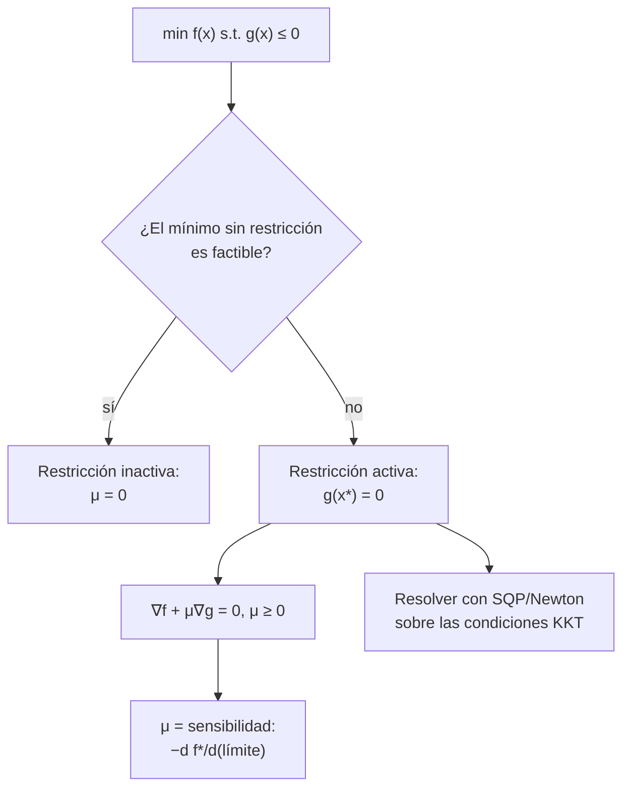

# B11-C23 — Optimización restringida: Lagrange, KKT y SQP

<!-- nav:top -->
<!-- /nav -->

## 1. Ubicación, nivel y alcance

Clase programada de ampliación del bloque B11 (la 23.ª). En [C17](../B11-C17-optimizacion-numerica/CLASE.md) viste que, sin restricciones, el mínimo de la transferencia bielíptica se escapaba hacia la frontera del intervalo de búsqueda. Aquí aprendes a tratar esa frontera como lo que es: una **restricción**. Verás los multiplicadores de Lagrange, las condiciones de Karush–Kuhn–Tucker (KKT), el significado físico del multiplicador y una iteración de programación cuadrática secuencial (SQP) como Newton sobre las condiciones de optimalidad. Nivel N2. No cubre restricciones de desigualdad múltiples con conjunto activo ni problemas grandes.

## 2. Por qué esta clase existe

Casi todo problema de diseño de trayectorias tiene límites: tiempo máximo, combustible disponible, distancia mínima a un cuerpo. Un optimizador que ignora las restricciones devuelve un resultado imposible; uno que las trata mal da un resultado que parece factible y no es óptimo. El multiplicador de Lagrange, además, dice cuánto cuesta cada restricción.

La pregunta motivadora: **¿cuál es el mejor resultado que respeta las restricciones, y cuánto me costaría relajarlas?** La decisión central: **identificar qué restricciones están activas y verificar KKT**.

## 3. Lo que podrás hacer al terminar

1. Plantear el Lagrangiano de un problema con restricción de igualdad.
2. Enunciar las condiciones KKT para una desigualdad.
3. Reconocer una restricción activa y calcular su multiplicador.
4. Interpretar el multiplicador como sensibilidad del óptimo.
5. Aplicar SQP (Newton sobre KKT) a un problema de igualdad.
6. Verificar un óptimo restringido con un barrido independiente.

La evidencia es el **problema restringido resuelto y verificado** del ejercicio 12 (sección 20).

## 4. Con qué llegas y cómo comprobarlo

Necesitas gradientes (B09), Newton (C17) y sistemas lineales (B10). Cinco preguntas:

1. ¿Cuál es el gradiente de `f = x² + y²`?
2. ¿Qué dice el gradiente en un mínimo sin restricciones?
3. Resuelve `2x + λ = 0` y `2y + λ = 0` con `x + y = 1`.
4. ¿Qué es una restricción activa?
5. ¿Cuánto vale `√5`?

<details>
<summary>Ver respuestas</summary>

1. `(2x, 2y)`. 2. Es cero. 3. `x = y = ½`, `λ = −1`. 4. Una desigualdad que se cumple con igualdad en el óptimo. 5. `2,236`.
</details>

Con cuatro o cinco aciertos, sigue; si no, repasa C17 y B09.

## 5. Un caso real: la transferencia con límite de tiempo

La transferencia bielíptica a `R = 13` (razón **ilustrativa**) de C17 reduce `Δv` cuanto más lejos esté el apoastro intermedio `x`, pero el tiempo de vuelo `T(x)` crece sin límite. Si la misión impone `T ≤ 1 000` unidades de tiempo (límite **sintético**, unos 10 días con la unidad de la órbita de 400 km), el problema es: minimizar `Δv(x)` sujeto a `T(x) ≤ 1 000`. La solución está en la restricción: `x* = 51,58 r₁`, `Δv = 0,535 081 v₁`, con multiplicador `μ = 3,01 × 10⁻⁶` por unidad de tiempo. Sin restricción, `Δv` bajaría a `0,529 138`, pero el viaje duraría `2,2 × 10⁶` unidades. Este es el **ejemplo conductor**.

## 6. Vocabulario

Un problema **con restricción de igualdad** es `min f(z)` sujeto a `g(z) = 0`. Su **Lagrangiano** es `L = f + λ g`; en el óptimo `∇f + λ ∇g = 0` y `g = 0`; `λ` es el **multiplicador de Lagrange**. Con **desigualdad** `T(x) ≤ T_max` aparecen las condiciones **KKT**: estacionariedad `∇Dv + μ ∇T = 0`; factibilidad `T ≤ T_max`; **signo** `μ ≥ 0`; y **complementariedad** `μ (T − T_max) = 0` (o la restricción está activa o su multiplicador es cero). El multiplicador mide la **sensibilidad**: `dDv*/dT_max = −μ`. **SQP** (programación cuadrática secuencial) resuelve la secuencia de problemas cuadráticos que salen de aplicar Newton al sistema KKT; con solo igualdades es Newton sobre `[∇f + λ∇g; g] = 0`.

## 7. Modelo mental: la pared y la fuerza que la sostiene

Una bola rueda hacia un mínimo pero choca con una pared: se queda pegada a ella. La fuerza con que la pared empuja es el multiplicador; si no hay pared en el camino, la fuerza es cero.



*Descripción textual:* si el mínimo sin restricciones ya es factible, la restricción es inactiva y su multiplicador es cero; si no, queda activa en el óptimo, donde el gradiente del objetivo se equilibra con el de la restricción mediante un multiplicador no negativo que mide la sensibilidad; la solución se halla resolviendo las condiciones KKT con Newton.

Analogía: una bola contra una pared. Su límite: con varias restricciones el conjunto activo puede cambiar durante la búsqueda.

## 8. La explicación, paso a paso

### 8.1 Un ejemplo con igualdad, a mano

Minimizar `x² + y²` con `x + y = 1`. `L = x² + y² + λ(x + y − 1)`. `∂L/∂x = 2x + λ = 0`; `∂L/∂y = 2y + λ = 0`; luego `x = y = −λ/2` y `x + y = 1` ⇒ `x = y = ½`, `λ = −1`, `f = ½`. Es el punto de la recta más cercano al origen.

### 8.2 La transferencia con restricción de tiempo

Se busca `x*` con `T(x*) = 1 000` por bisección: `x* = 51,5831`. La derivada del objetivo es `Δv′ = −7,67 × 10⁻⁵` (negativa: alejarse mejora) y la del tiempo `T′ = 25,47`. KKT: `Δv′ + μ T′ = 0` ⇒ `μ = 7,67 × 10⁻⁵/25,47 = 3,01 × 10⁻⁶ > 0`. Complementariedad: la restricción está activa (`T = T_max`) y `μ > 0` ✓. Un barrido en malla sobre la región factible da el mismo punto (`x = 51,58`, `Δv = 0,535 081`).

### 8.3 El multiplicador como precio

Si se relaja el límite en una unidad de tiempo, el óptimo mejora en `μ`. El laboratorio calcula `dΔv*/dT_max` por diferencias (resolviendo el problema para `T_max ± 1`): `−3,0115 × 10⁻⁶`, idéntico a `−μ`. Relajar el límite de 1 000 a 1 100 ahorraría unos `3 × 10⁻⁴ v₁` (`0,06 %`); una pequeñísima ganancia por 100 unidades más de tiempo. El multiplicador es el «precio» de la restricción.

### 8.4 SQP sobre un círculo

Minimizar `f = (x − 2)² + (y − 1)²` sobre `x² + y² = 1`. Solución exacta: el punto del círculo más cercano a `(2, 1)`, `(2, 1)/√5 = (0,894 427, 0,447 214)`, con `λ = √5 − 1 = 1,236 07` (para `L = f + λ(g − 1)`). La iteración de Newton sobre las condiciones `[∇f + λ∇g; g − 1] = 0`, desde `(1, 1)` y `λ = 0`, da errores `0,407; 0,098; 6,7 × 10⁻³; 5,7 × 10⁻⁵; 4,2 × 10⁻⁹; 5,6 × 10⁻¹⁷`: convergencia **cuadrática** (el exponente se duplica). El barrido angular coincide (`θ = 0,4636 rad`, `f = 1,527 864`).

### 8.5 Qué hace cada paso de SQP

En cada iteración se resuelve el sistema lineal `[[W, Aᵀ], [A, 0]] [δz; δλ] = −[∇f + λ∇g; g]`, con `W` la Hessiana del Lagrangiano (aquí `(2 + 2λ) I`) y `A = ∇g`. Es lo mismo que minimizar un modelo cuadrático de `L` sujeto a la linealización de la restricción: de ahí «programación cuadrática secuencial».

### 8.6 Verificar siempre

Tres pruebas: la restricción se cumple a la tolerancia; el gradiente del Lagrangiano se anula (residuo KKT `0` en el laboratorio); y un barrido independiente de la región factible no encuentra nada mejor.

## 9. Magnitudes, símbolos y unidades

| Símbolo | Qué es | Unidad | Nota |
|---|---|---|---|
| `x` | apoastro intermedio en unidades de `r₁` | adimensional | `x* = 51,58` |
| `Δv` | costo en unidades de `v₁` | adimensional | `0,535 081` |
| `T`, `T_max` | tiempo de vuelo y límite | `√(r₁³/μ_g)` | 1 000 (sintético) |
| `μ` | multiplicador de la desigualdad | `Δv` por unidad de tiempo | `3,01 × 10⁻⁶` |
| `λ` | multiplicador de la igualdad | — | `√5 − 1` |
| `g`, `W`, `A` | restricción, Hessiana de `L`, jacobiano de `g` | — | |

## 10. Convenciones y referencias

Órbitas circulares coplanares, impulsos instantáneos, dos cuerpos (como en C17). Signo de los multiplicadores: `L = f + λ g` con `μ ≥ 0` para desigualdades `g ≤ 0`. Todos los datos son **ilustrativos o sintéticos**. Los resultados son verificaciones numéricas propias; solo se consultó la fórmula de diferencias (S1).

## 11. De dónde sale lo que afirmamos

| ID | Fuente | Localizador | Respalda | Estado |
|---|---|---|---|---|
| S1 | NIST, *DLMF* §3.4, versión 1.2.8 | https://dlmf.nist.gov/3.4 | Diferencia central de tres puntos usada para las derivadas numéricas | Consultada el 2026-11-05 mediante extracción automática |

Límites: las condiciones KKT, el significado del multiplicador y SQP son resultados estándar no atribuidos a una fuente consultada; cada afirmación numérica se verificó en el laboratorio con un barrido independiente. Los datos son ilustrativos.

## 12. Cómo ver la solución

Equivalente accesible a una gráfica de `Δv` frente a `x` con la región factible (cálculo):

| `x` (en `r₁`) | `T` | ¿factible? | `Δv` |
|---|---|---|---|
| 13 (Hohmann) | 58 | sí | 0,535 292 |
| 51,58 | 1 000 | sí (borde) | 0,535 081 |
| 100 | 2 462 | no | 0,532 722 |
| `10⁴` | `2,2 × 10⁶` | no | 0,529 138 |

Descripción larga: el objetivo decrece al aumentar `x` (más allá del máximo local), pero la restricción corta la región factible en `x = 51,58`; el óptimo restringido está en el borde.

## 13. Ejemplo trabajado: ¿cuánto vale ampliar el plazo?

**Paso 1 · Problema.** Min `Δv(x)` s.t. `T(x) ≤ 1 000`.

**Paso 2 · Óptimo.** `x* = 51,58`; `Δv* = 0,535 081`; restricción activa.

**Paso 3 · Multiplicador.** `μ = −Δv′/T′ = 3,01 × 10⁻⁶`.

**Paso 4 · Relajar.** Con `T_max = 1 100`: ahorro `≈ μ · 100 = 3,0 × 10⁻⁴` (primer orden).

**Paso 5 · Comprobar.** `dΔv*/dT_max = −3,0115 × 10⁻⁶` por diferencias.

**Paso 6 · Decisión.** Un ahorro de `0,06 %` de `Δv` por 10 % más de tiempo de vuelo: depende de cuánto cuesta el tiempo para la misión (peso que no está en la matemática). Cálculo **simulado**.

## 14. Comparación: penalización y KKT

Con una penalización `Δv + λ_p T` (C17) se escoge el peso a mano y la restricción queda blanda. Con KKT se fija el límite y el multiplicador sale del problema, con interpretación de precio. SQP converge más rápido pero necesita derivadas y un buen punto de partida.

## 15. Práctica guiada

**Ejercicio 1 · con los pasos indicados.** Resuelve `min x² + y²` s.t. `x + y = 1`. *Pasos:* Lagrangiano, derivadas, restricción (8.1).

<details><summary>Solución comentada</summary>

`x = y = ½`, `λ = −1`, `f = ½`.
</details>

**Ejercicio 2 · con una pista.** En la transferencia, calcula `μ` con `Δv′ = −7,67 × 10⁻⁵` y `T′ = 25,47`. *Pista:* `μ = −Δv′/T′`.

<details><summary>Solución comentada</summary>

`3,01 × 10⁻⁶`.
</details>

**Ejercicio 3 · casi autónomo.** Verifica los tres criterios de KKT de la transferencia.

<details><summary>Solución comentada</summary>

Estacionariedad `Δv′ + μ T′ = 0`; factibilidad `T = T_max`; signo `μ > 0`; complementariedad `μ (T − T_max) = 0` ✓.
</details>

## 16. Práctica autónoma, transferencia e integrador

**Ejercicio 4.** Resuelve `min (x − 3)²` s.t. `x ≤ 1`. ¿Está activa la restricción? ¿Cuánto vale `μ`?

<details><summary>Solución comentada</summary>

El mínimo sin restricción (`x = 3`) es infactible; el óptimo es `x = 1` (activa). `2(x − 3) + μ = 0` ⇒ `μ = 4 > 0`.
</details>

**Ejercicio 5.** Resuelve `min (x − 3)²` s.t. `x ≤ 5`.

<details><summary>Solución comentada</summary>

`x = 3`, restricción inactiva, `μ = 0`.
</details>

**Ejercicio 6.** Con `μ = 3,01 × 10⁻⁶`, estima el ahorro de `Δv` al ampliar el plazo en 100 unidades.

<details><summary>Solución comentada</summary>

`≈ 3,0 × 10⁻⁴ v₁` (`0,056 %`).
</details>

**Ejercicio 7.** En SQP, ¿qué orden de convergencia tienen los errores `5,7 × 10⁻⁵ → 4,2 × 10⁻⁹ → 5,6 × 10⁻¹⁷`?

<details><summary>Solución comentada</summary>

Cuadrático: el exponente aproximadamente se duplica (−4,2 → −8,4 → −16,3).
</details>

**Ejercicio 8.** Para `(2, 1)` y el círculo unidad, ¿por qué el punto óptimo es `(2, 1)/√5`?

<details><summary>Solución comentada</summary>

Es la proyección radial de `(2, 1)` sobre el círculo (el punto más cercano); `|(2, 1)| = √5`.
</details>

**Ejercicio 9 · transferencia.** El óptimo sin restricción cae en `x = 10⁴` con `T = 2,2 × 10⁶`. ¿Por qué es inaceptable y qué restricción adicional sugiere?

<details><summary>Solución comentada</summary>

Son unos 62 años de vuelo con la unidad de la órbita de 400 km; se impone un tiempo máximo (o una distancia máxima). Es el tipo de restricción del ejemplo.
</details>

**Ejercicio 10 · transferencia.** Un optimizador devuelve `μ < 0`. ¿Qué significa?

<details><summary>Solución comentada</summary>

Que la restricción no debería estar activa: se puede mejorar el objetivo alejándose del borde hacia adentro; no es un óptimo KKT. Se desactiva la restricción y se repite.
</details>

**Ejercicio 11 · transferencia.** ¿Por qué se verifica con un barrido independiente aunque KKT se cumpla?

<details><summary>Solución comentada</summary>

KKT es necesaria, no suficiente: puede haber puntos que las cumplen y no son el mínimo global (mínimos locales, máximos); el barrido confirma que no hay nada mejor en la región factible.
</details>

**Ejercicio 12 · integrador.** Elabora tu *problema restringido resuelto y verificado*: eligiendo un `T_max` distinto, calcula `x*`, `μ`, comprueba KKT y la sensibilidad, resuelve por SQP el problema del círculo con otro punto objetivo y verifica ambos con un barrido.

<details><summary>Solución modelo</summary>

Tabla con `T_max`, `x*`, `Δv*`, `μ`, residuo KKT, sensibilidad por diferencias; iteraciones de SQP con errores cuadráticos; barridos coincidentes; datos rotulados como ilustrativos y sintéticos.
</details>

## 17. Laboratorio: KKT y SQP

El script [kkt_y_sqp.py](kkt_y_sqp.py) resuelve la transferencia restringida, comprueba KKT y la sensibilidad, y ejecuta SQP sobre el círculo; falla si algún criterio no se cumple.

**Datos:** ilustrativos y sintéticos. **Predice antes de ejecutar:** ¿qué signo tendrá `μ`? (positivo.) **Ejecución del 2026-11-06 (Python 3.12.9):**

```text
(a) restricción activa: T(x*) = 1000.000000000 con x* = 51.5831 r1 ; Dv(x*) = 0.535081
    gradientes: Dv' = -7.6704e-05, T' = 25.4707 ; multiplicador mu = 3.0115e-06 (> 0) ; residuo KKT = 0.0e+00
    barrido en malla sobre la región factible: x = 51.58, Dv = 0.535081
    sin restricción (hasta x = 1e4): Dv = 0.529138 con T = 2.224e+06
    sensibilidad dDv*/dTmax = -3.0115e-06 ; -mu = -3.0115e-06
(b) SQP (Newton sobre KKT) para min f s.t. x^2 + y^2 = 1, desde (1, 1), lam = 0:
    it 1: (x, y) = (1.2500000000, 0.2500000000) lam = 0.75000000 ; error = 4.066e-01 ; |g| = 6.25e-01
    it 2: (x, y) = (0.9436813187, 0.5315934066) lam = 1.02884615 ; error = 9.770e-02 ; |g| = 1.73e-01
    it 3: (x, y) = (0.9007402069, 0.4449853617) lam = 1.21167980 ; error = 6.695e-03 ; |g| = 9.34e-03
    it 4: (x, y) = (0.8944237755, 0.4472708695) lam = 1.23590543 ; error = 5.738e-05 ; |g| = 4.51e-05
    it 5: (x, y) = (0.8944271942, 0.4472135928) lam = 1.23606797 ; error = 4.173e-09 ; |g| = 3.29e-09
    it 6: (x, y) = (0.8944271910, 0.4472135955) lam = 1.23606798 ; error = 5.551e-17 ; |g| = 0.00e+00
    barrido angular: theta = 0.46364 rad, f = 1.52786405 ; exacto: f = 1.52786405, theta = 0.46365
Pruebas superadas.
```

```bash
python programa/clases/B11/B11-C23-optimizacion-restringida-lagrange-kkt-y-sqp/kkt_y_sqp.py
```

**Límites:** derivadas por diferencias centrales; problema de una variable con una desigualdad y otro de dos variables con una igualdad; resultados **simulados**.

## 18. Errores frecuentes y cómo corregirlos

**Ignorar la restricción y reportar el óptimo libre.** Se corrige con el ejercicio 9.

**Olvidar el signo del multiplicador.** Se corrige con el ejercicio 10.

**Confundir restricción activa con inactiva.** Se corrige con los ejercicios 4 y 5.

**Aceptar KKT sin barrido de comprobación.** Se corrige con el ejercicio 11.

**No interpretar el multiplicador.** Se corrige con el ejercicio 6.

## 19. Cómo sabrás que vas bien

Tras 8.1: ¿resuelves el problema de la recta? Si no, ejercicio 1. Tras 8.2: ¿compruebas los cuatro criterios? Si no, ejercicio 3. Tras 8.3: ¿qué precio tiene el tiempo? Si no, ejercicio 6. Tras el laboratorio: ¿qué indicaría una convergencia solo lineal en SQP? (Hessiana inexacta o mal punto de partida).

## 20. Qué entregas y cómo se evalúa

El producto es tu **problema restringido resuelto y verificado** (ejercicio 12).

| Criterio | Inicial | En desarrollo | Logrado | Destacado |
|---|---|---|---|---|
| Planteamiento | Sin Lagrangiano | Con errores de signo | Lagrangiano y KKT correctos | Discute activas e inactivas |
| Resolución | Solo aproximada | Un método | KKT o SQP con residuos | Verifica convergencia cuadrática |
| Multiplicador | No lo calcula | Lo calcula sin interpretar | Lo interpreta como precio | Lo valida por diferencias |
| Verificación | Ausente | Visual | Barrido independiente | Ambos problemas verificados |
| Fuentes | Sin fuente | Sin fecha | Con localizador y fecha | Rotula ilustrativo y sintético |

**Condiciones críticas (no se compensan con promedio):** verificar con un barrido independiente; interpretar el signo del multiplicador; citar solo fuentes consultadas.

## 21. Ética, seguridad y límites

Una restricción mal elegida cambia el óptimo y, con él, las decisiones de misión. El límite de tiempo de esta clase es sintético y no corresponde a ninguna misión. Accesibilidad: fórmulas en texto, tablas equivalentes a las gráficas, ejercicios sin conexión.

## 22. Para cerrar y seguir

El Lagrangiano convierte una restricción en un multiplicador; las condiciones KKT exigen estacionariedad, factibilidad, signo y complementariedad; el multiplicador es el precio de la restricción; SQP resuelve KKT con Newton y converge cuadráticamente. Queda abierta una pregunta: la convergencia exponencial de C16 requería periodicidad; ¿cómo se logra en dominios con bordes? Con Chebyshev.

**Glosario español–inglés.** multiplicador de Lagrange · *Lagrange multiplier*; condiciones KKT · *KKT conditions*; restricción activa · *active constraint*; complementariedad · *complementarity*; programación cuadrática secuencial · *sequential quadratic programming (SQP)*; sensibilidad · *sensitivity*.

**Continuidad.** B11-C24 reutiliza tu capacidad de **resolver sistemas lineales de condiciones** para colocar ecuaciones diferenciales en nodos de Chebyshev.

**Referencias:** ver sección 11.

<!-- nav:bottom -->
<!-- /nav -->
