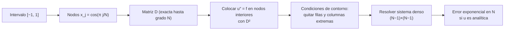

# B11-C24 — Métodos espectrales avanzados (Chebyshev y Fourier)

<!-- nav:top -->
[🏠 Programa](../../../../README.md) · [📚 Bloque B11](../../../tronco-comun/B11-ecuaciones-diferenciales-y-simulacion-numerica.md) · [← Anterior: B11-C23 — Optimización restringida: Lagrange, KKT y SQP](../B11-C23-optimizacion-restringida-lagrange-kkt-y-sqp/CLASE.md) · [Siguiente: B11-C25 — Aritmética de punto flotante y errores de redondeo →](../B11-C25-aritmetica-de-punto-flotante-y-errores-de-redondeo/CLASE.md)
<!-- /nav -->

## 1. Ubicación, nivel y alcance

Clase programada de ampliación del bloque B11 (la 24.ª). [C16](../B11-C16-metodos-espectrales-iniciales/CLASE.md) mostró la convergencia exponencial con funciones periódicas y Fourier. Pero casi ningún problema de ingeniería es periódico: tiene bordes. Aquí aprendes la **colocación de Chebyshev**, que conserva la convergencia exponencial en un intervalo con condiciones de contorno, y contrastas con Fourier y con diferencias finitas. Nivel N2. Verás la matriz de diferenciación de Chebyshev, un problema de contorno resuelto con 12 a 24 nodos, el fracaso de Fourier en funciones no periódicas y el costo en condicionamiento. No cubre dominios multidimensionales ni métodos de Galerkin.

## 2. Por qué esta clase existe

Cuando la solución es suave, un método espectral reduce un problema que necesita miles de puntos con diferencias a una docena con Chebyshev. Pero tiene un costo: el paso máximo estable de un esquema explícito baja como `1/N⁴`, y funciona mal si la solución no es suave.

La pregunta motivadora: **¿cómo uso un método espectral en un intervalo con bordes, y cuándo no vale la pena?** La decisión central: **elegir la base según la periodicidad y la suavidad**.

## 3. Lo que podrás hacer al terminar

1. Construir los nodos y la matriz de diferenciación de Chebyshev.
2. Comprobar que `D` es exacta para polinomios de grado `≤ N`.
3. Resolver un problema de contorno por colocación.
4. Medir la convergencia exponencial frente a diferencias finitas.
5. Explicar por qué Fourier falla en funciones no periódicas.
6. Estimar el costo en condicionamiento (`ρ(D²) ∝ N⁴`).

La evidencia es la **resolución espectral de una EDO** del ejercicio 12 (sección 20).

## 4. Con qué llegas y cómo comprobarlo

Necesitas C16, problemas de frontera ([C12](../B11-C12-problemas-de-frontera/CLASE.md)) y los nodos de Chebyshev de [C18](../B11-C18-interpolacion-y-extrapolacion/CLASE.md). Cinco preguntas:

1. ¿Qué es la colocación?
2. ¿Qué nodos usa Chebyshev?
3. ¿Qué pasa con Fourier si la función no es periódica?
4. ¿Cuánto es `e⁴`?
5. ¿Cómo se imponen las condiciones de contorno en el sistema de C12?

<details>
<summary>Ver respuestas</summary>

1. Exigir la ecuación en un conjunto de puntos. 2. `x_j = cos(π j/N)`. 3. Aparece un salto en la extensión periódica y Gibbs. 4. `54,6`. 5. Quitando las incógnitas de los extremos (valores conocidos).
</details>

Con cuatro o cinco aciertos, sigue; si no, repasa C12, C16 y C18.

## 5. Un caso real: un problema de contorno con una docena de nodos

El problema **sintético** `u″ = e^{4x}` en `[−1, 1]`, `u(±1) = 0`, tiene solución exacta `u = (e^{4x} − x sinh 4 − cosh 4)/16`. Con colocación de Chebyshev el error máximo en los nodos es `2,2 × 10⁻⁴` con `N = 8`, `1,1 × 10⁻⁷` con `N = 12` y `1,9 × 10⁻¹¹` con `N = 16`; con `N = 24` llega al nivel del redondeo (`8 × 10⁻¹⁵`). Las diferencias finitas centrales con el mismo número de puntos dan `1,9 × 10⁻²` a `N = 24`: unas 2,4 × 10¹² veces peor. Este es el **ejemplo conductor**.

## 6. Vocabulario

Los **nodos de Chebyshev–Gauss–Lobatto** son `x_j = cos(π j/N)`, `j = 0…N`, con `N + 1` puntos que se agrupan hacia los extremos. La **matriz de diferenciación** `D` de `(N + 1) × (N + 1)` satisface `(D f)_i ≈ f′(x_i)`: `D_ij = (c_i/c_j) (−1)^{i+j}/(x_i − x_j)` para `i ≠ j`, `D_ii = −Σ_{j≠i} D_ij`, con `c₀ = c_N = 2` y `c_j = 1` en los demás. La **colocación** impone la ecuación en los nodos interiores usando `D²`. El **condicionamiento** crece: el radio espectral de `D²` interior sube como `N⁴`. La **convergencia exponencial** es un error `~ e^{−c N}` si la solución es analítica.

## 7. Modelo mental: puntos donde más hacen falta

Cerca de los bordes un polinomio de grado alto oscila más; Chebyshev pone más nodos allí, y el error deja de crecer (la solución de Runge, C18). La derivada es exacta para todo polinomio hasta el grado de la malla, y las funciones analíticas se aproximan con coeficientes que decaen geométricamente.



*Descripción textual:* se toman los nodos de Chebyshev en `[−1, 1]`, se construye la matriz `D`, se coloca la ecuación en los nodos interiores con `D²`, se imponen las condiciones de contorno quitando los extremos, y se resuelve un sistema denso; si la solución es analítica, el error decae exponencialmente.

Analogía: más postes donde la cuerda se curva más. Su límite: el sistema es denso, no tridiagonal; resolverlo cuesta `O(N³)`.

## 8. La explicación, paso a paso

### 8.1 Un caso mínimo: `N = 2`

Nodos `1, 0, −1`. La matriz es `D = [[3/2, −2, 1/2], [1/2, 0, −1/2], [−1/2, 2, −3/2]]`. Aplicada a `f = x²`, es decir `(1, 0, 1)`: `(2, 0, −2) = 2x` ✓ (exacta). Para `u″ = 2` con `u(±1) = 0`: el único nodo interior da `(D²)₁₁ = ½(−2) + (−½)(2) = −2`; `−2 u₁ = 2` ⇒ `u₁ = −1 = x² − 1` en `x = 0` ✓. Con tres nodos se obtiene la parábola exacta.

### 8.2 Exactitud en polinomios

Para `N = 16`, el error máximo de `D x^k` frente a `k x^{k−1}` para `k = 0…16` es `2,8 × 10⁻¹⁴`: exacta salvo redondeo.

### 8.3 El problema de contorno

Se arma `D²` interior (quitando las filas y columnas de los extremos) y se resuelve `D² u = e^{4x}` en los nodos interiores. Errores máximos:

| `N` | Chebyshev | Diferencias finitas (mismos puntos) |
|---|---|---|
| 4 | `1,0 × 10⁻¹` | `5,8 × 10⁻¹` |
| 8 | `2,2 × 10⁻⁴` | `1,7 × 10⁻¹` |
| 12 | `1,1 × 10⁻⁷` | `7,6 × 10⁻²` |
| 16 | `1,9 × 10⁻¹¹` | `4,3 × 10⁻²` |
| 24 | `8,0 × 10⁻¹⁵` | `1,9 × 10⁻²` |
| 32 | `2,9 × 10⁻¹⁴` | `1,1 × 10⁻²` |

Chebyshev gana casi 3 órdenes de magnitud en `N = 8` y unos 12 en `N = 24`. Con `N > 24` el error sube un poco por el redondeo (condicionamiento).

### 8.4 Fourier en una función no periódica

La derivada de `e^x` en `[−1, 1]`: Chebyshev da `7,6 × 10⁻¹⁵` (`N = 16`) y `9,6 × 10⁻¹³` (`N = 64`); Fourier sobre malla uniforme da errores **que crecen**: `12,5`, `25,6`, `51,7` para `N = 16, 32, 64`. La razón: la extensión periódica de `e^x` tiene un salto en los extremos (de `e` a `e⁻¹`), y el método espectral de Fourier produce el fenómeno de Gibbs (C16).

### 8.5 El costo: condicionamiento

El radio espectral de `D²` interior vale `214,4` (`N = 8`), `3 175` (16), `49 939` (32), `795 730` (64): `ρ/N⁴ ≈ 0,047`, y las razones al duplicar `N` son `15,7` y `15,9`, cercanas a 16. Un esquema explícito (C09, C14) estaría limitado por un paso `∝ 1/N⁴` para la difusión (`Δt ≲ 2,8/ρ`). En la práctica se combinan con integradores implícitos (C22).

### 8.6 Cuándo y cuándo no

Chebyshev: solución analítica, intervalo acotado, condiciones de contorno generales. Fourier: periodicidad. Ninguno: soluciones con saltos o geometrías complejas (elementos finitos, C15).

## 9. Magnitudes, símbolos y unidades

| Símbolo | Qué es | Unidad | Nota |
|---|---|---|---|
| `N` | número de intervalos (nodos `N + 1`) | — | 4…64 |
| `x_j` | nodos de Chebyshev | adimensional | `cos(π j/N)` |
| `D` | matriz de diferenciación | — | densa |
| `u(x)` | incógnita | adimensional | problema sintético |
| `ρ(D²)` | radio espectral | — | `≈ 0,047 N⁴` |
| `e_N` | error máximo en los nodos | — | tabla de 8.3 |

## 10. Convenciones y referencias

Intervalo normalizado `[−1, 1]`, condiciones de Dirichlet homogéneas, doble precisión. El problema es **sintético** y no se tomó ningún dato de misión. La comparación con diferencias finitas usa el mismo número de puntos, uniformes.

## 11. De dónde sale lo que afirmamos

| ID | Fuente | Localizador | Respalda | Estado |
|---|---|---|---|---|
| S1 | NIST, *DLMF* §3.4, versión 1.2.8 | https://dlmf.nist.gov/3.4 | Diferencias finitas de tres puntos para `u″` (ec. 3.4.6/3.4.22) | Consultada el 2026-11-05 mediante extracción automática |
| S2 | NIST, *DLMF* §3.3, versión 1.2.8 | https://dlmf.nist.gov/3.3 | Interpolación de Lagrange con nodos y polinomio nodal (contexto de los nodos de Chebyshev) | Consultada el 2026-11-05 mediante extracción automática |

Límites: la construcción de `D`, la convergencia exponencial y el crecimiento `N⁴` son resultados estándar no atribuidos a una fuente consultada; se verificaron con el laboratorio. No se consultó ninguna fuente sobre Chebyshev; la fórmula de `D` es la estándar y se comprobó por exactitud en polinomios.

## 12. Cómo ver la convergencia

Equivalente accesible a una gráfica del error frente a `N` en escala logarítmica: la tabla de 8.3. Descripción larga: la curva de Chebyshev cae casi en vertical hasta el nivel del redondeo (`10⁻¹⁴`) y luego sube un poco; la de diferencias finitas baja con pendiente −2.

## 13. Ejemplo trabajado: ¿qué `N` para `10⁻¹⁰`?

**Paso 1 · Meta.** Error máximo `< 10⁻¹⁰` en `u″ = e^{4x}`.

**Paso 2 · Chebyshev.** `N = 16` da `1,9 × 10⁻¹¹`: basta.

**Paso 3 · Diferencias.** Con orden 2 y `1,9 × 10⁻²` en `N = 24`: `N = 24 √(1,9 × 10⁻²/10⁻¹⁰) = 24 · 13 800 = 3,3 × 10⁵` puntos.

**Paso 4 · Costo del sistema.** Chebyshev: matriz densa de `15 × 15`, `O(N³) = 3 400` operaciones; diferencias: tridiagonal de `3 × 10⁵`, `O(N)`.

**Paso 5 · Decisión.** Chebyshev gana: 16 contra `3,3 × 10⁵` puntos.

**Paso 6 · Sentido.** Para funciones no analíticas o con capas límite estrechas, la ventaja desaparece. Resultado **simulado** con un problema sintético.

## 14. Comparación de tres enfoques

| Propiedad | Diferencias finitas | Elementos finitos | Chebyshev |
|---|---|---|---|
| Convergencia (solución suave) | polinomial (orden 2) | polinomial (orden 2) | exponencial |
| Geometría | malla regular | arbitraria | intervalo/cajas |
| Sistema | tridiagonal/disperso | disperso | denso |
| Condicionamiento | `N²` | `N²` | `N⁴` |

## 15. Práctica guiada

**Ejercicio 1 · con los pasos indicados.** Aplica `D` (N = 2) a `f = x` y compáralo con `1`. *Pasos:* f en los nodos `(1, 0, −1)`.

<details><summary>Solución comentada</summary>

Fila 1: `1,5·1 + (−2)·0 + 0,5·(−1) = 1`; fila 2: `0,5·1 + 0 − 0,5·(−1) = 1`; fila 3: `−0,5·1 + 2·0 − 1,5·(−1) = 1`. Resultado `(1, 1, 1)` ✓ (derivada de `x`).
</details>

**Ejercicio 2 · con una pista.** Resuelve `u″ = 2`, `u(±1) = 0` con `N = 2`. *Pista:* `(D²)₁₁ = −2`.

<details><summary>Solución comentada</summary>

`−2 u₁ = 2` ⇒ `u₁ = −1` (exacto `x² − 1` en 0) (8.1).
</details>

**Ejercicio 3 · casi autónomo.** ¿Cuántos nodos tiene la malla de `N = 16` y cuántas incógnitas el sistema?

<details><summary>Solución comentada</summary>

17 nodos; 15 incógnitas interiores.
</details>

## 16. Práctica autónoma, transferencia e integrador

**Ejercicio 4.** ¿Por qué se pierde la exactitud con `N > 24` en el ejemplo (`2,9 × 10⁻¹⁴` en `N = 32`)?

<details><summary>Solución comentada</summary>

Por el redondeo amplificado por el condicionamiento de `D²` (crece como `N⁴`).
</details>

**Ejercicio 5.** Estima `ρ(D²)` para `N = 128` con `ρ ≈ 0,047 N⁴`.

<details><summary>Solución comentada</summary>

`0,047 · 128⁴ = 1,26 × 10⁷`.
</details>

**Ejercicio 6.** ¿Cuántas veces mejor es Chebyshev que diferencias finitas en `N = 16`?

<details><summary>Solución comentada</summary>

`4,3 × 10⁻²/1,9 × 10⁻¹¹ = 2,2 × 10⁹` veces.
</details>

**Ejercicio 7.** ¿Por qué Fourier falla en `e^x` sobre `[−1, 1]`?

<details><summary>Solución comentada</summary>

Por el salto de `e` a `e⁻¹` en los extremos de la extensión periódica (8.4).
</details>

**Ejercicio 8.** ¿Cuál es el error de Chebyshev en `N = 12` y cuántos órdenes mejora respecto de `N = 8`?

<details><summary>Solución comentada</summary>

`1,1 × 10⁻⁷`; de `2,2 × 10⁻⁴`: unos 3,3 órdenes.
</details>

**Ejercicio 9 · transferencia.** Un esquema explícito de difusión con Chebyshev `N = 64` tiene `ρ = 7,96 × 10⁵` (en unidades de la difusividad). Estima el `Δt` máximo con `Δt ≲ 2,8/ρ`.

<details><summary>Solución comentada</summary>

`2,8/7,96 × 10⁵ = 3,5 × 10⁻⁶` (en unidades de `1/α`): paso diminuto; conviene un esquema implícito (C22).
</details>

**Ejercicio 10 · transferencia.** La solución de un problema tiene una capa límite muy delgada en un borde. ¿Sirve Chebyshev con pocos nodos?

<details><summary>Solución comentada</summary>

Chebyshev agrupa nodos en los bordes y ayuda, pero la capa muy delgada exige muchos nodos o un cambio de variable; la convergencia exponencial solo aparece cuando `N` resuelve la capa.
</details>

**Ejercicio 11 · transferencia.** Un colega usa Fourier con una función periódica pero muestreada con muy pocos puntos. ¿Qué observarías?

<details><summary>Solución comentada</summary>

Aliasing y errores grandes (C16); necesita más puntos que el doble de la frecuencia más alta.
</details>

**Ejercicio 12 · integrador.** Elabora tu *resolución espectral de una EDO*: resuelve un problema de contorno propio (con solución exacta) con Chebyshev y con diferencias finitas, tabula el error, mide el radio espectral y explica cuándo no la usarías.

<details><summary>Solución modelo</summary>

Problema con solución exacta, tabla de errores por `N` para ambos métodos, `ρ(D²)` y su escala `N⁴`, y criterios de uso; datos rotulados como sintéticos, con versiones y fuentes con fecha.
</details>

## 17. Laboratorio: colocación de Chebyshev

El script [colocacion_chebyshev.py](colocacion_chebyshev.py) construye `D`, resuelve el problema de contorno, lo compara con diferencias finitas y con Fourier, y mide el radio espectral.

**Datos:** sintéticos. **Predice antes de ejecutar:** ¿qué `N` llega al redondeo? (≈ 24.) **Ejecución del 2026-11-06 (Python 3.12.9, NumPy 2.4.4):**

```text
1) N=16: error máximo de D sobre x^k, k = 0..16: 2.84e-14
2) u'' = exp(4x), u(±1) = 0: error máximo en los nodos
   Chebyshev N= 4: 1.039e-01   | diferencias finitas: 5.789e-01
   Chebyshev N= 8: 2.162e-04   | diferencias finitas: 1.664e-01
   Chebyshev N=12: 1.067e-07   | diferencias finitas: 7.600e-02
   Chebyshev N=16: 1.935e-11   | diferencias finitas: 4.316e-02
   Chebyshev N=24: 7.994e-15   | diferencias finitas: 1.932e-02
   Chebyshev N=32: 2.887e-14   | diferencias finitas: 1.089e-02
3) derivada de exp(x) en [-1, 1] (no periódica): Chebyshev frente a Fourier en malla uniforme
   N=16: Chebyshev 7.55e-15 | Fourier 1.25e+01
   N=32: Chebyshev 5.20e-14 | Fourier 2.56e+01
   N=64: Chebyshev 9.61e-13 | Fourier 5.17e+01
4) radio espectral de D^2 (nodos interiores):
   N= 8: rho = 2.1437e+02 ; rho/N^4 = 0.0523
   N=16: rho = 3.1748e+03 ; rho/N^4 = 0.0484
   N=32: rho = 4.9939e+04 ; rho/N^4 = 0.0476
   N=64: rho = 7.9573e+05 ; rho/N^4 = 0.0474
   razones al duplicar N: 15.73, 15.93 (se espera ~16)
Pruebas superadas.
```

```bash
python programa/clases/B11/B11-C24-metodos-espectrales-avanzados-chebyshev-y-fourier/colocacion_chebyshev.py
```

**Límites:** problema unidimensional con solución analítica; resultados **simulados**.

## 18. Errores frecuentes y cómo corregirlos

**Usar Fourier en funciones no periódicas.** Se corrige con el ejercicio 7.

**Olvidar quitar las filas y columnas de los extremos.** Se corrige con el ejercicio 2.

**Aumentar `N` más allá del redondeo.** Se corrige con el ejercicio 4.

**Ignorar el condicionamiento al elegir el paso de tiempo.** Se corrige con el ejercicio 9.

**Esperar convergencia exponencial con funciones no analíticas.** Se corrige con el ejercicio 10.

## 19. Cómo sabrás que vas bien

Tras 8.1: ¿resuelves `N = 2` a mano? Si no, ejercicios 1 y 2. Tras 8.3: ¿por qué Chebyshev gana? Si dudas, ejercicio 6. Tras 8.5: ¿qué cuesta? Si no lo sabes, ejercicio 9. Tras el laboratorio: ¿qué indicaría un error que no baja con `N`? (solución no analítica o error en las condiciones de contorno).

## 20. Qué entregas y cómo se evalúa

El producto es tu **resolución espectral de una EDO** (ejercicio 12).

| Criterio | Inicial | En desarrollo | Logrado | Destacado |
|---|---|---|---|---|
| Construcción de `D` | Fórmula con errores | Con ayuda | Exacta en polinomios | Explica la fórmula |
| Resolución | Sin condiciones de contorno | Con errores | Correcta con solución exacta | Mide la convergencia exponencial |
| Comparación | Solo Chebyshev | Con diferencias sin análisis | Con análisis de costo | Incluye Fourier y condicionamiento |
| Límites | Ausentes | Genéricos | Funciones no analíticas, capas límite | Propone alternativas |
| Fuentes | Sin fuente | Sin fecha | Con localizador y fecha | Rotula sintético y simulado |

**Condiciones críticas (no se compensan con promedio):** verificar contra una solución exacta; declarar los límites del método; citar solo fuentes consultadas.

## 21. Ética, seguridad y límites

Un método espectral con una función que no es suave puede dar resultados oscilatorios con apariencia de precisión. El problema de esta clase es sintético y no representa ningún sistema real. Accesibilidad: fórmulas en texto, tablas equivalentes a las gráficas, ejercicios sin conexión.

## 22. Para cerrar y seguir

La matriz de Chebyshev es exacta hasta el grado `N`; la colocación resuelve un problema de contorno con una docena de nodos; Fourier falla sin periodicidad; el costo es un condicionamiento `N⁴`. Queda abierta una pregunta: todo el bloque supone aritmética exacta con redondeo pequeño; ¿qué es exactamente el redondeo en un computador y cómo puede arruinar un cálculo? Es la aritmética de punto flotante.

**Glosario español–inglés.** colocación · *collocation*; nodos de Chebyshev · *Chebyshev nodes*; matriz de diferenciación · *differentiation matrix*; convergencia exponencial · *spectral convergence*; radio espectral · *spectral radius*; capa límite · *boundary layer*.

**Continuidad.** B11-C25 reutiliza tu capacidad de **medir el redondeo** para estudiar el punto flotante.

**Referencias:** ver sección 11.

<!-- nav:bottom -->
---

[← Anterior: B11-C23 — Optimización restringida: Lagrange, KKT y SQP](../B11-C23-optimizacion-restringida-lagrange-kkt-y-sqp/CLASE.md) · [📚 Bloque B11](../../../tronco-comun/B11-ecuaciones-diferenciales-y-simulacion-numerica.md) · [Siguiente: B11-C25 — Aritmética de punto flotante y errores de redondeo →](../B11-C25-aritmetica-de-punto-flotante-y-errores-de-redondeo/CLASE.md)
<!-- /nav -->
