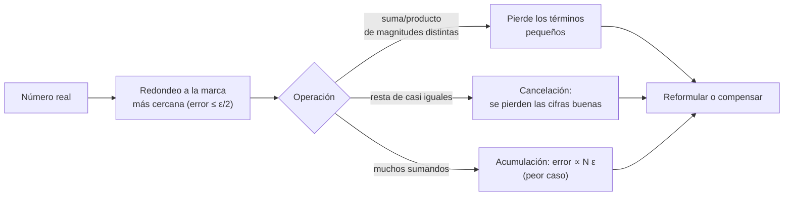

# B11-C25 — Aritmética de punto flotante y errores de redondeo

<!-- nav:top -->
[🏠 Programa](../../../../README.md) · [📚 Bloque B11](../../../tronco-comun/B11-ecuaciones-diferenciales-y-simulacion-numerica.md) · [← Anterior: B11-C24 — Métodos espectrales avanzados (Chebyshev y Fourier)](../B11-C24-metodos-espectrales-avanzados-chebyshev-y-fourier/CLASE.md) · [Siguiente: B11-C26 — Benchmark de algoritmos numéricos →](../B11-C26-benchmark-de-algoritmos-numericos/CLASE.md)
<!-- /nav -->

## 1. Ubicación, nivel y alcance

Clase programada de ampliación del bloque B11 (la 25.ª). En [C19](../B11-C19-estimacion-de-error-y-convergencia/CLASE.md) apareció el error de redondeo como una de las fuentes del presupuesto. Aquí miras por dentro: cómo guarda un computador los números reales, por qué `0,1 + 0,2 ≠ 0,3`, cuándo una resta destruye casi todas las cifras (cancelación) y cómo una suma de un millón de términos acumula error, con la técnica de la **suma compensada** como remedio. Nivel N2. No cubre formatos de precisión media o cuádruple ni aritmética de intervalos.

## 2. Por qué esta clase existe

Un programa de ciencias espaciales hace miles de millones de operaciones. Si una resta pierde 16 cifras en una sola operación, el resultado completo es basura sin que el programa se detenga. Reconocer las operaciones peligrosas y reformularlas es parte básica del cálculo científico.

La pregunta motivadora: **¿cuántas cifras puedo creer de un cálculo y qué operaciones las destruyen?** La decisión central: **reformular el cálculo para evitar la cancelación y la acumulación**.

## 3. Lo que podrás hacer al terminar

1. Explicar cómo se guarda un número en doble precisión.
2. Calcular el épsilon de máquina y el espaciado (ulp) a distintas magnitudes.
3. Reconocer y evitar la cancelación catastrófica.
4. Reformular la fórmula cuadrática y `1 − cos x` de forma estable.
5. Comparar suma ingenua, suma de Kahan y `fsum`.
6. Decidir cuándo basta la doble precisión y cuándo hace falta más.

La evidencia es la **ficha de errores de redondeo** del ejercicio 12 (sección 20).

## 4. Con qué llegas y cómo comprobarlo

Necesitas notación científica (B03), errores relativos y el presupuesto de error (C19). Cinco preguntas:

1. ¿Cuántos dígitos decimales significativos tiene `2,2 × 10⁻¹⁶`?
2. ¿Qué es un error relativo?
3. ¿Cuánto es `2⁻⁵²`?
4. Si redondeas a 4 cifras significativas `1000,4`, ¿qué obtienes?
5. ¿Qué es cancelación?

<details>
<summary>Ver respuestas</summary>

1. Dos. 2. `|aprox − exacto|/|exacto|`. 3. `2,22 × 10⁻¹⁶`. 4. `1000`. 5. Perder cifras significativas al restar dos números casi iguales.
</details>

Con cuatro o cinco aciertos, sigue; si no, repasa B03-C11, B01-C18 y C19.

## 5. Un caso real: restar dos números casi iguales

Para `x = 10⁻⁸`, la cantidad `1 − cos x` vale `5 × 10⁻¹⁷` (se deduce de `2 sin²(x/2)`). En doble precisión, `cos(10⁻⁸)` se redondea a `1` exactamente y la resta ingenua da **`0`**: error relativo del 100 %. La forma `2 sin²(x/2)` da `5,000 000 × 10⁻¹⁷` correcto. Algo similar le pasa a un cálculo de posiciones en un instante de una efeméride: restar dos coordenadas casi iguales, de millones de metros, puede destruir las cifras que importan. Este es el **ejemplo conductor**.

## 6. Vocabulario

Un número en **doble precisión** (IEEE 754 *binary64*) tiene 1 bit de signo, 11 de exponente y 52 de mantisa (53 cifras binarias efectivas), es decir, unas 15 a 17 cifras decimales; la documentación de Python confirma los 53 bits de precisión (S1). El **épsilon de máquina** `ε = 2⁻⁵² = 2,22 × 10⁻¹⁶` es el espaciado entre 1 y el siguiente número. El **ulp** (unidad en el último lugar) es ese espaciado a una magnitud dada; vale `2⁻⁵² · 2^e` para un número en `[2^e, 2^{e+1})`. El **redondeo al más cercano** da un error relativo máximo `ε/2`. La **cancelación catastrófica** pierde cifras al restar números casi iguales. Un **desbordamiento** es un resultado mayor que el máximo representable (`1,8 × 10³⁰⁸`), que da `inf`; un **subdesbordamiento** va hacia cero o a un número **subnormal**. La **suma compensada** (de Kahan) lleva una corrección con lo que se pierde en cada suma. `math.fsum` suma con precisión extendida y redondea una vez.

## 7. Modelo mental: una regla con marcas finitas

Los números representables son marcas en una regla; entre dos marcas no hay nada. Las marcas están más separadas cuanto mayor es el número, así que el error absoluto crece con la magnitud, y el relativo se mantiene en `ε`.



*Descripción textual:* cada número se redondea a la marca más cercana; luego, sumar magnitudes muy distintas pierde los términos pequeños, restar números casi iguales cancela las cifras buenas y sumar muchos términos acumula error hasta `N ε` en el peor caso; el remedio es reformular o compensar.

Analogía: medir con una regla cuyas marcas se separan al alejarse del cero. Su límite: la regla real tiene marcas uniformes dentro de cada intervalo de potencias de dos, no de forma continua.

## 8. La explicación, paso a paso

### 8.1 Qué se guarda

El número `0,1` no tiene representación binaria finita. Se guarda `3 602 879 701 896 397 / 2⁵⁵`, que difiere de `1/10` en `5,6 × 10⁻¹⁸` (S1). Por eso `0,1 + 0,2 = 0,300 000 000 000 000 04 ≠ 0,3` (diferencia `5,6 × 10⁻¹⁷`), y `math.isclose` es la forma correcta de comparar. Medido con un bucle, `ε = 2,2204 × 10⁻¹⁶ = 2⁻⁵²`.

### 8.2 El espaciado crece con la magnitud

El ulp vale `2,2 × 10⁻¹⁶` en 1, `1,5 × 10⁻⁸` en `10⁸` y **`2`** en `10¹⁶`: por eso `10¹⁶ + 1 = 10¹⁶`. Una distancia de 7 000 km expresada en metros (`7 × 10⁶`) tiene resolución de `9 × 10⁻¹⁰ m`; una expresada en nanómetros pierde cifras antes. Los límites son `1,8 × 10³⁰⁸` (máximo), `2,2 × 10⁻³⁰⁸` (mínimo normal) y `4,9 × 10⁻³²⁴` (mínimo subnormal); `10³⁰⁸ × 10 = inf`.

### 8.3 Cancelación

Para `1 − cos x` con `x = 10⁻⁸`: ingenua `0`; estable `2 sin²(x/2) = 5,0 × 10⁻¹⁷`, correcta a `10⁻¹⁶` relativo. La regla: si una fórmula resta dos cantidades casi iguales, busca una forma algebraicamente equivalente que no lo haga.

### 8.4 La fórmula cuadrática

Para `x² − 10⁸ x + 1 = 0` las raíces son `≈ 10⁸` y `≈ 10⁻⁸` (su producto es `c/a = 1`). La fórmula directa para la raíz pequeña, `(−b − √(b² − 4ac))/2a`, resta números casi iguales y da `7,45 × 10⁻⁹` (25 % de error). La forma estable `2c/(−b + √(b² − 4ac))` da `1,000 000 × 10⁻⁸`; con la raíz grande, el producto de raíces es `1,000 000 000 000` en la estable y `0,745` en la directa.

### 8.5 Suma de un millón de términos

Suma de `10⁶` términos iguales a `0,1` (el valor almacenado, cuya suma exacta es `100 000,000 000 005 55`). Ingenua: `100 000,000 001 333` (error relativo `1,3 × 10⁻¹¹`); Kahan: `100 000,0` (error `5,6 × 10⁻¹⁷`); `fsum`: `100 000,0` (error `5,6 × 10⁻¹⁷`, es decir, el redondeo de un único resultado). La compensación lleva el error de la suma casi a la precisión de un número, independiente de `N`.

### 8.6 Un ejemplo de juguete con 4 cifras

En aritmética decimal de 4 cifras significativas: `1000 + 0,4 = 1000` (el `0,4` se pierde). Diez sumas de `0,4` sobre `1000` dan `1000`; Kahan lleva el residuo `0,4` y da `1004`. Lo mismo ocurre en binario con otras magnitudes.

## 9. Magnitudes, símbolos y unidades

| Símbolo | Qué es | Unidad | Nota |
|---|---|---|---|
| `ε` | épsilon de máquina | adimensional | `2,2204 × 10⁻¹⁶` |
| `ulp(x)` | espaciado alrededor de `x` | unidad de `x` | `2,2 × 10⁻¹⁶` en 1; 2 en `10¹⁶` |
| `N` | número de sumandos | — | `10⁶` |
| error relativo | `|calc − exacto|/|exacto|` | adimensional | |
| `x` | argumento del ejemplo | rad | `10⁻⁸` (sintético) |
| `a, b, c` | coeficientes de la cuadrática | — | `1, −10⁸, 1` (sintéticos) |

## 10. Convenciones y referencias

Doble precisión IEEE 754 de Python 3.12.9, redondeo al más cercano. Todos los números de ejemplo son **sintéticos**; las referencias exactas se calcularon con aritmética racional (`fractions`) o con la identidad algebraica. No se midió ninguna cantidad física.

## 11. De dónde sale lo que afirmamos

| ID | Fuente | Localizador | Respalda | Estado |
|---|---|---|---|---|
| S1 | Python Software Foundation, *Floating-Point Arithmetic: Issues and Limitations* (documentación de Python 3.15.2) | https://docs.python.org/3/tutorial/floatingpoint.html | Los flotantes son binary64 IEEE 754 de 53 bits de precisión; `0,1` se almacena como `3602879701896397 / 2**55`; los errores de cada operación son del orden de 1 parte en `2**53`; `math.fsum`, `decimal` y `fractions` como remedios | Consultada el 2026-11-06 mediante extracción automática |
| S2 | Python Software Foundation, *decimal* (documentación de Python 3.15.2) | https://docs.python.org/3/library/decimal.html | Aritmética decimal de precisión ajustable (28 dígitos por defecto) exacta para valores decimales | Consultada el 2026-11-06 mediante extracción automática |

Límites: no se consultó el texto de la norma IEEE 754; los detalles del formato (11 bits de exponente, 52 de mantisa) y el algoritmo de Kahan son conocimiento estándar verificado numéricamente en el laboratorio (épsilon `2⁻⁵²`, ulp, límites del formato). La tabla de la sección 8.1 se respalda con S1.

## 12. Cómo ver los efectos

Equivalente accesible a una tabla de efectos (cálculo, doble precisión):

| Operación | Resultado calculado | Valor correcto | Error relativo |
|---|---|---|---|
| `1 − cos(10⁻⁸)` ingenua | `0` | `5,0 × 10⁻¹⁷` | `1` |
| `2 sin²(x/2)` | `5,0 × 10⁻¹⁷` | `5,0 × 10⁻¹⁷` | `< 10⁻¹⁵` |
| raíz pequeña, fórmula directa | `7,45 × 10⁻⁹` | `1,0 × 10⁻⁸` | `0,25` |
| raíz pequeña, forma estable | `1,000 × 10⁻⁸` | `1,0 × 10⁻⁸` | `< 10⁻¹²` |
| suma ingenua de `10⁶` términos | `100 000,000 001 33` | `100 000` | `1,3 × 10⁻¹¹` |
| suma de Kahan | `100 000,0` | `100 000` | `5,6 × 10⁻¹⁷` |

Descripción larga: las fórmulas ingenuas fallan por varios órdenes de magnitud; las reformuladas dan la precisión de la máquina.

## 13. Ejemplo trabajado: ¿cuántas cifras tiene mi distancia?

**Paso 1 · Datos.** Dos posiciones de una nave medidas desde un centro: `x₁ = 7 000 000,000 000 3 m` y `x₂ = 7 000 000,000 000 1 m`.

**Paso 2 · Resolución.** El ulp en `7 × 10⁶` es `9,3 × 10⁻¹⁰ m`: las diferencias de `10⁻¹³` ni siquiera son representables.

**Paso 3 · Resta.** `x₁ − x₂` se calcula como `0` o como un múltiplo de `9,3 × 10⁻¹⁰`: pierde todo.

**Paso 4 · Reformular.** Trabajar con el desplazamiento relativo a un origen cercano (restar un valor de referencia antes de almacenar), de modo que los números tengan magnitud pequeña y ulp finos.

**Paso 5 · Comprobar.** Comparar con aritmética exacta o decimal (S2).

**Paso 6 · Sentido.** La regla: guarda *diferencias pequeñas* en variables pequeñas. Cálculo ilustrativo con datos sintéticos.

## 14. Comparación de remedios

Reformular algebraicamente es gratis y debería ser lo primero. La suma de Kahan cuesta unas 4 operaciones por sumando. `math.fsum` es exacta pero más lenta. La aritmética decimal o racional es exacta para valores decimales o racionales, pero mucho más lenta. La precisión extendida (módulo `decimal` con 40 dígitos, C21) sirve de referencia.

## 15. Práctica guiada

**Ejercicio 1 · con los pasos indicados.** Calcula `2⁻⁵²` y comprueba que es `ε`. *Pasos:* `2⁻¹⁰ ≈ 9,77 × 10⁻⁴`.

<details><summary>Solución comentada</summary>

`2⁻⁵² = 2⁻⁵⁰ · 2⁻² = 8,88 × 10⁻¹⁶ · 0,25 = 2,22 × 10⁻¹⁶`.
</details>

**Ejercicio 2 · con una pista.** ¿Por qué `1e16 + 1 == 1e16`? *Pista:* ulp en `10¹⁶`.

<details><summary>Solución comentada</summary>

El ulp en `10¹⁶` es 2: sumar 1 queda a menos de medio ulp y se redondea al mismo número (8.2).
</details>

**Ejercicio 3 · casi autónomo.** Suma en aritmética decimal de 4 cifras: `1000 + 0,4` diez veces, ingenuo y con compensación.

<details><summary>Solución comentada</summary>

Ingenuo: `1000`; compensado: `1004` (8.6).
</details>

## 16. Práctica autónoma, transferencia e integrador

**Ejercicio 4.** Calcula el ulp de un número en `[2⁴⁰, 2⁴¹)`.

<details><summary>Solución comentada</summary>

`2⁻⁵² · 2⁴⁰ = 2⁻¹² = 2,44 × 10⁻⁴`.
</details>

**Ejercicio 5.** ¿Cuántas cifras decimales significativas ofrece la doble precisión aproximadamente?

<details><summary>Solución comentada</summary>

`53 log₁₀ 2 ≈ 15,95`: 15 a 16.
</details>

**Ejercicio 6.** Reformula `√(x + 1) − √x` para `x` grande y explica por qué.

<details><summary>Solución comentada</summary>

`1/(√(x + 1) + √x)`: evita restar dos raíces casi iguales.
</details>

**Ejercicio 7.** Con el error relativo de la suma ingenua `1,3 × 10⁻¹¹` para `N = 10⁶`, estima el del peor caso `N ε`.

<details><summary>Solución comentada</summary>

`10⁶ · 2,2 × 10⁻¹⁶ = 2,2 × 10⁻¹⁰`; el error real (`1,3 × 10⁻¹¹`) quedó 17 veces por debajo, porque los errores se compensan parcialmente.
</details>

**Ejercicio 8.** Una distancia de 400 km expresada en nanómetros es `4 × 10¹⁴`. ¿Qué ulp tiene?

<details><summary>Solución comentada</summary>

Entre `2⁴⁸ = 2,8 × 10¹⁴` y `2⁴⁹`: ulp `2⁻⁵² · 2⁴⁸ = 2⁻⁴ = 0,0625 nm`: más que suficiente. El problema surge con diferencias muy pequeñas de magnitudes grandes.
</details>

**Ejercicio 9 · transferencia.** Calculas el ángulo entre dos vectores casi paralelos con `arccos` del producto escalar normalizado. ¿Qué problema aparece y qué alternativa hay?

<details><summary>Solución comentada</summary>

`cos θ ≈ 1 − θ²/2` pierde las cifras de `θ` pequeño (cancelación); se usa `atan2(|a × b|, a · b)`, estable.
</details>

**Ejercicio 10 · transferencia.** Una simulación acumula el tiempo con `t += 0,1` durante `10⁶` pasos y compara con `t == 100000,0`. ¿Qué falla y cómo lo corriges?

<details><summary>Solución comentada</summary>

El error de acumulación (`1,3 × 10⁻¹¹` relativo) hace que la igualdad falle; se calcula `t = n · h` en cada paso o se usa suma compensada, y se compara con tolerancia.
</details>

**Ejercicio 11 · transferencia.** Un compañero afirma «con doble precisión no hay problemas de redondeo». Dale dos contraejemplos del laboratorio.

<details><summary>Solución comentada</summary>

`1 − cos(10⁻⁸)` da 0 y la raíz pequeña de la cuadrática pierde 25 %.
</details>

**Ejercicio 12 · integrador.** Elabora tu *ficha de errores de redondeo*: tres operaciones peligrosas de tu elección, su versión ingenua y su reformulación, con el error relativo de cada una frente a una referencia exacta, y una regla práctica para tu propagador.

<details><summary>Solución modelo</summary>

Tabla con operación, ingenua, reformulada, error relativo y referencia (racional o decimal); regla de prácticas; datos rotulados como sintéticos; versión de Python y fuentes con fecha.
</details>

## 17. Laboratorio: punto flotante

El script [punto_flotante.py](punto_flotante.py) mide el épsilon, muestra los efectos de la cancelación y compara tres sumas con una referencia racional exacta; falla si las versiones reformuladas no mejoran las ingenuas.

**Datos:** sintéticos. **Predice antes de ejecutar:** ¿qué dará `1 − cos(10⁻⁸)` en doble precisión? (`0`.) **Ejecución del 2026-11-06 (Python 3.12.9):**

```text
épsilon de máquina: medido 2.2204e-16 = 2^-52 ; sys.float_info.epsilon = 2.2204e-16
0.1 = 3602879701896397/36028797018963968 (exacto almacenado) -> diferencia con 1/10: 5.551e-18
0.1 + 0.2 = 0.30000000000000004 ; igual a 0.3: False ; diferencia = 5.551e-17 ; isclose = True
espaciado (ulp) en 1: 2.220e-16 ; en 1e8: 1.490e-08 ; en 1e16: 2.000e+00 (1e16 + 1 = 10000000000000000.0)
límites: máximo 1.798e+308; mínimo normal 2.225e-308; mínimo subnormal 4.941e-324; 1e308*10 = inf
1 - cos(1e-08): ingenua = 0.000000e+00 ; estable = 5.000000e-17 ; serie = 5.000000e-17
   errores relativos: ingenua 1.000e+00 ; estable 0.000e+00
x^2 - 1e8 x + 1 = 0, raíz pequeña: fórmula directa 7.450581e-09 ; forma estable 1.000000e-08 ; producto de raíces = c/a = 1
   producto con la raíz grande: directa 0.745058 ; estable 1.000000000000
suma de 10^6 sumandos 0.1 (suma exacta de lo almacenado = 100000.000000000000):
   ingenua  : 100000.00000133288 error relativo = 1.333e-11
   Kahan    : 100000.0 error relativo = 5.551e-17
   fsum     : 100000.0 error relativo = 5.551e-17
Pruebas superadas.
```

```bash
python programa/clases/B11/B11-C25-aritmetica-de-punto-flotante-y-errores-de-redondeo/punto_flotante.py
```

**Límites:** Python con binary64; los números de ejemplo son sintéticos; el comportamiento puede variar en otras plataformas o precisiones.

## 18. Errores frecuentes y cómo corregirlos

**Comparar flotantes con `==`.** Se corrige con el ejercicio 10.

**Restar números casi iguales sin reformular.** Se corrige con los ejercicios 6 y 9.

**Creer que la doble precisión elimina el redondeo.** Se corrige con el ejercicio 11.

**Sumar sin compensar muchos términos.** Se corrige con el ejercicio 7.

**Almacenar diferencias pequeñas en variables grandes.** Se corrige con el ejercicio 8 y la sección 13.

## 19. Cómo sabrás que vas bien

Tras 8.1: ¿explicas por qué `0,1 + 0,2 ≠ 0,3`? Si no, ejercicio 1. Tras 8.3: ¿reformulas `1 − cos x`? Si no, ejercicio 6. Tras 8.5: ¿cuándo usarías Kahan? Si dudas, ejercicio 10. Tras el laboratorio: ¿qué haría saltar una alarma? (un error relativo tras una resta del orden de 1).

## 20. Qué entregas y cómo se evalúa

El producto es tu **ficha de errores de redondeo** (ejercicio 12).

| Criterio | Inicial | En desarrollo | Logrado | Destacado |
|---|---|---|---|---|
| Formato | No lo describe | Lo nombra | Calcula `ε` y ulp | Relaciona ulp con unidades |
| Cancelación | No la ve | La describe | La reformula con éxito | Cuantifica la pérdida |
| Suma | Solo ingenua | Compara con sorpresa | Ingenua, Kahan y fsum | Explica el límite del peor caso |
| Referencia | Ninguna | Estimada | Exacta (racional/decimal) | Varias referencias |
| Fuentes | Sin fuente | Sin fecha | Con localizador y fecha | Rotula sintético y declara versión |

**Condiciones críticas (no se compensan con promedio):** cuantificar cada error frente a una referencia exacta; rotular los ejemplos como sintéticos; citar solo fuentes consultadas.

## 21. Ética, seguridad y límites

Los errores de redondeo no avisan. En un sistema crítico, una resta mal formulada puede producir una posición equivocada con apariencia de normalidad. Esta clase usa números de ejemplo y no valida ningún software de vuelo. Accesibilidad: fórmulas en texto, tablas equivalentes a las gráficas, ejercicios sin conexión.

## 22. Para cerrar y seguir

La doble precisión guarda 53 cifras binarias, con `ε = 2,22 × 10⁻¹⁶` y un espaciado que crece con la magnitud; la cancelación destruye cifras y se evita reformulando; la suma de muchos términos acumula error, que Kahan o `fsum` reducen casi al límite de la máquina. Queda abierta una pregunta: con tantos algoritmos disponibles, ¿cómo se comparan de forma justa y reproducible? Es el benchmark de algoritmos numéricos.

**Glosario español–inglés.** punto flotante · *floating point*; épsilon de máquina · *machine epsilon*; ulp · *unit in the last place*; cancelación catastrófica · *catastrophic cancellation*; suma compensada · *compensated (Kahan) summation*; desbordamiento · *overflow*; número subnormal · *subnormal number*.

**Continuidad.** B11-C26 reutiliza tu capacidad de **medir con una referencia exacta** para comparar algoritmos.

**Referencias:** ver sección 11.

<!-- nav:bottom -->
---

[← Anterior: B11-C24 — Métodos espectrales avanzados (Chebyshev y Fourier)](../B11-C24-metodos-espectrales-avanzados-chebyshev-y-fourier/CLASE.md) · [📚 Bloque B11](../../../tronco-comun/B11-ecuaciones-diferenciales-y-simulacion-numerica.md) · [Siguiente: B11-C26 — Benchmark de algoritmos numéricos →](../B11-C26-benchmark-de-algoritmos-numericos/CLASE.md)
<!-- /nav -->
